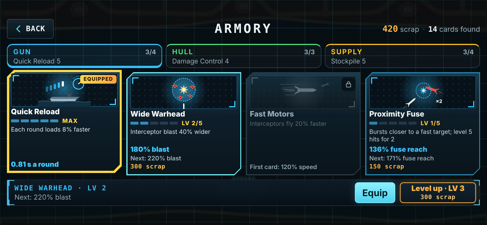
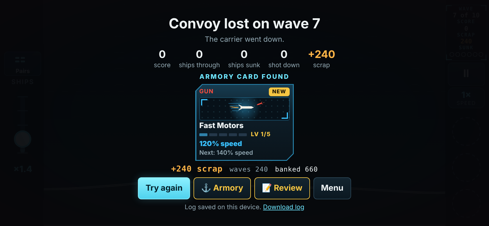
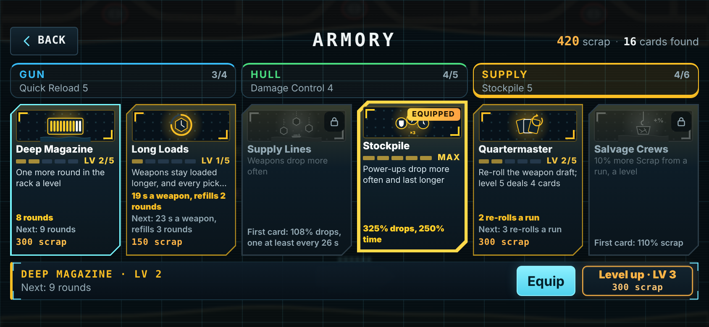
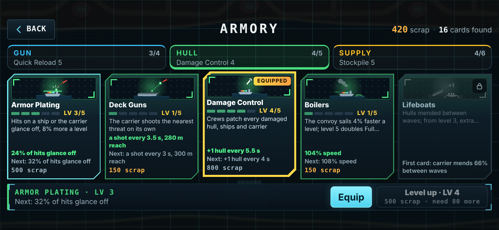
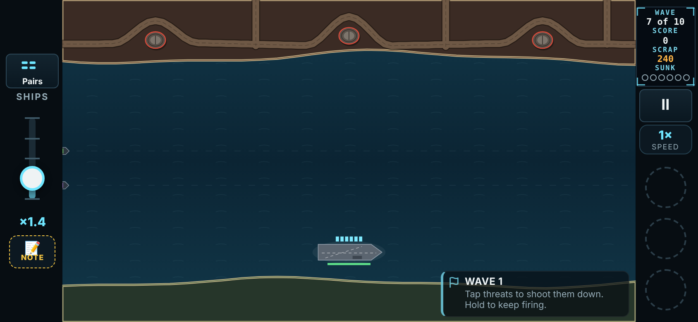

# V3 Armory overhaul (round ar1: brainstorm and build)

> Made by `node tools/v3/armory-ideas/doc.mjs` from `tools/v3/armory-ideas/ideas.mjs`, 2026-11-20. The review page is made from the same data by `tools/v3/armory-ideas/page.mjs`. The brainstorm below is as the player marked it; what was built from the marks is the first section (hand-written in `tools/v3/armory-ideas/built.md`).

The player asked (2026-11-20):

> Let’s run a full brainstorm on the armory too this has never gotten an overhaul. So let’s look at all the existing upgrades and decide which ones to keep and also see if we need the change anything about the armory system such as the categories. How they are unlocked such as exp collected in game (I think how survivor io did this is exp and you use that to upgrade the ones you find at the end of game). Then I want you to come up with three ideas on other ways to change the armory system. And then decide how many new upgrades to make if any.

and picked, as a quick fix:

> Lift the weak ones (Stockpile, Quick Reload, Long Loads) toward the middle; leave Armor Plating (no upgrade you own gets worse)

## What was built (2026-11-20, LOG_VERSION 33)

From the player's marks on the review page (round ar1). Branch `claude/v3-armory-build`.

### The lift, as measured

| Upgrade | Level 1 → 5 before | Level 1 → 5 now |
| --- | --- | --- |
| Quick Reload | 6% faster a level, −30% (0.95 s a round) | 8% faster a level, −40% (0.81 s a round) |
| Stockpile | 115% → 175% drops, 110% → 150% time | 145% → 325% drops, 130% → 250% time |
| Long Loads | 19 → 35 s a weapon | 19 → 35 s a weapon, and every weapon or boost pickup refills 2, 3, 4, 5 rounds, the whole rack at level 5 |
| Deep Magazine | 7, 8, 8, 9, 10 rounds | 7, 8, 9, 10, 11 rounds (level 3 counts now) |
| Armor Plating | unchanged | unchanged |

No level of any upgrade got worse (a test checks each level against the old numbers). In code: `RELOAD`, `POWER_SHARE`, `POWER_TIME`, `MAGAZINE`, `RACK_REFILL` in `src/v3/data/armory.ts`; the refill is read in `collect()` in `src/v3/sim/game.ts` (a weapon pickup, which is also how a boost starts).

### Scrap

- **Earning:** 40 a wave cleared (waves 1–10), 50 a boss round survived, 150 for clearing the map, 250 for a first clear, 100 for a card found that you already hold. A lost run keeps all of it. A cleared map played on into endless banks its waves once.
- **Cards:** still found at random at the end of a run (1, +1 for a clear, +1 for a first clear; from all 11 upgrades). A new card joins at level 1; a duplicate pays 100 Scrap, never a level.
- **Levels 2–5:** bought in the Armory: 150 / 300 / 500 / 800 Scrap.
- **In the run:** a SCRAP read-out in the HUD under the score (nothing to tap). **At the end:** "+N scrap" beside the score, and a line by line ledger (waves, boss rounds, map cleared, first clear, repeat cards, banked).
- **The Armory screen:** the bank in the head ("420 scrap · 14 cards found"). Tap a card you hold: the bar under the row shows its level and next level, **Equip** (or Take off), and **Level up · LV n** with its cost; greyed with "need N more" when short, "Max level" at 5. Each held card also shows its next cost (amber when you can pay). The menu's Armory count glows amber when a level can be bought.
- **Saves:** Armory save version 3. A version 2 save (round 7's cards) keeps every level and card count, Scrap starts at 0. A Deep Magazine equipped in the Gun bay moves to Supply if Supply is free (Supply's own card wins otherwise), and an emptied Gun bay takes the best gun card held. Saves older than version 2 are cleared as before. Broken Scrap values read as 0.
- **Free Play, the Test Lab, replays and developer runs** earn no Scrap and show no counter.

### Bays and names

- **Gun** (4): Quick Reload, Wide Warhead, Fast Motors, Proximity Fuse. **Hull** (3): Armor Plating, Deck Guns, Damage Control. **Supply** (4): Deep Magazine, Long Loads, Supply Lines, Stockpile.
- The bay keeps its name, **Supply** (the player turned down "Stores"); its line now reads "Rounds, weapon drops and power-ups".
- The Armory's Point Defense is shown as **Deck Guns**; its id stays `pointdef` (saves, logs, bot presets). The weapon Point Defense keeps its name.

  

Screenshots: `node e2e/v3-armory-shots.mjs` (844×390, 667×375 and 1280×720; `SHOT_DIR` defaults to `docs/design/img/armory`).

### Measured on the real game code

`tools/v3/armory-ideas/check.ts` plays plain Armory loadouts as the game reads them (no overrides), summed by `check-sum.mjs` into `check-results.json`. Same play as the lift: the "you" bot, the map's counter kit, every wave played, the five chapter 1 maps, 12 seeds, paired with No Armory.

**The lift matches the harness exactly.** The game changed between the lift's measurement and this build (Deck Guns 5 saved 8.2 then, 6.7 now; No Armory 25.1 then, 24.8 now), so `lift.ts` was played again on the same game just before the build (`lift-rerun-results.json`) and compared run for run:

| Config | Lift harness, same game (ships lost / saved) | Real code (ships lost / saved) | `lift-results.json` (saved) |
| --- | --- | --- | --- |
| Quick Reload 5 | 19.4 / 5.3 | 19.4 / 5.3 ± 1.0 | 6.7 |
| Stockpile 5 | 18.6 / 6.2 | 18.6 / 6.2 ± 1.1 | 5.8 |
| Long Loads 5 | 19.2 / 5.6 | 19.2 / 5.6 ± 1.0 | 5.2 |
| Your usual build (QR 5, DC 4, SP 5) | 10.0 | 10.0 (was 11.0 before the lift) | 10.3 |
| Best build (WW 5, AP 5, SP 5) | 5.6 | 5.6 (was 6.9) | 5.8 |

All within one standard error of `lift-results.json`. Quick Reload's 5.3 is the furthest (6.7 then); it is the game's drift, not the build (the harness gives the same 5.3 today).

**New Deep Magazine 5 (11 rounds):** 6.1 ± 1.1 ships saved alone. With Quick Reload 5 (they can now ride together): 8.2 saved at 11 rounds, 8.4 at 10: the 11th round changes nothing. The masher bot gains more from the pair (13.1 saved) than "you" (8.2), and with it loses 15.4 ships a run against "you"'s 16.6: within noise, but the gap is the sign round 6 watched for.

**Marrow with the best build:** 1.7 ships lost a run (12 seeds, before round 8) and 1.8 after round 8's Marrow changes (24 seeds, won 100%): still just under the "nearly trivial" line of 2, as the brainstorm warned.

**Supply Lines, again on more seeds** (48 seeds a map, 240 runs a config; not changed): 3.7 ± 0.5 ships saved with the counter kit, 3.1 ± 0.5 with the bot drafting for itself. The combo sweep's 4.9 and 0.8 (4 seeds) were noise: it is a steady ~3–4 on every map (2.9–4.1), now the weakest card in the Armory (the lifted three save 5.3–6.2).

**Bot win rates with the player's Armory** (`tools/v3/map-report/quick.ts --armory=player`, 60 seeds, after round 8; `quick-before-after.txt`):

| Map | Before | After |
| --- | --- | --- |
| Kesh | 27% | 40% |
| Marrow | 85% | 93% |
| Island | 38% | 35% |
| Behemoth | 30% | 38% |

The player's latest Armory (Wide Warhead 5, Deck Guns 4, Supply Lines 3) plays exactly as before: none of its numbers changed. The bot presets (`PLAYER_ARMORY`, `LATEST_ARMORY` in `tools/v3/bot-fit/measure.ts`, map-report `--armory`) keep their ids and levels, so they still mean the player's levels, now with the lifted numbers.

### Tools on Scrap

`tools/v3/sweep.ts` and `tools/v3/maps-plan/campaign.ts` model a career with Scrap: cards found with `findCards`, Scrap from `scrapFor`, spent with `spendScrap` on the loadout first. `lift.ts` measured the pre-build numbers and is kept as the record; re-check with `check.ts`.

### Checks

`npx tsc --noEmit`; `npx vitest run --exclude '.claude/**'` (new tests in `tests/v3/v3.test.ts`: the lift values and no level worse, Deep Magazine's rounds, Deck Guns, the rack refill in play, finding cards, Scrap earning, spending and costs, the version 2 save migration); `npm run v3:map-lab -- baseline` (rewritten for 33, replays exactly); `e2e/v3.mjs` (the save migration, the Armory with Scrap: levels a card, checks the cost and the greyed next level, equips, Deck Guns, the HUD's Scrap, a lost run's Scrap on the result screen).

## The four new upgrades (2026-11-20, LOG_VERSION 40)

The player on the review page: "Do life boat, salvage crew, boiler and quarter master". Branch `claude/v3-armory-new`. The Armory is now 15 cards: **Gun** 4, **Hull** 5 (+ Boilers, Lifeboats), **Supply** 6 (+ Quartermaster, Salvage Crews). Each has five levels, is found like any card and levelled with the same Scrap (150 / 300 / 500 / 800). Measured in `tools/v3/armory-ideas/new-upgrades.md`.

| Upgrade | Bay | Level 1 → 5 | Ships saved at level 5 (alone; on the player's Armory) |
| --- | --- | --- | --- |
| Boilers | Hull | the convoy sails 104% → 120%; level 5 doubles Full Steam (the power-up and the boost) | 2.5 kit / 1.5 own draft; −0.6 (nothing) |
| Lifeboats | Hull | the first ship sunk in a wave counts as half a loss, in 2 / 4 / 6 / 8 waves a run, every wave at level 5 | no ship saved; 3.6 off the loss tally; the player's build wins 62% of runs, not 45% |
| Quartermaster | Supply | re-roll the weapon draft 1 / 2 / 3 / 4 / 4 times a run; level 5 deals four cards | 2.5 own draft; 0.9 |
| Salvage Crews | Supply | +10% Scrap a level (+50%) | none, by design; 528 → 792 Scrap a run |

- **Boilers and Quartermaster land under the 5–8 band**, and their own numbers can't lift them: 130% and 150% speed save 4.3 and 4.7 alone and nothing on the player's build; 4, 6 or 10 re-rolls save the same (the bot spends 1.8). Kept at the brainstorm's numbers (Quartermaster's re-rolls spread so every level counts); a second job for Boilers is the player's call.
- **Lifeboats' half loss.** The ship still sinks (score, "ships sunk", the wave records); only the run's loss count takes half of it (`shipsSunk()` = sunk − restored − the boats' halves). The HUD's SUNK pips fill half a pip for it (two halves make a whole one), "LIFEBOATS · ½ LOSS" floats over the wreck, and the result screen says "N ships sunk · k by lifeboat (½)". The last-ship warning comes at one ship or less left (half a ship left is still the last). A VIP tanker (3 losses) counts 1.5. Each boss round is its own wave (one boat each); a bonus wave shares the number, and the boat, of the wave it follows. The convoy restored before the boss rounds wipes the halves with the losses they were of; boats already used stay used.
- **Quartermaster's re-roll.** A **Re-roll** button in the draft's top-left corner with the re-rolls left ("4 left"), greyed at none, only on a run that has the card. A re-roll deals the hand again from the draft's own dice (a new log command, `'x'`, so a log replays it), from weapons the old hand did not show when enough are open; a Test Lab draft still deals its tested weapon first. Four cards (five with Resupply) sit in one row. The bots (watch mode, the personas, `sim/bot.ts`) re-roll a hand with no weapon they hold to level and none of their four favourites for a free slot, while a new hand could still bring one.
- **Salvage Crews** multiplies the run's own Scrap (waves, boss rounds, the clear, a first clear), not a repeat card's 100; the result's ledger has a "salvage crews" line, and the HUD's Scrap counts it.
- **Saves and logs.** The Armory save stays version 3: a save without the new ids loads them at level 0, everything else kept. LOG_VERSION 40 (new armory ids, the `'x'` command); 40 still replays 39 (`LOG_REPLAYS = [39, 40]`): a run without the new upgrades is the same game, and the map-lab baseline replays unchanged but for its version (the state hash leaves out the new fields at their defaults).
- **Art:** a steaming ship (Boilers), a crew rowing clear with ½ (Lifeboats), a fan of cards and a turning arrow (Quartermaster), a crane lifting a crate (Salvage Crews), in the bay's colour like the others. Hull's five and Supply's six cards fit one row on a phone; on a short phone the blurb is cut to two lines so the bar stays on screen.

Checks: `npx tsc --noEmit`; `npx vitest run` (new `tests/v3/armoryNew.test.ts`: each upgrade's numbers, Boilers' speed and Full Steam and Saltgate's lock clocks, Lifeboats' half loss and the run's end, the boats a level and the restore, Quartermaster's four cards, the re-roll's determinism, its log replay and the bots' rule, Salvage's Scrap, an old save); `npm run v3:map-lab -- baseline`; `e2e/v3.mjs` (Hull 5 / Supply 6 cards fit a phone, the half pip, the Re-roll button deals a new hand, logged, and the run replays); `e2e/v3-armory-shots.mjs` (the screenshots here, with Boilers and Quartermaster held).

## The short version

- **Keep all 11 upgrades.** None is useless once lifted. Long Loads gets a new job (its own number can’t lift it); Deep Magazine’s dead level 3 gets a round; the Armory’s Point Defense is renamed (it clashes with the weapon).
- **The lift, now:** Quick Reload −40% at level 5 (4.5 → 6.7 ships saved), Stockpile 3.25× drops and 2.5× time (3.1 → 5.8), Long Loads refills the rack on a pickup (3.3 → 5.2). Armor Plating unchanged (13.9).
- **Unlocks: Scrap, survivor.io style.** Cards are still found at random after a run; levels are bought with Scrap earned in every run, by your choice. The three cards you equip reach level 5 in about 8–13 runs instead of 20–26 (strong/average player).
- **Bays:** keep three; Deep Magazine moves to Supply, renamed Stores (4 / 3 / 4).
- **Three other ways:** A. Refit Points (a budget instead of bays), B. Commendations (a perk for a feat on each map; recommended next), C. Branching Levels (a fork at levels 3 and 5).
- **New upgrades: 3** (Quartermaster, Siege Shells, Boilers), after the lift and the system choice.

## How the Armory works today

- 11 upgrades in three bays: Gun (5), Hull (3), Supply (3). Each has 5 levels, so 55 cards fill the Armory.
- Every level is a card won at the end of a run, never bought: 1 card for a run that cleared at least 3 waves, +1 for clearing the map, +1 more the first time you clear it.
- Each card is drawn at random from the upgrades not yet at level 5. A card you already hold adds a level. You never choose which one you get.
- A run takes one upgrade from each bay (the one you equip). The first card you win in a bay is equipped for you.
- Free Play and dev runs win nothing. Salvage, the round 1 currency you spent on gun upgrades, was removed in round 7.

## Every upgrade

Ships saved a run (all 13 waves) by each upgrade alone at level 5, against no Armory: the combo sweep’s Armory stage (`tools/v3/combo-sweep/results/armory.json`, 4 seeds on each of the five chapter 1 maps), with the map’s counter kit and with the bot drafting for itself. No Armory loses 24.5 (counter kit) and 26.2 (own draft) ships a run.

| Upgrade | Bay | Level 1 → 5 | Saved, counter kit | Saved, own draft | Call |
| --- | --- | --- | --- | --- | --- |
| Quick Reload | Gun | 1.27 s a round → 0.95 s (−30%) | 2.8 | 3.8 | **Change** |
| Wide Warhead | Gun | 140% blast → 300% blast | 5.1 | 7.1 | **Keep** |
| Fast Motors | Gun | 120% speed → 200% speed | 5.3 | 5.9 | **Keep** |
| Deep Magazine | Gun | 7 rounds → 10 rounds | 5.2 | 5.8 | **Change** |
| Proximity Fuse | Gun | 136% fuse reach → 243%, hits for 2 | 7.1 | 8.7 | **Keep** |
| Armor Plating | Hull | 8% glance off → 40% glance off | 13.3 | 14.7 | **Keep** |
| Point Defense (Armory) | Hull | a shot every 3.5 s, 280 m → every 2 s, 360 m | 7.1 | 8.3 | **Change** |
| Damage Control | Hull | +1 hull every 10 s → every 4 s | 8.9 | 13.3 | **Keep** |
| Long Loads | Supply | 19 s a weapon → 35 s a weapon | 3.9 | 2.8 | **Change** |
| Supply Lines | Supply | 108%, one every 26 s → 140%, one every 20 s | 4.9 | 0.8 | **Keep** |
| Stockpile | Supply | 115% drops, 110% time → 175% drops, 150% time | 2.3 | 2.4 | **Change** |

### Quick Reload (Gun): Change

Each round loads 6% faster a level.

- Strong: Felt every second of a run. Your usual build uses it, and it is the cleanest “more gun” upgrade.
- Weak: Second weakest in the Armory (2.8 ships saved with the counter kit). It was capped at −30% after V2’s round 6 audit found mashing won with an 11-round rack reloading 55% faster; with one gun card a run that pairing can’t happen any more.
- **Change.** Lift it to −40% at level 5 (see the lift): measured 4.5 → 6.7 ships saved.

### Wide Warhead (Gun): Keep

Interceptor blast 40% wider a level.

- Strong: In the two best full builds of the sweep. Huge on swarm maps: +13.3 on Marrow.
- Weak: Middling alone (5.1), and swingy: it does nothing on Harbor Mouth.
- **Keep.** Keep as it is. It makes a build, which is what a gun card should do.

### Fast Motors (Gun): Keep

Interceptors fly 20% faster a level.

- Strong: Even across maps (5.3 with the counter kit, 5.9 drafting for itself). Easy to feel.
- Weak: Never the best at anything; a safe middle pick.
- **Keep.** Keep. It is where the middle should be.

### Deep Magazine (Gun): Change

More rounds in the rack (+1 at levels 1, 2, 4 and 5).

- Strong: Middle value (5.2); helps the burst moments, the boss rounds most.
- Weak: Level 3 adds nothing (8 → 8). In all three of the worst full builds. Overlaps Quick Reload: both just mean “more shots”.
- **Change.** Make every level count: 7, 8, 9, 10, 11 rounds (not measured). Safe while it stays in the Gun bay, where it can’t pair with Quick Reload; if it moves to Stores (see Categories), keep 10 at level 5.

### Proximity Fuse (Gun): Keep

Bursts closer to a fast target; level 5 hits for 2.

- Strong: The best gun card (7.1; 8.7 drafting for itself). Level 5 is a real “wow” level.
- Weak: Levels 1–4 are hard to feel; the value is in level 5.
- **Keep.** Keep. The model for what a level 5 should feel like.

### Armor Plating (Hull): Keep

8% more of the hits on a ship or the carrier glance off, a level.

- Strong: The strongest card by far: 13.3 ships saved, more than most whole weapons. Works on every map.
- Weak: It makes the Hull bay a non-choice: once you have it, nothing else in the bay competes.
- **Keep.** Keep as it is: your call (no upgrade you own gets worse). The lift brings the weak ones up instead.

### Point Defense (Armory) (Hull): Change

The carrier shoots the nearest threat on its own.

- Strong: Strong (7.1), and best on Kesh (+14.3), where the drones come at the carrier.
- Weak: Shares its name with the Point Defense weapon you draft in a run. Weak on the Strait (+1.3).
- **Change.** Keep its numbers; rename it (e.g. “Deck Guns”) so it is not confused with the weapon.

### Damage Control (Hull): Keep

Crews patch every damaged hull, ships and carrier.

- Strong: Second best (8.9; 13.3 drafting for itself, nearly Armor Plating). In your usual build.
- Weak: Invisible: you rarely see a patch land.
- **Keep.** Keep. Maybe a small “+1” float when a patch lands (art, not balance).

### Long Loads (Supply): Change

A weapon pickup stays in the gun 4 s longer a level.

- Strong: Simple to read.
- Weak: Weak (3.9) and can’t be lifted with its own number: at 50 s and 65 s it saved 2.8 and 2.8, no more than at 35 s, because a new weapon drops before the old one runs out.
- **Change.** Give it a new job: every weapon pickup also refills the rack. Measured 3.3 → 5.2 at level 5.

### Supply Lines (Supply): Keep

Weapons drop more often, with a shorter wait for a guaranteed one.

- Strong: Middle with the counter kit (4.9); big on Harbor Mouth (+13.8). In the second best full build.
- Weak: The weakest card when the bot drafts for itself (0.8): more drops of a random draft help less than more drops of a planned kit.
- **Keep.** Keep for now and measure it again on more seeds after the lift (it is outside the three you picked).

### Stockpile (Supply): Change

Power-ups drop more often and last longer.

- Strong: Power-ups are the fun pickups (Overdrive, Shield, the Nuke). In the best full build of the sweep.
- Weak: The weakest card alone (2.3), and in your usual build.
- **Change.** Lift it to 3.25× drops and 2.5× time at level 5: measured 3.1 → 5.8.

## Categories (the bays)

- Gun has 5 cards, Hull 3, Supply 3, and a run equips one from each. So a random card is a Gun card 5 times in 11, but only one Gun card is ever used: Gun cards are the ones most often wasted.
- Hull holds the three strongest cards (Armor Plating, Damage Control, Point Defense: 13.3, 8.9, 7.1). Once you own Armor Plating the bay is a non-choice.
- Supply holds three of the four weakest (4.9, 3.9, 2.3). Its card often feels like a wasted win (the sweep’s own note).
- Two names clash: the Armory’s Point Defense and the Point Defense weapon.

Options:

- **Three bays; Deep Magazine moves to Supply (renamed Stores) (recommended).** Gun: Quick Reload, Wide Warhead, Fast Motors, Proximity Fuse. Hull: Armor Plating, Damage Control, Deck Guns. Stores: Deep Magazine, Long Loads, Supply Lines, Stockpile. 4 / 3 / 4. The smallest change that fixes the two worst problems: a Gun card is wasted less often, and Stores gets a middle card. Magazine fits: it is “what the gun carries”, like a weapon load. Runs keep three upgrades, so no big retune. One check: Deep Magazine 5 and the lifted Quick Reload 5 could now be equipped together (10 rounds, −40% reload). That is short of V2’s mashing line (11 rounds, −55%), but needs a sweep.
- **Keep the three bays as they are.** Only the lift and the rename. Nothing to relearn. The lift alone brings Supply closer to the middle.
- **Four bays: Gun, Loader, Hull, Supply.** Gun: Wide Warhead, Fast Motors, Proximity Fuse. Loader: Quick Reload, Deep Magazine, Long Loads. Hull: the three. Supply: Supply Lines, Stockpile, and one new card. Even bays of three, and a fourth card a run makes a build feel bigger. But four equipped upgrades are stronger than three: maps and the bot reports would need a retune.
- **No bays: a points budget.** See idea A (Refit Points). The most freedom, the most to rebuild.

## Unlocks and currency: Scrap

Find cards at random, as now. Level them with Scrap you collect in every run, and choose which ones.

In Survivor.io, gear drops at random from chests, and you level the gear you own with gold and blueprints earned in every run, win or lose. You choose what to level. In-run XP only levels your skills for that run.

**The loop**

1. In the run: every wave you clear and every boss round you survive pays Scrap (a counter by the score; nothing to tap, so it adds no work in a busy wave).
2. End of the run: the Scrap is banked, win or lose. The card drop stays (1, +1 for a clear, +1 for a first clear), but a card is now a FIND: a new card joins the Armory at level 1; a card you already hold turns into 100 Scrap.
3. In the Armory: tap a card you hold to level it, if you have the Scrap. You choose which cards grow, so the three you equip can reach level 5 long before the rest.

| Scrap earned | |
| --- | --- |
| A wave cleared (waves 1–10) | 40 |
| A boss round survived (11–13) | 50 |
| Clearing the map | 150 |
| First clear of a map | 250 |
| A card you already hold | 100 |

A cleared map pays 700 Scrap (+250 the first time).

| Scrap to level a card | |
| --- | --- |
| Level 1 → 2 | 150 |
| Level 2 → 3 | 300 |
| Level 3 → 4 | 500 |
| Level 4 → 5 | 800 |

1750 Scrap takes one card from level 1 to 5; all 11 take 19250.

**Pacing** (a model, not a playtest: 2000 simulated careers a player type with today’s card drops; a lost run ends near wave 8, 6 and 4; first clears are the first five wins):

| Player | Wins | Runs until the 3 you equip are at L5: today → Scrap | Runs until all 55 levels: today → Scrap |
| --- | --- | --- | --- |
| Strong player | 70% | 20 → 8 | 29 → 26 |
| Average player | 40% | 26 → 13 | 36 → 34 |
| Casual player | 10% | 34 → 34 | 47 → 57 |

With Scrap you choose where levels go, so the three cards you equip reach level 5 two to three times sooner for a strong or average player. The whole Armory takes about as long as today. A casual player, who rarely clears a map, earns little Scrap and gains least; a floor (say 100 Scrap for any run that clears 3 waves) would help them, at the cost of a faster Armory for everyone.

**What it replaces**

- A duplicate card no longer adds a level; it pays 100 Scrap.
- Levels 2–5 are bought with Scrap, by your choice, not drawn at random.
- Kept: cards are still found only at the end of a run, at random, and only one card a bay is equipped.

**Against round 7.** Round 7 removed Salvage and made every level a random card on purpose (your words: “they need to get that card at the end of the game. They don’t get to pick which ones… to get the next reload, you need to win another reload from a random drop”). This design keeps the random find but makes the levels a choice, so it brings back half of what round 7 took out. The question below asks which you want now.

**Your save.** Your levels stay. Scrap starts at 0, or (an option) every level you hold above 1 is refunded as Scrap so you can re-spend it.

## Three other ways to change the Armory

### A. Refit Points: Loadout budget with trade-offs

No bays. Each run you fit cards up to a points budget, and some cards carry a drawback that buys you more points.

- How it plays: The carrier has 10 refit points. A card costs its level in points (Armor Plating 5 = 5 points). Carry any mix: Plating 5 + Damage Control 5, or five cards at level 2. “Heavy” versions trade a drawback for points: Heavy Plating (+2 points, the convoy sails 10% slower), Hot Loads (+2, the rack is 2 rounds smaller). The budget grows with chapters (10, 12, 14, 16).
- Strong: Real build choices every run; the bays’ “one each” rule goes, and so does Armor Plating’s lock on the Hull bay. Drawbacks make interesting builds (all-in on the gun).
- Weak: Stacking two hull cards may break balance (Plating + Damage Control together is untested). More to think about before every run, on a phone. The budget needs tuning per chapter.
- Cost to build (M): Medium: about 3–4 days. save.ts (a budget, not one-a-bay), app.ts (the fitting screen), the drawbacks in armory.ts and game.ts, a combo-sweep stage for stacked builds.

### B. Commendations: Perks tied to maps and chapters

Each map awards one Commendation for a feat on it, a small permanent perk that fits that map. Twenty maps, twenty medals.

- How it plays: Clear Kesh with no ship lost in the Drone Storm: Storm Rigging (drones drift 10% slower everywhere). Clear Marrow with the radar slowed under 30 s: Radar Pickets (a threat is marked 1 s sooner). A chapter’s five medals unlock a chapter perk slot. Medals are a fourth slot beside the bays: equip one.
- Strong: Ties the Armory to the campaign and gives every map a replay goal. Each perk teaches the map it came from. Easy to add one per map as maps are built.
- Weak: 20 small perks to design and measure. Feats can feel grindy if too hard. A fourth slot makes runs stronger (needs a check per chapter).
- Cost to build (M): Medium–large, but spread out: about 2 days for the system (feat tracking in telemetry, a medals screen, one slot), then about half a day a map.

### C. Branching Levels: A small tech tree inside each card

At level 3 and level 5 each card forks: you choose one of two versions. Same 11 cards, twice the builds.

- How it plays: Wide Warhead 3: Cluster (three small bursts) or Shaped (a long narrow blast). Armor Plating 5: Reactive (a glancing hit shoves the threat back) or Spaced (the carrier takes no hits for 2 s after a ship is hit). Quick Reload 5: Autoloader (−40% reload) or Hot Swap (the rack refills when a weapon loads). You can re-pick a fork in the Armory between runs.
- Strong: Gives each level 5 a “wow” moment, like Proximity Fuse already has. Depth without more cards to find. Fits the Scrap system well: Scrap buys the levels, the fork is the choice.
- Weak: 22 forks to design, draw and balance; each fork needs its own sweep. Hard to show on one phone card.
- Cost to build (L): Large: about 5–7 days. New effects in game.ts for each fork, the fork picker in app.ts, art for 22 forks, a sweep stage per fork.

## New upgrades

**Recommended: 3.** Three, one for each gap below that nothing in the Armory touches today: the in-run draft, the boss rounds, and the convoy’s own movement. Not more: 11 cards already take 30+ runs to fill, and every new card thins the random finds. Build them after the lift and the system choice, so they are tuned against the new numbers.

| Candidate | Bay | Gap it fills | What it does | Risk | |
| --- | --- | --- | --- | --- | --- |
| Quartermaster | Supply | The draft between waves, the run’s main decision. Nothing in the Armory touches it. | Re-roll the draft: 1 re-roll a run at level 1, up to 3 at level 5; level 5 also shows 4 cards instead of 3. | The sweep found the first weapon matters most; a re-roll makes getting it surer, which may be strong early. | **recommended** |
| Siege Shells | Gun | The boss rounds and structures (launchers, the Dreadnought). Boss rounds cost 1–4 ships a run, and no card is aimed at them. | Interceptors deal +1 damage to bosses and structures at level 3, +2 at level 5; lower levels shorten a structure’s rebuild. | Only matters in the last three rounds and on structure maps; may read as weak on others. | **recommended** |
| Boilers | Hull | The convoy itself: how long it is exposed. Every hull card soaks hits; none shortens the trip. | The convoy sails 4% faster a level (20% at level 5). Level 5: Full Steam pickups last twice as long. | Faster ships change map timing (radar, lock gates); a map built around a slow crossing may play differently. | **recommended** |
| Drill Sergeant | Supply | The opening. The first weapon matters most (combo sweep). | Your first drafted weapon starts at level 2. | A close cousin, Head Start (draft a weapon before wave 1), changed nothing in round 7: late waves decide runs. | spare |
| Salvage Crews | Supply | Only with the Scrap system: a card that earns more Scrap. | +10% Scrap a level. | An economy card, not a battle card: it makes runs no easier, and the best players would always equip it. | spare |
| Lifeboats | Hull | The loss rule: a sunk ship counts fully. | The first ship sunk each wave counts as half a loss. | Changes the loss rule, which the maps’ difficulty is built on. Armor Plating already does much the same job. | spare |

## The short-term lift (measured before the build; applied, see What was built)

Not applied yet. Each upgrade alone at level 5, with the map’s counter kit forced, the “you” bot, 12 seeds on each of the five chapter 1 maps (60 runs), paired with No Armory on the same seeds; ± is one standard error. The sweep’s middle for comparison: Point Defense 8.2, Proximity Fuse 7.3; Armor Plating 13.9 (unchanged).

Measured with `tools/v3/armory-ideas/lift.ts` (configs in `candidates.mjs`; runs in `lift-runs.jsonl`, summed by `summarize.mjs` into `lift-results.json`). A candidate replaces the run’s Armory numbers after the run is made, so no game code changed; the rack refill is played by the harness (a pickup is counted, then the rack is filled).

| Config | Ships lost a run | Saved | ± |
| --- | --- | --- | --- |
| `none` | 25.1 | 0 | 0 |
| `plating5` | 11.2 | 13.9 | 0.9 |
| `pointdef5` | 16.9 | 8.2 | 1.1 |
| `fuse5` | 17.8 | 7.3 | 1 |
| `reload5` | 20.6 | 4.5 | 0.9 |
| `reloadA` | 18.4 | 6.7 | 1 |
| `reloadB` | 17.4 | 7.7 | 1 |
| `longload5` | 21.8 | 3.3 | 1.1 |
| `longloadA` | 22.3 | 2.8 | 0.9 |
| `longloadB` | 22.3 | 2.8 | 0.9 |
| `stockpile5` | 22 | 3.1 | 0.9 |
| `stockpileA` | 20.8 | 4.3 | 1.1 |
| `stockpileB` | 19.3 | 5.8 | 1.1 |
| `longloadR` | 19.9 | 5.2 | 1 |
| `longloadRP` | 19.2 | 5.9 | 1 |
| `longloadP` | 21.2 | 3.9 | 1.1 |
| `stockpileC` | 20.1 | 5 | 1 |
| `reloadC` | 19.1 | 6 | 0.9 |
| `player` | 11.8 | 13.3 | 0.9 |
| `playerLift` | 10.3 | 14.8 | 1 |
| `top` | 7.3 | 17.8 | 1 |
| `topLift` | 5.8 | 19.3 | 1 |

### Quick Reload: 4.5 → 6.7 ships saved

8% faster a level (was 6%): −40% at level 5.

| Level | Now | Lifted |
| --- | --- | --- |
| 1 | 1.27 | 1.24 |
| 2 | 1.19 | 1.13 |
| 3 | 1.11 | 1.03 |
| 4 | 1.03 | 0.92 |
| 5 | 0.95 s a round | 0.81 s a round |

−40% lands in the middle (6.7 ± 1). −50% saved 7.7, the top of the middle, and is close to V2’s mashing line.

### Stockpile: 3.1 → 5.8 ships saved

+45% drops and +30% time a level.

| Level | Now | Lifted |
| --- | --- | --- |
| 1 | 115% drops, 110% time | 145% drops, 130% time |
| 2 | 130%, 120% | 190%, 160% |
| 3 | 145%, 130% | 235%, 190% |
| 4 | 160%, 140% | 280%, 220% |
| 5 | 175% drops, 150% time | 325% drops, 250% time |

Power-ups are rare, so it takes a big multiplier to matter: 2.5× drops saved only 4.3; 3.25× saves 5.8 ± 1.1.

### Long Loads: 3.3 → 5.2 ships saved

The load time stays; every weapon or boost pickup also refills rounds into the rack (2 at level 1, the whole rack at level 5).

| Level | Now | Lifted |
| --- | --- | --- |
| 1 | 19 s a weapon | 19 s, refills 2 rounds |
| 2 | 23 s | 23 s, 3 rounds |
| 3 | 27 s | 27 s, 4 rounds |
| 4 | 31 s | 31 s, 5 rounds |
| 5 | 35 s a weapon | 35 s, refills the whole rack |

Longer loads saved nothing (2.8 at 50 s, 2.8 at 65 s: a new weapon drops first). Refilling the rack saved 5.2 ± 1. Adding a shorter pity clock reached 5.9, but that is Supply Lines’ job. Only level 5 was measured; levels 1–4 are a straight line to it.

**Whole builds** (ships lost a run, all 13 waves):

| Build | Before | After |
| --- | --- | --- |
| Your usual build (Quick Reload 5, Damage Control 4, Stockpile 5) | 11.8 | 10.3 |
| The sweep’s best build (Wide Warhead 5, Armor Plating 5, Stockpile 5) | 7.3 | 5.8 |

Watch Marrow: with the best build and the lifted Stockpile it lost 1.7 ships a run (was 3.5), under the “nearly trivial” line of 2. Marrow already plays easy for the bot (combo sweep), so this is Marrow’s problem more than Stockpile’s, but check it in the next sweep.

In `src/v3/data/armory.ts` the lift would be: `RELOAD = [1, 0.92, 0.84, 0.76, 0.68, 0.6]`; `POWER_SHARE = [1, 1.45, 1.9, 2.35, 2.8, 3.25]`, `POWER_TIME = [1, 1.3, 1.6, 1.9, 2.2, 2.5]`; Long Loads keeps `LOAD_TIME` and adds a rack refill on every weapon or boost pickup of `[0, 2, 3, 4, 5, rack]` rounds (a new stat, read in `collect()` and `startBoost()` in `src/v3/sim/game.ts`). The card blurbs change with them.

## Open questions

- **ar1-q-lift:** Apply the lift as measured (Quick Reload −40%, Stockpile 3.25× drops and 2.5× time, Long Loads refills the rack)?
  1. Yes, all three now (recommended)
  2. Quick Reload and Stockpile now; Long Loads waits for the overhaul
  3. Hold all of it until the overhaul
- **ar1-q-longload:** Long Loads can’t be lifted by making loads longer. What should it do?
  1. A weapon or boost pickup also refills the rack (recommended)
  2. Refill the rack and a shorter wait for a guaranteed weapon drop (overlaps Supply Lines)
  3. Cut it and put a new Supply card in its place
- **ar1-q-earn:** How should Armory levels be earned from now on?
  1. Scrap: find cards at random, level the ones you choose with Scrap from every run (recommended)
  2. Scrap plus blueprints for each bay (Survivor.io’s two currencies)
  3. Keep today’s rule: every level is a random card
  4. Both: a duplicate card still adds a level, and Scrap buys levels too
- **ar1-q-lost:** Does a lost run keep the Scrap it earned?
  1. Yes, all of it (recommended; Survivor.io does)
  2. Half of it
  3. No Scrap for a lost run
- **ar1-q-save:** When Scrap arrives, what happens to the Armory you have now?
  1. Keep every level; Scrap starts at 0 (recommended)
  2. Refund every level above 1 as Scrap, so you can re-spend it
  3. Start the Armory again from empty
- **ar1-q-bays:** The bays: Gun has 5 cards, Hull 3, Supply 3, and a run uses one of each. Change them?
  1. Three bays; Deep Magazine moves to Supply (renamed Stores) (recommended)
  2. Keep the three bays as they are
  3. Four bays: Gun, Loader, Hull, Supply
  4. No bays: a points budget
- **ar1-q-pdname:** The Armory’s Point Defense shares its name with the Point Defense weapon. Rename the Armory card?
  1. Deck Guns (recommended)
  2. CIWS Mount
  3. Keep the name
- **ar1-q-next:** After the Scrap system, which other change to the Armory comes first?
  1. B. Commendations: a perk for a feat on each map (recommended)
  2. C. Branching levels: a choice at levels 3 and 5
  3. A. Refit Points: a points budget instead of bays
  4. None for now
- **ar1-q-new:** How many new upgrades?
  1. Three: Quartermaster, Siege Shells, Boilers (recommended)
  2. One or two (say which in the note)
  3. None until the lift and the new system have landed
  4. More than three
- **ar1-q-drops:** Supply Lines saved only 0.8 ships when the bot drafted for itself (it was 4.9 with the counter kit). Lift it too?
  1. Measure it again on more seeds first (recommended)
  2. Lift it now, like the other three
  3. Leave it
- **ar1-q-else:** Anything else?

## The review page

A published artifact with a database (capability `db`), made by `node tools/v3/armory-ideas/page.mjs <out.html>`. Link: https://claude.ai/artifact/KHGEfp7znMRD6oSX9xbn5N (store: `reviews/{itemId}` {verdict, note}, `answers/{questionId}` {choice, note}; ids `ar1-`).

| Collection | Fields | Ids |
| --- | --- | --- |
| `reviews/{itemId}` | `verdict`, `note`, `at` | upgrades `ar1-up-<id>` (keep / change / cut); lifts `ar1-lift-*` (ok / change); ideas `ar1-alt-*`, `ar1-new-*` (go / maybe / drop) |
| `answers/{questionId}` | `choice` (option index), `note`, `at` | `ar1-q-lift`, `ar1-q-longload`, `ar1-q-earn`, `ar1-q-lost`, `ar1-q-save`, `ar1-q-bays`, `ar1-q-pdname`, `ar1-q-next`, `ar1-q-new`, `ar1-q-drops`, `ar1-q-else` |

When the player has marked it: `ArtifactData` `list` both collections, save them as `tools/v3/armory-ideas/review-<date>.json`, and count from that file.
