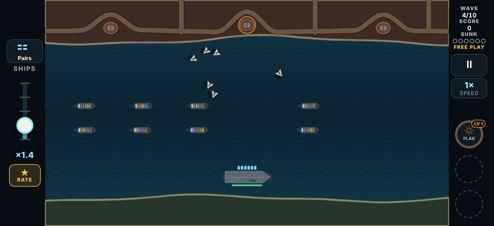
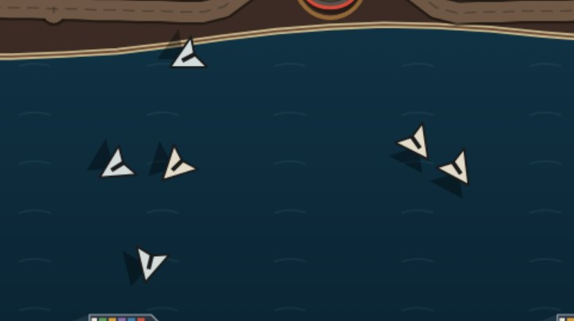
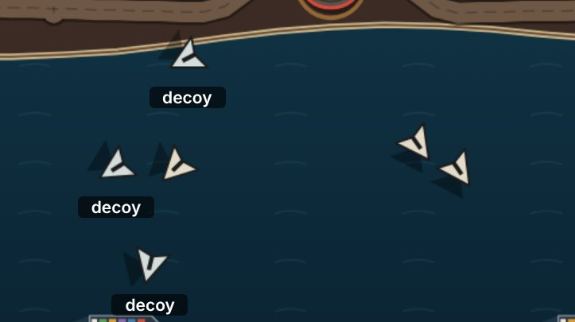
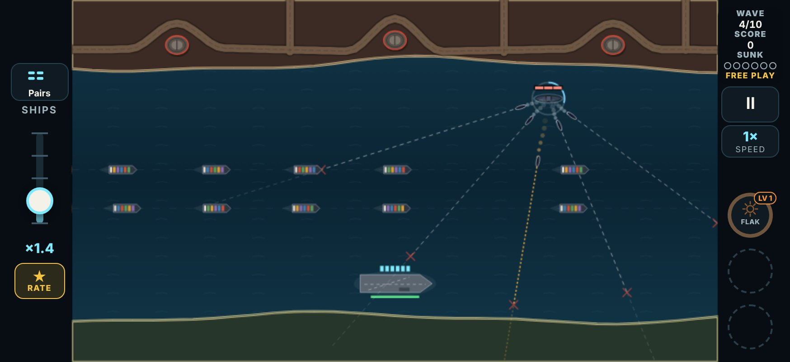
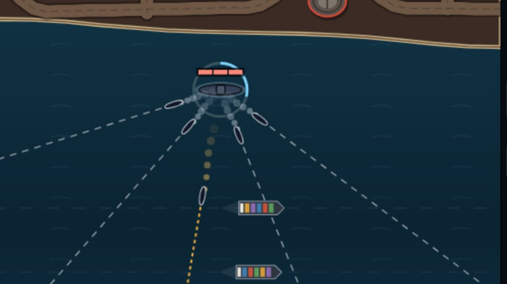

# V3 enemies, round 7: Decoy Drones, Hydra Missile, Torpedo Sub

This round builds your enemy notes from the round 6 event playtest. Three enemies changed **everywhere**: in normal waves, in Free Play, in the Test Lab's enemy and combo cards, and in the events that use them.

Round 7 is `{ n: 7, date: '2026-11-10', name: 'Enemy tweaks; more events', since: '2026-11-10T06:00' }`. Each changed card has a round 7 line in the Test Lab (`LAB_CHANGES`), so the hub asks for it again:
- the **Decoy Drones**, **Hydra Missile** and **Torpedo Sub** cards;
- the **Decoy Storm** and **Hydra Bloom** event cards;
- the combos **Decoys + Sprint Drones** and **Hydra + Sprint Drones, Tesla**, which take their enemy's line on.

The **Wolf Pack** is as it was: its subs still fire two or three torpedoes each, with two fast ones in the event.

## Decoy Drones: a faint tint, no strobe

> "give just a faint color difference everywhere, instead of the flash on, flash off"

> (round 6, the Decoy Storm) "I would definitely make the drones more I guess visible for which ones are the decoys make them like a different color slightly than the other one so it's easier to point out. Apply that for just this enemy attack in general not just this special event."

**The strobe is gone.** Before, a decoy close in flashed white (on one tenth of a second in three), with a white ring and a dotted trail.

**A decoy is now a shade cooler than a real drone, all the time.** That holds in normal waves, in combos and in the Decoy Storm.
- **A real drone** is warm cream (`#e4dccb`).
- **A decoy** is a pale grey with a hint of blue (`#d4dcdc`):
  - the same lightness;
  - its warmth taken out (saturation 32% → 10%);
  - about ΔE 11 in colour difference.
- **The rest is identical:** the same shape, shadow, flight and weave.
- **What it's like:** side by side, it reads. At a glance, in a swarm on a phone, it is easy to miss.

Up close, the same kind of swarm:

The same frame with the decoys marked. The marks are only for this page; the game marks nothing.

**The words:**
- The enemy's first-meeting tip: "Half this swarm is fake. The decoys are a shade cooler, grey not cream: save your shots for the real ones."
- The Test Lab card asks: "No strobe now: the decoys are a shade cooler. Can you tell them apart when you look, and not at a glance?"

### How the bots read the decoys

The bots (and the Cadence broadside, the one helper that picks its targets the way the bots do) used to leave a decoy alone once it strobed. That was within 160 px of its ship, and not before 3.5 s out.

There is nothing to flash now, so the bots read the tint the way a careful player would. A decoy counts as told apart:
- **once it is within 320 px of its ship.** By then the swarm is about half way in and is what you are looking at.
- **and not before 2 s out.** The swarm needs that long to spread out of its launch.

From then on the bots leave it alone. Before that it could be real, so they shoot it as before. The other helpers (Flak, the Cutter and so on) never told decoys apart, and still don't.

## Hydra Missile: 25% slower before the split

> "about 25% slower before the split"

> (round 6, the Hydra Bloom) "I think we need to slow down Hydro a bit at least the initial break of them. You can keep the speed after it splits, but make the initial stage slower than that. Applies for the whole hydra not just this."

- **The missile flies at 112.5 px/s, not 150 (0.75×), everywhere.** Like every missile, it still speeds up a little with the wave.
- **Its darts are unchanged** at 290 px/s.
- **The Hydra Bloom slows its Hydras by its own 0.85× on top**, as before. So they fly 96 px/s, not 128: also 25% slower than before.

## Torpedo Sub: three to five torpedoes, and sometimes a fast one

> "occasionally they'll fire a fast one, and/or they'll fire multiple, just kind of how the sub with the silos will fire four … the torpedo sub will fire three to five, and then sometimes fast ones"

> (round 6, the Wolf Pack) "…you could do that for the actual enemy attack two doesn't always have to be a fast one, but you can add in a fast one every once in a while add a little bit of variability to that one"

**Every Torpedo Sub now fires a spread** of three, four or five torpedoes (an even chance of each). Each torpedo has its own dashed line and its own X.

**The spread is a fan:**
- The **first torpedo** goes for a ship, as the lone torpedo did (it leads the ship).
- The **others fan out round it** across the water, 0.55 rad (about 31°) apart. The next ones go either side of the first, then further out.
- A heading whose run would go up a beach before its X is skipped for the next one out. A sub by the shore fans toward the lane.
- So the fan covers a stretch of the lane, much as a Rocket Truck's salvo lands on and around its ship, and the siege battery's shells land round theirs.

**Fast torpedoes:**
- **About one sub in four** (25%, rolled when its periscope shows) puts a fast torpedo in its spread. Which of the torpedoes is fast is rolled too.
- **A fast one runs at 2.2×** a torpedo's speed.
- **It looks like the Wolf Pack's fast ones:** an amber line in short dashes that run along it, and a longer amber wake.
- The rolls come from the sim's own dice (`rng.foes`), so a seed always plays the same spreads, and a run replays exactly from its log.

**More time to stop it:**
- The sub now fires **2.4 s after it comes up** (1.2 s before), with the periscope 1.5 s before that, as before.
- It stays up 2.3 s after firing, as before.
- So shooting the sub while it is up (three hits) is the clean answer. Killed before it fires, it fires nothing.

**The Wolf Pack is unchanged.**
- Its subs keep their two or three torpedoes each, every one at a ship of its own, 0.42 rad apart.
- Two fast torpedoes in the event, in all.
- It uses the same code as the normal sub (`fireSpread`), with its own numbers.

**The words:**
- First-meeting tip: "Up for a few seconds: three hits. It fires three to five torpedoes, now and then a fast amber one. Shoot it first, or get off the dashed lines."
- The card asks: "Three to five torpedoes now, now and then a fast one: can you read the lines? Sub, torpedoes or move?"

## What the bots made of it

All measured before and after on the same seeds.

### The Test Lab cards

The tool is `tools/v3/test-lab/measure.mts`, run with 80 seeds and all three bots. Each run is three Full waves of the card. The table sums each bot's 80 runs:
- **harm:** hits on the convoy from the card's enemy;
- **sunk:** ships it sank;
- **killed:** how many of the card's enemy the bot (and its helpers) shot down.

| Card | Bot | Before: harm / sunk | After: harm / sunk |
|---|---|---|---|
| Torpedo Sub | sharp | 24 / 8 | 33 / 11 |
| Torpedo Sub | average | 9 / 3 | 84 / 28 |
| Torpedo Sub | casual | 153 / 51 | 333 / 111 |
| Hydra Missile | sharp | 504 / 4 | 471 / 1 |
| Hydra Missile | average | 614 / 13 | 577 / 10 |
| Hydra Missile | casual | 755 / 73 | 682 / 66 |
| Hydra + Sprint Drones, Tesla | sharp | 96 / 1 | 41 / 0 |
| Hydra + Sprint Drones, Tesla | average | 108 / 7 | 53 / 4 |
| Hydra + Sprint Drones, Tesla | casual | 316 / 45 | 250 / 40 |
| Decoys + Sprint Drones | sharp | 28 / 1 | 28 / 1 |
| Decoys + Sprint Drones | average | 35 / 4 | 35 / 5 |
| Decoys + Sprint Drones | casual | 136 / 17 | 130 / 17 |

**The Torpedo Sub**, all three bots together: **2.4× the convoy harm** of the lone torpedo (450 against 186).
- **How I tuned it:** first I built it the Wolf Pack's way, every torpedo at a ship of its own, fired 0.6 s later than a lone torpedo. That came to **5.3×** (978) and sank 326 ships against 62: a wall, above all for the casual bot.
- **The two levers that brought it down:**
  - **Only the first torpedo is aimed at a ship;** the rest fan out.
  - **The sub fires later** (2.4 s up, not 1.8). The sharp bot now kills three subs in four before they fire, against one in six before.
- **What else I tried:** a wider fan (0.7 rad) and firing later still (2.7 s). Neither moved the total much past the noise.
- **The noise:** the average bot's "before" of 9 is low against the sharp bot's 24, so the 9 → 84 jump is partly noise. The sum over the three bots is the steadier number.
- Fast torpedoes were 6% of all the torpedoes fired (178 of 2,743).

**The Hydra** is easier:
- The bots kill more of them: sharp 468 of 468 (439 before); casual 379 (313).
- Less harm, fewer ships sunk.
- Its combo with Tesla took half the harm.

**The Decoy Drones** card itself shows no harm either way (decoys do none). The bots shot fewer decoys:
- sharp 1302 of 1317 (1313 before);
- average 1247 (1308);
- casual 1044 (1190).

The card's helpers still shoot every decoy they reach.

### The events

The tool is `tools/v3/special-events/measure.mts`, 40 seeds, the sharp and the average bot, shown as Clean / Held / Broken (%).

| Event | Bot | Own table: before | Own table: after | Lab card: before | Lab card: after |
|---|---|---|---|---|---|
| Decoy Storm | sharp | 98 / 3 / 0 | 98 / 3 / 0 | 33 / 25 / 43 | 40 / 35 / 25 |
| Decoy Storm | average | 98 / 3 / 0 | 93 / 8 / 0 | 30 / 25 / 45 | 50 / 30 / 20 |
| Hydra Bloom | sharp | 100 / 0 / 0 | 98 / 3 / 0 | 98 / 3 / 0 | 100 / 0 / 0 |
| Hydra Bloom | average | 90 / 8 / 3 | 100 / 0 / 0 | 38 / 5 / 58 | 100 / 0 / 0 |
| Wolf Pack | sharp | 73 / 15 / 13 | 70 / 15 / 15 | 85 / 15 / 0 | 88 / 13 / 0 |
| Wolf Pack | average | 45 / 30 / 25 | 45 / 30 / 25 | 55 / 25 / 20 | 55 / 25 / 20 |

**The Decoy Storm.** The share of the bots' shots that went at decoys fell a little:
- own table: 46% → 43% (sharp), 40% → 36% (average);
- lab card: 28% → 26%, 22% → 21%.

The lab card's Broken fell from 43–45% to 20–25%. With no ammo drops, the shots it saves count.

**The Hydra Bloom is now easy for the bots.** The ordinary bot on the lab card went from 58% Broken to never Broken. Its Hydras now fly 96 px/s and must be killed before the line. Being 25% slower gives the bots much longer to do that.

**The Wolf Pack** moved by a run or two in 40 for the sharp bot. That comes from a rounding fix in the shared fan code (judgement calls, below). Its numbers didn't change.

### The campaign

The tool is `tools/v3/sweep.ts`, base gun. The figure is the clear rate averaged over the 20 maps.

| Sweep | Bot | Before | After |
|---|---|---|---|
| Campaign (8 seeds) | sharp | 30.2% | 30.9% |
| Campaign (8 seeds) | average | 30.7% | 28.2% |
| Campaign (8 seeds) | casual | 3.2% | 2.5% |
| Free Play, Torpedo Sub only (16 seeds) | sharp | 43.9% | 44.9% |
| Free Play, Torpedo Sub only (16 seeds) | average | 29.2% | 23.2% |
| Free Play, Torpedo Sub only (16 seeds) | casual | 1.6% | 0.9% |

In the campaign the three changes about cancel out. With only Torpedo Subs as the new enemy, the ordinary bot clears 6 points fewer maps. The sub is harder, as asked, but it is not a wall.

## Judgement calls

- **The decoy colour:**
  - It is a cooler grey (`#d4dcdc`), not a different hue such as green or blue. The mini-drone is already pale green and the mothership green, and a strong hue would be "obvious at a glance".
  - I tried four shades side by side. `#d6dcd8` was hard to see even up close; `#cfd8dc` read at a glance.
- **When the bots read a decoy:** 320 px and 2 s are my estimate of a careful player, not measured. They move the Decoy Storm only a little (above).
- **The Torpedo Sub's fan:**
  - Only the first torpedo is aimed at a ship. The Wolf Pack's spreads aim each torpedo at a ship of its own.
  - With every torpedo aimed, three to five torpedoes did over five times the lone torpedo's harm. Your "like the silos" reads to me as a pattern round one target.
- **The sub fires later** (2.4 s up, not 1.2) so there is time to stop a spread before it comes.
- **The fast chance is 25% a sub.** Your "now and then" ("every once in a while") reads as about one sub in four, and a sub never carries two.
- **The Wolf Pack keeps its two or three a sub.** A normal sub now fires more than a Wolf Pack sub does; the Wolf Pack's threat is seven at once. Bringing it to three to five as well is a question for you.
- **Two fixes in the shared spread code:**
  - **A rounding fix.** A fanned heading exactly 0.42 rad off another could come out a hair short of it and be skipped, so some fans were wider than meant. That fix touches the Wolf Pack.
  - **The over-water check.** It doesn't touch the Wolf Pack's open water.
- **The Hydra Bloom keeps its own 0.85× slow on top** of the Hydra's new speed, so its Hydras are 25% slower, as everywhere.
- **No round 7 line for the map cards,** though their waves have these enemies too. A line would ask you to replay all twenty maps. Only the enemy, event and combo cards ask again.

## Unsure

- **The Hydra Bloom may now be too easy.** It went from the hardest of the three events for the ordinary bot to never Broken. If it is, the lever is the event's own slow (0.85): set to 1, its Hydras fly 112.5 px/s, 12% slower than before rather than 25%.
- **The Torpedo Sub is hard on the casual bot:** about twice the ships lost on its card. The levers are:
  - how many of the spread go for ships (`aimed`, 1);
  - the fan (`fan`, 0.55 rad);
  - when it fires (`aim`, 1.2 s more than the lone torpedo).
- **The Decoy tint on a real phone:** the pictures are from a desktop browser at phone size. Screen brightness and colour can make it fainter or stronger.

## Files

- `src/v3/data/foes.ts`:
  - `FOE.decoy`: `readAt` and `readAfter` in place of `revealAt` and `revealAfter`;
  - `FOE.torpedoSub`: `spread`, `aimed`, `fan`, `aim`, `fastChance` and `fastSpeed`;
  - the blurbs.
- `src/v3/data/config.ts`: the Hydra's speed (112.5).
- `src/v3/data/events.ts`: the Wolf Pack's fast speed is the normal sub's.
- `src/v3/sim/foes.ts`:
  - the normal sub's spread and fast roll;
  - `fireSpread` (aimed and fanned, over water, the rounding fix);
  - the decoy read.
- `src/v3/sim/events.ts`: the Wolf Pack's periscopes carry its own fan.
- `src/v3/ui/foes.ts`:
  - `DECOY_TINT`, and the decoy drawn in it with no strobe;
  - the sub's ring counts down its own time up.
- `src/v3/ui/app.ts`: the two first-meeting tips.
- `src/v3/data/lab.ts`: round 7, its lines, and three card questions.
- `tests/v3/enemiesRound7.test.ts`: the new tests. Older tests in `foes.test.ts`, `lab.test.ts` and `events.test.ts` were brought up to date. `e2e/v3.mjs` expects test round 7.
- `tools/v3/enemies-round7/shots.mjs` and `docs/design/img/enemies-round7/*.jpg`: the pictures.
