# V3 enemies and events, round 8

This round builds your Test Lab notes of 2026-11-10 on the enemies and the special events. Five enemies changed **everywhere** (in normal waves, Free Play, the Test Lab's cards and the events that use them), two events changed, and Dunmar Crossing has a new event.

Round 8 is `{ n: 8, date: '2026-11-10', name: 'Enemy pairs; weapon and enemy notes', since: '2026-11-10T19:00' }`. Each changed card has a round 8 line in the Test Lab (`LAB_CHANGES`), so the hub asks for it again:
- the **Decoy Drones**, **Hydra Missile**, **Torpedo Sub**, **Scavenger Drone** and **Spotter Plane** cards (the combos with them take their lines on);
- the **Hydra Bloom**, **Run the Canal**, **Supply Raid**, **Fire Mission**, **Decoy Storm** and **The Breakout** event cards;
- the new **Beacon Strike** card, in place of Undertow's.

Kept as they were (no change but what the enemies above bring): Siege of Vey, Rush, Rocket Convoy, Wolf Pack, Shield Wall, Dive Circus, Bombardment, Fire Mission's script, Repair Yard, Breakout's script, Siren Field.

## Your words

> Decoy Drones: "Still can't tell if which is which" · "Make they slightly more of a difference needed"

> Hydra Missile: "Yeah, still just a little too hard. I think you can slow it down. It's just a little bit more for both stages and that should be good."

> Torpedo Sub: "All the torpedoes just kind of fire in a random direction they shall be targeted and do one by one not all at once"

> Run the Canal: "Really bad the subs shoot torpedoes from water to land so that needs to be fixed and way too difficult way too much going on"

> Scavenger Drone: "This guy is is good and it made me think of a better way to do this drone. When this drone is present it will deny the player the ability to pick up the weapons or boost if it is with it a radius or the drone. Make that full change to this drone"

> Fire Mission: "This was a good improvement. I also think this is how the recon planes should behave in general as well. They Scott it out and lock on and then leave and come back with the same health and repeated until you kill it. Also the projective coming in should be like artillery shell coming in from off the map"

> Hydra Bloom: "Hydras should split even before the line is crossed there you can remove that line"

> Undertow: "Not sure what this was even trying to line up and synergy lol"

> Siege of Vey: "Hard but fun will need to tweak later"

## 1. Decoy Drones: about twice the difference

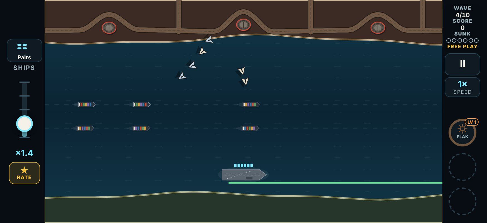

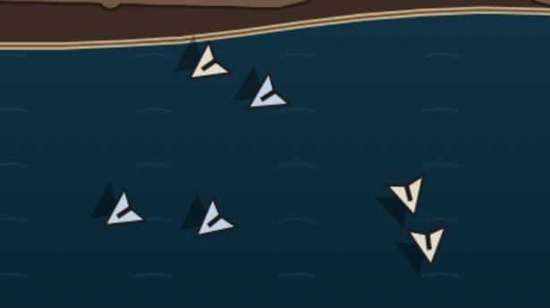

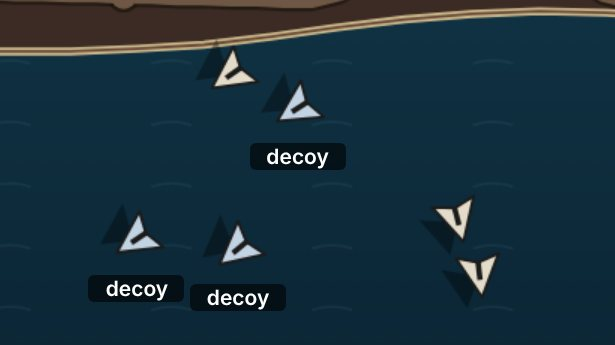

- **A decoy is now a pale steel blue, `#c2d3e3`** (round 7: a cool grey, `#d4dcdc`). A real drone is still warm cream (`#e4dccb`).
- **About twice the colour difference:** CIE76 ΔE about 20 (round 7: about 11).
- **Not a glaring colour:** the same lightness within 3 points, about as saturated as the cream; only the warmth turns cool (hue 41° → 209°). Nothing else on the water is this blue.
- **The rest is the same:** shape, shadow, flight, weave.
- **The bots' read rule:** a stronger tint reads sooner, so a careful player tells a decoy apart within **420 px** of its ship (320) and from **1.5 s** out (2). The bots and the Cadence broadside leave it alone from then on.
- **Words:** blurb "The decoys are a pale blue, not cream: look closely"; first-meeting tip "The decoys are a pale blue, the real ones cream"; card question "The decoys are a pale blue now, twice the difference: can you tell which is which?"

## 2. Hydra Missile: a little slower in both stages

| | Round 6 | Round 7 | Round 8 |
|---|---|---|---|
| The missile | 150 px/s | 112.5 | **100** (11% slower) |
| Its darts | 290 px/s | 290 | **255** (12% slower) |

Like every missile, both still speed up a little with the wave. The Hydra Bloom slows its own Hydras on top (below).

## 3. Torpedo Sub: aimed, one by one, never onto land

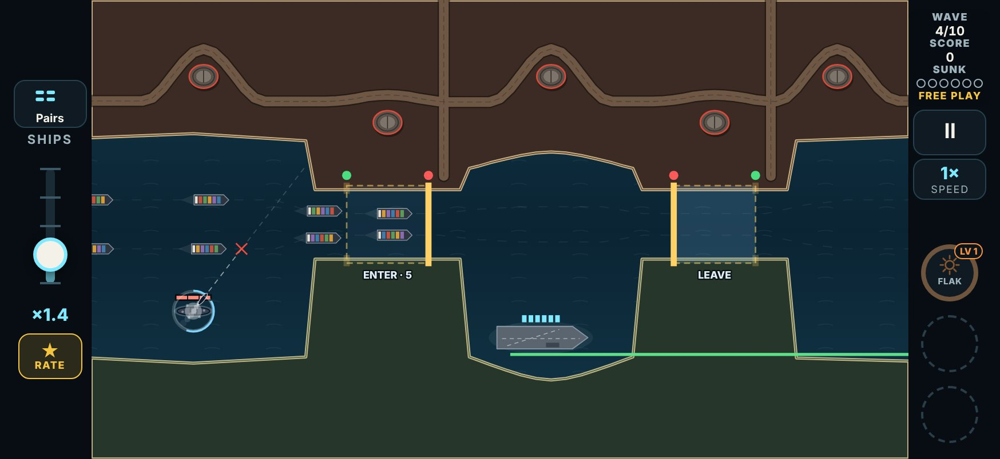

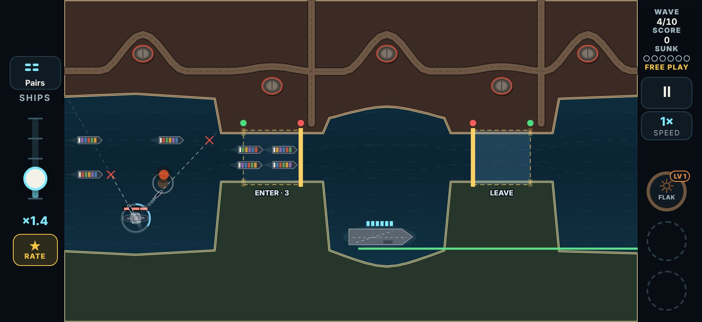

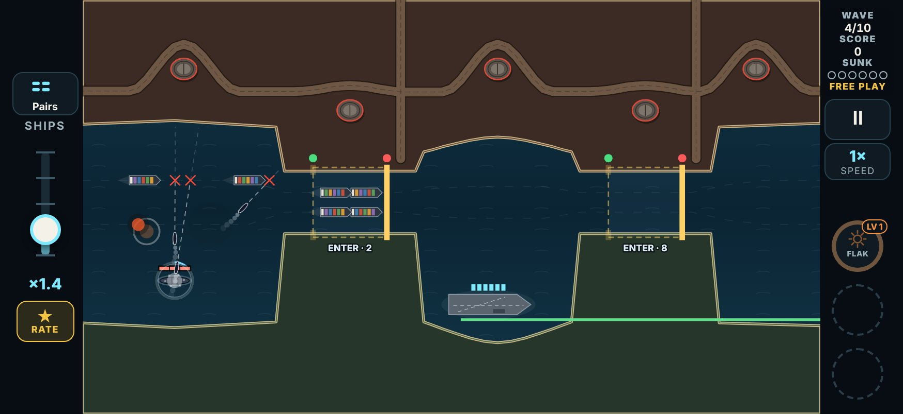

**The fan is gone.** A sub still fires three to five torpedoes (an even chance of each), now and then with a fast amber one (one sub in four), but:
- **One by one,** 0.8 s apart (`stagger`). The first goes 3.0 s after it comes up (2.4 in round 7), so there is a beat more to shoot it first.
- **Each is aimed at a ship,** leading it (its X is where the ship will be). The spread goes round the convoy: each torpedo goes for the ship this sub has fired at least at (the nearest breaking a tie), so it comes back to a ship only when there are fewer ships than torpedoes.
- **Each has its own dashed line,** as before.
- **Killed part way, the rest don't go.** Killed before its first, it fires nothing.
- **It dives** 1.4 s after its last torpedo.

**Never onto land** (your Run the Canal note):
- A torpedo is aimed only at a ship it can reach down a line of open water. A ship behind a bank is passed over; with none in reach, that torpedo isn't fired.
- Its run on past the ship stops short of any shore.
- A shore that wasn't there when it was fired (Saltgate's lock gates) ends it against it, never on it.
- The water is checked every 2 px (Saltgate's gates are thin).
- **A sub surfaces where it has ships in reach.** Of the map's sub spots, it takes the one with the most ships in reach over open water now. In round 7 a Run the Canal sub could sit in a basin behind the banks and fire at the canal across them.
- **Checked on all twenty maps** (a test): subs as in the waves, the Wolf Pack and Run the Canal. No torpedo was ever on land.
- **The Wolf Pack** keeps its spreads all at once, each at a ship of its own. It gets the same land rules: a heading with no open water to fan onto isn't fired.

**Not a wall:** with the stagger and the later first shot, the bots' Test Lab harm came out a little under round 7's (the table below). I tried 0.7 s apart with the first at 2.4 s first: 1.8× round 7's harm for the casual bot.

**Words:** blurb "Surfaces and fires three to five torpedoes one by one, each at a ship…"; first-meeting tip "It fires three to five torpedoes one by one, each at a ship…"; card question "Its torpedoes now go one by one, each at a ship: can you read the lines in time? Sub, torpedoes or move?"

## 4. Scavenger Drone: it denies, it doesn't steal

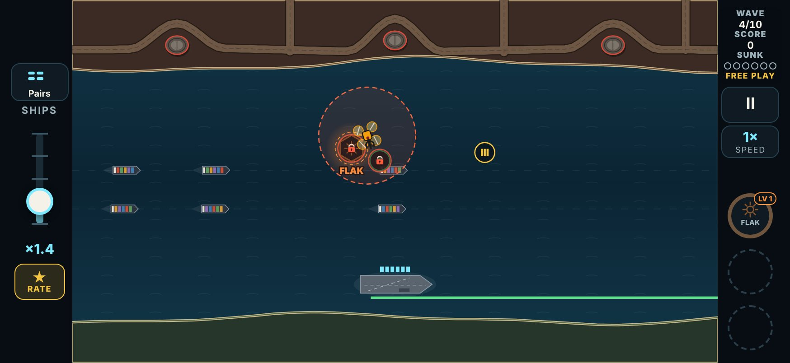

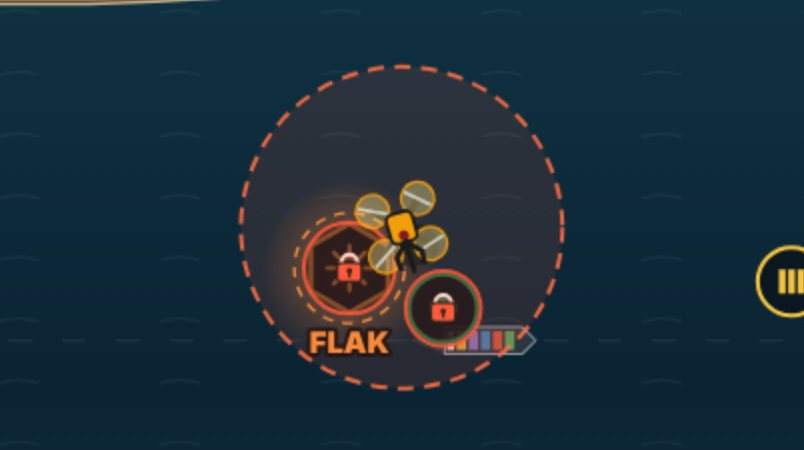

**The full change:**
- **It never takes a pickup.**
- **Any pickup within 120 px of it is locked** (`deny`). Its ring is drawn: a dashed red-amber circle that turns slowly, brighter and filled while it holds something. A locked pickup is dimmed, with a red ring and a padlock on it.
- **A locked pickup can't be taken.** A tap on it does nothing to it ("LOCKED" shows over it), and the tap goes on to whatever is under the finger: tap the drone over it and you shoot the drone.
- **A locked pickup doesn't age.** It waits, so **killing the drone frees it** whole.
- **How it moves:** it flies to the pickup no other scavenger's ring covers (a weapon first, then the nearest) and hovers over it, circling 48 px round it, while it has anything in its ring. With nothing on the water it circles over the water off the convoy, as before.
- **It leaves** (its ring off, everything free) once the rest of the wave is over, or after 40 s.
- **The bots** never tap a locked pickup, and rank the drone as urgent while it locks one (a weapon most).

**Supply Raid**, built on it, now reads: pickups rain down, and the drones lock what lands in their rings.
- Three scavengers a run (six before), from the sides of the screen in turn, all four over the two runs.
- They come a beat later (2.5 s, as the cargo lands), each to a part of the drop no other covers. A ring holds several pickups, so three lock most of a drop.
- Card question: "Pickups raining, and drones locking the ones in their rings: fun scramble or busywork?"

**Run the Canal** had three scavengers; they are cut (item 7).

## 5. Spotter Plane: turns, and artillery from off the map

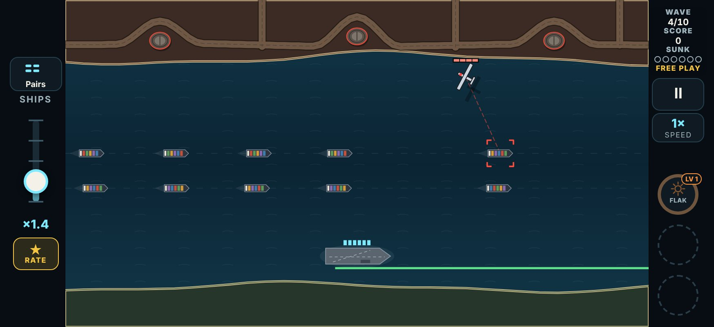

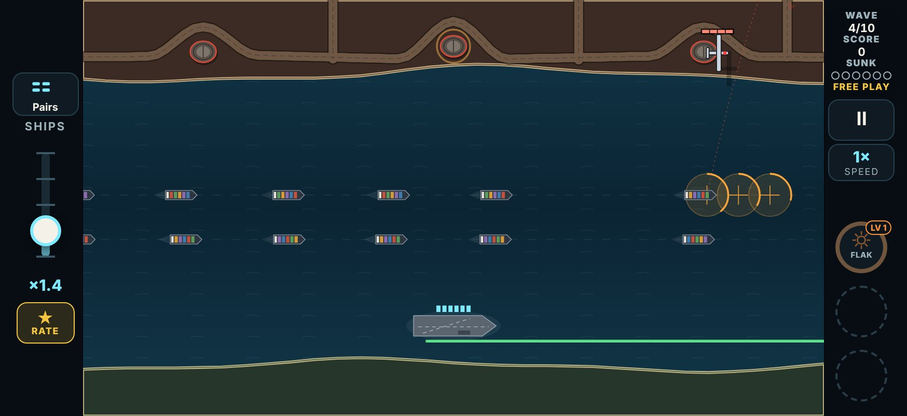

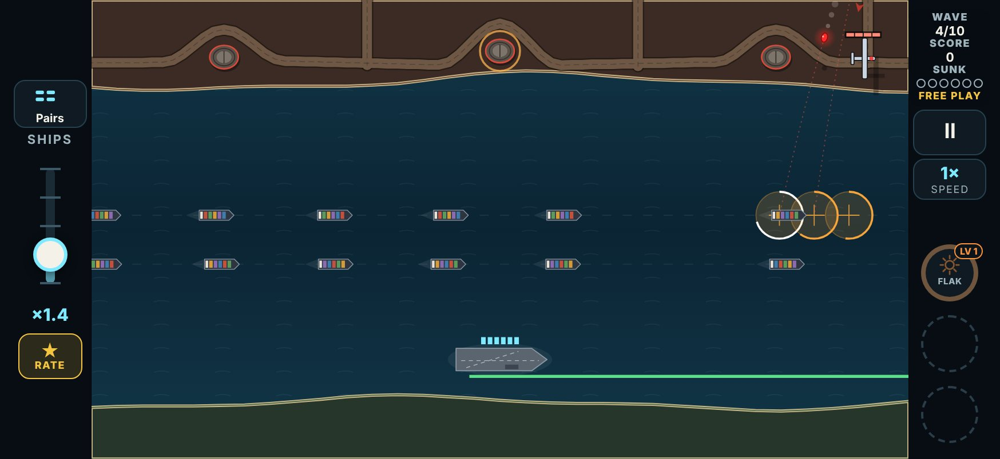

**Every Spotter flies turns,** as the Fire Mission's do:
1. In to its circle beside the lane.
2. Paints a ship 2 s after it gets there, a different ship from last turn if it can (new launches go for it, as before).
3. Calls the guns 4 s later.
4. Flies off the screen.
5. **Comes back 6 s later with the hits it took**, to a new circle, and goes round again.

- **Until you kill it:** up to four turns, as long as the rest of the wave is on. With nothing else left it doesn't come back, so a wave never waits on it.
- Off the screen it is off the board: no taps, no helpers, not a kill.

**Its call is artillery from off the map** (it was three ballistic missiles from the bases, which could be shot down):
- **Three shells** from a battery beyond the enemy's edge of the screen, landing 2.6 s after the call, 0.45 s apart, round where the painted ship will be (50 px apart along its course). One hit each, in the siege shell's circle (46 px).
- **Their circles show from the call.**
- **Each comes in from the edge:** while still beyond it, a red chevron pulses on the edge where it will come in; then the shell flies 1.6 s on a long, flat arc, a smoke trail behind it and its path dotted ahead to its circle. A whistle as each is fired.
- **Red, like everything that can't be stopped.** The answer is the plane: shot down before its shells are fired, its call is off.

**The Fire Mission** keeps its script. Its walking barrage now comes from the same off-map battery, so its shells come in from the edge too (round 6: from a shore base). Its timings, damage and the rule that a barrage once called comes are unchanged; the bots' results didn't move. Card line: "The shells are artillery from off the map: each comes in from the edge".

## 6. Hydra Bloom: no line; every Hydra splits into three

- **The halfway line is gone.** In round 7 a Hydra killed before it died whole.
- **Every Hydra in the event splits into three darts,** wherever it is killed.
- The card's rule is unchanged ("Hydras split into three, not two"). Question: "No line now: six Hydras, and every one splits into three. Hard in a good way?"
- **Retuned:** that alone took the lab card from never Broken to Broken 30% (sharp bot) and 65% (average bot). So the event eased elsewhere:
  - its Hydras at 0.75 of their (new) speed (0.85);
  - its darts at 0.7 of theirs;
  - the two fans 9 s apart (8);
  - one drone swarm (two).
- It is now harder than round 7's, as asked, and fair: the sharp bot holds 88% of the lab card's runs (table below).

## 7. Run the Canal: cut down

**The land torpedoes are fixed** (item 3).

**Cut to three phases, one after another:**

| | Round 7 | Round 8 |
|---|---|---|
| Subs | a pack of three, two torpedoes at once each | **two**, 2.5 s apart, each the new sub (three torpedoes one by one), from water with ships in reach |
| Gunships | two, from 7 s | **one**, over the far bank by a lock, from 9 s |
| Scavengers | three, from 9 s | **none** |
| Armored block | eight (two rows of four), from 17 s | **four** (two rows of two), from 19 s |
| Drone swarms | two | **one** |

- The block of six I tried first still sank everything the event sank: all 31 ships the sharp bot lost in 40 runs went to it. With a block of four, the sharp bot lost 11 ships in the 40 runs.
- Card question: "Cut down: two subs, a gunship over the bank, then a smaller armored block. Fair now?" The finale now features three of the chapter's four enemies (no Scavenger).

## 8. Beacon Strike: Dunmar Crossing's new event (Undertow is cut)

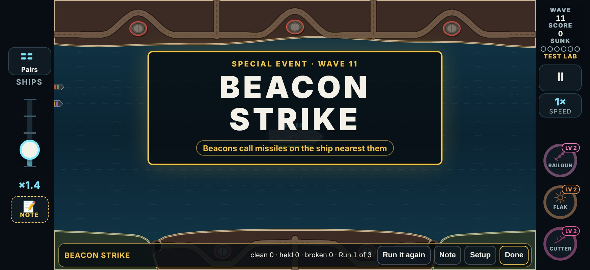

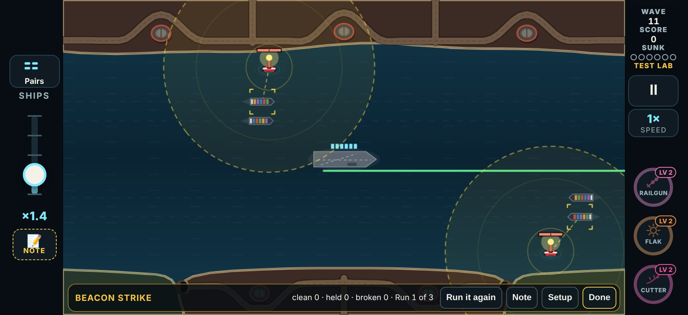

**In one sentence:** beacons rise beside the lanes, and every few seconds each one marks the ship nearest it and calls a missile down on that ship, until you sink it with your taps.

**How a run goes:**
1. **Two beacons rise,** one by each of Dunmar's lanes, just off the lane on the enemy side, ahead of the middle of that lane's convoy. Two more rise 10 s later. Each stays 18 s.
2. **The mark.** 1.6 s before each of its calls, a beacon marks the ship nearest it: a dashed yellow line from the beacon to the ship, the dashes marching toward it, and a bracket closing in on the ship (red in the last half second).
3. **The call:** a ballistic missile from the launch base nearest the beacon, at the marked ship. It can be shot down. A beacon's first call comes 2.6 s after it is up, then one every 4.4 s.
4. **Company:** two drone swarms.

**Why it reads:** the line from the beacon to the ship says "this one is next" at a glance, and it is the Lure Beacon you know: it still takes only your taps (two), and its ring still draws your helpers. So the choice is plain: spend taps on the beacon, or on what it calls. No slow zones.

- **The card's rule:** "Beacons call missiles on the ship nearest them" (the rule in force, not how to beat it).
- **Card question:** "Each beacon marks the ship nearest it and calls a missile on it: is the idea clear at a glance?"
- **Its lab kit:** Railgun, Flak, Laser Cutter (no helpers, as Undertow's).
- **Undertow is gone:** its slow (and the ship-speed hook in the sim), its barrages, its rule, its card and its ripples.

## What the bots made of it

All measured before (9d7c592) and after, on the same seeds.

### The Test Lab cards

`SEEDS=80 SKILLS=sharp,average,casual npx vite-node tools/v3/test-lab/measure.mts -- <cards>`: each run is three Full waves of the card. Harm is hits on the convoy from the card's enemy; sunk, the ships it sank.

| Card | Bot | Before: harm / sunk | After: harm / sunk |
|---|---|---|---|
| Torpedo Sub | sharp | 33 / 11 | 33 / 11 |
| Torpedo Sub | average | 84 / 28 | 36 / 12 |
| Torpedo Sub | casual | 333 / 111 | 351 / 117 |
| Hydra Missile | sharp | 471 / 1 | 445 / 2 |
| Hydra Missile | average | 577 / 10 | 536 / 5 |
| Hydra Missile | casual | 682 / 66 | 664 / 70 |
| Spotter Plane | sharp | 0 / 0 | 0 / 0 |
| Spotter Plane | average | 0 / 0 | 1 / 0 |
| Spotter Plane | casual | 0 / 0 | 3 / 1 |
| Scavenger Drone | all three | 0 / 0 | 0 / 0 |
| Decoy Drones | all three | 0 / 0 | 0 / 0 |
| Spotter + Siege Battery | sharp | 222 / 18 | 240 / 20 |
| Spotter + Siege Battery | average | 442 / 33 | 477 / 44 |
| Spotter + Siege Battery | casual | 1318 / 150 | 1375 / 171 |
| Hydra + Sprint Drones, Tesla | sharp | 41 / 0 | 14 / 0 |
| Hydra + Sprint Drones, Tesla | average | 53 / 4 | 16 / 1 |
| Hydra + Sprint Drones, Tesla | casual | 250 / 40 | 193 / 27 |
| Decoys + Sprint Drones | sharp | 28 / 1 | 30 / 2 |
| Decoys + Sprint Drones | average | 35 / 5 | 33 / 2 |
| Decoys + Sprint Drones | casual | 130 / 17 | 115 / 17 |

**Reading it:**
- **The Torpedo Sub:** 450 → 420 in all, three bots together. More subs are stopped before they fire: sharp 338 → 440 of about 470, average 201 → 381, casual 66 → 111. The casual bot loses about as much as before; the average bot much less.
- **The Spotter's card harm was 0 before** only because its strike was ballistic missiles, counted as theirs. Its shells now count as the Spotter's. The bots kill nearly every Spotter before its first call (about 99%), so it seldom gets a second turn. On the combo, where the siege gun is up too, harm is up about 5–10%.
- **The Scavenger does no harm** either way. What it costs is pickups: the bots tapped about as many over a test (sharp 4,380 → 4,367, average 4,266 → 4,168, casual 3,607 → 3,590), because they shoot it as soon as it locks one.
- **The Decoy Drones:** the bots shoot fewer decoys now that the tint reads sooner (decoys killed: sharp 1,302 → 1,274, average 1,247 → 1,188, casual 1,044 → 920).
- **The Hydra** is a little easier, most in its Tesla combo (harm about a third).

### The events

`npx tsx tools/v3/special-events/measure.mts 40 --only=…` (own table: wave 11, ten drafts handed over, flow 2) and `--lab` (as the card plays it). Clean / Held / Broken, %.

| Event | Bot | Own: before | Own: after | Lab card: before | Lab card: after |
|---|---|---|---|---|---|
| Hydra Bloom | sharp | 98 / 3 / 0 | 90 / 10 / 0 | 100 / 0 / 0 | 68 / 20 / 13 |
| Hydra Bloom | average | 100 / 0 / 0 | 70 / 25 / 5 | 100 / 0 / 0 | 65 / 23 / 13 |
| Run the Canal | sharp | 73 / 5 / 23 | 73 / 28 / 0 | 75 / 3 / 23 | 90 / 10 / 0 |
| Run the Canal | average | 63 / 15 / 23 | 63 / 38 / 0 | 85 / 10 / 5 | 95 / 5 / 0 |
| Undertow → **Beacon Strike** | sharp | 80 / 8 / 13 | 100 / 0 / 0 | 73 / 15 / 13 | 88 / 8 / 5 |
| Undertow → **Beacon Strike** | average | 48 / 35 / 18 | 98 / 0 / 3 | 60 / 30 / 10 | 88 / 13 / 0 |
| Supply Raid | sharp | 100 / 0 / 0 | 100 / 0 / 0 | 100 / 0 / 0 | 100 / 0 / 0 |
| Supply Raid | average | 100 / 0 / 0 | 98 / 3 / 0 | 100 / 0 / 0 | 100 / 0 / 0 |
| Fire Mission | sharp | 83 / 13 / 5 | 83 / 13 / 5 | 50 / 50 / 0 | 50 / 50 / 0 |
| Fire Mission | average | 58 / 40 / 3 | 58 / 40 / 3 | 23 / 55 / 23 | 23 / 55 / 23 |
| Wolf Pack | sharp | 70 / 15 / 15 | 70 / 15 / 15 | 88 / 13 / 0 | 88 / 13 / 0 |
| Wolf Pack | average | 45 / 30 / 25 | 45 / 30 / 25 | 55 / 25 / 20 | 55 / 25 / 20 |
| The Breakout | sharp | 95 / 5 / 0 | 98 / 3 / 0 | 85 / 10 / 5 | 95 / 5 / 0 |
| The Breakout | average | 93 / 8 / 0 | 98 / 3 / 0 | 78 / 23 / 0 | 88 / 10 / 3 |
| Decoy Storm | sharp | 98 / 3 / 0 | 98 / 3 / 0 | 40 / 35 / 25 | 45 / 35 / 20 |
| Decoy Storm | average | 93 / 8 / 0 | 95 / 5 / 0 | 50 / 30 / 20 | 58 / 20 / 23 |

Decoy Storm, shots at decoys: own table 43% → 40% (sharp), 36% → 32% (average); lab card 26% → 25%, 21% → 19%.

**Reading it:**
- **Run the Canal is never Broken now** for either bot, on either measure; the sharp bot holds every run.
- **Hydra Bloom** is harder than round 7's (it was never Broken), as asked, and the sharp bot still holds 88% of the lab card's runs.
- **Beacon Strike** is easier than Undertow was: the bots shoot most of the missiles, and on its own table they hold it all but once. It is the readable one, not the hard one. The levers are below.
- **Supply Raid** is still all but always Clean: the scavengers do no harm; what they cost is pickups.
- **Fire Mission and Wolf Pack** didn't move.

## Judgement calls

- **The decoy colour** is a pale steel blue (`#c2d3e3`), not a stronger hue. Twice round 7's difference reads as "another kind of drone" side by side and still looks like a drone. The bots' read distance went up with it (420 px, 1.5 s): my estimate of a careful player, not measured.
- **The Torpedo Sub's first torpedo is at 3.0 s, not 2.4**, and the rest 0.8 s apart. That keeps the aimed spread from being a wall. A shorter stagger (0.7) with the first at 2.4 s cost the casual bot nearly twice round 7's harm.
- **Spread across the ships** means the ship this sub has fired at least at; it doesn't share between subs.
- **The Wolf Pack keeps its spreads all at once** (you kept it), with the land rules on top. Whether its subs should fire one by one too is a question for you.
- **The Scavenger's locked pickups don't age.** So "kill it to free them" holds: the pickup is still there. Without that, a pickup under the drone would just expire (pickups last 5 s).
- **The Scavenger leaves** once the rest of the wave is over (or after 40 s), so a wave never waits on it. Its ring is 120 px.
- **The Spotter's turns:** up to four, 6 s away between them, and none once the rest of the wave is over. "Until you kill it" would otherwise hold a wave open forever.
- **The Spotter's shells can't be shot down** (red, like the siege gun's). The old ballistic strike could be. The counter is shooting the plane before its shells are fired.
- **The Fire Mission's barrage comes from off the map too**, since your note on the projectile was on that card.
- **Hydra Bloom's darts are slower in the event** (0.7×), and its Hydras slowed and spaced. "Always three darts" on its own was far harder than any other chapter 1 event.
- **Run the Canal lost its scavengers.** So the finale features three of the chapter's four enemies; that was the clearest cut of "too much going on".
- **Beacon Strike's missile can be shot down**, so the event is about choosing where your taps go.
- **The play log is version 20** (the sim changed). A parallel build may bump it too; the merge should keep one number.

## Unsure

- **Beacon Strike may be too easy for you.** The levers are `every` (4.4 s between calls), `life` (18 s), the second pair (`at`), and two missiles a call in place of one.
- **Hydra Bloom on the lab card** is now Broken 13% for both bots. If it is too hard, the lever is `dartSlow` (0.7).
- **The off-map shells come in from the enemy's edge** (the top on most maps). On a map with its carrier high they come from the bottom. I haven't looked at every map.
- **The Spotter with the bots** rarely gets past its first turn. Your playtest will show the turns far more than the measurements do.
- **A sub with no ship in reach** surfaces, fires nothing and dives. On Saltgate about one sub in five did, early in a wave (in the test harness's quiet waves).

## Files

- `src/v3/data/foes.ts`: the numbers (`FOE.decoy` read, `FOE.torpedoSub` stagger/aim/after, `FOE.scavenger` rework, `FOE.spotter` turns and shells) and blurbs.
- `src/v3/data/config.ts`: Hydra 100, dart 255.
- `src/v3/data/events.ts`: Hydra Bloom, Run the Canal, Supply Raid numbers; Beacon Strike in place of Undertow (`beaconCall` rule).
- `src/v3/sim/foes.ts`:
  - the sub (`subSpot`, `fireAimed`, `torpedoWet`, `wetReach`, the shore guard);
  - the scavenger (`updateScavenger`, `pickupLocked`);
  - the spotter (`updateSpotter`, `recallSpotter`, `callShells`, `offMapGun`, the `recall` mark, far shells).
- `src/v3/sim/events.ts`: Hydra Bloom (`hydraDarts`, `hydraDartPace`), Run the Canal, Supply Raid, Beacon Strike (`laneBeacons`, `beaconMark`, its calls), the Fire Mission's off-map barrage; Undertow removed.
- `src/v3/sim/game.ts`: locked pickups (taps, ageing); Undertow's ship slow removed.
- `src/v3/sim/bot.ts`, `src/v3/sim/mimic.ts`: never tap a locked pickup.
- `src/v3/sim/playlog.ts`: version 20.
- `src/v3/ui/foes.ts`, `render.ts`, `events.ts`: the decoy tint, the scavenger's ring and padlocks, the incoming shells, Beacon Strike's marks.
- `src/v3/ui/app.ts`: the first-meeting tips.
- `src/v3/data/lab.ts`: round 8, its lines, the card questions, Beacon Strike's kit.
- `tests/v3/enemiesRound8.test.ts`: the new tests. `foes`, `lab`, `events`, `eventsRound6`, `eventsRound7` and `enemiesRound7` tests brought up to date. `e2e/v3.mjs` expects test round 8.
- `tools/v3/enemies-round8/shots.mjs` and `docs/design/img/enemies-round8/*.jpg`: the pictures. `tools/v3/test-lab/measure.mts` takes `SEEDS` and `SKILLS` and counts pickups taken.
