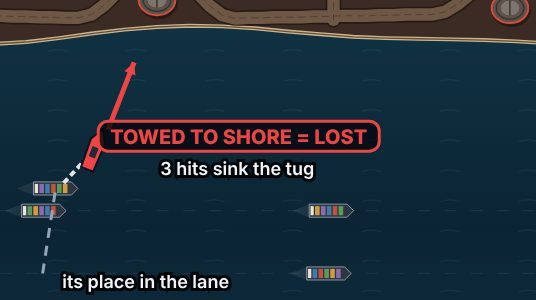
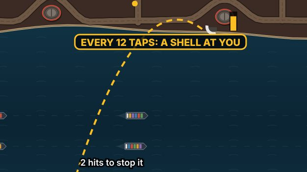
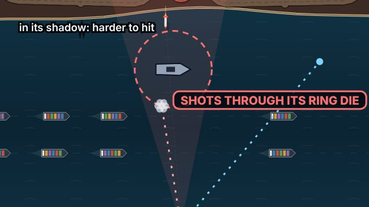
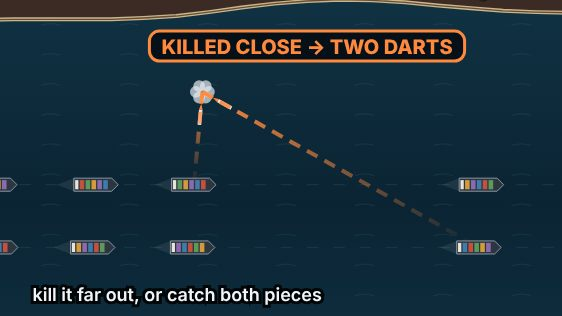
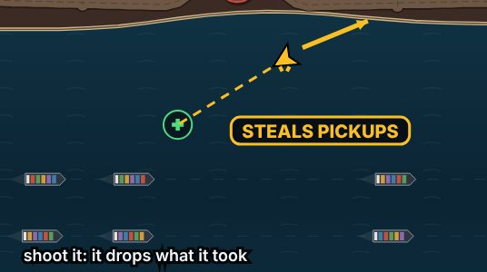
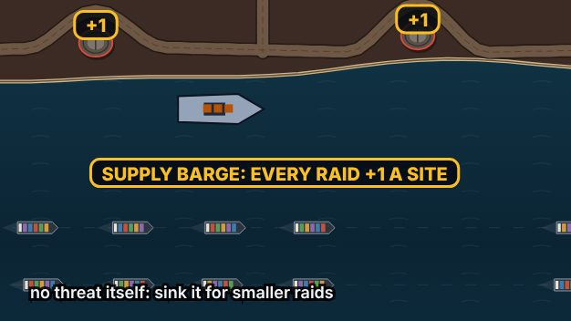
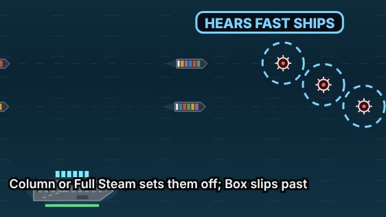
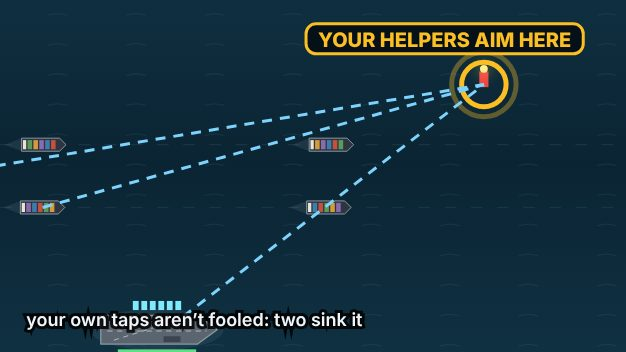
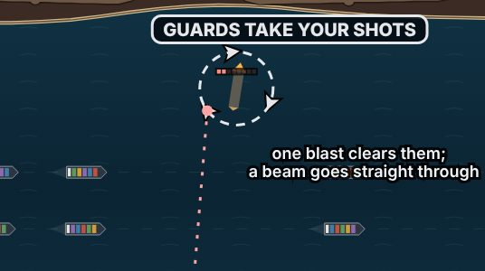
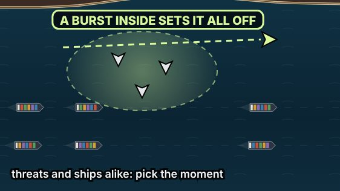

# V3 enemy ideas, round 1 (brainstorm, not built)

Nothing in this document is built. It is the enemy's version of the weapons' round 2: a taxonomy, the player's ideas with a read on each, and new ideas, for the player to mark before any build.

- **Review page:** https://claude.ai/artifact/Sm8d5jmPVxTwihiTiKdtGX. The same ideas, each with a picture drawn over a real wave, Go further / Maybe / Drop and notes, the cut ideas (Bring back), and 5 questions. Its saved marks are what the next session reads first:
  - `reviews/{ideaId}`: `verdict` (go, maybe, drop or revive) and `note`;
  - `answers/{questionId}`: `choice` (option index) and `note`; ids start `en-`, and `en-notes` is the free note.
- **Build the page:** `node tools/v3/enemy-ideas/page.mjs <out.html>`.
- **The pictures:** `node tools/v3/enemy-ideas/concepts.mjs` (needs `npx vite preview --port 4173` on a fresh build).
- **The check:** `node tools/v3/enemy-ideas/check.mjs`.
- **How the round was checked, cycle by cycle:** [v3-enemy-ideas-cycles.md](v3-enemy-ideas-cycles.md).

This file is generated by `node tools/v3/enemy-ideas/gen.mjs` from `tools/v3/enemy-ideas/enemies.mjs`. Edit that, not this.

## The ask

The player (2026-11-07):

> "Alright next I think we need to do the same process we did but with the enemy weapons. We need three different types of categories and then make subcategories as well for all the weapons … Then come up with new weapons for the enemy … Pick the best from that group and then come up with 10 weapons as well that a different than this list … So you don’t have to only make them make like 20 and then pick the best from that … Be Novel and come up with new ideas and inquiries weapons so they are not just another version of another weapon"

## Three categories

Split by role, like the player's weapons (Active, Passive, Boost): the category says what kind of answer an enemy needs. Every enemy below is placed: today's, the player's (#N), and the ten new ones (new).

### Strikes

Flies or sails at a hull and does the damage itself. You answer it by shooting it, or by where your ships are when it lands. Once it is gone, it is gone.

| Subcategory | What makes it one | Enemies |
|---|---|---|
| Swarm | Many and weak: the problem is how many at once. | Attack drone, Mini-drone, Bomblet, Sprint Drones (#5), Loitering Ambush Drones (#12), Crossing Attack Wing (#15) |
| Precision | One at a time, aimed at one ship: the problem is reaction. | Guided missile, Ballistic missile, Supersonic missile |
| Tough | Takes many hits: the problem is how much fire it soaks up. | Heavy cruise missile, Armored Drone (#14) |
| Trick | The moment you shoot it matters: it splits, ignites or punishes the wrong timing. | Cluster missile, **Hydra Missile** (new), **Fuel Cloud** (new) |
| Sea | On or under the water: in the lane itself, not the sky. | Drifting mine, Fast attack boat, **Hijacker Tug** (new), **Acoustic Mine** (new) |

### Platforms

Launches or fires from a distance, and stays to do it again. Where your gun can kill it, that stops what it would do next (what it already launched keeps coming); where it can’t, you answer what it launches. Its subcategory says where to look for it.

| Subcategory | What makes it one | Enemies |
|---|---|---|
| Air | Aircraft: they come and go, and can be shot down. | Drone mothership, Strike jet, Missile bomber, Stealth Strafer (#2), Stealth Bomber (#3), Attack Helicopter (#4), Dive Bomber (#18) |
| Sea | Ships, subs and sea structures. | Submarine, Oil rig, Dreadnought, Torpedo Attack Submarine (#9), Minelayer Boat (#10), Broadside Gunboat (#16) |
| Shore | On enemy land: sites, trucks and guns. | Launch site, Missile truck, Shore runner, The Citadel, Rocket Artillery Truck (#1), Coastal Siege Battery (#11), **Counter-Battery Site** (new) |

### Support

Never hits a hull itself. It changes the rules for the rest of the raid: what you can see, what survives, what your gun and drops can do, or where the enemy aims. Kill it and the rule goes.

| Subcategory | What makes it one | Enemies |
|---|---|---|
| Shield | Keeps other enemies alive. | Shield generator, Repair Tender (#13), **Bodyguard Ring** (new) |
| Deceive | Hides or fakes what you see. | Jammer Drone (#6), Decoy Drone (#7) |
| Sabotage | Works on your kit: your rack, your shots, your drops, your helpers. | EMP Attack Drone (#17), **Flak Picket** (new), **Scavenger Drone** (new), **Lure Beacon** (new) |
| Coordinate | Makes the rest of the enemy smarter or bigger. | Target-Spotter Aircraft (#8), **Supply Barge** (new) |

## How "different" was checked

Every enemy is tagged with what the player does about it (its **answer**) and what it takes from the player (its **pressure**). `check.mjs` fails if any kept new idea shares both tags with an enemy in the game, one of the player's 18, or another kept idea.

- **Today's 21 enemies:** 3 answers (shoot it down; kill the thing doing it; wait for the right moment) and 3 pressures (your ships’ hulls; safe water in the lane; how long enemies survive).
- **Answers only the new ideas use:** get there first; hold fire; choose where it dies; change the convoy’s speed.
- **Pressures only they use:** your ships themselves (taken, not sunk); your carrier; your shots in the air; your pickups; later raids; your helpers (passives, allied guns).
- An independent reviewer also read the ideas cold before the page went up (cycle 1 of the cycles doc). Two ideas were cut and four rebuilt on what it found.

## The player's 18

The player's own words are on the review page, unchanged. My read:

| # | Idea | Where | My read | Why |
|---|---|---|---|---|
| 1 | Rocket Artillery Truck | Platforms · Shore | pick | The first projectile your gun can’t stop, from a source you can kill in a few hits mid-raid (the rigs, Dreadnought and Citadel take 40–50). The clearest “drop everything” moment in the list. |
| 2 | Stealth Strafer | Platforms · Air | merge | Strong as a twist, thin as its own enemy. With #3: one “Stealth” trait that any aircraft can carry, so it lands on the jet, the bomber and the new helicopter alike. |
| 3 | Stealth Bomber | Platforms · Air | merge | Same as #2: best as the Stealth trait on the existing bomber. |
| 4 | Attack Helicopter | Platforms · Air | pick | An aircraft that holds a firing position and moves between them, rather than flying a line or drifting in: “sustained fire” becomes a choice you make while a raid is still coming. |
| 5 | Sprint Drones | Strikes · Swarm | pick | Cheap to build and reads at a glance: a swarm with a deadline, which changes how you sort it. |
| 6 | Jammer Drone | Support · Deceive | pick | The cleanest support enemy: it attacks information, not hulls, and you can end it with one good shot. |
| 7 | Decoy Drone | Support · Deceive | pick | Makes the rack the thing under attack, and rewards a careful player over a fast one. |
| 8 | Target-Spotter Aircraft | Support · Coordinate | pick | Turns a random raid into a readable plan you can break, and makes Aegis and Shield matter more. |
| 9 | Torpedo Attack Submarine | Platforms · Sea | pick | Three answers in one (the sub, the torpedo, the formation), and the first threat that travels in the lane itself. |
| 10 | Minelayer Boat | Platforms · Sea | maybe | Good, but mines already exist on one map. Worth it if mines should reach more maps. |
| 11 | Coastal Siege Battery | Platforms · Shore | pick | “Can’t be intercepted” turns the reticle from a hint into a must-move, so formation becomes the answer, not just a help. Pick this or the Dive Bomber (#18), not both. |
| 12 | Loitering Ambush Drones | Strikes · Swarm | pick | Moving, coordinated and readable: a real “now or later” choice that mines don’t give, since they don’t come at you together. |
| 13 | Repair Tender | Support · Shield | pick | Makes tough enemies a puzzle about order, and suits the Dreadnought, rigs and heavies already in the game. |
| 14 | Armored Drone | Strikes · Tough | maybe | Clever, but every shot leaves the carrier, so “from behind” is rare and hard to read on a phone. |
| 15 | Crossing Attack Wing | Strikes · Swarm | maybe | More a raid pattern than an enemy; it could ride along with any of the others. |
| 16 | Broadside Gunboat | Platforms · Sea | maybe | A good fight, but close to the Dreadnought. Worth it if it is the Dreadnought’s small cousin on more maps. |
| 17 | EMP Attack Drone | Support · Sabotage | pick | Cheap, readable, and it makes the rack the thing to defend, which suits the coming pacing pass. |
| 18 | Dive Bomber | Platforms · Air | maybe | Close to #11 in what you do about it. Pick one of the two “move out of the mark” enemies. |

**Recommended picks (11):** Rocket Artillery Truck, Attack Helicopter, Sprint Drones, Jammer Drone, Decoy Drone, Target-Spotter Aircraft, Torpedo Attack Submarine, Coastal Siege Battery, Loitering Ambush Drones, Repair Tender, EMP Attack Drone.

## The new ten (kept from 24)

### N1. Hijacker Tug

*A tug latches onto a cargo ship and tows it toward the enemy shore.*

- **Where:** Strikes · Sea.
- **Answer:** Get there first.
- **Takes:** Your ships themselves (taken, not sunk).
- **How it plays:** A small boat comes alongside a ship and hooks on (1 s, cable drawn). The ship leaves its lane and is dragged toward enemy water at half speed. If it reaches the shore it is captured: lost, and it counts against you like a sinking. Three hits sink the tug; the ship then swings back into the lane.
- **The decision:** The tug sits right beside your own ship, and the longer you wait the further from home the ship is. Drop what you are doing, or let a bigger raid land?
- **The tell:** The cable, and a ship leaving its lane.
- **What answers it:** Railgun, Grapnel, Charge Lance, Frigate Escort.
- **What's new:** The first enemy that takes a ship rather than sinking it, and the first that moves one of your ships.
- **Cost:** large. Ships run on fixed lanes today; pulling one off its lane and back is new engine work.

### N2. Counter-Battery Site

*A shore station that listens to your gun: fire a lot and it fires back at the carrier.*

- **Where:** Platforms · Shore.
- **Answer:** Hold fire.
- **Takes:** Your carrier.
- **How it plays:** A dish and a mortar pit on the enemy shore. Every tap you fire (not your helpers’ shots) fills a meter beside it; each time it fills (12 taps), the pit lobs one heavy shell at your carrier: two hits to stop it; if it lands it takes a quarter of the carrier’s health. The dish turns toward the carrier as the meter fills. Ten hits destroy the site.
- **The decision:** Fire less and better, spend shots stopping its shells, or spend a burst on the site so you can spray again.
- **The tell:** The dish turning, its meter, and the shell’s arc.
- **What answers it:** Railgun, Charge Lance, Orbital Strike, Bomber Wing.
- **What's new:** The first enemy that answers how you play: it punishes spraying and rewards the accurate player, and every shell it fires is caused by you, so cause and cost are on screen together.
- **Cost:** small. A shore structure (like a rig) with a counter on your taps, launching a shell at the carrier when it fills.

### N3. Flak Picket

*An enemy ship that shoots down your interceptors as they fly past.*

- **Where:** Support · Sabotage.
- **Answer:** Kill the thing doing it.
- **Takes:** Your shots in the air.
- **How it plays:** A small warship sits off the lane with a ring around it. Your shots fly from the carrier in near-straight lines, so the ring throws a shadow across part of the sky (drawn faintly). It downs up to two interceptors a second that cross the ring; a burst gets through, a trickle doesn’t. Shots at the picket itself are not shot down. Five hits sink it.
- **The decision:** Threats in its shadow cost more shots. Sink it first, send a burst, or answer them with something that doesn’t fly from the carrier (Air Strike, Orbital Strike, your helpers).
- **The tell:** The ring, its shadow, and puffs where your shots die.
- **What answers it:** Air Strike, Orbital Strike, Gunship Pair, Drone Screen.
- **What's new:** The first enemy that attacks your shots rather than your ships, and the first reason to care where the carrier’s fire comes from.
- **Cost:** medium. Interceptors meet nothing but threats today; this gives them a hazard on their path, and a shadow to draw.

### N4. Hydra Missile

*Shoot it and it splits in two, and both keep coming.*

- **Where:** Strikes · Trick.
- **Answer:** Choose where it dies.
- **Takes:** Your ships’ hulls.
- **How it plays:** A two-hit missile. The killing hit splits it into two fast one-hit darts aimed at the ships nearest it. Killed far out, the darts have a long way to fly and are easy; killed close, they arrive before you can answer. Area weapons that catch both pieces beat it.
- **The decision:** Kill it early, or with something that catches the pieces. The Cluster missile splits on its own when it nears its target; the Hydra splits only when you kill it, so where it dies is up to you.
- **The tell:** A forked tail on the missile.
- **What answers it:** Flak Cannon, Thermobaric Shell, Tesla Arc, Gravity Well.
- **What's new:** Your kill is the trigger, so the question is where it dies, not whether.
- **Cost:** small. A missile that spawns two children on death (the cluster already spawns children).

### N5. Scavenger Drone

*A drone that flies to your pickups and carries them off.*

- **Where:** Support · Sabotage.
- **Answer:** Get there first.
- **Takes:** Your pickups.
- **How it plays:** It goes for the nearest pickup on the water (a weapon, ammo, a repair or the Nuke), grabs it and flies off the top of the screen. Shoot it on the way out and it drops the pickup where it dies.
- **The decision:** Tap the pickup first, or shoot the thief and then tap what falls.
- **The tell:** A claw under it, and a line to the pickup it wants.
- **What answers it:** Seeker Pod, Laser Cutter, Supply Run.
- **What's new:** Goes after your drop economy, not your ships, and makes the pickups themselves something to defend.
- **Cost:** small. A drone that targets a pickup instead of a ship.

### N6. Supply Barge

*An enemy barge rearms the launch sites: while it floats, every raid gets bigger.*

- **Where:** Support · Coordinate.
- **Answer:** Kill the thing doing it.
- **Takes:** Later raids.
- **How it plays:** It moors off the enemy shore at the start of a wave. Each raid launched while it floats carries one more missile per site. Twelve hits sink it; the next raid shrinks back. It never fires.
- **The decision:** Spend shots on something that is no danger right now, to make every raid after it smaller.
- **The tell:** Crates on deck, and a +1 tag over each site.
- **What answers it:** Charge Lance, Railgun, Orbital Strike, Air Strike.
- **What's new:** The first enemy you fight for later raids: it puts the draft’s “invest now, pay off later” choice onto the battlefield.
- **Cost:** small. A sea structure and a raid-size bonus while it floats.

### N7. Acoustic Mine

*A mine that only hears fast ships.*

- **Where:** Strikes · Sea.
- **Answer:** Change the convoy’s speed.
- **Takes:** Safe water in the lane.
- **How it plays:** A field of mines settles in the lane, each with a pale ring. A ship that crosses a ring at speed sets it off (it sinks or takes three hits). The convoy’s speed comes from its formation (Column is fastest, Box slowest) and Full Steam: in Box or Spread, ships slip past. Mines sit under the water and surface every few seconds, when one hit clears them.
- **The decision:** Switch to a slow formation (Box or Spread) through the field and spend longer under fire, or keep Column’s speed and clear a path in time.
- **The tell:** The rings, pulsing faster as the convoy speeds up.
- **What answers it:** Shrapnel Shell, Tesla Arc, Flak Cannon.
- **What's new:** Puts a price on speed: today Column and Full Steam only buy less time under fire; here they set things off.
- **Cost:** small. Mines exist; a trigger on a ship’s speed, and a surfacing rhythm.

### N8. Lure Beacon

*A buoy that fools your helpers into chasing it.*

- **Where:** Support · Sabotage.
- **Answer:** Kill the thing doing it.
- **Takes:** Your helpers (passives, allied guns).
- **How it plays:** A flashing buoy bobs in open water. While it flashes, your helpers (Drone Screen, Gunship Pair, Aegis Launchers, Frigate Escort, Orbital Strike and the allied guns) aim at it instead of real threats, and their shots pass through it harmlessly. Only your own taps can hit it: two hits sink it.
- **The decision:** Your hands stay accurate; your helpers don’t. Spend two taps on the buoy to get them back, or fight on without them.
- **The tell:** The flashing buoy, and helpers turning toward it.
- **What answers it:** Railgun, Laser Cutter, Cadence Gun.
- **What's new:** The first counter to the passives, which the lock-in made a big part of the game: it attacks what plays itself.
- **Cost:** small. A sea target that the helpers’ targeting prefers and their shots ignore.

### N9. Bodyguard Ring

*Little drones orbit a heavy missile and throw themselves in front of your shots.*

- **Where:** Support · Shield.
- **Answer:** Choose which one to shoot.
- **Takes:** Your shots in the air.
- **How it plays:** Three one-hit guard drones circle a heavy cruise missile. A shot homing on the heavy meets a guard first: the guard dies, the heavy is untouched. Guards don’t attack. A blast that catches the ring (Flak, Tesla, Thermobaric) clears it; the Lance and Railgun go straight through.
- **The decision:** Your shots home, so a heavy behind its ring costs three extra shots. Clear the ring with one area shot first, or use a weapon that pierces.
- **The tell:** The orbiting ring around the heavy.
- **What answers it:** Flak Cannon, Tesla Arc, Thermobaric Shell, Railgun, Charge Lance.
- **What's new:** Makes the order you shoot in matter, and gives area and piercing weapons a job that plain shots can’t do.
- **Cost:** small. Drones that orbit a parent and intercept shots aimed at it.

### N10. Fuel Cloud

*A tanker drone sprays a fuel cloud over the lane; the next burst inside it sets the whole cloud off.*

- **Where:** Strikes · Trick.
- **Answer:** Wait for the right moment.
- **Takes:** Safe water in the lane.
- **How it plays:** A drone crosses the lane leaving a pale cloud (about two ships wide) that drifts for 12 s. Any burst inside it, yours or a threat’s impact, ignites it: two hits to everything in it, threats and ships alike. Beams and cuts (Railgun, Lance, Laser Cutter) don’t burst, so they can fire through it safely. Shoot the tanker before it sprays, or set the cloud off when a swarm is in it and your ships aren’t.
- **The decision:** Hold fire near it while your ships are under it, then use it: the cloud is the enemy’s trap and your bomb.
- **The tell:** The pale cloud and its edge.
- **What answers it:** Laser Cutter, Railgun, Charge Lance.
- **What's new:** A hazard both sides can use: the first enemy weapon you can turn on the enemy, by choosing the moment.
- **Cost:** medium. A lasting zone that bursts react to.

## Cut (14)

| Idea | Where | Pitch | Why cut |
|---|---|---|---|
| Limpet Boat | Strikes · Sea | A boat leaves a ticking charge on a ship’s hull; tap the charge to knock it off. | A tiny target on your own ship, under your thumb, mid-raid, is a test of fingers, not a decision; and a tap snaps to the nearest threat, so “exactly on the charge” wouldn’t hold. |
| Jinking Missile | Strikes · Trick | A missile that sidesteps your first shot. | Your shots home and burst, so a sidestep is followed or caught by the blast; in play it would be a two-hit guided missile. |
| Volatile Cloud | Support · Sabotage | A gas cloud whose ignition hurts only your ships. | Reworked into the Fuel Cloud, which burns threats too, so it’s a choice, not a punishment. |
| Superweapon Charge | Platforms · Shore | A shore railgun charges all wave and fires a ship-sinking line; damage sets it back. | Too close to your Rocket Artillery Truck and the Citadel: a big shore thing you must kill before it fires. |
| Impostor Ship | Platforms · Sea | One “cargo ship” in the convoy is an enemy that blows up beside the others. | Needs a new rule (shooting your own ships), and telling it apart on a phone would be guesswork. |
| Afterburner Relay | Support · Coordinate | A tower that speeds up every threat that passes near it. | A plainer support than your Repair Tender and Spotter, which do more with the same “kill the helper” answer. |
| Poisoned Drop | Support · Deceive | A fake pickup that jams your gun when you tap it. | Punishes collecting, which the game wants you to do; Scavenger Drone pressures drops more fairly. |
| Weapon Thief | Support · Sabotage | A drone that steals the weapon you have loaded. | Same target as Scavenger Drone, and losing a loaded weapon mid-fight feels worse than losing a pickup. |
| Fireship | Strikes · Sea | A burning boat that explodes over everything around it when it is killed. | Same “where it dies” answer as Hydra Missile, which reads better in the sky. |
| Smoke Layer | Support · Deceive | A boat that lays smoke over part of the lane, hiding threats inside it. | Your Jammer Drone does this better: it can be killed, and it hides lines, not whole threats. |
| Synchronizer | Support · Coordinate | Holds a raid back until every missile is ready, then lets all of them go at once. | A raid pattern like your Crossing Attack Wing, not a new enemy. |
| Walking Barrage | Platforms · Shore | A line of shell impacts walks down the lane toward the convoy. | Overlaps your Siege Battery (move out of the marks) and Acoustic Mine (the convoy’s speed). |
| Harpoon Boat | Platforms · Sea | Harpoons a ship and holds it dead in the water. | A weaker Hijacker Tug: holding a ship still is half of taking it. |
| Blockship | Platforms · Sea | An old ship scuttles itself in the lane, narrowing it for the rest of the wave. | Rewriting a lane mid-wave is a big engine change for a small effect; your Minelayer denies water more simply. |

## Questions for the player

- **`en-taxonomy`:** Sort the enemy into three categories by what they do in a fight: Strikes (hit a hull themselves), Platforms (launch or fire from a distance, and stay) and Support (change the rules: sight, survival, your kit, their aim)?
  1. Yes: Strikes, Platforms, Support (recommended)
  2. By where they come from: Air, Sea, Shore
  3. By what you do about them: shoot it, kill its source, move the convoy
- **`en-count`:** How many new enemies in the first enemy build?
  1. Eight, the strongest of both lists, as Free Play prototypes first (recommended)
  2. All the ones you mark “Go further”
  3. Four, and play them before building more
- **`en-chapters`:** Where do new enemies appear in the campaign?
  1. A few debut in each chapter, like the weapons (recommended)
  2. Each map gets one signature enemy
  3. Mixed into raids everywhere once unlocked
- **`en-stealth`:** Your Stealth Strafer and Stealth Bomber: two enemies, or one Stealth trait any aircraft can have (no warning arrow, no band; still a short visible run-in)?
  1. One Stealth trait for every aircraft (recommended)
  2. Two separate enemies
  3. Neither
- **`en-unstoppable`:** Rocket Artillery Truck and Siege Battery fire things no interceptor can stop. The rule for anything like that:
  1. Always a clear tell first, and the source is always killable (recommended)
  2. A tell is enough; some sources can’t be killed
  3. Nothing should be unstoppable
