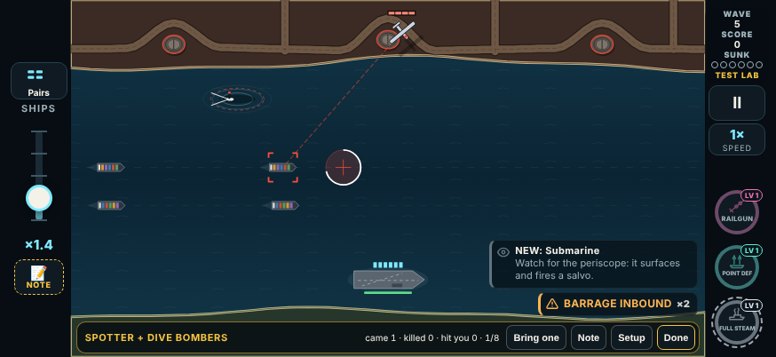
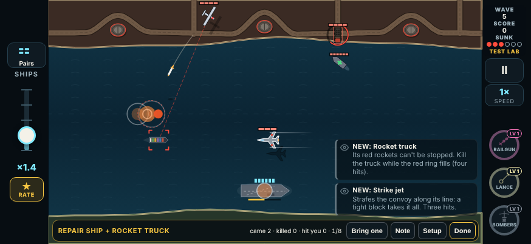
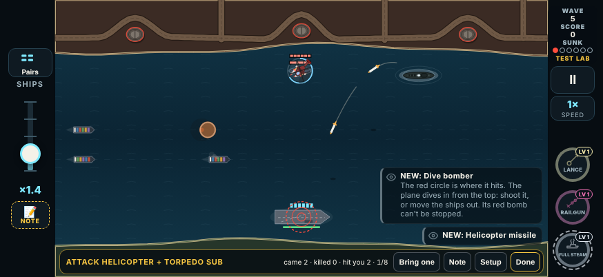
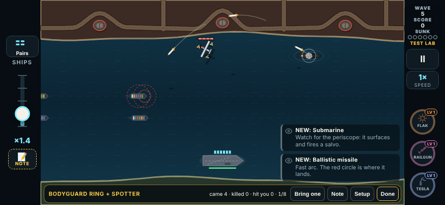

# V3 enemy pairs (Test Lab round 8)

The Test Lab's combos are now **enemy pairs**: two enemies that make each other more dangerous, or cover each other's weakness, coming in together. There are 13: the 4 the player kept and 9 new ones. They live in one list, `src/v3/data/pairs.ts`, which the Test Lab reads now and the map round can read later.

This is **test round 8** in `LAB_ROUNDS`: `{ n: 8, date: '2026-11-10', name: 'Enemy pairs; weapon and enemy notes', since: '2026-11-10T19:00' }`. The parallel builds (player weapons; enemy behaviour and events) add the same round.

## The player's direction

> "Main issue is the pairs should be enemy pairs, not player and enemy attack pairs. Basically looking for good synergy combos to add to the maps."

| Card | Verdict | Note | This build |
|---|---|---|---|
| Lure Beacon + Drone Screen | | "Good but we are looking for enemy weapon pairs here, not player and enemy weapons" | Cut |
| Incendiary Missile + Flak | | "Looking for enemy and enemy attack pairs" | Cut |
| Bodyguard Ring + Seeker Pod | | "Looking for enemy and enemy attack pairs" | Cut |
| Hydra + Sprint Drones, Tesla | | "Looking for enemy and enemy attack pairs" | Cut |
| Decoys + Sprint Drones | Keep | "Good pair" | Kept as it was |
| Siege Battery + Rocket Truck | Tune · Too hard | "Too much of an attack at once" | They take turns (below) |
| Repair Ship + Bodyguard Ring | Keep · Fun | "Very hard but doable" | Kept as it was |
| Spotter + Siege Battery | Keep (earlier) | "Much better this time" | Kept as it was |

## The pairs

Each pair has an id (its Test Lab card is `combo-<id>`), its members (the lead first), the first chapter it can come in (every member out by then; the original threats count as chapter 1) and a rule that brings it in together.

| Id | Pair | Ch | Synergy | Pairing rule |
|---|---|---|---|---|
| `decoy-sprint` | Decoys + Sprint Drones | 1 | Half the swarm is fake and the sprinters fly in among it: every shot spent on a decoy is one not spent on a drone that is about to sprint. | One raid from the launch base furthest from the convoy: the Decoy swarm leads, the Sprint Drones follow 0.5 s later from the same base. |
| `decoy-cluster` | Decoys + Cluster Missiles | 1 | The decoy swarm draws your shots in the very seconds the cluster missiles have to die, before they split over the convoy. | The Decoy swarm leads from the furthest base. Two Cluster Missiles follow from the same base, launched so they reach the convoy with the swarm (`arrive`). |
| `hydra-swarm` | Hydra + Drone Swarm | 1 | The Hydra flies inside a drone swarm: whatever clears the drones as they close on the ships kills the Hydra there too, and splits it into darts at the convoy. | A swarm of six drones leads from the furthest base. The Hydra follows from the same base, timed to catch the swarm up (`arrive`). |
| `scavenger-swarm` | Scavenger + Drone Swarm | 2 | The Scavenger waits over the water where your pickups fall; the swarm makes you spend ammo, and the Scavenger keeps you from the pickups that would refill it. | The Scavenger leads, in from the top to circle. A swarm of six drones launches 2.5 s later. |
| `heli-sub` | Attack Helicopter + Torpedo Sub | 2 | The helicopter hovers over the sub's water and keeps your gun busy with its missile pairs; the sub surfaces under it, and its short time up goes by while you deal with the helicopter. | The helicopter leads. The sub's periscope comes up 1 s after the helicopter reaches its hover, on the water under it (`near`). |
| `armored-hydra` | Armored Drones + Hydra | 2 | The armored drones make you wait for their bank; the Hydra makes you shoot early, before it splits. Together there is no good time to wait. | Two Armored Drones lead, 0.6 s apart, from the furthest base. The Hydra follows from the same base, timed to arrive with them. |
| `spotter-siege` | Spotter + Siege Battery | 3 | The Spotter paints a ship and the siege gun rises while it paints, so the first shells land with the strike the Spotter calls. | The Spotter leads. The siege hatch opens 3.5 s after the Spotter reaches its circle. |
| `siege-truck` | Siege Battery + Rocket Truck | 3 | Two launchers you can't outshoot, one after the other: the gun comes up while the truck is still firing, so there is no quiet moment to break either. | The truck leads. The siege hatch opens **6.5 s after the truck stops**, as it fires its last salvo; the shells start landing 1.5 to 2 s after the last rockets. Sets at least **28 s** apart in a wave. |
| `spotter-dive` | Spotter + Dive Bombers | 3 | The Spotter paints a ship and the dive bombers put their circles on it: with the strike it calls, three hits come at the one ship. | The Spotter leads. Two Dive Bombers follow, their circles 2.5 s and 4 s after it reaches its circle (it paints from 2 s). A dive bomber's circle goes on the painted ship. |
| `tender-bodyguard` | Repair Ship + Bodyguard Ring | 4 | The guards take your shots for the heavy while the Repair Ship mends what gets through. | The Repair Ship leads. The Bodyguard Ring (a heavy and its guards) launches as it reaches its station. |
| `tender-truck` | Repair Ship + Rocket Truck | 4 | The Repair Ship moors off the end of the truck's road and mends the truck between salvos: a truck you only half break comes back. | The Repair Ship leads, to a station 70 px off the end of the shore road nearest where it was going. The truck comes down that road as the ship reaches its station (`near`). |
| `lure-stealth` | Lure Beacon + Stealth Strafers | 4 | The beacon pulls your helpers' fire onto itself, and the strafers, with no warning, come in while your helpers are busy on it. | The beacon leads. Two Stealth Strafers follow 0.5 s and 3 s after it has risen. |
| `guard-spotter` | Bodyguard Ring + Spotter | 4 | The guards take the shots meant for the Spotter, so it stays up to paint its ship and call its strike. | The Spotter leads, with a ring of three guards round it from the moment it flies in (no heavy of its own; `near`). |

Chapters: 3 pairs in chapter 1, 3 in 2, 3 in 3, 4 in 4. Three pairs bring original threats (drone swarms, cluster missiles).









More in `docs/design/img/pairs/`: `decoy-cluster.png`, `lure-stealth.png`, `siege-truck.png`. They are 874×402, taken by `tools/v3/test-lab/pair-shots.mjs` the moment every member was up.

## Siege Battery + Rocket Truck: taking turns

Before, the siege hatch opened as the truck stopped, so its first shells landed while the truck's five salvos were still coming in. That was "too much of an attack at once".

**Now they take turns.** The hatch opens 6.5 s after the truck stops, as it fires its last salvo. The truck's rockets land from about 2.4 to 10.5 s after it stops (five salvos 1.5 s apart, up to 2 s of flight). The first shells land about 12.4 s after it stops. So the gun is up, and can be shot, while the truck finishes. But nothing of the siege gun lands until the rockets are done.

Sets of this pair in one wave are at least 28 s apart (`gap`), so one set's shells don't land on the next set's rockets either.

| | Before (round 4 timing) | After |
|---|---|---|
| Together on the board, quiet, median (min) | 11.7 s (11.6) | 5.1 s (5.0) |
| Average bot: the pair's own hull hits per Quick test | 6.5 | 3.0 |
| Average bot: ships sunk per test | 2.1 | 0.6 |
| Sharp bot: ships sunk per test | 0.3 | 0.6 |

(20 seeds each. The sharp bot's 0.3 → 0.6 is noise of a couple of seeds; its pair hits went 1.8 → 2.5.)

## What the build changed

**Cut:** the four combos with a player weapon. The weapon-drop pairing mode went with them:
- `LAB_SET.weaponLead`, the set's `dropped` flag and the drop by the carrier before each set;
- the weapon argument of the combo cards.

Weapon cards still drop their weapon with Bring one, as before.

**The pairs list:** `src/v3/data/pairs.ts`.
- `LabPair`, `PairFollow` and `PairMember` moved there (`data/lab.ts` re-exports them).
- The Test Lab's combo cards are built from `PAIRS`: `combo-<id>`, the pair's name, look line, kit and rule. `foes` is the pair's new enemies.

**What a pair can say** (new in the rule):
- **A member can be an original threat** (`OLD_THREATS`: `drone`, a swarm of 6, 0.35 s apart; `cluster`, two, 0.6 s apart). One goes out at once from the set's base and the rest are queued from the same base. They are tagged `paired`, so the lab's "together" counts the set's own swarm, not the wave's drones.
- **A member twice** (two Armored Drones, two Dive Bombers, two Stealth Strafers): each is its own follower.
- **New stations:** the Attack Helicopter at its hover, the Lure Beacon risen.
- **`near`:**
  - a Torpedo Sub's periscope moves to the water under the helicopter's hover;
  - a Repair Ship leading a truck moors 70 px off the end of the nearest shore road, and the truck takes that road;
  - a Bodyguard Ring forms round the lead (no heavy).
- **`gap`:** a pair can ask for its sets to be further apart than the lab's 12 s.

**Enemy behaviour** (the one change outside the pair code): a Dive Bomber's circle goes on the ship a Spotter is painting, when one is. It follows the Spotter's existing rule that most new launches go for the painted ship. The random pick is still drawn, so a run with no Spotter plays exactly as before. This is in `launchFoe` in `src/v3/sim/foes.ts`, and applies in the campaign too, wherever a Spotter and a Dive Bomber meet.

**The lab's "together":** `foeOnBoard` now counts:
- a dive bomber's circle before its plane;
- a sub's torpedoes, as the sub;
- a cluster's bomblets, as the cluster.

**Section blurb:** "Enemy pairs: two enemies that make each other more dangerous, coming in together."

**Kits:** each a three-weapon loadout from the pair's chapter (every weapon's `ROSTER` unlock is at or before it), with no weapon dropped for the pair. Lure + Stealth Strafers carries two helpers (Gunship Pair, Point Defense), as a chapter-4 player would. Without them the beacon has nothing to lure.

## Measured

The harness is `tools/v3/test-lab/pairs.mts`: `npx vite-node tools/v3/test-lab/pairs.mts -- 20` for every pair, or with card ids. It measures, over 20 seeds, on the lab's water:
- **Quiet:** nobody shooting and the convoy can't lose. This is the round-4 metric: the longest stretch in the first wave with every member on the board at once. Also the same after Bring one.
- **Bots:** the sharp and average bots play a Quick test (two waves). The table gives:
  - the pair's own hull hits on the card's tally (its new enemies only);
  - ships sunk per test;
  - tests the convoy came through.

| Pair | Together, quiet: median (min) | Bring one: median (min) | Sharp: its hits · sunk · through | Average: its hits · sunk · through |
|---|---|---|---|---|
| Decoys + Sprint Drones | 11.2 s (9.4) | 8.8 s (8.8) | 0.0 · 0.2 · 20/20 | 0.3 · 0.3 · 20/20 |
| Decoys + Cluster Missiles | 7.0 s (5.2) | 6.7 s (5.5) | 0.0 · 1.1 · 18/20 | 0.0 · 1.6 · 19/20 |
| Hydra + Drone Swarm | 7.0 s (6.3) | 8.3 s (8.0) | 3.2 · 0.1 · 20/20 | 4.1 · 0.7 · 20/20 |
| Scavenger + Drone Swarm | 14.1 s (7.8) | 12.1 s (6.8) | 0.0 · 0.1 · 20/20 | 0.0 · 0.1 · 20/20 |
| Attack Helicopter + Torpedo Sub | 14.2 s (12.4) | 14.2 s (12.4) | 0.3 · 0.4 · 20/20 | 0.8 · 0.2 · 20/20 |
| Armored Drones + Hydra | 6.4 s (6.1) | 7.7 s (7.5) | 4.8 · 1.1 · 19/20 | 6.0 · 1.8 · 19/20 |
| Spotter + Siege Battery | 18.0 s (18.0) | 18.0 s (18.0) | 2.1 · 0.3 · 19/20 | 3.8 · 0.7 · 20/20 |
| Siege Battery + Rocket Truck | 5.1 s (5.0) | 5.1 s (5.0) | 2.5 · 0.6 · 19/20 | 3.0 · 0.6 · 20/20 |
| Spotter + Dive Bombers | 7.5 s (6.9) | 7.3 s (7.0) | 0.3 · 0.3 · 20/20 | 0.6 · 0.3 · 20/20 |
| Repair Ship + Bodyguard Ring | 12.8 s (7.0) | 11.8 s (5.7) | 0.0 · 2.1 · 18/20 | 0.0 · 3.0 · 17/20 |
| Repair Ship + Rocket Truck | 13.5 s (13.4) | 13.5 s (13.4) | 3.0 · 1.8 · 18/20 | 3.1 · 2.7 · 17/20 |
| Lure Beacon + Stealth Strafers | 7.4 s (7.4) | 7.4 s (7.4) | 1.0 · 0.3 · 20/20 | 2.4 · 0.6 · 20/20 |
| Bodyguard Ring + Spotter | 34.1 s (26.4) | 34.0 s (26.4) | 0.0 · 0.5 · 20/20 | 0.0 · 0.4 · 20/20 |

**Every pair is together 4.5 s or more in every seed,** in the first wave and after Bring one.

**For comparison,** the single-enemy cards on the same harness give sunk per test, average bot:
- 0.1 to 0.3 for most single enemies;
- 0.4 for the Hydra, 0.7 for the Siege Battery;
- 1.3 for the Repair Ship (it brings a heavy);
- 1.6 for the Bodyguard Ring.

Through is 19 or 20 out of 20 for all of them.

**Reading it:**
- **The synergies show.** Armored + Hydra sinks 1.8 a test against 0.3 and 0.4 for its two enemies alone. Decoys + Clusters sinks 1.6 against the decoys' 0.2.
- **No pair is a wall.** Every pair lets the average bot through at least 17 tests in 20.
- **The hardest two are the Repair Ship pairs** (17/20 with the average bot, about 3 ships a test). Most of it is the heavy the Repair Ship always brings, since a direct hit sinks a ship. Repair Ship + Bodyguard is the player's "very hard but doable", kept as it was. Repair Ship + Rocket Truck is at the same level, so it fits the same chapter-4 slot.
- **"Its hits" counts only the new enemies.** A Decoy pair's harm is all in its real drones and clusters, which the card's tally doesn't count, hence 0.0. The sunk column is the convoy's whole loss.
- **The bots break most pairs before the second member arrives.** With them shooting, the median time together is 0 to 4 s, against 5 to 34 s quiet. The sharp bot kills a Spotter or a helicopter before it gets to its station. A player who lets it get there meets the pair.

## How the map round can use `pairs.ts`

```ts
import { PAIRS, enemyPair, pairChapter } from '../data/pairs';

const p = enemyPair('spotter-dive'); // or PAIRS.filter((p) => p.chapter <= chapterOf(map))
p.members;      // ['spotter', 'diveBomber', 'diveBomber']
p.chapter;      // 3: every member is out by chapter 3
p.synergy;      // the line for a briefing or a call-out
p.pair.lead;    // who launches at the pair's time
p.pair.follow;  // who comes after, on which cue (launch, station, arrive), from which base, placed by the lead
p.pair.gap;     // how far apart two of it should be in one wave (default 12 s)
```

- **To place a pair in a wave:** put its id in the map's wave script at a time. To launch it, do what `updateLabSets` in `src/v3/sim/game.ts` does for the Test Lab:
  - the lead out at that time;
  - each follower on its cue, with the same fallbacks (a lead shot down first, or 14 s without reaching its station, lets the others come at once).
  - That function reads only `g.lab.pair` and `g.lab.sets`. The map round can lift it into a shared `launchPairSets(g, pair, sets)`, called from both the lab and the campaign.
- **Where a pair fits:**
  - its `chapter`, at the earliest;
  - the measurements above for weight: the Repair Ship pairs and Armored + Hydra are a chapter's late waves, and Decoys + Sprint Drones or Spotter + Dive Bombers can be early ones.
- **Nothing is wired into the campaign's waves yet.** The only campaign change is the Dive Bomber going for a painted ship.

## The review page

- **Retired cards:** the cut combos are in `LAB_RETIRED` (`src/v3/data/lab.ts`), with their enemies, weapon, the round they were cut (8) and why. They are not in `LAB_CARDS`, so the hub doesn't list them and a saved queue drops them.
- **`labResultDocs`** (`src/v3/sim/labDocs.ts`) still writes a result for a retired card, marked `cut: { round: 8, why }`, with its evidence. An id the lab never had is still dropped.
- **`tools/v3/test-lab/cards.mts`** prints `retired` beside `cards`.
- **`tools/v3/test-lab/page.mjs`:**
  - the Results tab's Combos section lists the 13 pairs, from the cards;
  - a new **Cut cards** section lists the four cut combos, with "Cut in round 8: …" and their last verdicts;
  - they never show "changed since: retest", and the tally counts only live cards.
- The page needs a rebuild and republish to show round 8. This build doesn't publish it.

## Checks

- `tests/v3/pairsRound8.test.ts` (15 tests):
  - one combo card per pair, ids matching `pairs.ts`;
  - no combo card has a weapon, and no pair member is a player weapon;
  - each pair's chapter is its members' and its kit is from that chapter;
  - round 8 and the section blurb are in;
  - Siege + Truck: no siege shell lands within 1.2 s of a rocket (seeds 1 to 3), and the first shell comes after the set's last rocket;
  - the dive bombers' bombs land on the painted ship;
  - the periscope comes up under the helicopter;
  - the Repair Ship moors within reach of the truck and mends it;
  - the guards ring the Spotter and take its shots;
  - a set's swarm is tagged as the pair's;
  - three pair cards with Bring one replay exactly;
  - a cut card's verdict is kept, marked cut.
- `tests/v3/lab.test.ts`:
  - for all 13 pairs, every member is on the board together for 4.5 s or more in the first wave (seeds 1 to 3), and after Bring one (seeds 1 and 2);
  - Hydra + Drone Swarm with Bring one replays exactly;
  - the card counts (98 cards, 13 combos) and round 8.

## Verified

- `npx tsc --noEmit` is clean.
- `npx vitest run --exclude '.claude/**'` passes all 1321 tests in 46 files.
- `npx vite build` and `npm run build:store` succeed.
- On an isolated build (`vite preview` on port 4299), `e2e/v3.mjs` passes all 195 checks and `e2e/v3-audio.mjs` all 16. The hub check now expects 98 cards, 13 combos and none of the cut ones; the round checks expect round 8.

## Judgement calls

- **Siege + Truck: taking turns** rather than fewer salvos. Both launchers keep their numbers, so the cards for each enemy alone are unchanged. The overlap the player wanted ("Much better this time" was about meeting) stays: the gun is up while the truck finishes.
- **Hydra + Drone Swarm is close to the cut Hydra + Sprint Drones.** That card was cut for its Tesla, not its enemies. This one uses the original drone swarm, so it isn't the same card again.
- **A Repair Ship always brings its heavy,** so it does in Repair Ship + Rocket Truck too. Dropping it would make the pair lighter but change what a Repair Ship is.
- **The Scavenger is being reworked in parallel** (it denies pickups inside a radius). Its pair only times the swarm to the Scavenger's arrival, so it holds whatever the Scavenger does. Its numbers here are the old Scavenger's.
- **Two members of a kind** (two Armored Drones, two Dive Bombers, two Strafers) where one alone was too thin to make the synergy show.
