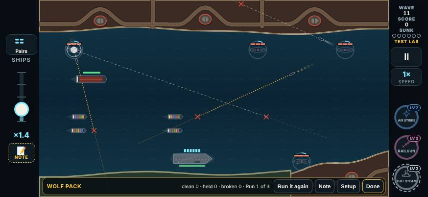
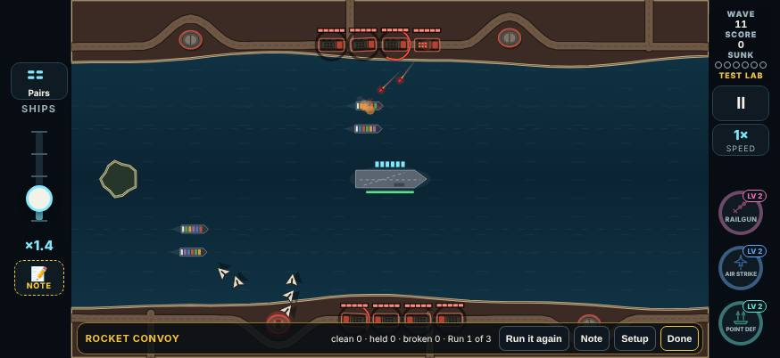
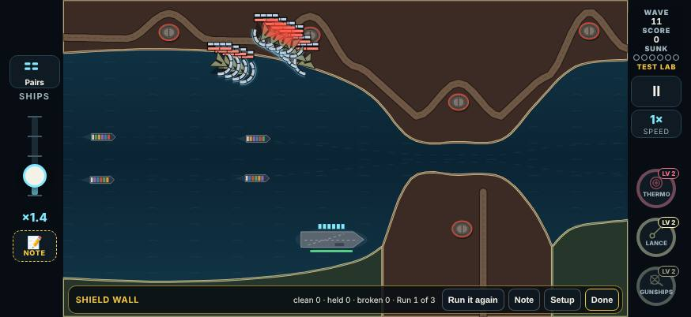
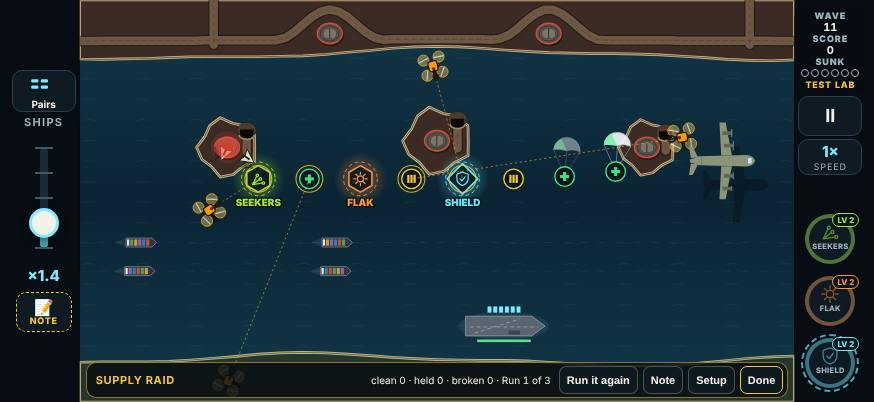
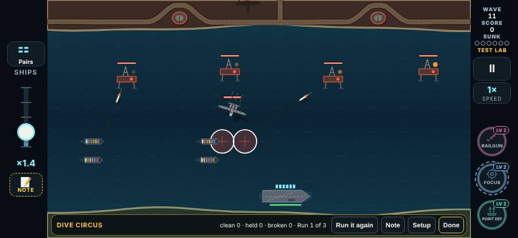
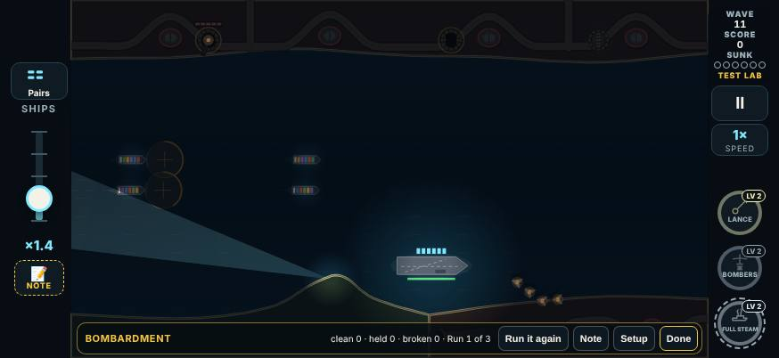
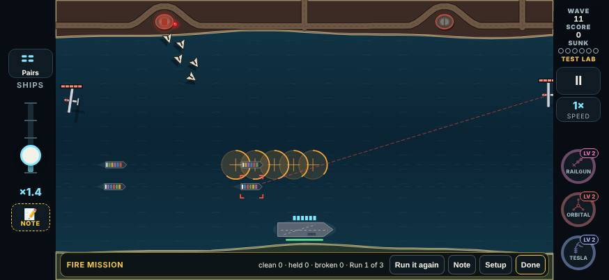
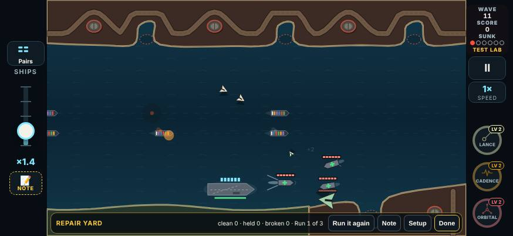

# V3 special events, round 6: the second pass

This round builds your notes from the first Test Lab playtest of the special events (build 2026-11-09T19:13, the event cards of test round 5). Your notes are in `tools/v3/test-lab/playtest-2026-11-10.json`, exactly as the logs have them.

Eight event cards changed, and each one has a round 6 line in the Test Lab (`LAB_CHANGES`), so the hub asks for them again. Round 6 is `{ n: 6, date: '2026-11-10', name: 'Special events, second pass', since: '2026-11-10T04:00' }`. The other nine events are as they were.

## All events

> "Not for all of these special events
>
> I like the three waves actually after doing it more
>
> Then also no nukes for these special events events"
>
> (a note from the pause menu, in the Bombardment)

**No Nuke in any special event.** No Nuke drops or appears while an event runs:
- **Kill drops:** the Nuke's weight is 0 in the drop table (`eventDropWeights`).
- **The Supply Raid's cargo:** its first run used to carry a Nuke. That crate is a repair now.
- **Airdrop's planes** (Supply Run at MAX): they can drop a Nuke in a normal wave, but not in an event.
- **Anything else:** `addPickup` turns a Nuke into a repair while an event runs, so no other source can slip one through.

The rule is only on while the event runs. Out of an event, the Nuke drops as before.

**A Nuke you already hold:** V3 has no way to hold a Nuke. It is a pickup that goes off when you tap it, and a cleared wave clears the water, so none is ever on the water when an event starts. So there was nothing to keep. If a Nuke were somehow on the water as an event began, it would still work: only new ones are stopped.

**Full is still three runs.** The lab bar now says which run it is: "clean 0 · held 0 · broken 0 · Run 1 of 3". The Gunship Wall note ("I thought it would be one and done") is why. Quick reads "Run 1 of 1". Other cards keep their "2/8".

## Each event

| Event | Your verdict and note | What changed |
|---|---|---|
| Afterburner Rush | Tune: "That was hard! I will try again" | Nothing |
| Gunship Wall | Keep: "That was good you really do need a good power up or weapon drop to deal with it tho which is fine just observe to make but why also three rounds not following that I thought it would be one and done" | Nothing (the run count is now on the bar) |
| Rocket Convoy | Keep, Too easy: "Too easy" | Harder (below) |
| Blackout | Keep: "Hard but doable" | Nothing |
| Decoy Storm | Keep: "This one was a lot of fun. I would definitely make the drones more I guess visible for which ones are the decoys make them like a different color slightly than the other one so it's easier to point out. Apply that for just this enemy attack in general not just this special event." | Nothing in this build: the colour is for the Decoy enemy everywhere |
| Hydra Bloom | Keep: "I think we need to slow down Hydro a bit at least the initial break of them. You can keep the speed after it splits, but make the initial stage slower than that. Applies for the whole hydra not just this." | Nothing in this build: the speed is for the Hydra everywhere |
| Wolf Pack | Tune, Too easy: "Make sure they shoot multiple torpedoes each in different directions and then maybe you can give them one or two fast torpedoes too just total not for each you could do that for the actual enemy attack two doesn't always have to be a fast one, but you can add in a fast one every once in a while add a little bit of variability to that one" | Spreads and fast torpedoes, in the event only (below) |
| Shield Wall | Keep: "You can spread them out a bit they all come from the same launcher" | Several launch points (below) |
| Supply Raid | Keep: "Yeah, this one's more fun than anything. Just make it so there's no nukes that get dropped during the special event cause I just kind of run up rivers of it and then add more drones that take them and have them come from all side." | No Nuke; more scavengers, from every side (below) |
| Carpet Run | Keep, no note | Nothing |
| Dive Circus | Tune, Too easy: "Fun but could have more than planes" | Missiles between the dives (below) |
| Bombardment | Tune, Too hard: "Add in some drones to allow some drips that. I think we needed so I can have more of a chance" (Broken in all six runs) | Supply drones (below) |
| Fire Mission | Tune, Too easy: "Wayyyyto easy let's rework this completely need a different idea for this one" | A new Fire Mission (below) |
| Repair Yard | Tune: "Worked good but it had a ship stuck that didn't travel at all I think it would be better to have the repair ships come from multiple directions on convert on the same spot" | The stuck ship fixed; the repair ships converge (below) |
| Escort Run | Keep: "Was hard but I think it is a good balance" | Nothing |
| Siren Field | Keep, Fun: "This one's really good and we should save it and only play on the player has a lot of passive pick up so make it like a only activate if there is at least two passive pickups because it'll be a challenging one for them so this one should be able to work on any map put that in its own category there might be other categories like that too" | Nothing in this build: its new category is a question for you first |
| Firestorm | Keep: "Really fun idea might be hard to master. I think kind of keep it as it is, but we'll test it out more. Probably need to be tuned down / I beat it the second time. It was fine. I'll keep it as it is." | Nothing |

### Rocket Convoy: two columns

- **Two columns of four trucks**, one down each of the Gauntlet's shore roads (north and south). There was one column of four. The south column sets out 1.5 s after the north.
- **They drive in faster:** 2.8 × a truck's speed (2 ×).
- **They raise closer together:** 1.4 s after the truck ahead (2.6 s). The south column raises half a turn after the north, so the salvos of the two columns overlap.
- **More trucks, less of each:** 5 hits (8) and 2 salvos (3) a truck.
- A wreck still stalls the trucks behind it, but now only on its own road.

### Wolf Pack: spreads, and fast torpedoes

- **Each sub fires a spread of two or three torpedoes.** Each torpedo has its own heading and its own dashed line. Where a ship lies on a clear heading (0.42 rad from the others), a torpedo goes for it; otherwise the spread fans out round the first.
- **Two of the event's torpedoes are fast**, in total, not one per sub: 2.2 × a torpedo's speed.
  - **What a fast one looks like:** an amber line in short dashes that run along it, and a longer amber wake.
  - **Which ones:** the subs that fire them are picked at random when the event starts.
- **More time per sub:** with a spread to fire, a sub fires 0.6 s later than a lone one would.
- **Fewer subs:** the packs are four and three (five and three).
- **The normal Torpedo Sub is unchanged.** Your note's "you could do that for the actual enemy attack" is not in this build.

### Shield Wall: from several launch points

- **Each of the block's three rows comes from its own launch point** on the far shore:
  - the drone base furthest from the carrier;
  - another drone base on that shore, if one is near;
  - otherwise a launcher set up on the shore 320 px either side.
- The rows fly to a muster point a quarter of the way to their ship and form up there. The nearer rows set out later, so all three arrive together.
- **The block then goes on as before:** plates forward, banking together at the two signals. If it has not formed after 7 s, it goes anyway.

### Supply Raid: more scavengers, from every side, no Nuke

- **Six scavengers a run** (three before), twelve in all, half a second apart.
- **From every side in turn:** left edge, right edge, top, bottom. Each leaves the way it came.
- **No Nuke in the cargo.** The first run's Nuke crate is a repair.

### Dive Circus: missiles between the dives

- The eight dives keep their beat (one every 2.3 s).
- **On every other off-beat, a pair of guided missiles** comes from two bases, 0.3 s apart. That makes three pairs, each between two dives.
- I tried drone swarms as well. The Test Lab card's bots lost 60% of their runs with them, so the extra threat is the missiles only (a judgement call).

### Bombardment: supply drones

- **Four supply swarms of four drones**, from 0.5 s, one every 3.5 s.
- **Every supply drone shot down drops a pickup.** They come in turn: a repair, ammo, one of your weapons, a repair. Never a Nuke.
- **They fly at the carrier, not the ships.** One that gets through costs a carrier hit (Held at worst), not a ship. That keeps them a chance to resupply more than a threat. With them going for the ships, the ordinary bot was Broken more often, not less.
- **The guns take turns further apart:** each hatch first rises 3 s after the one before (2.2 s).

### Fire Mission: a new event

**The idea.** Three Spotter planes take turns calling artillery onto the convoy, each from its own side of the screen. Each turn is short: a spotter comes in, marks a ship, calls the guns and leaves. The shells walk down the lane through the ship it marked.

**How a turn goes:**
1. **In.** A spotter flies in from off its side of the screen: the first from the left, the second from the right, the third from the far side of the lane (over the enemy shore). It heads for a spot 150 px off the lane on that side.
2. **It paints a ship.** The moment it is on the screen it paints a ship (the red paint line). The ship nearest its spot is painted, never the one painted last.
3. **It calls the barrage** 3 s after it came on the screen. Five shell circles appear on the water along the painted ship's course. From 2.4 s after the call, the shells land one after another, 0.4 s apart. They walk from behind the ship, through it and on ahead, so the ships around it are in the way too. Each shell does one hit.
4. **Out.** It climbs back out the way it came and is gone (not a kill).

**The rhythm.** A new turn every 4.4 s: left, right, far side, then round again. Each spotter flies two turns, six in all. Three drone swarms come for company. While a ship is painted, most new launches go for it, as with any spotter.

**What a kill does:**
- A spotter shot down **before it calls** takes its barrage with it, and it never comes back for its next turn.
- **Once called, a barrage comes**, whatever happens to the spotter.
- A spotter hit but not killed **keeps its damage** for its next turn. It has 5 hits.

**The card** says "Fire Mission" with no rule chip (there is no special rule in force). Its question: "Three spotters taking turns and shells walking down the lane: hard in a good way?" Nothing in the game says how to beat it.

The old Fire Mission (one spotter with three escorts, five strikes) is gone, and so is the spotter's "strike after strike" code that only it used.

### Repair Yard: the stuck ship, and repair ships that converge

**The stuck ship was a repair ship.**
- **How the old event placed them:** each of the three had a station beside the mothership's course, 120 px off it. If that side was land, the station moved to the other side, then was clamped to the screen.
- **Where it went wrong:** on Smugglers' Coves the mothership comes from the south-east base. One station landed inside the closed cove by that base: water, but walled in by land.
- **Why it never moved:** a repair ship sails in from a screen edge on a straight run over open water. No straight run reaches that cove, so the game "raised it where it is" and marked it on station.
- **The result:** it sat in the cove for the whole event and never travelled.
- **Your run** (seed 81721): the first of its three runs was Broken, with 5 ships lost.
  - The old placement used no dice, so it was the same in every run on that map: two repair ships sailed in from the east edge, and the third rose in the cove at (1271, 820). I re-ran the old code on your seed to check.
  - Your log doesn't record what sank the five ships, so I can't tell how much the stuck ship had to do with it.
  - A test now plays your card on your seed and checks every repair ship starts off the screen.

**What changed:**
- **The meeting spot.** It is open water on the mothership's course, about halfway along it, clear of land 80 px all round. Ships must be able to sail to it from at least two sides of the compass.
- **Three directions.** The three repair ships come in from different screen edges, as far round from each other as the water allows. They come only on straight runs over open water.
  - On Smugglers' Coves that means the west, the east and the north-east (across the lane). The south is land.
- **They converge.** Each stands on a ring 56 px round the spot, on the side it came from. The mothership passes over the spot, inside their reach.
- **They sail 1.6 × faster** in the event, so the one from the far (west) edge arrives about when the mothership does.
- **None rises in place** unless no edge can reach the spot at all. If that happens, it rises on the open-water spot itself, never in a cove.
- **A blocked repair ship works its way round.** Everywhere, not just in the event: a repair ship whose next step would be onto land now turns its heading a little at a time (the same side until it is clear) and works round the headland.
  - Before, it stopped dead. That happened when another boat sat on its route next to a shore: it gave way to the boat, was pushed against the land, and stayed there for good.

## What the bots made of it

`npx tsx tools/v3/special-events/measure.mts 20 --only=… [--lab]`. Twenty seeds each, the sharp and the average ("ordinary") bot.

There are two ways to measure:
- **The event's own table** (as in the build doc): the event at wave 11 with ten waves of drafts handed over, flow 2, the convoy already under way.
- **New: `--lab`**, the event as its Test Lab card plays it. The card's kit at level 2 with frequent drops, the default flow (1), and the event waiting for the convoy to sail in. Only the first run of each card is measured.
  - This is closer to how you met the events. The kits are weaker than ten drafts, and fewer ships means each loss counts for more.
  - It is much harsher than the event's own table for some events.

### The event's own table (wave 11, ten drafts, flow 2)

| Event | Bot | Before: Clean / Held / Broken | After: Clean / Held / Broken |
|---|---|---|---|
| Rocket Convoy | sharp | 100 / 0 / 0 | 75 / 25 / 0 |
| Rocket Convoy | average | 100 / 0 / 0 | 75 / 10 / 15 |
| Wolf Pack | sharp | 65 / 30 / 5 | 65 / 15 / 20 |
| Wolf Pack | average | 55 / 35 / 10 | 45 / 25 / 30 |
| Shield Wall | sharp | 90 / 10 / 0 | 80 / 5 / 15 |
| Shield Wall | average | 95 / 0 / 5 | 85 / 5 / 10 |
| Supply Raid | sharp | 100 / 0 / 0 | 100 / 0 / 0 |
| Supply Raid | average | 100 / 0 / 0 | 100 / 0 / 0 |
| Dive Circus | sharp | 100 / 0 / 0 | 85 / 10 / 5 |
| Dive Circus | average | 100 / 0 / 0 | 85 / 5 / 10 |
| Bombardment | sharp | 90 / 10 / 0 | 100 / 0 / 0 |
| Bombardment | average | 70 / 5 / 25 | 60 / 30 / 10 |
| Fire Mission | sharp | 100 / 0 / 0 | 85 / 10 / 5 |
| Fire Mission | average | 100 / 0 / 0 | 65 / 35 / 0 |
| Repair Yard | sharp | 90 / 10 / 0 | 90 / 5 / 5 |
| Repair Yard | average | 90 / 10 / 0 | 70 / 30 / 0 |

### As the Test Lab card plays it (`--lab`)

| Event | Bot | Before: Clean / Held / Broken | After: Clean / Held / Broken |
|---|---|---|---|
| Rocket Convoy | sharp | 65 / 20 / 15 | 20 / 25 / 55 |
| Rocket Convoy | average | 55 / 20 / 25 | 30 / 15 / 55 |
| Wolf Pack | sharp | 90 / 10 / 0 | 75 / 25 / 0 |
| Wolf Pack | average | 30 / 55 / 15 | 35 / 40 / 25 |
| Shield Wall | sharp | 90 / 0 / 10 | 75 / 5 / 20 |
| Shield Wall | average | 95 / 0 / 5 | 80 / 15 / 5 |
| Supply Raid | sharp | 100 / 0 / 0 | 100 / 0 / 0 |
| Supply Raid | average | 100 / 0 / 0 | 100 / 0 / 0 |
| Dive Circus | sharp | 60 / 35 / 5 | 40 / 35 / 25 |
| Dive Circus | average | 65 / 20 / 15 | 45 / 35 / 20 |
| Bombardment | sharp | 75 / 5 / 20 | 100 / 0 / 0 |
| Bombardment | average | 50 / 15 / 35 | 25 / 55 / 20 |
| Fire Mission | sharp | 100 / 0 / 0 | 40 / 60 / 0 |
| Fire Mission | average | 100 / 0 / 0 | 25 / 60 / 15 |
| Repair Yard | sharp | 65 / 20 / 15 | 60 / 30 / 10 |
| Repair Yard | average | 40 / 25 / 35 | 40 / 25 / 35 |

**Reading it:**
- **Rocket Convoy, Dive Circus and Fire Mission are no longer trivially Clean.** In the event's own table the sharp bot is at 75 to 85% (100% before). In the lab measure it is at 20 to 40%.
- **Wolf Pack is harder too.** It loses more ships in both measures, and the sharp bot's lab Clean is down from 90% to 75%.
- **The Bombardment is fairer.**
  - The ordinary bot's Broken is down from 25% to 10% (own table) and from 35% to 20% (lab).
  - The sharp bot goes from 75% Clean to 100% in the lab measure.
  - More of the ordinary bot's runs are Held: a supply drone got to the carrier.
- **Nothing is a guaranteed Broken.** The most is 55% (the Rocket Convoy in the lab measure, both bots).
- **The Rocket Convoy's two measures pull apart.** I tuned it to the event's own table (sharp ≤ ~70–75% Clean). With the card's chapter 1 kit at level 2, both bots lose it about half the time.
  - Your three runs of the old one were Held, Clean, Clean, against the bots' 65% Clean on the same measure. So you play it better than these bots, but this one most needs your next test.
  - The levers, if it is too much: each truck's hits (5) and how fast the columns drive in (2.8 ×).
- **The Shield Wall is about as before** on the event's own table (sharp 80% Clean, from 90%). Its rows are apart now, so a splash weapon no longer catches the whole block as it leaves its one base. That is what made the old one quick for the lab's sharp bot.
- **The Repair Yard is about as before.** Its change was the bug and the way the ships come in, not its difficulty.
- **The bots aren't you.** They stand in for a player, and the lab measure's runs are short. Each row is 20 runs, so a row can move 10 to 15 points between runs of the same code. The playtest is the real measure.

The events this round left alone measure much as they did; the drop rolls shift slightly with the Nuke out of the table. On the event's own table:
- **Afterburner Rush:** sharp 100% Clean.
- **Gunship Wall:** sharp 95% Clean.
- **Firestorm:** sharp 55% Clean, average 20% Clean.
- **Blackout:** the average bot is 35% Clean, 65% Held (55% Clean before). Its night is unchanged, so this is the rolls.

## Judgement calls

- **The Nuke:** turned into a repair in any event, not just left out. That is the simplest rule that also covers drop sources added later.
- **"Run 1 of 3":** on the bar's count line, in place of "1/3". Not a new element.
- **Rocket Convoy:** more trucks with less each (two columns of four, 5 hits, 2 salvos), not more salvos. The other ideas (overlapping salvos, a second column, a faster raise) are all in it too.
- **Wolf Pack:** fewer subs (seven, not eight) and a little more time for each, so the spreads don't make it a near-certain Broken for the ordinary bot. The two fast torpedoes are fixed at two, picked at random.
- **Shield Wall:** it joins up at a muster point (one block from three points) rather than coming as two or three separate blocks.
- **Supply Raid:** six scavengers a run (double), not a different number per side.
- **Dive Circus:** missiles only, no drone swarms (above).
- **Bombardment:**
  - the supply drones fly at the carrier;
  - the guns are spaced further apart;
  - the siege guns' hits and salvos are unchanged.
- **Fire Mission:** the design is mine (above). It is built on the Spotter and the siege shell circle, both of which you know.
  - The shells are siege-style circles that can't be shot down, so killing the spotter in time is the only way to stop a barrage. The card doesn't say so.
  - Each shell does one hit. The middle three land on and either side of the painted ship, so a barrage that lands usually sinks it.
- **Repair Yard:**
  - "converge on the same spot" is built as a meeting spot on the mothership's course, which it flies over. The mothership doesn't stop there.
  - The repair ships sail faster in the event, so the far one arrives in time.
  - The shore-skirting fix applies to the Repair Ship everywhere. It is a bug fix, and it doesn't change how any repair ship that wasn't stuck sails.

## Unsure

- **The Rocket Convoy in the lab:** see above.
- **The Fire Mission's numbers:** small changes swing it hard.
  - In tuning, 8 hits a spotter made every run Held for both bots.
  - At 5 hits, calling at 2.6 s rather than 3 s took the ordinary bot from 65% Clean to 10%.
  - It is at 5 hits, with 3 s to call.
- **The Shield Wall picture:** it shows two of the rows closing (the third sets out last). The rows are 320 px apart. On the Needle of Bosk there is only one drone base on the far shore, so two of the launch points are launchers set up on the shore beside it.

## Files

- `src/v3/data/events.ts`: the eight events' numbers and questions (`EV`, `EVENTS`).
- `src/v3/sim/events.ts`:
  - the scripts: two columns, spreads, the Shield Wall's rows and muster, scavengers from every side, missile pairs, supply swarms, the Fire Mission's turns and walking barrage, the Repair Yard's meeting spot and runs;
  - no Nuke in the drop table;
  - the supply drones' drops.
- `src/v3/sim/foes.ts`:
  - the spread and the fast torpedo;
  - the armored drone forming up;
  - the Fire Mission spotter;
  - a scavenger leaving the way it came;
  - `wetRun`;
  - the repair ship skirting a shore;
  - the barrage's shell damage.
- `src/v3/sim/game.ts`: the Nuke guard in `addPickup` and Airdrop's crates, and the supply drone flag (`cargo`) and its drop.
- `src/v3/ui/foes.ts`: the fast torpedo's line and wake.
- `src/v3/sim/lab.ts`, `src/v3/ui/lab.ts`: "Run n of 3" (`labCountText`).
- `src/v3/data/lab.ts`: round 6, and the eight round 6 lines.
- `tests/v3/eventsRound6.test.ts`: the tests. `tests/v3/events.test.ts` has the new counts.
- `tools/v3/special-events/measure.mts`: `--lab`.
- `tools/v3/special-events/build-shots.mjs`: the new picture moments.
- `docs/design/img/events/*.jpg`: the eight changed events' pictures.
- `tools/v3/test-lab/playtest-2026-11-10.json`: your notes.
