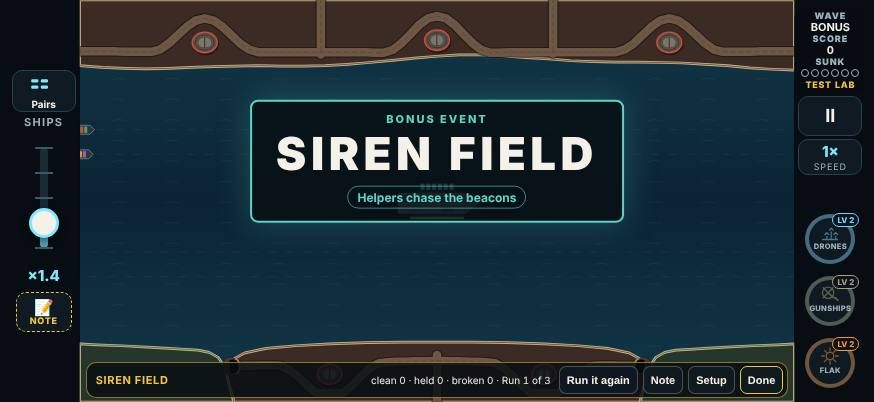
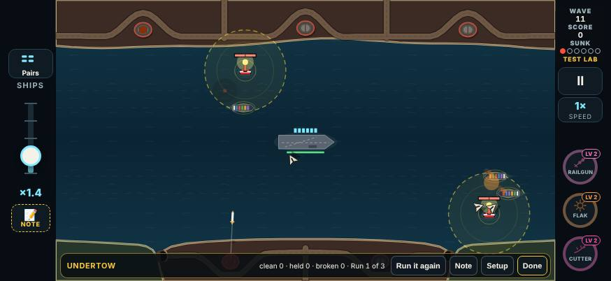
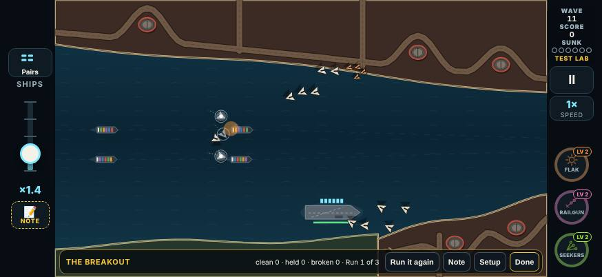
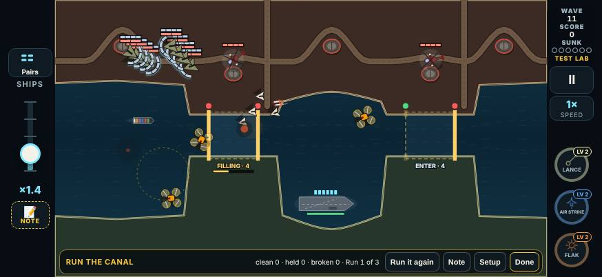
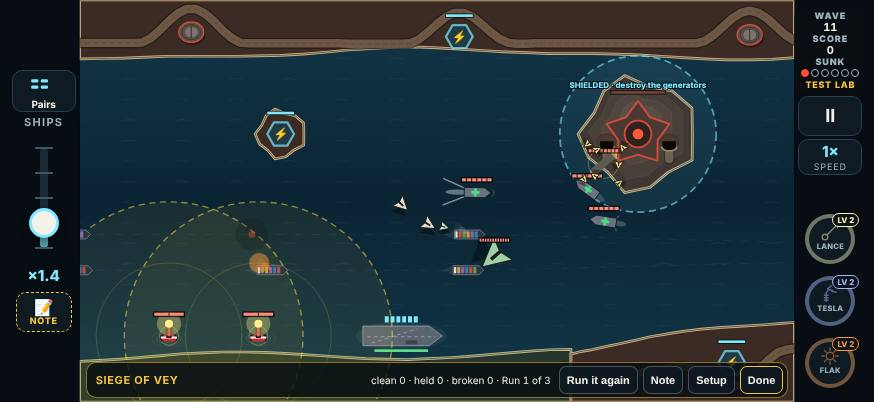

# V3 special events, round 7: a bonus event, an event for every map, and a three-run ending

This round builds three of your decisions on the special events:
- **Siren Field is a bonus event now**, in a new category of its own.
- **Every map has its own event.** Four are new: Undertow on Dunmar Crossing, and the three chapter finales.
- **The map's event is three runs, with the convoy restored first.** It is an experiment, behind one flag.

Round 7 in the Test Lab is `{ n: 7, date: '2026-11-10', name: 'Enemy tweaks; more events', since: '2026-11-10T06:00' }`. Another build adds the same round for its enemy changes. Five event cards have a round 7 line: the four new ones and Siren Field.

## Your words

> "the siren should appear as a bonus"

> "we should save it and only play [when] the player has a lot of passive pick up so make it like a only activate if there is at least two passive pickups because it'll be a challenging one for them so this one should be able to work on any map put that in its own category there might be other categories like that too"
>
> (your Siren Field note, Test Lab round 6)

> "some [enemies] could have more than one special event, so we'll need to come up with a few more so each map has its own."

> "I do like how the special event is three waves total that you have to beat. Let's experiment with it at the end: players get their lives reset right before it starts, so if they go out with just one left, it's [not] gonna be hard for them to beat that."

## 1. Bonus events: a category of their own

Events come in two kinds now (`EventKind` in `src/v3/data/events.ts`):
- **Map events.** Each map has one, after its ten waves.
- **Bonus events.** These are not tied to a map. They are listed in `BONUS_EVENTS`, and each entry says:
  - which wave the bonus wave follows (`after`);
  - its condition, a function of the run as that wave ends (`when`);
  - the condition in words, for the docs and the Test Lab, never the card (`why`);
  - the map its Test Lab card plays on (`labMap`).

To add another bonus event later, add one line to `BONUS_EVENTS` and write its script in `src/v3/sim/events.ts`.

**Siren Field is the first bonus event.**
- **The condition:** as wave 6 ends, the run holds **two or more passive weapons**. A passive is a weapon whose roster category is passive (`roster.ts`): Frigate Escort, Point Defense, Drone Screen, Gunship Pair, Bomber Wing and Orbital Strike.
  - "Holds" means drafted and in a slot, at level 1 or more. A run holds at most three weapons, so this is two or three of the three.
  - I read your "passive pickups" as passive weapons held. In V3 a weapon pickup only drops for a weapon you hold, so the two come to the same thing.
- **Where:** on any campaign map (not Free Play, endless or the Test Lab's other cards).
- **How often:** once a run at most.
- **When:** straight after wave 6, before wave 6's draft. The bonus wave comes up with its card, and the draft wave 6 earned follows it.
  - The bonus wave is not one of the map's waves. The counter reads **WAVE BONUS**, the wave number stays 6, and wave 7 onwards are planned exactly as before.
  - It pays no wave score and makes no wave record of its own.
- **Its card** says **BONUS EVENT** over the name, in sea-green rather than gold, with its rule chip ("Helpers chase the beacons"). The outcome banner and the result screen call it a bonus event too.
- **Its reward:** the same grading as any event (Clean, Held, Broken) and the same bonus score (+3,000 Clean, +1,500 Held).
- **The event itself is unchanged:** five beacons, every helper pulled to them, six drone swarms.
- **It is no longer Dunmar Crossing's event.** Undertow is (below).

## 2. Undertow: the Lure Beacon's second event (Dunmar Crossing)

**The idea, plainly.** Beacons rise in the water beside the shipping lanes. Any ship that sails into a beacon's ring slows to a crawl, and the ships behind it close up on it. Then shells start falling on the ships the rings are holding. A beacon stays up for 16 seconds, unless you sink it.

It needs no helpers. Siren Field covers helpers; this one is about your own ships.

**How a run goes:**
1. **Two beacons rise**, one by each of Dunmar's two lanes. Each comes up just outside its lane, on the side away from the carrier, about 170 px ahead of the middle of that lane's convoy, so the ships sail into its ring.
2. **The ring.** A beacon's ring is 130 px, drawn as the Lure Beacon's dashed yellow ring. A ship inside it, once the beacon is up, sails at **30% of its speed**.
   - Ships following it slow down too, because a ship always keeps its distance from the one ahead. The result is a knot of slowed ships.
   - Each held ship has yellow ripples closing in round its hull, so you can tell which ships are caught.
3. **Barrages.** Five shore barrages, one every 3.6 s from 3 s in.
   - With ships held, a barrage is three shells, aimed at the held ships.
   - With no ship held, it is one shell, at any ship.
4. **A second pair of beacons** rises 9 s in, the same way: ahead of the middle of each lane's convoy as it is then.
5. **Company:** three drone swarms.

**The rule on the card** is "Ships slow inside a beacon's ring". That is the rule in force, not how to beat it.

**Other rules:**
- A beacon still takes only your taps, and its ring still draws any helper inside it, as the Lure Beacon always does. Here that is the same 130 px ring, not the usual 300.
- The script never looks at whether you have helpers.

**Why this one.** Of the three ideas, the slow zone is the one you can read on a phone at a glance: a ring, and ships crawling inside it. It also gives the Lure Beacon a second job that is about your convoy, not your helpers.
- "Missiles pulled toward the ship nearest a beacon" would be hard to see.
- "Sink them in the right order" needs numbers on the water, and a rule the card would have to explain.

## 3. The three chapter finales

Each brings its chapter's four new enemies, as the design doc described, in phases one after another.

### The Breakout (Harbor Mouth), chapter 1

**The rule on the card:** "No ammo drops at first". There are no ammo drops until the Hydras come, 8 s in. After that, ammo drops again.

**How it plays:**
1. **The opening (from 0 s):**
   - Three decoy swarms of five, three fake in each, from the drone bases, 0.9 s apart.
   - One sprint swarm of four among them, at 2.4 s.
2. **The Hydras (from 12 s):** a fan of three Hydras, from the three bases furthest from the carrier, 1.2 s apart, at 65% of their speed. They split as Hydras always do.
3. **The trucks (from 16 s):** a pair of rocket trucks in a column down the north shore road. They behave as in the Rocket Convoy:
   - each stops behind the one ahead and raises after it;
   - a wreck stalls the truck behind it;
   - each takes 4 hits and fires 2 salvos.

**How it was tuned.** I tuned it down from four decoy swarms, two sprint swarms, four Hydras and trucks on both roads. On the bots' whole campaign runs that version was Broken in 7 of 11 first runs for the sharp bot.
- The opening emptied the rack: with no ammo drops, the bots were often still at 0 rounds when the Hydras arrived.

### Run the Canal (Saltgate Canal), chapter 2

**How it plays:**
1. **The pack (from 0 s):** three periscopes as the convoy comes in. Each sub fires a spread of two torpedoes, 1.4 s after the one before.
2. **The gunships (from 7 s):** two attack helicopters fly in and hold over the far bank, one by each lock. They open fire in turn, 5 s after they are called and 1.1 s apart.
   - The locks are where your ships wait while a chamber fills.
   - Each helicopter takes 4 hits and fires 3 volleys.
3. **The thieves (from 9 s):** three scavengers, from the sides of the screen in turn, after whatever the fight drops.
4. **The block (from 17 s):** eight armored drones in two rows of four, from launch points along the enemy shore. They form up, then fly at one ship and bank together at two signals, the Shield Wall's flash.
5. **Company:** two drone swarms.

### Siege of Vey (Citadel of Vey), chapter 4

**How it plays:**
1. **The Repair Yard on the Citadel (from 0 s):**
   - A drone mothership comes out of the Citadel: 12 hits, at 80% of its speed.
   - Three repair ships sail in from different sides to meet near the Citadel, 30% of the way along the mothership's course.
   - From there they mend whatever enemy is hurt within their reach: the mothership, and the Citadel and its generators. They mend 2 hits every 2.6 s.
2. **The Escort Run (from 8 s):**
   - A heavy missile with 8 hits comes out of the Citadel, in two rings of guards (three and four). It starts at half speed, and each ring stripped speeds it up.
   - Two lure beacons rise on open water. These are ordinary ones: they draw only the helpers inside their ring.
3. **The Firestorm (from 17 s):** five firebombs from every side, at 85% of their speed. Their fires burn 10 s.
4. **Company:** two drone swarms.

If the Citadel has already fallen, everything comes from the live base furthest from the carrier.

## 4. The three-run ending, the convoy restored first (one flag)

**The flag:** `ENDING.threeRuns` in `src/v3/data/events.ts`, on by default.

**With it on:**
- **Three runs.** The map's event is three back-to-back runs, waves 11, 12 and 13.
  - Between runs there is no draft: the next run's card comes up and its 3 s breather starts at once.
  - As at the end of any wave, the board clears and the rack refills. A weapon loaded in the gun goes with the board.
  - Clearing the third run wins the map.
- **The counter** reads **WAVE 11/13** to **13/13** on every map.
- **The card** says "Special event · wave 12 · Run 2 of 3".
- **The briefing** says "Special event: Undertow, waves 11–13".
- **The restore**, right before run 1. What I took "lives" to mean in this game is your ships and the carrier's hull, so the restore puts both back to full:
  - **Ships:** the ships lost so far stop counting against the six the run may lose. The SUNK pips go back to empty. The tally of ships lost on the result screen still counts them.
  - **Hulls:** every ship afloat is mended to full.
  - **The carrier:** its hull is full.
  - A call-out says **CONVOY RESTORED**: "Every ship back, and the carrier's hull repaired."
  - It happens once, before run 1, not before runs 2 and 3.
- **Grading.** Each run is graded as before (Clean, Held, Broken) and pays its own bonus, so the three bonuses add up.
  - The ending as a whole is its **worst run**, shown as a last chip on the result screen ("The ending · Worst run · Held").
  - I chose worst-of because three runs are one test: if any of them broke, the ending broke.
- **The result screen** shows a chip for each run ("Run 1 of 3 · Undertow · Clean +3,000") and the whole.
- **The Test Lab** has always played three runs on a Full test. It now reads its number of runs from the same setting (`LAB_EVENT_RUNS.full = ENDING.runs`), and its bar still says "Run n of 3".
  - The lab has no restore: a lab card starts with the convoy whole anyway.

**With it off:** the old ending. One run at wave 11, no restore, and the counter reads x/11. A test checks this.

**Always true:**
- No Nuke during an event: the drop table and the guards from round 6 cover every run and the bonus wave.
- A bonus wave is never one of the three runs.

## What the bots made of it

`npx tsx tools/v3/special-events/measure.mts 20 --only=… [--lab]` for the events, and `--campaign --ending=both` for whole maps. The sharp bot reacts in 0.35 s; the average bot reacts in 0.6 s and misses 8% of its taps.

### The four new events and the bonus

**The event's own table:** the first run, at wave 11 with ten drafts handed over, flow 2, the convoy under way. Siren Field is played after wave 6, with two passives in hand.

| Event | Bot | Clean | Held | Broken | Ships lost (avg) | Seconds |
|---|---|---|---|---|---|---|
| The Breakout | sharp | 95% | 5% | 0% | 0.05 | 23 |
| The Breakout | average | 100% | 0% | 0% | 0.00 | 23 |
| Run the Canal | sharp | 85% | 5% | 10% | 0.60 | 24 |
| Run the Canal | average | 65% | 15% | 20% | 0.95 | 24 |
| Undertow | sharp | 90% | 5% | 5% | 0.15 | 21 |
| Undertow | average | 45% | 30% | 25% | 0.80 | 22 |
| Siege of Vey | sharp | 75% | 25% | 0% | 0.10 | 35 |
| Siege of Vey | average | 65% | 35% | 0% | 0.20 | 36 |
| Siren Field (bonus) | sharp | 85% | 10% | 5% | 0.40 | 23 |
| Siren Field (bonus) | average | 85% | 10% | 5% | 0.35 | 24 |

**As the Test Lab card plays it (`--lab`):** the card's kit at level 2, flow 1, the event waiting for the convoy.

| Event | Bot | Clean | Held | Broken | Ships lost (avg) | Seconds |
|---|---|---|---|---|---|---|
| The Breakout | sharp | 60% | 35% | 5% | 0.45 | 24 |
| The Breakout | average | 70% | 25% | 5% | 0.35 | 23 |
| Run the Canal | sharp | 85% | 0% | 15% | 0.55 | 23 |
| Run the Canal | average | 75% | 20% | 5% | 0.30 | 23 |
| Undertow | sharp | 75% | 15% | 10% | 0.35 | 22 |
| Undertow | average | 55% | 35% | 10% | 0.60 | 23 |
| Siege of Vey | sharp | 65% | 20% | 15% | 0.50 | 38 |
| Siege of Vey | average | 25% | 60% | 15% | 0.70 | 38 |
| Siren Field (bonus) | sharp | 85% | 5% | 10% | 0.45 | 21 |
| Siren Field (bonus) | average | 65% | 15% | 20% | 0.85 | 23 |

**Reading it:**
- **The sharp bot holds (Clean or Held) at least 85% of the runs of every new event, on both measures.**
- **Nothing is a guaranteed Broken.** The most is 25%: the average bot on Undertow's own table.
- **The Breakout is the hardest of the four in the real campaign**, harder than its own table says. In the bots' whole campaign runs on Harbor Mouth (below), the sharp bot's runs of it were 34% Clean, 41% Held and 25% Broken.
  - The own table's ten handed-over drafts are a strong kit for it. The bots' own drafts in the campaign are weaker.
- **Siege of Vey is mostly Held:** the heavy and the mothership go for the carrier, so a carrier hit (Held) is common.
- **Undertow without a player:** with no shots fired, the rings held one to four ships at a time, and the barrages sank four ships in the first run.

### The whole map: the three-run ending against one run

- 20 seeds a map, from wave 1, the balance sweep's settings (`runBot`, flow 2, no Armory).
- **Through 10:** how often the bot got through wave 10. On Harbor Mouth, Saltgate Canal and Citadel of Vey that was winning the map before this round (they had no event).
- **1 run:** won the map with the flag off (one run at wave 11, no restore).
- **3 runs:** won the map with the flag on (three runs, the convoy restored first).

| Map | Chapter | Sharp: through 10 | Sharp: 1 run | Sharp: 3 runs | Average: through 10 | Average: 1 run | Average: 3 runs |
|---|---|---|---|---|---|---|---|
| The Strait | 1 | 100% | 100% | 100% | 100% | 100% | 90% |
| The Kesh Hook | 1 | 100% | 95% | 65% | 100% | 95% | 85% |
| Lee of Marrow | 1 | 90% | 85% | 90% | 90% | 90% | 60% |
| The Gauntlet | 1 | 80% | 55% | 40% | 80% | 65% | 30% |
| Harbor Mouth (new: The Breakout) | 1 | 55% | 55% | 50% | 45% | 45% | 45% |
| The Island | 2 | 50% | 35% | 30% | 60% | 60% | 25% |
| The Behemoth Run | 2 | 45% | 40% | 40% | 25% | 20% | 10% |
| The Needle of Bosk | 2 | 30% | 20% | 20% | 20% | 15% | 10% |
| The Archipelago | 2 | 45% | 45% | 45% | 20% | 15% | 20% |
| Saltgate Canal (new: Run the Canal) | 2 | 10% | 10% | 5% | 5% | 5% | 0% |
| Battery Point | 3 | 10% | 10% | 10% | 5% | 5% | 5% |
| Sowers' Reach | 3 | 25% | 25% | 25% | 20% | 20% | 20% |
| The Rig Field | 3 | 20% | 20% | 20% | 0% | 0% | 0% |
| The Black Strait | 3 | 10% | 10% | 10% | 0% | 0% | 0% |
| Dreadnought Pass | 3 | 10% | 10% | 10% | 10% | 10% | 10% |
| Smugglers' Coves | 4 | 15% | 5% | 10% | 10% | 10% | 5% |
| The Sharra Delta | 4 | 5% | 5% | 0% | 0% | 0% | 0% |
| Dunmar Crossing (new: Undertow) | 4 | 20% | 15% | 20% | 20% | 20% | 20% |
| Tidewater Flats | 4 | 10% | 10% | 10% | 5% | 0% | 0% |
| Citadel of Vey (new: Siege of Vey) | 4 | 15% | 10% | 10% | 10% | 0% | 0% |

**Reading it:**
- **Three runs are harder than one, even with the restore.** In chapters 1 and 2, where the bots reach the ending often enough to tell:
  - The Kesh Hook, sharp: 95% → 65%.
  - The Gauntlet: sharp 55% → 40%, average 65% → 30%.
  - The Island, average: 60% → 25%.
  - Lee of Marrow, average: 90% → 60%.
  - The Strait, average: 100% → 90%.
- **Why.** Each run carries the same risk as the old single run, and the restore comes only once. A run is usually lost to one bad run, not to coming in hurt.
  - On The Island, the average bot's Gunship Wall runs were each Broken a quarter to a third of the time. Some runs lost five or six ships in one go: a helicopter wall left standing sinks the convoy.
  - Across three runs that adds up to losing the map about half the time.
- **Where it doesn't move:** chapters 3 and 4. These bots get through ten waves only 0 to 25% of the time there, so those rows are a handful of runs each and say little.
- **Your case is real but rare for the bots.** "If they go out with just one left": the bots seldom reach wave 11 down to their last ship, so the restore helps them less than it would help you. For a player who limps into the ending, it gives the whole convoy back.
- **The bonus wave** came up in 19 of the 400 sharp-bot campaign runs (20 seeds on each of the 20 maps), and 18 of the average bot's:
  - sharp: 14 Clean, 2 Held, 3 Broken;
  - average: 13 Clean, 1 Held, 4 Broken;
  - all on maps from chapter 2 on. The bots rarely draft two passives by wave 6, and in chapter 1 the only passives in the draft are the Frigate Escort, Point Defense and the Drone Screen.
  - A bonus wave is never the end of a run. Its Broken costs ships, but the draft follows it as usual.

**The levers, if three runs are too much:**
- **Restore before every run, not just the first.** This is the one closest to your note.
- **A draft, or an ammo and repair drop, between runs.**
- **Two runs instead of three** (`ENDING.runs`).
- Or the flag off.

## The Test Lab

- **Four new cards** in the Events section, each starting straight into its event on its own map at wave 11. Their kits:
  - The Breakout: Flak, Railgun, Seeker Pod.
  - Run the Canal: Lance, Airstrike, Flak.
  - Undertow: Railgun, Flak, Laser Cutter (no helpers, on purpose).
  - Siege of Vey: Lance, Tesla, Flak.
- **Siren Field's card stays.** It starts the bonus event straight in, on Dunmar Crossing (its lab map), at wave 6's pace, with its kit of Drone Screen, Gunship Pair and Flak (two passives). Its card says BONUS EVENT.
  - The bonus event works on any map; the card just picks one.
- **The cards are in campaign order,** the finales after their chapter's other events and Siren Field last. That makes 21 event cards, and 93 cards in all.
- **Round 7 lines:**
  - The Breakout: "New event (Harbor Mouth): decoys, sprinters, Hydras, then trucks".
  - Run the Canal: "New event (Saltgate Canal): subs, gunships over the banks, thieves, then an armored block".
  - Undertow: "New event (Dunmar Crossing): beacons by the lanes slow the ships in their rings".
  - Siege of Vey: "New event (Citadel of Vey): repair ships, a guarded heavy and beacons, then firebombs".
  - Siren Field: "Now a bonus event: a bonus wave after wave 6 on any map, when you hold two passives". Its look question changed to say it is a bonus wave.
- **A finale card features all four of its chapter's enemies,** so its "came / killed" counts all four.

## The play log

**Version 19.** Since this round:
- a run that won at wave 11 plays on to 13;
- the three finale maps have events;
- the bonus wave can come after wave 6.

Older logs need their own build to replay.

Each event record says whether it was a bonus event (`kind: 'bonus'`) and which run of the ending it was (`run`, `runs`). A test replays a recorded three-run ending, restore and all, and a recorded run through the bonus wave.

## Judgement calls

- **The bonus condition** is "two or more passive weapons held as wave 6 ends", checked before wave 6's draft. That draft comes after the bonus wave.
  - Checking before the draft keeps the draft count unchanged and keeps the bonus a bonus: no extra draft for it.
- **The bonus wave keeps wave 6's number,** and the counter reads BONUS. It pays its event bonus but no wave score, and makes no wave record. So wave 7 onwards, the salvage count and "through wave 10" are exactly as before.
- **No bonus in Free Play, endless or the Test Lab's other cards.** The task said "any campaign map".
- **Undertow's design** is mine: the slow zone. Its numbers:
  - a 130 px ring;
  - 30% speed;
  - 16 s beacons;
  - three-shell barrages only on held ships.
- **The finales' phase timings and numbers** are mine, from the design doc's outlines:
  - **The Breakout:** "a truck pair on the road" is two trucks on one road, and "no ammo drops in the first phase" is the 8 s opening.
  - **Siege of Vey:** "the chapter's four new enemies" adds two ordinary lure beacons to the design's Repair Yard, Escort Run and Firestorm.
  - **Run the Canal:** it adds the scavengers to the design's pack, gunship pair and armored block.
- **"Lives"** are the ships you may still lose (six) and the carrier's hull, so the restore puts both back to full. It also mends the ships afloat.
- **The whole ending's grade is worst-of.** Each run still pays its own bonus, so the score is a sum.
- **Between runs:** no draft, as asked ("a short breather and the event card"). The board clears as after any wave, so a loaded weapon goes.
- **The Test Lab** keeps a draft between its runs, as it had, and has no restore. The shared notion is the number of runs (`ENDING.runs`) and the "Run n of 3" wording.
- **Undertow's beacons draw helpers** only inside their own 130 px ring (as any Lure Beacon does, with its ring). That is not Siren Field's rule.

## Unsure

- **Is three runs too much?** This is the experiment's real question, and the bots say it costs a lot of wins in chapters 1 and 2, restore or not. Your playtest should decide. The levers are above.
- **The Breakout's two measures disagree:**
  - its own table (wave 11, handed-over drafts): 95% Clean for the sharp bot;
  - the bots' whole campaign: 34% Clean, 25% Broken.
  
  I tuned it to the campaign. It may still feel hard after a weak draft.
- **Run the Canal is the easiest finale for the bots** (sharp 85% Clean). Saltgate is already chapter 2's hardest map, so I left it.
- **Undertow's drag ripples** are faint in a still picture. In play they pulse. If they don't read, the next step is tinting the held ships.
- **The bonus wave in chapter 1** can only come from the Frigate Escort, Point Defense and Drone Screen, so it will be rare there.

## Files

- `src/v3/data/events.ts`:
  - the categories (`EventKind`), `BONUS_EVENTS` and its condition;
  - the four new events and their numbers (`EV`);
  - `EVENT_MAPS` for all twenty maps;
  - `ENDING` (the flag), `endingRuns`, `campaignWaves`, `lastEventWave`, `worstOutcome`;
  - the new rules' words.
- `src/v3/sim/events.ts`:
  - the bonus wave (`bonusDue`, `startBonus`, `passivesHeld`);
  - the runs and the restore (`isEventWave`, `nextRunDue`, `restoreConvoy`, `endingOutcome`);
  - the new scripts;
  - Undertow's slow (`eventShipScale`, `caughtBy`);
  - shared pieces the old events now use too: decoy swarms, trucks, helicopters on station, scavengers, the armored block, the repair yard, the escorted heavy, firebombs.
- `src/v3/sim/game.ts`:
  - the end of a wave (bonus, next run, draft);
  - the restore before run 1;
  - `lossBase` and `shipsSunk`;
  - Undertow's slow in a ship's speed;
  - the new events in the log.
- `src/v3/sim/foes.ts`: a Lure Beacon's own ring and life (Undertow).
- `src/v3/ui/app.ts`, `src/v3/ui/events.ts`, `src/v3/ui/foes.ts`, `src/v3/ui/style.css`, `src/v3/ui/dev.ts`, `src/v3/ui/lab.ts`:
  - the bonus card;
  - "Run n of 3";
  - the counter (x/13, BONUS);
  - the SUNK pips after the restore;
  - CONVOY RESTORED;
  - the result chips;
  - the briefing's waves;
  - the held ships' ripples;
  - the beacon's ring.
- `src/v3/data/lab.ts`: round 7, the new cards' kits, the round 7 lines, `LAB_EVENT_RUNS.full = ENDING.runs`.
- `src/v3/sim/playlog.ts`: version 19.
- `tests/v3/eventsRound7.test.ts`: the new tests. `events.test.ts`, `eventsRound6.test.ts`, `lab.test.ts` and `audio.test.ts` have the new counts.
- `tools/v3/special-events/measure.mts`:
  - bonus events, measured after wave 6 with two passives;
  - `--campaign --ending=both`;
  - the bonus count.
- `tools/v3/special-events/build-shots.mjs`: the four new pictures and `siren-card.jpg`.
- `e2e/v3.mjs`: 93 cards, 21 events, WAVE 11/13, "Run 1 of 3", the three result chips and the ending.
