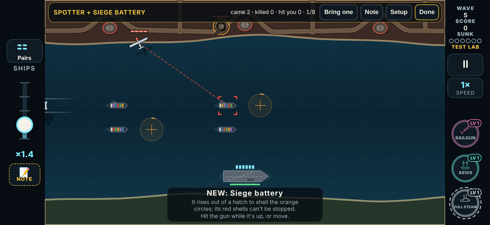
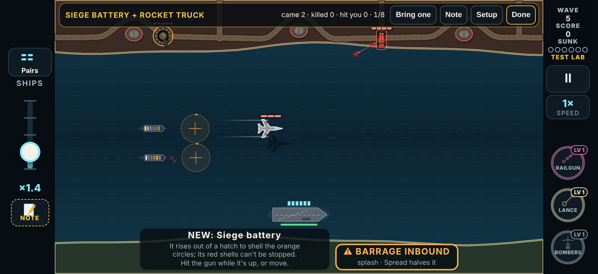
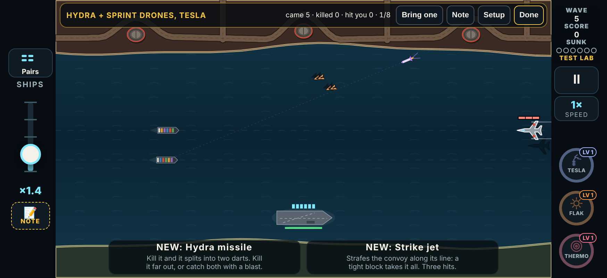

# V3 Test Lab, round 4: combos meet; Dual Wield and Cadence

The player tested again on 2026-11-09 (01:57 to 02:08 UTC). There were four logs, three cards and three notes. The logs were played on build `2026-11-08T20:56`, a round 2 build, so they carry round 2. The verdicts and notes are kept in `tools/v3/test-lab/playtest-2026-11-09.json`.

This build answers the three notes. It is **test round 4** in `LAB_ROUNDS`: `{ n: 4, date: '2026-11-09', name: 'Combos meet; Dual Wield and Cadence', since: '2026-11-09T03:00' }`.

## The notes, verbatim

| Card | Log | Verdict | Note |
|---|---|---|---|
| Spotter + Siege Battery | v3-20261109015734-35571 | (none; lost on wave 7) | "I didn’t seem to work quite right the recon drone and then the siege cannon never really appeared at the same time so I think we need to work on the timing or test that out because I’m sure not all the pairs will have similar timings like that so I’m not gonna play test anymore until we get that kind of fixed" |
| Dual Wield | v3-20261109020159-35572, v3-20261109020445-35573 | Keep | "Worked for the most part, but we just need to think of all the different scenarios that need to be fixed. Such as when you have it picked up the new wheel that is if you pick up another dual wheel it should reset all your current weapons that you have back to the full duration of the dual wheel and then yeah essentially that should be it. I think I’m not sure there’s other scenarios on there too, but I like how it works, but just take a look." |
| Cadence Gun | v3-20261109020457-35574 | (none) | "This works a lot better, but I have the third upgrade be a little bit more powerful. Maybe we could blow up the platforms and vehicles." |

The notes were dictated. "Dual wheel" means Dual Wield, and "I have the third upgrade" means "have the third upgrade".

## 1. Combos meet

**The problem.** A combo test used to treat its enemies as two separate entries in the mix. Each one was planned into whatever raid its theme fell in. Only the first was moved up to open the wave. Their lives are short and very different: a sprint swarm lasts 3 to 10 s, and the Spotter takes 6 to 9 s just to reach its circle. So most of the time the two never shared the screen. That is what the player saw.

**Now.** Every featured appearance of a combo is a **set**: the lead and the rest, launched together and timed to overlap (`LabCard.pair` in `src/v3/data/lab.ts`).
- **Planning:**
  - The wave plans its enemies as before, so the wave's size and make-up don't change.
  - The launches planned for the card's enemies are then taken out of the queue (`planSets` in `src/v3/sim/lab.ts`).
  - They come back as whole sets. There are as many sets as the most-planned of the card's enemies.
  - The first set opens the wave (about 4.5 s in). The others go where the wave had them, at least 12 s apart.
- **Launching:**
  - The game launches each set's members on the pairing's cues (`updateLabSets` in `src/v3/sim/game.ts`).
  - A set still to come holds the wave open, so a wave never ends halfway through a set.
- **Bring one** on a combo brings the whole set, with the same cues, and its weapon. It is still the recorded `'b'` command, so a test that used it replays exactly.
- **A combo with a weapon:** the weapon drops as a pickup by the carrier 1.5 s before each set, and at once with Bring one. It used to come only from kill drops, picked at random from the three kit weapons.
- **Fallbacks:**
  - A follower waiting on its lead comes at once if the lead is shot down first, or after 14 s.
  - A follower that should leave from the lead's base uses that base.

### The pairing rules

| Combo | Leads | Then | Why |
|---|---|---|---|
| Spotter + Siege Battery | Spotter | The siege hatch opens **3.5 s after the Spotter reaches its circle**. | The gun is up while the Spotter paints, and the first shells land with the strike it calls. Measured: shells 21.9 s, strike 21.7 s. |
| Repair Tender + Bodyguard Ring | Tender | The Bodyguard Ring (a fresh heavy and three guards) launches **as the Tender reaches its station**. | The Tender has a guarded heavy to mend. |
| Lure Beacon + Drone Screen | Lure Beacon | Drone Screen drops by the carrier **1.5 s before** each Lure Beacon. | You hold the drones the buoy pulls. |
| Incendiary Missile + Flak | Incendiary Missile | Flak drops **1.5 s before** each one. | You hold Flak when it launches. |
| Decoys + Sprint Drones | Decoy swarm, from the **launch base furthest from the convoy** | The Sprint Drones launch **0.5 s later from the same base**. | One raid, mixed. From a near base the sprinters' dash cut the shared time to 3 s. |
| Siege Battery + Rocket Truck | Rocket Truck | The siege hatch opens **as the truck stops to raise its launcher**. | The gun comes up as the launcher finishes rising, so the shells and the rockets come in the same window (rockets 9.1 to 16 s, shells land 12.6 s and 19.2 s). |
| Bodyguard Ring + Seeker Pod | Bodyguard Ring | Seeker Pod drops **1.5 s before** each ring. | You hold seekers for the guards to soak up. |
| Hydra + Sprint Drones, Tesla | Sprint Drones, from the **launch base furthest from the convoy** | The Hydra launches **from the same base once the drones are due within its own flight time plus 1.5 s**. Tesla drops 1.5 s before. | The Hydra flies twice as fast. Timed this way, it catches the swarm up and they arrive together, within about 1 s. |

### Measured

The harness is in the scratchpad, not the repo; the unit tests check the same thing. It runs:
- 30 seeds;
- the first wave of a Full test;
- nobody shooting (the convoy can't lose).

"Together" means every one of the card's enemies is on the board at once. The siege gun down in its hatch between salvos counts, and so do the Hydra's darts. The table gives the longest such stretch.

| Combo | Seeds with 5 s or more together, before → after | Longest together, median (min), before → after | Bring one, seeds with 5 s or more, before → after | Bring one, median (min), after |
|---|---|---|---|---|
| Spotter + Siege Battery | 7/30 → **30/30** | 0.0 s (0.0) → **18.0 s (18.0)** | 0/30 → **30/30** | 18.0 s (18.0) |
| Repair Tender + Bodyguard Ring | 8/30 → **30/30** | 0.0 s (0.0) → **12.8 s (7.0)** | 0/30 → **30/30** | 11.8 s (5.7) |
| Lure Beacon + Drone Screen | 30/30 → 30/30 | 21.4 s → 21.4 s | 30/30 → 30/30 | 21.4 s |
| Incendiary Missile + Flak | 30/30 → 30/30 | 13.8 s (6.9) → 13.8 s (6.9) | 30/30 → 30/30 | 15.2 s (11.4) |
| Decoys + Sprint Drones | 0/30 → **30/30** | 0.0 s (0.0) → **11.2 s (9.4)** | 0/30 → **30/30** | 8.8 s (8.8) |
| Siege Battery + Rocket Truck | 4/30 → **30/30** | 0.0 s (0.0) → **11.7 s (11.6)** | 0/30 → **30/30** | 11.6 s (11.6) |
| Bodyguard Ring + Seeker Pod | 30/30 → 30/30 | 12.8 s (6.1) → 12.8 s (6.1) | 30/30 → 30/30 | 12.8 s (9.6) |
| Hydra + Sprint Drones, Tesla | 0/30 → **28/30** | 0.0 s (0.0) → **5.3 s (4.7)** | 0/30 → **30/30** | 5.8 s (5.8) |

**The weapon combos' weapon,** with nobody shooting:
- **Before:** it never came, in 30 of 30 seeds, because it only dropped from kills.
- **After:** it is on the water 3.0 s into the wave in 30 of 30 seeds, 1.5 s ahead of its enemy, and Bring one drops it every time.

**The Hydra pair** is as long as the Hydra's own flight (about 5 s from the far base) and can't be longer: it dies when it hits. With the arrival timing, its whole flight is spent among the sprint drones. The two seeds under 5 s were at 4.7 s.

## 2. Dual Wield, every case

**The lock-in rule stays:** both hands run on the boost's clock and both end with it.

**What was wrong:**
- Picking up a second Dual Wield ended the first. Ending it **emptied both hands**, silently, so the player lost both weapons instead of getting them back at full time.
- Any other boost picked up mid-dual did the same.
- With both hands full, a new weapon always replaced the first hand, because both hands showed the boost's time and the tie went to the first.

**The rules now** (`startBoost`, `endBoost`, `boostLoad` and `updateTimers` in `src/v3/sim/game.ts`). Each case has its own test in `tests/v3/boosts.test.ts` ("Dual Wield: every case").

| Case | Rule |
|---|---|
| Another Dual Wield while one runs | The boost's clock starts over at its full time (15 s; 20 s from level 2), and **both hands go back to that full time with it**. "DUAL WIELD · RESET" shows. |
| A different weapon, one hand loaded | It fills the **second hand**, on the boost's clock. |
| A different weapon, both hands full | It replaces the hand **loaded longer ago**, so you hold the two newest. It runs on the boost's clock. |
| A different weapon, no hand loaded | It takes the first hand, on the boost's clock. The next one takes the second. |
| The same weapon as a hand holds | That hand is reloaded fresh: a new load, so for example the beat restarts and Aegis rearms. It stays in its hand and is never doubled into both. Its time is still the boost's. |
| A hand's weapon running out on its own | It can't while the boost runs. A weapon with 1 s left when Dual Wield started lasts the whole boost. |
| The boost runs out | Both hands end with it. One line over the gun says "RAILGUN + SCATTERGUN DONE", then "DUAL WIELD DONE". |
| Nuke, ammo, repair (the power-ups) | No effect on the boost or the hands. |
| Another boost (Shield, Overclock…) | It replaces Dual Wield, since there is one boost at a time. **The hands are no longer emptied:** each keeps the rest of Dual Wield's time on its own clock, so both still end exactly when the Dual Wield would have. |
| The wave is cleared | As before, the boost and both hands are gone, with no "DONE" (the field is cleared for the draft). |
| Levels, drafts | Drafts only come between waves, after the clear. A level drafted then counts from the next pickup, for example 20 s at level 2. |
| Started with the second hand empty | It calls a weapon in: the next kill drops one of yours (never a boost), and it joins on the boost's clock. |
| Started with both hands empty | The same: the first pickup takes hand 1, the next takes hand 2. |

The draft card's line now ends "…then both end; another Dual Wield restarts both".

## 3. Cadence Gun, MAX (War Drum)

**The rule:** at **level 3 only, on the beat only**, the beat shot destroys outright every platform and vehicle within its 40 px line, whatever its health:
- rocket trucks;
- siege guns while up (down in the hatch, a gun isn't a target);
- attack helicopters;
- torpedo subs while surfaced;
- repair tenders;
- stealth bombers and strafers;
- the dive bomber's plane;
- drone motherships.

It also knocks out every launch truck and launch sub that is up within 50 px of the line. These are the "raiders", which nothing but a strike used to touch, and they show TRUCK DESTROYED or SUB DESTROYED.

Everything else on the line takes the beat shot's usual 4. A structure (rig, generator, Citadel, the Dreadnought) only takes the 4. Off the beat, or at levels 1 and 2, nothing changes. War Drum's broadside after three beats in a row stays as it was.

- **Numbers:** `AB.cadence.wrecks` (the kinds) and `AB.cadence.raider: 50` in `src/v3/data/abilities.ts`.
- **Code:** `wreckLine` in `src/v3/sim/game.ts`.
- **The card's MAX line:** "On the beat it blows up any truck, siege gun, helicopter, sub or tender on its line; three beats in a row, and the fourth fires a free broadside at 8 threats".
- **The Test Lab card asks:** "Set it to MAX (War Drum) in Setup: on the beat it now blows up trucks, siege guns, helicopters, subs and tenders. Strong enough?"

**Before,** a 6-hit tender or helicopter needed two beat shots, and launch trucks couldn't be hit at all.

**Tests** (`tests/v3/weapons.test.ts`, "War Drum"):
- one each of six platforms on the line, all at full health, are all destroyed by one beat shot; so is a launch truck;
- a rig only takes 4, and a tender off the line is untouched;
- at level 2 on the beat, and at level 3 off the beat, they take the usual damage and the truck keeps firing.

## 4. Round 4 in the Test Lab

- `LAB_ROUNDS` gets round 4, as above.
- `LAB_CHANGES` gets round 4 lines for Dual Wield, Cadence and every combo:
  - "Its enemies now arrive together" for the two-enemy combos;
  - "Its enemies now arrive together; Tesla drops by the carrier just before" for Hydra + Sprint Drones, Tesla;
  - "<weapon> now drops by the carrier just before each <enemy>" for the three combos of one enemy and a weapon.

  So all 8 combos, Dual Wield and Cadence ask to be tested again.
- The weapon cards' "look for" lines:
  - Dual Wield: "A second Dual Wield now restarts both hands, and another boost no longer empties them: does every case feel right?"
  - Cadence: as above.
- `e2e/v3.mjs` now expects "Test round 4" in the hub's header, and round 4 on a new verdict and its log.

## Verified

- `npx tsc --noEmit` is clean.
- `npx vitest run --exclude '.claude/**'` passes all 1164 tests (34 new). The new ones:
  - `tests/v3/lab.test.ts`, "combos meet": every combo has a pairing. For each of the 8 combos, its enemies are together for 4.5 s or more in the first wave (seeds 1 to 3) and after Bring one (seeds 1 and 2). The siege gun rises while the Spotter paints, and its shells land with the strike. A weapon combo drops its weapon before the enemy, and with Bring one, and picking it up holds it. A combo test that used Bring one replays exactly. The round 4 versions are checked too.
  - `tests/v3/boosts.test.ts`: the Dual Wield cases, 11 tests.
  - `tests/v3/weapons.test.ts`: War Drum, 3 tests.
- `npx vite build` and `npm run build:store` succeed.
- `e2e/v3.mjs` passes all 166 checks and `e2e/v3-audio.mjs` all 16, on an isolated build.
- The screenshots above are from the browser at 874×402: `v3.html?lab=combo-spotter-siege`, `?lab=combo-siege-truck` and `?lab=combo-hydra-tesla`, each taken the moment both enemies were up together.

## Limits

- **The Hydra pair** shares about 5 s, the Hydra's own flight time. The test asks for 4.5 s.
- **Another boost replacing Dual Wield** now leaves the hands their time. This is a reading of "both end when the boost ends" that doesn't punish picking up a Shield. If the player wants a replaced Dual Wield to end its hands too, that is one line in `endBoost`.
- **War Drum's strength** wasn't re-measured with the sweep. The lock-in build had Cadence at MAX at 41% (mid-table). This makes it stronger against platform-heavy waves only.
- **The review page** (`node tools/v3/test-lab/page.mjs`) needs a rebuild and a republish to know round 4's versions. This build doesn't publish it.
