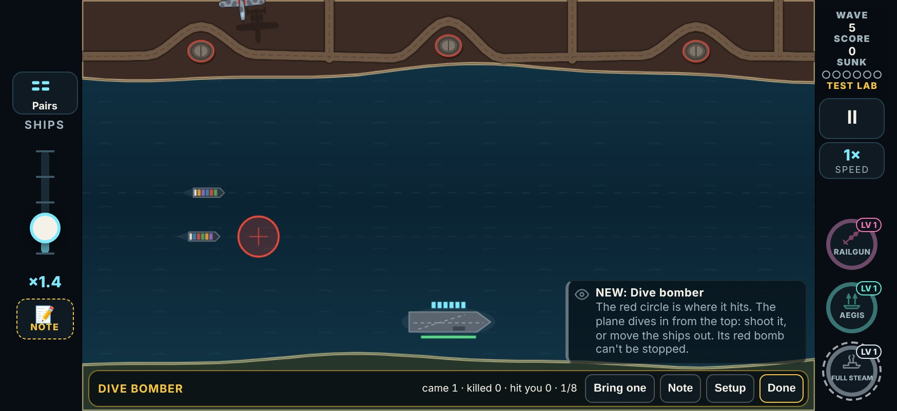
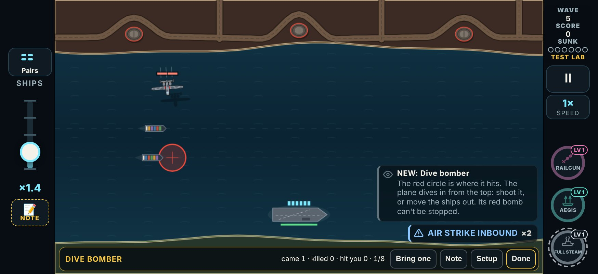
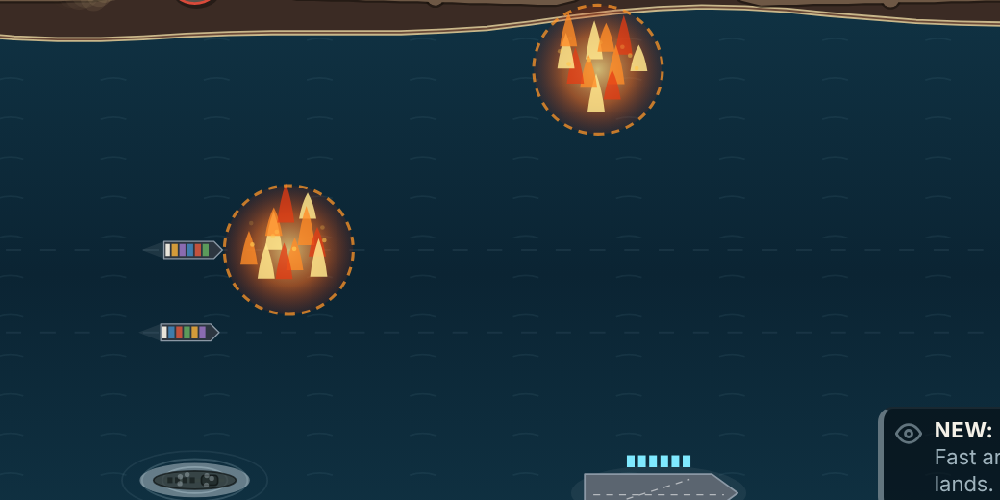
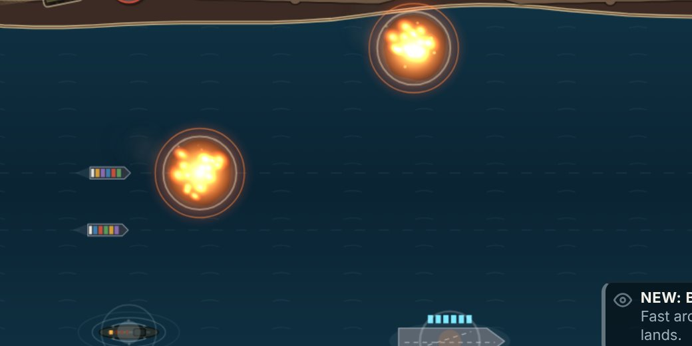
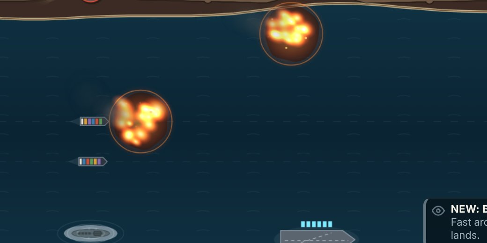
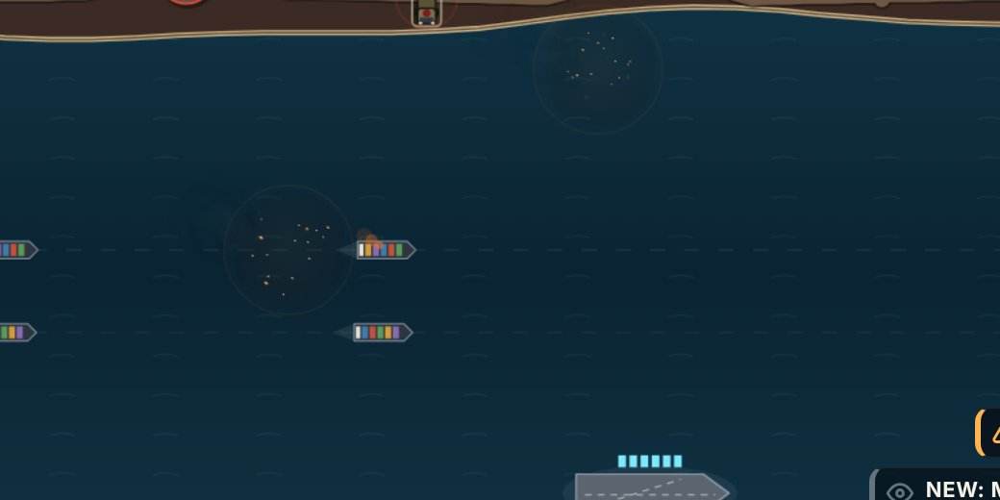
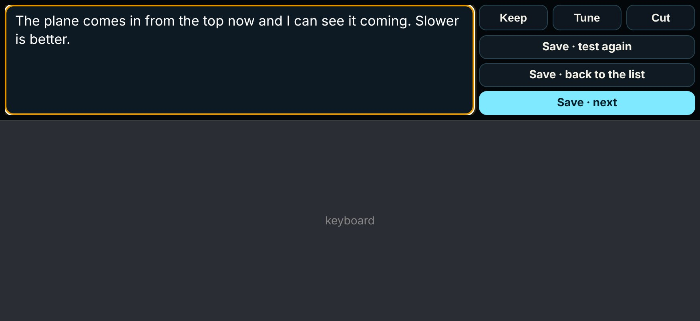
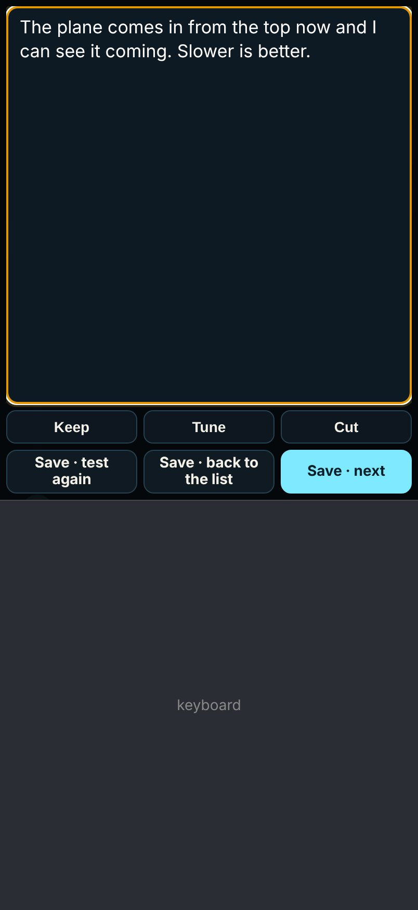
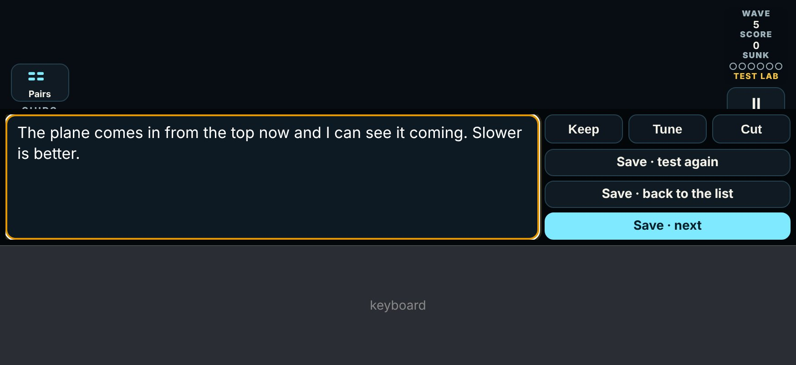
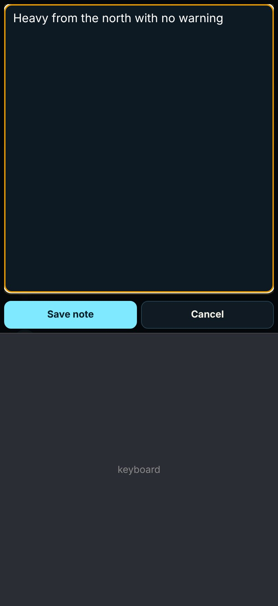

# V3 Test Lab, round 5: the enemy notes (Dive Bomber, Incendiary Missile, Repair Ship) and the note box

The player's Test Lab round 4 notes on the enemies, and two problems with giving feedback in the lab: the note box was still hard to see while typing on an iPhone, and several verdicts were lost. This build is **test round 5** in `LAB_ROUNDS`: `{ n: 5, date: '2026-11-09', name: 'Special events and weapon notes', since: '2026-11-09T18:00' }` (other builds of this round add the same entry).

## The notes, verbatim

| Card | Note | What this build does |
|---|---|---|
| Dive Bomber | "I would say slow it down a hair, not much … Also it still kinda just appears, it should come in off screen like the rest" | Its run is 10% slower, and it flies in from off the screen (§1). |
| Incendiary Missile | "the animation for the fire is bad and does not match the theme, improve that. Also the hit from the incendiary missile should not do damage; only damage should be from the fire. And the missile can be a little quicker" | New fire on the water; the burst does no damage; 12.5% faster (§2). |
| Combo: Repair Tender + Bodyguard Ring | "Pretty OP combo, make sure to use this one sparingly but it works well. Also, can we not call it repair tender and just like repair ship?" | Now the **Repair Ship** (§3). "Use sparingly" is a note for the map round (§3). |
| Decoy Drones | "Good for now, might tweak it later" | No change. |
| Combo: Spotter + Siege Battery | "Much better this time" | No change. |
| (the note box) | "I still can't see the text box all that great when writing feedback, both horizontal and vertical" | While typing, the dialog is the text box (§4). |

And from the logs: Incendiary Missile, Decoy Drones, Supply Run, Grapnel, Bomber Wing, Overdrive and Aegis were each saved with a note and **no verdict**, then played again only to set Keep (§5).

## 1. Dive Bomber: a hair slower, and in from off the screen

**Before.** The circle showed for 2.2 s, then the plane appeared out of nothing about 40 px under the top of the screen (lower when the circle was low) and dove at the circle in 1.8 s: up to 233 px/s.

**Now** (`FOE.diveBomber` in `src/v3/data/foes.ts`; `divePath`, `diveAt` in `src/v3/sim/foes.ts`):
- **Off the screen first.** It sets off 120 px past the screen's edge on the line of its dive (`off`), so neither it nor its shadow is in sight, and flies in level. A line that would start its dive off the side of the screen is mirrored, as before.
- **A hair slower.** Its dive takes **2.0 s, not 1.8**. A full dive (420 px) is flown at **210 px/s, not 233: 10% slower**. Nothing it flies is faster than 210 px/s (`cruise`): it flies in at that speed, and a shorter dive (a circle high up) eases down from it.
- **The circle and the timing.** The circle shows for **1.8 s** (was 2.2) before the plane sets off, so with the stretch off the screen the plane comes into sight about **2.4 s** after the circle (was 2.2). The plane's line is chosen when the circle appears, and the circle goes where the ship will be when the bomb lands.

Measured (20 seeds a map, `createGame` + `launchFoe`):

| Water | In sight before it lets go | Circle to bomb landing |
|---|---|---|
| Before (every map) | 1.8 s | 4.7 s |
| The Strait (the lab's water) | 2.02 to 2.50 s, mean 2.16 | 5.12 to 5.63 s |
| The Island (its lanes run low) | 2.53 to 3.08 s, mean 2.76 | 5.63 to 6.22 s |
| The Gauntlet, Lee of Marrow | 2.0 to 3.1 s | 5.1 to 6.2 s |

## 2. Incendiary Missile: new fire, the burst does no harm, a little quicker

**The fire** (`drawFire` in `src/v3/ui/foes.ts`). The old fire drew upright cartoon flames (cones) and a dashed ring. The game is seen from straight above, so they looked stuck on. The new one is seen from above like the Carpet Strike row, the explosions and a damaged ship's smoke:
- a dark, ragged slick of burning fuel on the water, with a hot glow over it that breathes;
- 16 tongues of flame across it, soft white-yellow-orange blobs stretched downwind, each flickering in size and length on its own beat (drawn additively, so they burn white where they crowd);
- sparks and dark grey smoke drifting off it the same way as a damaged ship's smoke (up and to the left);
- a thin solid warm ring at its reach (75 px), so the area that hurts still reads on a phone;
- a white-hot flash and a shock ring as it bursts; the flames die down over the last 1.8 s and the smoke lasts a moment longer.

The flame and smoke blobs are two small sprites drawn once and stamped (no gradient a blob a frame). With three fires up, the frame time on the test machine stayed at 16.7 ms (median and 95th percentile).

| Before | Now: the burst | Now: burning | Now: dying down |
|---|---|---|---|
|  |  |  |  |

**The burst does no damage** (`checkImpact` in `src/v3/sim/game.ts`). At its ship, or at the carrier, the missile only bursts; its fireball does all the harm, as before: a hull inside takes 1 hit 0.7 s in, then 1 every 2 s. A ship it reaches takes its first hit from the fire, not from the missile. `THREATS.cloud.damage` (1) is now only the fire's hit.

**A little quicker.** `THREATS.cloud.speed` is **54, not 48: 12.5% faster**. It still leads its ship and comes in on the bow (the round 2 test still passes).

The Nuke still clears it with no fire and puts any fire out (`tests/v3/nuke.test.ts`).

## 3. The Repair Ship

The Repair Tender is now the **Repair Ship** wherever the player sees it: its name (`FOES.tender.name`), the label (`THREATS.tender.label`, "Repair ship"), the kill call-out (REPAIR SHIP DOWN), the combo's name and rule ("Repair Ship + Bodyguard Ring"), the War Drum text ("… subs and repair ships"), the briefing, the Free Play picker, the lab cards, and the review pages' card lists (`tools/v3/test-lab/lab.mjs`, the enemy page's Build tab in `tools/v3/enemy-ideas/build.mjs`). Its id stays `tender`, so saved verdicts, logs and links still work. Older design docs keep the old name; docs from now on use the new one.

**For the map round: use it sparingly.** The player on the Repair Ship + Bodyguard Ring combo: "Pretty OP combo, make sure to use this one sparingly but it works well." Nothing in the waves changes now. When the maps' waves are planned (chapter 4, where both debut), the pair should come together rarely: at most once in a map's run, late, and not on a map that already leans on heavies.

## 4. The note box while typing

**The problem.** PR #136 fitted the dialog into what the keyboard leaves visible and folded the title, tags and rating rows away. On a real iPhone it was still hard to see:
- The Test Lab's text box was 13 px. iOS zooms the page in on a text box under 16 px, which puts parts of the dialog off the sides of the screen and throws out the fitting.
- The box itself was small: in landscape the keyboard leaves about 150 px, and the box got what was left after the buttons, capped at 40% of the screen.
- It used the dialog's dim colours.

**Now** (`enterTyping` and `fitTyping` in `src/v3/ui/app.ts`; the `.typing` rules in `style.css`). While a text box has the focus, the dialog *is* the text box:
- The dialog fills exactly what the keyboard leaves visible (`visualViewport`: its top, left, width and height, so it follows iOS when it pans the page under the keyboard).
- The box is pinned to the top of it, full width (beside the buttons when held sideways), **17 px** white text on near black with a gold edge, and as tall as the space allows. The text box is 16 px or more everywhere (the lab's note was 13 px), so iOS never zooms in.
- **Held sideways** (874 × 402, the keyboard leaving 150 px): the box takes the left two thirds, 586 × 138 px (about 5 lines); Keep / Tune / Cut and the Save buttons sit in a column beside it.
- **Upright** (402 × 874, the keyboard leaving 480 px): the box is 390 × 382 px (about 15 lines); Keep / Tune / Cut and the Save buttons sit under it in two rows.
- Everything else (the title, the tags, the counts) is folded away until the keyboard goes. The pause note and the volley rating work the same way, with their Save and Cancel.

Simulated with a stand-in `visualViewport` (the e2e's `FAKE_VV`), including iOS panning the page under the keyboard (`offsetTop` 120 px sideways, 200 px upright): the box, the verdict row and the buttons stay inside the visible part every time.

| Sideways | Upright |
|---|---|
|  |  |

Sideways, with iOS having panned the page 120 px: 

The pause note, upright: 

## 5. The lost verdicts

**The cause.** The verdict sheet kept the verdict in the sheet itself, and nothing lost a verdict once it was picked. But in typing mode (#136) everything except the text box and the Save buttons was folded away, **the Keep / Tune / Cut row included**. Round 4's verdicts were all given after dictating the note. The player tapped into the box, dictated, and then the only things on screen were the box and three Save buttons. Save had no check, so it saved the note with a `null` verdict. To set a verdict, the player had to replay the card. On that replay the sheet filled in the old note (it was the card's current entry), and the player tapped Keep and saved. That is why those cards had a note and no verdict, and then a second log with the same note and Keep.

**Now** (`labVerdictSheet` in `src/v3/ui/lab.ts`):
- **The verdict row stays while typing** (`data-typing-keep`), compact, beside or under the box. A tap on it doesn't take the focus from the box, so the keyboard stays up.
- **Save with no verdict asks for one** (`verdictResult` returns nothing). The keyboard goes, the whole sheet comes back, the verdict row pulses gold and "Pick Keep, Tune or Cut, then save." shows under it. Nothing is saved, and the note and tags stay.
- **The sheet's picks are kept for the test, not only in the sheet** (`VerdictDraft`, kept by `App.labDraft`). If the sheet is drawn again for the same test (a wave's end or a loss finishing under it), it starts from what the player had picked and typed. A wave's end no longer opens the weapon draft over a verdict sheet that is up.

**The checks.** In the e2e at all four sizes: a verdict picked before typing is kept through typing and saved; Save with no verdict saves nothing and asks; then Keep and Save saves both. In vitest: `verdictResult` and `newVerdictDraft`.

## 6. The bridge: a round's note once

`labResultDocs` in `src/v3/sim/labDocs.ts` joins every note of a card's round. A later test's note that starts with an earlier note of the **same** round was added whole. This happens because the sheet fills in the last note. So the earlier words came out twice: "the fire looks off · the fire looks off quicker please". Each note now has the round's earlier notes stripped from its start, as well as the earlier rounds' notes (`ownNote(note, [...earlier, ...seen])`), so only its own words are added. There is a unit test for it.

## What changed for the player (LAB_CHANGES, round 5)

- Dive Bomber: "Flies in from off the screen; its run a little slower (2.0 s)"
- Incendiary Missile: "New fire on the water; the burst does no damage, only the fire; a little faster"
- Repair Ship: "Now called the Repair Ship"

The combos with them (Repair Ship + Bodyguard Ring, Incendiary Missile + Flak) take these changes on, so they ask to be tested again too. The Dive Bomber's and the Incendiary Missile's "what to look for" lines are new.

## Judgement calls

- **The window.** The run itself is 10% slower, but the plane now flies in from off the screen, so it is in sight longer before it lets go: 2.0 to 2.5 s on the lab's water (was 1.8), up to 3.1 s where the lane runs low. The circle shows 0.4 s less (1.8 s), so the plane comes into sight at about the same moment as before (2.4 s after the circle, was 2.2). The bomb lands 5.1 to 6.2 s after the circle (was 4.7), a little more time to steam out of it.
- **The off-screen stretch is flown level at the dive's top speed (210 px/s)**, so it never speeds up anywhere. A faster run-in would have kept the in-sight time nearer 2.0 s, but it would make the plane faster than before for part of its flight.
- **Only the missile's own hit was removed.** The fire's hits (1 at 0.7 s, then every 2 s) are unchanged. So a missile that reaches its ship now does 1 hit, not 2, in its first second, and the card is a little weaker overall.
- **Save always needs a verdict now.** The hub's "TESTED" chip for a verdict-less entry stays, for old entries.
- **"Repair ship" in the review pages' card lists** (`tools/v3/test-lab/lab.mjs`, `tools/v3/enemy-ideas/build.mjs`) is changed too. The brainstorm list (`tools/v3/enemy-ideas/enemies.mjs`) keeps the name the idea had then.

## Checks

- `npx tsc --noEmit`: clean.
- `npx vitest run`: 40 files, 1176 tests pass. New: the Dive Bomber's speed, its entry from off the screen on five maps and its bomb timing; the missile's burst doing no damage (at a ship and at the carrier) while its fire does; the missile's speed; the Repair Ship's name; `verdictResult` / `newVerdictDraft`; the bridge's same-round dedupe; round 5's versions and changes.
- `npx vite build` and `npm run build:store`: both build.
- `e2e/v3.mjs` on its own build: 187 checks pass, including the typing and verdict checks at four sizes (§4, §5). `e2e/v3-audio.mjs`: passes.
