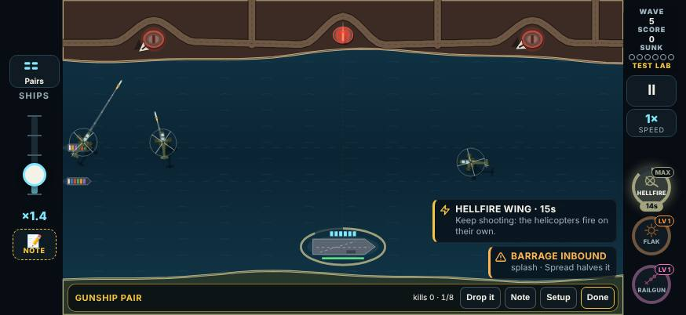
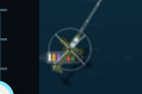
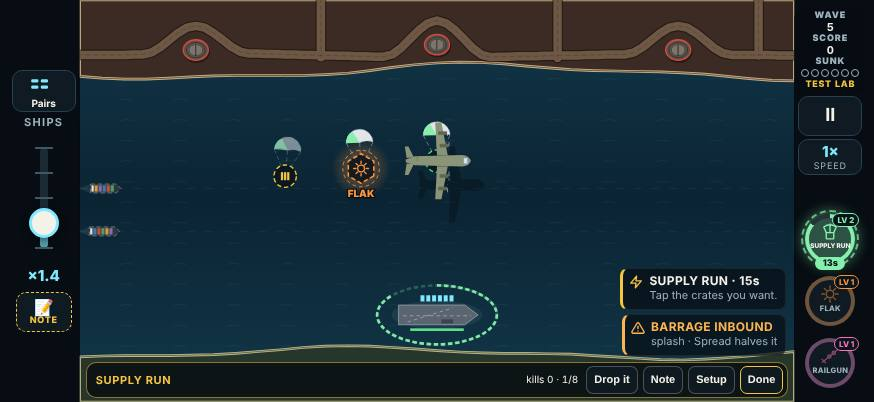
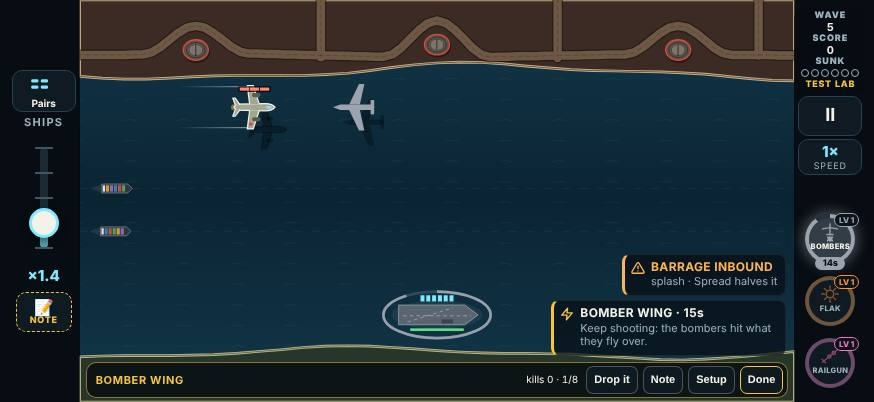
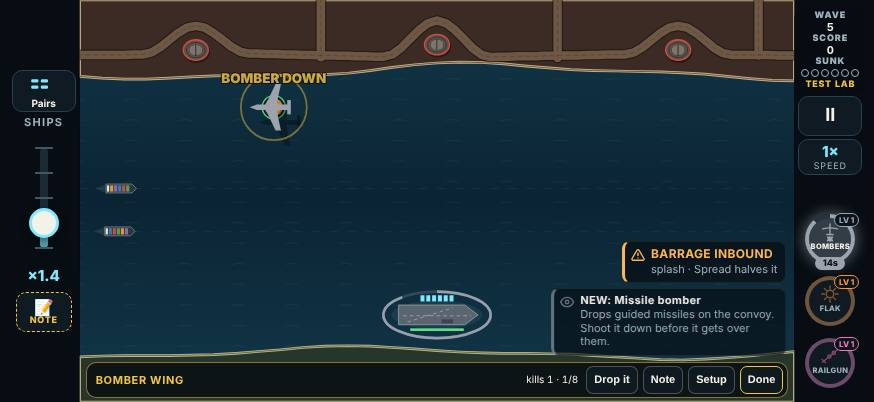
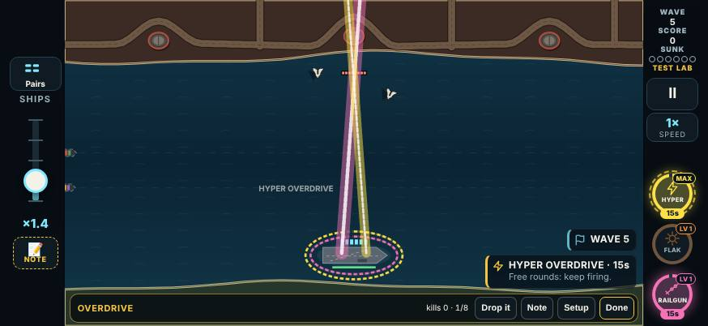
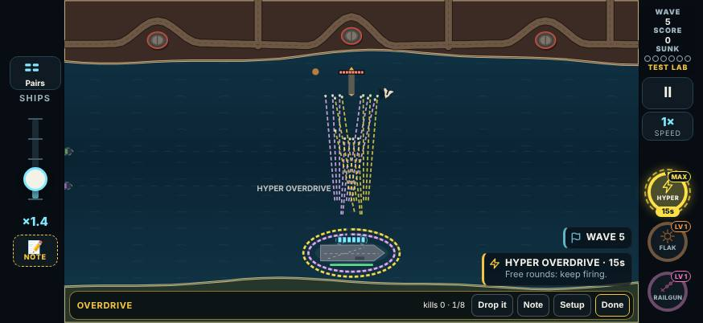
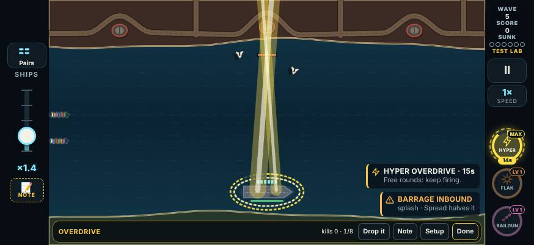
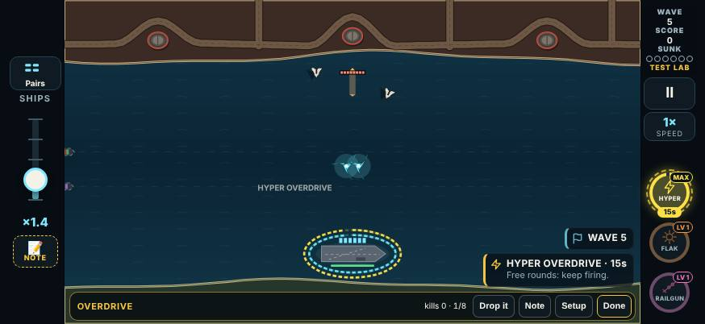
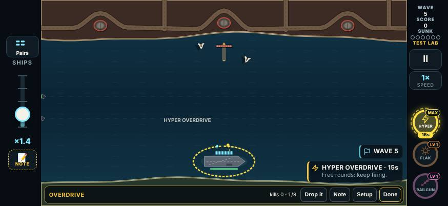

# V3 Test Lab, round 5: the weapon notes

The player went through the weapon cards on 2026-11-09 (04:06 to 16:48 UTC), on build `2026-11-09T03:49`, a round 4 build. There were 37 weapon logs on 29 cards, with 18 different notes. The notes and verdicts are kept in `tools/v3/test-lab/playtest-2026-11-09b.json`.

This build answers the notes. It is **test round 5** in `LAB_ROUNDS`: `{ n: 5, date: '2026-11-09', name: 'Special events and weapon notes', since: '2026-11-09T18:00' }`. (The special-events build adds the same round at the same time; the two are reconciled at merge.)

## The notes, verbatim

The notes were dictated. They are kept as the logs have them, so some words are the dictation's ("Tesla lab" is the Test Lab, "oral strike" is Orbital Strike, "straight thing" is the strafe block).

| Card | Verdict | Note |
|---|---|---|
| Aegis Launchers | Keep | "This one is good, but can we rename it to something else? I don’t like what we have." |
| Gravity Well | Keep | "This is a good overall, but it’s inconsistent and when it comes to the missile guide to missiles all those categories cause it does not pull those, but I’ll pull an aircraft so I think what we should do is categorize it by like size bigger stuff it just kind of slows it down while the larger stuff it does pull it in and then eventually pull in everything once it’s fully upgraded" |
| Laser Cutter | Keep | "This is good overall, but for targets, I have like multiple points if you waive the wave back-and-forth/multiple times with one continue with ammo, it should continue using ammo to do those cuts so if your finger still holding down, I should keep using the ammo essentially, so I guess the main thing that this would changes like once you hold down, you could just burn through all your ammo, but at the same rate" |
| Grapnel | Keep | "Make the grapple so it can always reach anywhere across the screen that shouldn’t be a level lock because it’s kind of unplayable if it isn’t so rework the levels as needed there too" |
| Drone Screen | Keep | "Get overall, but the drone shouldn’t start firing unless there’s actually a threat on the screen because they’re just continuous stream" |
| Focus | Keep | "When taping just to shoot a missile it should not do the slow down you need to long hold doe. Ti activate" |
| Gunship Pair | Keep | "Good overall just make sure if they are leaving the screen that they come back normally if you select another gunship instead of the existing g ones disappearing and also it should face the target when firing and also make it look more like a. Apache attack helicopter" |
| Frigate Escort | Keep | "Works good but need to make sure frigets do t just disappear when they are traveling off screen and you select another friget weapon drop" |
| Supply Run | Keep | "Works good overall / Remove the magnet part tho I don’t really like how that works especially if the player does not want the power up / Rework the levels as needed there / Also add in other weapon drops or boost to this cargo plane as well doesn’t have to be just ammo and heal it cna be weapons or the nuke too" |
| Bomber Wing | Keep | "Does this not attack like submarines and aircraft didn’t seem to really target at all which it should as well as the tie beats a little off silent silence before the bomber even passes over and then also it’s not giving a chance to go on the screen so there should have to at least be on the screen before the bomber hits them so you can actually see what is attacking" |
| Overclock | **Cut** | "You should set this up so that it also reload a lot quicker. It still too slow needs to be boosted up a little bit. / I’m not really sure what the difference is on this one versus overclocked so we’re gonna drop this one" |
| Overdrive | Keep | "What’s the difference between this one and then the other one that’s kind of like overdrive too that’s just like ammo reloading more. I think we should keep this one to drop the other one. I’ll edit the notes but then also on the last level when every shot hits two, it should like clearly show two project tiles instead of just one that should be for everything like for the beam be two laserbeam things like that so just make sure that’s clear" |
| Time Warp | **Cut** | "Too much like the focused ones were to drop this one" |
| Wild Card | Keep | "This works good, but it needs to be a weapon drop not a boost that shit replace whatever weapon you currently have since it takes over the main gun" |
| Shield | Keep | "Looks good overall I think you could just drop the whole straight thing and come up with new ideas that new ideas for the leveling up of this weapon" |
| Orbital Strike | Keep | "One note outside of the scope for those weapon when your plate testing one should always have an upgrade when you’re in this Tesla lab for the one that you’re actually testing so the oral strike and strike upgrade should be on the next round" |
| Charge Lance | Keep | "Kind of love hate this one. It works well once you get used to it but just kind of I guess hard to master so I think it’s OK as it is. Just keep note if there’s anything we can improve with it eventually." |
| Dual Wield | Keep | "Works as expected" |

Kept with no note, and not changed: Air Strike, Shrapnel, Thermobaric, Scattergun, Boomerang, Flak, Seeker Pod, Railgun, Tesla, Cadence, Full Steam (and Dual Wield, Orbital Strike).

**Charge Lance** is unchanged. On the list to improve one day: it is hard to master. A first idea, not built: show the charge marks (half, full) on the finger's ring, so the hold has a target.

## What was built

### 1. Aegis Launchers is now Point Defense

- **Name:** Point Defense. MAX: **Point Defense Grid**. The rail chip says POINT DEF / PD GRID.
- The id stays `aegis`, so saves, logs and the lab's notes still find it.
- Renamed on the card, the draft, the pickup, Free Play, the Test Lab card and the loss tips.
- The levels are as before.

### 2. Gravity Well: by size

**The rule.** Small threats are pulled in at every level. Big threats are only slowed until MAX, and MAX pulls in everything.

- **Small** (`WELL_SMALL` in `src/v3/sim/game.ts`):
  - every missile you can shoot down: ballistic, guided, supersonic, heavy cruise, cluster and its bomblets, Hydra and its darts, the helicopter's missiles, torpedoes, the Incendiary Missile;
  - drones of every kind;
  - fast attack boats and mines.
- **Big:** everything else that moves. That is strike jets, bombers, helicopters, motherships, the stealth planes, the dive bomber, the Spotter, trucks, siege guns, subs, the Repair Tender and the Lure Beacon. Inside the vortex they move at **35%** of their pace (`AB.well.slow`), until MAX.
- **Never:** structures (rigs, generators, the Citadel, the Dreadnought).

**Before:** it pulled everything except ballistic missiles, which follow a fixed arc. So the commonest missile was the one thing it never pulled, while a jet was dragged in.

**Now a ballistic missile is pulled too.** It hangs in the vortex, its arc carried with it, and the implosion takes it.

| Level | Text |
|---|---|
| 1 | Each shell opens a vortex for 1.5 s, then implodes: missiles, drones and small boats are dragged in; aircraft, helicopters and other big ones are only slowed |
| 2 | A wider pull and a harder implosion (big ones still only slowed) |
| 3 (Singularity) | It holds for 2 s, drags in everything, big ones too, and the implosion hits for 4 |

### 3. Laser Cutter: hold to keep cutting

- While the finger is down, the beam keeps cutting along the drag path. It cuts back and forth as often as you like.
- It spends **one round for every 320 px of cut** (420 px from level 2). That is the rate a swipe always had.
- It stops when the finger lifts or the rack is dry. There is no cap on a press.
- Each round's stretch can hit a threat once, so a threat waved over again is cut again by the next round.
- A finger held still spends nothing. The judgement: rounds are paid by distance, not by time, so "the same rate" as before.

| Level | Text |
|---|---|
| 1 | Swipe across threats: everything under your finger is cut. Keep the finger down and it keeps cutting, a round for every 320 px of cut |
| 2 | A round cuts 420 px |
| 3 (Searing Edge) | The cut stays lit for 1 s and burns what flies into it |

### 4. Grapnel: the whole screen from level 1

- It hooks any threat on screen at level 1 (the reach was 620 px).
- Level 2 used to be the reach. Now it **swings faster (1100 → 1500 px/s) and every smack hits for 3** (was 2).
- MAX is as before.

| Level | Text |
|---|---|
| 1 | Hold on any threat on screen to hook it, drag to swing it into others (2 hits each), let go to fling it |
| 2 | It swings faster and every smack hits for 3 |
| 3 (Wrecking Ball) | The flung threat explodes for 3 in a wide blast |

### 5. Drone Screen: no threat, no drones

- With no live threat on the screen, the deck holds its drones. Structures don't count, and nor does anything off the screen's edge.
- The next drone lifts off the moment something shows.
- Level 1's line adds "(none while nothing is on screen)".

### 6. Focus: long-press to slow time

- Slow motion starts only once the holding finger has been down **0.3 s** (`AB.focus.hold`), counted in real time by the sim, so it replays.
- A quicker touch is an ordinary shot, fired as it lifts, with no slow-down and no bank spent. (The UI's tap cut-off was 220 ms; it is now the same 0.3 s.)
- Level 1's line: "Press and hold one finger (a quick tap is just a shot) for up to 10 s of slow motion, and tap with the other; the rack reloads at full speed".

### 7. Gunship Pair: comes back, faces its target, looks like an Apache

**(a) Comes back.**
- A new Gunship drop while the pair is flying off used to delete them and fly in two new ones.
- Now the leaving pair turns round and flies back to its hover, on the new pickup's fresh 15 s.
- Only missing helicopters fly in (for example the third one at MAX).

**(b) Faces its target.**
- When a gunship's shot is due, it turns its nose onto the target first, at 6 rad/s (`AB.gunships.aimTurn`).
- It fires once the nose is within 0.35 rad (about 20°).
- If the turn takes longer than 0.6 s it fires anyway, so a gunship never stalls.
- While it turns to aim, the nose follows the target even if it is moving, and it sideslips to keep up with the convoy.
- To make up for the turn, they fire every 1.25 / 0.9 / 0.85 s (was 1.4 / 1.0 / 1.0; see Balance). The level lines are unchanged.

**(c) Apache-style.** Redrawn from above (`drawGunship` in `src/v3/ui/render.ts`), generic, with no markings:
- a long narrow fuselage and the nose sensor turret;
- the tandem cockpit, the gunner's pane ahead of the pilot's;
- engine pods either side of the mast;
- stub wings with a rocket pod and a missile rail at each tip;
- a long tail boom with its tailplane, and the tail rotor on its side;
- a four-blade main rotor.

### 8. Frigate Escort: comes back

The same fix as the gunships:
- A new drop turns leaving frigates round. They sail back up their lane to station, bow first; they used to vanish.
- On station a frigate keeps whichever way it faces, so it doesn't spin in place.
- Only missing frigates sail in.

### 9. Supply Run: no magnet; gear and the Nuke

- **No magnet at any level.** Crates and kill drops stay where they come down until you tap them.
- **A gear crate** holds one of your weapons or boosts, never Supply Run itself. With nothing else held, it holds ammo.
- **Airdrop** also drops a Nuke on 15% of its crates (`AB.supplyRun.nuke`). Measured over 30 seeds of one Airdrop, Nukes were well under a third of its crates.

| Level | Text |
|---|---|
| 1 | A cargo plane drops 3 crates in a row: ammo, a repair and one of your weapons or boosts; kills drop twice as much. Tap the crates you want |
| 2 | 5 crates (two of them weapons or boosts), and kills drop three times as much |
| 3 (Airdrop) | And every 6 s another plane drops a crate: one of your weapons or boosts, or now and then a Nuke |

The crates come in this order: ammo, gear, repair, gear, ammo. Picking up a boost from a crate replaces Supply Run (one boost at a time), as any boost does.

### 10. Bomber Wing: aircraft and subs, seen before it hits

**Targets, at every level:**
- aircraft on screen: strike jets, bombers, attack helicopters, the stealth planes, the dive bomber, the Spotter;
- torpedo subs that are up, and their periscopes, so the sub never comes up;
- launch subs surfaced or at periscope depth;
- trucks.

With none of those, it goes for the busiest silo or tunnel, as before. Carpet Raid used to be the only level that hit (surfaced) subs. A bomb destroys an aircraft or a sub outright.

**Timing.** Everything happens when the bomber is over the target:
- The silo's silence, the tunnel's cancelled truck and the kill all wait for the bomb. Before, a silo went silent as the bomber was called, 1.45 s on average before it even arrived: the "silence before the bomber even passes over".
- The bomber comes in from the side that keeps it on screen for at least **0.8 s** before its bomb (`AB.bomberWing.seen`). That is the nearer edge if there's room, otherwise the far one. Against a plane, it comes in behind it if that leaves time.
- It flies at 800 px/s (was 950) and follows a moving target's line.
- A target that leaves the screen first is let go: no bomb out of sight.
- The silo pick counts the launches due from when the bomber gets there.

**Sound.** The run sound (`sortie.pass`) starts 0.95 s before the drop, so its roar is the drop. It pans with the plane, and the bomb's blast plays as the bomb lands.

| Level | Text |
|---|---|
| 1 | A bomber crosses the screen and bombs what it flies over: aircraft, subs and trucks are destroyed; with none up, the busiest silo or tunnel goes quiet for 6 s, its launches cancelled |
| 2 | A pass every 4.5 s |
| 3 (Carpet Raid) | A pass every 3.5 s, two bombers each hitting a target; silos stay silent for 8 s |

**Measured.** Bomber Wing at MAX loaded for 45 s of wave 6, on island, battery, coves, citadel and strait, 6 seeds each (a scratchpad harness):

| | Before | After |
|---|---|---|
| Passes | 347 | 409 |
| Targets | silo 195, tunnel 89, truck 63 | silo 189, tunnel 89, truck 64, **aircraft 63, sub 4** |
| On screen before its bomb, mean (min) | 1.33 s (0.83 s) | 1.52 s (0.80 s) |
| A silo silent before the bomb lands, mean | **1.45 s** | **0 s** |
| Passes let go (target left the screen) | 2 | 4 (no bomb) |

### 11. Overclock cut; Overdrive's MAX shows two shots

**Overclock is gone:**
- It is out of the game, the draft, the campaign's chapter 2, Free Play, the Test Lab (its card), the bots, the card art, the icons and the tests.
- An old Free Play setup or play log that names it starts without it (`knownWeapon` in `src/v3/data/roster.ts`).
- A draft pick that names it does nothing.
- An old lab verdict on its card is ignored, by the hub and by the review page's bridge (`labResultDocs` skips cards that no longer exist).

**Overdrive at MAX (Hyper Overdrive)** fires every shot twice, as before, but now the two shots show:
- **Two muzzles.** The pair leaves from two muzzles 34 px either side of the gun, square to the line of fire (`AB.overdrive.twin`, `muzzle` in `src/v3/sim/game.ts`).
- **Shells, cones, blades, seekers, lances, beams:** each comes from its own muzzle.
  - A beam or a lance crosses the other at the target: two laser beams, an X.
  - A shell to open water lands as far aside as it left.
- **Air Strike:** a second jet flies the same row, a length behind.
- **Laser Cutter:** a second beam runs 34 px beside your finger and cuts on its own.
- **Grapnel:** the fling bursts twice, side by side.
- **Plain shots and tagged shells** (Tesla, Flak, Well, Thermobaric at a threat): two interceptors. The second goes at the next threat, as before.
- **Wild Card:** a second random roll.
- **Cadence:** a second beat shot.
- **Flagged and coloured.** The second shot is flagged (`Interceptor.twin`, `Fx.twin`) and drawn in Overdrive's yellow, a little slimmer, so the pair reads as two.
- **The passives** (frigates, gunships, drones, bombers, the satellite) fire on their own and are not doubled; Overdrive is about your gun's rounds. A judgement call.
- **MAX line:** "Every shot fires twice: two shells, two beams, two blades, side by side".

### 12. Time Warp cut

- Removed the same way as Overclock.
- Its old power-up had already left the drops when the weapon went live; its weight is now 0 (`PICKUPS.weights.timewarp`), so nothing changes in play.
- The power-up's code (`warpT`) stays, dormant.
- The audio policy's "time warp" pitch-down stays for the same reason.

### 13. Wild Card is a weapon

- It is an **active** now (`ROSTER.wildCard.cat`). Its pickup takes over the gun like any weapon: it replaces the loaded one, for the weapon time.
- Each tap fires a random weapon's shot at Wild Card's level. Another weapon's pickup replaces it.
- Under Dual Wield it takes a hand.
- Free Play and the setup list it without "(boost)". Its chip is a weapon's, not a boost's.

| Level | Text |
|---|---|
| 1 | It takes over the gun: each tap fires a random weapon's level 1 shot |
| 2 | A random active or passive, at level 2 |
| 3 (Jackpot) | A random active weapon's MAX shot |

### 14. Shield: new levels

The strafe block is gone at every level. Strafing runs go through any Shield, and nothing shatters. The shatter sound was retired with it.

| Level | Text |
|---|---|
| 1 | Ships and the carrier take no damage from missiles, drones and boats |
| 2 | Every hit it blocks puts a round back in the rack |
| 3 (Reflect) | It lasts 18 s, and a blocked missile bounces back and bursts on what is behind it |

**Numbers:** `AB.shield.time: [1, 1, 1.2]` (× the weapon time) and `refund: [0, 1, 1]`.

**The sweep picked these.** The first try (20 s and the refill from level 2) won **52% at MAX**, the top of the table. These win 41%. Each variant was measured at MAX:

| Variant | MAX wins |
|---|---|
| Refill only, 15 s | 24% |
| 18 s, no refill | 27% |
| 18 s and refill | 41% |

### 15. The Test Lab offers the tested weapon

- In a weapon test, or a combo with a weapon, **every draft between waves offers the tested weapon's next level** until it is MAX (`openDraft` in `src/v3/sim/game.ts`). It goes first in the offer.
- If the offer was full, it takes the last card's place.
- At MAX it is left to the normal draft.

## Round 5 in the Test Lab

- `LAB_ROUNDS` gets round 5, as above. `LAB_ROUND` is 5, and the hub's header says "Test round 5".
- **`LAB_CHANGES`** gets a round 5 line for each changed card: Point Defense, Gravity Well, Laser Cutter (its second line), Grapnel, Drone Screen, Focus, Gunship Pair (its second line), Frigate Escort, Supply Run, Bomber Wing, Overdrive, Wild Card and Shield.
  - Lure Beacon + Drone Screen takes on Drone Screen's line, so it asks to be tested again too.
- **The cut cards** `w-overclock` and `w-timeWarp` are gone: 72 cards, down from 74.
- **The reworked cards come first** in the Weapons section, each with its own "look for" line.

## Balance

**Weapon sweep.** `tools/v3/weapon-ideas/phase1-sweep.mts`:
- the "average" bot;
- every map from wave 1, 5 seeds a map (100 runs a row);
- the row's weapon held at a fixed level, Resupply at every draft.

Before is the trunk; after is this build. Read ±4 points as noise at 100 runs. The bot holds and swipes the Cutter the way it always did (one swipe at a time), so it doesn't use the new hold, and it doesn't long-press Focus the way a person would.

Runs won, before → after:

| Weapon | Level 1 | MAX | What changed |
|---|---|---|---|
| (nothing held) | 5% → 5% | 5% → 5% | reference |
| Railgun | 8% → 8% | 41% → 41% | reference (unchanged) |
| Flak | 23% → 23% | 40% → 40% | reference (unchanged) |
| Point Defense | 17% → 17% | 45% → 45% | the name only |
| Gravity Well | 24% → 21% | 30% → **43%** | by size; MAX now drags in everything, ballistics too |
| Laser Cutter | 19% → 19% | 57% → 57% | hold to keep cutting (the bot doesn't hold) |
| Grapnel | 22% → **29%** | 46% → 47% | the whole screen from level 1 |
| Drone Screen | 17% → 16% | 36% → 34% | holds fire with nothing on screen |
| Gunship Pair | 26% → 28% | 47% → 43% | faces its target; fires a little more often to make up for the turn (12 seeds a map at MAX: 47% → 47%) |
| Frigate Escort | 32% → 34% | 46% → 47% | comes back |
| Bomber Wing | 15% → 15% | 25% → **30%** | aircraft and subs; seen before it hits |
| Supply Run | 18% → 15% | 21% → 18% | no magnet (the bot taps every crate anyway) |
| Overdrive | 28% → 28% | 39% → 42% | MAX doubles every shot, lances, cuts and beat shots included |
| Railgun + Overdrive | 16% → 16% | 49% → 51% | |
| Scattergun + Overdrive | 15% → 15% | 47% → 51% | |
| Wild Card | 22% → 20% | 34% → 34% | a weapon now (was a boost with nothing loaded) |
| Shield | 16% → 16% | 13% → **41%** | new levels: no strafe block, no shatter that ended it early |
| Focus | 12% → 16% | 23% → 24% | long-press (the bot holds anyway) |

The MAX column runs from Supply Run's 18% to the Cutter's 57%, as before: nothing new at the top, and nothing left at the bottom that wasn't there. Supply Run and Focus are still the bot's weakest; the bot undersells Focus (it can't hold and tap the way a person does), and Supply Run is about running dry, which the sweep's Resupply at every draft hides. Two tunings came from the sweep:

- **Shield:** 20 s and a refill from level 2 won 52% at MAX, the top of the table. The levels above win 41%.
- **Gunship Pair:** turning to face the target cost it about 7 points at MAX (12 seeds a map: 47% → 40%). Shots every 1.25 / 0.9 / 0.85 s (was 1.4 / 1.0 / 1.0) bring it back to 47%.

**Campaign sweep.** `npm run v3:sweep -- 4 --skills=average`: every map, 4 seeds, from wave 1. Maps cleared, by chapter:

| Chapter | Before | After | Ships lost a run, before → after |
|---|---|---|---|
| 1, Home Waters | 70% | 90% | 3.1 → 2.2 |
| 2, The Narrows | 25% | 30% | 5.5 → 5.4 |
| 3, Dark Water | 5% | 10% | 5.3 → 5.5 |
| 4, Open War | 5% | 10% | 5.7 → 5.5 |

Read this one with care. At 4 seeds a map a single map moves 25 points a seed. And the sweep shuffles the bot's favourite weapons from the roster's list, which lost two names, so every seed now favours different weapons: the chapter 1 runs favoured the Frigate Escort (5 pickups a run) where they had favoured Air Strike and Time Warp. The whole-game estimate is unchanged: 4.1 h and 25 runs to clear all 20 maps, before and after.

## Verified

- `npx tsc --noEmit` is clean.
- `npx vitest run --exclude '.claude/**'`: all 1187 tests pass (41 files).
  - New: `tests/v3/labRound5.test.ts` (20 tests):
    - Point Defense's name;
    - the Gravity Well by size, kind by kind and level by level;
    - the Cutter cutting again and again while held, until the rack is dry;
    - the Grapnel hooking across the screen at level 1, and level 2's faster, harder swing;
    - Drone Screen holding fire;
    - gunships and frigates turning back with the same ids;
    - every Hellfire leaving with the gunship's nose on its target;
    - Bomber Wing on a jet (from the side that keeps it on screen, its roar at the drop), on a torpedo sub and a periscope, and on three maps (every bomb lands with the bomber over its target, on screen first);
    - Hyper Overdrive's two muzzles and twin flags for plain shots, the Railgun, Flak, Thermobaric, Scattergun, Boomerang, Air Strike, Seeker Pod, Tesla, Charge Lance and Laser Cutter, and one shot below MAX;
    - the lab's draft offering the tested weapon for three weapon cards and a combo, across seeds, until MAX.
  - Changed:
    - `tests/v3/boosts.test.ts`: six boosts; Supply Run's no-magnet, crates and Airdrop; the cut weapons gone, with an old setup still starting; Wild Card as a weapon; Focus's tap and hold; Shield's levels and refill.
    - `tests/v3/weapons.test.ts`: the roster by chapter, the Cutter's hold, Bomber Wing's silence at the bomb, subs at every level.
    - `tests/v3/lab.test.ts`: 72 cards, round 5, the changes.
    - `tests/v3/audio.test.ts`: the retired shatter cue.
    - `tests/v3/foes.test.ts`: the Lure Beacon's gunship check counts launches by id.
- `npx vite build` and `npm run build:store` succeed.
- **e2e,** on an isolated build: `vite build --outDir scratchpad/r5-weapons/dist`, served by `vite preview --port 4211`.
  - `e2e/v3.mjs`: all 180 checks pass. New checks: Wild Card takes over the gun, a quick Focus tap is a shot with no slow-down, Supply Run's crates stay put. Updated: 27 weapons in Free Play, 72 lab cards, Test round 5, the log version 18, Full Steam in place of Time Warp beside the Railgun, and Bomber Wing's silo silenced when the bomber gets there.
  - `e2e/v3-audio.mjs`: all 16 checks pass.
- **Screenshots** in `docs/design/img/lab-round5/`: from the browser at 874×402 (the gunship close-up is a crop at device scale), staged in a lab run through `window.__v3`.

## Limits and judgement calls

- **Point Defense** was my pick of name. MAX is "Point Defense Grid".
- **Heavy cruise missiles count as small** for the Gravity Well, since the note said every missile. They are slow, so being dragged in is mostly to their cost.
- **The Cutter is paid by distance.** A still finger spends nothing. If the player meant "it should keep burning rounds while held", that is a timer in `updatePress`.
- **Supply Run's gear can be a boost.** Taking a boost from a crate ends Supply Run, as any boost replaces another. Supply Run itself is never in a crate.
- **Hyper Overdrive doesn't double the passives.**
- **Bomber Wing flies slower** (800 px/s) and from the far side when a near pass would be too short, so a pass takes about 1.5 s to land (was about 1.3 s).
- **The play log version is now 18.** Old logs still load in the hub, but their exact replays belong to the old rules. The special-events build may bump it too; reconcile at merge.
- **The Charge Lance** idea above is not built.
