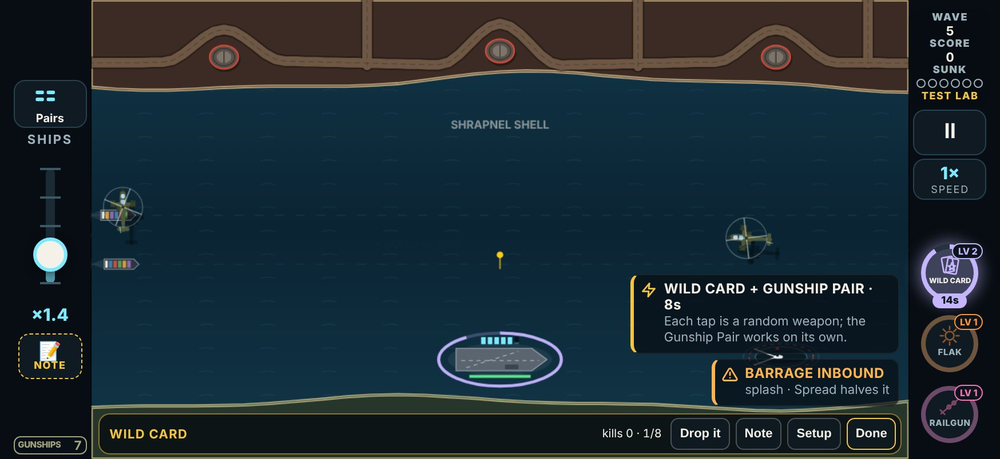
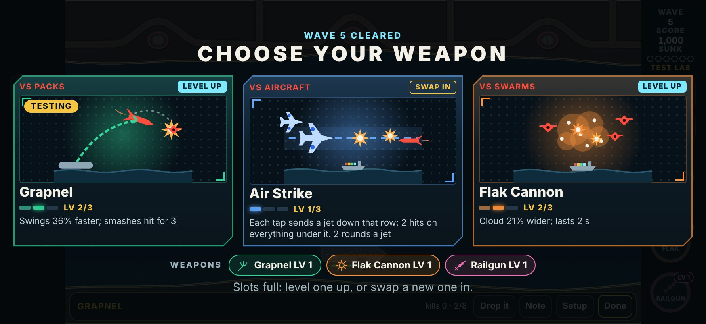
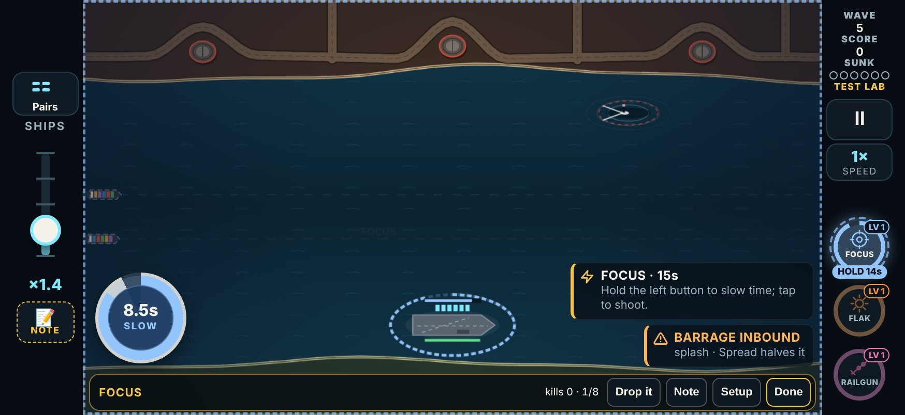
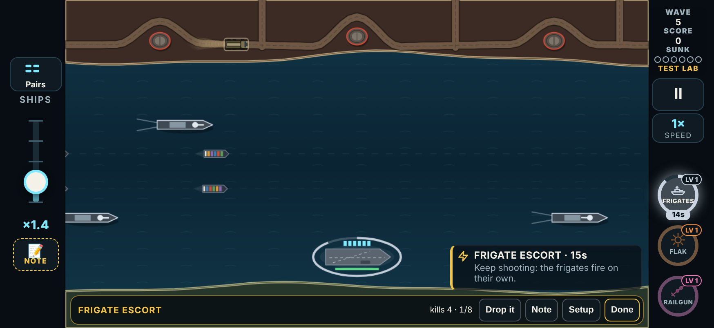

# V3 Test Lab, round 8: the weapon notes

The player went through the weapon cards on 2026-11-10 (17:03 to 17:30 UTC), on build `2026-11-10T15:47`, a round 7 build. There were eleven weapon logs on ten cards, with seven notes. The logs are in the scratchpad's `logs/v3-20261110*.json`.

This build answers the notes. It is **test round 8** in `LAB_ROUNDS`: `{ n: 8, date: '2026-11-10', name: 'Enemy pairs; weapon and enemy notes', since: '2026-11-10T19:00' }`. (The enemies/events build and the enemy-pairs build add the same round at the same time; the three are reconciled at merge.)

## The notes, verbatim

The notes were dictated. They are kept as the logs have them ("weight" is "wave", "the grapple" is the Grapnel).

| Card | Verdict | Note |
|---|---|---|
| Overdrive | Keep | "The second upgrades doesn’t make sense if say fills the rack but it is already full at the end rework that" |
| Wild Card | Keep | "It doesn’t drop a random passive with the level two upgrade it should just give you a Radom one so it can be like escort or heli etc that just one u get for the pick up and then random for the active attacks" |
| Grapnel | Tune | "Sleep modification when I throw it make sure that if it runs into another enemy that explodes, unless it will still have some health after I throw it there, but yeah, that should be good and then also I think I made a note saying that we should always have an available play testing a new weapon. I didn’t see the grapple upgrade after the first weight that I completed so make sure that’s a thing." |
| Drone Screen | Keep | "Works good and small comment that the drone kind of drives away awkwardly once all the targets have been destroyed and it’s still on the screen so make sure you fix that" |
| Focus | Keep | "Work good but the duration for how long it last or the meter should be a little more of obvious / Few weird quirk too where the slow Motion was still going even though I was not touching the screen / The slow motion should just be a button you hold on the left side of the screen too with your left thumb instead of just holding anywhere so it does t waste ammo" |
| Gunship Pair | Keep | "Good overall / One note on the first upgrade if say “fire half as often again” or something like that and it doesn’t really make sense that need to be more clear and direct what the upgrade does like “increases fire rate by xxx” / So do an audit on ALL the weapon boost and what not make sure their descriptions are direct like that" |
| Frigate Escort | Keep | "Works good, but the ship should just not turn around. They should just run the screen and then new ones should come on the screen when it’s in that awkward transition stage." |

Kept with no note, and not changed in play: Bomber Wing, Shield, Supply Run (their text is in the audit below).

## What was built

### 1. Overdrive: level 2 lasts 18 s

**Before.** Level 2 kept the rack full while it ran and handed it back full. But rounds were already free from level 1, so the rack never emptied: the level did nothing you could see (the sweep agrees: 25% → 26% of runs won, level 1 → 2).

**Now.** Level 2 lasts **18 s** instead of 15 (`AB.overdrive.time: [1, 1.2, 1.2]` × the weapon time; Shield's MAX time). MAX keeps the 18 s and fires every shot twice, as before. (20 s made MAX the strongest thing in the sweep: see Balance.) The rack refill is gone at every level: with free rounds, the rack reloads at its usual pace.

The banner on pickup now says the boost's own time (`OVERDRIVE · 18s`).

| Level | Text |
|---|---|
| 1 | Shots cost no rounds for 15 s |
| 2 | Lasts 18 s |
| 3 (Hyper Overdrive) | Every shot fires twice: two shells, two beams, two blades, side by side |

### 2. Wild Card: each pickup brings a random passive (level 2 up)

**Before.** Level 2's taps rolled from the actives and the passives together; a passive roll was a one-shot version (three drones, one rocket, one beam, one bomber pass). The player never saw "a passive".

**Now.**

- **The pickup brings one.** From level 2, every Wild Card pickup also rolls one random passive from the whole roster: Frigate Escort, Point Defense, Drone Screen, Gunship Pair, Bomber Wing or Orbital Strike (`WILD_PASSIVES`). It works on its own, exactly as its own pickup would (the frigates sail in, the helicopters fly in, and so on), beside the Wild Card in the gun.
- **Its level:** level 1 at Wild Card level 2, level 2 at Jackpot (`AB.wildCard.passive`).
- **Its clock:** 8 s (`AB.wildCard.time`, of the weapon time), its own. (15 s, at level 2, made Wild Card one of the strongest weapons in the sweep: see Balance.) Replacing the Wild Card in the gun doesn't end it; the wave's end does.
- **Another Wild Card pickup** rolls again; the new passive replaces the old one (the same one again: a fresh clock).
- **Never a duplicate:** a passive already loaded in a hand (Dual Wield) isn't rolled. Picking up a passive's own pickup while Wild Card has brought the same one: the loaded one takes over.
- **Taps are random actives only** (the ten one-tap actives), at the Wild Card's level, at every level.
- **It shows:** the banner says `WILD CARD + GUNSHIP PAIR · 8s`, a `+ GUNSHIP PAIR` tag rises from the pickup, and a timer chip in the left rail (`GUNSHIPS 7`) counts it down.
- Drawn and played by `held()`, so every passive's code, Point Defense's drawing and the Lure Beacon's pull treat it like a loaded one.

| Level | Text |
|---|---|
| 1 | Takes over the gun: each tap fires a random weapon's level 1 shot |
| 2 | Each pickup also brings 1 random passive (frigates, gunships, drones…) for 8 s; shots at level 2 |
| 3 (Jackpot) | Shots at MAX; the passive at level 2 |

### 3. Grapnel: a thrown threat bursts on the first threat it runs into

**(a) The rule, exactly.** After you let go, the ball flies for 0.35 s (`AB.grapnel.fly`), as before. Now:

1. The first other threat the ball comes within **34 px** of (`AB.grapnel.impactR`, the same reach as a smash) sets off the ball's burst **there and then**: every threat in the burst (70 px; 130 px at MAX) takes the burst's hits (2; 3 at MAX). That includes the one it ran into and the ball itself.
2. If that burst kills the ball (anything with 2 hit points or fewer; 3 at MAX), the ball is gone in the blast: "it explodes".
3. If the ball still has hit points, it **keeps them and flies on** along its throw ("unless it will still have some health"). It can run into another threat on the way, and each new one sets off one more burst (the ball takes a hit from each). A threat it has already run into doesn't set it off again.
4. A throw that runs into nothing bursts where it lands at the end of its flight, as before. One that has already burst on a threat is just let go at the end (no extra burst).
5. Hyper Overdrive's twin burst comes with every burst, as before.

The level 1 line says so: "... let go to throw it: it bursts for 2 on the first threat it hits".

**(b) The lab's draft.** The player: "I didn't see the grapple upgrade after the first wave I completed".

- **What the log says.** That test (`v3-20261110170309-61521`, the Strait from wave 11) logged one draft, after the first wave: offered **Grapnel**, Flak, Scattergun; picked Flak. So the round 5 rule did deal it, and as the first card. A browser run of the same test on the round 7 build shows the same draft (Grapnel first, `LEVEL UP`, "It swings faster and every smack hits for 3").
- **No draft without it.** A new test plays every weapon card (27) and every combo with a weapon (4), from wave 5 and from wave 11, two seeds each, three drafts, taking another card each time: on the round 7 code every one of those drafts already offered the tested weapon.
- **What was wrong.** Three things made it easy to miss, or not there:
  1. The card looked like any other `LEVEL UP` card: nothing said it was the one under test.
  2. The rule only moved it to the front when the random deal had left it out. When the deal already had it, it stayed where it was dealt: second in the Focus test the same day, and it could be third.
  3. A tested weapon swapped out of the loadout (all three slots full, a new weapon swapped in for it) was never offered again (`(g.levels[tested] ?? 0) > 0`).
- **The fix** (`openDraft` in `src/v3/sim/game.ts`):
  1. In a weapon test (or a combo with a weapon), the tested weapon is **always the first card**, until it is MAX.
  2. Its card carries a gold **TESTING** tag and a gold edge (`app.ts`, `.v3-card-testing`).
  3. Swapped out, it comes back as a `SWAP IN` card.
- **The test** (`tests/v3/labRound8.test.ts`) covers every weapon card and every combo with a weapon, and checks the first card of every draft, MAX, and the swap-out.

### 4. Drone Screen: drones fly home and land

**Before.** A drone with no target flew straight up at 40% speed until it left the top of the screen; a drone that ran out of its 4 s just vanished.

**Now** (`homeDrone`):

- **Nothing left on screen to ram** (or its 4 s are up): it turns for the carrier deck and lands there, at 75% of its speed (`AB.droneScreen.home`). Its nose turns at most 5 rad/s (`turn`), so it banks round rather than snapping about. It comes straight in over the last 60 px, and it stays on the screen while it turns.
- **Threats up, but every one already has a drone on it:** a spare drone waits 70 px over the deck (`wait`), circling, until one comes free.
- **A Lure Beacon** that comes up still turns any drone, home-bound or waiting, as before.
- A drone that rams is spent, as before.

### 5. Focus: a button for the left thumb

**(a) The button.**

- While the Focus boost runs, a round button sits at the **bottom left of the battlefield**.
  - It is 88 px across: thumb-sized.
  - It sits 12 px in from the battlefield's edge, so it is clear of the left rail, and inside the safe area.
  - It sits 18 px up from the bottom, above the lab bar in a test.
- **Held, time slows. Let go, it runs at speed again.** No long-press: slow motion starts the step the button goes down.
- **The button never fires.** Every touch on the water is a shot, whichever finger and whenever, so a hold no longer turns into a slow-down or holds back a shot.
- In the sim it is the same `focusHold(down)` as before, recorded in the play log as `'h'` commands, so a run with Focus replays exactly. `AB.focus.hold` (round 5's 0.3 s long-press) is gone.

**(b) The meter.** On the button:

- the seconds of slow motion left, in big figures (`8.4s`);
- `HOLD`, or `SLOW` while it is slowing;
- a blue ring, the slow motion still banked;
- a thin white outer ring, the boost's own clock (when it runs out, the button goes);
- dimmed and `EMPTY` when the bank is spent.

The bar over the carrier and the rail chip (`HOLD 15s`) are as before.

**(c) The stuck slow motion.** The round 7 log has the summary only (no inputs), so it can't be replayed. Two defects in the round 5 code fit "the slow motion was still going even though I was not touching the screen":

1. **Pausing never let go.** The pause button and the app going to the background (which pauses the game) left the slow-motion finger held. The game only let go on the canvas's own `pointerup` or `pointercancel`. When iOS takes a touch away from the page (a swipe to the home screen, Control Center or the app switcher, a call), that lift may never come. On Resume, time went straight back to slow with nothing touching. Simulated in the browser on the round 7 build: a finger held in slow motion, the app sent to the background (the game pauses), no lift reaching the page, Resume: slow motion with nothing touching, the bank draining.
2. **Which finger slowed time depended on order.** The first finger down while the bank lasted became the slow-motion finger. With the left thumb lifted, the next press of the right thumb (a hold-to-fire on a swarm) became it, and slowed time after 0.3 s, with the left thumb off the screen.

**The fix:**

- Only the button slows time.
- It takes pointer capture and lets go on every way a touch can end:
  - its pointer's up, cancel or lost capture (on the button, and on the window);
  - a `touchend` or `touchcancel` anywhere that leaves no touch on the button (iOS's touch list doesn't lose touches the way a pointerup can be lost in a crowd of fingers);
  - the window losing focus;
  - any pause (button, Space, background, a note);
  - the boost ending, which the sim also enforces (`endBoost` clears `g.finger`);
  - the wave ending.

### 6. Every weapon's text: direct, with numbers

The player: "it needs to be more clear and direct what the upgrade does, like 'increases fire rate by xxx' ... do an audit on ALL the weapons, boosts and whatnot".

**The rules:**

- Every level line says what changes, in numbers where there is one: "Fire rate +39%", "Lasts 18 s", "hits for 3", "21% wider".
- A percentage is against the level before, from the real numbers in `AB` (rounded to the nearest whole percent).
- A fire rate is shots per second: a gap of 1.25 s → 0.9 s is "+39%".
- Times are at the base weapon time (15 s); the Armory's Long Loads card adds to every one.
- The same lines are the draft card text, the Free Play list and the Test Lab's card. The `how` hint shows on loading.

**The test.** `tests/v3/v3.test.ts` ("card text matches the numbers") checks every number in every line against `AB`. A second test fails on the old vague words ("half again", "faster still", "a bigger", "a wider", "harder hits", "twice as") and on any line over 150 characters, the most a phone card shows without crowding.

75 of the 81 level lines changed, and two `how` hints. Old → new:

| Weapon | Line | Old | New |
|---|---|---|---|
| Flak Cannon | 1 | Each shell leaves a flak cloud for 1.5 s that hits whatever flies through | Each shell leaves a flak cloud for 1.5 s; anything in it takes 1 hit every 0.35 s |
|  | 2 | A bigger cloud that hangs for 2 s | Cloud 21% wider; lasts 2 s |
|  | 3 (MAX: Flak Curtain) | Clouds hang for 4 s, a wall the swarm has to fly through | Clouds last 4 s and are 17% wider: a wall the swarm must fly through |
| | how | Tap a swarm, or the water in its path | (same) |
| Seeker Pod | 1 | Each tap launches 3 seekers at the threats nearest your finger, each a third of a shot | Each tap launches 3 seekers at the threats nearest your finger, 1/3 hit each |
|  | 2 | 4 seekers a tap | (same) |
|  | 3 (MAX: Swarm Pod) | 5 seekers, and one whose target is gone finds another | 5 seekers a tap; one whose target dies finds another |
| | how | Tap in the middle of a raid | (same) |
| Point Defense | 1 | Every ship carries an interceptor that fires on its own at a threat about to hit it | Every ship carries 1 interceptor that fires on its own at a threat about to hit it |
|  | 2 | Two a ship, fired from further out | 2 interceptors a ship; they fire from 33% further out |
|  | 3 (MAX: Point Defense Grid) | Spent ones reload every 3 s, and the carrier fires its own | Spent interceptors reload every 3 s; the carrier gets 3 of its own |
| | how | Keep shooting: every ship fires its own | (same) |
| Gravity Well | 1 | Each shell opens a vortex for 1.5 s, then implodes: missiles, drones and small boats are dragged in; aircraft, helicopters and other big ones are only slowed | Each shell opens a vortex for 1.5 s, then implodes for 2 hits. Missiles, drones and small boats are pulled in; big ones are slowed to 35% |
|  | 2 | A wider pull and a harder implosion (big ones still only slowed) | Pull 20% wider; implosion hits for 3 |
|  | 3 (MAX: Singularity) | It holds for 2 s, drags in everything, big ones too, and the implosion hits for 4 | Lasts 2 s, pulls in everything (big ones too) and implodes for 4 |
| | how | Tap between the threats you want pulled together | (same) |
| Air Strike | 1 | Each tap sends a jet down that row, hitting everything under it (2 rounds a jet) | Each tap sends a jet down that row: 2 hits on everything under it. 2 rounds a jet |
|  | 2 | A wider run, harder hits | Row 19% wider; hits for 3 |
|  | 3 (MAX: Carpet Strike) | The row burns for 2 s and subs and trucks under it are destroyed | Hits for 4; the row burns for 2 s, and subs and trucks under it are destroyed |
| | how | Tap a row: a jet flies across it, for 2 rounds | (same) |
| Railgun | 1 | Each shot is a beam that pierces everything in line | Each shot is a beam that pierces everything in line, 1 hit each |
|  | 2 | Twice the damage, a wider beam | Beam hits for 2 and is 29% wider |
|  | 3 (MAX: Mass Driver) | Wide slugs, four times as hard: two bring down a heavy missile | Beam hits for 4 and is 44% wider: two bring down a heavy missile |
| | how | Tap anywhere: the beam fires through it | (same) |
| Tesla Arc | 1 | Every hit arcs to 3 threats nearby | Every hit arcs to 3 threats nearby, 1 hit each |
|  | 2 | 4 arcs per hit, and every arc arcs again | 4 arcs a hit, and every arc arcs again |
|  | 3 (MAX: Storm Coil) | Each tap fires a second, free shot at a threat nearby | Each tap also fires a free second shot at a threat nearby |
| | how | Tap threats as usual | (same) |
| Shrapnel Shell | 1 | Each shell bursts into 10 fragments that fly out in every direction | Each shell bursts into 10 fragments in every direction, 1 hit each |
|  | 2 | 14 fragments that fly further | 14 fragments, reaching 23% further |
|  | 3 (MAX: Fragstorm) | 18 fragments that tear through everything in their path | 18 fragments that pierce everything in their path |
| | how | Tap into a swarm | (same) |
| Frigate Escort | 1 | Two frigates sail in and fire on their own while it lasts | Two frigates sail in and fire on their own, a shot every 0.9 s each |
|  | 2 | They fire half again as fast | Fire rate +50% |
|  | 3 (MAX: Battle Group) | A third frigate joins, and they fire faster still | A third frigate joins; fire rate +33% |
| | how | Keep shooting: the frigates fire on their own | (same) |
| Thermobaric Shell | 1 | Each shell bursts in a huge blast that hits everything in it | Each shell bursts in a huge blast: 1 hit on everything in it |
|  | 2 | A bigger blast that hits for 2 | Blast 27% wider; hits for 2 |
|  | 3 (MAX: Daisy Cutter) | The biggest blast, hitting for 3 | Blast 26% wider again; hits for 3 |
| | how | Tap the middle of a pack | (same) |
| Scattergun | 1 | Each tap fires a short blast of 8 pellets from the gun toward your finger | Each tap fires 8 pellets in a short cone toward your finger, 1 hit each |
|  | 2 | 11 pellets, reaching further | 11 pellets, reaching 17% further |
|  | 3 (MAX: Dragon's Breath) | 15 pellets that tear through everything in their path | 15 pellets that pierce everything in their path |
| | how | Tap threats closing on the gun | (same) |
| Boomerang | 1 | Each tap throws a blade out to the threat and back, cutting everything on both passes | Each tap throws a blade to the threat and back: 1 hit on everything it passes, both ways |
|  | 2 | A wider blade that cuts for 2 | Blade 29% wider; hits for 2 |
|  | 3 (MAX: Twin Blades) | Two blades at once | Two blades a tap |
| | how | Tap past a line of threats | (same) |
| Charge Lance | 1 | Tap for a quick shot; hold to charge: half for a 3-hit bolt, full for a 6-hit lance through everything in line | Tap: a normal shot. Hold 0.35 s: a 3-hit bolt. Hold 0.7 s: a 6-hit lance through everything in line |
|  | 2 | Charges a third faster, and the half bolt pierces | Charges 33% faster; the 3-hit bolt pierces |
|  | 3 (MAX: Sunspear) | A full lance leaves a burning line for 2 s | A full lance leaves a line that burns for 2 s |
| | how | Hold to charge, let go to fire | (same) |
| Laser Cutter | 1 | Swipe across threats: everything under your finger is cut. Keep the finger down and it keeps cutting, a round for every 320 px of cut | Swipe across threats: 1 hit on everything under your finger. Keep it down to keep cutting, 1 round per 320 px |
|  | 2 | A round cuts 420 px | Each round cuts 31% further (420 px) |
|  | 3 (MAX: Searing Edge) | The cut stays lit for 1 s and burns what flies into it | (same) |
| | how | Swipe across threats; hold to keep cutting | (same) |
| Grapnel | 1 | Hold on any threat on screen to hook it, drag to swing it into others (2 hits each), let go to fling it | Hold a threat to hook it, drag to smash it into others (2 hits each), let go to throw it: it bursts for 2 on the first threat it hits |
|  | 2 | It swings faster and every smack hits for 3 | Swings 36% faster; smashes hit for 3 |
|  | 3 (MAX: Wrecking Ball) | The flung threat explodes for 3 in a wide blast | The burst hits for 3 and is 86% wider |
| | how | Hold a threat and drag it | Hold a threat, drag, let go to throw |
| Cadence Gun | 1 | A beat every 0.9 s: fire on it for a free 4-hit shot that pierces; off the beat, a normal shot | A beat every 0.9 s. Tap on it for a free 4-hit shot that pierces; off it, a normal shot |
|  | 2 | A wider beat window | Beat window 50% longer |
|  | 3 (MAX: War Drum) | On the beat it blows up any truck, siege gun, helicopter, sub or repair ship on its line; three beats in a row, and the fourth fires a free broadside at 8 threats | On the beat it destroys any truck, siege gun, helicopter, sub or repair ship in line; 3 beats in a row and the 4th fires a free broadside at 8 threats |
| | how | Tap on the beat | (same) |
| Drone Screen | 1 | Your own drones lift off the carrier one after another and ram the threats closest to your ships (none while nothing is on screen) | A drone lifts off the carrier every 1.2 s and rams the threat closest to your ships, 1 hit (none while nothing is on screen) |
|  | 2 | A drone every 0.9 s | Launch rate +33% (a drone every 0.9 s) |
|  | 3 (MAX: Hornet Nest) | A drone every 0.7 s, and each ram bursts, hitting everything around it | Launch rate +29% (every 0.7 s); each ram bursts, hitting everything around it |
| | how | Keep shooting: the drones ram on their own | (same) |
| Gunship Pair | 1 | Two helicopters hover over the convoy and rocket the thickest cluster near it | Two helicopters hover over the convoy, each firing a rocket at the thickest cluster every 1.25 s, 1 hit in a blast |
|  | 2 | They fire half again as often | Fire rate +39% |
|  | 3 (MAX: Hellfire Wing) | A third helicopter joins, and each pod hits for 2 | A third helicopter joins; rockets hit for 2 |
| | how | Keep shooting: the helicopters fire on their own | (same) |
| Bomber Wing | 1 | A bomber crosses the screen and bombs what it flies over: aircraft, subs and trucks are destroyed; with none up, the busiest silo or tunnel goes quiet for 6 s, its launches cancelled | Every 6 s a bomber crosses and destroys an aircraft, sub or truck it flies over; with none up, it silences the busiest silo or tunnel for 6 s |
|  | 2 | A pass every 4.5 s | (same) |
|  | 3 (MAX: Carpet Raid) | A pass every 3.5 s, two bombers each hitting a target; silos stay silent for 8 s | A pass every 3.5 s with 2 bombers, each on its own target; silos stay silent 8 s |
| | how | Keep shooting: the bombers hit what they fly over | (same) |
| Orbital Strike | 1 | Laser dots close in on the toughest thing on screen, then a beam from orbit hits it for 3 (and what is around it for 1) | Every 2.5 s a beam from orbit hits the toughest threat on screen for 3 (1 to what is around it) |
|  | 2 | A strike every 1.8 s | (same) |
|  | 3 (MAX: Sky Spear) | A strike every 1.2 s, and the beam lingers onto the next toughest | A strike every 1.2 s; each beam strikes the next toughest too |
| | how | Keep shooting: the satellite picks the biggest | (same) |
| Supply Run | 1 | A cargo plane drops 3 crates in a row: ammo, a repair and one of your weapons or boosts; kills drop twice as much. Tap the crates you want | A cargo plane drops 3 crates: ammo, a repair and one of your weapons or boosts; kills drop 2× as much. Tap the crates you want |
|  | 2 | 5 crates (two of them weapons or boosts), and kills drop three times as much | 5 crates (2 of them gear); kills drop 3× as much |
|  | 3 (MAX: Airdrop) | And every 6 s another plane drops a crate: one of your weapons or boosts, or now and then a Nuke | Every 6 s another plane drops a crate of gear, now and then a Nuke |
| | how | Tap the crates you want | (same) |
| Dual Wield | 1 | The next weapon picked up joins the loaded one: every tap fires both, for one round. Both last as long as the boost, then both end; another Dual Wield restarts both | The next weapon you pick up joins the loaded one: every tap fires both, for 1 round. Lasts 15 s; another Dual Wield restarts it |
|  | 2 | It lasts 20 s | Lasts 20 s |
|  | 3 (MAX: Arsenal Drop) | And weapons drop twice as often while it lasts | Weapons drop 2× as often while it lasts |
| | how | Pick up a second weapon: both fire | (same) |
| Wild Card | 1 | It takes over the gun: each tap fires a random weapon's level 1 shot | Takes over the gun: each tap fires a random weapon's level 1 shot |
|  | 2 | A random active or passive, at level 2 | Each pickup also brings 1 random passive (frigates, gunships, drones…) for 8 s; shots at level 2 |
|  | 3 (MAX: Jackpot) | A random active weapon's MAX shot | Shots at MAX; the passive at level 2 |
| | how | Each tap is a random weapon | (same) |
| Focus | 1 | Press and hold one finger (a quick tap is just a shot) for up to 10 s of slow motion, and tap with the other; the rack reloads at full speed | Hold the button on the left for slow motion (35% speed), up to 10 s in all; tap anywhere to shoot. The rack reloads at full speed |
|  | 2 | 15 s, at a quarter of the speed | 15 s of slow motion, at 25% speed |
|  | 3 (MAX: Deadeye) | Shots fired in slow motion hit for triple | Shots fired in slow motion hit for 3× |
| | how | Press and hold one finger, tap with the other | Hold the left button to slow time; tap to shoot |
| Overdrive | 1 | Rounds cost nothing | Shots cost no rounds for 15 s |
|  | 2 | And the rack keeps refilling, so it is full when the boost ends | Lasts 18 s |
|  | 3 (MAX: Hyper Overdrive) | Every shot fires twice: two shells, two beams, two blades, side by side | (same) |
| | how | Free rounds: keep firing | (same) |
| Shield | 1 | Ships and the carrier take no damage from missiles, drones and boats | For 15 s, ships and the carrier take no damage from missiles, drones and boats |
|  | 2 | Every hit it blocks puts a round back in the rack | Every hit it blocks puts 1 round back in the rack |
|  | 3 (MAX: Reflect) | It lasts 18 s, and a blocked missile bounces back and bursts on what is behind it | Lasts 18 s; a blocked missile bounces back and bursts on what is behind it |
| | how | Your hulls are shielded | (same) |
| Full Steam | 1 | The convoy steams at 1.6× speed | The convoy sails 1.6× faster for 15 s |
|  | 2 | 2× speed | Speed 2× |
|  | 3 (MAX: Ramming Speed) | Ships at full steam ram drones and boats out of the water | (same) |
| | how | The convoy runs for it | (same) |
| Resupply (draft card) | | Repair every ship and the carrier, refill the rack | Every ship and the carrier fully repaired; rack full |

### 7. Frigate Escort: the leaving ones sail on, a fresh set comes in

**Before** (round 5): a new Frigate drop while the frigates were sailing off turned them round, back up their lane to station.

**Now** (`launchEscorts`):

- The leaving frigates **keep going** down their lane and off the screen; nothing turns round.
- A **fresh set** (two, three at MAX) sails in from the lane's entry to station, the first in taking the furthest station, in line astern.
- Frigates **still on station** stay there on the new pickup's fresh clock. No new ships come, and none moves.
- **Levelled up to MAX while on station:** the two stay put and the third sails in to a free station.
- Frigates never sail backwards up a lane now (the test checks every step).

Gunship Pair keeps round 5's turn-back (no note on it).

## Round 8 in the Test Lab

- `LAB_ROUNDS` gets round 8, as above. `LAB_ROUND` is 8, and the hub's header says "Test round 8".
- **`LAB_CHANGES`** gets a round 8 line for each card whose play changed: Grapnel, Drone Screen, Focus, Frigate Escort, Overdrive and Wild Card. Lure Beacon + Drone Screen takes on Drone Screen's line.
- The text-only rewrite gives no card a new version. So Gunship Pair (its note was about its text) stays at round 5, and no other card asks for a retest for its words.
- **The reworked cards come first** in the Weapons section (the six above, then round 5's), each with a new "look for" line.
- **The draft** in a weapon test always deals the tested weapon first, tagged TESTING (3b).
- **The play log is version 20** (`LOG_VERSION`). Old logs still load, but their exact replays belong to the old rules. The parallel round 8 builds may bump it too; reconcile at merge.

## Balance

**Weapon sweep.** `tools/v3/weapon-ideas/phase1-sweep.mts`, as in round 5:

- the "average" bot;
- every map from wave 1;
- the row's weapon held at a fixed level, Resupply at every draft.

This round runs **10 seeds a map, 200 runs a row**: half the noise of round 5's 5 seeds. Read about ±3 points as noise.

- **Before** is this branch's base, `9d7c592`.
- **After** is this build.
- Every changed weapon was run at all three levels, with reference rows.

Runs won, before → after:

| Weapon | Level 1 | Level 2 | MAX | What changed |
|---|---|---|---|---|
| (nothing held) | 5% → 5% | 5% → 5% | 5% → 5% | reference |
| Railgun | 11% → 11% | 24% → 24% | 39% → 39% | reference |
| Flak | 25% → 25% | 30% → 30% | 44% → 44% | reference |
| Gunship Pair | 20% → 20% | 24% → 24% | 46% → 46% | text only |
| Overdrive | 25% → 25% | 26% → **30%** | 41% → **49%** | 18 s from level 2 (no refill) |
| Railgun + Overdrive | 20% → 20% | 33% → 31% | 46% → 43% | |
| Scattergun + Overdrive | 15% → 15% | 29% → 31% | 54% → 55% | |
| Wild Card | 19% → 19% | 22% → **34%** | 40% → **52%** | a passive with each pickup; taps actives only |
| Grapnel | 38% → 37% | 33% → 37% | 44% → 43% | bursts on impact |
| Drone Screen | 18% → 15% | 18% → 17% | 32% → 30% (20 seeds a map: 33% → 30%) | drones fly home |
| Focus | 14% → 16% | 19% → 19% | 23% → 25% | a button; no long-press (the bot holds it as before) |
| Frigate Escort | 34% → 33% | 43% → 43% | 48% → 44% (20 seeds a map: 48% → 46%) | a fresh set sails in |

**Tunings the sweep picked:**

- **Overdrive.** At 20 s from level 2, MAX won **54%**, the top of the table (up from 41%: five more seconds of doubled shots). At 15 s for MAX only, 38%, but then MAX would be shorter than level 2. 18 s at both level 2 and MAX (Shield's MAX time) wins 30% and 49%.
- **Wild Card.** A level-2 passive for the full 15 s won **45%** at level 2 (was 22%) and **56%** at MAX (was 40%). In the sweep the bot holds Wild Card nearly the whole run, so a passive with every pickup is two weapons at once, nearly all the time. Variants, at level 2 and MAX:

  | The passive | Level 2 | MAX |
  |---|---|---|
  | level 2 / MAX, 15 s | 45% | 56% |
  | level 1 / level 2, 15 s | 45% | 57% |
  | level 1 / level 2, 7.5 s | 39% | 46% |
  | level 1 / level 1, 7.5 s | 39% | 47% |
  | level 1 / level 2, 5 s | 34% | 50% |
  | **level 1 / level 2, 8 s (built)** | **34%** | **52%** |

  The passive's level barely matters; its time does. 8 s is long enough to see the frigates or helicopters arrive and work. The two runs at 7.5 s and 8 s differ by 5 to 6 points at MAX, which is this sweep's noise.

**Reading it:**

- **Overdrive and Wild Card** are stronger than before at level 2 and MAX, by design (both of their level 2s did little), and inside the table: MAX runs from Focus's 25% to Scattergun + Overdrive's 55% (and the Cutter's 57% in round 5).
- If Jackpot proves too strong in play, the knobs are `AB.wildCard.time` and `AB.wildCard.passive`.
- **Grapnel, Drone Screen, Frigate Escort** are within the noise. Frigate Escort's MAX at 20 seeds a map (400 runs) is 48% → 46%: a fresh pair sails in from the lane's entry, where a turned-back pair was already close.
- **Focus:** the bot calls `focusHold` itself, so it plays the button as it played the hold; only the 0.3 s wait is gone.

## Verified

- `npx tsc --noEmit` is clean.
- `npx vitest run --exclude '.claude/**'`: all **1348 tests pass** (46 files).
  - New: `tests/v3/labRound8.test.ts` (51 tests):
    - Wild Card: the passive, its level and its clock; every passive in the roster comes and works; taps are actives only; level 1 none, Jackpot level 2, a new pickup rolls again, the wave's end clears it; no duplicate of a loaded passive.
    - Grapnel: a ball that dies explodes on impact and hits what it ran into; one with health keeps it and flies on, bursting on the next; a throw into nothing bursts where it lands.
    - The lab's draft: one test per weapon card (27) and per combo with a weapon (4), from wave 5 and wave 11, first card in every draft; until MAX; back after a swap-out.
    - Drone Screen: home to the deck, turning smoothly, staying on screen; a spare waits over the deck; out of time it flies home; a ram spends the drone.
    - Focus: only the button slows time, taps while it is held are shots, it ends the step it comes up; another boost or the wave lets go; the button's 'h' commands replay exactly.
    - Frigate Escort: leaving ones sail on (no ship ever moves back up its lane), a fresh set sails in to station; a drop on station keeps them; levelled to MAX on station, the third joins.
  - Changed:
    - `tests/v3/v3.test.ts`: every number on every card checked against `AB`, and no vague words.
    - `tests/v3/boosts.test.ts`: Focus's button (no long-press); Overdrive's 18 s, no refill.
    - `tests/v3/lab.test.ts`: round 8, the six changed cards, the reworked order.
    - `tests/v3/labRound5.test.ts`: the frigates' turn-back (replaced), the Gravity Well's text.
    - `tests/v3/weapons.test.ts`: War Drum's text.
    - `tests/v3/audio.test.ts`: the new `wild` event.
    - `tests/v3/events.test.ts`, `tests/v3/eventsRound7.test.ts`: log version 20.
- `npx vite build` and `npm run build:store` succeed.
- **e2e**, on an isolated build: `vite build --outDir scratchpad/r8-weapons/dist`, served by `vite preview --port 4291`.
  - `e2e/v3.mjs`: all **199** checks pass.
    - New: the Focus button (on the left edge, thumb-sized, clear of the rail; a tap on the water is a shot; held, time slows and it fires nothing while a tap elsewhere fires; let go, at speed at once; a pause or a lost lift leaves nothing running; it goes with the boost) and Wild Card level 2's passive.
    - Updated: log version 20, Test round 8.
  - `e2e/v3-audio.mjs`: all **16** checks pass.
- **Screenshots** in `docs/design/img/lab-round8/`, from the browser at 874×402 (device scale 2), staged in lab runs through `window.__v3`.

## Limits and judgement calls

- **Overdrive level 2 is a longer boost** (18 s; 20 s tested too strong at MAX). Other ideas weighed: a faster reload after it ends (often meaningless too), or more damage (overlaps Deadeye and MAX). Duration is the one thing that always matters to a boost.
- **Wild Card's passive** is level 1 (level 2 at Jackpot) and runs its own 8 s, so it outlives a Wild Card replaced in the gun. It is still a clear buff (level 2: 22% → 34%; MAX: 40% → 52%). If Jackpot proves too strong in play, `AB.wildCard.time` is the knob that matters.
- **The Grapnel ball bursts on any threat it runs into**, structures included (a rig takes the burst like any blast did). Threats it touches the moment it is let go (still overlapping one it was smashing) set it off at once; that is "running into" one.
- **Focus's button sits over the bottom-left of the water.** A threat right under it is tapped elsewhere. It is drawn only while Focus runs. The 0.3 s long-press is gone for good, so a Focus run from an old (version 19) log replays differently.
- **The stuck slow motion was not replayed from the player's log** (it has no inputs). The two defects fixed are the ones the code had; the browser simulation shows the first.
- **The Grapnel lab draft:** the log shows it was offered; I could not make the round 7 rule miss it. What changed is that it is always first, says TESTING, and comes back after a swap-out.
- **Drones out of time fly home instead of vanishing.** They no longer ram once out of time, so nothing changes in what they kill.
- **Percentages on the cards are exact** to the whole percent (21%, 39%), not rounded to fives, so the test can hold the text to the numbers.
- **Gunship Pair MAX** also fires 6% faster (0.9 → 0.85 s); the line leaves that out to stay short.
