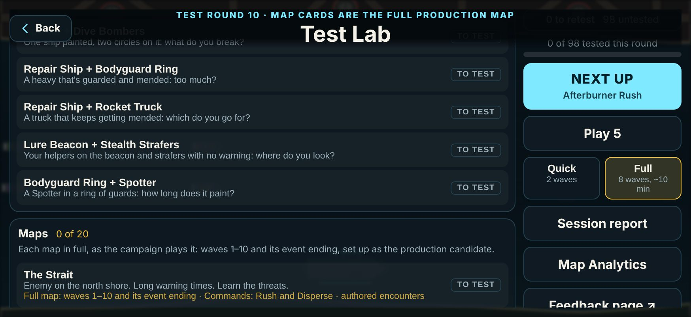
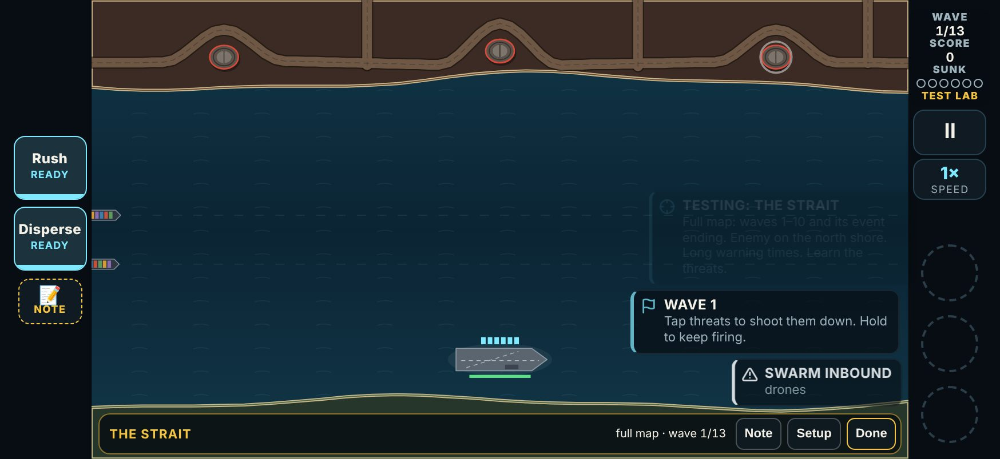
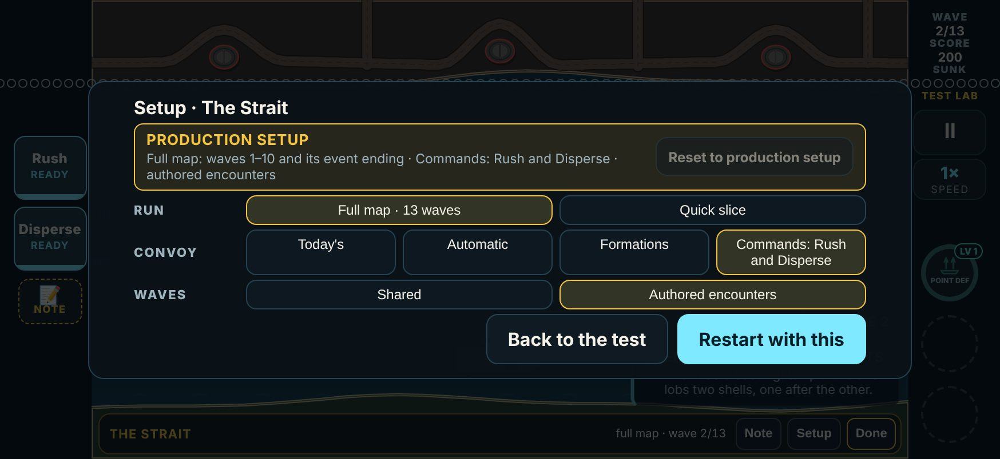

# V3 Test Lab round 10: map cards are the full production map

**Date:** 2026-11-13. Follows [v3-round9-fixes.md](v3-round9-fixes.md) and [v3-map-lab-slices2-5.md](v3-map-lab-slices2-5.md).

Test Lab round 10 is `{ n: 10, date: '2026-11-13', name: 'Map cards are the full production map', since: '2026-11-13T06:00' }`. All twenty map cards have a round 10 line, so the hub asks for each of them again. Nothing else changed: no other card moved, and the campaign plays exactly as before.

## Your words

> "Update the maps to be set up as you mentioned there so I don't have to modify the settings, so when I click that it's all good to go with those settings, so I know it's [playtesting] the right thing. Then also I want this map playtest to be the full finished 10 waves. I don't want the random playtest rounds we have. Should be what the final product will be, so we are working towards making those full production maps."

## What a map card plays now

Tap a map card and you play **that map as the campaign plays it**:

- **Waves 1 to 10**, with the campaign's own wave plan for that map. On the same seed, waves 1 to 10 are planned exactly as a campaign run plans them. The two differences are the convoy commands and authored encounters on the three reference maps.
- **The campaign's starting loadout**: no weapons, and the gun with your current Armory (see below).
- **The normal draft after every wave**: three weapons, as in the campaign.
- **Then the map's own event ending.** The convoy and carrier are restored, then three runs of the map's event play as waves 11 to 13. A bonus wave such as the Siren Field can come after wave 6, as it can in the campaign.
- **The map's difficulty and scaling are the campaign's.** That covers its threat scale, its aircraft, its chapter's new enemies, its posts and its boss.

What it no longer does:
- it has **no lab start wave** (it used to start at wave 5);
- it has **no lab kit** (Flak, Railgun, Laser Cutter);
- it has **no frequent weapon drops** and **no Quick or Full lab length**;
- it is **no longer endless**: it ends when the map is won or lost.

It is still a Test Lab test:
- The **lab bar** reads **THE STRAIT · full map · wave 3/13**, and the HUD says **WAVE 3/13 · TEST LAB**.
- **Note** works as before. **Done** works at any time, including over the draft between waves: the bar now sits above the draft, and the draft makes room for it.
- When the map is won or lost, or when you tap Done, the **verdict sheet** opens. Its evidence reads, for example, "Full map: 13 of 13 waves cleared (the map cleared) · Its ending: Clean 2 · Held 1 · Broken 0".
- **Bring one is gone** from map cards. A map card has no enemy or weapon of its own to bring, and the 'b' command does nothing on a full run.
- Nothing counts toward records, unlocks or Armory cards.

**The Armory: your current Armory.** A map card uses the upgrades you have equipped, at their levels, as a campaign run does. Before, lab tests always ran with no Armory at all. That is still true of every other card and of a map card's Quick slice.





## The defaults per map: ready to test

| Map | Card | Its ending (waves 11-13) | Opens with |
|---|---|---|---|
| **The Strait** | `map-strait` | Afterburner Rush | **Commands (D): Rush and Disperse · authored encounters** |
| **The Gauntlet** | `map-gauntlet` | Rocket Convoy | **Commands (D): Rush and Disperse · authored encounters** |
| **Harbor Mouth** | `map-harbor` | The Breakout | **Commands (D): Hold · authored encounters** |
| The Kesh Hook | `map-kesh` | Decoy Storm | Today's convoy controls |
| Lee of Marrow | `map-marrow` | Hydra Bloom | Today's convoy controls |
| The Island | `map-island` | Gunship Wall | Today's convoy controls |
| The Behemoth Run | `map-behemoth` | Wolf Pack | Today's convoy controls |
| The Needle of Bosk | `map-needle` | Shield Wall | Today's convoy controls |
| The Archipelago | `map-archipelago` | Supply Raid | Today's convoy controls |
| Saltgate Canal | `map-saltgate` | Run the Canal | Today's convoy controls |
| Battery Point | `map-battery` | Blackout | Today's convoy controls |
| Sowers' Reach | `map-sowers` | Carpet Run | Today's convoy controls |
| The Rig Field | `map-rigs` | Dive Circus | Today's convoy controls |
| The Black Strait | `map-lantern` | Bombardment | Today's convoy controls |
| Dreadnought Pass | `map-dreadnought` | Fire Mission | Today's convoy controls |
| Smugglers' Coves | `map-coves` | Repair Yard | Today's convoy controls |
| The Sharra Delta | `map-delta` | Escort Run | Today's convoy controls |
| Dunmar Crossing | `map-crossing` | Beacon Strike | Today's convoy controls |
| Tidewater Flats | `map-tide` | Firestorm | Today's convoy controls |
| Citadel of Vey | `map-citadel` | Siege of Vey | Today's convoy controls |

- **The three reference maps:**
  - The convoy is under policy D: the map's own schedule and formation, plus its commands.
  - Their authored encounters are on, in waves 1 to 10 only. The Strait's are Ranging shots (waves 2-4), The screen (5-7) and Rolling push (8-10). The Gauntlet's are North, then south (2-4), Overlap (5-7) and Crossfire (8-10). Harbor Mouth's are Open water (1-3), Funnel salvo (4-7) and The last mile (8-10).
  - The event ending is unchanged by either layer: it is the map's own event.
- **The other 17 maps** play their full map with today's convoy controls (flow and formations). No commands or encounters exist for them yet. Each card says so: "Today's convoy controls (no commands or encounters for this map yet)".
- **The same setup three ways:** tapping the card in the hub, **Next up**, and the plain link `v3.html?lab=map-strait` all open it. "Play 5" and "Save · next" do too.
- The setup is defined in one place, `mapProduction` in `src/v3/data/lab.ts`.

## How to change them

**In the game: Setup on the lab bar.** The sheet opens with a box marked **PRODUCTION SETUP** that says what that is.
- **Run**: **Full map · 13 waves** (the default) or **Quick slice**.
- **Convoy**: Today's, Automatic, Formations, or Commands.
- **Waves** (the three reference maps): Shared, or Authored encounters.
- Change anything and the box turns amber and reads **Changed from the production setup**. **Reset to production setup** puts every row back in one tap.
- **Restart with this** restarts the test with your setup. "Save · test again" on the verdict sheet keeps it. A new tap on the card, Next up or a plain link opens the production setup again.



**The Quick slice** is the old short lab run, kept for fast checks of geography and enemies:
- it starts at the lab's start wave (5);
- it has the card's three-weapon kit, frequent drops, and the Quick (2 waves) or Full (8 waves) length;
- its bar reads **quick slice · 1/8**;
- its sheet adds back the Wave, Weapon, Mix and Length rows.

It is never the default. Reset to production setup leaves it.

**By link (for comparisons):** the link changes the setup only for the card it names, and only as it opens.

| Link | Opens |
|---|---|
| `v3.html?lab=map-strait` | the production setup |
| `?lab=map-strait&convoy=current&enc=0` | the full map with today's controls and the shared waves |
| `?lab=map-strait&plays=slice` | the Quick slice |
| `?lab=map-strait&convoy=tactical&enc=1` | the old link shape, which is now the production setup |

**In the code:** `mapProduction(map)` in `src/v3/data/lab.ts` decides each map's production setup. A map becomes a reference map when it has commands in `MAP_CONVOY` (`src/v3/data/convoy.ts`) and encounters in `ENCOUNTERS` (`src/v3/data/encounters.ts`).

## The log, and the bridge

**The play log says which run it was**, so the next session reads the setup straight from it:

```jsonc
// A map card's full run
"firstWave": 1,                    // no "freePlay"
"lab": { "card": "map-strait", "rev": 10, "round": 10, "plays": "full",
         "config": { "convoy": "tactical", "encounters": 1, "production": true } },
"convoy": { "policy": "tactical", "obligation": "natural", "rev": 2 },
"encounters": { "rev": 1 },
"labResult": { ..., "plays": "full" }

// A map card's Quick slice
"firstWave": 5, "freePlay": { ... },
"lab": { "card": "map-strait", "length": "full", "mix": "normal", "rev": 10, "round": 10, "plays": "slice" }
```

- **`lab.plays`** is `full` or `slice` on every map card's log from round 10. The sim reads only `plays`.
- **`lab.config`** is a record of the convoy policy, the encounters' revision (0 for the shared waves), and whether that was the production setup. Replay plays the log's own `convoy` and `encounters`.
- **A map card's log from before round 10** has no `plays` and was a slice. It replays as before.
- **The log version stays 21.** A log without `plays` replays exactly as before. A log with `plays: 'full'` needs a build from this round, the same rule as `convoy` and `encounters`.

**The bridge** (`src/v3/sim/labDocs.ts`, `tools/v3/test-lab/results.mts` and `page.mjs`):
- A map card's result carries `plays` and a `setup` line, for example: "Full map from wave 1 · D · Tactical commands · authored encounters rev 1 · production setup".
- A slice's line reads "Quick slice from wave 5, full length · ...".
- `results.mts` prints the line beside the verdict.
- The review page shows it in front of the evidence, and marks each earlier round as Full map or Quick slice.
- `cards.mts` gives each map card its "Full map: ..." line for the page.

**Map Analytics** (`src/v3/ui/mapLab.ts`) reads these runs as any other. Each run's label says which it was: "you · map-harbor v10 · full map · ..." or "· quick slice from wave 5". A full run's waves 11 to 13 count as the **Map event** in its scope filter, as a campaign run's do. They are no longer a lab event.

## How it is built

- **`src/v3/sim/lab.ts`.** A lab card's setup can say `plays: 'full'`. The lab state's `full` flag makes the lab watch only:
  - no endless;
  - no lab length (`labDone` is never true; the run ends won or lost);
  - `labWaves` is the map's waves, 13;
  - the count reads "full map · wave n/13".
- **`src/v3/sim/events.ts`.** "Is this a lab test?" is now `labTest(g)`, a lab card that is not a full run. So a full map run has the campaign's event for its map, its three runs, the restore before them, and the bonus wave. `endEvent` counts the ending's runs in the lab's evidence.
- **`src/v3/sim/game.ts`.**
  - `applyLab` does not plan the first wave again for a full run. Nothing it changes touches the plan, so the RNG draws are the campaign's.
  - The restore before wave 11 happens on a full run.
  - `labBring` does nothing on a full run.
- **`src/v3/ui/lab.ts`.**
  - `defaultSetup` opens a map card on `productionSetup`.
  - `labRunPlan` turns a setup (and a link that names the card) into the lab setup, convoy and encounters to play.
  - `isProduction` marks the sheet.
  - `labActions` drops Bring one from map cards.
- **`src/v3/ui/app.ts`.**
  - `startLab` plays a full run with no Free Play setup: wave 1, your Armory, the campaign's drafts.
  - `play()` ignores `?wave=`, the developer presets and watch mode for it.
  - A cleared map logs as `won`.
  - The first-map tips about the flow slider and formations are skipped under a lab convoy policy. Those controls are the map's there.
- **`src/v3/sim/mimic.ts`.** `BotRun` takes a `lab` setup, so tools and tests can play a map card.

## Checks

All run on this branch. The browser checks ran on an isolated build served by `vite preview` at 874 x 402.

| Check | Result |
|---|---|
| `npx tsc --noEmit` | clean |
| `npx vitest run --exclude '.claude/**'` | 54 files, 1498 tests, all pass (20 of them new, in `tests/v3/mapCards.test.ts`) |
| `npm run v3:map-lab -- baseline` | 12 of 12 stored runs replay exactly, telemetry on and off: **the campaign is unchanged** |
| `npx vite build`, `npm run build:store` | both build |
| `e2e/v3.mjs` | 199 checks pass (two checks now expect round 10) |
| `e2e/v3-audio.mjs` | 16 pass |
| `e2e/v3-convoy.mjs` | 35 pass (its "no policy" Gauntlet check now asks for today's controls by link) |
| `e2e/v3-encounters.mjs` | 14 pass (its Strait check uses the Quick slice from wave 5, the encounter it was written for) |
| `e2e/v3-map-analytics.mjs` | 24 pass (the run's label says "full map") |
| `e2e/v3-map-cards.mjs` (new) | 18 pass |

**What the new tests cover** (`tests/v3/mapCards.test.ts`):
- **The same game as the campaign.** On The Kesh Hook, The Strait and Harbor Mouth with the layers off, one bot plays a campaign run and the map card's run on the same seed, to the win. Waves 1 to 13 are planned the same, wave by wave, and they are the same game, RNG included.
- **The production setup** is the campaign game with the two layers on, and nothing else.
- **Every map card's first wave** is the campaign's.
- **The defaults:** the three reference cards open on D and encounters from the hub, from Next up and from the bare link.
- **The event ending follows wave 10:** the restore, then rush 1/3, 2/3, 3/3, then won.
- **Bring one is absent.**
- **The log** carries the setup.
- **Replay is exact.**
- **The bridge** tells a full run from a slice.
- **The Quick slice** is the old run.

`tests/v3/lab.test.ts` checks round 10, and every map card (and only those) at version 10.

**The new browser check** (`e2e/v3-map-cards.mjs`):
- tap The Strait in the hub: wave 1 of 13, Rush and Disperse, no Bring one, and an encounter called out on wave 2;
- the draft after wave 1, with Done above it;
- the sheet's production mark, and Reset;
- the Quick slice;
- Next up, and the bare link.

## Not done, or open

- **Note and Setup during a draft.** The lab bar's Note and Setup work in a wave, not during the draft between waves, as before. Done works in both.
- **First-meeting tips.** A full map run shows them once per save, as the campaign does. Lab tests always showed them. Developer mode still shows them every time.
