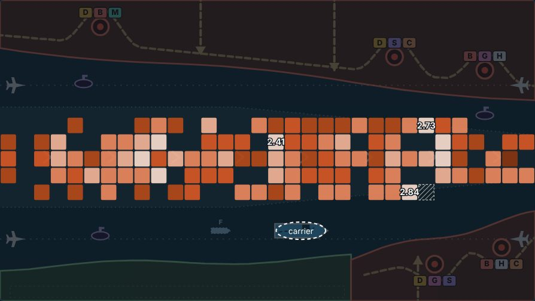
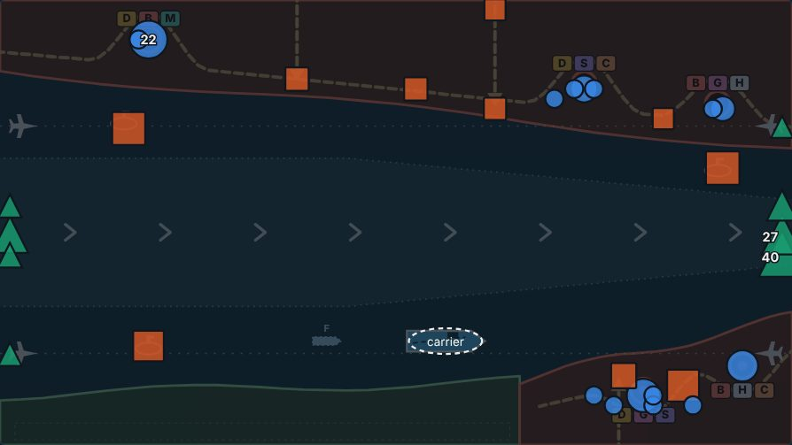

# V3 Map & Convoy Lab: slices 0 and 1 (the baseline and the telemetry)

**Date:** 2026-11-12. Follows [v3-map-convoy-lab-plan.md](v3-map-convoy-lab-plan.md), §10 and §14.
**Status:** slices 0 and 1 built and checked. Nothing about combat, special events, convoy controls or maps was changed. Slice 2 (the heatmap viewer) is not started; it waits on the review below.

- **Review page:** https://claude.ai/artifact/Tp6WVUqHcdGu87dGUE3Gpa. Each result with its evidence and a Looks right / Change mark, a first look at the telemetry drawn on the three reference maps, and six questions for the next session.
  - Built by `npx vite-node tools/v3/map-lab/page.ts -- <out.html>` from `tools/v3/map-lab/review.mjs` (findings, questions), the stored baseline, and the results files in `tools/v3/map-lab/results/`.
  - Its store: `reviews/{id}` = `{ verdict: 'ok' | 'change' | null, note, at }` for the twelve findings and the three maps; `answers/{id}` = `{ choice, note, at }` for the six questions and `ml1-else`. Every id starts `ml1-` (round 1).

Words used here, as the plan asks: **observed** (measured in this session), **found** (a fact about the game as it stood), **decided** (a choice made here, with its reason), **hypothesis** (not tested yet).

The numbers below are in `tools/v3/map-lab/results/` (`audit.json`, `bench.json`, `browser-cost.json`, `browser-run.json`, `crossbuild.json`, `build.json`), written by the commands named with them, and in `tests/v3/fixtures/map-lab/manifest.json`.

## What was built

| Piece | Where | What it is |
| --- | --- | --- |
| Telemetry | `src/v3/sim/telemetry.ts` | The record: a header, the run's stretches, discrete events, position samples, a running ledger, and the checks that it adds up. |
| Hooks | `src/v3/sim/game.ts`, `foes.ts`, `events.ts` | One null check at each place the sim itself decides something (a launch, a hit, a pickup, a tap, a command). |
| Replay | `src/v3/sim/playlog.ts` | `replay(log, { telemetry: true })`, `Recorder.telemetry()`. The log's format and version are unchanged. |
| Baseline and checks | `src/v3/sim/mapLab.ts` | The twelve recipes, the state hash, the step-by-step on/off comparison. |
| Stored baseline | `tests/v3/fixtures/map-lab/` | Twelve play logs and `manifest.json` (what each replays to). 260 KB. |
| Tool | `tools/v3/map-lab/run.ts` (`npm run v3:map-lab`) | `baseline`, `telemetry <log>`, `audit`, `bench`, `preview`. |
| Review page | `tools/v3/map-lab/review.mjs`, `page.ts`, `preview.ts` | The findings and questions, the page made from them, and the first maps drawn from the baseline's telemetry. |
| Tests | `tests/v3/telemetry.test.ts` (26), `tests/v3/mapLabBaseline.test.ts` (6) | The gate, as tests. |
| Browser check | `e2e/v3-map-lab.mjs` | A Test Lab run played by touch at 874 x 402; live against replay; the cost. |
| In the game | `src/v3/ui/app.ts` | Records in Test Lab runs, dev mode or `?tel=1`. "Download telemetry" beside "Download log" on the result screen. |

## Slice 0: the audit

### What the plan says against what is there (found)

| The plan (§2) | The code today |
| --- | --- |
| `LOG_VERSION = 19` "at review" | **20** (enemies and events round 8). |
| Test Lab: enemy, weapon, combo and map cards | Round **8**; **98** cards: 21 events, 17 enemies, 27 weapons, 13 enemy pairs, 20 maps. `docs/design/v3-test-lab.md` still describes round 4 (74 cards, log version 17). |
| The ending: three runs, waves 11 to 13 | Confirmed: `ENDING = { threeRuns: true, runs: 3 }`; the convoy and carrier are restored before run 1 (`restoreConvoy`); a run between two others starts with no draft. |
| Siren Field as a bonus after wave 6 | Confirmed: `BONUS_EVENTS`, when two or more passives are held as wave 6 ends; campaign only (not Free Play, the lab or endless). The bonus wave keeps wave number 6 and writes no wave record. |
| Convoy inputs `'f'` and `'m'` | Confirmed. The Delta's fork is **not** its own input: it is a tap (`'t'`) on the buoy that `tapResult` turns into `throwSwitch`. |
| Five flow steps, four formations | Confirmed (`FLOW_STEPS`, default index 1; `FORMATIONS`). A ship keeps the flow multiplier it sailed under. |
| Wave scheduler | `startWave`: the shared table scaled by the map, bunched into themed raids, some handed to subs and trucks (`planVectors`), aircraft and new enemies swapped in for drone swarms. An event wave runs a script instead (`sim/events.ts`). |
| Build id | `__BUILD__` is the build's date and time to the minute, not a commit. The telemetry header adds a hash of the map's data and a hash of the rules tables. |

### What the game already recorded (found)

- Per wave, cumulative: score, delivered, lost, carrier hull, shots, kills by kind, sinkings by kind, tap counts (`WaveRecord`).
- For the run: launches by origin class (`origins`: base, truck, sub, air, child), carrier damage by kind, weapon pickups taken by weapon.
- From the log's `Watch`: volleys as met, marked moments. From events: each event's grade, what it sent, ships lost, shots.
- From the Test Lab: per-card evidence (`LabStats`).

None of it has a place on the map, and none of it names a particular attacker.

### Attribution gaps (found), and what slice 1 did

| What | Before | Now |
| --- | --- | --- |
| A hit on a ship, the carrier or a post | Knew only the kind of threat | The attacker's id, the impact point, the warhead, what was dealt after formation armour, and the hull points really removed |
| A truck's rocket, a dive bomber's bomb | No link to the truck or the plane | Carries the id of what fired it |
| An Incendiary Missile's fire, a Fire Mission shell | No link to the missile or the spotter | Carries the id of what it came from |
| A bomber's missile, a helicopter's rocket, a torpedo | Blamed on a kind | Names the very bomber, helicopter or submarine |
| A bomblet, a mini-drone, a Hydra's dart | Blamed on a kind | Names the threat it split from |
| A pickup | Only a count of those taken | Dropped, then taken, expired or cleared with the wave, each with its place |
| A cargo ship | Only totals | Each ship from sailing to delivery or sinking, with its lane and sampled positions |
| A tap | Only counts | Where, what it went for, what was loaded, the rack before and after |
| Flow and formation | In the log, with no result | What was asked, what stood before, whether anything changed, how many ships it reaches |
| The bonus wave | No wave record of its own | Its own stretch, with its grade |

To name attackers, three write-only fields were added to sim objects: `Threat.src`, `FoeShot.src`, `FoeMark.src` (and `Interceptor.by` for a helper's shot). Nothing in the sim reads them.

### Found in the game, not changed

1. **The carrier damage tally counts the warhead, not the hull.** `carrierDamageBy[kind] += amount` runs even when the hit takes only the carrier's last points. In 3 of 60 audit runs the tally read 14 for a carrier with 12 hull points. Nothing in play reads it. The telemetry records both (`dealt` and `hp`).
2. **A Resupply card lowers a supertanker's hull from 8 to 3.** `pickUpgrade('resupply')` sets every ship afloat to `stats.shipHp` (3); a supertanker has `VIP.hp` (8). Reproduced on The Behemoth Run. It is a change to the sim, so it is a question on the review page, not a fix here. The telemetry records it as a heal of −5, so the hull still adds up.
3. **`docs/design/v3-test-lab.md` is four rounds behind** (see the table above).
4. **Bot observations, not conclusions:** undefended, a Test Lab run on Harbor Mouth from wave 5 is lost in 37 s (2,206 steps). The sharper bot with Wide Warhead 3 loses Harbor Mouth on wave 10 and The Gauntlet's Rocket Convoy in run 2.

### The baseline (decided)

Twelve fixed runs, four on each reference map. `you` is the bot fitted to the player's own logs (`sim/mimic.ts`), `tryhard` a sharper day. A start at wave 6 or 11 is handed the weapons the skip-ahead drafts, as `?wave=N` does.

| Run | Bot | Armory | Seed | From wave | Ended | Wave | Delivered | Lost | Hull points | Covers |
| --- | --- | --- | --- | --- | --- | --- | --- | --- | --- | --- |
| strait-campaign-tryhard | tryhard | Wide Warhead 3 | 101 | 1 | won | 13 | 250 | 1 | 70 | waves 1-10, Afterburner Rush runs 1-3 |
| strait-campaign-you | you | base gun | 102 | 1 | won | 13 | 197 | 6 | 123 | the same with the base gun; six ships lost before the restore |
| strait-event | tryhard | Wide Warhead 3 | 201 | 11 | won | 13 | 0 | 0 | 4 | Afterburner Rush on its own |
| strait-bonus | tryhard | Wide Warhead 3 | 8 | 6 | won | 13 | 161 | 0 | 79 | Siren Field after wave 6, then 7-13 |
| gauntlet-campaign-tryhard | tryhard | Wide Warhead 3 | 103 | 1 | lost | 12 | 251 | 6 | 67 | waves 1-10, Rocket Convoy run 1, lost in run 2 |
| gauntlet-campaign-you | you | base gun | 102 | 1 | lost | 10 | 222 | 6 | 102 | waves 1-10 with the base gun |
| gauntlet-event | tryhard | Wide Warhead 3 | 202 | 11 | lost | 12 | 0 | 6 | 34 | Rocket Convoy on its own (lost in run 2) |
| gauntlet-bonus | tryhard | Wide Warhead 3 | 20 | 6 | won | 13 | 176 | 2 | 108 | Siren Field, then 7-13 |
| harbor-campaign-tryhard | tryhard | Wide Warhead 3 | 103 | 1 | lost | 10 | 165 | 6 | 82 | waves 1-10 |
| harbor-campaign-you | you | base gun | 103 | 1 | lost | 8 | 120 | 6 | 87 | waves 1-8 with the base gun |
| harbor-event | tryhard | Wide Warhead 3 | 201 | 11 | won | 13 | 12 | 0 | 12 | The Breakout on its own |
| harbor-bonus | tryhard | Wide Warhead 3 | 20 | 6 | lost | 10 | 127 | 6 | 124 | Siren Field, then 7-10 |

("Hull points" is ship plus carrier hull removed.) Each row is a stored play log (`tests/v3/fixtures/map-lab/<run>.json`) and a line in `manifest.json`: the log's hash, the hash of the game state it replays to, the hash of its telemetry, the map and rules hashes, and its totals.

**`tests/v3/mapLabBaseline.test.ts` fails when the sim changes.** That is its job: runs from before and after a change are not the same experiment. When a change is meant, bump `LOG_VERSION` if old logs no longer replay, run `npm run v3:map-lab -- baseline --write`, and say so in the change's notes.

### Slice 0 gate (observed)

- Before any change: 22 V3 test files, **551 tests** passing; `npm run build` passing.
- **No combat change:** the twelve baseline recipes and ten more maps (Saltgate's locks, the Delta's fork, the tide, Marrow's posts, the Dreadnought, the supertanker, night, the Citadel, Dunmar Crossing, the Kesh Hook) were played by the bots on the commit before this work and on this build. Inputs, summaries, final state (leaving out the fields added for telemetry) and the next draw from every RNG stream are **identical in all 22**.
- **Reproducible:** each stored log replays to its stored state hash; the recipe (map, seed, bot, Armory, first wave) plays the stored log again byte for byte.

## Slice 1: the telemetry

### The shape (decided)

A **sidecar** to the play log: `{ header, phases, events, samples, totals }`.

- **Header:** schema 1, game, log version, the log's id, build, map hash, rules hash, map, the 1600 x 900 frame, seed, first wave, mode (campaign, freePlay, lab, watch, replay, sim), player (human or the bot's name), the input (touch, screen size, landscape), the Armory, weapon levels at the start, the hulls and limits in force (ship hull, carrier hull, loss limit, last wave), the convoy policy (`current`, rev 1, flow and formation at the start), the Test Lab card with its version and round, the sampling rates.
- **Phases** (stretches): a normal wave, `bonusEvent`, `mapEvent` (with run 1, 2 or 3 of 3), or `labEvent`. Each has its first and last step and time, how it ended, the event's grade, and the run's counters as it began (lost, delivered, carrier hull, ships afloat, flow, formation): the denominators.
- **Events**, each with the step, game time and its phase:

| Kind | What it is |
| --- | --- |
| `thr+` / `thr-` | A threat launched (origin class, base index or launcher id, parent id, target, hull, a ballistic's landing point and flight time, its raid) and ended (`kill`, `impact`, `gone`) |
| `hurt` | A threat damaged: hull removed, what did it (the gun, a weapon, a helper), the weapon tagged on the shot, whether it was the player's own hand, whether it killed |
| `hit` | A hull hit: impact id, victim and where it was, where the blow landed, attacker id and kind, the warhead, what was dealt, hull really removed and left, direct or splash, sunk, blocked (Shield or glance), lane and distance along it, formation |
| `heal` | Hull put back: repair pickup, Damage Control, Resupply, the supertanker home, the restore before the ending |
| `ship+` / `ship-` | A ship sailed (lane, slot, flow, formation) and was delivered (points) or sunk (by what) |
| `pk+` / `pk-` | A pickup dropped (why: a kill, a plane, the tanker, the lab, an event) and ended (collected, expired, cleared with the wave) |
| `tap`, `in` | A tap (where, result, target, loaded weapon, rack before and after) and other inputs (press, move, release, gesture shots, Focus, Bring one, a card picked) |
| `cmd` | Flow, formation or the fork: asked, stood before, changed or not, ships reached, seconds to the next sailing |
| `rdr` | A sub or truck's state as it changes (warn, surface, fire, dive, drive, raise): where the platform was, apart from where each round left it |
| `mark+` / `mark-` | The new enemies' warnings on the water (periscope, dive circle, shell circle, fire, hatch) |
| `warn` | A raid's warning (theme, bases, lead time) and an aircraft's arrow |
| `env` | Lock gates, the tide, a post down or up, a base down, a star shell, the Shield |
| `audit` | Something changed that no event told of (see below) |

- **Samples:** every ship's position 4 times a second, every moving threat's twice a second, to a tenth of a world unit.
- **Totals:** a ledger kept as events are written.

All coordinates are world units. Entity ids are the game's own (`nextId`), so one threat has one id from launch to end; the telemetry never draws an id or a random number of its own.

### Where it lives (decided)

- **It is made by replay.** A sidecar is a pure function of the build and the play log, so nothing new is uploaded or stored with the log, and any log on this log version can be turned into telemetry later (`npm run v3:map-lab -- telemetry log.json`). The log stays version 20 with nothing added; a log replayed without the option carries none.
- **Live**, it records only in Test Lab runs, dev mode or with `?tel=1` (`?tel=0` turns it off). It stays in memory on the device; the result screen offers "Download telemetry" beside "Download log". Ordinary campaign play records nothing. The App Store build never records.
- **Bounds:** 150,000 events and 40,000 samples a run (a whole 13-wave run is about 2,600 and 2,700). Past the cap the oldest samples go first and the sidecar says it was cut.

### It checks itself (decided)

Before and after every step the telemetry compares what its `hit` and `heal` events moved with each hull as it is, and the threats and pickups it was told of with the ones on the board. Anything it was not told of becomes an `audit` event and counts in `totals.audits`. A future change that moves a hull point without a hook shows up in every run, not only in a test. `reconcile(sidecar, game)` then compares the totals with the game's own counters: ships lost, delivered and sunk by kind, kills by kind, launches, carrier hull, taps, pickups on the water.

### Slice 1 gate (observed)

| Check | Result |
| --- | --- |
| On and off, step by step | The 12 baseline runs (**244,638 steps**) played side by side with telemetry on and off: equal after every step (a cheap checksum every step, the whole state every 300), and the same next draw from every RNG stream. |
| The same on other water | **60 bot runs on all 20 maps** (three seeds each, starting at waves 1, 11 and 6): 0 differences, 0 audit lines. |
| The same with every input | A bot that holds, swipes and flings the gesture weapons, with every weapon in hand; every special event card; every enemy and enemy-pair card; a map card on each kind of water: equal, 0 audit lines. |
| Hull points and sinkings | In the audit, **2,582 hull hits, every one with its attacker named**; hull removed, sinkings by kind and carrier hull match the game in every run. |
| Pickups | Every pickup dropped ends as taken, expired, cleared with the wave or still on the water: none unexplained. |
| Live against replay | A Test Lab run on Harbor Mouth played by touch at 874 x 402: the sidecar recorded live, the one from replaying its log in the browser and the one from replaying it under Node have the same hash. |
| Older logs | The log format is unchanged; a log replays to the same state with or without telemetry. Logs from before version 20 replay only on the build that made them, as before. |
| Regression | 24 V3 test files, **583 tests** passing; `npm run build` and `npm run build:store` passing; `npm run e2e:v3` passing. |

### What it costs (observed)

| | |
| --- | --- |
| A sim step in Chromium at 874 x 402 | 13.9 µs off, 20.5 µs on: +6.6 µs, **0.04%** of a 60 fps frame (an earlier run: +5.1 µs) |
| The same with the processor slowed 4x | 66.4 µs off, 78.5 µs on: +12 µs, **0.07%** of a frame (an earlier run: +25 µs, 0.15%) |
| A headless replay under Node | 12% slower with telemetry on (11 to 17% across three runs of the benchmark) |
| Size | about 2.2 KiB of JSON per second of play (0.46 KiB zipped); the longest baseline run is 1.2 MB (0.24 MB zipped) |
| The game's download | 547.7 kB before, 568.4 kB now (182.9 to 190.0 kB zipped) |

The slowed processor is a stand-in for a phone. **It has not been measured on a real iPhone.**

### The sampling rate (observed, then decided)

Ship-seconds by 50 x 50 square from samples joined by straight lines, against every step's true positions (squares with 10 ship-seconds or more):

| Run | 10 a second | **4 a second** | 2 a second | 1 a second | every 2 s |
| --- | --- | --- | --- | --- | --- |
| The Strait: worst square | 0.1% | **0.1%** | 0.1% | 0.2% | 9.8% |
| The Gauntlet: worst square | 0.3% | **0.3%** | 0.6% | 1.9% | 17.2% |
| Harbor Mouth: worst square | 1.0% | **0.6%** | 0.4% | 1.7% | 18.6% |
| The Kesh Hook (a bend): worst square | 2.0% | **2.5%** | 4.7% | 10.3% | 23.0% |

Decided: **4 a second, to a tenth of a unit.** With whole-unit rounding, Harbor Mouth's worst square was wrong by 33% at 4 a second: one of its lanes runs along a grid line, and rounding moved ship-seconds across it. A tenth of a unit removed that.

## A first look (observed, bots only)

Four baseline runs a map, added together (`npm run v3:map-lab -- preview`). These show that the record is right. They are not yet evidence about a person: a bot sees in the dark and reacts faster.

| Normal waves | The Strait | The Gauntlet | Harbor Mouth |
| --- | --- | --- | --- |
| Ship-minutes afloat | 489 | 511 | 365 |
| Ship hull points lost | 180 | 166 | 271 |
| Hull points per ship-minute | 0.37 | 0.33 | **0.74** |
| The same by third of the board (entry, middle, exit) | 0.42, 0.41, 0.33 | 0.30, 0.42, 0.31 | **0.69, 0.78, 0.87** |
| Sinkings by third | 0, 1, 4 | 1, 5, 2 | **0, 7, 11** |
| Most damage from | ballistic 83, strafer 51 | ballistic 66, strafer 39 | **strafer 107**, ballistic 58 |
| Base: launches, hull points | 379, 45 | 405, 71 | 295, 71 |
| Truck or sub: launches, hull points | 286, 93 | 289, 84 | 267, 108 |
| Aircraft: launches, hull points | 43, 62 | 58, 47 | 63, **114** |
| Pickups dropped, taken | 180, 160 | 184, 156 | 154, 138 |

*Harbor Mouth, normal waves: hull points lost per ship-minute in each square (lighter is worse; hatched: too little traffic for a rate).*

*Harbor Mouth, normal waves: hull points removed, traced back to where the attacker was launched (circle: a base; square: a truck or submarine; triangle: an aircraft's entry).*

The same view of [The Gauntlet](img/map-lab/gauntlet-sources.jpg) and [The Strait](img/map-lab/strait-sources.jpg). Every layer for all three maps is on the review page.

- Harbor Mouth costs twice the hull per ship-minute of the other two, rises toward the exit, and sinks nothing in the first third. That is the funnel the plan's thesis describes, in numbers.
- On Harbor Mouth an aircraft launch removes 1.8 hull points on average, a base launch 0.24. Strafing jets, not the heavies, do the most damage to these bots there.
- In the events: The Gauntlet's Rocket Convoy costs 1.51 hull points per ship-minute against 0.33 in its normal waves; The Strait's Afterburner Rush 0.99 against 0.37.

**Hypotheses these raise, not tested:** that Harbor Mouth's danger is the strafing run down a single-file funnel as much as the heavies; that a Hold before the funnel would trade against those runs. Slice 2's viewer and a person's runs come first.

## What slice 1 does not do

- No heatmap viewer, filters, scrubber or drill-down (slice 2). The review page's maps are a fixed first look.
- No new convoy command and no control policy (slices 3 and 4). `cmd` events cover today's flow, formation and fork.
- A threat's change of target mid-flight is not an event (positions are sampled). A helper's shot is not an event (its hits are, with the helper named). Speed and pause presses are not recorded.
- Night and stealth: when a warning could first be *seen* by a person is not known to the sim. The stream has when it went up.
- A Test Lab run's verdict sheet has no download link; its telemetry is read through the page's test hook or made from its log.
- Not measured on a real iPhone. No human run yet.

## The build, test, inspect, correct, retest log

1. **Read** the plan, the Test Lab, the log, the events and the sim; listed every place a hull, a threat or a pickup changes.
2. **Baseline first:** 551 tests and the build passing before any edit.
3. **Built** the telemetry and the hooks. First whole runs: equal with it on and off, reconciled, 0 audits.
4. **Inspect:** the 60-run audit found the carrier tally differing from the hull in 3 runs. The telemetry was right (hull removed stops at zero); the game's tally counts the warhead. **Corrected** the reconciliation to compare like with like; recorded the finding.
5. **Inspect:** with the gesture-playing bot, tap counts differed. The game counts a Grapnel hook, a Cutter swipe and a charged Lance as taps; the telemetry did not. **Corrected:** a `gesture` input event. Retest: equal.
6. **Inspect:** the sampling study showed a 33% worst square on Harbor Mouth at every rate. Whole-unit rounding on a lane that runs along a grid line. **Corrected:** a tenth of a unit. Retest: 0.6%.
7. **Inspect:** the live sidecar of a run ended with Done differed from its replay (the last stretch was closed live, open in replay). **Corrected:** a replay of a log that was left closes it too. Retest in the browser: the same hash, and the same under Node.
8. **Compared** with the commit before this work on 22 runs: identical.
9. **Looked** at the phone-sized screenshots: nothing added to the field; the result screen's new link fits.
10. **Regression:** 583 tests, both builds, the existing browser suite and the new one.

## Next

Slice 2 (the viewer) waits on the review page. The questions there: what to build next, where the viewer lives, whether the player will play the three map cards once each (so the first heatmaps include a person), which Armory the bots should have, whether to fix the Resupply finding, and when to record live.
