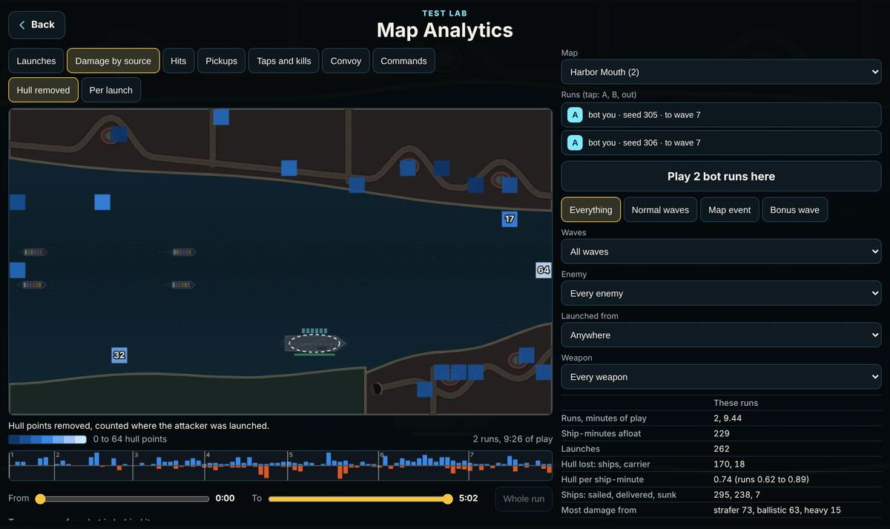
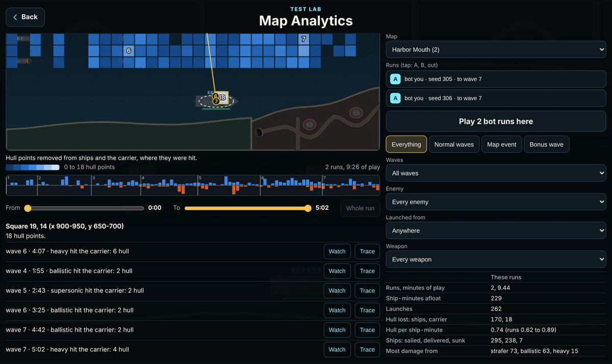
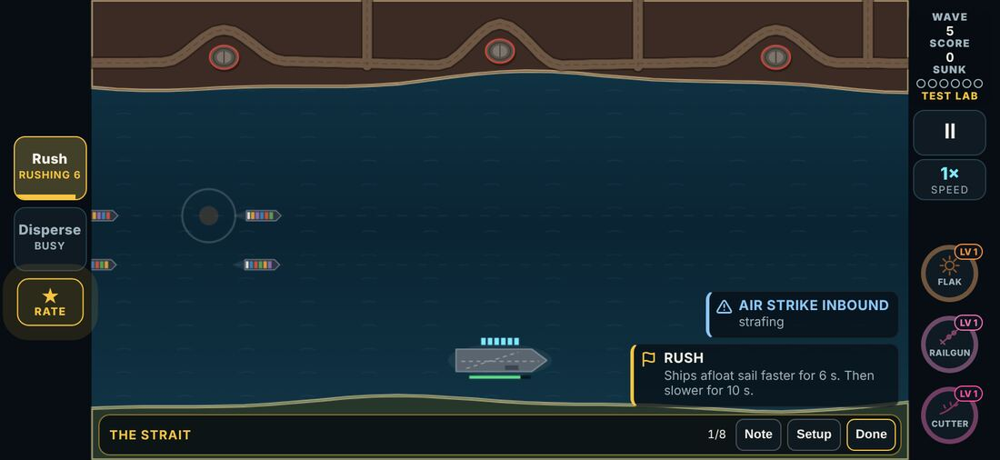
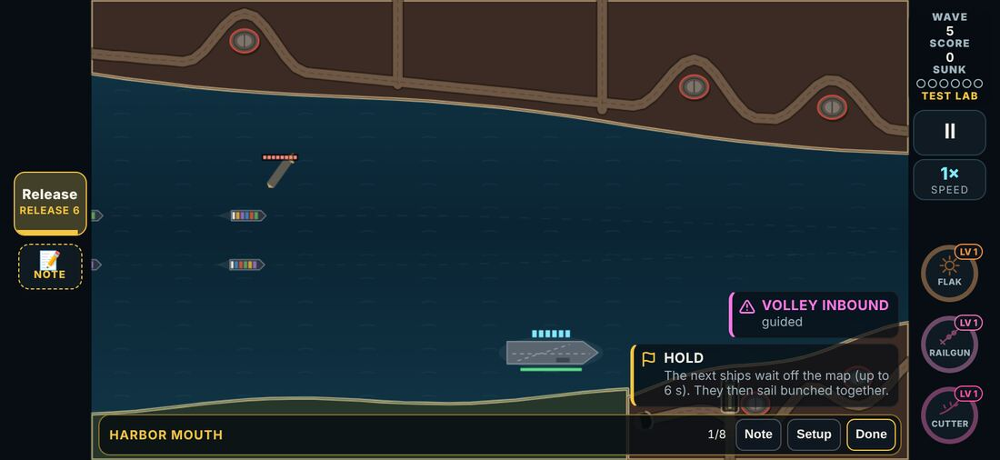
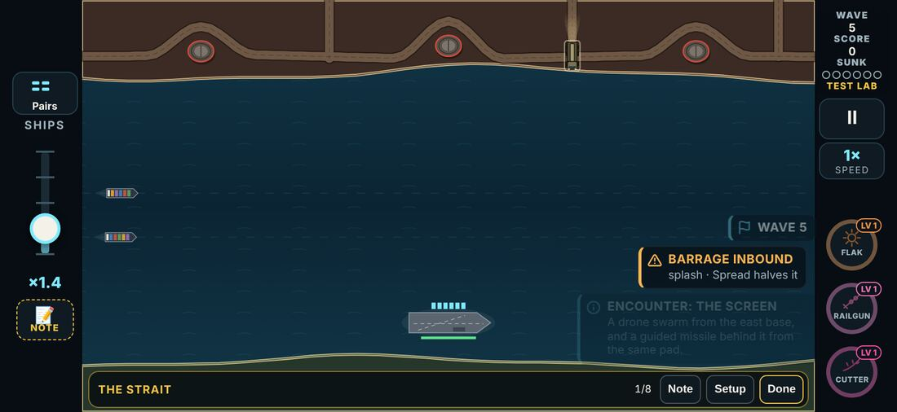
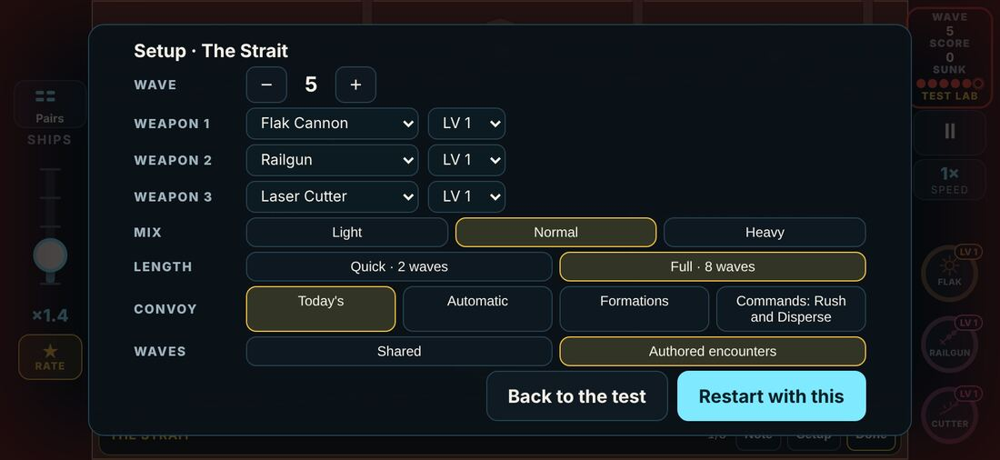

# V3 Map & Convoy Lab: slices 2 to 5 (the viewer, convoy policies, commands, encounters)

**Date:** 2026-11-12. Follows [v3-map-convoy-lab-plan.md](v3-map-convoy-lab-plan.md) (§10 and §14) and [v3-map-lab-slice0-1.md](v3-map-lab-slice0-1.md).
**Status:** slices 2, 3, 4 and 5 built and checked, all inside the Test Lab. **The campaign is unchanged**: a normal run has no convoy policy and no encounters, and the twelve stored baseline runs replay to the same state. Slice 6 (per-map decisions) is not started; it waits on the owner's phone playtest and the review below.

- **Review page (round 2):** https://claude.ai/artifact/Tp6WVUqHcdGu87dGUE3Gpa. The same page as round 1, opening on round 2: each result with its evidence, the playtest in order, the nine encounters one by one, and six questions. Round 1 is kept underneath.
  - Built by `npx vite-node tools/v3/map-lab/page.ts -- <out.html>` from `tools/v3/map-lab/review.mjs`, `src/v3/data/convoy.ts`, `src/v3/data/encounters.ts` and the results files in `tools/v3/map-lab/results/`.
  - Its store: `reviews/{id}` = `{ verdict: 'ok' | 'change' | null, note, at }` and `answers/{id}` = `{ choice, note, at }`. Round 2's ids start `ml2-` (fourteen findings, nine encounters as `ml2-enc-<encounter id>`, six questions and `ml2-else`); round 1's `ml1-` ids are untouched.

Words used here, as the plan asks: **observed** (measured in this session), **found** (a fact about the game as it stood), **decided** (a choice made here, with its reason), **hypothesis** (not tested yet), **proposed** (for the owner to accept or not). Nothing here is **accepted** until the owner says so.

Every experiment number below is from `tools/v3/map-lab/results/experiment.json` and `experiment-encounters.json`; the tables are printed by `node tools/v3/map-lab/tables.mjs`. Bot runs are a first read. They are not evidence of how any of this feels in the hand.

## What was built

| Slice | Piece | Where | What it is |
| --- | --- | --- | --- |
| 2 | Map analytics | `src/v3/sim/mapAnalytics.ts` | Telemetry turned into layers on a 32 x 18 grid of the board: launches, damage by source, hits, pickups, taps and kills, convoy traffic, commands. Filters, a mask for squares with too little play, a time line, a trace from any hull hit back to its launch, and a difference between two sets of runs. |
| 2 | The screen | `src/v3/ui/mapLab.ts` (its own chunk, loaded when opened) | "Map Analytics" on the Test Lab's front page, or `?maplab=1`. Reads the runs kept on the device; "Play 2 bot runs here" for a map with none. A hot square opens the replay a few seconds before it. |
| 2 | A report outside the game | `tools/v3/map-lab/page.ts -- report.html --logs=a.json,b.json` | The same maps from any log files. |
| 3 | Convoy policies | `src/v3/data/convoy.ts`, `src/v3/sim/convoy.ts` | A automatic, B formations only, C today's controls, D the map's commands. `Game.convoy` is `null` in the campaign. Rules version `CONVOY_REV = 1`, written into the log. |
| 3 | Experiment harness | `src/v3/sim/convoyLab.ts`, `src/v3/sim/convoyPilot.ts`, `npm run v3:map-lab -- experiment` | The same seeds under each policy, with the ships owed held fixed or left to each policy; a bot that presses commands well, at random, on cooldown, or never. |
| 4 | Commands | `src/v3/sim/convoy.ts`, `src/v3/ui/app.ts` | Rush and Disperse (The Strait, The Gauntlet), Hold and Release (Harbor Mouth). A new logged input `'k'`; the log version is still 20. |
| 5 | Encounters | `src/v3/data/encounters.ts`, `planEncounters` in `src/v3/sim/game.ts` | Nine authored encounters over the shared ten waves of the three reference maps. `Game.enc` is `null` in the campaign. Rules version `ENCOUNTER_REV = 1`, written into the log; launches tagged in telemetry. |
| all | Tests | `tests/v3/mapAnalytics.test.ts` (21), `convoy.test.ts` (21), `encounters.test.ts` (15) | The gates below, as tests. |
| all | Browser checks | `e2e/v3-map-analytics.mjs`, `e2e/v3-convoy.mjs`, `e2e/v3-encounters.mjs` | By touch at 874 x 402 and 667 x 375. |

How to open each in the Test Lab: pick a map under "Maps", then "Setup". The **Convoy** row picks the policy; the **Waves** row (the three reference maps only) picks the shared waves or the authored encounters. Or by link: `v3.html?lab=map-strait&convoy=tactical&enc=1`.

## The gates (observed)

| Gate | Result |
| --- | --- |
| The campaign plays as before | The twelve baseline runs replay to the stored state with `Game.convoy` and `Game.enc` in the game (`tests/v3/mapLabBaseline.test.ts`, `npm run v3:map-lab -- baseline`). An ordinary run in the browser has neither layer, even with `?convoy=` or `?enc=1` in the link. |
| The viewer shows what happened | Layer totals equal the telemetry's ledger; a launch square is the launcher's square; a filter never changes a total it does not name; off-board hits count in the edge square; thin squares are masked, not drawn as safe. |
| A hotspot opens its replay | "Watch" replays the same log to a few seconds before the hit and stops there (browser check). |
| Policies are comparable | D with no command pressed is the same game as A on every seed (0 difference in hull, sinkings and score on all six map and bot pairs). Runs carry their policy; `logHash` differs between policies. |
| Commands are inputs like any other | Every press, accepted or refused, is in the log and the telemetry; a run with commands replays to the same state and the same telemetry, on and off. |
| A press never fires, a tap never commands | Browser check, both ways, at two phone sizes. |
| An encounter uses only what the map has | Every beat's enemy is in that map's table or extras by that wave; every base and submarine spot exists; submarines are on open water. |
| A wave with an encounter is no bigger | What an encounter sends comes out of the planned wave launch for launch; over eight seeds the wave is within two launches of the shared wave on the same dice (a submarine tops its salvo back up). |
| Every authored launch is warned of | A lit base at least a raid's warning ahead, a periscope and surfacing time for a submarine, the arrow for an aircraft. |
| Events are left alone | Waves 11 to 13 and the Siren Field bonus wave play the same with the encounter layer on. |
| The telemetry adds up | 0 problems from the telemetry's own checks across both experiments (1,248 runs). |

Full regression at the end of the session: see "Checks run" at the bottom.

## What the bots showed (observed)

1. **The control holds.** D with no command pressed equals A everywhere. Differences below come from commands being used.
2. **Today's flow slider has one best setting.** At the fastest flow, hull lost per ship-minute falls by a quarter to a half and the score about doubles or more, on every map, for both bots, with or without encounters. Under "each policy under its own rules", C scores two to three times A for that reason alone. This is the most robust result of the round.
3. **Formations alone (B) are not an improvement.** B lost more hull than A in eleven of twelve fixed-schedule rows (six map and bot pairs, shared waves and encounters). The formation bot picks by the raid call-out; the map's pairs formation is already a reasonable default.
4. **The Strait, shared waves: commands help, but so does pressing at random.** Sharp use lowered hull lost on 7 of 8 seeds for the weaker bot and 6 of 8 for the stronger; random use did as well. On this map Rush is close to free.
5. **The Gauntlet, shared waves: timing matters.** Sharp use helped (8 of 8 seeds for the stronger bot); random use did not.
6. **Harbor Mouth, shared waves: Hold is mixed.** It helped the stronger bot and hurt the weaker one.
7. **With encounters on, the picture changes.** The Strait's gain from commands mostly goes away; The Gauntlet's flips sign for the weaker bot; Harbor Mouth's stays good for the stronger bot only. The bots cannot settle the commands.
8. **The encounters make two maps harder.** Hull lost per ship-minute under A rises on Harbor Mouth and The Gauntlet for both bots, and is level on The Strait. The launch count is no higher, so this is the aim and the timing (a salvo into the narrows, two shores at once), which is the point of an encounter, but "the same difficulty" is not yet true.

### Hypotheses (not tested)

- Rush is free on The Strait because every second not spent under the three bases is worth more than the slow stretch after. A longer or slower coast, or a Rush that can only be given when a volley is in the air, would make it a decision.
- Hold hurts the weaker bot because the ships it keeps back arrive together and it cannot clear what is aimed at a bunch. Releasing one group at a time would keep the idea and lose the bunch.
- Harbor Mouth's funnel salvo (four shells from the submarine off the narrows, aimed at the ships nearest the mouth) is the main cause of that map's rise. Two shells, or a longer gap between them, is the first thing to try.
- The bots do not read an encounter's warning any differently from a raid's, so they cannot show whether an encounter is *readable*. Only a person can.

### Proposed (for the owner)

- Where a map has commands, the map sets the flow (policies A, B and D already do this in the lab). The slider's one right answer is not a decision worth a control.
- Do not carry Rush, Disperse or Hold toward the campaign as they are. Retune the three (cost of Rush, release of Hold) and rerun, then judge them in the hand.
- Tune the encounters from the owner's marks before any of them is proposed for a map in slice 6. Harbor Mouth's first.

## Found on the way (not changed)

- **Most drone swarms are already replaced by the middle waves.** Each new enemy and each aircraft stands in for a whole swarm. The Strait at wave 5: the table asks for 18 drones, 6 or 7 are launched. An encounter that "replaces ten drones" on such a wave replaces all there are.
- **A submarine always fires a full salvo.** Fewer shells than its salvo are topped up, and none means no salvo at all. Taking shells out of a wave is therefore not linear.
- **Planning the first wave again moves its dice.** The Test Lab already plans wave 1 a second time when a card is applied; so do the convoy and encounter layers. A run with a layer and a run without are different dice on the first wave. The experiments compare like with like (every arm has the same layers on), and `EncounterSetup.only: []` gives the shared wave on an encounter run's dice.
- **A shell from very close lands behind its ship** (a ballistic flies at least 2.6 s; its aim assumes the real, shorter flight).
- From round 1, still open: the carrier's damage tally counts warhead, not hull removed; Resupply lowers a supertanker's hull; `docs/design/v3-test-lab.md` is four rounds behind.

## Build, test, look, correct, retest

| What was built | What the check showed | What was changed | Rechecked |
| --- | --- | --- | --- |
| Exposure by formation and lane | A filtered stretch did not advance the ship's position, so the next stretch was measured from the wrong place | Position always advances | Unit test on a two-lane map |
| Hits on the grid | Hits off the board's edge were dropped | Counted in the edge square | Layer total equals the ledger |
| Viewer chunk | The game's main download grew | Loaded on demand; hash tables named, not imported whole | Build size in the results file |
| Policy state on `Game` | The baseline's state hash changed | Null layers are left out of the hash | Baseline replays unchanged |
| Hold | At the fastest flow the queue never emptied | Lab knob for Hold's length; the map's flow under D | Unit test |
| Command buttons | A touch "beside the rail" in the browser check landed on Rush | The check taps the water by board coordinates | Both directions pass |
| Disperse while rushing | Button read "NO SHIPS" | Reads "BUSY" | Browser check |
| Encounter budget, first cut | Taken out of the wave's table before planning: a swarm the game would have replaced anyway was removed, and the wave grew by six launches | Taken out of the wave as planned, after aircraft and new enemies took their places | Unit test, eight seeds |
| Encounter budget, second cut | A missile the scaled-down table did not have was not paid for | One drone for one missile | Same test |
| Encounter budget, third cut | Paying a drone shortfall in missiles emptied submarine salvos: a wave fell from 35 launches to 21 | Shortfall is not paid in missiles; two drone-heavy encounters trimmed (4 + 4 drones, not 5 + 5) | Same test: within two launches, never under 60% |
| Encounter telemetry | The first wave's encounter was not named (telemetry attaches after the wave is planned) | Named on attach; once per wave however often it is planned | Unit and browser checks |
| Encounter call-out | Did not show at the default call-out level | Shown like the wave's own call-out | Browser check |
| Setup sheet | With two more rows its buttons were cut off on a phone | Tighter on short screens | Fits at 874 x 402; scrolls 9 px at 667 x 375 |
| Encounter comparison | "Hull lost doubled on Harbor Mouth" was partly longer runs (4 of 8 finished against 0 of 8) | Reported per ship-minute | Table below |

## The nine encounters

Lab only, rules version 1. Each takes its launches out of the wave it plays in. From `src/v3/data/encounters.ts`.

| Map | Waves | Role | Encounter | The decision | What it sends | Takes out |
| --- | --- | --- | --- | --- | --- | --- |
| The Strait | 2 to 4 | teach | **Ranging shots.** The middle base lights up alone and lobs two shells, one after the other. | Read one warning from one place: where will it land, and which ship is under it? | 2 x ballistic from base 2 | 2 ballistic |
| The Strait | 5 to 7 | combine | **The screen.** A drone swarm from the east base, and a guided missile behind it from the same pad. | Shoot the swarm in front, or reach through it for the missile that does the damage? | 6 x drone from base 3; 1 x guided from base 3 | 6 drones, 1 guided |
| The Strait | 8 to 10 | escalate | **Rolling push.** The three bases fire in turn, west to east, two seconds apart: drones, then shells, then a guided pair. | Three different answers in six seconds, each with its own warning: take them in order or get ahead of the last? | 5 x drone from base 1; 2 x ballistic from base 2; 2 x guided from base 3 | 5 drones, 2 ballistic, 2 guided |
| The Gauntlet | 2 to 4 | teach | **North, then south.** A swarm from the north shore; four seconds later, one from the south. | Finish the first shore before the second opens, or leave some to turn round in time? | 4 x drone from base 1; 4 x drone from base 3 | 8 drones |
| The Gauntlet | 5 to 7 | combine | **Overlap.** Shells from the north-east base while a swarm is still coming off the south-west one. | Two shores at once and two kinds of answer: which lane do you save first? | 6 x drone from base 3; 2 x ballistic from base 2 | 6 drones, 2 ballistic |
| The Gauntlet | 8 to 10 | climax | **Crossfire.** Both shores open together, and a strafing run comes down the channel between them. | Everything is warned of at once: what can wait two seconds, and what cannot? | 4 x drone from base 1; 4 x drone from base 3; 1 x guided from base 4; 1 x strafer from an aircraft | 14 drones, 1 guided |
| Harbor Mouth | 1 to 3 | teach | **Open water.** The west base fires at the ships still in the wide water; the narrows are quiet. | Learn the two halves of the map: the wide water forgives, the narrows will not. | 5 x drone from base 1 | 5 drones |
| Harbor Mouth | 4 to 7 | combine | **Funnel salvo.** A submarine surfaces off the narrows and fires a salvo into the mouth of the funnel. | The periscope shows before the salvo: send the next ships in under it, or hold them out? | 4 x ballistic from a submarine | 4 ballistic |
| Harbor Mouth | 8 to 10 | climax | **The last mile.** The east bases fire down the funnel at the ships about to deliver, as a swarm comes in from the south. | The ships nearest home are the ones aimed at: defend the last mile or the ones behind? | 2 x guided from base 3; 5 x drone from base 4; 2 x ballistic from base 5 | 5 drones, 2 ballistic, 2 guided |

Waves 1 on The Strait and The Gauntlet have no encounter (the map alone). No encounter plays in a map's own event (waves 11 to 13) or in the bonus wave.

## The experiment's tables

Bots: `you` (fitted to the owner, base gun); `tryhard` (sharper, Wide Warhead 3). 8 seeds a row; convoy rules rev 1; encounters rev 1. Problems reported by the telemetry's own checks: 0 (shared), 0 (encounters).

#### Shared waves, the same ships owed under every policy (the map's flow, step 2)

| Map | Bot | Policy | Finished | Hull lost | Sunk | Hull per ship-minute | Score | Commands | Hull against A (seeds lower) |
| --- | --- | --- | --- | --- | --- | --- | --- | --- | --- |
| The Strait | you | A automatic | 8/8 | 93 | 14.1 | 1.13 | 36878 | 0.0 |  |
| The Strait | you | B formations | 7/8 | 107 | 14.8 | 1.07 | 37143 | 1.0 | +14.1 (3/8) |
| The Strait | you | D tactical, never used | 8/8 | 93 | 14.1 | 1.13 | 36878 | 0.0 | 0.0 (0/8) |
| The Strait | you | D tactical, sharp | 6/8 | 65 | 7.9 | 0.83 | 33643 | 8.9 | -28.4 (7/8) |
| The Strait | you | D tactical, random | 6/8 | 66 | 7.9 | 0.84 | 33030 | 30.3 | -27.3 (7/8) |
| The Strait | you | D tactical, spam | 7/8 | 75 | 10.4 | 0.93 | 36868 | 41.8 | -17.9 (7/8) |
| The Strait | tryhard | A automatic | 8/8 | 50 | 4.5 | 0.58 | 47225 | 0.0 |  |
| The Strait | tryhard | B formations | 8/8 | 55 | 3.8 | 0.51 | 47128 | 1.0 | +4.3 (2/8) |
| The Strait | tryhard | D tactical, never used | 8/8 | 50 | 4.5 | 0.58 | 47225 | 0.0 | 0.0 (0/8) |
| The Strait | tryhard | D tactical, sharp | 8/8 | 40 | 3.6 | 0.45 | 46385 | 9.4 | -10.8 (6/8) |
| The Strait | tryhard | D tactical, random | 8/8 | 39 | 3.6 | 0.44 | 47060 | 35.1 | -11.3 (5/8) |
| The Strait | tryhard | D tactical, spam | 8/8 | 41 | 3.6 | 0.47 | 47068 | 44.6 | -9.3 (6/8) |
| The Gauntlet | you | A automatic | 3/8 | 63 | 9.1 | 0.90 | 24195 | 0.0 |  |
| The Gauntlet | you | B formations | 4/8 | 88 | 13.8 | 0.99 | 26413 | 1.0 | +24.6 (3/8) |
| The Gauntlet | you | D tactical, never used | 3/8 | 63 | 9.1 | 0.90 | 24195 | 0.0 | 0.0 (0/8) |
| The Gauntlet | you | D tactical, sharp | 2/8 | 51 | 6.0 | 0.69 | 23678 | 6.9 | -12.9 (5/8) |
| The Gauntlet | you | D tactical, random | 3/8 | 65 | 11.0 | 0.83 | 25785 | 28.1 | +1.9 (4/8) |
| The Gauntlet | you | D tactical, spam | 2/8 | 54 | 7.4 | 0.78 | 22740 | 33.8 | -9.4 (5/8) |
| The Gauntlet | tryhard | A automatic | 7/8 | 82 | 13.5 | 0.89 | 39918 | 0.0 |  |
| The Gauntlet | tryhard | B formations | 6/8 | 71 | 11.5 | 0.71 | 32923 | 1.0 | -10.6 (5/8) |
| The Gauntlet | tryhard | D tactical, never used | 7/8 | 82 | 13.5 | 0.89 | 39918 | 0.0 | 0.0 (0/8) |
| The Gauntlet | tryhard | D tactical, sharp | 7/8 | 65 | 11.8 | 0.72 | 35055 | 8.4 | -16.5 (8/8) |
| The Gauntlet | tryhard | D tactical, random | 7/8 | 89 | 17.1 | 0.97 | 37805 | 36.0 | +6.6 (4/8) |
| The Gauntlet | tryhard | D tactical, spam | 7/8 | 71 | 13.6 | 0.81 | 34433 | 43.4 | -10.5 (3/8) |
| Harbor Mouth | you | A automatic | 0/8 | 51 | 7.8 | 0.93 | 17230 | 0.0 |  |
| Harbor Mouth | you | B formations | 3/8 | 121 | 19.5 | 1.48 | 24958 | 1.0 | +70.8 (1/8) |
| Harbor Mouth | you | D tactical, never used | 0/8 | 51 | 7.8 | 0.93 | 17230 | 0.0 | 0.0 (0/8) |
| Harbor Mouth | you | D tactical, sharp | 2/8 | 64 | 9.0 | 1.03 | 20115 | 15.5 | +12.9 (1/8) |
| Harbor Mouth | you | D tactical, random | 5/8 | 81 | 12.3 | 1.13 | 25145 | 19.5 | +30.3 (0/8) |
| Harbor Mouth | you | D tactical, spam | 3/8 | 66 | 8.9 | 0.98 | 22948 | 22.6 | +15.5 (3/8) |
| Harbor Mouth | tryhard | A automatic | 8/8 | 74 | 7.9 | 0.80 | 48275 | 0.0 |  |
| Harbor Mouth | tryhard | B formations | 4/8 | 81 | 8.4 | 0.83 | 34895 | 1.0 | +6.6 (3/8) |
| Harbor Mouth | tryhard | D tactical, never used | 8/8 | 74 | 7.9 | 0.80 | 48275 | 0.0 | 0.0 (0/8) |
| Harbor Mouth | tryhard | D tactical, sharp | 5/8 | 58 | 5.8 | 0.72 | 35660 | 19.6 | -15.6 (5/8) |
| Harbor Mouth | tryhard | D tactical, random | 7/8 | 64 | 7.1 | 0.74 | 39703 | 23.1 | -10.3 (6/8) |
| Harbor Mouth | tryhard | D tactical, spam | 6/8 | 56 | 6.5 | 0.72 | 35493 | 27.3 | -17.5 (6/8) |

#### Shared waves, each policy under its own rules (the game's loss limit; C keeps its slider and its score)

| Map | Bot | Policy | Finished | Hull lost | Sunk | Hull per ship-minute | Score | Commands | Hull against A (seeds lower) |
| --- | --- | --- | --- | --- | --- | --- | --- | --- | --- |
| The Strait | you | A automatic | 5/8 | 60 | 6.5 | 0.83 | 27063 | 0.0 |  |
| The Strait | you | B formations | 3/8 | 62 | 5.9 | 0.79 | 23408 | 1.0 | +1.6 (3/8) |
| The Strait | you | C current controls | 6/8 | 115 | 5.9 | 0.60 | 75113 | 4.0 | +54.3 (0/8) |
| The Strait | you | D tactical, sharp | 4/8 | 49 | 6.0 | 0.73 | 27015 | 7.6 | -11.0 (6/8) |
| The Strait | tryhard | A automatic | 7/8 | 43 | 3.1 | 0.51 | 42315 | 0.0 |  |
| The Strait | tryhard | B formations | 7/8 | 49 | 3.4 | 0.51 | 40530 | 1.0 | +6.0 (3/8) |
| The Strait | tryhard | C current controls | 8/8 | 65 | 1.3 | 0.30 | 98423 | 4.0 | +21.8 (0/8) |
| The Strait | tryhard | D tactical, sharp | 8/8 | 38 | 3.6 | 0.44 | 43818 | 9.3 | -4.9 (5/8) |
| The Gauntlet | you | A automatic | 2/8 | 46 | 5.3 | 0.73 | 21333 | 0.0 |  |
| The Gauntlet | you | B formations | 1/8 | 52 | 4.9 | 0.71 | 20500 | 1.0 | +5.9 (3/8) |
| The Gauntlet | you | C current controls | 1/8 | 67 | 2.8 | 0.43 | 53913 | 4.0 | +20.9 (3/8) |
| The Gauntlet | you | D tactical, sharp | 0/8 | 38 | 3.4 | 0.60 | 20780 | 6.5 | -7.3 (5/8) |
| The Gauntlet | tryhard | A automatic | 6/8 | 59 | 7.3 | 0.67 | 35088 | 0.0 |  |
| The Gauntlet | tryhard | B formations | 6/8 | 48 | 4.9 | 0.51 | 27815 | 1.0 | -10.4 (4/8) |
| The Gauntlet | tryhard | C current controls | 5/8 | 65 | 4.1 | 0.34 | 71410 | 4.0 | +6.0 (2/8) |
| The Gauntlet | tryhard | D tactical, sharp | 7/8 | 47 | 5.5 | 0.55 | 31408 | 8.4 | -11.5 (5/8) |
| Harbor Mouth | you | A automatic | 0/8 | 38 | 4.6 | 0.77 | 16228 | 0.0 |  |
| Harbor Mouth | you | B formations | 0/8 | 58 | 6.0 | 1.04 | 15185 | 1.0 | +19.6 (1/8) |
| Harbor Mouth | you | C current controls | 0/8 | 106 | 6.5 | 0.77 | 49338 | 4.0 | +67.5 (0/8) |
| Harbor Mouth | you | D tactical, sharp | 0/8 | 43 | 5.3 | 0.86 | 16370 | 12.8 | +4.5 (2/8) |
| Harbor Mouth | tryhard | A automatic | 4/8 | 51 | 5.6 | 0.69 | 31110 | 0.0 |  |
| Harbor Mouth | tryhard | B formations | 1/8 | 63 | 6.1 | 0.81 | 23520 | 1.0 | +12.1 (2/8) |
| Harbor Mouth | tryhard | C current controls | 4/8 | 79 | 4.8 | 0.48 | 63760 | 4.0 | +28.5 (2/8) |
| Harbor Mouth | tryhard | D tactical, sharp | 4/8 | 50 | 4.5 | 0.67 | 29693 | 19.0 | -0.9 (4/8) |

#### Encounters on, the same ships owed under every policy

| Map | Bot | Policy | Finished | Hull lost | Sunk | Hull per ship-minute | Score | Commands | Hull against A (seeds lower) |
| --- | --- | --- | --- | --- | --- | --- | --- | --- | --- |
| The Strait | you | A automatic | 6/8 | 76 | 10.9 | 0.99 | 32218 | 0.0 |  |
| The Strait | you | B formations | 7/8 | 108 | 13.6 | 1.14 | 32680 | 1.0 | +32.4 (1/8) |
| The Strait | you | D tactical, never used | 6/8 | 76 | 10.9 | 0.99 | 32218 | 0.0 | 0.0 (0/8) |
| The Strait | you | D tactical, sharp | 8/8 | 74 | 9.5 | 0.86 | 36440 | 10.5 | -1.9 (4/8) |
| The Strait | you | D tactical, random | 6/8 | 79 | 11.1 | 0.98 | 33543 | 32.0 | +3.5 (4/8) |
| The Strait | you | D tactical, spam | 7/8 | 73 | 9.3 | 0.89 | 38048 | 42.0 | -2.6 (6/8) |
| The Strait | tryhard | A automatic | 8/8 | 51 | 4.8 | 0.59 | 46303 | 0.0 |  |
| The Strait | tryhard | B formations | 8/8 | 75 | 7.0 | 0.72 | 45860 | 1.0 | +24.3 (0/8) |
| The Strait | tryhard | D tactical, never used | 8/8 | 51 | 4.8 | 0.59 | 46303 | 0.0 | 0.0 (0/8) |
| The Strait | tryhard | D tactical, sharp | 8/8 | 46 | 3.8 | 0.51 | 46723 | 9.8 | -5.0 (4/8) |
| The Strait | tryhard | D tactical, random | 8/8 | 52 | 4.8 | 0.60 | 46400 | 34.6 | +1.8 (4/8) |
| The Strait | tryhard | D tactical, spam | 8/8 | 47 | 4.6 | 0.54 | 46880 | 43.9 | -3.5 (3/8) |
| The Gauntlet | you | A automatic | 1/8 | 63 | 9.5 | 1.09 | 19680 | 0.0 |  |
| The Gauntlet | you | B formations | 3/8 | 103 | 15.4 | 1.21 | 25050 | 1.0 | +40.4 (2/8) |
| The Gauntlet | you | D tactical, never used | 1/8 | 63 | 9.5 | 1.09 | 19680 | 0.0 | 0.0 (0/8) |
| The Gauntlet | you | D tactical, sharp | 5/8 | 85 | 13.5 | 1.12 | 25985 | 9.4 | +22.8 (2/8) |
| The Gauntlet | you | D tactical, random | 4/8 | 90 | 15.6 | 1.17 | 27528 | 30.3 | +27.9 (2/8) |
| The Gauntlet | you | D tactical, spam | 3/8 | 80 | 11.8 | 1.08 | 25463 | 36.3 | +17.6 (4/8) |
| The Gauntlet | tryhard | A automatic | 7/8 | 98 | 19.1 | 1.15 | 37015 | 0.0 |  |
| The Gauntlet | tryhard | B formations | 6/8 | 108 | 16.1 | 1.06 | 34973 | 1.0 | +9.5 (3/8) |
| The Gauntlet | tryhard | D tactical, never used | 7/8 | 98 | 19.1 | 1.15 | 37015 | 0.0 | 0.0 (0/8) |
| The Gauntlet | tryhard | D tactical, sharp | 5/8 | 68 | 11.6 | 0.83 | 30405 | 8.6 | -29.9 (6/8) |
| The Gauntlet | tryhard | D tactical, random | 5/8 | 64 | 11.0 | 0.79 | 32885 | 32.3 | -33.9 (6/8) |
| The Gauntlet | tryhard | D tactical, spam | 5/8 | 72 | 13.0 | 0.89 | 32913 | 40.3 | -26.0 (6/8) |
| Harbor Mouth | you | A automatic | 4/8 | 98 | 17.9 | 1.43 | 24190 | 0.0 |  |
| Harbor Mouth | you | B formations | 6/8 | 136 | 22.4 | 1.55 | 27050 | 1.0 | +38.0 (0/8) |
| Harbor Mouth | you | D tactical, never used | 4/8 | 98 | 17.9 | 1.43 | 24190 | 0.0 | 0.0 (0/8) |
| Harbor Mouth | you | D tactical, sharp | 4/8 | 100 | 16.9 | 1.39 | 28235 | 16.6 | +2.6 (4/8) |
| Harbor Mouth | you | D tactical, random | 4/8 | 89 | 14.9 | 1.29 | 26485 | 19.1 | -8.6 (5/8) |
| Harbor Mouth | you | D tactical, spam | 5/8 | 109 | 20.4 | 1.49 | 28045 | 26.5 | +11.0 (2/8) |
| Harbor Mouth | tryhard | A automatic | 8/8 | 89 | 11.8 | 1.01 | 46378 | 0.0 |  |
| Harbor Mouth | tryhard | B formations | 8/8 | 94 | 11.8 | 0.92 | 43308 | 1.0 | +5.0 (4/8) |
| Harbor Mouth | tryhard | D tactical, never used | 8/8 | 89 | 11.8 | 1.01 | 46378 | 0.0 | 0.0 (0/8) |
| Harbor Mouth | tryhard | D tactical, sharp | 8/8 | 73 | 9.8 | 0.87 | 41903 | 19.0 | -16.1 (7/8) |
| Harbor Mouth | tryhard | D tactical, random | 8/8 | 77 | 10.8 | 0.92 | 41610 | 23.0 | -12.4 (7/8) |
| Harbor Mouth | tryhard | D tactical, spam | 8/8 | 71 | 9.3 | 0.85 | 41828 | 29.4 | -18.0 (7/8) |

#### The flow slider: policy A at the map's flow and at the fastest

| Map | Bot | Waves | Hull per ship-minute, step 2 | Step 4 | Score, step 2 | Step 4 |
| --- | --- | --- | --- | --- | --- | --- |
| The Strait | you | shared | 1.13 | 0.59 | 36878 | 90525 |
| The Strait | tryhard | shared | 0.58 | 0.26 | 47225 | 102988 |
| The Gauntlet | you | shared | 0.90 | 0.46 | 24195 | 68850 |
| The Gauntlet | tryhard | shared | 0.89 | 0.50 | 39918 | 97063 |
| Harbor Mouth | you | shared | 0.93 | 0.62 | 17230 | 64075 |
| Harbor Mouth | tryhard | shared | 0.80 | 0.48 | 48275 | 94300 |
| The Strait | you | encounters | 0.99 | 0.62 | 32218 | 82925 |
| The Strait | tryhard | encounters | 0.59 | 0.43 | 46303 | 96475 |
| The Gauntlet | you | encounters | 1.09 | 0.63 | 19680 | 57500 |
| The Gauntlet | tryhard | encounters | 1.15 | 0.59 | 37015 | 86413 |
| Harbor Mouth | you | encounters | 1.43 | 0.85 | 24190 | 65663 |
| Harbor Mouth | tryhard | encounters | 1.01 | 0.53 | 46378 | 92913 |

#### What the encounters did to the waves: policy A, shared against encounters

| Map | Bot | Hull per ship-minute, shared | Encounters | Hull lost, shared | Encounters | Sunk, shared | Encounters | Finished, shared | Encounters |
| --- | --- | --- | --- | --- | --- | --- | --- | --- | --- |
| The Strait | you | 1.13 | 0.99 | 93 | 76 | 14.1 | 10.9 | 8/8 | 6/8 |
| The Strait | tryhard | 0.58 | 0.59 | 50 | 51 | 4.5 | 4.8 | 8/8 | 8/8 |
| The Gauntlet | you | 0.90 | 1.09 | 63 | 63 | 9.1 | 9.5 | 3/8 | 1/8 |
| The Gauntlet | tryhard | 0.89 | 1.15 | 82 | 98 | 13.5 | 19.1 | 7/8 | 7/8 |
| Harbor Mouth | you | 0.93 | 1.43 | 51 | 98 | 7.8 | 17.9 | 0/8 | 4/8 |
| Harbor Mouth | tryhard | 0.80 | 1.01 | 74 | 89 | 7.9 | 11.8 | 8/8 | 8/8 |

How to read them: "Finished" is runs that reached the end of the ten waves and the event. "Hull against A" is the mean, over the same seeds, of that policy's hull lost minus A's; "seeds lower" is on how many of the eight it lost less. A run that ends early has less time to lose hull in, so compare "Hull per ship-minute" across rows that finished differently.

## Checks run (end of session)

| Check | Result |
| --- | --- |
| `npx tsc --noEmit` | clean |
| `npm test` | 1,476 tests in 53 files, all passing (583 after round 1) |
| `npm run v3:map-lab -- baseline` | 12 of 12 stored runs replay exactly, telemetry on and off |
| `npm run build`, `npm run build:store` | both build; the game's V3 chunk is 588.75 kB (197.30 kB zipped), the viewer 28.97 kB (11.58 kB) on demand |
| `npm run e2e:v3` | passes (215 checks, and the audio check) |
| `node e2e/v3-map-lab.mjs` | 18 checks pass |
| `node e2e/v3-map-analytics.mjs` | 24 checks pass |
| `node e2e/v3-convoy.mjs` | 22 checks pass |
| `node e2e/v3-encounters.mjs` | 14 checks pass |
| `npm run v3:map-lab -- experiment --seeds=8` (shared, and `--encounters`) | 624 runs each, 0 telemetry problems |

These counts are in `tools/v3/map-lab/results/slices2-5.json`, written from the runs' own output.

## What is not done

- No person has played any of this yet. Every judgement about feel, readability and fairness is open.
- Slice 6 (a decision per map, and anything moving toward the campaign) is not started.
- Only three maps have commands and encounters. The other seventeen play their shared waves under any policy, and policy D gives them no command.
- The bots press commands by simple rules (a volley committed, a splash incoming, a raid opening). A better pilot might find more in Hold than these did.
- The viewer compares two sets of runs but has no saved comparisons, and no export beyond the report page.
