# V3 maps plan: 20 maps in four chapters (for approval)

Status: **proposal, nothing built.** Follows [v3-maps-handoff.md](v3-maps-handoff.md). The player approves or changes each layout first; a later session builds the approved set.

- **Review page:** https://claude.ai/artifact/YVdLYc3i8u3D4ZLdLAxXgE (the same diagrams, with Approve / Change / Cut and notes per map, and the open questions). Its saved marks are what the build session reads first.
- Diagrams: `docs/design/v3-maps-plan/NN-id.svg`, one per slot. The existing five are drawn straight from `MAPS` in `src/v3/data/maps.ts`; the new fifteen from `tools/v3/maps-plan/proposed.ts`, written in the shape of `MapDef` so an approved layout becomes code mechanically. Regenerate with `npx vite-node tools/v3/maps-plan/render.ts -- page.html`.
- In-game screenshots of the existing five (wave 6, watch bot): `docs/design/v3-maps-plan/shot-*.png`.
- Names are made up, inspired by real places, to keep a game about shooting down missiles clear of real, contested straits on the App Store.

## The order

**Chapter 1: Home Waters** (1–2 tries a map). Learn the threats. Geography helps you more than it hurts. Maps 1–2 are the free trial.

1. The Strait (existing) (free) · 2. The Kesh Hook (free) · 3. Lee of Marrow · 4. The Gauntlet (existing) · 5. Harbor Mouth (existing)

**Chapter 2: The Narrows** (~2 tries a map). The water squeezes the convoy: shared lanes, a VIP, single file, islets, locks.

6. The Island (existing) · 7. The Behemoth Run · 8. The Needle of Bosk · 9. The Archipelago (existing) · 10. Saltgate Canal

**Chapter 3: Dark Water** (2–3 tries a map). Hazards that are not missiles: mines, rigs to knock out, night, a battleship.

11. Battery Point · 12. Sowers' Reach · 13. The Rig Field · 14. The Black Strait · 15. Dreadnought Pass

**Chapter 4: Open War** (3–4 tries a map). Everything at once: boats, forks, two-way traffic, tides, and the Citadel.

16. Smugglers' Coves · 17. The Sharra Delta · 18. Dunmar Crossing · 19. Tidewater Flats · 20. Citadel of Vey

## All twenty at a glance

| # | Ch | Map | Unique idea | New threat or mechanic | Difficulty | Tries | Engine work |
|---|---|---|---|---|---|---|---|
| 1 | 1 | The Strait (free) | One enemy shore, one wide lane | drones, ballistic, guided, supersonic, heavy; trucks, subs, aircraft | ●○○○○ | 1 | Built |
| 2 | 1 | The Kesh Hook (new) (free) | A curved lane: ships hook 90° and leave off the top edge | nothing new to fight; the turn changes every lead angle | ●○○○○ | 1 | New system |
| 3 | 1 | Lee of Marrow (new) | An allied radar the enemy will try to kill: lost is lost | enemy fire aimed at your radar | ●●○○○ | 1–2 | Small |
| 4 | 1 | The Gauntlet | Both shores hostile, carrier mid-channel | — | ●●○○○ | 1–2 | Data only |
| 5 | 1 | Harbor Mouth | A funnel: the hardest stretch is right before delivery | cluster missiles, motherships | ●●○○○ | 2 | Data only |
| 6 | 2 | The Island | An enemy island in mid-strait, two lanes | caves and tunnels | ●●●○○ | 2 | Data only |
| 7 | 2 | The Behemoth Run (new) | A VIP ship to protect alongside the convoy | supertanker (6 hp, counts as 3 losses, heavies prefer it) | ●●●○○ | 2 | Small |
| 8 | 2 | The Needle of Bosk (new) | Single file: ships merge into a column and queue before the gap | — | ●●●○○ | 2 | Medium |
| 9 | 2 | The Archipelago | A chain of enemy islets; the long reach west | — | ●●●○○ | 2 | Data only |
| 10 | 2 | Saltgate Canal (new) | Lock gates: stop, wait, go, on a visible timer | — | ●●●○○ | 2–3 | New system |
| 11 | 3 | Battery Point (new) | Allied turrets that help, and draw fire | enemy fire aimed at your shore guns | ●●●○○ | 2 | Small |
| 12 | 3 | Sowers' Reach (new) | Drifting mines to clear | mines (drift with the current, 3 damage to a ship, one hit clears) | ●●●●○ | 2–3 | Medium |
| 13 | 3 | The Rig Field (new) | Destructible launchers: permanent relief for weapon time spent | rigs with hit points | ●●●●○ | 2–3 | Small |
| 14 | 3 | The Black Strait (new) | Night: you see by the beam, launch flashes and Star Shells | Star Shell pickup (lights an area 5 s) | ●●●●○ | 3 | Medium |
| 15 | 3 | Dreadnought Pass (new) | A moving boss with a health bar | the Dreadnought | ●●●●○ | 3 | New system |
| 16 | 4 | Smugglers' Coves (new) | The first threat that comes over the water | fast attack boats (white wake warning, 2 hits) | ●●●●○ | 3 | Small |
| 17 | 4 | The Sharra Delta (new) | You route the convoy: a one-tap switch at the fork | no subs (too shallow) | ●●●●● | 3 | Medium |
| 18 | 4 | Dunmar Crossing (new) | Two-way traffic: both edges are a front | — | ●●●●● | 3–4 | Small |
| 19 | 4 | Tidewater Flats (new) | A lane that opens and closes on the tide | tide gauge | ●●●●● | 3–4 | Small |
| 20 | 4 | Citadel of Vey (new) | The fortress: break the shield, then silence the core | shield and generators | ●●●●● | 4 | Medium |

Engine work: **Built** = exists; **Data only** = numbers in `maps.ts`; **Small** = a contained addition; **Medium** = a new mechanic; **New system** = a new subsystem (path lanes, locks, the moving boss).

### Shared systems

| System | What it is | Maps | Size |
|---|---|---|---|
| Path lanes | Lanes as polylines; ships, formations and funnels follow the heading. | kesh, delta | Medium–large, once |
| Queue and merge | Ships close into one file and wait their turn. | needle, saltgate | Medium, once |
| Lock gates | Gates, a fill timer with a light and countdown; built on the queue. | saltgate | Medium |
| Damageable launchers | Hit points, health bar, destroyed state for bases. | rigs, dreadnought, citadel | Small–medium, once |
| Moving boss | A launcher on a path with turrets and a boss bar. | dreadnought | Medium |
| Shield and core | Generators that gate damage to a core. | citadel | Small, on top of the above |
| Ship types | Size, hit points, loss weight, targeting weight. | behemoth | Small |
| Lane direction | Spawn and delivery side per lane. | crossing | Small–medium |
| Timed lanes | A lane that opens and closes on a clock. | tide | Small–medium |
| Allied radar | A friendly structure the enemy targets; its sweep tracks threats over the lane. | marrow | Small–medium |
| Allied turret | Friendly auto-gun that a hit knocks out. | battery | Small–medium |
| Surface threats | Mines (drift) and fast boats (ram). | sowers, coves | Medium + small |
| Night | Darkness, light cones, Star Shell pickup. | lantern | Medium |
| Route switch | A tappable buoy that sets the next branch. | delta | Small, after path lanes |

## Key to the diagrams

Rust land with a red-orange edge is **enemy**; green land with a mint edge is **friendly**. The pale band is a shipping lane; chevrons show the way ships sail. Red rings are silos, with letter chips for what each fires: **D** drones, **B** ballistic, **G** guided, **S** supersonic, **H** heavy cruise, **C** cluster, **M** mothership, **Mi** mines, **FB** fast boats. Square platforms are oil rigs (hit points shown). Dashed tan lines are truck roads (an arrow is a pop-up route); purple ellipses are sub spots; dotted lines with planes are aircraft lines. The blue ship is the carrier, the small dashed one the Frigate Escort station; the faint dashed box is the notice tray.

## The layouts

### Chapter 1: Home Waters

#### 1. The Strait (existing) (free trial)

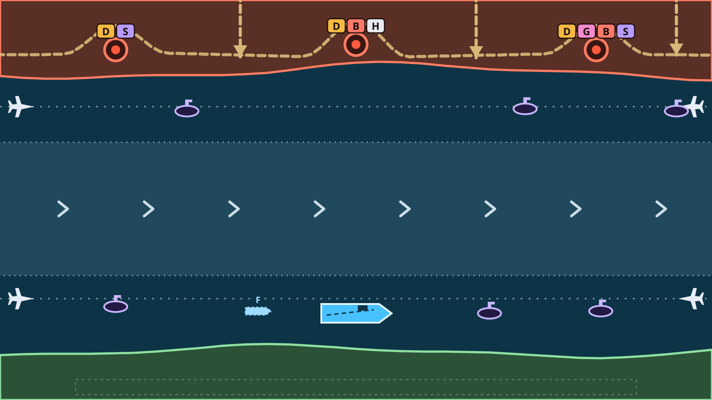

Enemy on the north shore only, long warnings. Learn every threat.

- **The one new idea:** One enemy shore, one wide lane.
- **First to bring:** drones, ballistic, guided, supersonic, heavy; trucks, subs, aircraft.
- **Enemy sources:** 3 silos; trucks from wave 2 (1 coast road, 3 pop-ups); subs from wave 3 (6 spots); strafers from wave 5, bombers from wave 7 (2 lines). Extra on this map: supersonic from wave 6, heavy cruise from wave 10.
- **Expected tries:** 1. **Difficulty:** 1/5. **Threat scale:** 1.15 (1.15).
- **Engine work (Built):** Built.
- In game: 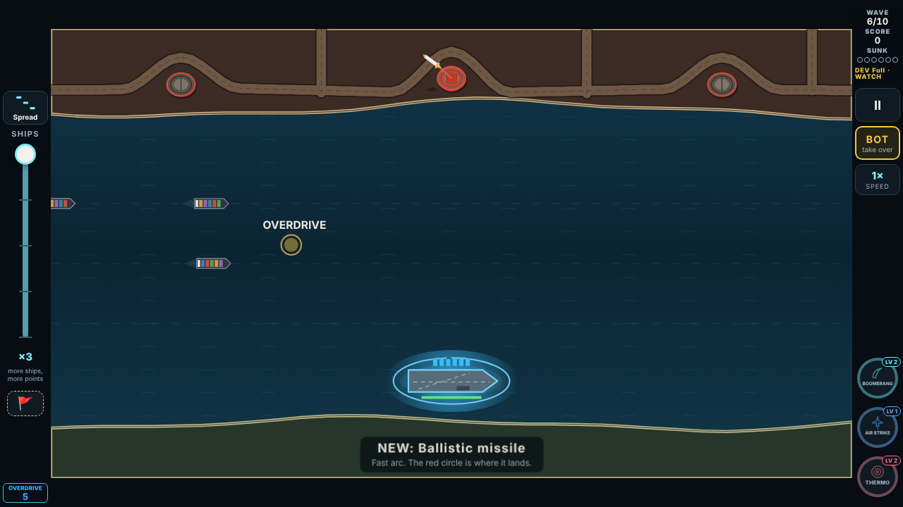

#### 2. The Kesh Hook (free trial)

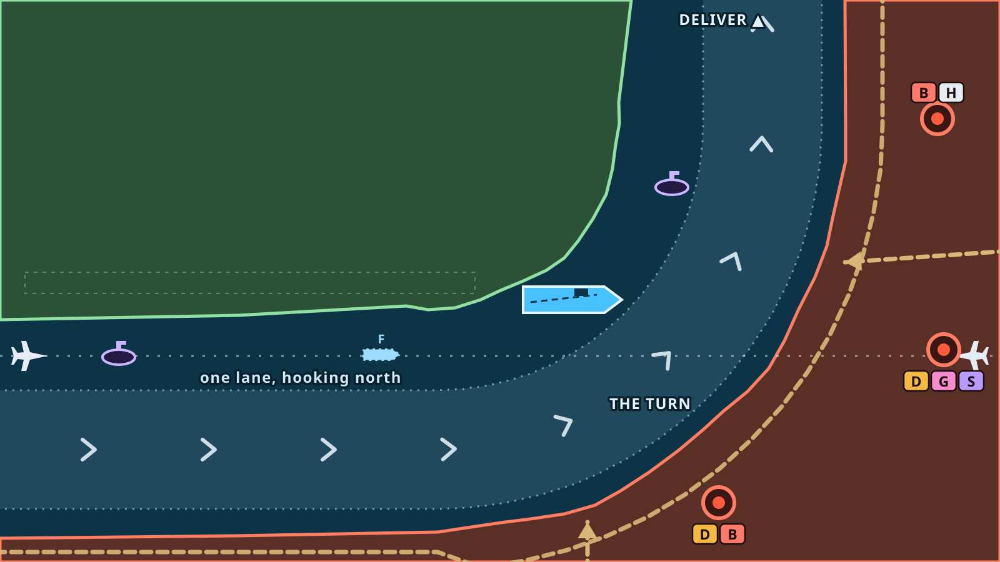

The strait hooks north round a friendly cape; you hold the inside of the turn.

- **The one new idea:** A curved lane: ships hook 90° and leave off the top edge.
- **First to bring:** nothing new to fight; the turn changes every lead angle.
- **Enemy sources:** 3 silos; trucks from wave 2 (1 coast road, 2 pop-ups); subs from wave 3 (2 spots); strafers from wave 5, bombers from wave 7 (1 line). Extra on this map: supersonic from wave 6.
- **Expected tries:** 1. **Difficulty:** 1/5. **Threat scale:** 1.1.
- **Engine work (New system):** Path lanes: a lane is a polyline, ships and formations follow its heading, funnels measured along it, ballistic lead follows the path. Also the base for the Delta. Medium–large.

#### 3. Lee of Marrow

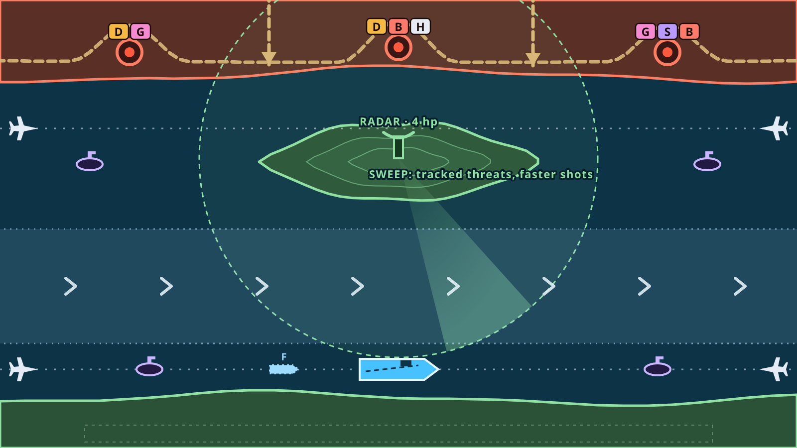

A radar tower on a friendly island sweeps the lane. While it stands, your shots fly fast at anything in its sweep.

- **The one new idea:** An allied radar the enemy will try to kill: lost is lost.
- **First to bring:** enemy fire aimed at your radar.
- **Enemy sources:** 3 silos; trucks from wave 2 (1 coast road, 2 pop-ups); subs from wave 3 (4 spots); strafers from wave 5, bombers from wave 7 (2 lines). Extra on this map: supersonic from wave 6, heavy cruise from wave 9.
- **Expected tries:** 1–2. **Difficulty:** 2/5. **Threat scale:** 1.1.
- **Engine work (Small):** A friendly structure with hit points that some enemy launches target; while it stands, a sweep covers the lane and threats inside it are tracked (lock box, interceptors 1.5× faster at them). Destroyed for the rest of the run. Small–medium; shares the structure code with Battery Point.

#### 4. The Gauntlet (existing)

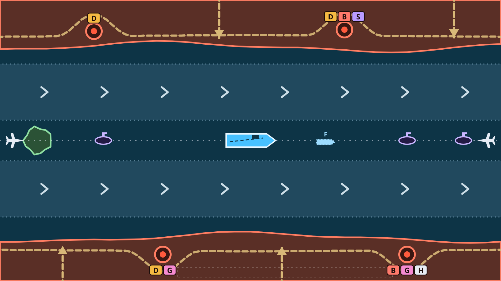

Enemy on both shores. Your carrier holds the middle; ships pass either side.

- **The one new idea:** Both shores hostile, carrier mid-channel.
- **First to bring:** —.
- **Enemy sources:** 4 silos; trucks from wave 2 (2 coast roads, 4 pop-ups); subs from wave 3 (3 spots); strafers from wave 4, bombers from wave 6 (1 line). Extra on this map: heavy cruise from wave 5, supersonic from wave 7.
- **Expected tries:** 1–2. **Difficulty:** 2/5. **Threat scale:** 1.1 (1.2).
- **Engine work (Data only):** Built. Moves from slot 2 to 4 (unlock order changes; the save keeps cleared maps by id). Eased a touch for slot 4.
- In game: 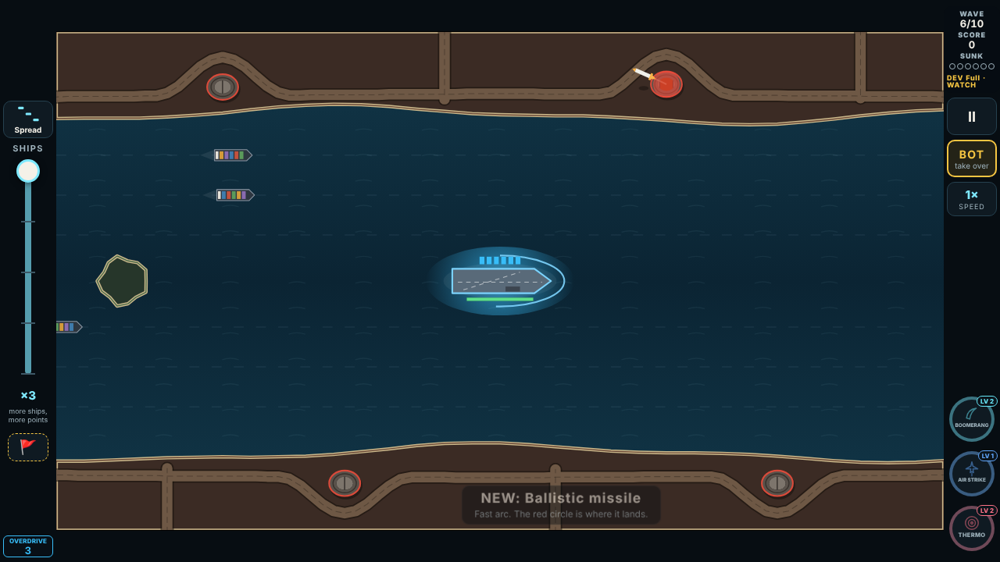

#### 5. Harbor Mouth (existing)

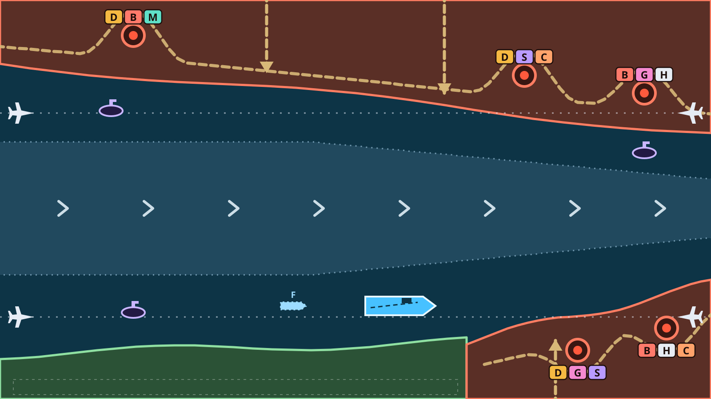

The channel funnels into the harbour under enemy headlands. The worst comes last.

- **The one new idea:** A funnel: the hardest stretch is right before delivery.
- **First to bring:** cluster missiles, motherships.
- **Enemy sources:** 5 silos; trucks from wave 1 (2 coast roads, 3 pop-ups); subs from wave 2 (3 spots); strafers from wave 3, bombers from wave 4 (2 lines). Extra on this map: supersonic from wave 4, heavy cruise from wave 5, cluster from wave 6, mothership from wave 7.
- **Expected tries:** 2. **Difficulty:** 2/5. **Threat scale:** 0.9 (1.0).
- **Engine work (Data only):** Built. Ease to fit slot 5 (bots clear it least of the five).
- In game: 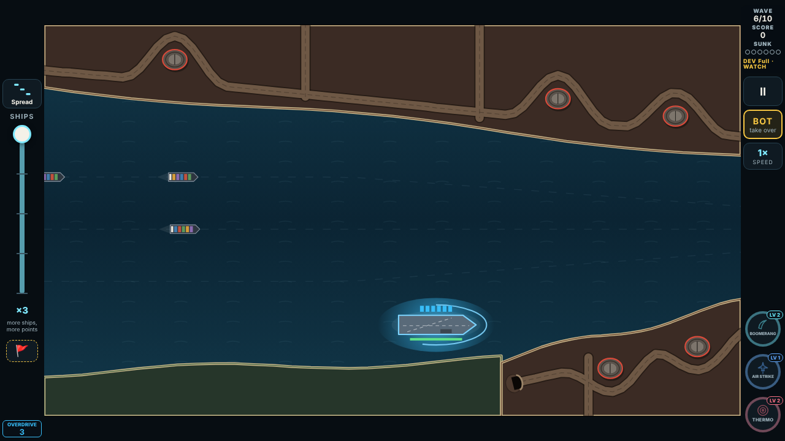

### Chapter 2: The Narrows

#### 6. The Island (existing)

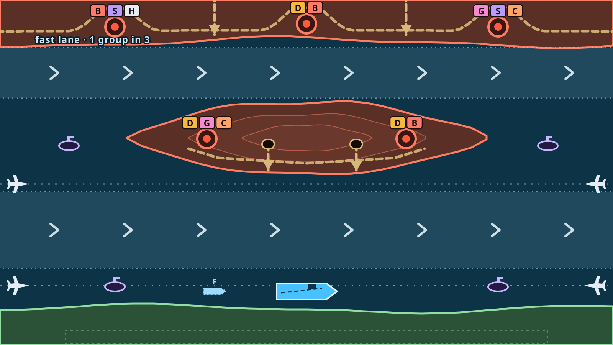

The enemy holds the island and the far shore. A risky fast north lane, a safe south lane.

- **The one new idea:** An enemy island in mid-strait, two lanes.
- **First to bring:** caves and tunnels.
- **Enemy sources:** 5 silos; trucks from wave 1 (2 coast roads, 4 pop-ups); subs from wave 3 (4 spots); strafers from wave 4, bombers from wave 5 (2 lines). Extra on this map: supersonic from wave 6, heavy cruise from wave 7, cluster from wave 8.
- **Expected tries:** 2. **Difficulty:** 3/5. **Threat scale:** 1.0 (0.95).
- **Engine work (Data only):** Built. Moves from slot 3 to 6 (away from Lee of Marrow, so two island maps are not back to back); a little more fire for slot 6.
- In game: 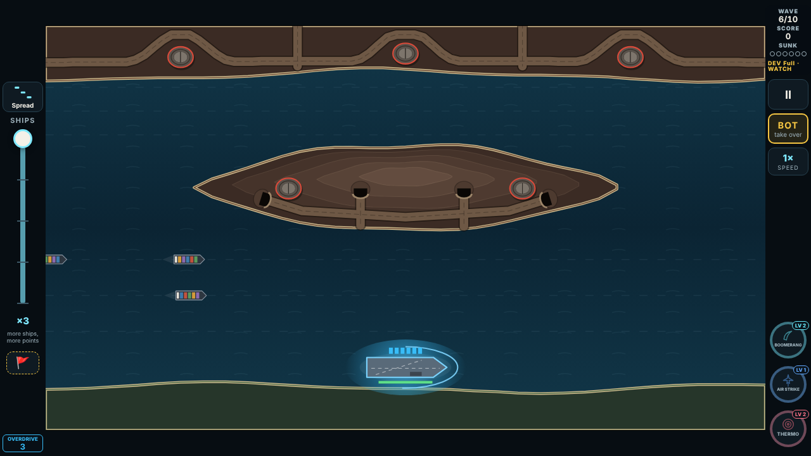

#### 7. The Behemoth Run

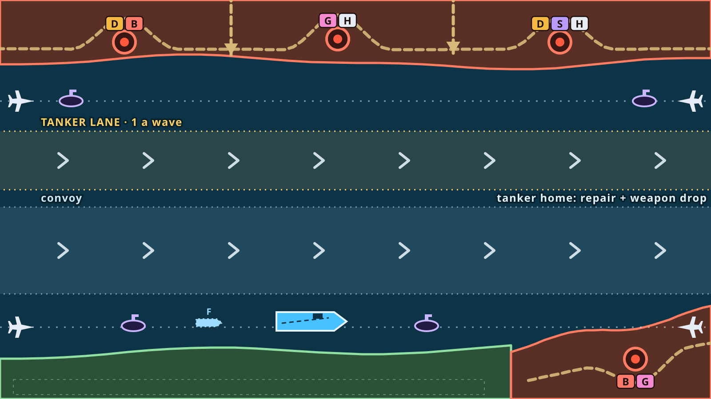

Once a wave a supertanker crawls through the deep lane. Six hits, worth three ships.

- **The one new idea:** A VIP ship to protect alongside the convoy.
- **First to bring:** supertanker (6 hp, counts as 3 losses, heavies prefer it).
- **Enemy sources:** 4 silos; trucks from wave 2 (2 coast roads, 2 pop-ups); subs from wave 3 (4 spots); strafers from wave 4, bombers from wave 6 (2 lines). Extra on this map: cluster from wave 4, heavy cruise from wave 3, mothership from wave 8.
- **Expected tries:** 2. **Difficulty:** 3/5. **Threat scale:** 1.15.
- **Engine work (Small):** A ship type: size, hit points, loss weight, its own lane and speed, threat targeting weight; a reward on delivery. Small.

#### 8. The Needle of Bosk

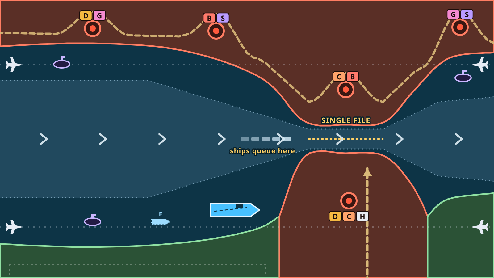

Open water narrows to a gap one ship wide. The convoy bunches at the mouth.

- **The one new idea:** Single file: ships merge into a column and queue before the gap.
- **First to bring:** —.
- **Reuses:** the funnel (map 5).
- **Enemy sources:** 5 silos; trucks from wave 2 (1 coast road, 1 pop-up); subs from wave 3 (3 spots); strafers from wave 4, bombers from wave 6 (2 lines). Extra on this map: cluster from wave 3, heavy cruise from wave 6, mothership from wave 8.
- **Expected tries:** 2. **Difficulty:** 3/5. **Threat scale:** 1.1.
- **Engine work (Medium):** Lanes below LANE_FLOOR: ships merge to one file and queue (slow) before the gap, keep spacing, re-form after. Column formation skips the merge. Medium.

#### 9. The Archipelago (existing)

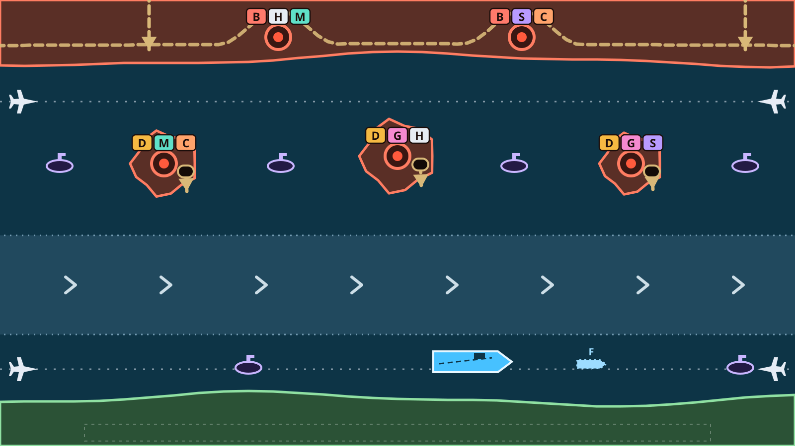

Enemy islets with gaps between them, and motherships. The west end is a long reach.

- **The one new idea:** A chain of enemy islets; the long reach west.
- **First to bring:** —.
- **Enemy sources:** 5 silos; trucks from wave 1 (1 coast road, 5 pop-ups); subs from wave 2 (6 spots); strafers from wave 3, bombers from wave 4 (2 lines). Extra on this map: mothership from wave 6, heavy cruise from wave 6, cluster from wave 7, supersonic from wave 8.
- **Expected tries:** 2. **Difficulty:** 3/5. **Threat scale:** 1.1 (1.05).
- **Engine work (Data only):** Built. Slightly harder for slot 9.
- In game: 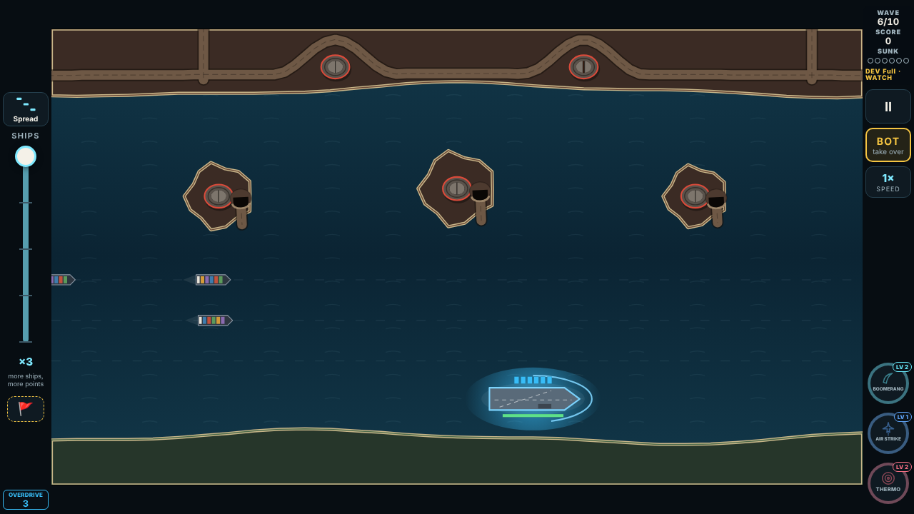

#### 10. Saltgate Canal

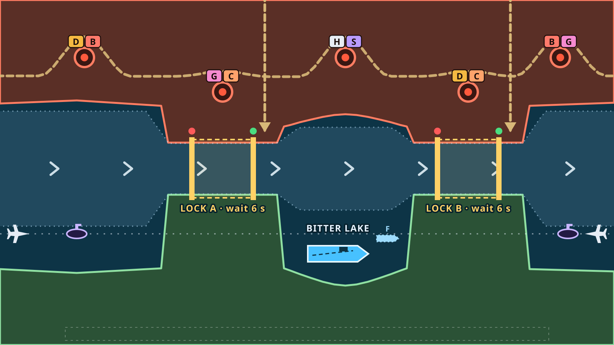

Two locks. Ships wait in each chamber while it fills: sitting ducks under the silos.

- **The one new idea:** Lock gates: stop, wait, go, on a visible timer.
- **First to bring:** —.
- **Enemy sources:** 5 silos; trucks from wave 2 (1 coast road, 2 pop-ups); subs from wave 3 (2 spots); strafers from wave 4, bombers from wave 6 (1 line). Extra on this map: cluster from wave 4, heavy cruise from wave 5, mothership from wave 8.
- **Expected tries:** 2–3. **Difficulty:** 3/5. **Threat scale:** 1.0.
- **Engine work (New system):** Locks: gates close, ships stop in the chamber, a fill timer with a gate light and countdown, the far gate opens, ships behind queue (reuses the single-file queue). Medium–large.

### Chapter 3: Dark Water

#### 11. Battery Point

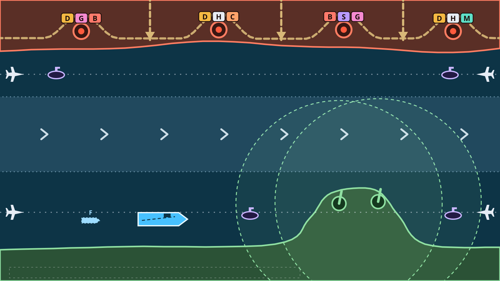

Two allied shore guns fire on their own. The enemy wants them silenced first.

- **The one new idea:** Allied turrets that help, and draw fire.
- **First to bring:** enemy fire aimed at your shore guns.
- **Enemy sources:** 4 silos; trucks from wave 1 (1 coast road, 3 pop-ups); subs from wave 2 (4 spots); strafers from wave 3, bombers from wave 5 (2 lines). Extra on this map: supersonic from wave 4, cluster from wave 4, mothership from wave 6, heavy cruise from wave 3.
- **Expected tries:** 2. **Difficulty:** 3/5. **Threat scale:** 1.2.
- **Engine work (Small):** A friendly auto-turret (reach, rate, targets nearest) that a hit knocks out for ~12 s; heavies and ballistics may target it. Small–medium.

#### 12. Sowers' Reach

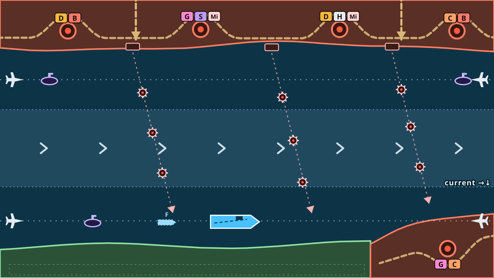

Mines drift across the lane on the current. Clear them without starving the sky.

- **The one new idea:** Drifting mines to clear.
- **First to bring:** mines (drift with the current, 3 damage to a ship, one hit clears).
- **Enemy sources:** 5 silos; trucks from wave 2 (2 coast roads, 2 pop-ups); subs from wave 3 (3 spots); strafers from wave 4, bombers from wave 6 (2 lines). Extra on this map: mines from wave 1, cluster from wave 5, mothership from wave 7.
- **Expected tries:** 2–3. **Difficulty:** 4/5. **Threat scale:** 1.15.
- **Engine work (Medium):** A new threat that drifts, never targets, collides with ships and is tappable; mine chutes as base kinds; bombers may lay a line late on. Medium.

#### 13. The Rig Field

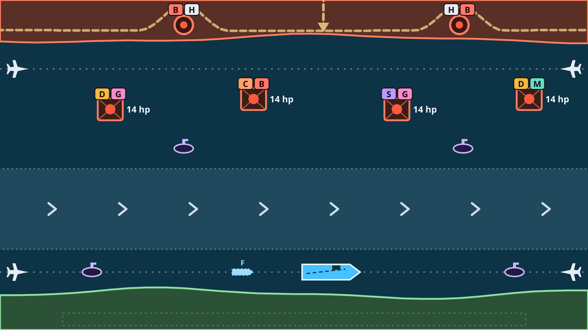

Enemy oil rigs launch from the open sea. A rig you bring down stays down.

- **The one new idea:** Destructible launchers: permanent relief for weapon time spent.
- **First to bring:** rigs with hit points.
- **Enemy sources:** 2 silos, 4 rigs; trucks from wave 2 (1 coast road, 1 pop-up); subs from wave 3 (4 spots); strafers from wave 4, bombers from wave 5 (2 lines). Extra on this map: cluster from wave 4, mothership from wave 5, supersonic from wave 6.
- **Expected tries:** 2–3. **Difficulty:** 4/5. **Threat scale:** 1.2.
- **Engine work (Small):** Bases get hit points, a health bar and a destroyed state that lasts the run; which weapons damage them (Railgun, Air Strike, Thermobaric, plain shots for 1). Small–medium. Reused by the Citadel.

#### 14. The Black Strait

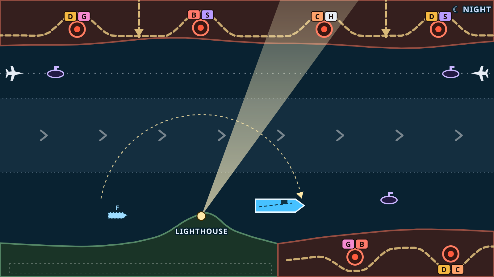

Night. Threats are a faint glow until the lighthouse beam sweeps over them.

- **The one new idea:** Night: you see by the beam, launch flashes and Star Shells.
- **First to bring:** Star Shell pickup (lights an area 5 s).
- **Enemy sources:** 6 silos; trucks from wave 2 (2 coast roads, 2 pop-ups); subs from wave 3 (3 spots); strafers from wave 4, bombers from wave 6 (1 line). Extra on this map: cluster from wave 4, mothership from wave 6.
- **Expected tries:** 3. **Difficulty:** 4/5. **Threat scale:** 1.15.
- **Engine work (Medium):** A darkness layer, a sweeping light cone, the carrier's lamp, threats drawn dim outside light (still tappable, landing circles still shown), a Star Shell pickup. Medium.

#### 15. Dreadnought Pass

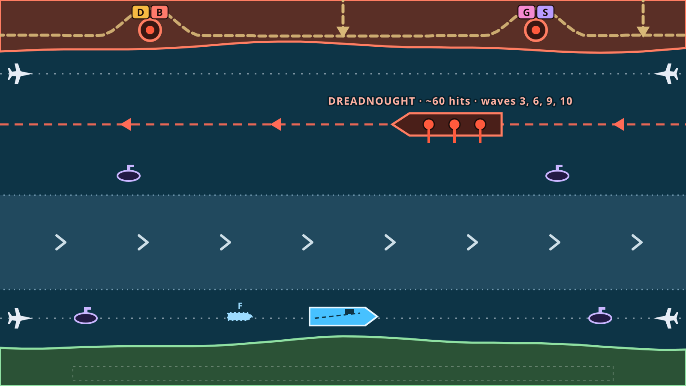

Every third wave a battleship steams through, firing broadsides. Sixty hits to sink.

- **The one new idea:** A moving boss with a health bar.
- **First to bring:** the Dreadnought.
- **Reuses:** base hit points (map 13).
- **Enemy sources:** 2 silos; trucks from wave 2 (1 coast road, 2 pop-ups); subs from wave 3 (4 spots); strafers from wave 4, bombers from wave 5 (2 lines). Extra on this map: heavy cruise from wave 4, cluster from wave 5, mothership from wave 7.
- **Expected tries:** 3. **Difficulty:** 4/5. **Threat scale:** 1.15.
- **Engine work (New system):** A moving launcher on a path with hit points, turrets that fire barrages, a boss bar and a sinking moment; waves 3/6/9/10. Medium–large.

### Chapter 4: Open War

#### 16. Smugglers' Coves

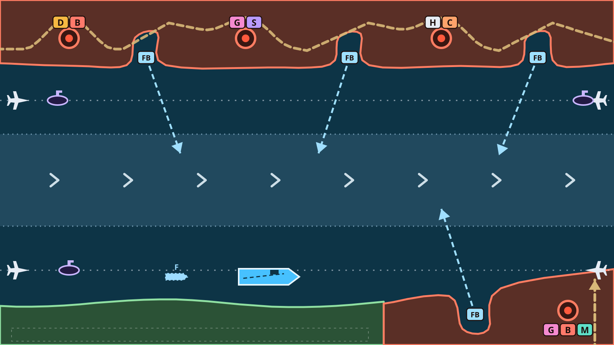

Fast attack boats burst out of hidden coves to ram the convoy.

- **The one new idea:** The first threat that comes over the water.
- **First to bring:** fast attack boats (white wake warning, 2 hits).
- **Enemy sources:** 4 silos; trucks from wave 2 (1 coast road, 1 pop-up); subs from wave 3 (3 spots); strafers from wave 4, bombers from wave 6 (2 lines); fast boats from wave 1. Extra on this map: fast boats from wave 1, cluster from wave 4, mothership from wave 6.
- **Expected tries:** 3. **Difficulty:** 4/5. **Threat scale:** 1.25.
- **Engine work (Small):** A surface threat: drives from a cove to a ship on the water (reuses truck and sub movement), rams. Small–medium.

#### 17. The Sharra Delta

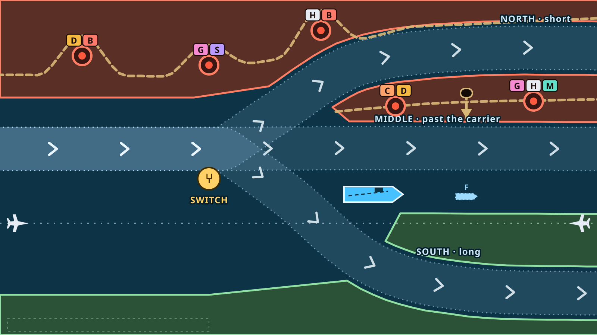

The river forks three ways. Tap the buoy to pick the branch the next ships take.

- **The one new idea:** You route the convoy: a one-tap switch at the fork.
- **First to bring:** no subs (too shallow).
- **Reuses:** path lanes (map 2).
- **Enemy sources:** 5 silos; trucks from wave 1 (2 coast roads, 1 pop-up); no subs; strafers from wave 3, bombers from wave 5 (1 line). Extra on this map: cluster from wave 3, mothership from wave 5, supersonic from wave 5.
- **Expected tries:** 3. **Difficulty:** 5/5. **Threat scale:** 1.25.
- **Engine work (Medium):** Forked path lanes, a tappable switch that sets the next spawn group's branch, the bot learns to use it. Medium (after path lanes).

#### 18. Dunmar Crossing

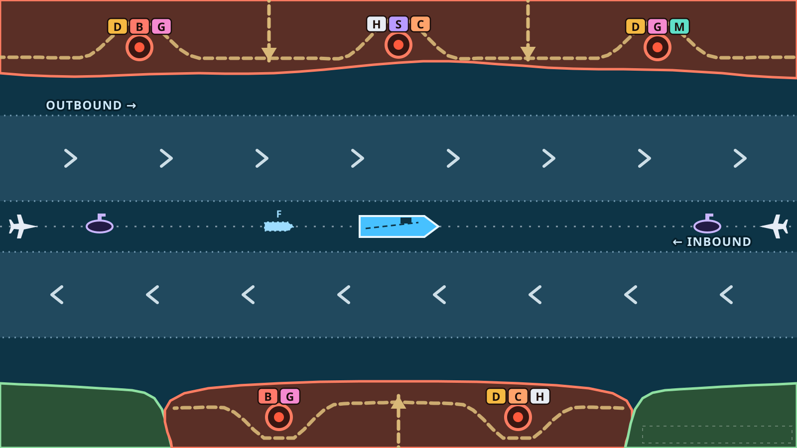

Two convoys at once: outbound east in the north lane, inbound west in the south.

- **The one new idea:** Two-way traffic: both edges are a front.
- **First to bring:** —.
- **Reuses:** carrier mid-channel (map 6).
- **Enemy sources:** 5 silos; trucks from wave 2 (2 coast roads, 3 pop-ups); subs from wave 3 (2 spots); strafers from wave 4, bombers from wave 5 (1 line). Extra on this map: cluster from wave 3, supersonic from wave 4, mothership from wave 6.
- **Expected tries:** 3–4. **Difficulty:** 5/5. **Threat scale:** 1.25.
- **Engine work (Small):** Per-lane spawn and delivery sides (right-to-left ships, formations mirrored). Small–medium.

#### 19. Tidewater Flats

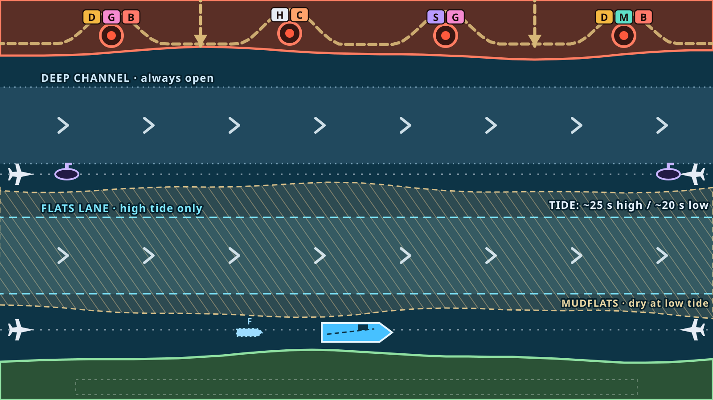

The safe lane over the flats floats only at high tide. At low tide, everyone runs the guns.

- **The one new idea:** A lane that opens and closes on the tide.
- **First to bring:** tide gauge.
- **Reuses:** risky vs safe lanes (map 4).
- **Enemy sources:** 4 silos; trucks from wave 2 (1 coast road, 2 pop-ups); subs from wave 3 (2 spots); strafers from wave 4, bombers from wave 5 (2 lines). Extra on this map: cluster from wave 3, supersonic from wave 4, mothership from wave 6.
- **Expected tries:** 3–4. **Difficulty:** 5/5. **Threat scale:** 1.3.
- **Engine work (Small):** A lane gated by a timer (ships pick an open lane at spawn; ships already on the flats finish), a gauge, flats drawn wet or dry. Small–medium.

#### 20. Citadel of Vey

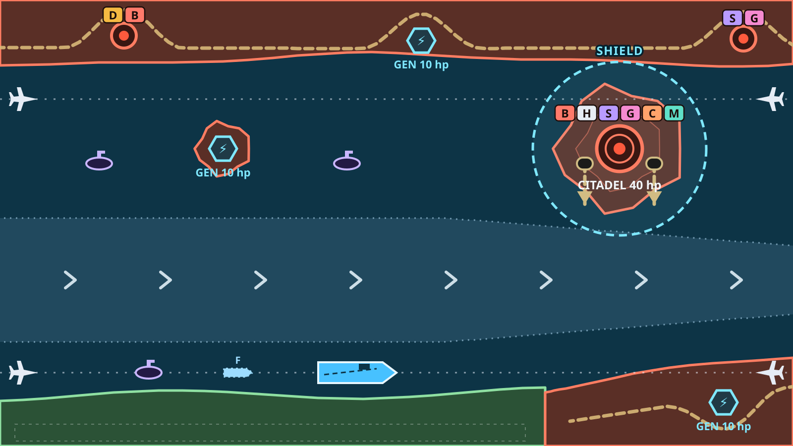

A fortress guards the harbour narrows behind a shield fed by three generators.

- **The one new idea:** The fortress: break the shield, then silence the core.
- **First to bring:** shield and generators.
- **Reuses:** the funnel (5), destructible launchers (13), boss bar (15).
- **Enemy sources:** 2 silos, 3 shield generators, the Citadel; trucks from wave 1 (2 coast roads, 2 pop-ups); subs from wave 2 (3 spots); strafers from wave 3, bombers from wave 4 (2 lines). Extra on this map: cluster from wave 3, supersonic from wave 3, mothership from wave 5, heavy cruise from wave 4.
- **Expected tries:** 4. **Difficulty:** 5/5. **Threat scale:** 1.35.
- **Engine work (Medium):** A shield that blocks hits on the core until its generators fall; the core's batteries silenced at 0 hp. Medium, mostly reusing rigs and the Dreadnought.

## Checks before showing the player

- **Variety.** Every map's headline idea is different. Fog was cut (kept night). The radar (map 3) and the battery (map 11) are both allied structures, but one sees and one shoots, eight maps apart. The Delta and the Island both have lane choices; the Delta is the one where you choose.
- **Readability.** Enemy land is rust with a red-orange edge, friendly land is green with a mint edge, in every diagram and in the game. Each silo shows what it fires as letter chips, so colour is never the only cue.
- **Fairness.** Every new threat has a warning and an answer: mines are slow and blink (any shot), fast boats leave a wake (2 hits), the Dreadnought telegraphs its broadsides, the night keeps a faint glow and landing circles, locks show a countdown.
- **The curve.** Each new idea arrives alone. Later maps reuse earlier ones only as support: the Citadel reuses the funnel and rigs, the Delta reuses the bend's path lanes, Tidewater reuses the Island's risky and safe lanes.
- **Order changes.** On review: the Gauntlet moves to slot 4 and the Island to 6, so the two island maps (Lee of Marrow and the Island) are not back to back. Harbor Mouth eases to fit slot 5.

## The brainstorm (33 ideas, 15 picked)

**Geography**

- ✅ **The bend (Hormuz-like)**: The lane hooks 90° round a cape; carrier inside the turn. Stresses lead angles on ballistics and guided. Decision: Guard the apex where ships turn and bunch. → The Kesh Hook.
- ✅ **Single-file narrows**: Wide water funnels to a one-hull gap. Stresses clusters, ballistic splash on a bunched queue. Decision: Formation (Column) and ship flow before the gap. → The Needle of Bosk.
- ✅ **Canal with lock gates**: Ships stop in chambers while they fill. Stresses everything, against stationary ships. Decision: Time your rack to the gate cycle. → Saltgate Canal.
- ✅ **River delta, forking**: Three branches round marsh islands; you switch the fork. Stresses shore fire at short range. Decision: Which branch the next ships take. → The Sharra Delta.
- ✖ **Fjord with cliffs**: High walls hide launch sites until a missile crests the cliff. Stresses reaction time. Decision: Memorise launch points. Cut: Its idea (short warning) is the Island's and the Black Strait's; the night map does it with more to look at.
- ✖ **Open sea, enemy fleet**: No shores; warships on the horizon launch everything. Stresses all-round threat. Decision: Which ship to hit. Cut: Folded into the Dreadnought: one boss reads better than a fleet on a phone.
- ✖ **Archipelago maze**: Lanes weave between many islets. Stresses short-warning fire from all sides. Decision: Where to sit your attention. Cut: The Archipelago and the Delta already cover it.
- ✖ **Reef or pack ice**: The lane narrows a little every wave. Stresses bunching over time. Decision: When to lower ship flow. Cut: Single file does the narrowing better; ice is a theme we can reskin later.
- ✖ **Wreck Alley**: Every ship sunk leaves a wreck that narrows the lane. Stresses snowballing losses. Decision: Losses cost space, not just lives. Cut: Punishes a losing player twice; keep for Hard mode.
- ✖ **Two-strait junction**: Two straits meet in a T; convoys merge at the junction. Stresses merge point fire. Decision: Protect the merge. Cut: Needs two lane systems at once; Dunmar gives two-way traffic for less.

**Dynamics**

- ✅ **Tides**: The safe lane floats only at high tide. Stresses shore fire on the deep channel at ebb. Decision: Ship flow in time with the tide. → Tidewater Flats.
- ✖ **Swing bridge on a timer**: A bridge closes the lane; ships wait for it to swing. Stresses queued ships. Decision: Same as locks. Cut: The locks do the stop-and-wait idea, with more drama.
- ✖ **Lane closure mid-wave**: A blockship sinks in a lane and ships reroute. Stresses sudden rerouting. Decision: Cover the new route. Cut: Feels random rather than readable; the delta switch gives control instead.
- ✅ **Battleship crossing**: A moving boss steams through every third wave. Stresses heavy barrages; weapon time on a big target. Decision: Sink it, or ride it out. → Dreadnought Pass.
- ✅ **Fortress boss**: A shielded citadel guarded by generators. Stresses everything. Decision: Generators first, or the convoy. → Citadel of Vey.
- ✅ **Night and a searchlight**: Threats show faintly until the beam crosses them. Stresses warning time. Decision: Watch the beam; spend Star Shells. → The Black Strait.
- ✖ **Storm**: Ships slow down; aircraft are grounded while it blows. Stresses exposure time. Decision: Flow down in the storm. Cut: Slower ships just make a map longer; a fine skin for a Hard-mode variant.
- ✖ **Fog banks**: Drifting banks hide what is inside them. Stresses warning time in places. Decision: Cover the fog edges. Cut: Same headline as night; one visibility map is enough for 20.
- ✅ **Mines**: Mines drift across the lane on the current. Stresses ammo split between mines and missiles. Decision: Rounds now on mines, or on the sky. → Sowers' Reach.
- ✅ **Fast attack boats**: Boats burst out of coves to ram. Stresses a surface threat. Decision: Boats or missiles first. → Smugglers' Coves.
- ✖ **Airfield on the shore**: Jets taxi and take off from a visible runway. Stresses aircraft. Decision: Hit them on the runway. Cut: Overlaps the rigs (knock out the source); aircraft already come on every map.
- ✖ **Jammer tower**: Inside its zone your interceptors wobble until it falls. Stresses accuracy. Decision: Destroy the jammer. Cut: Making the main gun worse feels unfair in a tap game.
- ✖ **Volcano or ash fall**: Ash clouds drift and block shots. Stresses aim. Decision: Shoot round clouds. Cut: Blocking the player's own shots reads as a bug.

**Friendly side**

- ✖ **Friendly island shelter**: Low flyers have to go round it. Stresses the gaps either side. Decision: Watch the gaps, not the middle. Cut: Replaced on review by the radar tower on the same island.
- ✅ **Allied shore battery**: Two turrets fire on their own; the enemy targets them. Stresses heavies aimed at your guns. Decision: Save the guns or the ships. → Battery Point.
- ✅ **Allied radar**: A radar sweep tracks threats over the lane while the tower stands. Stresses strikes on the radar. Decision: Defend your eyes, or let it go. → Lee of Marrow.
- ✖ **Second friendly port mid-map**: Half the convoy delivers early. Stresses little. Decision: Few. Cut: No real decision for the player.
- ✖ **Carrier on the far shore**: The gun sits next to the enemy. Stresses carrier strikes. Decision: Self-defence first. Cut: Flips the readable layout for little gain.
- ✅ **Supertanker (VIP)**: One huge slow ship a wave, worth three. Stresses heavies and guided aimed at it. Decision: Priorities: tanker or convoy. → The Behemoth Run.
- ✅ **Rigs you can destroy**: Offshore launchers with hit points stay down. Stresses weapon time. Decision: Invest now for quiet later. → The Rig Field.

**Direction**

- ✅ **Two-way traffic**: Outbound east, inbound west, at once. Stresses both edges. Decision: Split attention left and right. → Dunmar Crossing.
- ✖ **Right to left**: The whole convoy sails west. Stresses nothing new. Decision: None. Cut: A mirror, not an idea; the Crossing uses it.
- ✖ **Convoy turnaround**: Ships sail in, deliver at a mid-map port, sail back out. Stresses double exposure. Decision: Few. Cut: Doubles exposure without a new decision.

## Open questions

- **Which two maps are the free trial?** **The Strait + The Kesh Hook** (recommended) / The Strait + Lee of Marrow / The Strait + The Island. The Hook is the store screenshot and plays easy, but it needs path lanes built first. Lee of Marrow is cheap to build; the Island already exists but is harder.
- **How long should a ship wait in a Saltgate lock?** 4 s / **6 s** (recommended) / 8 s. 6 s is one raid cycle (raids come every 5 s): long enough to feel exposed, short enough not to bore. A gate light and countdown show the time left.
- **Should every chapter end on a boss?** **Set-piece enders (as laid out)** (recommended) / A boss with a health bar every chapter / No bosses, just harder maps. Laid out: Harbor Mouth, Saltgate, Dreadnought and the Citadel close the chapters. Only the last two are true bosses; a boss on map 5 would land before the player knows the threats.
- **Should the Delta's fork be yours to switch?** **Yes: one tap on the buoy** (recommended) / No: ships pick at random. Without the switch it is the Island with three lanes. One tap on a big buoy is a single decision, not button management.
- **How dark is the Black Strait?** **Threats glow faintly outside the light** (recommended) / Fully hidden outside the light. A faint glow keeps every threat answerable (warning and an answer); fully hidden would break the fairness rule.
- **Does a destroyed rig stay down?** **For the rest of the run** (recommended) / Rebuilt after 2 waves. Permanent is the decision: invest now for quiet later. A rebuild makes it a chore.
- **Losing the supertanker counts as how many ships?** 2 / **3** (recommended) / Lose the map. Three of the six allowed losses makes it matter without one hit ending the run.
- **At the Needle, should Column formation skip the queue?** **Yes** (recommended) / No. It makes the formation picker matter on one map, which it rarely does today.
- **Are the made-up names OK?** **Yes** (recommended) / Change some (note them per map). All fictional, inspired by real places (Kesh ~ Qeshm, Saltgate ~ Suez, Bosk ~ Bosporus, Dunmar ~ Dardanelles), to stay clear of App Store trouble.

## For the build session

- Read the review page's saved marks first (collections `reviews/{mapId}`: `verdict` approve | change | cut, `note`; `answers/{questionId}`: `choice` (option index), `note`).
- `MapId`, `MAPS` and `MAP_ORDER` grow to 20; the save keeps cleared maps by id, so moving the Gauntlet from slot 2 to 6 needs an unlock migration (a player who cleared it keeps it).
- Straight lanes in `proposed.ts` (from x = -40 to 1640) are today's `Channel` (a funnel's `[x, hw]` stops become `narrow`). Curved, reversed and forked lanes wait for path lanes.
- Each map also needs bot and sweep coverage (`npm run v3:sweep`) and an e2e tray check, as the five have.
