# V3 map rebuild: the plan round

This file is generated by `node tools/v3/maps-rebuild/plan-doc.mjs` from `tools/v3/maps-rebuild/plan.mjs` (the round's data), `facts.mts` (the game today) and `measured-2026-11-12.json` (the bots). Edit those, not this.

> "Next I think we need to rebuild all the maps."

The 20 campaign maps were laid out in the maps plan ([v3-maps-plan.md](v3-maps-plan.md), built in [v3-maps-build.md](v3-maps-build.md)), before the 17 new enemies, the 13 enemy pairs ([v3-enemy-pairs.md](v3-enemy-pairs.md)), the events and the new weapons. This round decides how each map is rebuilt around them. Nothing in the game changes in this round.

## The review page

- **Built by** `node tools/v3/maps-rebuild/page.mjs <out.html>` (it runs `facts.mts` through vite-node and refuses to build if the plan breaks its rules). It is published as an Artifact with `capabilities: {db: {}}`; the link goes here once it is published.
- **Tabs:** Scope (the questions), one per chapter (its five maps), Systems, All notes, My marks (with the "Anything else?" box).
- **Checked** at 390 px and 874 px wide, light and dark, in Chromium: no console errors, no sideways scroll on any tab, a verdict saves (to the browser off claude.ai) and Bring back shows on a Cut.

**The store** (each document is `{ ...fields, at: ISO time }`; before the store answers, marks wait in `localStorage` with `pending: true`):

| Collection | Fields | Holds |
|---|---|---|
| `reviews/{mapId}` | `verdict` (`approve`, `change` or `cut`), `note` | A verdict on a map's proposal. Ids are `MAP_ORDER`'s (`strait` … `citadel`). |
| `systems/{id}` | `verdict`, `note` | A verdict on a map-wide change: `script`, `debut`, `hatches`, `saltgate`, `callouts`. |
| `answers/{questionId}` | `choice` (option index, 0 = the recommended), `note` | The Scope answers: `mr-scope`, `mr-curve`, `mr-debut`, `mr-pairs`, `mr-ending`, `mr-waves`, `mr-endless`. |
| `answers/else` | `note` | The "Anything else?" box. |

Read them back with one `ArtifactData` `list` of each collection, copy them to `tools/v3/maps-rebuild/review-<date>.json`, and count verdicts from that file.

## How this was made

- **Today's maps** come from the game's own data (`tools/v3/maps-rebuild/facts.mts`): each map's layout, the original threats each wave brings (the wave table at its threat scale, its extras and its attack vectors), the new enemies the raid planner (`planFoes`) sends wave by wave over three seeds, its debut, its event and what sits under the call-out corner. The diagrams are drawn from the live `MapDef` by `tools/v3/maps-plan/svg.ts`, with the proposed hatches and call-out corner on top.
- **Win rates** (`tools/v3/maps-rebuild/measure.mts`, 8 seeds a map, build c4e5850 (claude/v3-enemies-round8)): Each map from wave 1 through its three-run ending (the map is won when its last run holds), flow 2. "through10": got through the ten normal waves. "empty": the reaction-time bots, no Armory. "campaign": the persona fitted to the player's playtests ("you") and the average bot, with one upgrade in each bay at level 5 × (slot − 1) / 9.
- **The rules every proposal keeps** (`checkPlan` in `plan.mjs`): every enemy debuts once, on a map of its chapter, alone on its debut wave; no enemy or pair before its members are met; pairs from wave 6 (wave 4 on a chapter finale) and only from their chapter; the Repair Ship pairs from wave 9, Repair Ship + Bodyguard Ring once; target tries rising through each chapter and from finale to finale; each map keeps its own event.

## Scope questions

1. **What does “rebuild all the maps” cover?** (`mr-scope`)
   1. Every map’s waves and pacing, rewritten as a wave script per map; layouts change only where a note asks for it (siege hatches, call-out corners, the Saltgate limits) (recommended)
   2. Waves and pacing only, on all 20 maps; no layout changes at all
   3. Waves and layouts: redraw the maps too, not just their waves
   4. Only the maps that measure off their target; leave the rest as they are
   - Why it matters: The layouts were approved in the maps plan and the visual check; what changed since is everything that fills them: 17 new enemies, 13 pairs, the events and the weapons. Today’s waves come from one shared planner that knows none of the pairs.
   - Since the maps were built: 17 new enemies (4, 4, 5, 4 by chapter), 13 enemy pairs, an event on every map (the ending is 3 runs), 1 bonus event, and 11 weapons added by chapters 2 to 4.
   - Every map has a shore road crossing the screen (1676 to 2060 px of it on screen); 9 maps have two.
2. **How hard should each chapter be, in tries a map for a typical player?** (`mr-curve`)
   1. A sawtooth: each chapter starts a little easier than the last finale and climbs. Chapter 1: 1 → 1.8 tries; Chapter 2: 1.5 → 2.5; Chapter 3: 2 → 3; Chapter 4: 2.5 → 3.8 (the finales hardest) (recommended)
   2. The maps plan’s steps: 1.1 tries on maps 1–2, 1.6 on 3–5, 2.1 on 6–10, 2.7 on 11–15, 3.4 on 16–20
   3. Flatter: 1–2 tries on every map, 3 on the four finales
   4. Steeper: 1 try in chapter 1, up to 5 tries by the Citadel
   - Why it matters: Each chapter brings new weapons and new enemies at once, so its first map needs room to learn them. Measured today (below), several maps sit out of order inside their chapter.
   - Chapter 1, average bot with a campaign Armory, maps won: 100% → 100% → 38% → 38% → 88%. Your persona: 25% → 75% → 25% → 13% → 38%.
   - Chapter 2, average bot with a campaign Armory, maps won: 88% → 50% → 50% → 88% → 38%. Your persona: 50% → 25% → 13% → 13% → 13%.
   - Chapter 3, average bot with a campaign Armory, maps won: 75% → 100% → 88% → 75% → 63%. Your persona: 0% → 25% → 25% → 13% → 0%.
   - Chapter 4, average bot with a campaign Armory, maps won: 88% → 63% → 75% → 50% → 75%. Your persona: 13% → 13% → 13% → 0% → 0%.
   - Proposed targets, tries a map: 1 · 1.1 · 1.3 · 1.5 · 1.8 | 1.5 · 1.7 · 2 · 2.2 · 2.5 | 2 · 2.2 · 2.4 · 2.6 · 3 | 2.5 · 2.8 · 3 · 3.3 · 3.8.
3. **How should new enemies come in?** (`mr-debut`)
   1. One debut a map, shown alone on wave 2 (wave 3 on the Strait); after that only enemies you’ve already met join it. The three finales (Harbor Mouth, Saltgate Canal, Citadel of Vey) debut no enemy; they bring the chapter’s pairs (recommended)
   2. Two debuts on each chapter’s first two maps, none after
   3. As today: every enemy of the chapter on every map of it, each map leading with a different one
   - Why it matters: Today the raid planner sends all of the chapter’s new enemies on every map of it, each map leading with a different one (below).
   - The Strait, chapter 1’s first map, today: 4 new enemies (Sprint Drones, Decoy Drones, Hydra Missile, Rocket Truck), plus its map idea.
   - The Island, chapter 2’s first map, today: 4 new enemies (Attack Helicopter, Torpedo Sub, Armored Drone, Scavenger Drone) and 4 new weapons in the draft (Charge Lance, Gunship Pair, Shield, Full Steam), plus its map idea.
   - Battery Point, chapter 3’s first map, today: 5 new enemies (Stealth Strafer, Stealth Bomber, Dive Bomber, Siege Battery, Spotter Plane) and 5 new weapons in the draft (Grapnel, Bomber Wing, Orbital Strike, Dual Wield, Focus), plus its map idea.
   - Smugglers' Coves, chapter 4’s first map, today: 4 new enemies (Repair Ship, Bodyguard Ring, Lure Beacon, Incendiary Missile) and 2 new weapons in the draft (Cadence Gun, Wild Card), plus its map idea.
4. **How many enemy pairs should a map use, and from which wave?** (`mr-pairs`)
   1. None on the Strait; one or two different pairs a map after that, from wave 6; three on a chapter finale, from wave 4; never two pairs at the same time; each Repair Ship pair once or twice in the whole campaign, late (recommended)
   2. One a map, wave 8 or later
   3. More: a pair on most waves from wave 4
   - Why it matters: A pair is two enemies that cover each other, launched by its own rule (src/v3/data/pairs.ts). The lab measured how hard each is (below).
   - Decoys + Sprint Drones (chapter 1): 0.3 ships sunk a lab test.
   - Decoys + Cluster Missiles (chapter 1): 1.6 ships sunk a lab test.
   - Hydra + Drone Swarm (chapter 1): 0.7 ships sunk a lab test.
   - Scavenger + Drone Swarm (chapter 2): 0.1 ships sunk a lab test.
   - Attack Helicopter + Torpedo Sub (chapter 2): 0.2 ships sunk a lab test.
   - Armored Drones + Hydra (chapter 2): 1.8 ships sunk a lab test.
   - Spotter + Siege Battery (chapter 3): 0.7 ships sunk a lab test.
   - Siege Battery + Rocket Truck (chapter 3): 0.6 ships sunk a lab test.
   - Spotter + Dive Bombers (chapter 3): 0.3 ships sunk a lab test.
   - Repair Ship + Bodyguard Ring (chapter 4): 3 ships sunk a lab test.
   - Repair Ship + Rocket Truck (chapter 4): 2.7 ships sunk a lab test.
   - Lure Beacon + Stealth Strafers (chapter 4): 0.6 ships sunk a lab test.
   - Bodyguard Ring + Spotter (chapter 4): 0.4 ships sunk a lab test.
5. **Does the three-run ending stay?** (`mr-ending`)
   1. Yes, on every map, with the convoy restored first; but on a map whose bots get through the ten waves and then lose it (the Lee of Marrow, the Gauntlet), the runs ramp up: the first lighter, the third full (recommended)
   2. Yes, exactly as it is on every map
   3. Three runs on the four finales only; one run elsewhere
   4. Back to one run everywhere
   - Why it matters: You like the three runs. Measured (below), most maps lose little between getting through the ten waves and winning; two lose most of their wins in the ending.
   - Average bot with a campaign Armory, through the ten waves → won the map: The Strait 100→100%, The Kesh Hook 100→100%, Lee of Marrow 100→38%, The Gauntlet 100→38%, Harbor Mouth 88→88%, The Island 88→88%, The Behemoth Run 75→50%, The Needle of Bosk 50→50%, The Archipelago 88→88%, Saltgate Canal 38→38%, Battery Point 75→75%, Sowers' Reach 100→100%, The Rig Field 88→88%, The Black Strait 75→75%, Dreadnought Pass 63→63%, Smugglers' Coves 88→88%, The Sharra Delta 75→63%, Dunmar Crossing 75→75%, Tidewater Flats 50→50%, Citadel of Vey 88→75%.
   - Biggest drops in the ending: Lee of Marrow (−62 points, Hydra Bloom); The Gauntlet (−62 points, Rocket Convoy); The Behemoth Run (−25 points, Wolf Pack).
6. **How many waves before the ending?** (`mr-waves`)
   1. Ten on every map, as today (recommended)
   2. Eight on each chapter’s first map, ten elsewhere
   3. Twelve on the four finales
   - Why it matters: A map is 10 waves and the three-run ending: about 11 minutes. Fewer waves on a chapter’s first map would shorten the learning; more on a finale would make it a slog before its big ending.
   - A map today: 10 waves, then the 3-run ending.
7. **What do Free Play and endless take from the rebuild?** (`mr-endless`)
   1. Free Play keeps the raid planner and its Enemies line. Endless, after the ending, keeps the map’s identity: the enemies its script used and its pairs, a pair every other wave, growing as now (recommended)
   2. Endless replays the map’s ten-wave script, a step harder each time round
   3. Neither changes: both keep today’s planner
   - Why it matters: The scripts end at wave 10. Past it, endless needs something to plan from; Free Play is your sandbox and its Enemies line (campaign, none, all, one) still works.

## Systems

### A wave script for every map (`script`)

- **What you'd see:** Each map plays its own ten waves: which new enemies come on which wave, which pair, and any moment tied to the map (a raid as ships sit in a lock, a sub as the tanker passes). The original threats still come from the wave table, as today.
- **Why:** Today one planner picks the new enemies for every map from the chapter’s list, so every map of a chapter looks alike and none of the 13 pairs ever comes in a campaign wave. Your pairs note asks for “good synergy combos to add to the maps”.
- **How it plugs in:**
  - Data: `MapDef.script?: WaveScript[]`, one entry a wave: `{ foes?: FoeId[]; pairs?: { id: string; at?: number; cue?: Cue }[]; moment?: Cue }`. The per-map tables on this page become this data one for one.
  - The planner: in `startWave` (sim/game.ts), `labFoes(...) ?? planFoes(...)` becomes `labFoes(...) ?? scriptFoes(g) ?? planFoes(...)`. A scripted enemy takes its units out of the wave table exactly as a planned one does (a drone swarm, and a missile for a heavy one).
  - Pairs: lift `updateLabSets` into a shared `launchPairSets(g, pair, sets)`, called by the Test Lab and the campaign. A pair’s set takes a drone swarm out of the table (and a missile for each heavy member), and launches at its `at` (or with its raid) with the same cues and fallbacks as in the lab.
  - Cues: a short list the moment column uses: `lock` (ships waiting in a lock), `tanker`, `boss` (the Dreadnought on its pass), `ebb` (low tide), `post` (the radar or a battery), `pickup`. A cue moves a raid or a pair to that moment, within the wave.
  - Past the script (endless, Free Play): the planner, as today (Scope question 7).
  - A test reads every script and fails if an enemy debuts twice, a pair comes before its members, or a Repair Ship pair comes more often than the plan says.

### A debut wave that shows one new enemy (`debut`)

- **What you'd see:** On a map’s debut wave its new enemy comes first and alone: its raid has nothing else in it, its first-sight card shows, and the next raid waits until it is dealt with or 8 s have passed. From then on it mixes with the rest.
- **Why:** Each map should “showcase a new enemy attack if it has not been showcased yet”; and the first map of a chapter brings six or more new things today (all of the chapter’s new enemies and its new weapons).
- **How it plugs in:**
  - `WaveScript.debut?: FoeId`: the planner holds the wave’s other raids back until the debut enemy is down or 8 s have passed.
  - Only enemies already met in the campaign (an earlier map, or this map’s debut) may appear in a script; the test above checks it.

### Permanent siege hatches (`hatches`)

- **What you'd see:** On a map that brings the Siege Battery (the Black Strait, Dreadnought Pass and the Citadel), two or three hatches are drawn on the enemy shore from the start, closed. A siege gun always rises from one of them. They are extra: no launch base gives up its place, or any of its missiles, for one.
- **Why:** Your Siege Battery note: “the silo or whatever that it comes out it will be permanent and it doesn’t need to replace the other launcher ones.” Today a hatch appears beside a random base when the gun is due, and goes when it is done.
- **How it plugs in:**
  - `MapDef.hatches?: Point[]` (the diagrams on this page show where). `siegeSpot` picks a free hatch; with none on the map it falls back to today’s spot beside a base.
  - The hatches are drawn with the map (closed, a dim light), not only while a gun is due.
  - The Siege Battery comes on top of the wave instead of in place of one of its missiles (it leaves `HEAVY_FOES`’ trade, so no silo goes quiet for it). The Bombardment’s three guns use the same hatches.

### Saltgate Canal: pace and formation held (`saltgate`)

- **What you'd see:** On Saltgate Canal the ship-flow slider is held at ×1.4 (the default) and only Column and Pairs can be picked; the slider and the formation button show a small lock. Any map can use the same limits later (the Needle is the next candidate).
- **Why:** Your note on Saltgate: “force the players to have their ships come in at a certain pace here … or at least like setting a limit specific [per] map same with formations”. The flow slider sets how many ships queue at each lock; which formations to allow in the narrow chambers is a design call, and the proposal keeps the two that run in file.
- **How it plugs in:**
  - `MapDef.limits?: { flow?: [min, max]; formations?: FormationId[] }`; Saltgate: `{ flow: [1, 1], formations: ['column', 'pairs'] }`.
  - The flow slider and the formation button read it (the slider’s other steps dimmed, the formations not allowed hidden); the bots and the play log follow the same limits.

### Call-outs placed per map (`callouts`)

- **What you'd see:** The call-out stack stays bottom-right on most maps. On the eight where a launch base, a cove or a generator sits under that corner, it moves to the bottom-left; on the Gauntlet, where every corner has a base, a card goes faint while the base under it is lit.
- **Why:** The call-outs round left it as an idea: the stack covers a base on several maps (“Harbor Mouth, Behemoth, Sowers, Lantern, Coves, Citadel”). Checked against the map data with a box the stack’s size in each corner, the Kesh Hook, the Gauntlet and the Needle have one under it too.
- **How it plugs in:**
  - `MapDef.callouts?: 'bl' | 'fade'` (bottom-right when absent), read by `place()` in ui/alerts.ts. Each map’s card on this page names its corner, and the diagram draws it.
  - Bottom-left moves the stack’s anchor to the left rail’s edge; fade drops a card to 25% while a base under it has its raid light on.

## Measured today

Won the map (got through the ten waves), 8 seeds each. The target is the proposed tries as a win rate.

| # | Map | Target | Average bot, campaign Armory | Your persona, campaign Armory | Sharp bot, no Armory | Average bot, no Armory |
|---|---|---|---|---|---|---|
| 1 | The Strait | 1 tries (100%) | 100% (100%) | 25% (25%) | 100% (100%) | 100% (100%) |
| 2 | The Kesh Hook | 1.1 tries (91%) | 100% (100%) | 75% (75%) | 88% (100%) | 88% (88%) |
| 3 | Lee of Marrow | 1.3 tries (77%) | 38% (100%) | 25% (38%) | 25% (88%) | 13% (100%) |
| 4 | The Gauntlet | 1.5 tries (67%) | 38% (100%) | 13% (25%) | 0% (75%) | 25% (50%) |
| 5 | Harbor Mouth | 1.8 tries (56%) | 88% (88%) | 38% (38%) | 38% (38%) | 38% (38%) |
| 6 | The Island | 1.5 tries (67%) | 88% (88%) | 50% (50%) | 25% (38%) | 25% (38%) |
| 7 | The Behemoth Run | 1.7 tries (59%) | 50% (75%) | 25% (38%) | 75% (75%) | 38% (38%) |
| 8 | The Needle of Bosk | 2 tries (50%) | 50% (50%) | 13% (25%) | 25% (25%) | 0% (0%) |
| 9 | The Archipelago | 2.2 tries (45%) | 88% (88%) | 13% (13%) | 13% (13%) | 0% (0%) |
| 10 | Saltgate Canal | 2.5 tries (40%) | 38% (38%) | 13% (13%) | 0% (0%) | 0% (0%) |
| 11 | Battery Point | 2 tries (50%) | 75% (75%) | 0% (0%) | 13% (13%) | 0% (0%) |
| 12 | Sowers' Reach | 2.2 tries (45%) | 100% (100%) | 25% (25%) | 0% (0%) | 13% (13%) |
| 13 | The Rig Field | 2.4 tries (42%) | 88% (88%) | 25% (25%) | 25% (25%) | 38% (38%) |
| 14 | The Black Strait | 2.6 tries (38%) | 75% (75%) | 13% (13%) | 13% (13%) | 0% (0%) |
| 15 | Dreadnought Pass | 3 tries (33%) | 63% (63%) | 0% (0%) | 25% (25%) | 13% (13%) |
| 16 | Smugglers' Coves | 2.5 tries (40%) | 88% (88%) | 13% (13%) | 13% (13%) | 0% (0%) |
| 17 | The Sharra Delta | 2.8 tries (36%) | 63% (75%) | 13% (13%) | 0% (13%) | 0% (0%) |
| 18 | Dunmar Crossing | 3 tries (33%) | 75% (75%) | 13% (13%) | 0% (0%) | 13% (13%) |
| 19 | Tidewater Flats | 3.3 tries (30%) | 50% (50%) | 0% (0%) | 0% (0%) | 0% (0%) |
| 20 | Citadel of Vey | 3.8 tries (26%) | 75% (88%) | 0% (13%) | 25% (25%) | 0% (0%) |

## Chapter 1: Home Waters

New enemies: Sprint Drones, Decoy Drones, Hydra Missile, Rocket Truck.  Pairs from this chapter: Decoys + Sprint Drones (`decoy-sprint`), Decoys + Cluster Missiles (`decoy-cluster`), Hydra + Drone Swarm (`hydra-swarm`).

### 1. The Strait (`strait`)

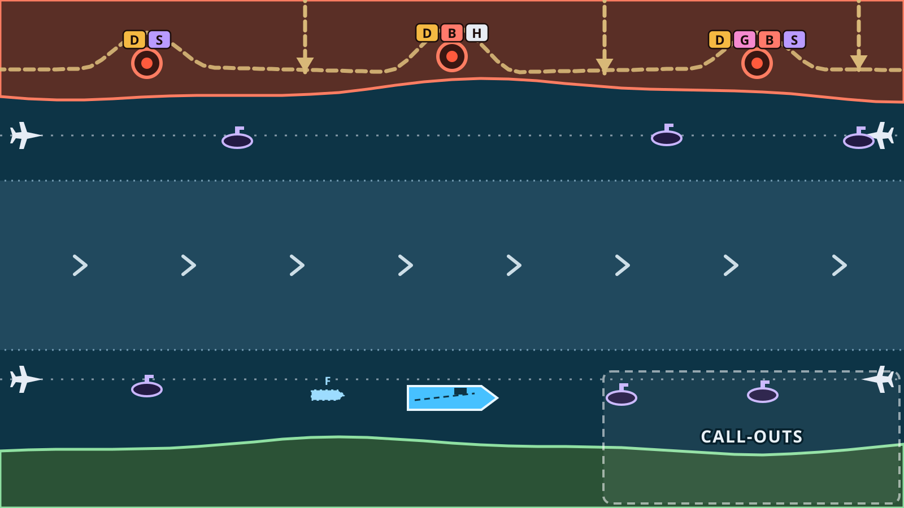

**Learn the threats: one enemy shore, one wide lane, long warnings.**

**Today**

- 1 lane, 3 launch bases, 1 shore road and 3 pop-up roads, 6 sub spots. Threat scale 0.7.
- The raid planner leads with Sprint Drones on wave 2 and sends 1 new enemy a wave on waves 2–5, 2 on 6–9 and 3 on wave 10. Seen over three seeds: 4 of this chapter’s (Sprint Drones, Decoy Drones, Hydra Missile, Rocket Truck). No pairs.
- Afterburner Rush: the map’s ending, 3 runs with the convoy restored first; built on Sprint Drones.
- Measured: the average bot with a campaign Armory won 100% (100% through the ten waves), your persona 25%; with no Armory, sharp 100%, average 100%. Hold. The bots win it; the persona fitted to your play loses it more often, as pessimistic about map 1 as the maps build found it.

**Notes**

- Brief: "Chapter maps with fewer debut enemies: the first map of a chapter starts with 6 or more new things." (This round’s brief. The player’s own words weren’t in the repo’s docs, lab files or scratchpad logs. The count holds today (see each chapter’s first map).)
- You: "That was hard! I will try again" (Test Lab, Afterburner Rush card, 2026-11-10 (tools/v3/test-lab/playtest-2026-11-10.json).)

**The rebuild**

- **Debut:** Sprint Drones, alone on wave 3.
- **Pairs:** none.
- **Target:** 1 tries.
- **Event:** Keep Afterburner Rush, ramped for map 1: 4 sprint swarms in run 1, 5 in run 2, 6 in run 3 (6 in each today).
- **Call-outs:** bottom-right.
- **Layout:** no change.

| Wave | Original threats (today's table) | New enemies | Pair | Moment |
|---|---|---|---|---|
| 1 | 11 drones | — | — | Drones and ballistic missiles only: the long warnings teach the raid call-outs. |
| 2 | 13 drones, 1 ballistic; 1 truck | — | — | — |
| 3 | 15 drones, 3 ballistic, 1 guided; 1 sub, 1 truck | **Sprint Drones** | — | Debut: one Sprint Drone swarm on its own, with its first-sight card. |
| 4 | 18 drones, 4 ballistic, 1 guided; 1 sub, 2 trucks | Sprint Drones | — | — |
| 5 | 18 drones, 4 ballistic, 1 guided; 1 jet, 2 subs, 2 trucks | Sprint Drones | — | — |
| 6 | 19 drones, 5 ballistic, 2 guided, 1 supersonic; 1 jet, 2 subs, 3 trucks | Sprint Drones, Sprint Drones | — | Supersonic missiles join (the map’s extra, as today). |
| 7 | 22 drones, 5 ballistic, 4 guided, 1 supersonic; 1 jet, 1 bomber, 3 subs, 3 trucks | Sprint Drones | — | — |
| 8 | 22 drones, 6 ballistic, 4 guided, 2 supersonic; 1 jet, 1 bomber, 3 subs, 4 trucks | Sprint Drones, Sprint Drones | — | — |
| 9 | 27 drones, 6 ballistic, 5 guided, 2 supersonic; 2 jets, 1 bomber, 3 subs, 4 trucks | Sprint Drones, Sprint Drones | — | — |
| 10 | 31 drones, 8 ballistic, 6 guided, 2 supersonic, 1 heavy; 2 jets, 1 bomber, 3 subs, 5 trucks | Sprint Drones, Sprint Drones, Sprint Drones | — | The first heavy cruise missile (the map’s extra, as today). |

### 2. The Kesh Hook (`kesh`)

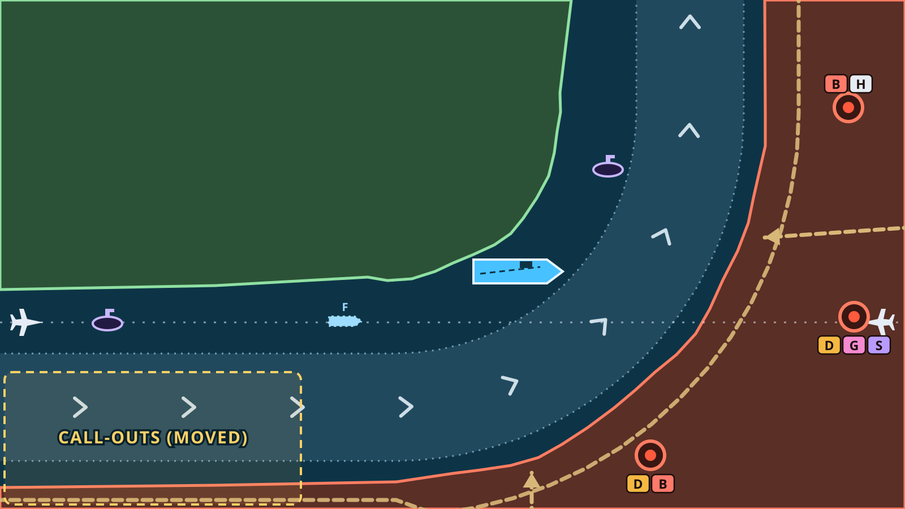

**The hook: ships turn north round the cape, and every threat comes off the outer bank.**

**Today**

- 1 lane, 3 launch bases, 1 shore road and 2 pop-up roads, 2 sub spots; a 90° bend. Threat scale 0.8.
- The raid planner leads with Decoy Drones on wave 2 and sends 1 new enemy a wave on waves 2–5, 2 on 6–9 and 3 on wave 10. Seen over three seeds: 4 of this chapter’s (Decoy Drones, Hydra Missile, Rocket Truck, Sprint Drones). No pairs.
- Decoy Storm: the map’s ending, 3 runs with the convoy restored first; built on Decoy Drones; rule: No ammo drops.
- The call-out corner covers a launch base.
- Measured: the average bot with a campaign Armory won 100% (100% through the ten waves), your persona 75%; with no Armory, sharp 88%, average 88%. Hold. About on target.

**Notes**

- You: "We should have the enemy jets follow the curve here and actually make a banking turn around the bend · The frigate do not follow the actual water path and just overlaps on the land and aircraft." (Two notes paused on The Kesh Hook (docs/design/v3-map-visual-check.md). Fixed in that round.)
- You: "This one was a lot of fun. I would definitely make the drones more I guess visible for which ones are the decoys make them like a different color slightly than the other one so it’s easier to point out." (Test Lab, Decoy Storm card, 2026-11-10. The tint was built in rounds 7 and 8.)

**The rebuild**

- **Debut:** Decoy Drones, alone on wave 2.
- **Pairs:** Decoys + Sprint Drones (`decoy-sprint`)
- **Target:** 1.1 tries.
- **Event:** Keep Decoy Storm.
- **Call-outs:** bottom-left.
- **Layout:** Call-outs move to the bottom-left corner. (A launch base sits under the bottom-right corner, where the call-outs stack.)

| Wave | Original threats (today's table) | New enemies | Pair | Moment |
|---|---|---|---|---|
| 1 | 13 drones | — | — | Ships hook north round Cape Marrow; threats only from the outer bank. |
| 2 | 15 drones, 2 ballistic; 1 truck | **Decoy Drones** | — | Debut: one Decoy swarm on its own, off the bank the ships turn toward. |
| 3 | 18 drones, 3 ballistic, 1 guided; 1 sub, 1 truck | Decoy Drones | — | — |
| 4 | 20 drones, 4 ballistic, 1 guided; 1 sub, 2 trucks | Sprint Drones | — | — |
| 5 | 20 drones, 4 ballistic, 2 guided; 1 jet, 2 subs, 2 trucks | Decoy Drones | — | — |
| 6 | 22 drones, 6 ballistic, 2 guided, 1 supersonic; 1 jet, 2 subs, 3 trucks | Decoy Drones, Sprint Drones | — | Supersonic missiles join (the map’s extra, as today). |
| 7 | 25 drones, 6 ballistic, 4 guided, 1 supersonic; 1 jet, 1 bomber, 3 subs, 3 trucks | Decoy Drones, Decoy Drones | — | — |
| 8 | 26 drones, 7 ballistic, 5 guided, 2 supersonic; 1 jet, 1 bomber, 3 subs, 4 trucks | Decoy Drones | Decoys + Sprint Drones | The campaign’s first pair. |
| 9 | 30 drones, 7 ballistic, 6 guided, 2 supersonic; 2 jets, 1 bomber, 3 subs, 4 trucks | Decoy Drones, Sprint Drones | — | — |
| 10 | 36 drones, 9 ballistic, 7 guided, 2 supersonic; 2 jets, 1 bomber, 3 subs, 5 trucks | Decoy Drones, Decoy Drones | Decoys + Sprint Drones | The pair launched as the ships are in the turn. |

### 3. Lee of Marrow (`marrow`)

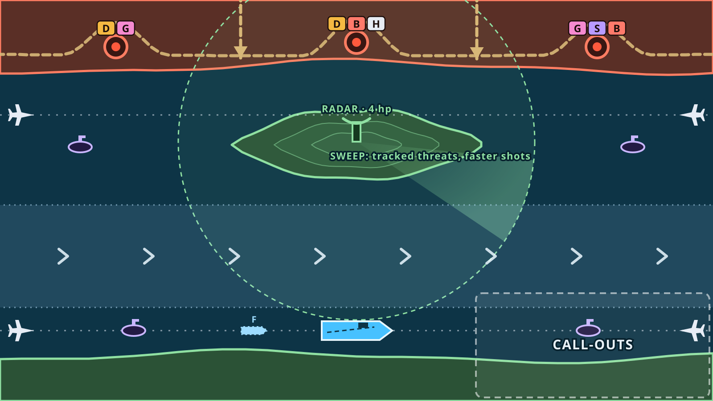

**The radar tower: keep it standing and your shots fly faster at whatever it tracks.**

**Today**

- 1 lane, 3 launch bases, 1 shore road and 2 pop-up roads, 4 sub spots; radar tower. Threat scale 0.95.
- The raid planner leads with Hydra Missile on wave 2 and sends 1 new enemy a wave on waves 2–5, 2 on 6–9 and 3 on wave 10. Seen over three seeds: 4 of this chapter’s (Hydra Missile, Rocket Truck, Sprint Drones, Decoy Drones). No pairs.
- Hydra Bloom: the map’s ending, 3 runs with the convoy restored first; built on Hydra Missile; rule: Hydras split into three, not two.
- Measured: the average bot with a campaign Armory won 38% (100% through the ten waves), your persona 25%; with no Armory, sharp 25%, average 13%. Ease the ending. The bots get through the ten waves on nearly every seed, then lose the map in Hydra Bloom.

**Notes**

- You: "make it like a radar tower on the island and the enemy can attack that too. If it is lost it is lost and it should look like a sweep or something in that lane for the protection of the friend ships." (The maps plan review (docs/design/v3-maps-build.md). Built.)
- You: "Hydras should split even before the line is crossed there you can remove that line" (Test Lab notes of 2026-11-10, Hydra Bloom card (docs/design/v3-enemies-round8.md). Built in round 8, which also eased the event.)

**The rebuild**

- **Debut:** Hydra Missile, alone on wave 2.
- **Pairs:** Hydra + Drone Swarm (`hydra-swarm`), Decoys + Sprint Drones (`decoy-sprint`)
- **Target:** 1.3 tries.
- **Event:** Keep Hydra Bloom, ramped: one fan of Hydras in run 1, two in runs 2 and 3 (two in each today).
- **Call-outs:** bottom-right.
- **Layout:** no change.

| Wave | Original threats (today's table) | New enemies | Pair | Moment |
|---|---|---|---|---|
| 1 | 15 drones | — | — | The radar tower sweeps the lane: shots fly faster at what it tracks. |
| 2 | 18 drones, 2 ballistic; 1 truck | **Hydra Missile** | — | Debut: one Hydra, alone, inside the sweep. |
| 3 | 21 drones, 4 ballistic, 1 guided; 1 sub, 1 truck | Hydra Missile | — | — |
| 4 | 24 drones, 5 ballistic, 1 guided; 1 sub, 2 trucks | Sprint Drones | — | A ballistic raid at the tower: the first test of “lost is lost” (cued to the radar). |
| 5 | 24 drones, 5 ballistic, 2 guided; 1 jet, 2 subs, 2 trucks | Hydra Missile, Decoy Drones | — | — |
| 6 | 26 drones, 7 ballistic, 3 guided, 1 supersonic; 1 jet, 2 subs, 3 trucks | Hydra Missile | — | Supersonic missiles join (the map’s extra, as today). |
| 7 | 29 drones, 7 ballistic, 5 guided, 1 supersonic; 1 jet, 1 bomber, 3 subs, 3 trucks | Hydra Missile | Hydra + Drone Swarm | First Hydra + Drone Swarm, inside the sweep. |
| 8 | 30 drones, 9 ballistic, 6 guided, 2 supersonic; 1 jet, 1 bomber, 3 subs, 4 trucks | Hydra Missile, Sprint Drones | — | — |
| 9 | 36 drones, 9 ballistic, 7 guided, 2 supersonic, 1 heavy; 2 jets, 1 bomber, 3 subs, 4 trucks | Hydra Missile | Decoys + Sprint Drones | Heavy cruise missiles join (the map’s extra, as today). |
| 10 | 43 drones, 10 ballistic, 9 guided, 2 supersonic, 1 heavy; 2 jets, 1 bomber, 3 subs, 5 trucks | Hydra Missile, Decoy Drones | Hydra + Drone Swarm | — |

### 4. The Gauntlet (`gauntlet`)

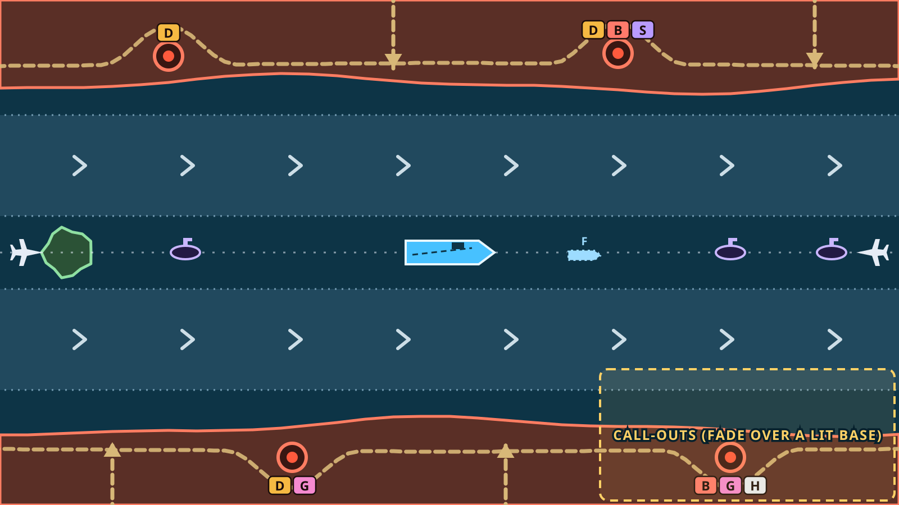

**Both shores: the carrier holds the middle, and trucks come down both roads.**

**Today**

- 2 lanes, 4 launch bases, 2 shore roads and 4 pop-up roads, 3 sub spots. Threat scale 0.75.
- The raid planner leads with Rocket Truck on wave 2 and sends 1 new enemy a wave on waves 2–5, 2 on 6–9 and 3 on wave 10. Seen over three seeds: 4 of this chapter’s (Rocket Truck, Sprint Drones, Decoy Drones, Hydra Missile). No pairs.
- Rocket Convoy: the map’s ending, 3 runs with the convoy restored first; built on Rocket Truck.
- The call-out corner covers a launch base.
- Measured: the average bot with a campaign Armory won 38% (100% through the ten waves), your persona 13%; with no Armory, sharp 0%, average 25%. Ease the ending. With a campaign Armory the average bot gets through the ten waves, then Rocket Convoy takes the map.

**Notes**

- You: "Too easy" (Test Lab, Rocket Convoy card, 2026-11-10 (round 5). Round 6 made it two columns, one down each shore road.)
- Design note: "Weak: Only works on maps with a long shore road (The Gauntlet has one)." (Rocket Convoy’s design card, docs/design/v3-special-events.md. (The player’s own note on Rocket Convoy, 2026-11-10: “Too easy”.))

**The rebuild**

- **Debut:** Rocket Truck, alone on wave 2.
- **Pairs:** Hydra + Drone Swarm (`hydra-swarm`), Decoys + Sprint Drones (`decoy-sprint`)
- **Target:** 1.5 tries.
- **Event:** Keep Rocket Convoy here (the map with a long road on each shore), ramped: one column in run 1, two in runs 2 and 3. Your “Too easy” was before round 6 doubled it; retest.
- **Call-outs:** bottom-right, fading over a lit base.
- **Layout:** Call-outs fade while the base under them is lit. (A base sits under the bottom-right corner, and every other corner has one too.)

| Wave | Original threats (today's table) | New enemies | Pair | Moment |
|---|---|---|---|---|
| 1 | 12 drones | — | — | Enemy on both shores; ships pass either side of the carrier. |
| 2 | 14 drones, 2 ballistic; 1 truck | **Rocket Truck** | — | Debut: one Rocket Truck down a north-shore road, nothing else in its raid. |
| 3 | 17 drones, 3 ballistic, 1 guided; 1 sub, 1 truck | Rocket Truck | — | — |
| 4 | 19 drones, 4 ballistic, 1 guided; 1 jet, 1 sub, 2 trucks | Decoy Drones | — | — |
| 5 | 19 drones, 4 ballistic, 2 guided, 1 heavy; 1 jet, 2 subs, 2 trucks | Rocket Truck | — | Heavy cruise missiles join (the map’s extra, as today). |
| 6 | 20 drones, 5 ballistic, 2 guided, 1 heavy; 1 jet, 1 bomber, 2 subs, 3 trucks | Rocket Truck | Hydra + Drone Swarm | — |
| 7 | 23 drones, 5 ballistic, 4 guided, 1 heavy, 1 supersonic; 1 jet, 1 bomber, 3 subs, 3 trucks | Rocket Truck, Rocket Truck | — | Two trucks at once, one on each shore. Supersonic missiles join (extra). |
| 8 | 24 drones, 7 ballistic, 5 guided, 2 heavy, 1 supersonic; 2 jets, 1 bomber, 3 subs, 4 trucks | Hydra Missile | Decoys + Sprint Drones | — |
| 9 | 29 drones, 7 ballistic, 5 guided, 2 heavy, 2 supersonic; 2 jets, 1 bomber, 3 subs, 4 trucks | Rocket Truck, Decoy Drones | — | — |
| 10 | 34 drones, 8 ballistic, 7 guided, 2 heavy, 2 supersonic; 2 jets, 2 bombers, 3 subs, 5 trucks | Rocket Truck, Rocket Truck | Hydra + Drone Swarm | A truck on each shore and the pair between them. |

### 5. Harbor Mouth (`harbor`)

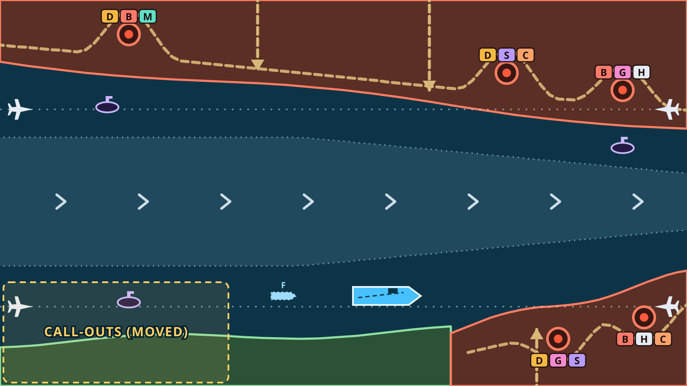

**Chapter finale: the funnel, where the worst comes right before delivery, and the chapter’s three pairs.**

**Today**

- 1 lane, 5 launch bases, 2 shore roads and 3 pop-up roads, 3 sub spots. Threat scale 0.6.
- The raid planner leads with Sprint Drones on wave 2 and sends 1 new enemy a wave on waves 2–5, 2 on 6–9 and 3 on wave 10. Seen over three seeds: 4 of this chapter’s (Sprint Drones, Decoy Drones, Hydra Missile, Rocket Truck). No pairs.
- The Breakout: the map’s ending, 3 runs with the convoy restored first; built on Decoy Drones, Sprint Drones, Hydra Missile, Rocket Truck; rule: No ammo drops at first.
- The call-out corner covers a launch base and a launch base.
- Measured: the average bot with a campaign Armory won 88% (88% through the ten waves), your persona 38%; with no Armory, sharp 38%, average 38%. Hold, and check the funnel. With a campaign Armory it is about right; with no Armory the bots stop in the waves, not the ending.

**Notes**

- Design note: "The stack does sit over the bottom-right shore, which on some maps (Harbor Mouth, Behemoth, Sowers, Lantern, Coves, Citadel) has a base: the cards are translucent, short-lived and go at a tap. … Ideas not built: Per-map nudge for the few maps with a base in the bottom-right corner (lift the stack above it, or fade a card while its base fires)." (docs/design/v3-callouts.md (the call-outs round). The player’s ask there: “move the notifications to the bottom right hand corner”.)

**The rebuild**

- **Debut:** none (a chapter finale: the chapter's enemies and pairs).
- **Pairs:** Decoys + Sprint Drones (`decoy-sprint`), Hydra + Drone Swarm (`hydra-swarm`), Decoys + Cluster Missiles (`decoy-cluster`)
- **Target:** 1.8 tries.
- **Event:** Keep The Breakout (the chapter’s four enemies in one go).
- **Call-outs:** bottom-left.
- **Layout:** Call-outs move to the bottom-left corner. (Two launch bases sit under the bottom-right corner.)

| Wave | Original threats (today's table) | New enemies | Pair | Moment |
|---|---|---|---|---|
| 1 | 10 drones; 1 truck | — | — | The funnel: the hardest water is right before delivery. |
| 2 | 11 drones, 1 ballistic; 1 sub, 1 truck | Sprint Drones | — | — |
| 3 | 13 drones, 2 ballistic, 1 guided; 1 jet, 1 sub, 2 trucks | Decoy Drones | — | — |
| 4 | 15 drones, 3 ballistic, 1 guided, 1 supersonic; 1 jet, 1 bomber, 2 subs, 2 trucks | Hydra Missile | Decoys + Sprint Drones | Supersonic missiles join (the map’s extra, as today). |
| 5 | 15 drones, 3 ballistic, 1 guided, 1 supersonic, 1 heavy; 1 jet, 1 bomber, 2 subs, 3 trucks | Rocket Truck | — | Heavy cruise missiles join (extra, as today). |
| 6 | 16 drones, 4 ballistic, 2 guided, 1 supersonic, 1 heavy, 1 cluster; 1 jet, 1 bomber, 3 subs, 3 trucks | Rocket Truck | Hydra + Drone Swarm | Cluster missiles join (extra): the campaign’s first. |
| 7 | 19 drones, 4 ballistic, 3 guided, 2 supersonic, 1 heavy, 1 cluster, 1 mothership; 2 jets, 1 bomber, 3 subs, 4 trucks | Sprint Drones, Decoy Drones | — | Motherships join (extra, as today). |
| 8 | 19 drones, 5 ballistic, 4 guided, 2 supersonic, 1 heavy, 1 cluster, 1 mothership; 2 jets, 2 bombers, 3 subs, 4 trucks | Rocket Truck | Decoys + Cluster Missiles | First Decoys + Cluster Missiles: the finale’s new pair. |
| 9 | 23 drones, 5 ballistic, 4 guided, 2 supersonic, 2 heavy, 2 cluster, 1 mothership; 2 jets, 2 bombers, 3 subs, 5 trucks | Hydra Missile, Decoy Drones | Hydra + Drone Swarm | — |
| 10 | 27 drones, 7 ballistic, 5 guided, 2 supersonic, 2 heavy, 2 cluster, 1 mothership; 2 jets, 2 bombers, 3 subs, 5 trucks | Rocket Truck | Decoys + Cluster Missiles then Decoys + Sprint Drones | Two pairs, one after the other; the second as the convoy reaches the harbour mouth. |

## Chapter 2: The Narrows

New enemies: Attack Helicopter, Torpedo Sub, Armored Drone, Scavenger Drone. New weapons: Charge Lance, Gunship Pair, Shield, Full Steam. Pairs from this chapter: Scavenger + Drone Swarm (`scavenger-swarm`), Attack Helicopter + Torpedo Sub (`heli-sub`), Armored Drones + Hydra (`armored-hydra`).

### 6. The Island (`island`)

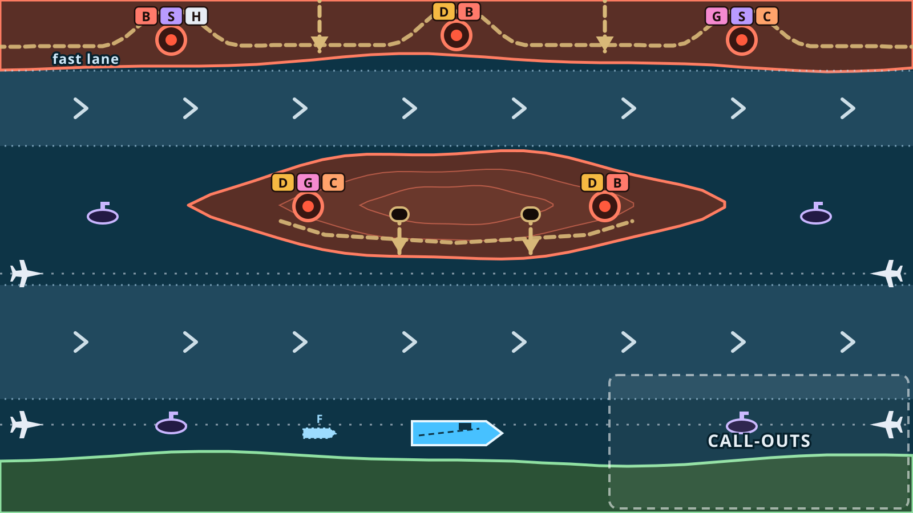

**The enemy holds the island: a fast, risky north lane and a safe south one.**

**Today**

- 2 lanes, 5 launch bases, 2 shore roads and 4 pop-up roads, 4 sub spots; islets. Threat scale 1.
- The raid planner leads with Attack Helicopter on wave 2 and sends 1 new enemy a wave on waves 2–5, 2 on 6–9 and 3 on wave 10. Seen over three seeds: 4 of this chapter’s (Attack Helicopter, Torpedo Sub, Armored Drone, Scavenger Drone) and 3 older (Decoy Drones, Hydra Missile, Rocket Truck). No pairs.
- Gunship Wall: the map’s ending, 3 runs with the convoy restored first; built on Attack Helicopter.
- Measured: the average bot with a campaign Armory won 88% (88% through the ten waves), your persona 50%; with no Armory, sharp 25%, average 25%. Hold. A gentle start to the chapter, as the curve wants.

**Notes**

- Brief: "Chapter maps with fewer debut enemies: the first map of a chapter starts with 6 or more new things." (This round’s brief. The player’s own words weren’t in the repo’s docs, lab files or scratchpad logs. The count holds today (see each chapter’s first map).)
- You: "That was good you really do need a good power up or weapon drop to deal with it tho which is fine just observe to make but why also three rounds not following that I thought it would be one and done" (Test Lab, Gunship Wall card, 2026-11-10.)

**The rebuild**

- **Debut:** Attack Helicopter, alone on wave 2.
- **Pairs:** Decoys + Sprint Drones (`decoy-sprint`), Hydra + Drone Swarm (`hydra-swarm`)
- **Target:** 1.5 tries.
- **Event:** Keep Gunship Wall.
- **Call-outs:** bottom-right.
- **Layout:** no change.

| Wave | Original threats (today's table) | New enemies | Pair | Moment |
|---|---|---|---|---|
| 1 | 16 drones; 1 truck | — | — | The enemy holds the island and the far shore. |
| 2 | 19 drones, 2 ballistic; 1 truck | **Attack Helicopter** | — | Debut: one Attack Helicopter, alone, hovering by the south lane. |
| 3 | 22 drones, 4 ballistic, 1 guided; 1 sub, 2 trucks | Attack Helicopter | — | — |
| 4 | 25 drones, 5 ballistic, 1 guided; 1 jet, 1 sub, 2 trucks | Sprint Drones | — | — |
| 5 | 25 drones, 5 ballistic, 2 guided; 1 jet, 1 bomber, 2 subs, 3 trucks | Attack Helicopter, Decoy Drones | — | — |
| 6 | 27 drones, 7 ballistic, 3 guided, 1 supersonic; 1 jet, 1 bomber, 2 subs, 3 trucks | Attack Helicopter | Decoys + Sprint Drones | Supersonic missiles join (the map’s extra, as today). |
| 7 | 31 drones, 7 ballistic, 5 guided, 1 supersonic, 1 heavy; 1 jet, 1 bomber, 3 subs, 4 trucks | Attack Helicopter, Rocket Truck | — | Heavy cruise missiles join (extra). |
| 8 | 32 drones, 9 ballistic, 6 guided, 1 supersonic, 1 heavy, 1 cluster; 2 jets, 1 bomber, 3 subs, 4 trucks | Attack Helicopter, Hydra Missile | — | Cluster missiles join (extra). |
| 9 | 38 drones, 9 ballistic, 7 guided, 2 supersonic, 1 heavy, 1 cluster; 2 jets, 2 bombers, 3 subs, 5 trucks | Attack Helicopter | Hydra + Drone Swarm | — |
| 10 | 45 drones, 11 ballistic, 9 guided, 2 supersonic, 2 heavy, 2 cluster; 2 jets, 2 bombers, 3 subs, 5 trucks | Attack Helicopter, Attack Helicopter, Decoy Drones | — | Two helicopters, one over each lane. |

### 7. The Behemoth Run (`behemoth`)

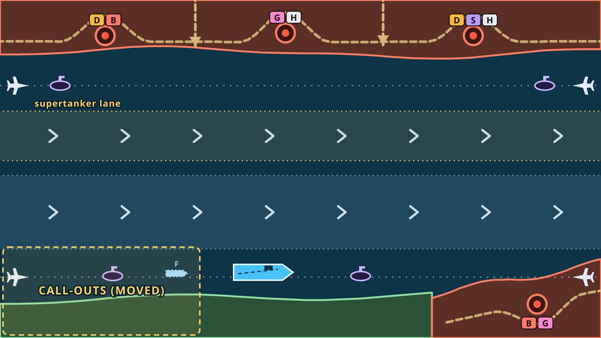

**The supertanker: once a wave it crawls through the deep lane, worth three ships.**

**Today**

- 2 lanes, 4 launch bases, 2 shore roads and 2 pop-up roads, 4 sub spots; VIP supertanker. Threat scale 1.15.
- The raid planner leads with Torpedo Sub on wave 2 and sends 1 new enemy a wave on waves 2–5, 2 on 6–9 and 3 on wave 10. Seen over three seeds: 4 of this chapter’s (Torpedo Sub, Armored Drone, Scavenger Drone, Attack Helicopter) and 3 older (Decoy Drones, Hydra Missile, Rocket Truck). No pairs.
- Wolf Pack: the map’s ending, 3 runs with the convoy restored first; built on Torpedo Sub.
- The call-out corner covers a launch base.
- Measured: the average bot with a campaign Armory won 50% (75% through the ten waves), your persona 25%; with no Armory, sharp 75%, average 38%. Ease a little. It measures harder than the Archipelago two maps later.

**Notes**

- Design note: "The stack does sit over the bottom-right shore, which on some maps (Harbor Mouth, Behemoth, Sowers, Lantern, Coves, Citadel) has a base: the cards are translucent, short-lived and go at a tap. … Ideas not built: Per-map nudge for the few maps with a base in the bottom-right corner (lift the stack above it, or fade a card while its base fires)." (docs/design/v3-callouts.md (the call-outs round). The player’s ask there: “move the notifications to the bottom right hand corner”.)
- You: "Make sure they shoot multiple torpedoes each in different directions and then maybe you can give them one or two fast torpedoes too just total not for each" (Test Lab, Wolf Pack card, 2026-11-10. Built in round 6.)

**The rebuild**

- **Debut:** Torpedo Sub, alone on wave 2.
- **Pairs:** Attack Helicopter + Torpedo Sub (`heli-sub`), Hydra + Drone Swarm (`hydra-swarm`)
- **Target:** 1.7 tries.
- **Event:** Keep Wolf Pack.
- **Call-outs:** bottom-left.
- **Layout:** Call-outs move to the bottom-left corner. (A launch base sits under the bottom-right corner.)

| Wave | Original threats (today's table) | New enemies | Pair | Moment |
|---|---|---|---|---|
| 1 | 18 drones | — | — | One supertanker a wave in the deep lane: six hits, worth three ships. |
| 2 | 22 drones, 2 ballistic; 1 truck | **Torpedo Sub** | — | Debut: one Torpedo Sub, surfacing off the deep lane as the tanker passes (cued to it). |
| 3 | 25 drones, 5 ballistic, 1 guided; 1 sub, 1 truck | Torpedo Sub | — | — |
| 4 | 29 drones, 6 ballistic, 1 guided, 1 cluster; 1 jet, 1 sub, 2 trucks | Attack Helicopter | — | Cluster missiles join (the map’s extra, as today). |
| 5 | 29 drones, 6 ballistic, 2 guided, 1 cluster, 1 heavy; 1 jet, 2 subs, 2 trucks | Torpedo Sub, Decoy Drones | — | Heavies join (extra); they and guided missiles prefer the tanker. |
| 6 | 31 drones, 8 ballistic, 3 guided, 2 cluster, 1 heavy; 1 jet, 1 bomber, 2 subs, 3 trucks | Torpedo Sub, Sprint Drones | — | — |
| 7 | 36 drones, 8 ballistic, 6 guided, 2 cluster, 1 heavy; 1 jet, 1 bomber, 3 subs, 3 trucks | Torpedo Sub | Attack Helicopter + Torpedo Sub | First Attack Helicopter + Torpedo Sub, over the tanker’s lane. |
| 8 | 37 drones, 10 ballistic, 7 guided, 2 cluster, 1 heavy, 1 mothership; 2 jets, 1 bomber, 3 subs, 4 trucks | Torpedo Sub, Attack Helicopter | — | Motherships join (extra). |
| 9 | 44 drones, 10 ballistic, 8 guided, 2 cluster, 2 heavy, 1 mothership; 2 jets, 1 bomber, 3 subs, 4 trucks | Torpedo Sub | Hydra + Drone Swarm | — |
| 10 | 52 drones, 13 ballistic, 10 guided, 3 cluster, 2 heavy, 1 mothership; 2 jets, 2 bombers, 3 subs, 5 trucks | Torpedo Sub, Rocket Truck | Attack Helicopter + Torpedo Sub | The pair waits for the tanker. |

### 8. The Needle of Bosk (`needle`)

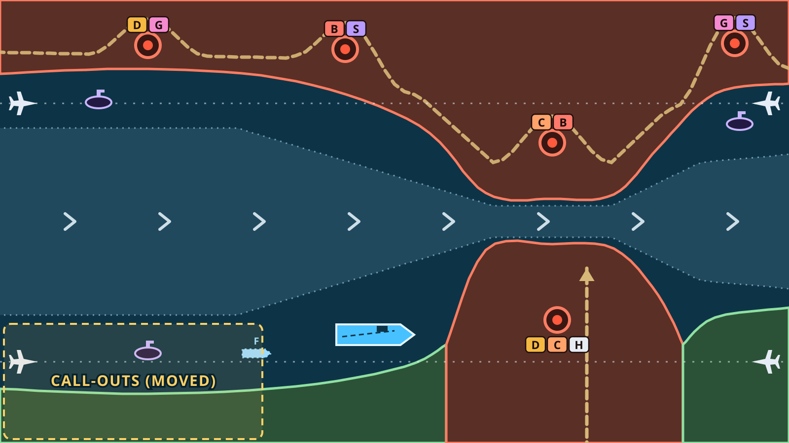

**Single file: open water narrows to a gap one hull wide, and the convoy queues at the mouth.**

**Today**

- 1 lane, 5 launch bases, 1 shore road and 1 pop-up road, 3 sub spots; single file. Threat scale 0.95.
- The raid planner leads with Armored Drone on wave 2 and sends 1 new enemy a wave on waves 2–5, 2 on 6–9 and 3 on wave 10. Seen over three seeds: 4 of this chapter’s (Armored Drone, Scavenger Drone, Attack Helicopter, Torpedo Sub) and 3 older (Decoy Drones, Hydra Missile, Rocket Truck). No pairs.
- Shield Wall: the map’s ending, 3 runs with the convoy restored first; built on Armored Drone.
- The call-out corner covers a launch base.
- Measured: the average bot with a campaign Armory won 50% (50% through the ten waves), your persona 13%; with no Armory, sharp 25%, average 0%. Ease. It measures harder than the Archipelago after it.

**Notes**

- You: "You can spread them out a bit they all come from the same launcher" (Test Lab, Shield Wall card, 2026-11-10. Built in round 6.)

**The rebuild**

- **Debut:** Armored Drone, alone on wave 2.
- **Pairs:** Attack Helicopter + Torpedo Sub (`heli-sub`), Armored Drones + Hydra (`armored-hydra`), Decoys + Cluster Missiles (`decoy-cluster`)
- **Target:** 2 tries.
- **Event:** Keep Shield Wall.
- **Call-outs:** bottom-left.
- **Layout:** Call-outs move to the bottom-left corner. (A launch base sits under the bottom-right corner.)

| Wave | Original threats (today's table) | New enemies | Pair | Moment |
|---|---|---|---|---|
| 1 | 15 drones | — | — | Open water funnels to a gap one hull wide. |
| 2 | 18 drones, 2 ballistic; 1 truck | **Armored Drone** | — | Debut: Armored Drones on their own. |
| 3 | 21 drones, 4 ballistic, 1 guided, 1 cluster; 1 sub, 1 truck | Armored Drone | — | Cluster missiles join (the map’s extra, from wave 3 as today). |
| 4 | 24 drones, 5 ballistic, 1 guided, 1 cluster; 1 jet, 1 sub, 2 trucks | Torpedo Sub | — | — |
| 5 | 24 drones, 5 ballistic, 2 guided, 2 cluster; 1 jet, 2 subs, 2 trucks | Armored Drone, Armored Drone | — | A cluster raid timed to the queue at the mouth. |
| 6 | 26 drones, 7 ballistic, 3 guided, 2 cluster, 1 heavy; 1 jet, 1 bomber, 2 subs, 3 trucks | Armored Drone | Attack Helicopter + Torpedo Sub | Heavies join (extra). |
| 7 | 29 drones, 7 ballistic, 5 guided, 2 cluster, 1 heavy; 1 jet, 1 bomber, 3 subs, 3 trucks | Armored Drone, Attack Helicopter | — | — |
| 8 | 30 drones, 9 ballistic, 6 guided, 3 cluster, 1 heavy, 1 mothership; 2 jets, 1 bomber, 3 subs, 4 trucks | Armored Drone | Armored Drones + Hydra | First Armored Drones + Hydra, at the queue. Motherships join (extra). |
| 9 | 36 drones, 9 ballistic, 7 guided, 3 cluster, 2 heavy, 1 mothership; 2 jets, 1 bomber, 3 subs, 4 trucks | Armored Drone, Torpedo Sub | — | — |
| 10 | 43 drones, 10 ballistic, 9 guided, 3 cluster, 2 heavy, 1 mothership; 2 jets, 2 bombers, 3 subs, 5 trucks | Armored Drone, Armored Drone | Decoys + Cluster Missiles | Clusters at the bunched column. |

### 9. The Archipelago (`archipelago`)

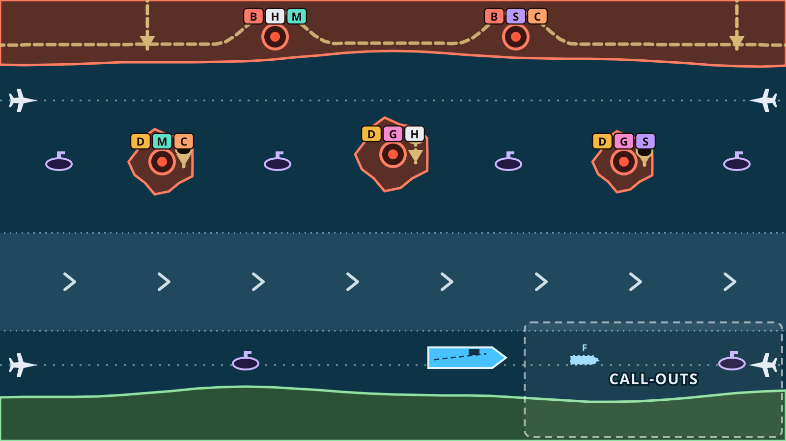

**Enemy islets with gaps between them; the west end is a long reach from the carrier.**

**Today**

- 1 lane, 5 launch bases, 1 shore road and 5 pop-up roads, 6 sub spots; islets. Threat scale 1.1.
- The raid planner leads with Scavenger Drone on wave 2 and sends 1 new enemy a wave on waves 2–5, 2 on 6–9 and 3 on wave 10. Seen over three seeds: 4 of this chapter’s (Scavenger Drone, Attack Helicopter, Torpedo Sub, Armored Drone) and 3 older (Decoy Drones, Hydra Missile, Rocket Truck). No pairs.
- Supply Raid: the map’s ending, 3 runs with the convoy restored first; built on Scavenger Drone; rule: Pickups rain down.
- Measured: the average bot with a campaign Armory won 88% (88% through the ten waves), your persona 13%; with no Armory, sharp 13%, average 0%. Raise a little. It measures easier than the Needle before it.

**Notes**

- You: "Yeah, this one’s more fun than anything. Just make it so there’s no nukes that get dropped during the special event cause I just kind of run up rivers of it and then add more drones that take them and have them come from all side." (Test Lab, Supply Raid card, 2026-11-10. Built in rounds 6 and 8.)

**The rebuild**

- **Debut:** Scavenger Drone, alone on wave 2.
- **Pairs:** Scavenger + Drone Swarm (`scavenger-swarm`), Armored Drones + Hydra (`armored-hydra`), Attack Helicopter + Torpedo Sub (`heli-sub`)
- **Target:** 2.2 tries.
- **Event:** Keep Supply Raid.
- **Call-outs:** bottom-right.
- **Layout:** no change.

| Wave | Original threats (today's table) | New enemies | Pair | Moment |
|---|---|---|---|---|
| 1 | 18 drones; 1 truck | — | — | Islets and gaps: threats come through between them. |
| 2 | 21 drones, 2 ballistic; 1 sub, 1 truck | **Scavenger Drone** | — | Debut: one Scavenger Drone over the first pickup on the water (cued to it). |
| 3 | 24 drones, 4 ballistic, 1 guided; 1 jet, 1 sub, 2 trucks | Scavenger Drone, Armored Drone | — | — |
| 4 | 28 drones, 6 ballistic, 1 guided; 1 jet, 1 bomber, 2 subs, 2 trucks | Attack Helicopter | — | — |
| 5 | 28 drones, 6 ballistic, 2 guided; 1 jet, 1 bomber, 2 subs, 3 trucks | Scavenger Drone, Torpedo Sub | — | — |
| 6 | 30 drones, 8 ballistic, 3 guided, 1 mothership, 1 heavy; 1 jet, 1 bomber, 3 subs, 3 trucks | Scavenger Drone | Scavenger + Drone Swarm | First Scavenger + Drone Swarm. Motherships and heavies join (extras). |
| 7 | 34 drones, 8 ballistic, 6 guided, 1 mothership, 1 heavy, 1 cluster; 2 jets, 1 bomber, 3 subs, 4 trucks | Armored Drone, Hydra Missile | — | Cluster missiles join (extra). |
| 8 | 35 drones, 10 ballistic, 7 guided, 1 mothership, 1 heavy, 1 cluster, 1 supersonic; 2 jets, 2 bombers, 3 subs, 4 trucks | Scavenger Drone | Armored Drones + Hydra | Supersonic missiles join (extra). |
| 9 | 42 drones, 10 ballistic, 8 guided, 2 mothership, 2 heavy, 2 cluster, 1 supersonic; 2 jets, 2 bombers, 3 subs, 5 trucks | Scavenger Drone, Attack Helicopter, Torpedo Sub | — | — |
| 10 | 50 drones, 12 ballistic, 10 guided, 2 mothership, 2 heavy, 2 cluster, 2 supersonic; 2 jets, 2 bombers, 3 subs, 5 trucks | Scavenger Drone, Armored Drone | Attack Helicopter + Torpedo Sub | — |

### 10. Saltgate Canal (`saltgate`)

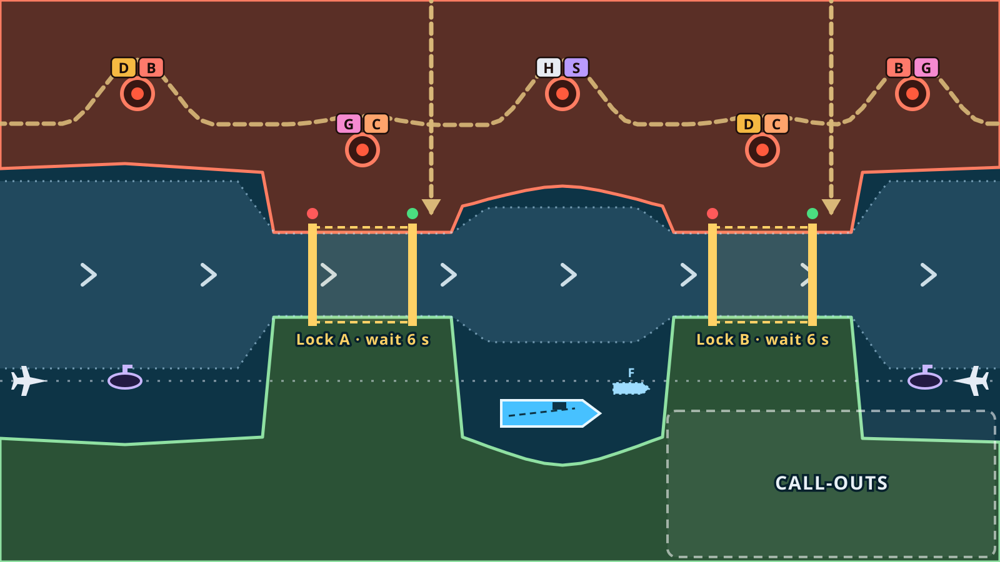

**Chapter finale: two locks where ships wait in the chamber under the silos, and the chapter’s pairs one lock at a time.**

**Today**

- 1 lane, 5 launch bases, 1 shore road and 2 pop-up roads, 2 sub spots; two locks. Threat scale 0.9.
- The raid planner leads with Attack Helicopter on wave 2 and sends 1 new enemy a wave on waves 2–5, 2 on 6–9 and 3 on wave 10. Seen over three seeds: 4 of this chapter’s (Attack Helicopter, Torpedo Sub, Armored Drone, Scavenger Drone) and 3 older (Decoy Drones, Hydra Missile, Rocket Truck). No pairs.
- Run the Canal: the map’s ending, 3 runs with the convoy restored first; built on Torpedo Sub, Attack Helicopter, Armored Drone.
- Measured: the average bot with a campaign Armory won 38% (38% through the ten waves), your persona 13%; with no Armory, sharp 0%, average 0%. Ease, and hold the pace. With a campaign Armory it measures among the hardest maps in the game for the average bot; the pace and formation limits (Systems) change how it plays.

**Notes**

- You: "The Stargate Matt is working a lot better now, but we definitely should add in or force the players to have their ships come in at a certain pace here. I think it’s probably time to start looking at not allowing the players to change the pace cause I really changes the flow of the maps or at least like setting a limit specific war map same with formations maybe we could change that up to" (Note paused on Saltgate Canal, wave 8, 2026-11-08 (play log v3-20261108031002-15964; also tools/v3/test-lab/playtest-2026-11-08.json). “Stargate Matt” is the dictation of “Saltgate map”.)
- You: "Really bad the subs shoot torpedoes from water to land so that needs to be fixed and way too difficult way too much going on" (Test Lab notes of 2026-11-10, Run the Canal card (docs/design/v3-enemies-round8.md). Round 8 cut the event to three phases and aimed the subs; not retested since.)

**The rebuild**

- **Debut:** none (a chapter finale: the chapter's enemies and pairs).
- **Pairs:** Attack Helicopter + Torpedo Sub (`heli-sub`), Scavenger + Drone Swarm (`scavenger-swarm`), Armored Drones + Hydra (`armored-hydra`)
- **Target:** 2.5 tries.
- **Event:** Keep Run the Canal as round 8 cut it (three phases, one after another; subs aimed, never across land), and retest it.
- **Call-outs:** bottom-right.
- **Layout:** Ship flow held at ×1.4 and formations limited to Column and Pairs (see Systems). (Your note on Saltgate: the pace “really changes the flow of the maps”; and Box and Spread barely fit the chambers.)

| Wave | Original threats (today's table) | New enemies | Pair | Moment |
|---|---|---|---|---|
| 1 | 14 drones | — | — | Two locks: ships wait in each chamber while it fills, under the silos. |
| 2 | 17 drones, 2 ballistic; 1 truck | Torpedo Sub | — | A sub up as the first ships sit in Lock A (cued to the lock). |
| 3 | 20 drones, 4 ballistic, 1 guided; 1 sub, 1 truck | Armored Drone | — | — |
| 4 | 23 drones, 5 ballistic, 1 guided, 1 cluster; 1 jet, 1 sub, 2 trucks | Attack Helicopter | Attack Helicopter + Torpedo Sub | Cluster missiles join (the map’s extra, as today). |
| 5 | 23 drones, 5 ballistic, 2 guided, 1 cluster, 1 heavy; 1 jet, 2 subs, 2 trucks | Scavenger Drone, Armored Drone | — | Heavies join (extra). |
| 6 | 24 drones, 6 ballistic, 3 guided, 2 cluster, 1 heavy; 1 jet, 1 bomber, 2 subs, 3 trucks | Torpedo Sub | Scavenger + Drone Swarm | — |
| 7 | 28 drones, 6 ballistic, 5 guided, 2 cluster, 1 heavy; 1 jet, 1 bomber, 3 subs, 3 trucks | Attack Helicopter, Armored Drone | — | — |
| 8 | 29 drones, 8 ballistic, 5 guided, 2 cluster, 2 heavy, 1 mothership; 2 jets, 1 bomber, 3 subs, 4 trucks | Scavenger Drone, Torpedo Sub | — | Motherships join (extra). |
| 9 | 34 drones, 8 ballistic, 6 guided, 2 cluster, 2 heavy, 1 mothership; 2 jets, 1 bomber, 3 subs, 4 trucks | Attack Helicopter | Armored Drones + Hydra | The pair timed to Lock B’s wait. |
| 10 | 41 drones, 10 ballistic, 8 guided, 3 cluster, 2 heavy, 1 mothership; 2 jets, 2 bombers, 3 subs, 5 trucks | Torpedo Sub, Scavenger Drone | Attack Helicopter + Torpedo Sub then Armored Drones + Hydra | One pair at each lock, the second after the first is done. |

## Chapter 3: Dark Water

New enemies: Stealth Strafer, Stealth Bomber, Dive Bomber, Siege Battery, Spotter Plane. New weapons: Grapnel, Bomber Wing, Orbital Strike, Dual Wield, Focus. Pairs from this chapter: Spotter + Siege Battery (`spotter-siege`), Siege Battery + Rocket Truck (`siege-truck`), Spotter + Dive Bombers (`spotter-dive`).

### 11. Battery Point (`battery`)

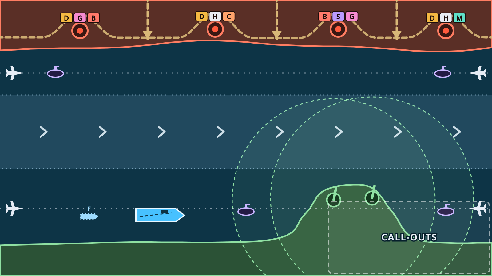

**Two allied shore guns fire on their own; the enemy wants them silenced first.**

**Today**

- 1 lane, 4 launch bases, 1 shore road and 3 pop-up roads, 4 sub spots; allied shore guns. Threat scale 1.8.
- The raid planner leads with Stealth Strafer on wave 2 and sends 1 new enemy a wave on waves 2–5, 2 on 6–9 and 3 on wave 10. Seen over three seeds: 5 of this chapter’s (Stealth Strafer, Stealth Bomber, Dive Bomber, Siege Battery, Spotter Plane) and 4 older (Rocket Truck, Hydra Missile, Torpedo Sub, Armored Drone). No pairs.
- Blackout: the map’s ending, 3 runs with the convoy restored first; built on Stealth Strafer; rule: Night, A star shell is on the way.
- Measured: the average bot with a campaign Armory won 75% (75% through the ten waves), your persona 0%; with no Armory, sharp 13%, average 0%. Ease. A chapter’s first map, yet for your persona it measures no easier than the Saltgate finale before it.

**Notes**

- Brief: "Chapter maps with fewer debut enemies: the first map of a chapter starts with 6 or more new things." (This round’s brief. The player’s own words weren’t in the repo’s docs, lab files or scratchpad logs. The count holds today (see each chapter’s first map).)
- You: "Hard but doable" (Test Lab, Blackout card, 2026-11-10.)

**The rebuild**

- **Debut:** Stealth Strafer, alone on wave 2.
- **Pairs:** Attack Helicopter + Torpedo Sub (`heli-sub`), Armored Drones + Hydra (`armored-hydra`)
- **Target:** 2 tries.
- **Event:** Keep Blackout.
- **Call-outs:** bottom-right.
- **Layout:** no change.

| Wave | Original threats (today's table) | New enemies | Pair | Moment |
|---|---|---|---|---|
| 1 | 29 drones; 1 truck | — | — | Your two shore guns fire on their own at anything in reach. |
| 2 | 34 drones, 4 ballistic; 1 sub, 1 truck | **Stealth Strafer** | — | Debut: one Stealth Strafer, no warning, along the lane. |
| 3 | 40 drones, 7 ballistic, 2 guided, 1 heavy; 1 jet, 1 sub, 2 trucks | Stealth Strafer | — | Heavies join (the map’s extra, from wave 3): they go for the guns. |
| 4 | 45 drones, 9 ballistic, 2 guided, 1 supersonic, 1 cluster, 1 heavy; 1 jet, 2 subs, 2 trucks | Attack Helicopter | — | Supersonic and cluster missiles join (extras). |
| 5 | 45 drones, 9 ballistic, 4 guided, 1 supersonic, 1 cluster, 2 heavy; 1 jet, 1 bomber, 2 subs, 3 trucks | Stealth Strafer, Scavenger Drone | — | — |
| 6 | 49 drones, 13 ballistic, 5 guided, 2 supersonic, 2 cluster, 1 mothership, 2 heavy; 1 jet, 1 bomber, 3 subs, 3 trucks | Stealth Strafer | Attack Helicopter + Torpedo Sub | Motherships join (extra). |
| 7 | 56 drones, 13 ballistic, 9 guided, 2 supersonic, 2 cluster, 1 mothership, 2 heavy; 2 jets, 1 bomber, 3 subs, 4 trucks | Stealth Strafer, Torpedo Sub | — | A strafer run as a gun is knocked out (cued to the battery). |
| 8 | 58 drones, 16 ballistic, 11 guided, 2 supersonic, 2 cluster, 1 mothership, 2 heavy; 2 jets, 1 bomber, 3 subs, 4 trucks | Stealth Strafer, Armored Drone | — | — |
| 9 | 68 drones, 16 ballistic, 13 guided, 2 supersonic, 2 cluster, 2 mothership, 3 heavy; 2 jets, 2 bombers, 3 subs, 5 trucks | Stealth Strafer | Armored Drones + Hydra | — |
| 10 | 81 drones, 20 ballistic, 16 guided, 3 supersonic, 3 cluster, 2 mothership, 3 heavy; 2 jets, 2 bombers, 3 subs, 5 trucks | Stealth Strafer, Stealth Strafer, Rocket Truck | — | — |

### 12. Sowers' Reach (`sowers`)

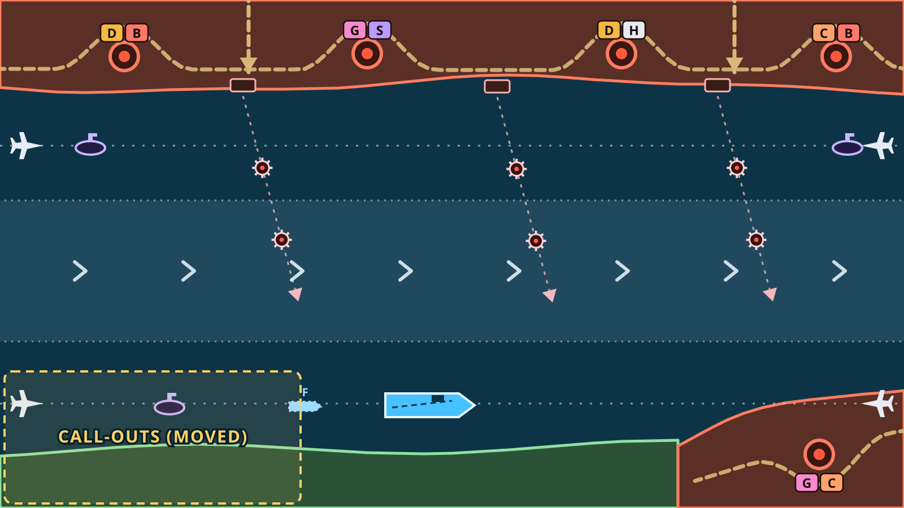

**Mines adrift: every round spent on a mine is one not spent on a missile.**

**Today**

- 1 lane, 5 launch bases (3 mine chutes), 2 shore roads and 2 pop-up roads, 3 sub spots; drifting mines. Threat scale 1.45.
- The raid planner leads with Stealth Bomber on wave 2 and sends 1 new enemy a wave on waves 2–5, 2 on 6–9 and 3 on wave 10. Seen over three seeds: 5 of this chapter’s (Stealth Bomber, Dive Bomber, Siege Battery, Spotter Plane, Stealth Strafer) and 4 older (Rocket Truck, Hydra Missile, Torpedo Sub, Armored Drone). No pairs.
- Carpet Run: the map’s ending, 3 runs with the convoy restored first; built on Stealth Bomber.
- The call-out corner covers a launch base.
- Measured: the average bot with a campaign Armory won 100% (100% through the ten waves), your persona 25%; with no Armory, sharp 0%, average 13%. Hold.

**Notes**

- Design note: "The stack does sit over the bottom-right shore, which on some maps (Harbor Mouth, Behemoth, Sowers, Lantern, Coves, Citadel) has a base: the cards are translucent, short-lived and go at a tap. … Ideas not built: Per-map nudge for the few maps with a base in the bottom-right corner (lift the stack above it, or fade a card while its base fires)." (docs/design/v3-callouts.md (the call-outs round). The player’s ask there: “move the notifications to the bottom right hand corner”.)

**The rebuild**

- **Debut:** Stealth Bomber, alone on wave 2.
- **Pairs:** Decoys + Cluster Missiles (`decoy-cluster`), Scavenger + Drone Swarm (`scavenger-swarm`), Attack Helicopter + Torpedo Sub (`heli-sub`)
- **Target:** 2.2 tries.
- **Event:** Keep Carpet Run.
- **Call-outs:** bottom-left.
- **Layout:** Call-outs move to the bottom-left corner. (A launch base sits under the bottom-right corner.)

| Wave | Original threats (today's table) | New enemies | Pair | Moment |
|---|---|---|---|---|
| 1 | 23 drones, 2 mines | — | — | Mines drift across the lane on the current. |
| 2 | 28 drones, 3 ballistic, 3 mines; 1 truck | **Stealth Bomber** | — | Debut: one Stealth Bomber, no warning. |
| 3 | 32 drones, 6 ballistic, 1 guided, 3 mines; 1 sub, 1 truck | Stealth Bomber | — | — |
| 4 | 36 drones, 7 ballistic, 1 guided, 4 mines; 1 jet, 1 sub, 2 trucks | Stealth Strafer | — | — |
| 5 | 36 drones, 7 ballistic, 3 guided, 4 mines, 1 cluster; 1 jet, 2 subs, 2 trucks | Stealth Bomber, Armored Drone | — | Cluster missiles join (the map’s extra, as today). |
| 6 | 39 drones, 10 ballistic, 4 guided, 5 mines, 1 cluster; 1 jet, 1 bomber, 2 subs, 3 trucks | Stealth Bomber | Decoys + Cluster Missiles | Decoys among the mines: rounds spent on both. |
| 7 | 45 drones, 10 ballistic, 7 guided, 5 mines, 2 cluster, 1 mothership; 1 jet, 1 bomber, 3 subs, 3 trucks | Stealth Bomber, Stealth Strafer | — | Motherships join (extra). |
| 8 | 46 drones, 13 ballistic, 9 guided, 6 mines, 2 cluster, 1 mothership; 2 jets, 1 bomber, 3 subs, 4 trucks | Stealth Bomber | Scavenger + Drone Swarm | Scavengers over the pickups between the mines. |
| 9 | 55 drones, 13 ballistic, 10 guided, 6 mines, 2 cluster, 1 mothership; 2 jets, 1 bomber, 3 subs, 4 trucks | Stealth Bomber, Attack Helicopter | — | — |
| 10 | 65 drones, 16 ballistic, 13 guided, 7 mines, 2 cluster, 2 mothership; 2 jets, 2 bombers, 3 subs, 5 trucks | Stealth Bomber, Stealth Strafer | Attack Helicopter + Torpedo Sub | — |

### 13. The Rig Field (`rigs`)

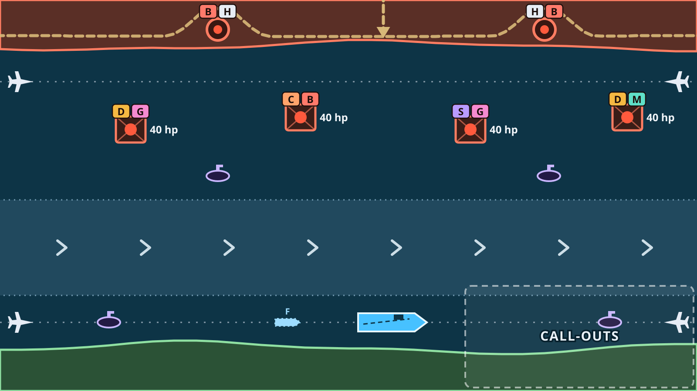

**Oil rigs launch from the open sea; each one you bring down stays down.**

**Today**

- 1 lane, 6 launch bases (4 rigs), 1 shore road and 1 pop-up road, 4 sub spots; oil rigs. Threat scale 1.7.
- The raid planner leads with Dive Bomber on wave 2 and sends 1 new enemy a wave on waves 2–5, 2 on 6–9 and 3 on wave 10. Seen over three seeds: 5 of this chapter’s (Dive Bomber, Siege Battery, Spotter Plane, Stealth Strafer, Stealth Bomber) and 4 older (Rocket Truck, Hydra Missile, Torpedo Sub, Armored Drone). No pairs.
- Dive Circus: the map’s ending, 3 runs with the convoy restored first; built on Dive Bomber.
- Measured: the average bot with a campaign Armory won 88% (88% through the ten waves), your persona 25%; with no Armory, sharp 25%, average 38%. Hold.

**Notes**

- You: "Fun but could have more than planes" (Test Lab, Dive Circus card, 2026-11-10. Round 6 added guided missiles between the dives.)

**The rebuild**

- **Debut:** Dive Bomber, alone on wave 2.
- **Pairs:** Hydra + Drone Swarm (`hydra-swarm`), Armored Drones + Hydra (`armored-hydra`), Attack Helicopter + Torpedo Sub (`heli-sub`)
- **Target:** 2.4 tries.
- **Event:** Keep Dive Circus.
- **Call-outs:** bottom-right.
- **Layout:** no change.

| Wave | Original threats (today's table) | New enemies | Pair | Moment |
|---|---|---|---|---|
| 1 | 27 drones | — | — | Four rigs launch from the sea: spend weapons on rigs now, or on missiles? |
| 2 | 32 drones, 3 ballistic; 1 truck | **Dive Bomber** | — | Debut: one Dive Bomber: the circle, then the plane. |
| 3 | 37 drones, 7 ballistic, 2 guided; 1 sub, 1 truck | Dive Bomber, Stealth Strafer | — | — |
| 4 | 43 drones, 9 ballistic, 2 guided, 1 cluster; 1 jet, 1 sub, 2 trucks | Stealth Bomber | — | Cluster missiles join (the map’s extra, as today). |
| 5 | 43 drones, 9 ballistic, 3 guided, 1 cluster, 1 mothership; 1 jet, 1 bomber, 2 subs, 2 trucks | Dive Bomber | — | Motherships join (extra). |
| 6 | 46 drones, 12 ballistic, 5 guided, 2 cluster, 1 mothership, 1 supersonic; 1 jet, 1 bomber, 2 subs, 3 trucks | Dive Bomber | Hydra + Drone Swarm | Supersonic missiles join (extra). |
| 7 | 53 drones, 12 ballistic, 9 guided, 2 cluster, 1 mothership, 1 supersonic; 1 jet, 1 bomber, 3 subs, 3 trucks | Dive Bomber, Stealth Bomber | — | — |
| 8 | 54 drones, 15 ballistic, 10 guided, 2 cluster, 2 mothership, 2 supersonic; 2 jets, 1 bomber, 3 subs, 4 trucks | Dive Bomber | Armored Drones + Hydra | — |
| 9 | 65 drones, 15 ballistic, 12 guided, 2 cluster, 2 mothership, 2 supersonic; 2 jets, 2 bombers, 3 subs, 4 trucks | Dive Bomber, Stealth Strafer, Torpedo Sub | — | — |
| 10 | 77 drones, 19 ballistic, 15 guided, 3 cluster, 2 mothership, 2 supersonic; 2 jets, 2 bombers, 3 subs, 5 trucks | Dive Bomber, Dive Bomber | Attack Helicopter + Torpedo Sub | — |

### 14. The Black Strait (`lantern`)

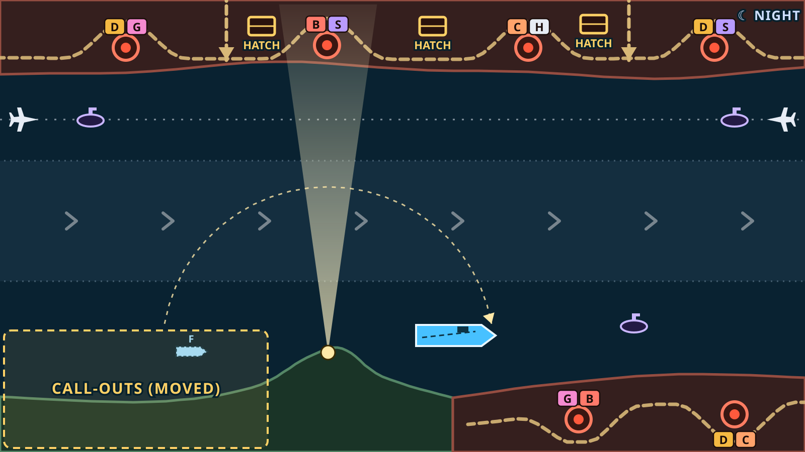

**Night: threats are a faint glow until the lighthouse beam sweeps over them.**

**Today**

- 1 lane, 6 launch bases, 2 shore roads and 2 pop-up roads, 3 sub spots; night. Threat scale 1.45.
- The raid planner leads with Siege Battery on wave 2 and sends 1 new enemy a wave on waves 2–5, 2 on 6–9 and 3 on wave 10. Seen over three seeds: 5 of this chapter’s (Siege Battery, Spotter Plane, Stealth Strafer, Stealth Bomber, Dive Bomber) and 4 older (Rocket Truck, Hydra Missile, Torpedo Sub, Armored Drone). No pairs.
- Bombardment: the map’s ending, 3 runs with the convoy restored first; built on Siege Battery.
- The call-out corner covers a launch base and a launch base.
- Measured: the average bot with a campaign Armory won 75% (75% through the ten waves), your persona 13%; with no Armory, sharp 13%, average 0%. Hold. The bots see in the dark, so it plays harder than it measures.

**Notes**

- You: "This one is good now too just note for maps. I actually have this the silo or whatever that it comes out it will be permanent and it doesn’t need to replace the other launcher ones." (Test Lab round 2, Siege Battery card, 2026-11-08 (tools/v3/test-lab/playtest-2026-11-08-round2.json))
- Design note: "The stack does sit over the bottom-right shore, which on some maps (Harbor Mouth, Behemoth, Sowers, Lantern, Coves, Citadel) has a base: the cards are translucent, short-lived and go at a tap. … Ideas not built: Per-map nudge for the few maps with a base in the bottom-right corner (lift the stack above it, or fade a card while its base fires)." (docs/design/v3-callouts.md (the call-outs round). The player’s ask there: “move the notifications to the bottom right hand corner”.)
- You: "Add in some drones to allow some drips that. I think we needed so I can have more of a chance" (Test Lab, Bombardment card, 2026-11-10. Round 6 added supply drones.)
- You: "Not for all of these special events / I like the three waves actually after doing it more / Then also no nukes for these special events events" (Note paused on The Black Strait, wave 13 (the Bombardment’s last run), 2026-11-09 (play log v3-20261109234402-81718; tools/v3/test-lab/playtest-2026-11-10.json).)

**The rebuild**

- **Debut:** Siege Battery, alone on wave 3.
- **Pairs:** Hydra + Drone Swarm (`hydra-swarm`), Siege Battery + Rocket Truck (`siege-truck`), Armored Drones + Hydra (`armored-hydra`)
- **Target:** 2.6 tries.
- **Event:** Keep Bombardment, its three guns rising from the map’s own hatches.
- **Call-outs:** bottom-left.
- **Layout:** Three permanent siege hatches on the north shore. (Your Siege Battery note: the hatch it comes out of should be permanent, and not take a launcher’s place.) Call-outs move to the bottom-left corner. (Two launch bases sit under the bottom-right corner.) Hatches at (520, 52), (860, 52), (1180, 48).

| Wave | Original threats (today's table) | New enemies | Pair | Moment |
|---|---|---|---|---|
| 1 | 23 drones | — | — | Night: a lighthouse beam sweeps the lane. |
| 2 | 28 drones, 3 ballistic; 1 truck | Stealth Strafer | — | Three siege hatches stand on the north shore from the start (permanent: see Systems). |
| 3 | 32 drones, 6 ballistic, 1 guided; 1 sub, 1 truck | **Siege Battery** | — | Debut: one Siege Battery rises from a hatch, alone. |
| 4 | 36 drones, 7 ballistic, 1 guided, 1 cluster; 1 jet, 1 sub, 2 trucks | Siege Battery, Dive Bomber | — | Cluster missiles join (the map’s extra, as today). |
| 5 | 36 drones, 7 ballistic, 3 guided, 1 cluster; 1 jet, 2 subs, 2 trucks | Siege Battery, Stealth Bomber | — | — |
| 6 | 39 drones, 10 ballistic, 4 guided, 2 cluster, 1 mothership; 1 jet, 1 bomber, 2 subs, 3 trucks | Siege Battery | Hydra + Drone Swarm | Motherships join (extra). |
| 7 | 45 drones, 10 ballistic, 7 guided, 2 cluster, 1 mothership; 1 jet, 1 bomber, 3 subs, 3 trucks | Siege Battery | Siege Battery + Rocket Truck | First Siege Battery + Rocket Truck. |
| 8 | 46 drones, 13 ballistic, 9 guided, 2 cluster, 1 mothership; 2 jets, 1 bomber, 3 subs, 4 trucks | Siege Battery, Stealth Strafer | — | — |
| 9 | 55 drones, 13 ballistic, 10 guided, 2 cluster, 2 mothership; 2 jets, 1 bomber, 3 subs, 4 trucks | Siege Battery, Dive Bomber | Armored Drones + Hydra | — |
| 10 | 65 drones, 16 ballistic, 13 guided, 3 cluster, 2 mothership; 2 jets, 2 bombers, 3 subs, 5 trucks | Siege Battery, Siege Battery | Siege Battery + Rocket Truck | Two hatches taking turns, and the truck. |

### 15. Dreadnought Pass (`dreadnought`)

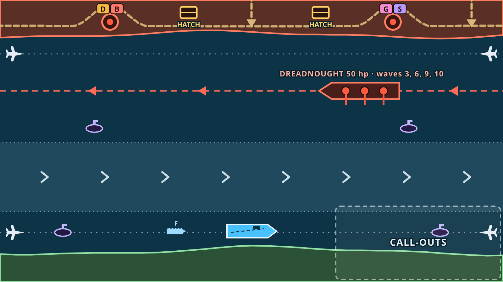

**Chapter finale: a battleship steams through on waves 3, 6, 9 and 10, and the Spotter calls the guns.**

**Today**

- 1 lane, 2 launch bases, 1 shore road and 2 pop-up roads, 4 sub spots; the Dreadnought. Threat scale 0.85.
- The raid planner leads with Spotter Plane on wave 2 and sends 1 new enemy a wave on waves 2–5, 2 on 6–9 and 3 on wave 10. Seen over three seeds: 5 of this chapter’s (Spotter Plane, Stealth Strafer, Stealth Bomber, Dive Bomber, Siege Battery) and 4 older (Rocket Truck, Hydra Missile, Torpedo Sub, Armored Drone). No pairs.
- Fire Mission: the map’s ending, 3 runs with the convoy restored first; built on Spotter Plane.
- Measured: the average bot with a campaign Armory won 63% (63% through the ten waves), your persona 0%; with no Armory, sharp 25%, average 13%. Hold. Hard, as a finale should be.

**Notes**

- You: "This one is good now too just note for maps. I actually have this the silo or whatever that it comes out it will be permanent and it doesn’t need to replace the other launcher ones." (Test Lab round 2, Siege Battery card, 2026-11-08 (tools/v3/test-lab/playtest-2026-11-08-round2.json))
- You: "I didn’t seem to work quite right the recon drone and then the siege cannon never really appeared at the same time so I think we need to work on the timing or test that out because I’m sure not all the pairs will have similar timings like that" (Test Lab, Spotter + Siege combo card, 2026-11-09 (tools/v3/test-lab/playtest-2026-11-09.json). Fixed by the pair rules in round 4 and round 8 (src/v3/data/pairs.ts).)
- You: "This was a good improvement. I also think this is how the recon planes should behave in general as well. They Scott it out and lock on and then leave and come back with the same health and repeated until you kill it." (Test Lab notes of 2026-11-10, Fire Mission card (docs/design/v3-enemies-round8.md). Before that (round 5): “Wayyyyto easy let’s rework this completely”.)

**The rebuild**

- **Debut:** Spotter Plane, alone on wave 2.
- **Pairs:** Siege Battery + Rocket Truck (`siege-truck`), Spotter + Dive Bombers (`spotter-dive`), Spotter + Siege Battery (`spotter-siege`)
- **Target:** 3 tries.
- **Event:** Keep Fire Mission.
- **Call-outs:** bottom-right.
- **Layout:** Two permanent siege hatches on the north shore. (The siege guns of its pairs rise from fixed hatches (your Siege Battery note).) Hatches at (600, 40), (1020, 40).

| Wave | Original threats (today's table) | New enemies | Pair | Moment |
|---|---|---|---|---|
| 1 | 14 drones | — | — | Two shores and one deep channel: the battleship’s. |
| 2 | 16 drones, 2 ballistic; 1 truck | **Spotter Plane** | — | Debut: one Spotter Plane paints a ship and calls shells from off the map. |
| 3 | 19 drones, 3 ballistic, 1 guided; 1 sub, 1 truck, the Dreadnought | Spotter Plane | — | The Dreadnought’s first pass (waves 3, 6, 9 and 10, as today). |
| 4 | 21 drones, 4 ballistic, 1 guided; 1 jet, 1 sub, 2 trucks | Dive Bomber | — | — |
| 5 | 21 drones, 4 ballistic, 2 guided, 1 cluster; 1 jet, 1 bomber, 2 subs, 2 trucks | Stealth Bomber | Siege Battery + Rocket Truck | Cluster missiles join (the map’s extra, as today). |
| 6 | 23 drones, 6 ballistic, 3 guided, 1 heavy, 1 cluster; 1 jet, 1 bomber, 2 subs, 3 trucks, the Dreadnought | Spotter Plane | — | Second pass; the Spotter paints for its broadside (cued to the battleship). Heavies join (extra). |
| 7 | 26 drones, 6 ballistic, 4 guided, 1 heavy, 2 cluster, 1 mothership; 1 jet, 1 bomber, 3 subs, 3 trucks | Spotter Plane | Spotter + Dive Bombers | First Spotter + Dive Bombers. Motherships join (extra). |
| 8 | 27 drones, 8 ballistic, 5 guided, 1 heavy, 2 cluster, 1 mothership; 2 jets, 1 bomber, 3 subs, 4 trucks | Siege Battery, Stealth Strafer | — | — |
| 9 | 32 drones, 8 ballistic, 6 guided, 1 heavy, 2 cluster, 1 mothership; 2 jets, 2 bombers, 3 subs, 4 trucks, the Dreadnought | Spotter Plane | Spotter + Siege Battery | Third pass, with Spotter + Siege Battery. |
| 10 | 38 drones, 9 ballistic, 8 guided, 2 heavy, 2 cluster, 2 mothership; 2 jets, 2 bombers, 3 subs, 5 trucks, the Dreadnought | Spotter Plane, Stealth Bomber | Spotter + Dive Bombers | Last pass. |

## Chapter 4: Open War

New enemies: Repair Ship, Bodyguard Ring, Lure Beacon, Incendiary Missile. New weapons: Cadence Gun, Wild Card. Pairs from this chapter: Repair Ship + Bodyguard Ring (`tender-bodyguard`), Repair Ship + Rocket Truck (`tender-truck`), Lure Beacon + Stealth Strafers (`lure-stealth`), Bodyguard Ring + Spotter (`guard-spotter`).

### 16. Smugglers' Coves (`coves`)

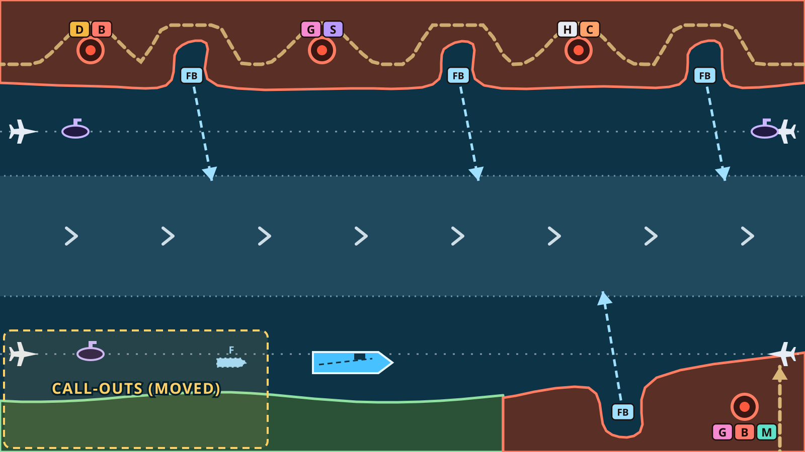

**Fast attack boats burst out of hidden coves to ram the convoy.**

**Today**

- 1 lane, 4 launch bases (4 coves), 1 shore road and 1 pop-up road, 3 sub spots; fast boats from coves. Threat scale 1.25.
- The raid planner leads with Repair Ship on wave 2 and sends 1 new enemy a wave on waves 2–5, 2 on 6–9 and 3 on wave 10. Seen over three seeds: 4 of this chapter’s (Repair Ship, Bodyguard Ring, Lure Beacon, Incendiary Missile) and 5 older (Torpedo Sub, Attack Helicopter, Stealth Strafer, Dive Bomber, Rocket Truck). No pairs.
- Repair Yard: the map’s ending, 3 runs with the convoy restored first; built on Repair Ship.
- The call-out corner covers a launch base and a cove.
- Measured: the average bot with a campaign Armory won 88% (88% through the ten waves), your persona 13%; with no Armory, sharp 13%, average 0%. Hold, or raise a little: it measures easier than the maps after it, as a chapter’s first map should, but by more than the curve wants.

**Notes**

- Brief: "Chapter maps with fewer debut enemies: the first map of a chapter starts with 6 or more new things." (This round’s brief. The player’s own words weren’t in the repo’s docs, lab files or scratchpad logs. The count holds today (see each chapter’s first map).)
- Design note: "The stack does sit over the bottom-right shore, which on some maps (Harbor Mouth, Behemoth, Sowers, Lantern, Coves, Citadel) has a base: the cards are translucent, short-lived and go at a tap. … Ideas not built: Per-map nudge for the few maps with a base in the bottom-right corner (lift the stack above it, or fade a card while its base fires)." (docs/design/v3-callouts.md (the call-outs round). The player’s ask there: “move the notifications to the bottom right hand corner”.)
- You: "Worked good but it had a ship stuck that didn’t travel at all I think it would be better to have the repair ships come from multiple directions on convert on the same spot" (Test Lab, Repair Yard card, 2026-11-10. Built in round 6.)

**The rebuild**

- **Debut:** Repair Ship, alone on wave 2.
- **Pairs:** Spotter + Dive Bombers (`spotter-dive`), Repair Ship + Rocket Truck (`tender-truck`)
- **Target:** 2.5 tries.
- **Event:** Keep Repair Yard.
- **Call-outs:** bottom-left.
- **Layout:** Call-outs move to the bottom-left corner. (A launch base and a cove sit under the bottom-right corner.)

| Wave | Original threats (today's table) | New enemies | Pair | Moment |
|---|---|---|---|---|
| 1 | 20 drones, 2 fast boats | — | — | Fast boats out of the coves; watch for the white wake. |
| 2 | 24 drones, 3 ballistic, 3 fast boats; 1 truck | **Repair Ship** | — | Debut: one Repair Ship sails in and mends the boats near it. |
| 3 | 28 drones, 5 ballistic, 1 guided, 3 fast boats; 1 sub, 1 truck | Repair Ship, Stealth Strafer | — | — |
| 4 | 31 drones, 6 ballistic, 1 guided, 4 fast boats, 1 cluster; 1 jet, 1 sub, 2 trucks | Dive Bomber | — | Cluster missiles join (the map’s extra, as today). |
| 5 | 31 drones, 6 ballistic, 3 guided, 4 fast boats, 1 cluster; 1 jet, 2 subs, 2 trucks | Repair Ship, Attack Helicopter | — | — |
| 6 | 34 drones, 9 ballistic, 4 guided, 5 fast boats, 2 cluster, 1 mothership; 1 jet, 1 bomber, 2 subs, 3 trucks | Repair Ship | Spotter + Dive Bombers | Motherships join (extra). |
| 7 | 39 drones, 9 ballistic, 6 guided, 6 fast boats, 2 cluster, 1 mothership; 1 jet, 1 bomber, 3 subs, 3 trucks | Repair Ship, Dive Bomber | — | — |
| 8 | 40 drones, 11 ballistic, 8 guided, 6 fast boats, 2 cluster, 1 mothership; 2 jets, 1 bomber, 3 subs, 4 trucks | Repair Ship, Torpedo Sub | — | — |
| 9 | 48 drones, 11 ballistic, 9 guided, 7 fast boats, 2 cluster, 2 mothership; 2 jets, 1 bomber, 3 subs, 4 trucks | Repair Ship | Repair Ship + Rocket Truck | Repair Ship + Rocket Truck, late and once on this map. |
| 10 | 56 drones, 14 ballistic, 11 guided, 7 fast boats, 3 cluster, 2 mothership; 2 jets, 2 bombers, 3 subs, 5 trucks | Repair Ship, Stealth Bomber, Spotter Plane | — | — |

### 17. The Sharra Delta (`delta`)

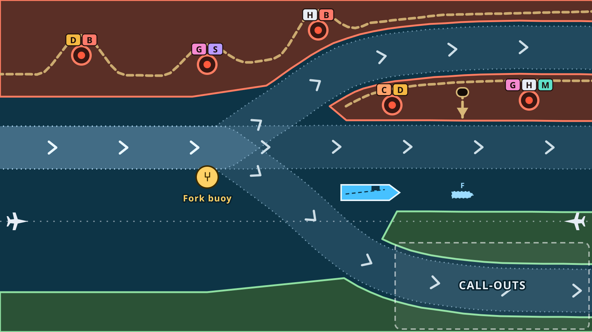

**The river forks three ways round the marshes, and you send the ships.**

**Today**

- 3 lanes, 5 launch bases, 2 shore roads and 1 pop-up road, 0 sub spots; a three-way fork, a 90° bend. Threat scale 1.5.
- The raid planner leads with Bodyguard Ring on wave 2 and sends 1 new enemy a wave on waves 2–5, 2 on 6–9 and 3 on wave 10. Seen over three seeds: 4 of this chapter’s (Bodyguard Ring, Lure Beacon, Incendiary Missile, Repair Ship) and 5 older (Torpedo Sub, Attack Helicopter, Stealth Strafer, Dive Bomber, Rocket Truck). No pairs.
- Escort Run: the map’s ending, 3 runs with the convoy restored first; built on Bodyguard Ring.
- Measured: the average bot with a campaign Armory won 63% (75% through the ten waves), your persona 13%; with no Armory, sharp 0%, average 0%. Hold.

**Notes**

- You: "the paths look a little off and the aircraft carrier shouldn’t just be sitting in a pond." (The maps plan review (docs/design/v3-maps-build.md). Built.)
- You: "Was hard but I think it is a good balance" (Test Lab, Escort Run card, 2026-11-10.)

**The rebuild**

- **Debut:** Bodyguard Ring, alone on wave 2.
- **Pairs:** Spotter + Dive Bombers (`spotter-dive`), Bodyguard Ring + Spotter (`guard-spotter`), Attack Helicopter + Torpedo Sub (`heli-sub`)
- **Target:** 2.8 tries.
- **Event:** Keep Escort Run.
- **Call-outs:** bottom-right.
- **Layout:** no change.

| Wave | Original threats (today's table) | New enemies | Pair | Moment |
|---|---|---|---|---|
| 1 | 24 drones; 1 truck | — | — | The fork: tap the buoy to send ships north, middle or south. |
| 2 | 29 drones, 3 ballistic; 1 truck | **Bodyguard Ring** | — | Debut: one Bodyguard Ring round a heavy. |
| 3 | 33 drones, 6 ballistic, 2 guided, 1 cluster; 1 jet, 2 trucks | Bodyguard Ring, Repair Ship | — | Cluster missiles join (the map’s extra, as today). |
| 4 | 38 drones, 8 ballistic, 2 guided, 1 cluster; 1 jet, 2 trucks | Stealth Strafer | — | — |
| 5 | 38 drones, 8 ballistic, 3 guided, 2 cluster, 1 mothership, 1 supersonic; 1 jet, 1 bomber, 3 trucks | Bodyguard Ring, Dive Bomber | — | Motherships and supersonic missiles join (extras). |
| 6 | 41 drones, 11 ballistic, 5 guided, 2 cluster, 1 mothership, 1 supersonic; 1 jet, 1 bomber, 3 trucks | Bodyguard Ring | Spotter + Dive Bombers | — |
| 7 | 47 drones, 11 ballistic, 8 guided, 2 cluster, 1 mothership, 2 supersonic; 2 jets, 1 bomber, 4 trucks | Bodyguard Ring | Bodyguard Ring + Spotter | First Bodyguard Ring + Spotter. |
| 8 | 48 drones, 14 ballistic, 9 guided, 2 cluster, 2 mothership, 2 supersonic; 2 jets, 1 bomber, 4 trucks | Bodyguard Ring, Repair Ship, Torpedo Sub | — | — |
| 9 | 57 drones, 14 ballistic, 11 guided, 3 cluster, 2 mothership, 2 supersonic; 2 jets, 2 bombers, 5 trucks | Bodyguard Ring | Attack Helicopter + Torpedo Sub | The pair over the short north branch: send the ships south? |
| 10 | 68 drones, 17 ballistic, 14 guided, 3 cluster, 2 mothership, 2 supersonic; 2 jets, 2 bombers, 5 trucks | Bodyguard Ring, Bodyguard Ring | Bodyguard Ring + Spotter | — |

### 18. Dunmar Crossing (`crossing`)

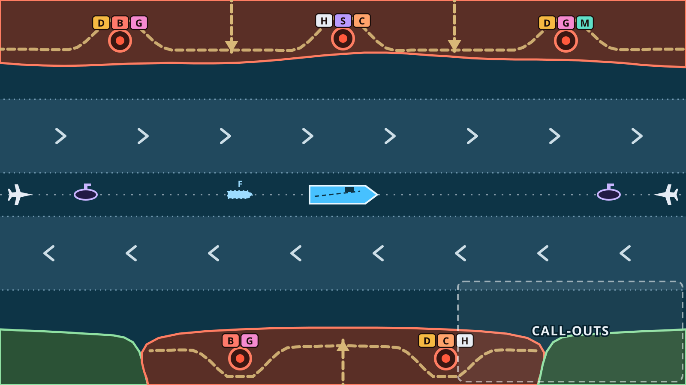

**Two-way traffic: eastbound and westbound convoys pass each other.**

**Today**

- 2 lanes, 5 launch bases, 2 shore roads and 3 pop-up roads, 2 sub spots; two-way traffic. Threat scale 1.65.
- The raid planner leads with Lure Beacon on wave 2 and sends 1 new enemy a wave on waves 2–5, 2 on 6–9 and 3 on wave 10. Seen over three seeds: 4 of this chapter’s (Lure Beacon, Incendiary Missile, Repair Ship, Bodyguard Ring) and 5 older (Torpedo Sub, Attack Helicopter, Stealth Strafer, Dive Bomber, Rocket Truck). No pairs.
- Beacon Strike: the map’s ending, 3 runs with the convoy restored first; built on Lure Beacon; rule: Beacons call missiles on the ship nearest them.
- Measured: the average bot with a campaign Armory won 75% (75% through the ten waves), your persona 13%; with no Armory, sharp 0%, average 13%. Hold.

**Notes**

- You: "Not sure what this was even trying to line up and synergy lol" (Test Lab notes of 2026-11-10, Undertow card (docs/design/v3-enemies-round8.md). Cut; Beacon Strike took its place.)
- You: "This one’s really good and we should save it and only play on the player has a lot of passive pick up … this one should be able to work on any map put that in its own category" (Test Lab, Siren Field card, 2026-11-10. Now a bonus event after wave 6 on any map; its lab map is Dunmar Crossing.)

**The rebuild**

- **Debut:** Lure Beacon, alone on wave 2.
- **Pairs:** Lure Beacon + Stealth Strafers (`lure-stealth`), Spotter + Dive Bombers (`spotter-dive`), Bodyguard Ring + Spotter (`guard-spotter`)
- **Target:** 3 tries.
- **Event:** Keep Beacon Strike (new in round 8, in Undertow’s place). Siren Field stays the bonus wave after wave 6, on any map.
- **Call-outs:** bottom-right.
- **Layout:** no change.

| Wave | Original threats (today's table) | New enemies | Pair | Moment |
|---|---|---|---|---|
| 1 | 26 drones | — | — | Two lanes, two directions. |
| 2 | 31 drones, 3 ballistic; 1 truck | **Lure Beacon** | — | Debut: one Lure Beacon rises between the lanes. |
| 3 | 36 drones, 7 ballistic, 2 guided, 1 cluster; 1 sub, 1 truck | Lure Beacon, Bodyguard Ring | — | Cluster missiles join (the map’s extra, as today). |
| 4 | 41 drones, 8 ballistic, 2 guided, 1 cluster, 1 supersonic; 1 jet, 1 sub, 2 trucks | Repair Ship | — | Supersonic missiles join (extra). |
| 5 | 41 drones, 8 ballistic, 3 guided, 2 cluster, 1 supersonic; 1 jet, 1 bomber, 2 subs, 2 trucks | Lure Beacon, Dive Bomber | — | — |
| 6 | 45 drones, 12 ballistic, 5 guided, 2 cluster, 2 supersonic, 1 mothership; 1 jet, 1 bomber, 2 subs, 3 trucks | Lure Beacon | Lure Beacon + Stealth Strafers | First Lure Beacon + Stealth Strafers. Motherships join (extra). |
| 7 | 51 drones, 12 ballistic, 8 guided, 2 cluster, 2 supersonic, 1 mothership; 1 jet, 1 bomber, 3 subs, 3 trucks | Lure Beacon, Bodyguard Ring | — | — |
| 8 | 53 drones, 15 ballistic, 10 guided, 2 cluster, 2 supersonic, 1 mothership; 2 jets, 1 bomber, 3 subs, 4 trucks | Lure Beacon | Spotter + Dive Bombers | — |
| 9 | 63 drones, 15 ballistic, 12 guided, 3 cluster, 3 supersonic, 2 mothership; 2 jets, 2 bombers, 3 subs, 4 trucks | Lure Beacon, Repair Ship, Stealth Bomber | — | — |
| 10 | 74 drones, 18 ballistic, 15 guided, 3 cluster, 3 supersonic, 2 mothership; 2 jets, 2 bombers, 3 subs, 5 trucks | Lure Beacon, Lure Beacon | Bodyguard Ring + Spotter | — |

### 19. Tidewater Flats (`tide`)

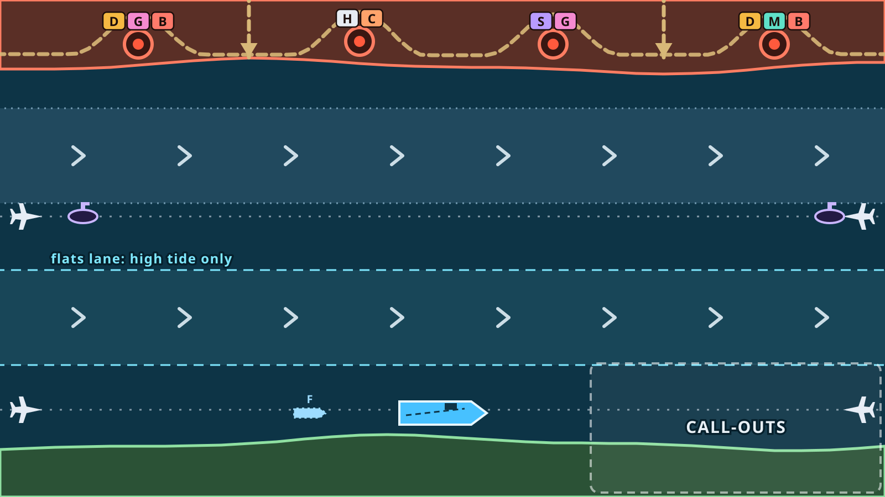

**The tide: the safe flats lane floats only at high water; at low tide every ship runs the deep channel.**

**Today**

- 2 lanes, 4 launch bases, 1 shore road and 2 pop-up roads, 2 sub spots; the tide. Threat scale 1.4.
- The raid planner leads with Incendiary Missile on wave 2 and sends 1 new enemy a wave on waves 2–5, 2 on 6–9 and 3 on wave 10. Seen over three seeds: 4 of this chapter’s (Incendiary Missile, Repair Ship, Bodyguard Ring, Lure Beacon) and 5 older (Torpedo Sub, Attack Helicopter, Stealth Strafer, Dive Bomber, Rocket Truck). No pairs.
- Firestorm: the map’s ending, 3 runs with the convoy restored first; built on Incendiary Missile.
- Measured: the average bot with a campaign Armory won 50% (50% through the ten waves), your persona 0%; with no Armory, sharp 0%, average 0%. Ease. With a campaign Armory it measures the hardest map of chapter 4 for the average bot, harder than the Citadel after it.

**Notes**

- You: "Pretty OP combo, make sure to use this one sparingly but it works well. Also, can we not call it repair tender and just like repair ship?" (Test Lab round 5, Repair Ship + Bodyguard Ring combo card (docs/design/v3-lab-round5-enemies.md, which adds: “at most once in a map’s run, late, and not on a map that already leans on heavies”).)
- You: "Really fun idea might be hard to master. I think kind of keep it as it is, but we’ll test it out more. Probably need to be tuned down / I beat it the second time. It was fine. I’ll keep it as it is." (Test Lab, Firestorm card, 2026-11-10.)

**The rebuild**

- **Debut:** Incendiary Missile, alone on wave 2.
- **Pairs:** Lure Beacon + Stealth Strafers (`lure-stealth`), Armored Drones + Hydra (`armored-hydra`), Repair Ship + Bodyguard Ring (`tender-bodyguard`)
- **Target:** 3.3 tries.
- **Event:** Keep Firestorm.
- **Call-outs:** bottom-right.
- **Layout:** no change.

| Wave | Original threats (today's table) | New enemies | Pair | Moment |
|---|---|---|---|---|
| 1 | 22 drones | — | — | High tide opens the flats lane; low tide closes it. |
| 2 | 27 drones, 3 ballistic; 1 truck | **Incendiary Missile** | — | Debut: one Incendiary Missile at low tide, at the deep channel (cued to the ebb). |
| 3 | 31 drones, 6 ballistic, 1 guided, 1 cluster; 1 sub, 1 truck | Incendiary Missile, Lure Beacon | — | Cluster missiles join (the map’s extra, as today). |
| 4 | 35 drones, 7 ballistic, 1 guided, 1 cluster, 1 supersonic; 1 jet, 1 sub, 2 trucks | Bodyguard Ring | — | Supersonic missiles join (extra). |
| 5 | 35 drones, 7 ballistic, 3 guided, 2 cluster, 1 supersonic; 1 jet, 1 bomber, 2 subs, 2 trucks | Incendiary Missile, Repair Ship | — | — |
| 6 | 38 drones, 10 ballistic, 4 guided, 2 cluster, 2 supersonic, 1 mothership; 1 jet, 1 bomber, 2 subs, 3 trucks | Incendiary Missile | Lure Beacon + Stealth Strafers | Motherships join (extra). |
| 7 | 43 drones, 10 ballistic, 7 guided, 2 cluster, 2 supersonic, 1 mothership; 1 jet, 1 bomber, 3 subs, 3 trucks | Incendiary Missile, Incendiary Missile | — | Firebombs at the ebb, as the convoy crowds into the deep channel. |
| 8 | 45 drones, 13 ballistic, 8 guided, 2 cluster, 2 supersonic, 1 mothership; 2 jets, 1 bomber, 3 subs, 4 trucks | Incendiary Missile | Armored Drones + Hydra | — |
| 9 | 53 drones, 13 ballistic, 10 guided, 3 cluster, 3 supersonic, 2 mothership; 2 jets, 2 bombers, 3 subs, 4 trucks | Incendiary Missile | Repair Ship + Bodyguard Ring | The campaign’s one Repair Ship + Bodyguard Ring in a normal wave (“use sparingly”). |
| 10 | 63 drones, 15 ballistic, 13 guided, 3 cluster, 3 supersonic, 2 mothership; 2 jets, 2 bombers, 3 subs, 5 trucks | Incendiary Missile, Incendiary Missile, Lure Beacon | — | — |

### 20. Citadel of Vey (`citadel`)

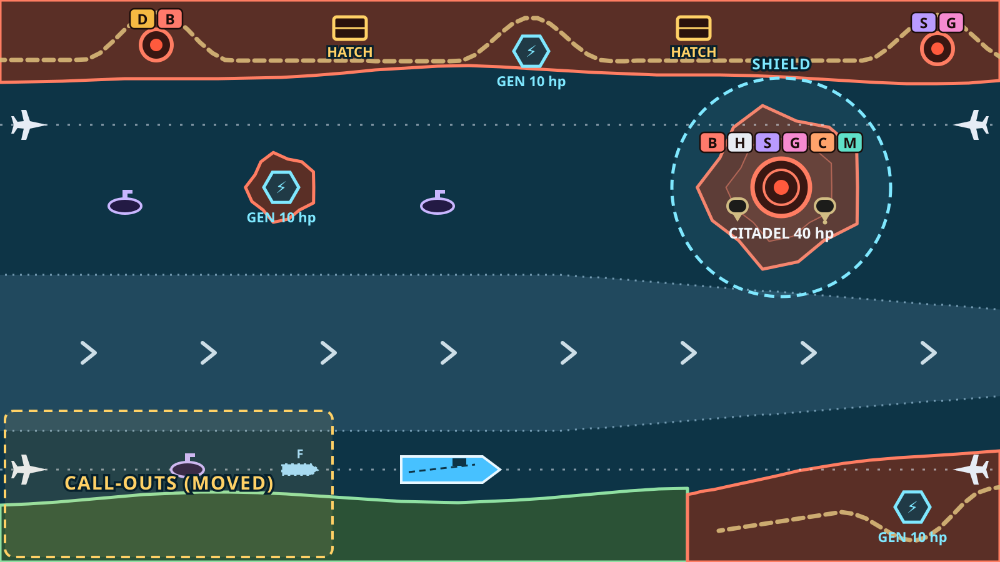

**The campaign finale: the fortress behind its shield, and the hardest pairs.**

**Today**

- 1 lane, 2 launch bases (3 shield generators), 2 shore roads and 2 pop-up roads, 3 sub spots; the Citadel and its shield, islets. Threat scale 1.25.
- The raid planner leads with Repair Ship on wave 2 and sends 1 new enemy a wave on waves 2–5, 2 on 6–9 and 3 on wave 10. Seen over three seeds: 4 of this chapter’s (Repair Ship, Bodyguard Ring, Lure Beacon, Incendiary Missile) and 5 older (Torpedo Sub, Attack Helicopter, Stealth Strafer, Dive Bomber, Rocket Truck). No pairs.
- Siege of Vey: the map’s ending, 3 runs with the convoy restored first; built on Repair Ship, Bodyguard Ring, Lure Beacon, Incendiary Missile.
- The call-out corner covers a shield generator.
- Measured: the average bot with a campaign Armory won 75% (88% through the ten waves), your persona 0%; with no Armory, sharp 25%, average 0%. Raise a little. It measures easier than Tidewater Flats before it, and the finale should be the hardest.

**Notes**

- You: "Pretty OP combo, make sure to use this one sparingly but it works well. Also, can we not call it repair tender and just like repair ship?" (Test Lab round 5, Repair Ship + Bodyguard Ring combo card (docs/design/v3-lab-round5-enemies.md, which adds: “at most once in a map’s run, late, and not on a map that already leans on heavies”).)
- Design note: "The stack does sit over the bottom-right shore, which on some maps (Harbor Mouth, Behemoth, Sowers, Lantern, Coves, Citadel) has a base: the cards are translucent, short-lived and go at a tap. … Ideas not built: Per-map nudge for the few maps with a base in the bottom-right corner (lift the stack above it, or fade a card while its base fires)." (docs/design/v3-callouts.md (the call-outs round). The player’s ask there: “move the notifications to the bottom right hand corner”.)
- You: "This one is good now too just note for maps. I actually have this the silo or whatever that it comes out it will be permanent and it doesn’t need to replace the other launcher ones." (Test Lab round 2, Siege Battery card, 2026-11-08 (tools/v3/test-lab/playtest-2026-11-08-round2.json))
- You: "Hard but fun will need to tweak later" (Test Lab notes of 2026-11-10, Siege of Vey card (docs/design/v3-enemies-round8.md).)
- You: "I didn’t seem to work quite right the recon drone and then the siege cannon never really appeared at the same time so I think we need to work on the timing or test that out because I’m sure not all the pairs will have similar timings like that" (Test Lab, Spotter + Siege combo card, 2026-11-09 (tools/v3/test-lab/playtest-2026-11-09.json). Fixed by the pair rules in round 4 and round 8 (src/v3/data/pairs.ts).)

**The rebuild**

- **Debut:** none (a chapter finale: the chapter's enemies and pairs).
- **Pairs:** Bodyguard Ring + Spotter (`guard-spotter`), Lure Beacon + Stealth Strafers (`lure-stealth`), Spotter + Siege Battery (`spotter-siege`), Repair Ship + Rocket Truck (`tender-truck`), Spotter + Dive Bombers (`spotter-dive`)
- **Target:** 3.8 tries.
- **Event:** Keep Siege of Vey.
- **Call-outs:** bottom-left.
- **Layout:** Two permanent siege hatches on the north shore. (The siege gun of its Spotter pair rises from fixed hatches (your Siege Battery note).) Call-outs move to the bottom-left corner. (A shield generator sits under the bottom-right corner.) Hatches at (560, 45), (1110, 45).

| Wave | Original threats (today's table) | New enemies | Pair | Moment |
|---|---|---|---|---|
| 1 | 20 drones; 1 truck | — | — | Bring down the three shield generators, then silence the Citadel. |
| 2 | 24 drones, 3 ballistic; 1 sub, 1 truck | Repair Ship | — | A Repair Ship by the Citadel. |
| 3 | 28 drones, 5 ballistic, 1 guided, 1 cluster, 1 supersonic; 1 jet, 1 sub, 2 trucks | Bodyguard Ring, Lure Beacon | — | Supersonic and cluster missiles join (the map’s extras, as today). |
| 4 | 31 drones, 6 ballistic, 1 guided, 1 cluster, 1 supersonic, 1 heavy; 1 jet, 1 bomber, 2 subs, 2 trucks | Incendiary Missile | Bodyguard Ring + Spotter | Heavies join (extra). |
| 5 | 31 drones, 6 ballistic, 3 guided, 2 cluster, 2 supersonic, 1 mothership, 1 heavy; 1 jet, 1 bomber, 2 subs, 3 trucks | Repair Ship, Lure Beacon | — | Motherships join (extra). |
| 6 | 34 drones, 9 ballistic, 4 guided, 2 cluster, 2 supersonic, 1 mothership, 2 heavy; 1 jet, 1 bomber, 3 subs, 3 trucks | Incendiary Missile, Bodyguard Ring | Lure Beacon + Stealth Strafers | — |
| 7 | 39 drones, 9 ballistic, 6 guided, 2 cluster, 2 supersonic, 1 mothership, 2 heavy; 2 jets, 1 bomber, 3 subs, 4 trucks | Lure Beacon, Repair Ship | — | — |
| 8 | 40 drones, 11 ballistic, 8 guided, 3 cluster, 3 supersonic, 2 mothership, 2 heavy; 2 jets, 2 bombers, 3 subs, 4 trucks | Incendiary Missile | Spotter + Siege Battery | The siege gun rises from the Citadel’s own hatches. |
| 9 | 48 drones, 11 ballistic, 9 guided, 3 cluster, 3 supersonic, 2 mothership, 2 heavy; 2 jets, 2 bombers, 3 subs, 5 trucks | Bodyguard Ring, Incendiary Missile, Lure Beacon | — | — |
| 10 | 56 drones, 14 ballistic, 11 guided, 3 cluster, 3 supersonic, 2 mothership, 3 heavy; 2 jets, 2 bombers, 3 subs, 5 trucks | Repair Ship, Incendiary Missile | Repair Ship + Rocket Truck then Spotter + Dive Bombers | The last wave: two pairs, one after the other. |

## Every note found

Searched: docs/design/*.md (every V3 doc; player quotes and design notes on maps, chapters, debuts, call-outs, events); tools/v3/test-lab/playtest-*.json (six lab sessions: every verdict note and paused note); the session’s play logs (156 game logs, 8 paused notes, on the Strait, Saltgate Canal and the Black Strait; the two about maps are above, the rest are about weapons and enemy art); tools/v3/enemy-ideas/review-2026-11-07.json and the maps plan review (docs/design/v3-maps-build.md).

- **You**, The Black Strait, Dreadnought Pass, Citadel of Vey: "This one is good now too just note for maps. I actually have this the silo or whatever that it comes out it will be permanent and it doesn’t need to replace the other launcher ones." (Test Lab round 2, Siege Battery card, 2026-11-08 (tools/v3/test-lab/playtest-2026-11-08-round2.json))
- **You**, Saltgate Canal: "The Stargate Matt is working a lot better now, but we definitely should add in or force the players to have their ships come in at a certain pace here. I think it’s probably time to start looking at not allowing the players to change the pace cause I really changes the flow of the maps or at least like setting a limit specific war map same with formations maybe we could change that up to" (Note paused on Saltgate Canal, wave 8, 2026-11-08 (play log v3-20261108031002-15964; also tools/v3/test-lab/playtest-2026-11-08.json). “Stargate Matt” is the dictation of “Saltgate map”.)
- **You**, Saltgate Canal: "Really bad the subs shoot torpedoes from water to land so that needs to be fixed and way too difficult way too much going on" (Test Lab notes of 2026-11-10, Run the Canal card (docs/design/v3-enemies-round8.md). Round 8 cut the event to three phases and aimed the subs; not retested since.)
- **Brief**, The Strait, The Island, Battery Point, Smugglers' Coves: "Chapter maps with fewer debut enemies: the first map of a chapter starts with 6 or more new things." (This round’s brief. The player’s own words weren’t in the repo’s docs, lab files or scratchpad logs. The count holds today (see each chapter’s first map).)
- **You**, Tidewater Flats, Citadel of Vey: "Pretty OP combo, make sure to use this one sparingly but it works well. Also, can we not call it repair tender and just like repair ship?" (Test Lab round 5, Repair Ship + Bodyguard Ring combo card (docs/design/v3-lab-round5-enemies.md, which adds: “at most once in a map’s run, late, and not on a map that already leans on heavies”).)
- **Design note**, Harbor Mouth, The Behemoth Run, Sowers' Reach, The Black Strait, Smugglers' Coves, Citadel of Vey: "The stack does sit over the bottom-right shore, which on some maps (Harbor Mouth, Behemoth, Sowers, Lantern, Coves, Citadel) has a base: the cards are translucent, short-lived and go at a tap. … Ideas not built: Per-map nudge for the few maps with a base in the bottom-right corner (lift the stack above it, or fade a card while its base fires)." (docs/design/v3-callouts.md (the call-outs round). The player’s ask there: “move the notifications to the bottom right hand corner”.)
- **Design note**, The Gauntlet: "Weak: Only works on maps with a long shore road (The Gauntlet has one)." (Rocket Convoy’s design card, docs/design/v3-special-events.md. (The player’s own note on Rocket Convoy, 2026-11-10: “Too easy”.))
- **You**, every map: "it should showcase a new enemy attack if it has not been showcased yet. And the special event should not replace the round, so basically there is 11 waves now instead of 10" (Special events review, the “Map scripts” piece (docs/design/v3-special-events-build.md).)
- **You**, every map: "some [enemies] could have more than one special event, so we’ll need to come up with a few more so each map has its own." (Test Lab notes, events round 7 (docs/design/v3-events-round7.md). Earlier: “you will need to mix it around tho … one or more weapons might need a second special too on a different map” (docs/design/v3-special-events-build.md).)
- **You**, every map: "I do like how the special event is three waves total that you have to beat. Let’s experiment with it at the end: players get their lives reset right before it starts, so if they go out with just one left, it’s [not] gonna be hard for them to beat that." (docs/design/v3-events-round7.md (the three-run ending with the convoy restored first).)
- **You**, The Black Strait: "Not for all of these special events / I like the three waves actually after doing it more / Then also no nukes for these special events events" (Note paused on The Black Strait, wave 13 (the Bombardment’s last run), 2026-11-09 (play log v3-20261109234402-81718; tools/v3/test-lab/playtest-2026-11-10.json).)
- **You**, every map: "Main issue is the pairs should be enemy pairs, not player and enemy attack pairs. Basically looking for good synergy combos to add to the maps." (Test Lab round 8 (docs/design/v3-enemy-pairs.md).)
- **You**, every map: "Make a total of 20 maps to play. They should all have their ‘unique’ items on each map, like how Island has the center island." (The first maps ask (docs/design/v3-maps-handoff.md).)
- **You**, Dreadnought Pass, Citadel of Vey: "I didn’t seem to work quite right the recon drone and then the siege cannon never really appeared at the same time so I think we need to work on the timing or test that out because I’m sure not all the pairs will have similar timings like that" (Test Lab, Spotter + Siege combo card, 2026-11-09 (tools/v3/test-lab/playtest-2026-11-09.json). Fixed by the pair rules in round 4 and round 8 (src/v3/data/pairs.ts).)
- **You**, The Kesh Hook: "We should have the enemy jets follow the curve here and actually make a banking turn around the bend · The frigate do not follow the actual water path and just overlaps on the land and aircraft." (Two notes paused on The Kesh Hook (docs/design/v3-map-visual-check.md). Fixed in that round.)
- **You**, Lee of Marrow: "make it like a radar tower on the island and the enemy can attack that too. If it is lost it is lost and it should look like a sweep or something in that lane for the protection of the friend ships." (The maps plan review (docs/design/v3-maps-build.md). Built.)
- **You**, The Sharra Delta: "the paths look a little off and the aircraft carrier shouldn’t just be sitting in a pond." (The maps plan review (docs/design/v3-maps-build.md). Built.)
- **You**, The Strait: "That was hard! I will try again" (Test Lab, Afterburner Rush card, 2026-11-10 (tools/v3/test-lab/playtest-2026-11-10.json).)
- **You**, The Kesh Hook: "This one was a lot of fun. I would definitely make the drones more I guess visible for which ones are the decoys make them like a different color slightly than the other one so it’s easier to point out." (Test Lab, Decoy Storm card, 2026-11-10. The tint was built in rounds 7 and 8.)
- **You**, Lee of Marrow: "Hydras should split even before the line is crossed there you can remove that line" (Test Lab notes of 2026-11-10, Hydra Bloom card (docs/design/v3-enemies-round8.md). Built in round 8, which also eased the event.)
- **You**, The Gauntlet: "Too easy" (Test Lab, Rocket Convoy card, 2026-11-10 (round 5). Round 6 made it two columns, one down each shore road.)
- **You**, The Island: "That was good you really do need a good power up or weapon drop to deal with it tho which is fine just observe to make but why also three rounds not following that I thought it would be one and done" (Test Lab, Gunship Wall card, 2026-11-10.)
- **You**, The Behemoth Run: "Make sure they shoot multiple torpedoes each in different directions and then maybe you can give them one or two fast torpedoes too just total not for each" (Test Lab, Wolf Pack card, 2026-11-10. Built in round 6.)
- **You**, The Needle of Bosk: "You can spread them out a bit they all come from the same launcher" (Test Lab, Shield Wall card, 2026-11-10. Built in round 6.)
- **You**, The Archipelago: "Yeah, this one’s more fun than anything. Just make it so there’s no nukes that get dropped during the special event cause I just kind of run up rivers of it and then add more drones that take them and have them come from all side." (Test Lab, Supply Raid card, 2026-11-10. Built in rounds 6 and 8.)
- **You**, Battery Point: "Hard but doable" (Test Lab, Blackout card, 2026-11-10.)
- **You**, The Rig Field: "Fun but could have more than planes" (Test Lab, Dive Circus card, 2026-11-10. Round 6 added guided missiles between the dives.)
- **You**, The Black Strait: "Add in some drones to allow some drips that. I think we needed so I can have more of a chance" (Test Lab, Bombardment card, 2026-11-10. Round 6 added supply drones.)
- **You**, Dreadnought Pass: "This was a good improvement. I also think this is how the recon planes should behave in general as well. They Scott it out and lock on and then leave and come back with the same health and repeated until you kill it." (Test Lab notes of 2026-11-10, Fire Mission card (docs/design/v3-enemies-round8.md). Before that (round 5): “Wayyyyto easy let’s rework this completely”.)
- **You**, Smugglers' Coves: "Worked good but it had a ship stuck that didn’t travel at all I think it would be better to have the repair ships come from multiple directions on convert on the same spot" (Test Lab, Repair Yard card, 2026-11-10. Built in round 6.)
- **You**, The Sharra Delta: "Was hard but I think it is a good balance" (Test Lab, Escort Run card, 2026-11-10.)
- **You**, Dunmar Crossing: "Not sure what this was even trying to line up and synergy lol" (Test Lab notes of 2026-11-10, Undertow card (docs/design/v3-enemies-round8.md). Cut; Beacon Strike took its place.)
- **You**, Dunmar Crossing: "This one’s really good and we should save it and only play on the player has a lot of passive pick up … this one should be able to work on any map put that in its own category" (Test Lab, Siren Field card, 2026-11-10. Now a bonus event after wave 6 on any map; its lab map is Dunmar Crossing.)
- **You**, Tidewater Flats: "Really fun idea might be hard to master. I think kind of keep it as it is, but we’ll test it out more. Probably need to be tuned down / I beat it the second time. It was fine. I’ll keep it as it is." (Test Lab, Firestorm card, 2026-11-10.)
- **You**, Citadel of Vey: "Hard but fun will need to tweak later" (Test Lab notes of 2026-11-10, Siege of Vey card (docs/design/v3-enemies-round8.md).)

## Judgement calls

- **Debuts stay where they are today.** Each map keeps the enemy its event is built on, so the events (each tested in the Test Lab on its own map) still fit. The three maps that repeat a debut today (Harbor Mouth, Saltgate Canal, Citadel of Vey) become finales with no debut, as their events already are; Dreadnought Pass keeps the Spotter.
- **The original threats are today's.** Each script keeps the wave table, extras and attack vectors as they are; the new enemies and pairs take their share out of it, as the planner does today. Tuning each map to its target is the build's job, with these rates as the start.
- **Two measures.** The reaction-time bots with no Armory are what earlier rounds reported; the maps were tuned against an Armory that fills by about map 10, so the headline is the average bot and the persona fitted to your play with a campaign Armory (one upgrade a bay, level 5 × (slot − 1) / 9). Eight seeds a map is a few: a map's rate moves by 12.5 points a seed.
- **The call-out corner** is checked with a box the stack's size (the right or left third of the field, its bottom 250 units). By that box the Kesh Hook, the Gauntlet and the Needle also have a base under it, beside the six the call-outs round named. The Gauntlet has one under every corner, so it fades instead.
- **"Long shore road."** Every map now has a shore road crossing the screen, and the Rocket Truck uses the short pop-up roads, so no script is held back by roads. Rocket Convoy stays on the Gauntlet, with a road on each shore.
- **The "6 or more new things" note** came with this round's brief; its words weren't in the repo. The count holds today (the evidence under `mr-debut`).
- **The Siege Battery note** is read two ways at once: the hatch is a fixed part of the map, and the gun does not take a launch base's place or its missiles. If you meant only one of them, say so on the Systems card.
