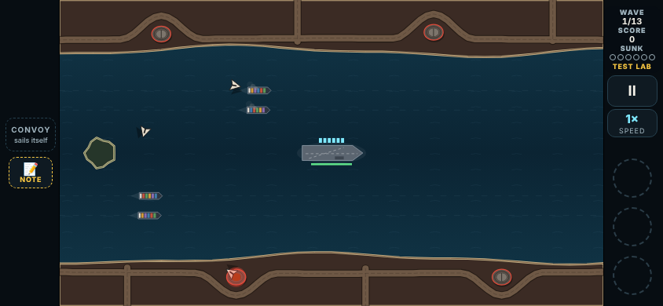
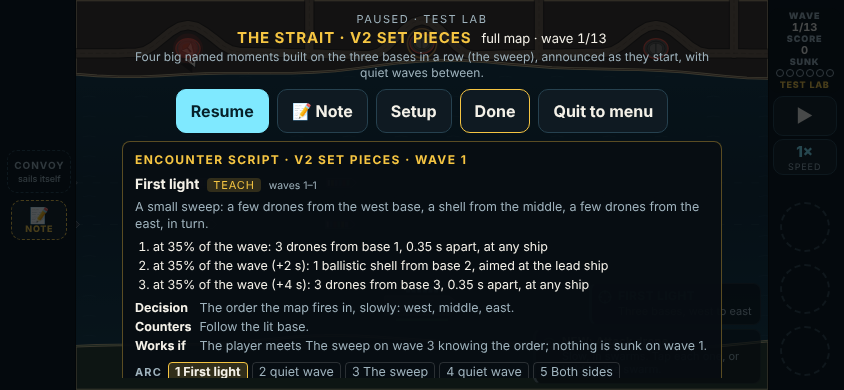
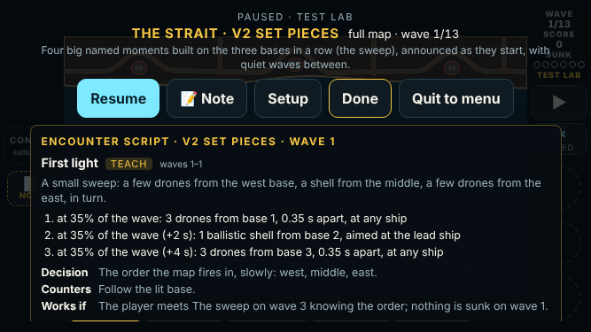
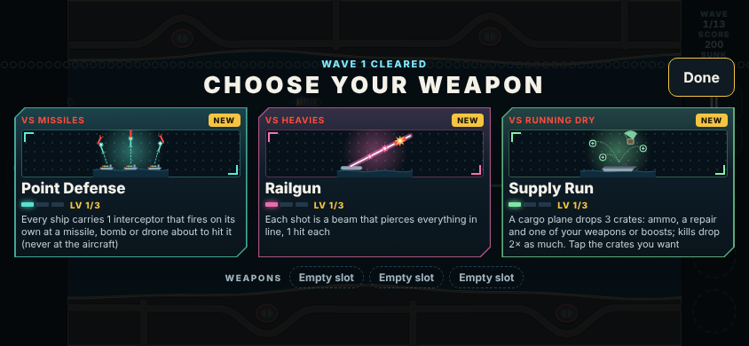
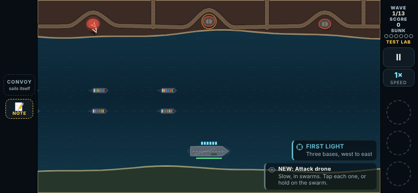
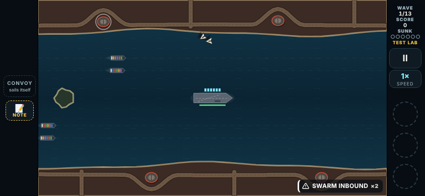
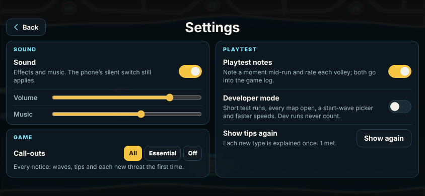

# V3 pause menu and tips: the lab bar into the pause menu, tips only for new types

The player, on an iPhone in landscape, on a Test Lab map card ("THE STRAIT ·
V2 SET PIECES"):

> "We need to change the done and notes at the bottom banner to be in the
> bottom pause menu cuz that banner at the bottom covers up launchers. Also
> the notification system can like be reduced to just notes about new weapon
> types and that should carry over between maps in the campaign mode so
> drones isn't said every time."

UI only: no sim change, no `LOG_VERSION` change, the sim's "New threat"
telemetry moments untouched.

Code: `labPauseHead` / `labPauseActions` / `labDoneButton` in
`src/v3/ui/lab.ts`; `showPauseMenu`, `startLab`, `openLabSetup`,
`showDraft`, `drainEvents`, `explain` and `tipsRow` in `src/v3/ui/app.ts`;
the seen-types store in `src/v3/platform/seen.ts`; `.v3-lab-pause*` and
`.v3-draft-done` in `src/v3/ui/style.css`.

## 1. The Test Lab bar is gone; its commands are on the pause menu

- **In play**: nothing of the test is over the field. The slim bar along the
  bottom (rounds 8/9, 36 px) is removed, with every rule that made room for
  it: the call-out stack sits at the bottom again (`.lab-on .v2-alerts`), so
  does Focus's button (`.playing.lab-on .v3-focus-btn`), the draft no longer
  pads its bottom, the pause panel no longer pads under the script. The
  canvas never had an inset for it. The HUD still says TEST LAB.
- **Pause (II)**: in a test the pause menu's header is the test: an eyebrow
  "Paused · Test Lab", the card's name in gold, its count as the bar had it
  ("full map · wave 1/13", "came 3 · killed 2 · hit you 0 · 1/8"), and the
  card's "what to look for" line. Its buttons, in one row that wraps: Resume,
  Bring one / Drop it / Run it again (cards that have it; never a map card),
  📝 Note, Setup, Done (gold once two waves have run, as before), ★ Rate last
  volley (playtest notes on), Quit to menu. The encounter script follows, as
  before, and scrolls inside the panel.

Fit (checked at 844×390 and 667×375 with the encounter script up): the panel
stays inside the screen, the page never scrolls sideways, every button is
44 px tall; the script scrolls under the buttons when it is longer than the
screen (as it did before).

### The flows (the game stays paused throughout)

| Button | What it does | Closing it |
|---|---|---|
| Bring one / Drop it / Run it again | The same recorded input as before | Closes the menu and the game goes on at once, so the player sees what was brought |
| 📝 Note | The note sheet (same sheet, same log entry, same thumbnail) | Save or Cancel: back to the pause menu (as the menu's note always did) |
| Setup | The setup sheet | Apply restarts the test with it (as before); **Back to the test**: back to the pause menu, still paused |
| Done | Ends the test: the verdict sheet with the scorecard | Unchanged: Save · test again / back to the list / next |
| Resume, Quit to menu | Unchanged | |

The bar's Note and Setup used to return straight to play; from the menu they
return to the menu, which is one tap from play and matches the menu's own
note. The left rail's NOTE button is unchanged (the quick way to note
mid-wave, back to play after).

**Done on the draft.** A map card's full run has a draft after every wave,
and Done worked there over the bar (round 10). The pause button is not
available on a draft, so the draft gets its own Done, in the header's
top-right corner, clear of the cards, in lab runs only.

## 2. Tips only for new types, remembered across maps and modes

The rule: an in-run card introduces a **new type** (an enemy, an enemy
munition, a launcher, a player weapon, a pickup, a map's own system) the
first time the player meets it, once per save; the memory carries over
between maps and is the same in the campaign, Free Play and the Test Lab.
Before, a type was explained once per save in the campaign, but **every
time** in Free Play, any Test Lab slice and developer mode, so the drone was
announced on every lab map.

### Every on-screen notice in a run

| Kind | Where in code | Shown today when | Decision |
|---|---|---|---|
| NEW: *enemy / munition* (Attack drone, Ballistic missile, Rocket truck …) | `drainEvents` `debut` (DEBUT_HINT) | First sight per save in the campaign; every run in Free Play, Test Lab slices, dev mode | **Kept, new type**: `threat:<kind>`, once per save in every mode |
| NEW: Submarine / Missile truck / Shore runner | `drainEvents` `vector` (VECTOR_HINT) | As above | **Kept, new type**: `launcher:<kind>` |
| RED SHOTS CAN'T BE STOPPED / Hit the launcher instead | `redHint` | First red shot of **every run** | **Kept, new munition type**: `munition:red`, once per save |
| PICKUP: Time Warp / Shield / Full Steam / Star Shell / Nuke; WEAPON DROP | `drainEvents` `newPickup` (PICKUP_HINT) | First per save (campaign); every run elsewhere | **Kept, new type**: `pickup:<kind>` |
| *WEAPON* · 15s / how to fire it (loaded notice) | `drainEvents` `weapon` | **Every** weapon or boost loaded | **Changed**: the first time each weapon is loaded, ever (`weapon:<id>`); after that the right rail's card shows what is loaded and its seconds |
| WILD CARD + *weapon* | `drainEvents` `wild` | Every Wild Card pickup with a passive | **Changed**: once per pairing (`weapon:wildCard+<id>`) |
| RADAR TOWER (what the lock box means) | `radarHint` | First lock per save (campaign); every run elsewhere | **Kept, new type**: `post:radar` |
| THE HOOK, LOCK GATES, MINES … (a map's own system) | `drainEvents` `wave` 1 (MAP_HINT) | Wave 1 of **every run** of that map | **Changed**: once per map per save (`map:<id>`): a map's system is new the first time only |
| SUPERTANKER UNDER WAY | `drainEvents` `tanker` | Every wave on Behemoth | **Changed**: the first time only (`ship:supertanker`) |
| WAVE N | `drainEvents` `wave` | Every wave start | **Kept** as the wave's beat (no sound; its number is the HUD's too), with no tip in it |
| "Tap threats to shoot them down. Hold to keep firing." (under WAVE 1) | `drainEvents` `wave` | Wave 1 of every run, every map, every mode | **Cut**, except the first campaign run of a fresh save, on map 1 (`tip:basics`) |
| MORE SHIPS, MORE POINTS (wave 2) / FORMATIONS (wave 3) | `drainEvents` `wave` (FIRST_TIPS) | Once per save, map 1, campaign | **Kept as it was**: first campaign runs of a fresh save only (`tip:ships`, `tip:formations`); never in the lab or Free Play |
| TESTING: *card* / what to look for | `startLab` | Every test start | **Cut**: the card's name and look are in the pause menu's header (and on the hub row tapped to start it) |
| BOSS ROUNDS / Survive the next 3 rounds; the event card and its outcome | `drainEvents` `special` / `specialEnd` | Each map's ending / each event | **Unchanged** |
| Encounter call-outs (TWO SHORES, FIRST LIGHT …) | `drainEvents` `encounter` | v2 by default, `?callouts=1/0` | **Unchanged** (under test) |
| ENCOUNTER: *name* / premise | `drainEvents` `wave` | Lab/encounter runs whose version has no call-outs | **Unchanged** (the round 12 test's fallback) |
| CONVOY RESTORED | `drainEvents` `restore` | Before the boss rounds (round 7 experiment) | **Unchanged** (part of the ending) |
| *RAID* INBOUND | `raidAlert` | Each raid warning | **Unchanged** (a warning to answer now, not a tip) |
| DREADNOUGHT INBOUND | `drainEvents` `boss` | Each pass | **Unchanged** (a warning; its first sight also gets NEW:) |
| RADAR HIT / RADAR LOST / BATTERY KNOCKED OUT | `drainEvents` `post` | Each time (Call-outs: All only) | **Unchanged** (news of the player's own posts, not a tip) |
| LAST SHIP / CARRIER CRITICAL | `syncDanger` | One loss from the end | **Unchanged** (alarm) |
| Stamps: WAVE N CLEARED, MAP CLEARED, CONVOY LOST / CARRIER DOWN | `startBeat` | Each outcome | **Unchanged** (the run's outcome) |
| NOTE SAVED, VOLLEY RATED, YOU HAVE / BOT HAS CONTROL, REPLAY, a convoy command's answer | `openNote`, `openRate`, `setControl`, `startPlayback`, `giveCommand` | On the player's own tap | **Unchanged** (answers to a tap) |

Outside the run and unchanged: the loadout's "New enemies in *chapter*" box,
the draft's NEW · *chapter* badges, the Delta buoy's TAP TO SWITCH label on
the map.

The Call-outs setting still decides what shows: a card it hides is not used
up (switched back to All, the player still meets it). A replay never shows
or uses one up.

### Why the one how-to line stays for a fresh save

"Tap threats to shoot them down. Hold to keep firing." is the only place the
game tells a new player how to shoot, and the hold-to-fire half is not
discoverable. It shows once: wave 1 of map 1 in the campaign, on a save that
has never seen it (a save from before this round that had shown any tip
counts as having seen it).
Never in the Test Lab or Free Play, never again after.

### Persistence

`src/v3/platform/seen.ts`, in the game's storage seam (`kv`, as the progress
save, the Armory and the settings; on iOS it lives in Preferences):

- key `straitwatch.v3.seen`, record `{ v: 1, ids: [...] }`, ids `kind:name`
  (`threat:drone`, `launcher:sub`, `munition:red`, `weapon:railgun`,
  `pickup:shield`, `post:radar`, `map:kesh`, `ship:supertanker`, `tip:*`);
  added to `KEYS` so the native app loads it.
- A fresh save has none. Without storage (private mode) every type is new
  each time, and nothing throws.
- **Migration**: a save from before kept a bare list under
  `straitwatch.v3.tips` (`debut:drone`, `vector:sub`, `pickup:shield`,
  `radar`, the two first-map tip titles). The first read with no new record
  converts it (to `threat:`, `launcher:`, `pickup:`, `post:radar`, `tip:`),
  marks `tip:basics` if it held anything, writes the record and removes the
  old key. A damaged record reads as nothing met; a newer version's ids are
  still read.
- **Settings → Show tips again** clears it: every type is introduced again
  and a fresh save's first-map tips come back. Its row says how many types
  have been met; the button is off when none have. It is in the right-hand
  card of the playtest build's Settings (the left column is full on a
  667×375 phone, and Settings must fit without scrolling) and under Game in
  the App Store build. **Reset progress** clears it too.

## Checks

- Unit: `tests/v3/seenTypes.test.ts` (fresh save, once then remembered,
  survives a reload on the web and on native, Show tips again, Reset
  progress, migration of an old list, damaged or newer records, no storage);
  `labActions` unchanged (`tests/v3/mapCards.test.ts`).
- e2e: `e2e/v3.mjs` (no bar over the field; the pause menu heads with the
  test and has its commands; the game stays paused under the menu, Setup and
  Note; Back to the test / Cancel return to the menu; Bring one resumes; a
  drone is introduced on The Strait, not on The Gauntlet after a reload, and
  again after Show tips again; no how-to line in a lab run);
  `e2e/v3-map-cards.mjs` (the pause menu reads "THE STRAIT · full map · wave
  1/13", Note/Setup/Done and no Bring one, shows the encounter script, fits
  and has 44 px buttons; Done in reach on the draft, clear of the cards);
  `v3-map-lab`, `v3-convoy`, `v3-map-analytics` reach Done through the pause
  menu.
