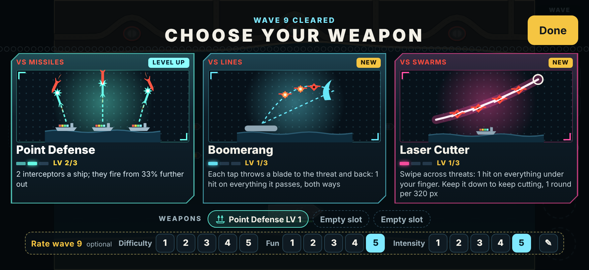
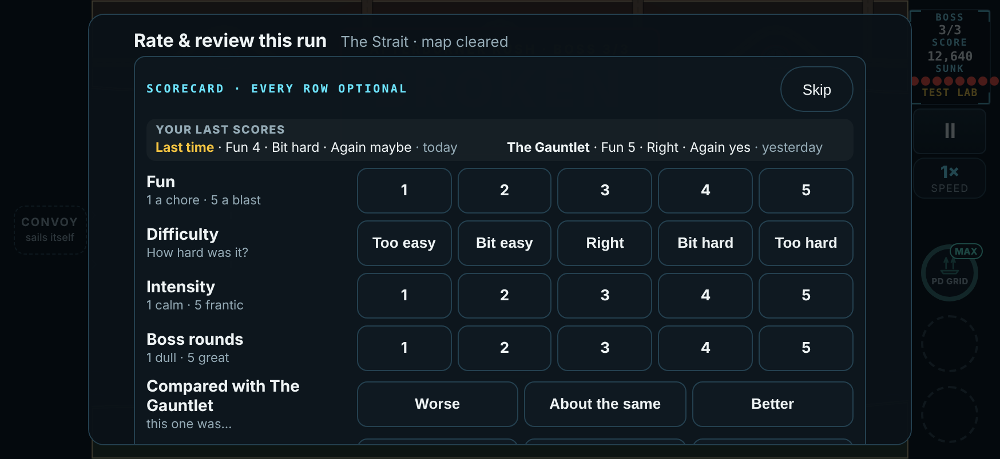
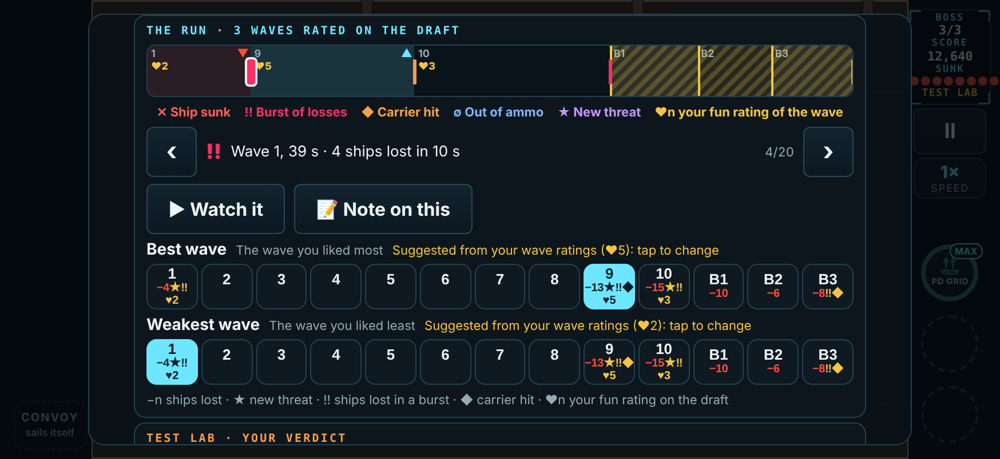

# V3 Rate & review: one end screen, and a rating after each wave

## What the player asked for

On the normal game's end-of-run review (campaign, Battery, 2026-11-19):

> This score card here on the normal game is wayyyyyy better apply this to the test lab and retain the question for the test lab tho so you will need to merge this idea. And the. Let's also have the option to include this ranking after each wave in the weapon selection so that will help with the can't remember what happened in the last wave

On the Kesh map card, about the scorecard's "Best moment" row:

> the best part of the wave in the ranking is not a great mechanic it is still hard to recall what happened so not a great stat

All the notes are in `tools/v3/map-rules/review-2026-11-19.json`.

## What changed

1. **The Test Lab's end screen is now the normal game's "Rate & review this run"**, with the Test Lab's questions in it. This applies to every card, not only map cards.
2. **Each wave can be rated on the weapon draft after it.** This is optional and works in the campaign, Free Play and the Test Lab.
3. **Best moment is gone.** The per-wave ratings replace it as the ground truth for the fun measures (`docs/design/v3-fun-metrics.md`).

Screenshots (874×402, a landscape phone):

| | |
|---|---|
| The draft's rating row |  |
| The Test Lab end screen: the rating rows |  |
| The Test Lab end screen: the run, Best and Weakest wave |  |

## The draft: "Rate wave N"

The row sits under the cards and the loadout, so it never covers a card:

- **Difficulty**, **Fun** and **Intensity**, 1 to 5, the same three axes as the per-volley rating and the run's rating (1 easy, 5 brutal; 1 a chore, 5 a blast; 1 calm, 5 frantic);
- **✎**, a short note (one line, up to 280 characters).

How it behaves:

- Tap a number to rate. Tap it again to clear it.
- Every tap goes into the log straight away. There is no Save button, and picking a card is all it takes to go on.
- Skipping it costs nothing.
- A swap redraws the draft, and what was rated stays.
- It is shown only when the player is playing the run: not in a replay, not while the bot is at the controls, and not on a wave a dev stride skipped. It also needs playtest notes on (Settings), which is the default.
- The boss rounds run on with no draft between them, so B1 and B2 can't be rated there. B3 is the end of the map.

## The end screen

### Campaign and Free Play

The screen is the same as before:

- the run's rating (1–5 difficulty, fun and intensity);
- the timeline with its marked moments;
- the selected moment, with **Watch it** and **Note on this**;
- **Note on the run**.

It now also shows **each wave's rating on the timeline**: the band reads "♥4" (the fun), its title gives all three axes and the note, and the legend explains ♥.

### Test Lab

One screen, from top to bottom:

1. **Title.** "Rate & review this run", then the card and how the test ended (map cleared, the convoy was lost, stopped with Done).
2. **The rating rows.**
   - A map card's full run gets the scorecard: **Your last scores** (the context), then Fun 1–5, Difficulty (Too easy … Too hard), **Intensity 1–5** (new), Boss rounds 1–5 (on a run that reached wave 11), **Compared with** the map rated last (Worse / About the same / Better), and Play again.
   - Every row is optional, and **Skip** folds the whole scorecard away.
   - Any other card gets the normal game's three 1–5 rows. They are saved as the log's `rating`, as in the campaign.
3. **The run.** This is the normal review's part:
   - the timeline (wave bands with their ratings, volleys, moment ticks), its legend, and the selected moment with ‹ ›, **Watch it** and **Note on this**;
   - a replay or a note comes back to this screen, scrolled where it was, with every answer kept;
   - for a map card, **Best wave** and **Weakest wave** are picked here, under the timeline, on the same wave chips as before. Each chip shows the ships lost, the marked moments and the draft rating (♥n). A pick puts ▲ (best) or ▼ (weakest) on its band on the timeline.
   - **Suggested from your wave ratings:** with two or more waves rated for fun that differ, the most fun wave is put in as Best and the least fun as Weakest, and each row says so. Ties go to the more intense wave (for Best) or the less intense wave (for Weakest), then the later or earlier wave. A suggestion never replaces a pick the player has already made, and once the player clears it, it is not put back.
4. **Test Lab · your verdict.** Keep / Tune / Cut, the tags, the note on the run (the Test Lab's own note, so there is no second "Note on the run" button), what the test counted, and your earlier verdicts.
5. **Save** buttons, as before. Save still asks for a verdict.

Gone: the **Best moment** row (scorecard revision 3).

## The data

### The play log (`src/v3/sim/playlog.ts`)

`waveRatings?: WaveRating[]` is a new optional field, next to `notes`, `volleys` and `rating`:

```ts
interface WaveRating {
  wave: number;   // the wave rated (11-13: the boss rounds)
  step: number;   // the sim step it was given on (the draft's)
  at: string;     // wall clock
  rating: { difficulty?: number; fun?: number; intensity?: number }; // 1-5
  note?: string;  // up to 280 characters
}
```

- `Recorder.rateWave(wave, rating, note)` keeps one entry per wave. Rating a wave again replaces its entry, and clearing everything removes it.
- `Recorder.waveRating(wave)` reads an entry back.
- A continued run (Continue on the menu) keeps the field.
- **The log version is unchanged (28).** The field is not sim input. Replay never reads it, and a log with it replays exactly as one without it. `tests/v3/feedback.test.ts` checks this. `LOG_VERSION` and the version pins are untouched.

### The score (`labResult.score`, `src/v3/data/scorecard.ts`)

`SCORECARD_REV` is now **4**.

| Field | Since | What |
|---|---|---|
| `intensity` | 4 | 1 calm to 5 frantic (a row, `since: 4`) |
| `moment`, `momentT` | 3 | Best moment, **retired by 4** (`retired: 4`). Revision 3 scores keep them and read as before. |
| `waves` | 4 | the waves rated on the draft: `[{ n, difficulty?, fun?, intensity?, note? }]`, in wave order |
| `bestSuggested`, `weakestSuggested` | 4 | what the screen suggested. `best` / `weakest` hold what was saved, so a kept suggestion has the two equal. |

Example:

```json
"score": { "rev": 4, "intensity": 4, "boss": 5, "vs": "better", "vsCard": "map-gauntlet", "best": 12, "weakest": 10,
           "waves": [{ "n": 1, "fun": 2 }, { "n": 9, "fun": 5, "intensity": 5 }, { "n": 10, "fun": 3 }],
           "bestSuggested": 9, "weakestSuggested": 1 }
```

Helpers: `waveScores` (cleans `waveRatings` or `waves`), `suggestWaves` and `waveScoreText` ("F5 D2 I5").

A skipped scorecard saves no score, `waves` included. The per-wave ratings are still in the log's `waveRatings`.

### The tools

- `tools/v3/test-lab/scores.mjs`:
  - `scoreAverages` picks up Intensity on its own, as a stars row on revision 4. Each revision still averages only with its own scores.
  - New: `waveRatingChips(score)` gives a score's per-wave ratings as chips.
  - New: `waveRatingAverages(runs)` averages fun, difficulty and intensity wave by wave over a card's runs.
  - New: `suggestionsKept(runs)` counts how often the suggested Best and Weakest wave were kept.
- `tools/v3/test-lab/page.mjs`: the Test Lab review page shows the latest run's wave ratings, and, with two or more runs that rated waves, their per-wave averages and the suggestions kept.
- `src/v3/sim/labDocs.ts` (the bridge) and `results.mts` read the score through `cleanScorecard` and `scoreLine`, so the new fields come through. `scoreLine` adds "Waves 1:F2 9:F5 I5 …".
- `docs/design/v3-fun-metrics.md`: the ground truth for the saves and the tension curve is now the per-wave ratings, not Best moment.

## Effort (round 11)

> "In the end games score card add in a rating for me to rate how hard I tried, so we know if it was a fluke or if it truly is hard."

- **One row more on the end screen: Effort, 1–5** (1 casual / not really trying, 5 full focus, all-out), in the same style as Fun and Intensity, and optional like them.
  - **Campaign and Free Play:** under Difficulty, Fun and Intensity in the run's rating. It is saved in the log's `rating` as `effort`. The per-volley and per-wave ratings do not ask it (`RATING_AXES` is unchanged; the run uses `RUN_RATING_AXES`).
  - **Test Lab, a map card's full run:** a scorecard row after Play again, saved in `labResult.score.effort`.
  - **Test Lab, any other card:** the normal game's rows, Effort included, in the log's `rating`.
- **Scorecard revision stays 4.** Effort asks something new and changes no other row's question, so it joins revision 4 (`since: 4`). This round's scores keep averaging with the earlier revision 4 ones, and an older revision 4 score reads as Effort left blank. `scoreAverages` (`tools/v3/test-lab/scores.mjs`) averages it as a stars row, and `scoreLine` reads "Effort 2".
- **The log version is unchanged by it.** Like the rest of the rating it is not sim input. The uploader (`api/playlog.ts`, `src/v3/platform/playlogStore.ts`) stores the whole log, so it reaches the uploaded log with no change there.
- **The tools:** `runEffort(log)` (`src/v3/sim/feedback.ts`) reads it from either place, and `lowEffort` marks 2 or less (`LOW_EFFORT`).
  - `tools/v3/bot-fit/fit.ts` keeps it on each of the player's runs in `player.json` (`effort`) and prints a line above the table with the rated runs and the **LOW EFFORT** ones, to be weighed less. `--skip-low-effort` leaves them out. `--json` output carries `effort` per run.
  - `tools/v3/bot-fit/playtest.ts` shows `effort n` (and `LOW: weigh less`) on each run's header and saves it in the run's entry.
- Test: `tests/v3/effort.test.ts`.

## Checks

- `tests/v3/scorecard.test.ts`: revision 4's rows, Intensity, the retired Best moment still read on revision 3, `waveScores`, `suggestWaves`, the sheet's suggestion (put in once, never over a pick), and Save with the waves.
- `tests/v3/labScores.test.ts`: the page reads revision 4, Intensity averages, the per-wave chips and averages, and the suggestions kept.
- `tests/v3/feedback.test.ts`: `rateWave` (one per wave, replaced, cleared, bad values dropped); the replay is unchanged with or without `waveRatings`.
- `tests/v3/resume.test.ts`: a continued run keeps its wave ratings.
- `e2e/v3.mjs`: the campaign draft's "Rate wave 1" row; the rating lands in the log with the game untouched; the review shows it on wave 1's band.
- `e2e/v3-map-cards.mjs`:
  - the Test Lab end screen is one screen in the order title, scorecard, run, Test Lab, buttons;
  - Intensity is asked and Best moment is not;
  - waves rated on a map card's drafts show on the timeline and suggest Best and Weakest;
  - the player's picks replace the suggestions and move the marks;
  - stepping through the moments keeps the answers;
  - the score lands in the log and on the device.

  The run also takes this page's screenshots (`RR_DIR`, default `docs/design/img/rate-review`).
