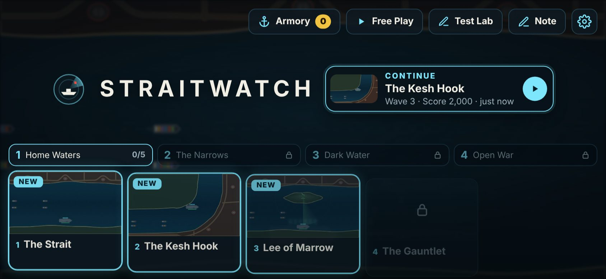
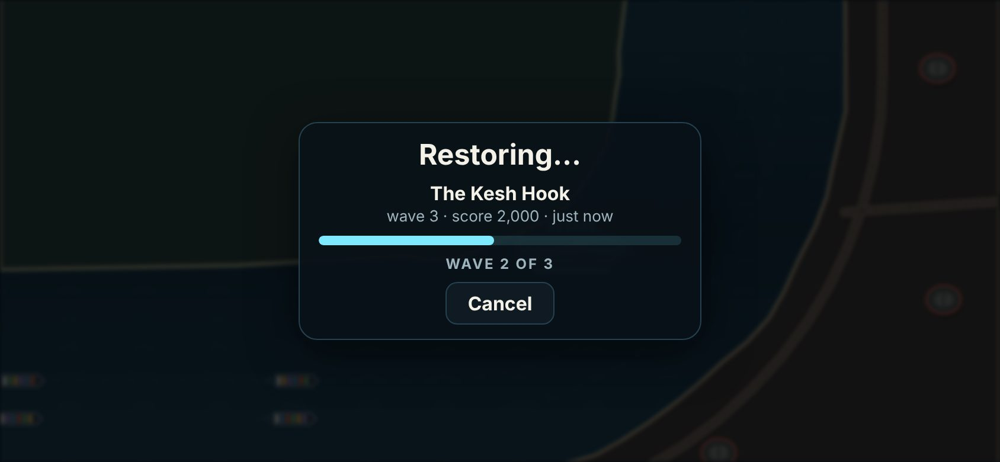
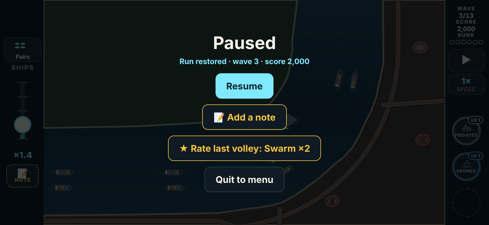
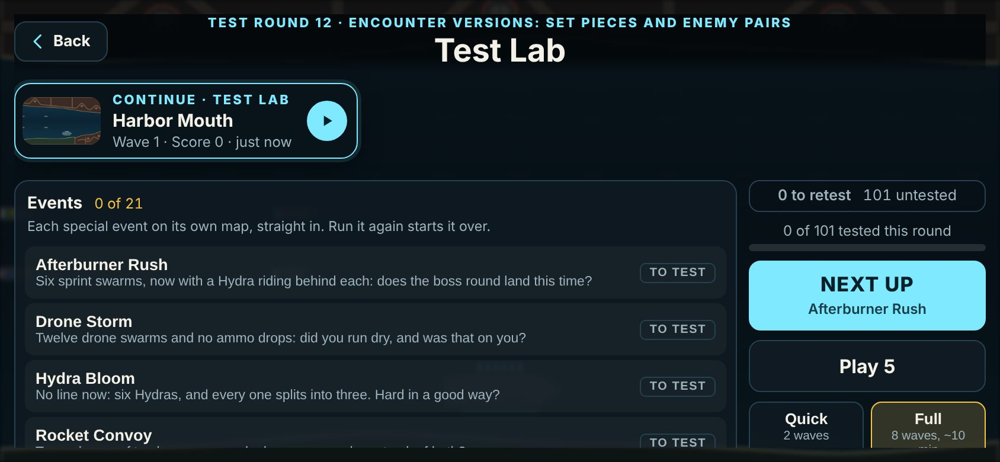
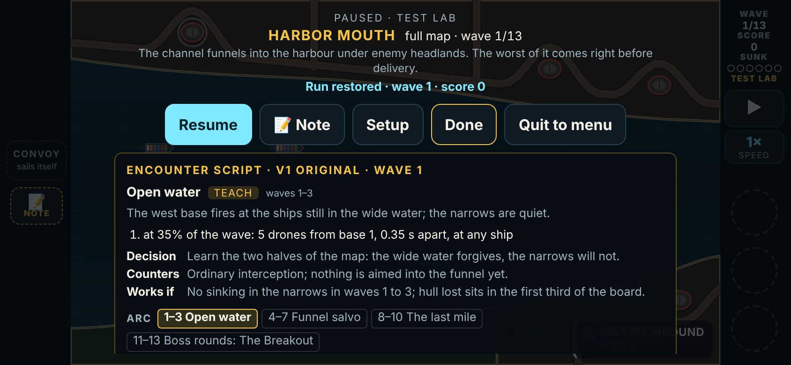
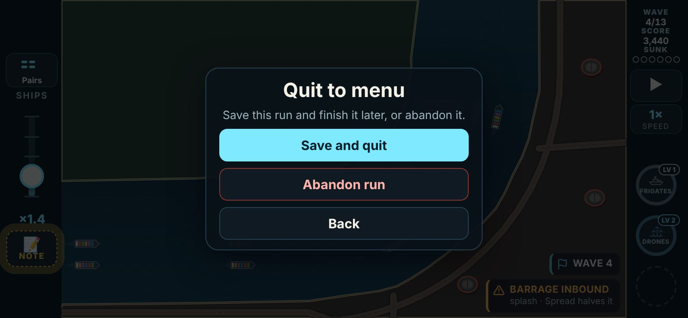
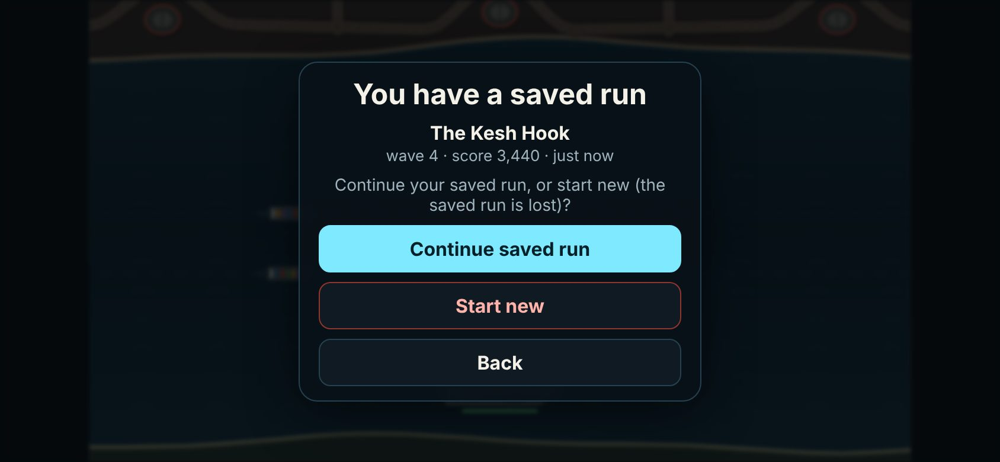
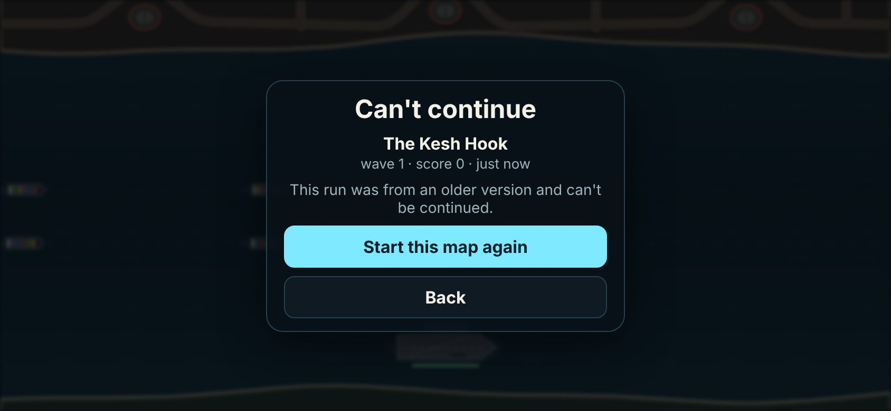

# V3: continue a run you left

The player, who plays on an iPhone in short sittings:

> "Do we have a way to save when you leave mid game, so I can come back and
> finish it? This is a problem I keep running into."

Before this, leaving mid-run paused the wave and sealed the play log as a
quit (`background()` / `pagehide`, `Recorder.left()`); if iOS closed the app,
or the player left the run, it was gone. A full-map Test Lab run is ~10
minutes; runs left at wave 6 and wave 2 were replayed from wave 1, and a
Harbor Mouth card was scored over three sittings.

Now a run in progress is kept, and the menu offers **Continue**.

No sim change and no `LOG_VERSION` change. The only sim-side edits are
refactors and additions that the sim never reads: `applyCommand` /
`setupGame` taken out of `replayTo` (the same code, shared), an optional
`resumes` field on the log, `Recorder.resume`, `Watch.restore` (the UI's
volley/moment bookkeeping), and the new `sim/resume.ts`.

Code: `src/v3/sim/resume.ts` (fingerprint, sliced replay),
`src/v3/platform/runSave.ts` (the record), `Recorder.resume` in
`src/v3/sim/playlog.ts`, `Watch.restore` in `src/v3/sim/feedback.ts`, and in
`src/v3/ui/app.ts` `keepRun`, `confirmQuit`, `quitRun`, `askBeforeNew`,
`continueEntry`, `continueRun`, `runRestore`, `resumeRun`, `showOldRun`,
`restartSaved`; `.v3-continue`, `.v3-restore*`, `.v3-quit`, `.v3-ask-saved`,
`.v3-old-run` in `src/v3/ui/style.css`. Tests: `tests/v3/resume.test.ts`,
`e2e/v3-resume.mjs`.

## How it works

The sim is deterministic, so a run is wholly its log: map, seed, first wave,
tempo, Armory, the Free Play / lab card / encounters / convoy setup, then
every input stamped with the step it came before. Saving a run is saving its
log so far. Continuing it replays that log to the saved step, checks the
game there is the game that was saved, and carries on recording into the
**same** log.

### When it is saved

One slot (`straitwatch.v3.run`), written through the `kv` seam
(`platform/store.ts`: localStorage on the web, Preferences on iOS, flushed by
the native `pause` listener), at:

| Moment | Where |
|---|---|
| The app goes to the background (visibilitychange hidden; iOS `pause`) | `background()` |
| The page is closed or reloaded | `pagehide` |
| The pause menu opens | `showPauseMenu()` |
| Every wave's end / draft (and every note or rating saved) | `saveProgress()` |
| Pause → Quit to menu → **Save and quit** | `quitRun(true)` |

A kept run is mid-wave or in a draft. A gesture weapon's press is let go as
it is saved (a finger can't be held across leaving; logged like any lift).

It is cleared when the run is won or lost (the moment the phase changes, so
an app closed during the finale can't offer a finished run), when a test's
verdict is saved (Done, its length, or a loss), on **Abandon run**, when a
new run starts over it (after asking), and on Setup → Apply in a test (a
restart, as before). Settings → Reset progress clears it with every other
key.

### The record (platform/runSave.ts, version 1)

```ts
interface RunSave {
  v: 1;                 // the record's own version
  savedAt: string;      // ISO time (the menu's "3 min ago")
  build: string;        // the build it was saved on
  logVersion: number;   // LOG_VERSION of the log
  log: PlayLog;         // the log so far: every command, notes, volleys,
                        // moments, draft picks, setup; no `end`
  step: number;         // the sim step it was saved at
  commands: number;     // inputs up to it
  phase: 'wave' | 'draft';
  print: RunPrint;      // the game's fingerprint at `step`
  mark: WaveMark;       // where the wave in play began (dev wave retry)
  kind: 'campaign' | 'free' | 'lab';
  ui: { free?: FreeSetup; lab?: { card; setup: LabRunSetup }; speed?: number };
  title: string; wave: number; score: number;   // for Continue
}
```

The fingerprint (`runPrint`, `sim/resume.ts`) is cheap (~0.01 ms) and only
reads: steps, phase, wave, waveT, score, ships, lost, delivered, carrier hp,
threats, pickups, ammo, shots, next id, a sum over every ship, threat,
pickup and interceptor's position and hull, and where each of the six RNG
streams stands (read through a `fork`, which draws nothing), hashed as one.
Visual effects are left out: the screen ages those itself during a wave's
end beat.

A run's record is the size of its log: 13–30 KB for a whole bot run to wave
13 (~450 inputs); a human's run has more taps and any note thumbnails.

### Continue

On the main menu, Continue sits beside the title (the space between the top
bar and the chapter tabs): the map's picture, the map or card name, "Wave 3
· Score 1,720 · just now". A Test Lab run also shows at the top of the Test
Lab hub, and says "Continue · Test Lab" (the store build has no Test Lab, so
never shows one).



Tapping it:

1. If the record's log version isn't one this build replays
   (`replaysHere(v)` false), or a lab card it names is gone: the "can't
   continue" sheet (below), without replaying.
2. **Restoring…**: the log is replayed headless (`Restorer`): no drawing, no
   sound (the sim's cues and UI events pile up unread and are dropped), no
   haptics, no tips or call-outs, no second log or lab entry. It runs 12 ms
   of each frame, so the screen stays live, with a progress bar, "Wave 2 of
   3", and Cancel. A lab run's telemetry sidecar is rebuilt in the same
   replay, so it covers the whole run once.
3. The fingerprint is checked. A mismatch (a build that kept the version
   but plays the inputs differently) goes to the "can't continue" sheet; the
   differing fields are logged to the console.
4. The run opens **paused**: mid-wave with the pause menu up and a line
   "Run restored · wave 3 · score 1,720"; in a draft, the draft (dealt at
   once, no beat); a test that had run its length, its verdict sheet. The
   same log carries on (`Recorder.resume`): id, inputs, draft picks, notes,
   rated volleys and marked moments, and the wave mark.




A resumed Test Lab run is a test as before: TEST LAB on the HUD, its pause
menu with Note, Setup and Done (PR #154), its encounter script, its convoy
rail. Setup → Apply restarts it as today and clears the save.




### Quit to menu, and starting over a saved run

Pause → **Quit to menu** now asks: **Save and quit** (the default, first and
filled), **Abandon run**, or Back (to the pause menu). Save and quit seals
the log as left (as a trip to the background does) and keeps the run;
Abandon ends the log as a quit, as Quit always did, and clears the save.
Where a run can't be kept (endless, the dev watch bot, no storage) Quit goes
straight to the menu as before.



Starting any run (Sail, Free Play's Start, a lab card, Play 5, a `?lab=`
link) while a different run is saved asks: "Continue your saved run, or
start new (the saved run is lost)?", with **Continue saved run**, **Start
new** and Back.



### Version safety

A save this build can't continue is never silently continued as a different
game. The sheet says, in one line, "This run was from an older version and
can't be continued." and offers **Start this map again**: the same
campaign map, the same Free Play setup, or the same lab card with its setup.
The record is cleared when the sheet shows (it can never be continued); the
log it left in the log store stays as it was.



## The log stays one run

The continued run keeps the log's id, its start time and build, and every
input, and appends from the saved step. `resumes: [{ at, step, build }]` on
the log says when it was continued (analysis can tell a run played in
several sittings; replay never reads it). The play log, the Test Lab
scorecard and its verdict, and the map-lab telemetry all cover the whole run.

On the server: `api/playlog.ts` stores a log at `playlogs/<id>.json` with
`allowOverwrite: true`, and the artifact database by `doc(id).set` — both
keyed by the log id, both overwrite. The device's own store
(`storeLog`/`flushUnsent`) also keeps one copy per id, and counts a log as
sent per `id@steps`. So the "left" log a background sealed is **replaced**
by the next save of the same id (the next wave end, a later background, or
the final won/lost/done log). No `resumed: true` / earlier-part id was
needed. The e2e watches the uploads: a background's `{end: 'quit', left:
true}` at step 4,896, then the continued run's save at step 6,662 with the
same id and `resumes: 1`; the replay of that one log equals the live game.

## Replay timing

A whole bot run to wave 13 (33,984 steps, The Kesh Hook, try-hard):

| Where | Time |
|---|---|
| node (this container), `replayTo` / `Restorer` | 1.2–1.5 s (35–43 µs/step) |
| Chromium (headless, same machine), `Restorer` | 1.05–1.6 s |
| Chromium, CPU slowed 4× (DevTools' mid-tier mobile) | 4.2–4.6 s |
| Shorter runs (node): Harbor Mouth to wave 8 (21k steps), The Gauntlet to wave 8, Sowers to wave 5 | 0.67 s, 0.38 s, 0.32 s |

Estimate on an iPhone: a recent one (A15 and later; JavaScriptCore with JIT
in the app's WKWebView) about as fast as this container, 1–2 s for wave 13;
an older one 2–4 s. That is over the ~2 s line, so the replay is sliced
across frames (12 ms a frame, ~1.4× the raw time in wall clock) with the
progress bar and Cancel, and the screen stays responsive. "Restoring…" stays
up at least 0.45 s so a short replay reads as a step, not a flash. A run
left early (waves 1–4) is a fraction of a second.

## What isn't kept

- **Endless** (after a map is won): not kept. The win is already recorded,
  the record is cleared at the win, and leaving endless ends it as before.
- **Dev watch mode** (the bot at the controls): not kept; the bot's own
  state isn't in the log. Dev presets (a tempo) are kept and continue.
- **Replays** ("watch it", Map Analytics' playback, a note's moment): not
  runs; never kept.
- **No storage** (private mode, storage denied): nothing is saved, the menu
  has no Continue, and Quit goes straight to the menu, as before.

## Checks

- `tests/v3/resume.test.ts` (15): save → storage → read back in a "new
  session" → sliced replay → the full state digest (every field the sim keeps
  and each RNG stream's position) equals the live game's, then both play on
  with the same inputs and stay equal, and the continued log replays to the
  whole run. For a campaign run mid-wave and in a draft; a Test Lab map card
  (Harbor Mouth: encounters + convoy policy) mid-wave and in a draft; a map
  card with the convoy's Hold given (Sowers); Free Play from wave 5. Also:
  notes, rated volleys and draft picks carried over; the `Restorer` equals
  `replayTo`; the fingerprint reads without changing the game and catches a
  changed replay; an older log or record version isn't continued; a
  finished run isn't kept; one slot cleared by id or outright; garbage in
  storage; no storage or throwing storage (off, nothing throws).
- `e2e/v3-resume.mjs` (37 checks, 844×390 touch): three waves of The Kesh
  Hook, background, reload, Continue, Restoring…, back paused at the same
  wave/score/step, the same log id, finish wave 3, the one log replays to
  the live game, the uploads replace by id; Quit's prompt (Back, Save and
  quit, Abandon run); the start-new prompt (Continue saved run / Start
  new); an older log version and a changed fingerprint (Start this map
  again); Free Play; a Harbor Mouth map card continued from the Test Lab hub
  (Note/Setup/Done; Setup → Apply restarts and clears the save); no storage.
- The other suites open run after run by link and reload, which now leaves
  a saved run that the next start asks about: `v3`, `v3-map-cards`,
  `v3-encounters` and `v3-convoy` start each page with no saved run (an init
  script drops the one key). Their checks are unchanged.
