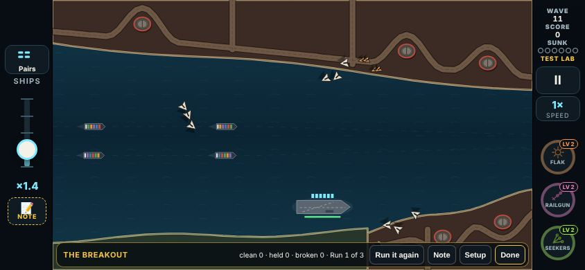
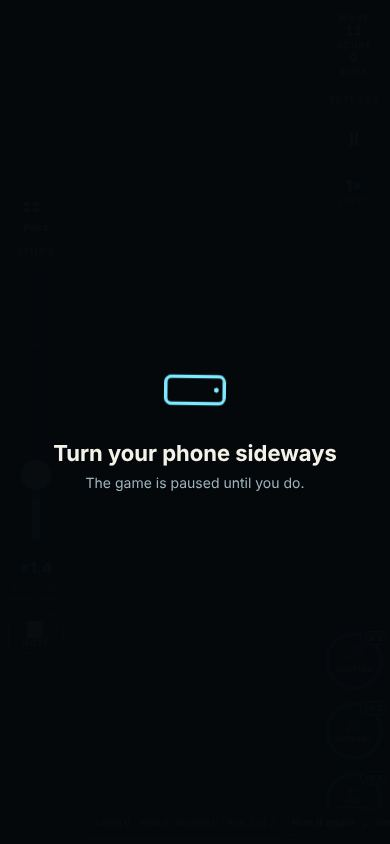

# V3 round 11: map notes

**Date:** 2026-11-14. Test Lab round 11.

## Part B

The decoys out of the game, Point Defense only at munitions, the Laser Cutter only cuts, every weapon you fire hurts a Lure Beacon, and Focus's dial shows your slow motion.

### Your words

> "Oooo and let's just remove the decoy drones I just don't like that so remove entirely from the games"

> "The point defense should not shoot down planes, only the munitions from the planes"

> "The laser player attack still shoots a munitions from the ship. It should NOT do that it should only do the cut"

> Beacon Strike (2026-11-13): "The laser cutter did not do any hits on the beacon so do an audit to make sure all weapons will actually attack the beacon"

> Focus (2026-11-13): "The dial on the left should indicate the amount of time you have left to freeze and not the time left before the power up is gone"

### 1. The decoy drones are gone

**Removed everywhere you could meet them:**
- the enemy itself (`decoy`: its numbers, its drawing and its pulse, its sounds, its first-meeting tip);
- the waves of every map;
- Free Play's enemy picker (16 enemies, not 17);
- the briefing's list of chapter 1's enemies;
- the bots' rule for telling a decoy apart, and the pair timing that read it.

A Free Play setting saved as "decoys only" falls back to the campaign's enemies.

**Kesh has no debut enemy for now.** Chapter 1's maps took its new enemies in turn: Sprint Drones (The Strait), Decoys (Kesh), Hydra (Marrow), Rocket Truck (The Gauntlet).
- Marrow and The Gauntlet keep theirs (`DEBUT_SLOTS` in `src/v3/data/foes.ts`).
- Kesh's waves lead with the Sprint Drones you met on The Strait, so it brings nothing new. Its briefing marks no enemy "first here".
- **Open item:** Kesh needs a debut. The map rebuild's design cards will give it one.

**Kesh's event is now the Drone Storm** (`drone-storm`, in place of the Decoy Storm).
- It has twelve swarms of plain drones, three then two in turn (30 drones).
- Half come at the start and half 7 s later, one swarm from each drone base in turn.
- No ammo drops, as before.
- **Provisional:** you may pick a different event for Kesh with the rebuild.

**The Breakout** (Harbor Mouth) opens with three plain drone swarms of three, in place of the decoy swarms. Then come the sprinters, Hydras and trucks as before. Its card now features the Sprint Drones, Hydra and Rocket Truck.

**The two decoy pairs are gone:** Decoys + Sprint Drones and Decoys + Cluster Missiles. That leaves eleven enemy pairs, with one in chapter 1 (Hydra + Drone Swarm). No map placed them.

#### How hard the Drone Storm is (measured)

The Decoy Storm had 24 real drones among 48 decoys. Since round 9 the bots leave decoys alone, so for them it was 24 drones. The plain-drone version was measured with `npx vite-node tools/v3/special-events/measure.mts -- 80 [--lab] --only=…` (80 seeds, three bots).

The table shows Clean / Held / Broken %, and ships lost per run in brackets.

| | Bot | Decoy Storm (before) | 2 a swarm (24) | **2.5 a swarm (30, kept)** | 3 a swarm (36) |
|---|---|---|---|---|---|
| Lab card | sharp | 41 / 33 / 26 (0.88) | 86 / 10 / 4 (0.17) | **64 / 11 / 25 (0.81)** | 35 / 10 / 55 (2.02) |
| Lab card | average | 45 / 35 / 20 (0.81) | 84 / 13 / 4 (0.20) | **54 / 21 / 25 (0.99)** | 41 / 14 / 45 (1.76) |
| Lab card | casual | 39 / 24 / 38 (1.19) | 86 / 9 / 5 (0.19) | **55 / 18 / 28 (1.10)** | 30 / 18 / 53 (2.16) |
| Own table | sharp | 94 / 6 / 0 (0.06) | 99 / 1 / 0 (0.01) | **91 / 5 / 4 (0.15)** | 89 / 5 / 6 (0.25) |
| Own table | average | 96 / 3 / 1 (0.06) | 98 / 3 / 0 (0.03) | **94 / 6 / 0 (0.06)** | 81 / 10 / 9 (0.33) |
| Own table | casual | 85 / 14 / 1 (0.17) | 88 / 11 / 1 (0.14) | **80 / 13 / 8 (0.30)** | 59 / 18 / 24 (0.81) |

**Reading it:**
- The same 24 drones were far easier as plain swarms. A decoy swarm launched all at once in a wide line, so its two real drones arrived together. A plain swarm streams out of its base.
- Three a swarm was too hard. Two and a half (three, then two) comes closest: ships lost per run are within about 0.2 of the Decoy Storm's for every bot on the lab card. Broken is 25–28% against 20–38%.
- It is a little harder than before on its own table for the casual bot.

**The Breakout,** Clean / Held / Broken %, 80 seeds:

| | sharp | average | casual |
|---|---|---|---|
| Lab card, before | 100 / 0 / 0 | 100 / 0 / 0 | 99 / 1 / 0 |
| Lab card, swarms of 2 | 100 / 0 / 0 | 100 / 0 / 0 | 100 / 0 / 0 |
| **Lab card, swarms of 3 (kept)** | 98 / 3 / 0 | 96 / 4 / 0 | 93 / 6 / 1 |
| Own table, before | 100 / 0 / 0 | 100 / 0 / 0 | 96 / 4 / 0 |
| **Own table, swarms of 3** | 100 / 0 / 0 | 99 / 1 / 0 | 89 / 11 / 0 |

### 2. Point Defense fires only at munitions

Before, each ship's interceptors fired at anything aimed at it, and at any plane overhead. The carrier's (at MAX) did the same for the carrier. **Now they fire only at munitions that are aimed at their hull** (`isMunitionKind` in `src/v3/sim/game.ts`).
- **Munitions:** missiles of every kind, bombs, bomblets, Hydras and their darts, torpedoes, firebombs, drones of every kind, and a boat that rams.
- **Never the aircraft:** jets, bombers, the attack helicopter, the dive bomber, the Spotter and the drone mothership.
- **Never a launcher or a support either:** trucks, siege guns, subs, the Repair Ship, guards, beacons, scavengers. Their "harm" is what they fire, and that is what gets shot.

**Aircraft munitions are their own threats, each aimed at a hull,** so they are covered:
- a bomber's (and Stealth Bomber's) guided missiles;
- the helicopter's missiles;
- a cluster's bomblets.

Two things have nothing in the air to intercept, as before:
- **a strafer's guns** hit the hulls under them directly;
- **a dive bomber's bomb** is a red shot.

The card's level 1 now reads: "Every ship carries 1 interceptor that fires on its own at a missile, bomb or drone about to hit it (never at the aircraft)".

### 3. The Laser Cutter only cuts

Before, a press let go before it became a swipe was a tap, and a tap fired a normal shell from the carrier. **Now a tap with the Cutter loaded fires nothing and spends no round.** "SWIPE TO CUT" shows over your finger for under a second, one at a time.
- A tap on a pickup still takes it.
- This also covers a second finger's tap while one is pressed, and the bots' missed taps.
- **Dual Wield:** the other hand still fires its own shot on a tap. The Cutter adds none.
- **Hyper Overdrive** twins the cut (as before), never a shell.
- **The bots** already swiped with it, so nothing changed for them, except that a missed tap is now nothing too.

Why nothing, not a short cut through the tapped point:
- On a phone a tap is often a slip or a pickup grab. A cut would spend a round on it.
- It would also teach "tap works" for a weapon that is about the swipe.
- The words tell you what to do instead, the first time it happens.

### 4. Every weapon you fire hurts a Lure Beacon

A beacon only takes the player's own hand; your helpers' shots pass through it (by design). Several of your own weapons were not counted as your hand when they did damage after the tap: the Cutter's cut (a finger moving), the seekers, the jets, the blades, the clouds and burning lines. **They are all your hand now.**

`tests/v3/beaconAudit.test.ts` puts a beacon in each weapon's path, fires it as a finger does, and checks the beacon takes damage, at level 1 and at MAX.

| Weapon | Hurt the beacon before | Now |
|---|---|---|
| Plain gun, Flak shell, Gravity Well, Shrapnel, Thermobaric, Railgun, Tesla, Scattergun, Charge Lance, Grapnel, Cadence, Wild Card | yes | yes |
| Laser Cutter (the cut) | **no** | yes |
| Seeker Pod | **no** | yes |
| Air Strike (the jet's guns) | **no** | yes |
| Boomerang (the blades) | **no** | yes |
| Lingering work: Flak's cloud, the Cutter's lit cut (MAX), Carpet Strike's burning row, Sunspear's burning line | **no** | yes |
| A shell fired onto open water next to a beacon (Flak, Well, Shrapnel, Thermobaric), and War Drum's broadside | **no** | yes |
| Boosts that fire through the gun: Focus, Overdrive, Dual Wield | yes | yes |
| Helpers: Frigates, Point Defense, Drone Screen, Gunship Pair, Bomber Wing, Orbital Strike | no, by design | no, by design |
| Shield, Full Steam, Supply Run | fire nothing of their own | no change |

The beacon's blurb now says "Only your own weapons can sink it, not your helpers". Its first-meeting tip says "Two hits of your own sink it: a shot, a cut, a blast".

### 5. Focus: the dial is your slow motion

The left button's ring already showed the slow motion banked. But its outer face was a bright cream dial of the boost's own clock, so the dial you saw ran down whether or not you held it.
- **Now the button shows only the slow motion left:** the blue ring and the seconds in the middle. It stays full until you hold it, and drains only while you do.
- **The boost's own time** stays where every boost shows it: the dashed ring round the carrier and its chip on the right.

### The Test Lab (round 11)

Each changed card has one line:

| Card | Line |
|---|---|
| Drone Storm (new: `ev-drone-storm`) | New event in place of the Decoy Storm (the decoys are gone): twelve plain drone swarms and no ammo drops |
| The Breakout | No decoys: it opens with plain drone swarms, then the sprinters, Hydras and trucks as before |
| Kesh (map) | No decoys any more: Kesh has no new enemy of its own for now, and its event is the Drone Storm |
| Harbor Mouth (map) | Its event, The Breakout, opens with plain drone swarms (no decoys) |
| Point Defense | Fires only at what is about to hit a hull (missiles, bombs, drones), never at the aircraft |
| Laser Cutter | Only cuts: a tap fires no shell (it says SWIPE TO CUT), and its cut now hits beacons |
| Focus | The dial on the left button shows your slow motion left, not the boost's own time |
| Lure Beacon | Every weapon you fire now hurts it: cuts, seekers, jets, blades, clouds and burning lines (your helpers still can't) |
| Beacon Strike | Every weapon you fire now hurts the beacons, the Laser Cutter too |

Lure Beacon + Stealth Strafers takes the beacon's line on. The questions on Point Defense, the Cutter and Focus were rewritten to match.

**Retired** (`LAB_RETIRED`, round 11, "decoys removed from the game"): Decoy Drones, Decoy Storm, Decoys + Sprint Drones and Decoys + Cluster Missiles. Their old verdicts stay on the review page; the hub drops them. **The hub now has 95 cards.**

### Judgement calls

- **Kesh leads with the Sprint Drones.** Leading with the Hydra would have taken Marrow's debut. The Sprint Drones were already met on The Strait.
- **Drone Storm: 2.5 a swarm,** alternating three and two. Neither whole number came close to the Decoy Storm with the bots.
- **The Breakout: swarms of three.** Swarms of two matched the bots' numbers exactly, but each looked like a pair, not a swarm. Three is a little harder for the bots (Clean 93–98% on the card, down from 99–100%).
- **Point Defense ignores launchers and supports too,** not only aircraft. "Only the munitions" read as the rule: the carrier's interceptors used to go for trucks, helicopters and siege guns aimed at it.
- **The drone mothership counts as an aircraft.** It is a slow airship; its mini-drones are the munitions.
- **The play log stays version 21.** Its shape is unchanged. But a v21 log played before this round no longer replays to the same game: decoys and Cutter taps are gone, and Point Defense picks other targets. The repo's rule bumps the version when that happens. Part A changes replay too, so the merge should bump it once, to 22.
- **Stored data was rewritten the repo's way:**
  - The Map & Convoy Lab baseline was rewritten: `npm run v3:map-lab -- baseline --write`, 12 runs. Still 7 of 12 won, though which ones moved. For example, Gauntlet "tryhard" went from won to lost at wave 8, and Harbor "tryhard" from lost at wave 8 to won.
  - The round 9 Hold fixture, the player's own log, was not rewritten. It replays the same up to and through the Hold. Its test now follows the held ships by id, because what happens later in that run moved.
  - `tests/v3/convoy.test.ts`'s "not a score farm" check now uses eight seeds, not four. With four, the mean score swung 35% on The Gauntlet. Over twelve seeds the two are within 4%.

### Checks

- `npx tsc --noEmit`: clean.
- `npx vitest run --exclude '.claude/**'`: all passing. New tests:
  - `tests/v3/round11b.test.ts`: no decoys anywhere; the debuts; the Drone Storm and The Breakout; Point Defense by kind, against a real bomber run, the helicopter and the Spotter; Cutter taps, with Dual Wield and Hyper Overdrive; the bots; the lab lines.
  - `tests/v3/beaconAudit.test.ts`: the beacon audit.
- `npx vite build` and `npm run build:store`: both build.
- Browser checks on an isolated build at port 4741: `e2e/v3.mjs` (now also checks Focus's dial: full while not held, draining while held; and the Drone Storm card's Run it again), `e2e/v3-audio.mjs` and `e2e/v3-map-cards.mjs`.
- **Found on the way:** an event card's bar only had Run it again when the card featured a new enemy. The Drone Storm, built on plain drones, lost it. Every event card has it now (`labActions`).
- Screenshots: `node tools/v3/round11/shots-b.mjs`, at 844 x 390 and 390 x 844, 1x (the Point Defense close-up at 3x).
  - Held upright, the game asks to be turned sideways and pauses (it is landscape only), so that size has one frame.

