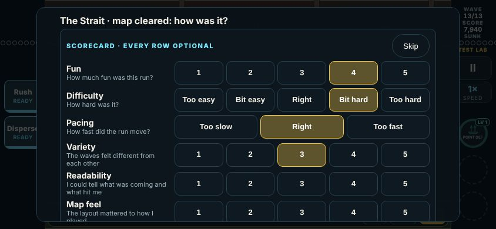
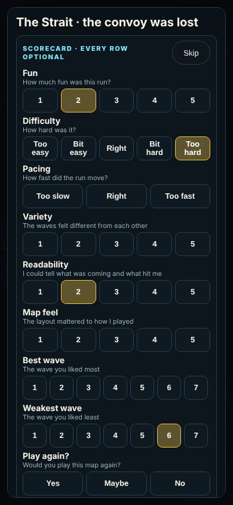
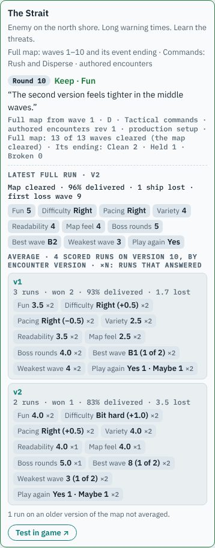

# V3 Test Lab round 11: map notes

**Date:** 2026-11-14. Follows [v3-map-cards-production.md](v3-map-cards-production.md).

Test Lab round 11 is `{ n: 11, date: '2026-11-14', name: 'Round 11: map notes — boss rounds, Hold only, no decoys' }`. Each part of the round adds its own section below.

## Part C: scorecard

The player: "let's improve the rating and feedback system at the end of the game. It should have categories to rank that we should have some feedback on to determine if this production map is good." Next: "make a few different versions of the same maps with different encounters and see which ones do the best."

- **The sheet.** After a map card's full run (won, lost, or Done), the verdict sheet opens with a **Scorecard** above Keep / Tune / Cut. It has ten rows: Fun, Difficulty, Pacing, Variety, Readability, Map feel, Boss rounds (only past wave 10), Best wave, Weakest wave and Play again?. Each is answered with one tap and every row is optional. Skip folds the box away. The categories are data (`src/v3/data/scorecard.ts`, `SCORECARD_REV` 1).
- **The log** is version 22. The run's `labResult.score` holds the answers, and `variant` holds the map's encounter version (`'v1'` until a map has more). A v21 log still replays.
- **The page.** A map card shows the latest run's scores as chips, beside three numbers from the log's summary: delivered %, ships lost, and the wave of the first loss. With two or more scored runs, it adds per-category averages with run counts, grouped by encounter version when there is more than one.
- The full description is in [v3-test-lab.md, Scorecard](v3-test-lab.md#scorecard).

**Checks for part C:**
- `npx tsc --noEmit`: clean.
- `npx vitest run --exclude '.claude/**'`: 57 files and 1516 tests pass. 17 of the tests are new, in `tests/v3/scorecard.test.ts` and `tests/v3/labScores.test.ts`.
- `npx vite build` and `npm run build:store`: both build.
- Browser checks, on an isolated build: `e2e/v3.mjs` 199 pass, `e2e/v3-map-cards.mjs` 26 pass (8 of them new, for the scorecard), and `e2e/v3-convoy.mjs` 35 pass.
- **The Map & Convoy Lab baseline was rewritten** (`npm run v3:map-lab -- baseline --write`) for the log version alone. Every run's state and telemetry hashes are unchanged.
