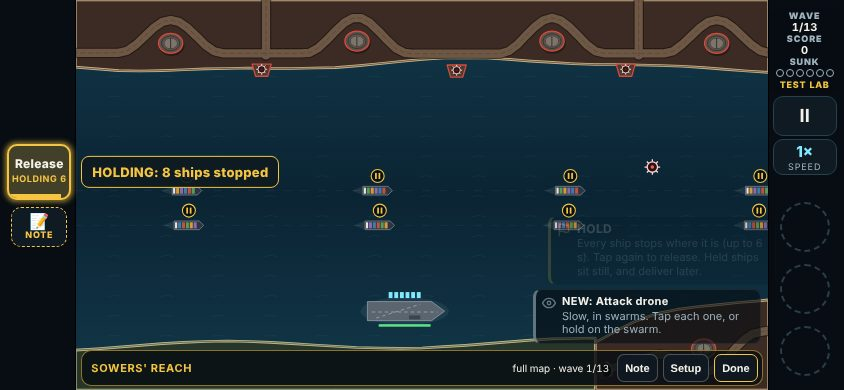
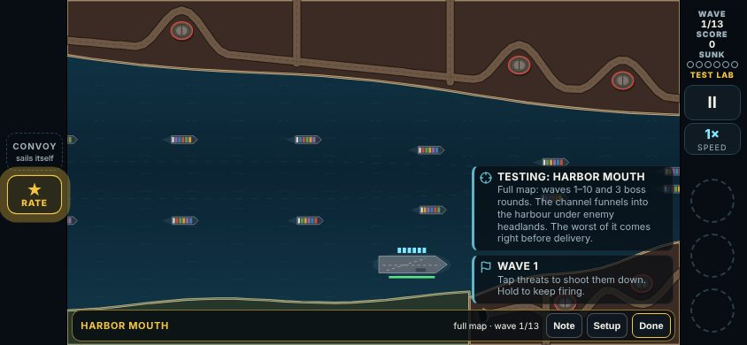

# V3 round 11: map notes — boss rounds, simpler Hold, no Rush or Disperse

**Date:** 2026-11-14. From your full-map playtest of The Strait, The Gauntlet and Harbor Mouth (the round 10 map cards).

Test Lab round 11 is `{ n: 11, date: '2026-11-14', name: 'Round 11: map notes — boss rounds, simpler Hold, no Rush or Disperse', since: '2026-11-14T20:00' }`. This round has two parts, built side by side:

- **Part A** (this branch): the map notes.
- **Part B**: the decoys, Point Defense and the Laser Cutter.

## Part A

### Your words

> "when there is a overdrive or a boost selected, everything becomes like dotted the outline like the cargo ships too"

> "the special effects waves at the end should be just called the 'boss' rounds or something like that and then say a little blurb at the start like survive the next rounds"

> "the line for the boss round doesn't seem to matter cuz all the drones will just launch into boost mode before it so I think you can remove that visual"

> "I would like to see what the encounters are tho like as a developer like tell me what the script is essentially doesn't need to be during the game but maybe when u pause"

> "With the hold line I think that all the ships should just pause instead of having a line that way we don't have to make the hold map specific"

> "the ship should start wider apart from one another at the start and then get closer together at the harbor neck"

And your decision after we looked at the logs:

> "cut them all but Hold and make hold only available on maps where it makes sense like the map with the mines that cross the way: that way the players can pause when the mines are passing"

### 1. The dotted outlines (a bug)

**What was wrong.** When a boost was loaded, its ring around the carrier is drawn dashed. The code set the dash before it saved the drawing state, so restoring the state put the dash back. Everything drawn after it came out dotted: the ships, the carrier, the pickups.

**The fix.** The dash is now set after the save, so the restore clears it (`drawLoadedRing` in `src/v3/ui/render.ts`). I checked every other dashed line in `src/v3/ui/`. None had the same mistake.

**The check.** `tests/v3/round11.test.ts` draws a whole frame with a boost loaded into a fake canvas. It checks that no dash is left on after each restore. It fails on the old code. The browser check also reads the canvas after a frame: the dash is empty.

### 2. Boss rounds

The map's three event runs at the end (waves 11 to 13) are now called **boss rounds** everywhere you read them:

- **The event card** reads "BOSS ROUND 1 OF 3 · WAVE 11" over the event's own name. The first card also says **"Survive the next 3 rounds"**.
- **A call-out** says **BOSS ROUNDS: Survive the next 3 rounds.** as the first one starts.
- **The HUD counter** reads **BOSS 1/3** in place of WAVE 11/13.
- **The outcome banner** reads "Afterburner Rush · Boss round 1 of 3".
- **The briefing** says "Boss rounds: Afterburner Rush, waves 11–13".
- **The result screen** labels each run "Boss round 1 of 3", and the whole as "Boss rounds · Worst round".
- **The Test Lab:**
  - a map card says "Full map: waves 1–10 and 3 boss rounds";
  - its bar reads "full map · boss round 1/3";
  - its verdict sheet says "Boss rounds: Clean 2 · Held 1 · Broken 0".
- **The restore before them** now says "…for the boss rounds".

The number 3 comes from `ENDING.runs`. Event ids and names are unchanged. A Test Lab **event** card still says "Run 1 of 3": it is a test of one event, not the map's ending.

### 3. Afterburner Rush: no line

The dashed line is gone (as Hydra Bloom's went in round 8). Nothing sets every sprinter off at once any more. Each sprinter still cruises in at half speed (`EV.rush.cruise`). It flares and sprints by the sprinter's own rule, within 160 px of its ship. The six swarms, 1.5 s apart, are unchanged. The card's question is now "No line now: six sprint swarms cruise in, and each boosts near its ship. Does it still feel like a rush?"

### 4. The encounter script, on the pause screen

On a run with the authored encounters on (the reference map cards), **Pause** shows an **Encounter script** panel under the buttons. It is a developer's view, so nothing of it shows during play. It shows:

- **This wave's encounter:** its name, its role (teach, combine, escalate or climax), its waves and its premise.
- **Each beat on one line**, for example: "at 45% of the wave (+1.4 s): 1 guided missile from base 3, aimed at the lead ship". Bases are counted from 1.
- **The designer's lines:** Decision, Counters, and Works if.
- **The map's arc on one line**, with this wave's part marked. For example: 1–3 Open water · **4–7 Funnel salvo** · 8–10 The last mile · 11–13 Boss rounds: The Breakout.

On a wave with no encounter, it says so, or names the boss round or bonus wave.

**On a phone:**
- Upright, the panel shows over the "turn your phone" notice, the way a note does.
- Sideways, the buttons sit in a row and the panel scrolls, clear of the lab bar.
- There is no sideways scroll at 390 px or 844 px wide.

### 5. Rush and Disperse are gone; Hold is on Sowers' Reach only

**Why** (from your three runs, replayed with telemetry):
- You pressed a command 15 times in about 24 minutes.
- 13 of those presses had nothing in the air that a change of speed or spacing could dodge.
- Only ballistic shells can miss a ship that speeds up or spreads out. Everything else homes in, and it hit with every impact.
- Shells were only about 13 to 18% of the hull damage you took.
- So Rush and Disperse could touch about a sixth of what hurt you. That is why it felt like button mashing.

**What changed** (convoy rules **rev 3**, `CONVOY_REV`):
- **Rush and Disperse are cut** from the game. That covers their numbers, their buttons, the bots' use of them, and the tests. A recorded `'rush'` or `'disperse'` in an old log is now refused as "not a command on this map".
- **Hold stops every ship afloat**, wherever it is. There is no hold line any more. Each ship eases to a stop within 0.4 s and waits, up to 6 s or until you tap Release. New ships wait at the entry. Each held ship carries a pause mark. The 12 s cooldown is unchanged. A Hold with no ship afloat is refused ("No ships afloat").
- **Hold is only on Sowers' Reach.** That map's mine chutes drop mines that drift across the lane, so you can stop the convoy while they pass. Its button says "Every ship stops where it is (up to 6 s)."
- **Sowers' Reach's map card** now opens under the Commands policy (D), with Hold. Its ships sail the campaign's own schedule (flow step 1, Pairs), so only Hold is new. It has no authored encounters.
- **The Strait, The Gauntlet and Harbor Mouth have no command.** Their map cards still open under D, with their encounters. The convoy sails the map's own schedule and formation, and the rail reads "CONVOY · sails itself".

### 6. Harbor Mouth: wide in the open water, close at the neck

- **On Harbor Mouth, a pair now sails wide apart in the open water.** Its two ships are about 210 px apart, against 96 px before.
- **The pair closes up as the lane narrows into the neck.** At the far end the ships are about 42 px apart, as before.
- **How it works.** A lane can ask for this (`Channel.open`: Harbor Mouth's is 2.2). A formation that opens out (`FormationDef.opens`: only the Pairs) then spreads its slots that much where the lane is at full width. The spread eases back to its own slots where the lane has narrowed to the floor (`slotOffset` in `src/v3/data/mapTypes.ts`).
- **Ships stay in the lane.** A ship's centre always stays 34 px inside the lane's edge, and the ships never touch.
- **Only Harbor Mouth changes.** Every other lane, and the Box, Spread and Column formations, are exactly as before.

**Why it opts in.** Every map already scales a formation's slots to the local lane width. A general version that widened every map's open water would also move The Strait's ships, whose lane never narrows. So Harbor Mouth opts in, and no other map does.

**Balance.** Campaign runs on Harbor Mouth from wave 1, 16 seeds a bot, the same seeds before and after (`warhead: 3`):

| Bot | Before: won, mean wave, ships lost | After |
|---|---|---|
| tryhard | 4/16, 9.6, 4.3 | 5/16, 9.9, 4.1 |
| you | 0/16, 7.7, 4.3 | 0/16, 7.4, 4.4 |
| casual | 0/16, 6.8, 4.3 | 0/16, 6.6, 4.6 |

That is within noise: the change is a look, not a balance change.

### The Test Lab

Round 11's lines (part A). The hub asks for each of these cards again:

- **The Strait:**
  - "Rush and Disperse are gone: the convoy sails on its own"
  - the boss rounds line
  - "Its boss rounds (Afterburner Rush) have no line on the water now: each sprinter boosts near its ship"
- **The Gauntlet:**
  - "Rush and Disperse are gone: the convoy sails on its own"
  - the boss rounds line
- **Harbor Mouth:**
  - "Hold is gone here; ships start wide and close up at the neck"
  - the boss rounds line
- **Sowers' Reach:**
  - "New: Hold — tap to stop every ship while mines drift across, tap again to release (up to 6 s)"
  - the boss rounds line
- **Afterburner Rush** (the event card): "No line on the water: each sprinter flares and sprints near its ship, as sprinters always do"

The boss rounds line reads: "The three event runs at the end are now called boss rounds, and a banner says "survive the next 3 rounds" as they start".

Round 10's lines keep their round 10 wording ("Commands: Rush and Disperse · …"). They say what round 10 set up.

### The log and the baseline

- **The play log stays version 21.** Its shape did not change: a `'k'` command is still a command id. Old v21 logs with a Rush, a Disperse or a Hold on Harbor Mouth now replay with those presses refused. Afterburner Rush and Harbor Mouth logs also play differently now.
- **The convoy rules are rev 3**, and every log with a convoy setup records its rev.
- **The Map & Convoy Lab baseline was rewritten** (`npm run v3:map-lab -- baseline --write`). Its content hash changed because `EV.rush` lost `line` and the Pairs gained `opens`. Harbor Mouth's map hash changed because of its lane's `open`. The stored runs that moved:
  - The Strait's four, through the boss rounds.
  - Harbor Mouth's campaign runs, through the spacing. tryhard now wins (it lost on wave 8 before); you now lose on wave 9 (wave 5 before).
  - The Gauntlet's four replay unchanged, and so does Harbor Mouth's event run.

### Judgement calls

- **The round's name.** I dropped "Rush wake" from it: that item was cancelled when Rush was cut. The name is "Round 11: map notes — boss rounds, simpler Hold, no Rush or Disperse".
- **The production setup on the reference maps stays policy D**, now with no command. That keeps their logs comparable with round 10's: same schedule, same formation, encounters on. Under D with no command, the ships sail exactly as under A (a test checks it).
- **Sowers' Reach opens under D**, because that is how a map card gets a command. It sails the campaign's default flow and the Pairs, so a player who never touches the controls sees the same convoy.
- **The call-out and the card both say "Survive the next 3 rounds".** The card is the big moment. The call-out stays in the tray after the card fades.
- **Upright play is not shown.** The game asks you to turn the phone during play, so the upright boss-round and Hold screenshots show that notice. The pause panel is the exception: it shows upright.

### Checks

| Check | Result |
|---|---|
| `npx tsc --noEmit` | clean |
| `npx vitest run --exclude '.claude/**'` | 55 files, 1505 tests, all pass (`tests/v3/round11.test.ts` is new) |
| `npx vite build`, `npm run build:store` | both build |
| `e2e/v3.mjs` | 200 pass (the boss round counter, card and call-out; the briefing) |
| `e2e/v3-convoy.mjs` | 35 pass (Hold on Sowers' Reach at 874 x 402 and 667 x 375; no command on The Strait or Harbor Mouth) |
| `e2e/v3-encounters.mjs` | 14 pass |
| `e2e/v3-map-cards.mjs` | 19 pass (Sowers' Reach's bare link opens with Hold) |
| `e2e/v3-audio.mjs` | 16 pass |

## Part B

(see the decoy/Aegis/Cutter branch)
