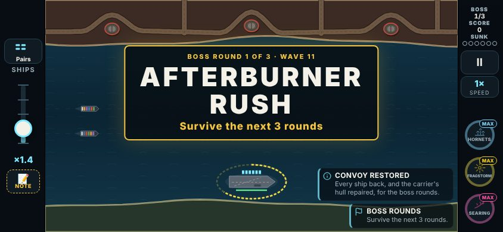
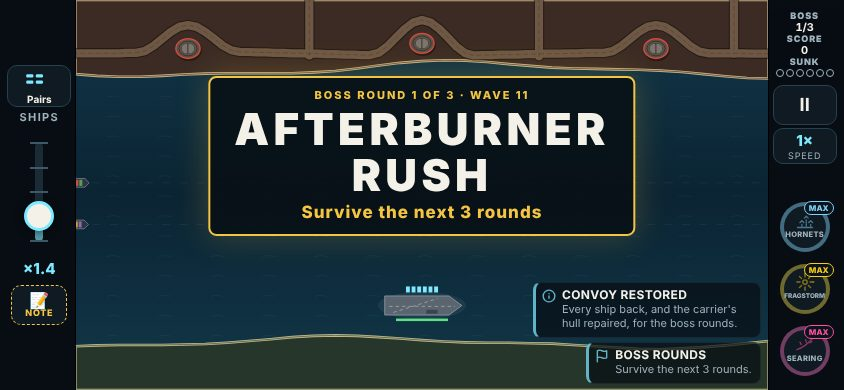
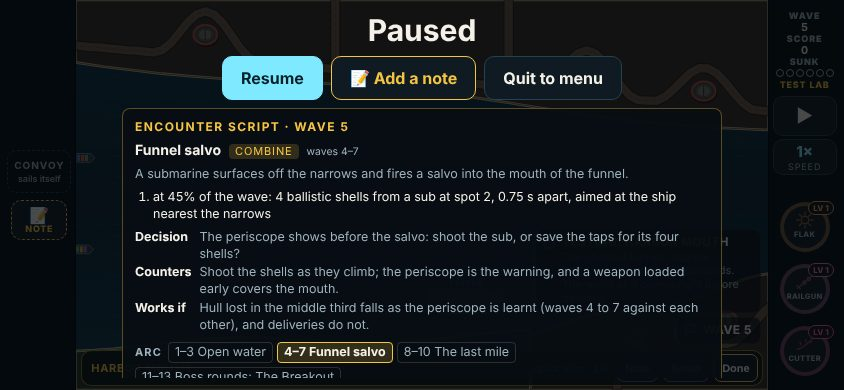
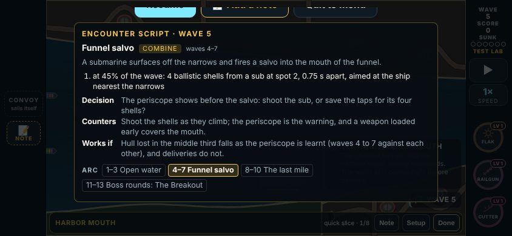
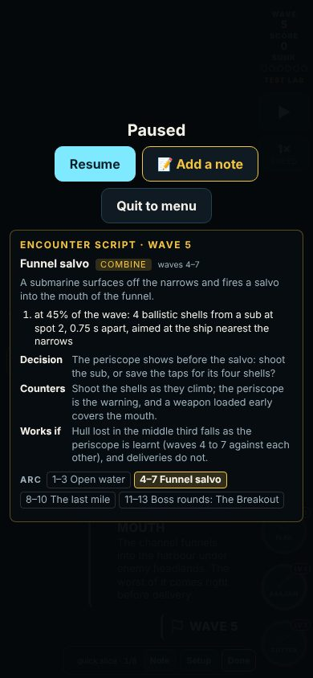
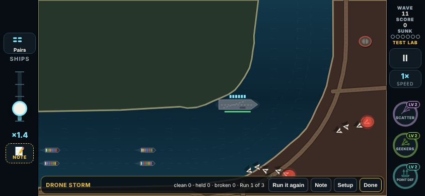
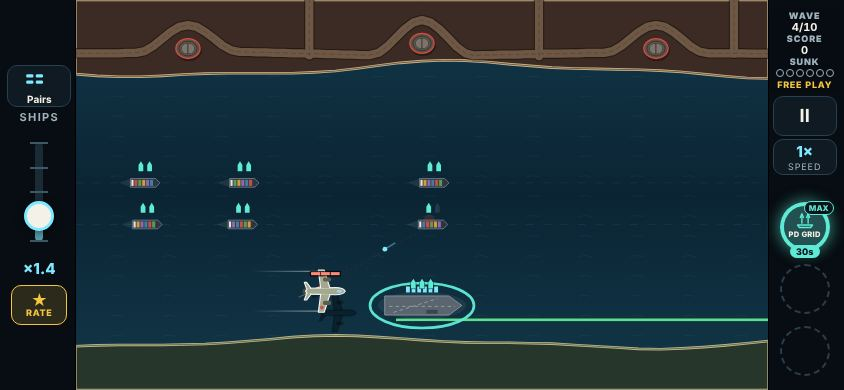
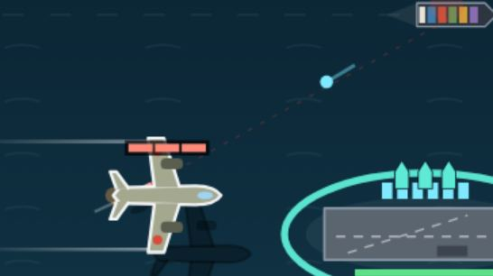
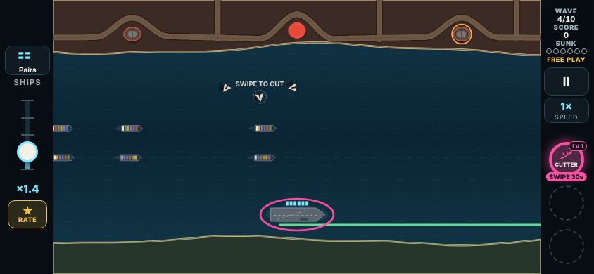

# V3 round 11: map notes — boss rounds, Hold only, no decoys, a scorecard

**Date:** 2026-11-14. From your full-map playtest of The Strait, The Gauntlet and Harbor Mouth (the round 10 map cards), and the Test Lab notes of 2026-11-13.

Test Lab round 11 is `{ n: 11, date: '2026-11-14', since: '2026-11-14T20:00' }`. It has three parts, built side by side and merged:

- **Part A:** the map notes (dotted outlines, boss rounds, the Afterburner Rush line, the encounter script on pause, Rush and Disperse cut, Hold on Sowers' Reach only, Harbor spacing).
- **Part B:** decoys removed, Point Defense at munitions only, the Laser Cutter only cuts, the beacon audit, the Focus dial.
- **Part C:** the scorecard at the end of a map run.

**Play log version 22.** Logs from before this round (v21) no longer replay to the same game (Rush and Disperse are gone, decoys are gone, Afterburner Rush and Harbor play differently), so only v22 logs replay.

## Part A

### Your words

> "when there is a overdrive or a boost selected, everything becomes like dotted the outline like the cargo ships too"

> "the special effects waves at the end should be just called the 'boss' rounds or something like that and then say a little blurb at the start like survive the next rounds"

> "the line for the boss round doesn't seem to matter cuz all the drones will just launch into boost mode before it so I think you can remove that visual"

> "I would like to see what the encounters are tho like as a developer like tell me what the script is essentially doesn't need to be during the game but maybe when u pause"

> "With the hold line I think that all the ships should just pause instead of having a line that way we don't have to make the hold map specific"

> "the ship should start wider apart from one another at the start and then get closer together at the harbor neck"

And your decision after we looked at the logs:

> "cut them all but Hold and make hold only available on maps where it makes sense like the map with the mines that cross the way: that way the players can pause when the mines are passing"

### 1. The dotted outlines (a bug)

**What was wrong.** When a boost was loaded, its ring around the carrier is drawn dashed. The code set the dash before it saved the drawing state, so restoring the state put the dash back. Everything drawn after it came out dotted: the ships, the carrier, the pickups.

**The fix.** The dash is now set after the save, so the restore clears it (`drawLoadedRing` in `src/v3/ui/render.ts`). I checked every other dashed line in `src/v3/ui/`. None had the same mistake.

**The check.** `tests/v3/round11.test.ts` draws a whole frame with a boost loaded into a fake canvas. It checks that no dash is left on after each restore. It fails on the old code. The browser check also reads the canvas after a frame: the dash is empty.

### 2. Boss rounds

The map's three event runs at the end (waves 11 to 13) are now called **boss rounds** everywhere you read them:

- **The event card** reads "BOSS ROUND 1 OF 3 · WAVE 11" over the event's own name. The first card also says **"Survive the next 3 rounds"**.
- **A call-out** says **BOSS ROUNDS: Survive the next 3 rounds.** as the first one starts.
- **The HUD counter** reads **BOSS 1/3** in place of WAVE 11/13.
- **The outcome banner** reads "Afterburner Rush · Boss round 1 of 3".
- **The briefing** says "Boss rounds: Afterburner Rush, waves 11–13".
- **The result screen** labels each run "Boss round 1 of 3", and the whole as "Boss rounds · Worst round".
- **The Test Lab:**
  - a map card says "Full map: waves 1–10 and 3 boss rounds";
  - its bar reads "full map · boss round 1/3";
  - its verdict sheet says "Boss rounds: Clean 2 · Held 1 · Broken 0".
- **The restore before them** now says "…for the boss rounds".

The number 3 comes from `ENDING.runs`. Event ids and names are unchanged. A Test Lab **event** card still says "Run 1 of 3": it is a test of one event, not the map's ending.

### 3. Afterburner Rush: no line

The dashed line is gone (as Hydra Bloom's went in round 8). Nothing sets every sprinter off at once any more. Each sprinter still cruises in at half speed (`EV.rush.cruise`). It flares and sprints by the sprinter's own rule, within 160 px of its ship. The six swarms, 1.5 s apart, are unchanged. The card's question is now "No line now: six sprint swarms cruise in, and each boosts near its ship. Does it still feel like a rush?"

### 4. The encounter script, on the pause screen

On a run with the authored encounters on (the reference map cards), **Pause** shows an **Encounter script** panel under the buttons. It is a developer's view, so nothing of it shows during play. It shows:

- **This wave's encounter:** its name, its role (teach, combine, escalate or climax), its waves and its premise.
- **Each beat on one line**, for example: "at 45% of the wave (+1.4 s): 1 guided missile from base 3, aimed at the lead ship". Bases are counted from 1.
- **The designer's lines:** Decision, Counters, and Works if.
- **The map's arc on one line**, with this wave's part marked. For example: 1–3 Open water · **4–7 Funnel salvo** · 8–10 The last mile · 11–13 Boss rounds: The Breakout.

On a wave with no encounter, it says so, or names the boss round or bonus wave.

**On a phone:**
- Upright, the panel shows over the "turn your phone" notice, the way a note does.
- Sideways, the buttons sit in a row and the panel scrolls, clear of the lab bar.
- There is no sideways scroll at 390 px or 844 px wide.

### 5. Rush and Disperse are gone; Hold is on Sowers' Reach only

**Why** (from your three runs, replayed with telemetry):
- You pressed a command 15 times in about 24 minutes.
- 13 of those presses had nothing in the air that a change of speed or spacing could dodge.
- Only ballistic shells can miss a ship that speeds up or spreads out. Everything else homes in, and it hit with every impact.
- Shells were only about 13 to 18% of the hull damage you took.
- So Rush and Disperse could touch about a sixth of what hurt you. That is why it felt like button mashing.

**What changed** (convoy rules **rev 3**, `CONVOY_REV`):
- **Rush and Disperse are cut** from the game. That covers their numbers, their buttons, the bots' use of them, and the tests. A recorded `'rush'` or `'disperse'` in an old log is now refused as "not a command on this map".
- **Hold stops every ship afloat**, wherever it is. There is no hold line any more. Each ship eases to a stop within 0.4 s and waits, up to 6 s or until you tap Release. New ships wait at the entry. Each held ship carries a pause mark. The 12 s cooldown is unchanged. A Hold with no ship afloat is refused ("No ships afloat").
- **Hold is only on Sowers' Reach.** That map's mine chutes drop mines that drift across the lane, so you can stop the convoy while they pass. Its button says "Every ship stops where it is (up to 6 s)."
- **Sowers' Reach's map card** now opens under the Commands policy (D), with Hold. Its ships sail the campaign's own schedule (flow step 1, Pairs), so only Hold is new. It has no authored encounters.
- **The Strait, The Gauntlet and Harbor Mouth have no command.** Their map cards still open under D, with their encounters. The convoy sails the map's own schedule and formation, and the rail reads "CONVOY · sails itself".

### 6. Harbor Mouth: wide in the open water, close at the neck

- **On Harbor Mouth, a pair now sails wide apart in the open water.** Its two ships are about 210 px apart, against 96 px before.
- **The pair closes up as the lane narrows into the neck.** At the far end the ships are about 42 px apart, as before.
- **How it works.** A lane can ask for this (`Channel.open`: Harbor Mouth's is 2.2). A formation that opens out (`FormationDef.opens`: only the Pairs) then spreads its slots that much where the lane is at full width. The spread eases back to its own slots where the lane has narrowed to the floor (`slotOffset` in `src/v3/data/mapTypes.ts`).
- **Ships stay in the lane.** A ship's centre always stays 34 px inside the lane's edge, and the ships never touch.
- **Only Harbor Mouth changes.** Every other lane, and the Box, Spread and Column formations, are exactly as before.

**Why it opts in.** Every map already scales a formation's slots to the local lane width. A general version that widened every map's open water would also move The Strait's ships, whose lane never narrows. So Harbor Mouth opts in, and no other map does.

**Balance.** Campaign runs on Harbor Mouth from wave 1, 16 seeds a bot, the same seeds before and after (`warhead: 3`):

| Bot | Before: won, mean wave, ships lost | After |
|---|---|---|
| tryhard | 4/16, 9.6, 4.3 | 5/16, 9.9, 4.1 |
| you | 0/16, 7.7, 4.3 | 0/16, 7.4, 4.4 |
| casual | 0/16, 6.8, 4.3 | 0/16, 6.6, 4.6 |

That is within noise: the change is a look, not a balance change.

### The Test Lab

Round 11's lines (part A). The hub asks for each of these cards again:

- **The Strait:**
  - "Rush and Disperse are gone: the convoy sails on its own"
  - the boss rounds line
  - "Its boss rounds (Afterburner Rush) have no line on the water now: each sprinter boosts near its ship"
- **The Gauntlet:**
  - "Rush and Disperse are gone: the convoy sails on its own"
  - the boss rounds line
- **Harbor Mouth:**
  - "Hold is gone here; ships start wide and close up at the neck"
  - the boss rounds line
- **Sowers' Reach:**
  - "New: Hold — tap to stop every ship while mines drift across, tap again to release (up to 6 s)"
  - the boss rounds line
- **Afterburner Rush** (the event card): "No line on the water: each sprinter flares and sprints near its ship, as sprinters always do"

The boss rounds line reads: "The three event runs at the end are now called boss rounds, and a banner says "survive the next 3 rounds" as they start".

Round 10's lines keep their round 10 wording ("Commands: Rush and Disperse · …"). They say what round 10 set up.

### The log and the baseline

- **The play log stays version 21.** Its shape did not change: a `'k'` command is still a command id. Old v21 logs with a Rush, a Disperse or a Hold on Harbor Mouth now replay with those presses refused. Afterburner Rush and Harbor Mouth logs also play differently now.
- **The convoy rules are rev 3**, and every log with a convoy setup records its rev.
- **The Map & Convoy Lab baseline was rewritten** (`npm run v3:map-lab -- baseline --write`). Its content hash changed because `EV.rush` lost `line` and the Pairs gained `opens`. Harbor Mouth's map hash changed because of its lane's `open`. The stored runs that moved:
  - The Strait's four, through the boss rounds.
  - Harbor Mouth's campaign runs, through the spacing. tryhard now wins (it lost on wave 8 before); you now lose on wave 9 (wave 5 before).
  - The Gauntlet's four replay unchanged, and so does Harbor Mouth's event run.

### Judgement calls

- **The round's name.** I dropped "Rush wake" from it: that item was cancelled when Rush was cut. The name is "Round 11: map notes — boss rounds, simpler Hold, no Rush or Disperse".
- **The production setup on the reference maps stays policy D**, now with no command. That keeps their logs comparable with round 10's: same schedule, same formation, encounters on. Under D with no command, the ships sail exactly as under A (a test checks it).
- **Sowers' Reach opens under D**, because that is how a map card gets a command. It sails the campaign's default flow and the Pairs, so a player who never touches the controls sees the same convoy.
- **The call-out and the card both say "Survive the next 3 rounds".** The card is the big moment. The call-out stays in the tray after the card fades.
- **Upright play is not shown.** The game asks you to turn the phone during play, so the upright boss-round and Hold screenshots show that notice. The pause panel is the exception: it shows upright.

### Checks

| Check | Result |
|---|---|
| `npx tsc --noEmit` | clean |
| `npx vitest run --exclude '.claude/**'` | 55 files, 1505 tests, all pass (`tests/v3/round11.test.ts` is new) |
| `npx vite build`, `npm run build:store` | both build |
| `e2e/v3.mjs` | 200 pass (the boss round counter, card and call-out; the briefing) |
| `e2e/v3-convoy.mjs` | 35 pass (Hold on Sowers' Reach at 874 x 402 and 667 x 375; no command on The Strait or Harbor Mouth) |
| `e2e/v3-encounters.mjs` | 14 pass |
| `e2e/v3-map-cards.mjs` | 19 pass (Sowers' Reach's bare link opens with Hold) |
| `e2e/v3-audio.mjs` | 16 pass |

## Part B

The decoys out of the game, Point Defense only at munitions, the Laser Cutter only cuts, every weapon you fire hurts a Lure Beacon, and Focus's dial shows your slow motion.

### Your words

> "Oooo and let's just remove the decoy drones I just don't like that so remove entirely from the games"

> "The point defense should not shoot down planes, only the munitions from the planes"

> "The laser player attack still shoots a munitions from the ship. It should NOT do that it should only do the cut"

> Beacon Strike (2026-11-13): "The laser cutter did not do any hits on the beacon so do an audit to make sure all weapons will actually attack the beacon"

> Focus (2026-11-13): "The dial on the left should indicate the amount of time you have left to freeze and not the time left before the power up is gone"

### 1. The decoy drones are gone

**Removed everywhere you could meet them:**
- the enemy itself (`decoy`: its numbers, its drawing and its pulse, its sounds, its first-meeting tip);
- the waves of every map;
- Free Play's enemy picker (16 enemies, not 17);
- the briefing's list of chapter 1's enemies;
- the bots' rule for telling a decoy apart, and the pair timing that read it.

A Free Play setting saved as "decoys only" falls back to the campaign's enemies.

**Kesh has no debut enemy for now.** Chapter 1's maps took its new enemies in turn: Sprint Drones (The Strait), Decoys (Kesh), Hydra (Marrow), Rocket Truck (The Gauntlet).
- Marrow and The Gauntlet keep theirs (`DEBUT_SLOTS` in `src/v3/data/foes.ts`).
- Kesh's waves lead with the Sprint Drones you met on The Strait, so it brings nothing new. Its briefing marks no enemy "first here".
- **Open item:** Kesh needs a debut. The map rebuild's design cards will give it one.

**Kesh's event is now the Drone Storm** (`drone-storm`, in place of the Decoy Storm).
- It has twelve swarms of plain drones, three then two in turn (30 drones).
- Half come at the start and half 7 s later, one swarm from each drone base in turn.
- No ammo drops, as before.
- **Provisional:** you may pick a different event for Kesh with the rebuild.

**The Breakout** (Harbor Mouth) opens with three plain drone swarms of three, in place of the decoy swarms. Then come the sprinters, Hydras and trucks as before. Its card now features the Sprint Drones, Hydra and Rocket Truck.

**The two decoy pairs are gone:** Decoys + Sprint Drones and Decoys + Cluster Missiles. That leaves eleven enemy pairs, with one in chapter 1 (Hydra + Drone Swarm). No map placed them.

#### How hard the Drone Storm is (measured)

The Decoy Storm had 24 real drones among 48 decoys. Since round 9 the bots leave decoys alone, so for them it was 24 drones. The plain-drone version was measured with `npx vite-node tools/v3/special-events/measure.mts -- 80 [--lab] --only=…` (80 seeds, three bots).

The table shows Clean / Held / Broken %, and ships lost per run in brackets.

| | Bot | Decoy Storm (before) | 2 a swarm (24) | **2.5 a swarm (30, kept)** | 3 a swarm (36) |
|---|---|---|---|---|---|
| Lab card | sharp | 41 / 33 / 26 (0.88) | 86 / 10 / 4 (0.17) | **64 / 11 / 25 (0.81)** | 35 / 10 / 55 (2.02) |
| Lab card | average | 45 / 35 / 20 (0.81) | 84 / 13 / 4 (0.20) | **54 / 21 / 25 (0.99)** | 41 / 14 / 45 (1.76) |
| Lab card | casual | 39 / 24 / 38 (1.19) | 86 / 9 / 5 (0.19) | **55 / 18 / 28 (1.10)** | 30 / 18 / 53 (2.16) |
| Own table | sharp | 94 / 6 / 0 (0.06) | 99 / 1 / 0 (0.01) | **91 / 5 / 4 (0.15)** | 89 / 5 / 6 (0.25) |
| Own table | average | 96 / 3 / 1 (0.06) | 98 / 3 / 0 (0.03) | **94 / 6 / 0 (0.06)** | 81 / 10 / 9 (0.33) |
| Own table | casual | 85 / 14 / 1 (0.17) | 88 / 11 / 1 (0.14) | **80 / 13 / 8 (0.30)** | 59 / 18 / 24 (0.81) |

**Reading it:**
- The same 24 drones were far easier as plain swarms. A decoy swarm launched all at once in a wide line, so its two real drones arrived together. A plain swarm streams out of its base.
- Three a swarm was too hard. Two and a half (three, then two) comes closest: ships lost per run are within about 0.2 of the Decoy Storm's for every bot on the lab card. Broken is 25–28% against 20–38%.
- It is a little harder than before on its own table for the casual bot.

**The Breakout,** Clean / Held / Broken %, 80 seeds:

| | sharp | average | casual |
|---|---|---|---|
| Lab card, before | 100 / 0 / 0 | 100 / 0 / 0 | 99 / 1 / 0 |
| Lab card, swarms of 2 | 100 / 0 / 0 | 100 / 0 / 0 | 100 / 0 / 0 |
| **Lab card, swarms of 3 (kept)** | 98 / 3 / 0 | 96 / 4 / 0 | 93 / 6 / 1 |
| Own table, before | 100 / 0 / 0 | 100 / 0 / 0 | 96 / 4 / 0 |
| **Own table, swarms of 3** | 100 / 0 / 0 | 99 / 1 / 0 | 89 / 11 / 0 |

### 2. Point Defense fires only at munitions

Before, each ship's interceptors fired at anything aimed at it, and at any plane overhead. The carrier's (at MAX) did the same for the carrier. **Now they fire only at munitions that are aimed at their hull** (`isMunitionKind` in `src/v3/sim/game.ts`).
- **Munitions:** missiles of every kind, bombs, bomblets, Hydras and their darts, torpedoes, firebombs, drones of every kind, and a boat that rams.
- **Never the aircraft:** jets, bombers, the attack helicopter, the dive bomber, the Spotter and the drone mothership.
- **Never a launcher or a support either:** trucks, siege guns, subs, the Repair Ship, guards, beacons, scavengers. Their "harm" is what they fire, and that is what gets shot.

**Aircraft munitions are their own threats, each aimed at a hull,** so they are covered:
- a bomber's (and Stealth Bomber's) guided missiles;
- the helicopter's missiles;
- a cluster's bomblets.

Two things have nothing in the air to intercept, as before:
- **a strafer's guns** hit the hulls under them directly;
- **a dive bomber's bomb** is a red shot.

The card's level 1 now reads: "Every ship carries 1 interceptor that fires on its own at a missile, bomb or drone about to hit it (never at the aircraft)".

### 3. The Laser Cutter only cuts

Before, a press let go before it became a swipe was a tap, and a tap fired a normal shell from the carrier. **Now a tap with the Cutter loaded fires nothing and spends no round.** "SWIPE TO CUT" shows over your finger for under a second, one at a time.
- A tap on a pickup still takes it.
- This also covers a second finger's tap while one is pressed, and the bots' missed taps.
- **Dual Wield:** the other hand still fires its own shot on a tap. The Cutter adds none.
- **Hyper Overdrive** twins the cut (as before), never a shell.
- **The bots** already swiped with it, so nothing changed for them, except that a missed tap is now nothing too.

Why nothing, not a short cut through the tapped point:
- On a phone a tap is often a slip or a pickup grab. A cut would spend a round on it.
- It would also teach "tap works" for a weapon that is about the swipe.
- The words tell you what to do instead, the first time it happens.

### 4. Every weapon you fire hurts a Lure Beacon

A beacon only takes the player's own hand; your helpers' shots pass through it (by design). Several of your own weapons were not counted as your hand when they did damage after the tap: the Cutter's cut (a finger moving), the seekers, the jets, the blades, the clouds and burning lines. **They are all your hand now.**

`tests/v3/beaconAudit.test.ts` puts a beacon in each weapon's path, fires it as a finger does, and checks the beacon takes damage, at level 1 and at MAX.

| Weapon | Hurt the beacon before | Now |
|---|---|---|
| Plain gun, Flak shell, Gravity Well, Shrapnel, Thermobaric, Railgun, Tesla, Scattergun, Charge Lance, Grapnel, Cadence, Wild Card | yes | yes |
| Laser Cutter (the cut) | **no** | yes |
| Seeker Pod | **no** | yes |
| Air Strike (the jet's guns) | **no** | yes |
| Boomerang (the blades) | **no** | yes |
| Lingering work: Flak's cloud, the Cutter's lit cut (MAX), Carpet Strike's burning row, Sunspear's burning line | **no** | yes |
| A shell fired onto open water next to a beacon (Flak, Well, Shrapnel, Thermobaric), and War Drum's broadside | **no** | yes |
| Boosts that fire through the gun: Focus, Overdrive, Dual Wield | yes | yes |
| Helpers: Frigates, Point Defense, Drone Screen, Gunship Pair, Bomber Wing, Orbital Strike | no, by design | no, by design |
| Shield, Full Steam, Supply Run | fire nothing of their own | no change |

The beacon's blurb now says "Only your own weapons can sink it, not your helpers". Its first-meeting tip says "Two hits of your own sink it: a shot, a cut, a blast".

### 5. Focus: the dial is your slow motion

The left button's ring already showed the slow motion banked. But its outer face was a bright cream dial of the boost's own clock, so the dial you saw ran down whether or not you held it.
- **Now the button shows only the slow motion left:** the blue ring and the seconds in the middle. It stays full until you hold it, and drains only while you do.
- **The boost's own time** stays where every boost shows it: the dashed ring round the carrier and its chip on the right.

### The Test Lab (round 11)

Each changed card has one line:

| Card | Line |
|---|---|
| Drone Storm (new: `ev-drone-storm`) | New event in place of the Decoy Storm (the decoys are gone): twelve plain drone swarms and no ammo drops |
| The Breakout | No decoys: it opens with plain drone swarms, then the sprinters, Hydras and trucks as before |
| Kesh (map) | No decoys any more: Kesh has no new enemy of its own for now, and its event is the Drone Storm |
| Harbor Mouth (map) | Its event, The Breakout, opens with plain drone swarms (no decoys) |
| Point Defense | Fires only at what is about to hit a hull (missiles, bombs, drones), never at the aircraft |
| Laser Cutter | Only cuts: a tap fires no shell (it says SWIPE TO CUT), and its cut now hits beacons |
| Focus | The dial on the left button shows your slow motion left, not the boost's own time |
| Lure Beacon | Every weapon you fire now hurts it: cuts, seekers, jets, blades, clouds and burning lines (your helpers still can't) |
| Beacon Strike | Every weapon you fire now hurts the beacons, the Laser Cutter too |

Lure Beacon + Stealth Strafers takes the beacon's line on. The questions on Point Defense, the Cutter and Focus were rewritten to match.

**Retired** (`LAB_RETIRED`, round 11, "decoys removed from the game"): Decoy Drones, Decoy Storm, Decoys + Sprint Drones and Decoys + Cluster Missiles. Their old verdicts stay on the review page; the hub drops them. **The hub now has 95 cards.**

### Judgement calls

- **Kesh leads with the Sprint Drones.** Leading with the Hydra would have taken Marrow's debut. The Sprint Drones were already met on The Strait.
- **Drone Storm: 2.5 a swarm,** alternating three and two. Neither whole number came close to the Decoy Storm with the bots.
- **The Breakout: swarms of three.** Swarms of two matched the bots' numbers exactly, but each looked like a pair, not a swarm. Three is a little harder for the bots (Clean 93–98% on the card, down from 99–100%).
- **Point Defense ignores launchers and supports too,** not only aircraft. "Only the munitions" read as the rule: the carrier's interceptors used to go for trucks, helicopters and siege guns aimed at it.
- **The drone mothership counts as an aircraft.** It is a slow airship; its mini-drones are the munitions.
- **The play log stays version 21.** Its shape is unchanged. But a v21 log played before this round no longer replays to the same game: decoys and Cutter taps are gone, and Point Defense picks other targets. The repo's rule bumps the version when that happens. Part A changes replay too, so the merge should bump it once, to 22.
- **Stored data was rewritten the repo's way:**
  - The Map & Convoy Lab baseline was rewritten: `npm run v3:map-lab -- baseline --write`, 12 runs. Still 7 of 12 won, though which ones moved. For example, Gauntlet "tryhard" went from won to lost at wave 8, and Harbor "tryhard" from lost at wave 8 to won.
  - The round 9 Hold fixture, the player's own log, was not rewritten. It replays the same up to and through the Hold. Its test now follows the held ships by id, because what happens later in that run moved.
  - `tests/v3/convoy.test.ts`'s "not a score farm" check now uses eight seeds, not four. With four, the mean score swung 35% on The Gauntlet. Over twelve seeds the two are within 4%.

### Checks

- `npx tsc --noEmit`: clean.
- `npx vitest run --exclude '.claude/**'`: all passing. New tests:
  - `tests/v3/round11b.test.ts`: no decoys anywhere; the debuts; the Drone Storm and The Breakout; Point Defense by kind, against a real bomber run, the helicopter and the Spotter; Cutter taps, with Dual Wield and Hyper Overdrive; the bots; the lab lines.
  - `tests/v3/beaconAudit.test.ts`: the beacon audit.
- `npx vite build` and `npm run build:store`: both build.
- Browser checks on an isolated build at port 4741: `e2e/v3.mjs` (now also checks Focus's dial: full while not held, draining while held; and the Drone Storm card's Run it again), `e2e/v3-audio.mjs` and `e2e/v3-map-cards.mjs`.
- **Found on the way:** an event card's bar only had Run it again when the card featured a new enemy. The Drone Storm, built on plain drones, lost it. Every event card has it now (`labActions`).
- Screenshots: `node tools/v3/round11/shots-b.mjs`, at 844 x 390 and 390 x 844, 1x (the Point Defense close-up at 3x).
  - Held upright, the game asks to be turned sideways and pauses (it is landscape only), so that size has one frame.

## Part C: scorecard

The player: "let's improve the rating and feedback system at the end of the game. It should have categories to rank that we should have some feedback on to determine if this production map is good." Next: "make a few different versions of the same maps with different encounters and see which ones do the best."

- **The sheet.** After a map card's full run (won, lost, or Done), the verdict sheet opens with a **Scorecard** above Keep / Tune / Cut. It has ten rows: Fun, Difficulty, Pacing, Variety, Readability, Map feel, Boss rounds (only past wave 10), Best wave, Weakest wave and Play again?. Each is answered with one tap and every row is optional. Skip folds the box away. The categories are data (`src/v3/data/scorecard.ts`, `SCORECARD_REV` 1).
- **The log** is version 22. The run's `labResult.score` holds the answers, and `variant` holds the map's encounter version (`'v1'` until a map has more). A v21 log still replays.
- **The page.** A map card shows the latest run's scores as chips, beside three numbers from the log's summary: delivered %, ships lost, and the wave of the first loss. With two or more scored runs, it adds per-category averages with run counts, grouped by encounter version when there is more than one.
- The full description is in [v3-test-lab.md, Scorecard](v3-test-lab.md#scorecard).

**Checks for part C:**
- `npx tsc --noEmit`: clean.
- `npx vitest run --exclude '.claude/**'`: 57 files and 1516 tests pass. 17 of the tests are new, in `tests/v3/scorecard.test.ts` and `tests/v3/labScores.test.ts`.
- `npx vite build` and `npm run build:store`: both build.
- Browser checks, on an isolated build: `e2e/v3.mjs` 199 pass, `e2e/v3-map-cards.mjs` 26 pass (8 of them new, for the scorecard), and `e2e/v3-convoy.mjs` 35 pass.
- **The Map & Convoy Lab baseline was rewritten** (`npm run v3:map-lab -- baseline --write`) for the log version alone. Every run's state and telemetry hashes are unchanged.
