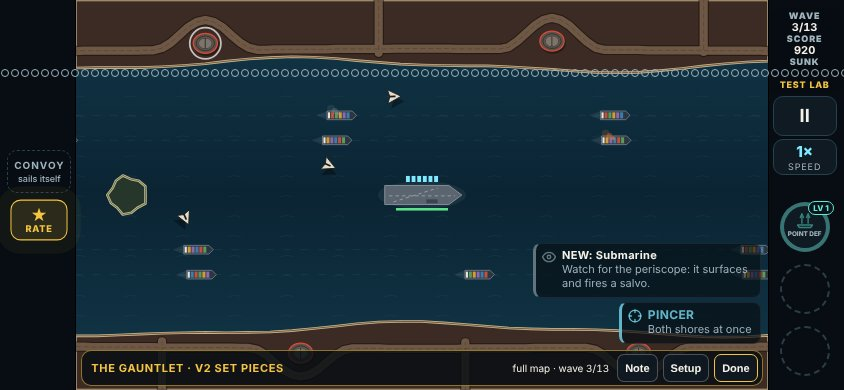
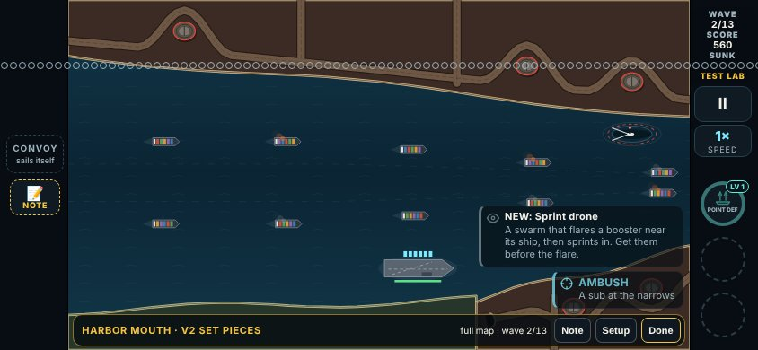

# V3 round 12: encounter versions — set pieces and enemy pairs

**Date:** 2026-11-14. Test Lab round 12 is `{ n: 12, date: '2026-11-14', since: '2026-11-15T00:00' }` (after round 11's builds, stamped from 2026-11-14T21:00).

**Why.** Your full-map playtest kept all three reference maps. But the round 11 encounters were hard to see: on The Strait, encounter launches did about 13 of 62 hull hits. You asked to "make a few different versions of the same maps with different encounters and see which ones do the best". This round makes three versions of each reference map. Each version is built round one idea, so the scorecard can tell us which idea works.

## The three versions

- **v1 Original.** The nine encounters from round 11, unchanged: one small scripted moment in most waves.
- **v2 Set pieces.** Four big encounters a map, each named on screen as it starts. Quiet waves sit between them. The set-piece waves get more of the wave budget and the quiet waves get less. Over waves 1–10 the total is no bigger than the shared waves.
- **v3 Enemy pairs.** An encounter in most waves, each built from one of the enemy pairs (`src/v3/data/pairs.ts`). Each pair is **taught** alone first, then **combined** with the wave's own fire, then two pairs **overlap**. Every v3 wave gives up 5–35% of its own fire to pay for its pair.

**The call-out.** As a v2 encounter's first warning shows (the bases light, a periscope rises, an arrow points), a call-out names it, for example **PINCER: Both shores at once**. It is a "warn" card in the corner: short, and it never stops play. Every encounter has a call-out line, but only v2 turns them on. A link can turn them on or off for any version: `?lab=map-strait&callouts=1`.

**Guests (v3).** The reference maps are all chapter 1. Chapter 1 has one pair of its own (Hydra + Drone Swarm), so v3 brings some later-chapter enemies onto these maps on purpose: the Scavenger, the Attack Helicopter, the Torpedo Sub, the Armored Drone, the Spotter and the Siege Battery. Each map lists its guests (`MAP_VERSIONS[map].v3.guests`). A test fails if a pair uses any other enemy from a later chapter.

## Wave by wave

The bold name is the wave's encounter. A % is that wave's share of the shared wave's drones and missiles (no % means 100%).

### The Strait (the three-base sweep)

| Wave | v1 Original | v2 Set pieces | v3 Enemy pairs |
|---|---|---|---|
| 1 | – | quiet · 90% | – |
| 2 | **Ranging shots** | quiet · 85% | **Hydra in the swarm** (Hydra + Drone Swarm) · 95% |
| 3 | **Ranging shots** | **The sweep**: the three bases fire in turn, west to east · 115% | **Hydra and shells** · 90% |
| 4 | **Ranging shots** | quiet · 85% | **The Scavenger** (Scavenger + Drone Swarm) |
| 5 | **The screen** | **Both sides**: subs north and south of the lane · 115% | **Scavenger and shells** · 80% |
| 6 | **The screen** | quiet · 85% | **Helicopter and sub** (Attack Helicopter + Torpedo Sub) · 85% |
| 7 | **The screen** | quiet · 85% | **Helicopter, sub and a swarm** · 85% |
| 8 | **Rolling push** | **Air raid**: a bomber and a swarm under it · 115% | **Two swarms with company** (Scavenger + Hydra pairs) |
| 9 | **Rolling push** | quiet · 85% | **Air, water and a Hydra** (helicopter + sub, Hydra) · 75% |
| 10 | **Rolling push** | **The long sweep**: east to west this time | **Finale: Hydra and helicopter** · 70% |

### The Gauntlet (a true two-shore pincer)

| Wave | v1 Original | v2 Set pieces | v3 Enemy pairs |
|---|---|---|---|
| 1 | – | quiet · 90% | – |
| 2 | **North, then south** | quiet · 85% | **Hydra in the swarm** · 95% |
| 3 | **North, then south** | **Pincer**: both shores at once · 115% | **Hydra across the channel** · 80% |
| 4 | **North, then south** | quiet · 95% | **Plates and a Hydra** (Armored Drones + Hydra) · 80% |
| 5 | **Overlap** | **Scissors**: shells north, a missile south | **Plates over the channel** · 75% |
| 6 | **Overlap** | quiet · 85% | **Truck, then gun** (Siege Battery + Rocket Truck) · 75% |
| 7 | **Overlap** | quiet · 85% | **Launchers and a swarm** · 85% |
| 8 | **Crossfire** | **Channel run**: a strafer down the channel · 85% | **Hydras on both shores** (Hydra + armored pairs) · 65% |
| 9 | **Crossfire** | quiet · 85% | **Launchers and a Hydra** · 85% |
| 10 | **Crossfire** | **Full pincer**: all four bases | **Finale: launchers and plates** · 80% |

### Harbor Mouth (a submarine ambush at the narrows)

| Wave | v1 Original | v2 Set pieces | v3 Enemy pairs |
|---|---|---|---|
| 1 | **Open water** | quiet · 90% | – |
| 2 | **Open water** | **Ambush**: a sub at the narrows · 105% | **Hydra in the swarm** · 90% |
| 3 | **Open water** | quiet · 95% | **Hydra off the headland** · 85% |
| 4 | **Funnel salvo** | **Headlands**: both headlands on the neck · 110% | **Helicopter and sub** · 80% |
| 5 | **Funnel salvo** | quiet · 95% | **Helicopter over the neck** · 65% |
| 6 | **Funnel salvo** | quiet · 95% | **Painted ship** (Spotter + Siege Battery) · 70% |
| 7 | **Funnel salvo** | **Wolf pack**: two subs, the mouth and behind you | **Painted at the neck** · 65% |
| 8 | **The last mile** | quiet · 90% | **Two Hydras** · 75% |
| 9 | **The last mile** | quiet · 90% | **Hydra and the sub** · 65% |
| 10 | **The last mile** | **Harbor gate**: everything at the neck | **Finale: Hydra and Spotter** · 75% |

Harbor Mouth's set pieces fall on waves 2, 4, 7 and 10, not 3, 5, 8 and 10. Its shared wave 5 is already a step up (strafers, bombers and a heavy arrive by then), and waves 8 and 9 (the v1 cliff) stay quiet.

## How to test

1. Open the Test Lab and the **Maps** section. Each reference map has three cards together: **The Strait** (v1), **The Strait · v2 Set pieces** and **The Strait · v3 Enemy pairs**, then the same for **The Gauntlet** and **Harbor Mouth**. Each card opens on its production setup: the full map from wave 1, and the convoy sails itself. There is nothing to set.
2. Play **at 1× speed**. Map by map, play all three versions back to back: v1, v2, v3. Start with Harbor Mouth, because its v1 is the one with the cliff.
3. **Fill the scorecard after every run**, won or lost. The review page groups the scores by version on the map's own card, so v1, v2 and v3 show side by side.
4. **Pause** in any wave to see that version's script.

## What the bots measured

**Setup.**
- Every row is the card's own production setup, made the way the hub starts it (`labRunPlan`).
- 48 seeds per bot (900–947).
- Bots: `you` (fitted to you, base gun), `tryhard` (Wide Warhead 3) and `casual` (base gun).
- Raw results: `tools/v3/map-lab/results/round12-versions.json`. Made by `npx vite-node tools/v3/map-lab/versions.ts -- --seeds=48 --json=…`; the tables are printed by `node tools/v3/map-lab/versions-tables.mjs`.

**How to read it.** The bots are weaker than you. `you` loses all three maps nearly every time, near wave 7–9, while you won The Strait with 3 ships lost. So read the table as a **comparison between versions**, not as how hard a map is.

### Fair difficulty for the `you` bot

| Map | Version | Wave reached | Ships lost (1–10) | First loss | Encounter share of hull hits |
|---|---|---|---|---|---|
| The Strait | v1 | 8.6 | 5.8 | wave 5.6 | 20% |
| | v2 | 8.9 | 5.6 | wave 5.0 | 9% |
| | v3 | 8.5 | 5.9 | wave 5.1 | 31% |
| The Gauntlet | v1 | 8.0 | 5.5 | wave 5.4 | 22% |
| | v2 | 8.3 | 5.1 | wave 5.0 | 18% |
| | v3 | 7.6 | 5.5 | wave 5.0 | 33% |
| Harbor Mouth | v1 | 7.5 | 5.9 | wave 4.0 | 19% |
| | v2 | 7.6 | 5.4 | wave 5.0 | 6% |
| | v3 | 7.0 | 5.6 | wave 4.2 | 28% |

On every map the three versions end within half a wave of each other for `you`. No version wins by being easier. For `tryhard`, the win rates are:

| Map | v1 | v2 | v3 |
|---|---|---|---|
| The Strait | 63% | 63% | 77% |
| The Gauntlet | 2% | 0% | 0% |
| Harbor Mouth | 2% | 15% | 25% |

### Cliffs

**Instrument.** The difficulty curve is measured with the run kept going: no loss limit, and the carrier can't sink. So every seed plays every wave, and ships lost per wave is measured on all 48. The `tryhard` rows are the cleanest, because a stronger player's run is not already falling apart by wave 8.

**Ships lost per wave, `tryhard`:**

| Map | Version | Waves 1 → 10 | Biggest step up |
|---|---|---|---|
| Harbor Mouth | v1 | 0.0 · 0.0 · 0.1 · 0.2 · 0.7 · 0.7 · 0.9 · **2.9** · 3.8 · 4.3 | +2.0 on wave 8 (it triples) |
| | v2 | 0.0 · 0.1 · 0.1 · 0.1 · 0.3 · 0.7 · 1.0 · 2.1 · 3.2 · 4.1 | +1.1 on wave 9 |
| | v3 | 0.0 · 0.0 · 0.1 · 0.1 · 0.5 · 0.6 · 1.3 · 1.1 · 2.2 · 3.8 | +1.6 on wave 10 |
| The Gauntlet | v1 | 0.0 · 0.0 · 0.1 · 0.1 · 0.3 · 0.4 · 0.6 · **2.7** · 2.4 · 2.7 | +2.0 on wave 8 |
| | v2 | 0.0 · 0.0 · 0.1 · 0.0 · 0.5 · 0.4 · 0.4 · **2.4** · 1.7 · 3.4 | +2.0 on wave 8 |
| | v3 | 0.0 · 0.0 · 0.0 · 0.1 · 0.3 · 0.3 · 1.2 · 1.9 · 2.1 · 2.5 | +1.0 on wave 7 |
| The Strait | v1 | 0.0 · 0.0 · 0.0 · 0.1 · 0.3 · 0.2 · 0.5 · 1.0 · 1.3 · 2.3 | +1.0 on wave 10 |
| | v2 | 0.0 · 0.0 · 0.2 · 0.0 · 0.1 · 0.2 · 0.2 · 0.4 · 0.8 · **2.6** | +1.8 on wave 10 |
| | v3 | 0.0 · 0.0 · 0.0 · 0.0 · 0.1 · 0.3 · 0.4 · 0.4 · 1.1 · 1.7 | +0.8 on wave 9 |

**What the curve says:**

- **Harbor Mouth's wave 8 cliff is gone in v2 and v3.** In v1, ships lost triple from wave 7 to wave 8. In v2 and v3 the losses climb a step at a time and no wave triples. In the normal runs, the biggest one-wave step for any bot falls from +1.4 ships (v1) to +0.9 or less.
- **The Gauntlet's wave 8 is a cliff in its shared waves.** v1 and v2 both have it. v3 smooths it only because it gives up 35% of that wave's fire. That is a finding for the checklist, not for any one version.
- **v2 does what it says.** Its peaks are sharper and its quiet waves are quieter: The Strait's wave 10 is its hardest moment. Only Harbor Mouth's v2 was flattened on purpose.

### Other numbers

- **Encounter hits.**
  - v3's pairs do 23–34% of the hull damage in waves 1–10, against v1's 15–29%.
  - v2's set pieces do the least, 6–22%. Their shells and swarms are big, but they are announced and mostly shot down.
  - So v2 should feel the most readable, and v3 the most "the encounter got me".
- **Most threats on screen at once.** About the same in every version: 7–12 in waves 1–10. v3 is lowest, because a pair is a few tough enemies rather than a cloud.
- **Carrier hull.** v2 costs the carrier more on Harbor Mouth (6.4–8.0 hull, against 3.0–3.9 in v1). Its set pieces aim at the ships near the neck, close to the carrier.

## Tuning done

| Map | Change | Why |
|---|---|---|
| All, v2 | Set-piece waves 115% (first draft 125%); quiet waves 85% (first draft 80%) | — |
| The Strait, v2 | **The sweep** lost its guided missile; **Air raid** lost its strafer (wave 8 rose 1.6 ships in one step); **The long sweep** went from two guided missiles and a supersonic to one missile | — |
| The Gauntlet, v2 | **Scissors** went from two guided missiles at the lead ship to one; **Channel run** went from two strafers to one; **Full pincer** lost its strafer; waves 5 and 8 got less budget | Its shared waves 5 and 8 are already steps up |
| Harbor Mouth, v2 | Set pieces moved to waves 2, 4, 7 and 10; gentler budget (90–110%) | Was a +0.9 to +1.25 step at wave 5 |
| All, v3 | The climaxes went from three pairs to two | Wave 10 rose 1.4–1.8 ships for `tryhard` |
| All, v3 | Each map's waves have their own budget; the heavy pairs' teach waves give up the most | — |
| All, v3 | A Hydra counts as a whole drone swarm (as the game's own planner counts new enemies) | — |
| All, v3 | Two-swarm overlaps take missiles out of the wave too | By the middle waves most of a wave's drones are already gone |
| Harbor Mouth, v3 | The helicopter + sub and the Spotter + gun never overlap; wave 8 is two Hydra pairs | It was a +1.3 to +2.6 step at wave 9 |

**ENCOUNTER_REV is 2.**
- v1's beats are unchanged, so a rev 1 log replays as before. A test checks this.
- A run's version is in its `EncounterSetup` (`version`, and `callouts` when a link set it), so the sim plays it from the log.
- It is also in the log's `lab.variant` and `labResult.variant`, so the review page groups by it.

## What we'll learn for the checklist

- **Big and named, or many and small?** Your scorecard on v2 against v1 (Fun, Readability, Pacing, Variety) tells us whether a map should be built round a few announced set pieces with quiet waves between, or one small moment a wave.
- **Do enemy pairs belong on the maps?** v3 against v1 tells us whether a pair makes a better encounter than a hand-placed beat. If it does, every map gets its chapter's pairs, taught, then combined, then overlapped.
- **Cliffs are a wave-table problem, not an encounter problem.** The Gauntlet's wave 8 and Harbor Mouth's wave 8 are steep in their shared waves. Checklist item: no wave should lose more than about twice the wave before it. Measure it with this curve.
- **Readable is not the same as harmless.** v2's set pieces are the most announced and do the least damage. If v2 scores best on Readability but worst on Difficulty, the next build makes the set pieces bite without hiding them.

## Questions on the page

- **r12-callouts.** Should every map name its big moments on screen, whichever version wins?
- **r12-guests.** If you like v3, may the early maps borrow later-chapter pairs?

## Judgement calls

- **A card per version, not a picker on the map card.**
  - You asked to pick a version "with no settings fiddling". A card is one tap and opens on its production setup.
  - The hub's to-test list asks for each one, and each keeps its own verdict and notes.
  - The map's own card stays v1, and shows every version's runs side by side on the review page (`labResultDocs` folds them in).
- **The map's own card has a round 12 line, so it asks to be played again.** Round 11's v1 scores are on an older card version, so the page leaves them out of this round's averages. That way the three versions are compared on the same build.
- **v3 borrows later-chapter enemies** (see Guests). It is the only way to try the pairs on chapter 1 maps. The second question asks whether that should stay.
- **The scale.** A version moves fire between waves but never adds to the ten (a test checks this). A v3 wave gives up more than its pair's launch count, because a helicopter or a siege gun is worth more than a drone.
- **The fairness target is the `you` bot's wave reached, within half a wave of v1.** Win rates for `you` are near zero on every version, so they can't separate them.
- **The Gauntlet's shared wave 8 is left as it is.** This round is about encounters, and the campaign is unchanged.
- **The Map & Convoy Lab baseline was not rewritten.** `npm run v3:map-lab -- baseline` replays all 12 stored runs exactly. Encounters are lab-only, and the campaign is unchanged.

## Checks

| Check | Result |
|---|---|
| `npx tsc --noEmit` | clean |
| `npx vitest run --exclude '.claude/**'` | 61 files, 1580 tests, all pass (`tests/v3/round12.test.ts` is new; `tests/v3/encounters.test.ts` now covers every version) |
| `npx vite build`, `npm run build:store` | both build |
| `e2e/v3.mjs` | 202 pass |
| `e2e/v3-encounters.mjs` | 14 pass |
| `e2e/v3-map-cards.mjs` | 27 pass |
| `e2e/v3-convoy.mjs` | 35 pass |
| `e2e/v3-map-lab.mjs` | 18 pass |
| `e2e/v3-map-analytics.mjs` | 24 pass |
| `e2e/v3-audio.mjs` | 16 pass |
| `npm run v3:map-lab -- baseline` | all 12 stored runs replay exactly (not rewritten) |

The screenshots are made by `node tools/v3/round12/shots.mjs` (844 x 390, 1x).
