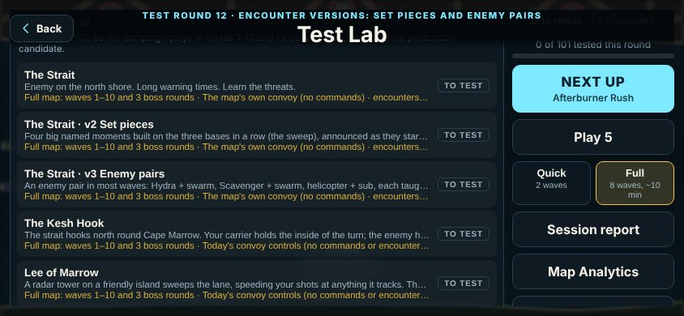
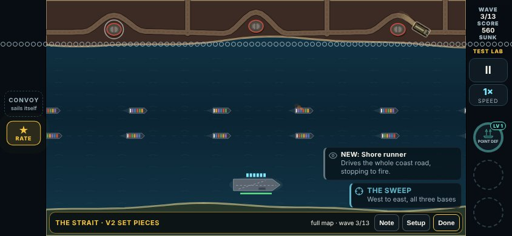
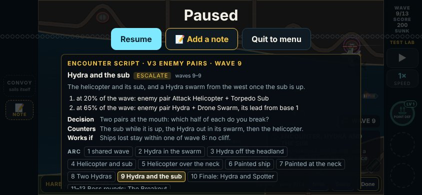
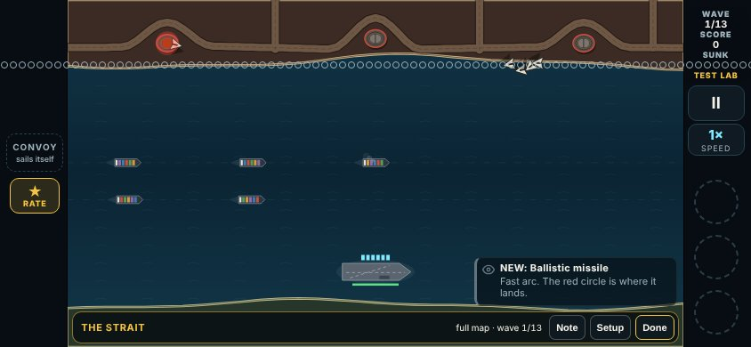
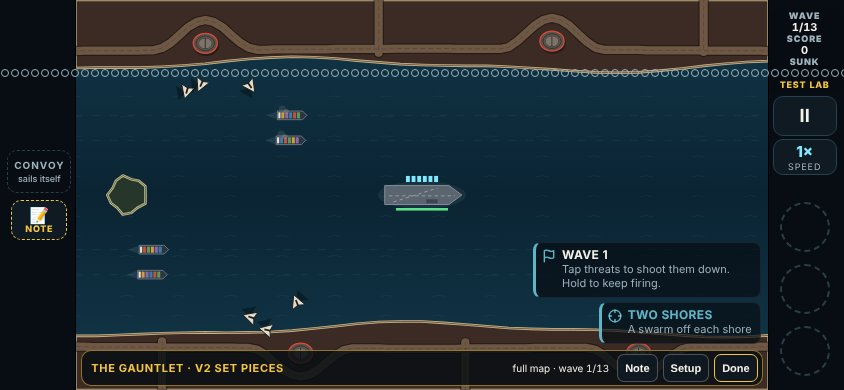
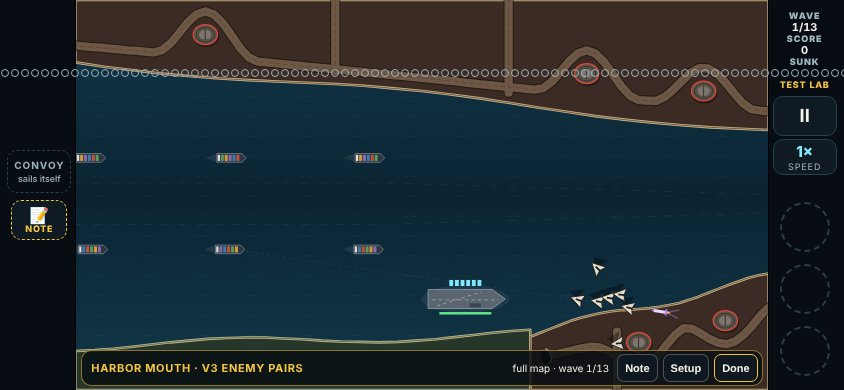
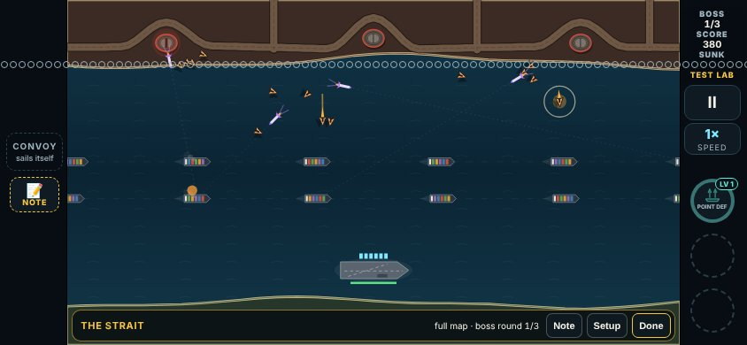
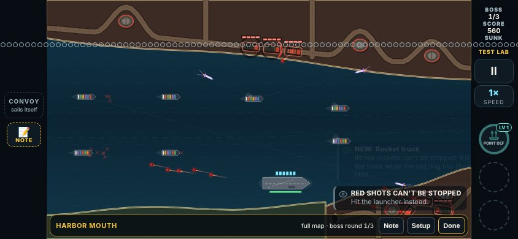

# V3 round 12: encounter versions — set pieces and enemy pairs

**Date:** 2026-11-14. Test Lab round 12 is `{ n: 12, date: '2026-11-14', since: '2026-11-15T00:00' }` (after round 11's builds, stamped from 2026-11-14T21:00).

**Why.** Your full-map playtest kept all three reference maps. But the round 11 encounters were hard to see: on The Strait, encounter launches did about 13 of 62 hull hits. You asked to "make a few different versions of the same maps with different encounters and see which ones do the best". This round makes three versions of each reference map. Each version is built round one idea, so the scorecard can tell us which idea works.

**Round 12's fixes.** Before you play this round, it also carries fixes from your round 11 scorecards: see [From the round 11 scorecards](#from-the-round-11-scorecards). Every number in this doc is measured after them.

## From the round 11 scorecards

You played round 11 (the v1 encounters) on all three reference maps at 1×, and filled a scorecard each time.

**What you found.**

- **The Strait:** won, one ship lost all run. Fun 3, difficulty "a bit easy", variety 3, map feel 3, boss rounds 3, weakest wave: 1. The Afterburner Rush (24 sprint drones a round) hit the ships 4 times in three rounds and sank none.
- **The Gauntlet:** lost in boss round 3. Fun 3, difficulty right, boss rounds **5**, weakest wave: 1. The Rocket Convoy sank 6 ships over its three rounds. Your note: "The rocket truck speed off too fast when they are done shooting, they should go at normal speeds."
- **Harbor Mouth, two runs.** With Overdrive and Railgun (weapons you aim) you lost at wave 8: "The last mile" (36 enemies) sank 4 ships in 46 s. With Airstrike, Seeker and Drone Screen all maxed (weapons that fire themselves) you won with 2 ships lost, and wave 8 sank 1. Fun 4 both times, boss rounds 3, weakest wave: 1. The Breakout sank no ships in its three rounds.

**What it says.**

- A boss round lands only when it sinks ships. The Gauntlet's did, and scored 5; the other two sank nothing and scored 3.
- Wave 1 (10–12 plain drones for about 25 s, most often with no encounter) is the weakest wave on every map.
- Fun goes with pressure. Readability was 5 everywhere, so more pressure costs nothing there.
- Harbor Mouth's wave 8 tests your build; it is not an unfair wall. Round 12 had flattened it in v2 and v3, and that was too far.

**What changed.** Each change applies to all three versions of a map, so the versions stay fair to compare.

1. **Rocket trucks drive off at normal speed.** Done firing, an event's truck backed off at its drive-in speed × 2.5: about 7 × a truck's speed. Now every truck drives off at its own speed (`FOE.rocketTruck.leave` = 1 × the truck's 75 px/s, and the wave's pace). The Rocket Convoy's and the Breakout's trucks still drive in fast (`drive` 2.8 and 2.4).
2. **The Strait's and Harbor Mouth's boss rounds sink ships.**
   - **Afterburner Rush:** still six sprint swarms, and a Hydra rides in a second behind each one, out of the same base, at 0.75 of its speed (`EV.rush.hydras` 6).
   - **The Breakout:** its three phases stay. The trucks come as the no-ammo opening ends (8 s, was 16 s), three down each of the map's two shore roads (six, was two down one).
   - The banner and the three rounds are as they were.
3. **Wave 1 says something about the map, in every version.** Each version's wave 1 now carries its first encounter, or a light opener drawn from it (encounters rev 3):
   - The Strait: v1 **Ranging shots** (one shell from the middle base); v2 **First light**, a small named sweep (a few drones west, a shell from the middle, a few drones east); v3 **Hydra in the swarm**.
   - The Gauntlet: v1 **North, then south** (two drones a shore); v2 **Two shores**, named (a swarm off each shore at once); v3 **Hydra in the swarm**.
   - Harbor Mouth: v1 already opened with **Open water**; v2 **First periscope**, named (one shell into the funnel); v3 **Hydra in the swarm**.
   - Each stays easy: no ship lost on wave 1 by the `you` or `casual` bot on any card (48 seeds each). A v3 opener launches early, from the base furthest from the convoy: from a nearer base the Hydra sank a ship in one run in ten.
   - v2's openers are small call-outs, not set pieces: its four set pieces stay its peaks.
4. **The Strait is a little harder on waves 5–10:** about 10% more of each wave's own fire, the same in all three versions (`MAP_FIRE`). It is in the encounter layer, so the campaign's Strait is unchanged. The extra launches come after the planner (two thirds as one drone swarm, the rest missiles), because a submarine fills its salvo whatever it is given and extra missiles in the plan mostly vanished into the salvos.
5. **Harbor Mouth's rule, softened.** The new rule: a wave may hurt, but must not end the run for every kit. Wave 8 is the shared wave again in v2 (100%, was 90%) and v3 (100%, was 75%; its two Hydra pairs now take drones out of the wave rather than missiles).
6. **The comparison, measured again.** Every bot table below was measured again on the same 3 bots × 48 seeds, after all of the above.

**Boss rounds, before and after.** v1 on each map, every seed playing all three boss rounds (no loss limit, the carrier can't sink), ships lost over the three rounds:

| Map | `you` | `tryhard` | `casual` |
|---|---|---|---|
| The Strait | 2.0 → **14.4** | 0.2 → **6.1** | 2.2 → **14.9** |
| The Gauntlet (the reference) | 17.4 → 18.3 | 14.3 → 14.1 | 19.0 → 20.9 |
| Harbor Mouth | 4.3 → **11.8** | 0.7 → **7.7** | 4.8 → **12.8** |

In v1 The Strait's boss rounds now cost 44–79% of what the Gauntlet's cost the same bot, and Harbor Mouth's 55–64% (every version is in the table below: 28–79% and 43–66%). The target was "about one ship a round for a competent player, like the Gauntlet's". The bots lose far more than you: on the Gauntlet you lost 6 ships in three rounds, `tryhard` 14. So "as many as the Gauntlet" for the bots would be two a round for you, and "one a round" about half the Gauntlet's. The choice sits between: about two thirds of the Gauntlet for `you` and `casual`, about half for `tryhard`.

- Chosen by measurement (32 seeds, `you` and `tryhard`, the share of the Gauntlet's boss losses): four rocket trucks behind the rush cost 24–39%; four Hydras 28–62%; six Hydras 53–80%; six volleys of two shells 84–95% (and the shells did most of it, so it would no longer be a rush). Six Hydras keep the rush and land.
- The Breakout: trucks from 8 s, three a road, cost 58–67%; from 6 s, 58–72%. 8 s keeps the opening's no-ammo phase whole.
- The Gauntlet is not harder for `tryhard` (14.3 → 14.1). The weaker bots lose 1–2 more ships over three rounds, within the spread of 48 seeds; the trucks now stay on screen longer as they leave, and the bots spend taps on them.

## The three versions

- **v1 Original.** The nine encounters from round 11, unchanged: one small scripted moment in most waves.
- **v2 Set pieces.** Four big encounters a map, each named on screen as it starts. Quiet waves sit between them. The set-piece waves get more of the wave budget and the quiet waves get less. Over waves 1–10 the total is no bigger than the shared waves.
- **v3 Enemy pairs.** An encounter in most waves, each built from one of the enemy pairs (`src/v3/data/pairs.ts`). Each pair is **taught** alone first, then **combined** with the wave's own fire, then two pairs **overlap**. Every v3 wave gives up 5–35% of its own fire to pay for its pair.

**The call-out.** As a v2 encounter's first warning shows (the bases light, a periscope rises, an arrow points), a call-out names it, for example **PINCER: Both shores at once**. It is a "warn" card in the corner: short, and it never stops play. Every encounter has a call-out line, but only v2 turns them on. A link can turn them on or off for any version: `?lab=map-strait&callouts=1`.

**Guests (v3).** The reference maps are all chapter 1. Chapter 1 has one pair of its own (Hydra + Drone Swarm), so v3 brings some later-chapter enemies onto these maps on purpose: the Scavenger, the Attack Helicopter, the Torpedo Sub, the Armored Drone, the Spotter and the Siege Battery. Each map lists its guests (`MAP_VERSIONS[map].v3.guests`). A test fails if a pair uses any other enemy from a later chapter.

## Wave by wave

The bold name is the wave's encounter. A % is that wave's share of the shared wave's drones and missiles (no % means 100%).

### The Strait (the three-base sweep)

| Wave | v1 Original | v2 Set pieces | v3 Enemy pairs |
|---|---|---|---|
| 1 | **Ranging shots** (opener: one shell) | **First light** (opener: a small sweep, named) · 90% | **Hydra in the swarm** (opener) |
| 2 | **Ranging shots** | quiet · 85% | **Hydra in the swarm** (Hydra + Drone Swarm) · 95% |
| 3 | **Ranging shots** | **The sweep**: the three bases fire in turn, west to east · 115% | **Hydra and shells** · 90% |
| 4 | **Ranging shots** | quiet · 85% | **The Scavenger** (Scavenger + Drone Swarm) |
| 5 | **The screen** | **Both sides**: subs north and south of the lane · 115% | **Scavenger and shells** · 80% |
| 6 | **The screen** | quiet · 85% | **Helicopter and sub** (Attack Helicopter + Torpedo Sub) · 85% |
| 7 | **The screen** | quiet · 85% | **Helicopter, sub and a swarm** · 85% |
| 8 | **Rolling push** | **Air raid**: a bomber and a swarm under it · 115% | **Two swarms with company** (Scavenger + Hydra pairs) |
| 9 | **Rolling push** | quiet · 85% | **Air, water and a Hydra** (helicopter + sub, Hydra) · 75% |
| 10 | **Rolling push** | **The long sweep**: east to west this time | **Finale: Hydra and helicopter** · 70% |

On every version, waves 5–10 also send about 10% more of their own drones and missiles (round 12's fixes, below).

### The Gauntlet (a true two-shore pincer)

| Wave | v1 Original | v2 Set pieces | v3 Enemy pairs |
|---|---|---|---|
| 1 | **North, then south** (opener: two drones a shore) | **Two shores** (opener: a swarm off each shore, named) · 90% | **Hydra in the swarm** (opener) |
| 2 | **North, then south** | quiet · 85% | **Hydra in the swarm** · 95% |
| 3 | **North, then south** | **Pincer**: both shores at once · 115% | **Hydra across the channel** · 80% |
| 4 | **North, then south** | quiet · 95% | **Plates and a Hydra** (Armored Drones + Hydra) · 80% |
| 5 | **Overlap** | **Scissors**: shells north, a missile south | **Plates over the channel** · 75% |
| 6 | **Overlap** | quiet · 85% | **Truck, then gun** (Siege Battery + Rocket Truck) · 75% |
| 7 | **Overlap** | quiet · 85% | **Launchers and a swarm** · 85% |
| 8 | **Crossfire** | **Channel run**: a strafer down the channel · 85% | **Hydras on both shores** (Hydra + armored pairs) · 65% |
| 9 | **Crossfire** | quiet · 85% | **Launchers and a Hydra** · 85% |
| 10 | **Crossfire** | **Full pincer**: all four bases | **Finale: launchers and plates** · 80% |

### Harbor Mouth (a submarine ambush at the narrows)

| Wave | v1 Original | v2 Set pieces | v3 Enemy pairs |
|---|---|---|---|
| 1 | **Open water** | **First periscope** (opener: one shell, named) · 90% | **Hydra in the swarm** (opener) |
| 2 | **Open water** | **Ambush**: a sub at the narrows · 105% | **Hydra in the swarm** · 90% |
| 3 | **Open water** | quiet · 95% | **Hydra off the headland** · 85% |
| 4 | **Funnel salvo** | **Headlands**: both headlands on the neck · 110% | **Helicopter and sub** · 80% |
| 5 | **Funnel salvo** | quiet · 95% | **Helicopter over the neck** · 65% |
| 6 | **Funnel salvo** | quiet · 95% | **Painted ship** (Spotter + Siege Battery) · 70% |
| 7 | **Funnel salvo** | **Wolf pack**: two subs, the mouth and behind you | **Painted at the neck** · 65% |
| 8 | **The last mile** | quiet · 100% (was 90%) | **Two Hydras** · 100% (was 75%) |
| 9 | **The last mile** | quiet · 90% | **Hydra and the sub** · 65% |
| 10 | **The last mile** | **Harbor gate**: everything at the neck | **Finale: Hydra and Spotter** · 75% |

Wave 1's openers (round 12's fixes) are light, and not set pieces: v2's four set pieces stay its peaks. A v3 opener launches early, out of the base furthest from the convoy.

Harbor Mouth's set pieces fall on waves 2, 4, 7 and 10, not 3, 5, 8 and 10. Its shared wave 5 is already a step up (strafers, bombers and a heavy arrive by then), and wave 9 stays quiet. Wave 8 (the v1 cliff) was quiet too, but round 12's fixes made it the shared wave again: it should test your build, not be flattened.

## How to test

1. Open the Test Lab and the **Maps** section. Each reference map has three cards together: **The Strait** (v1), **The Strait · v2 Set pieces** and **The Strait · v3 Enemy pairs**, then the same for **The Gauntlet** and **Harbor Mouth**. Each card opens on its production setup: the full map from wave 1, and the convoy sails itself. There is nothing to set.
2. Play **at 1× speed**. Map by map, play all three versions back to back: v1, v2, v3. Start with Harbor Mouth, because its v1 is the one with the cliff.
3. **Fill the scorecard after every run**, won or lost. The review page groups the scores by version on the map's own card, so v1, v2 and v3 show side by side.
4. **Pause** in any wave to see that version's script.

## What the bots measured

**Setup.**
- Every row is the card's own production setup, made the way the hub starts it (`labRunPlan`).
- 48 seeds per bot (900–947).
- Bots: `you` (fitted to you, base gun), `tryhard` (Wide Warhead 3) and `casual` (base gun).
- Raw results: `tools/v3/map-lab/results/round12-versions.json`. Made by `npx vite-node tools/v3/map-lab/versions.ts -- --seeds=48 --maps=<map> --json=…` for each map and `-- --seeds=48 --kits=harbor --kits-only --json=…` for the kits, side by side, then `-- --merge=…` into one file; the tables are printed by `node tools/v3/map-lab/versions-tables.mjs`.
- Measured after round 12's fixes. The numbers before them are in this file's history (round 12's first commit).

**How to read it.** The bots are weaker than you. `you` loses all three maps nearly every time, near wave 7–9, while you won The Strait with one ship lost. So read the table as a **comparison between versions**, not as how hard a map is.

### Fair difficulty for the `you` bot

| Map | Version | Wave reached | Ships lost (1–10) | First loss | Encounter share of hull hits |
|---|---|---|---|---|---|
| The Strait | v1 | 8.5 | 5.6 | wave 5.0 | 18% |
| | v2 | 8.6 | 5.8 | wave 4.6 | 9% |
| | v3 | 8.4 | 5.9 | wave 4.9 | 33% |
| The Gauntlet | v1 | 8.0 | 5.4 | wave 5.3 | 20% |
| | v2 | 8.3 | 4.8 | wave 5.2 | 18% |
| | v3 | 7.5 | 5.7 | wave 4.4 | 38% |
| Harbor Mouth | v1 | 7.5 | 5.9 | wave 4.0 | 19% |
| | v2 | 7.5 | 5.3 | wave 4.8 | 7% |
| | v3 | 7.0 | 5.8 | wave 4.3 | 28% |

- **The Strait:** the three versions end within 0.2 of a wave of each other.
- **Harbor Mouth:** within half a wave (v3 is 0.5 behind v1 and v2, as before the fixes).
- **The Gauntlet:** v3 ends 0.5 of a wave behind v1 and 0.8 behind v2 (before the fixes: 0.4 and 0.7). Its wave 7 (the truck and the siege gun with a swarm) costs `you` 2.7 ships against v1's 1.4. Giving that wave less of its own fire (70%, not 85%) changed nothing measurable (7.4), so it was put back; the pair itself is what costs. Worth knowing when you score v3 on the Gauntlet.

No version wins by being easier. For `tryhard`, the win rates are (round 12 before the fixes in brackets):

| Map | v1 | v2 | v3 |
|---|---|---|---|
| The Strait | 15% (63%) | 25% (63%) | 44% (77%) |
| The Gauntlet | 0% (2%) | 0% (0%) | 0% (0%) |
| Harbor Mouth | 0% (2%) | 2% (15%) | 6% (25%) |

The Strait's and Harbor Mouth's boss rounds now end runs, as the Gauntlet's do: that is where most of the drop comes from.

### Boss rounds

Every seed plays all three boss rounds (no loss limit, the carrier can't sink). Ships lost over the three rounds, and the share of the Gauntlet's for the same bot and version:

| Map | Version | `you` | `tryhard` | `casual` |
|---|---|---|---|---|
| The Strait | v1 | 14.4 (79%) | 6.1 (44%) | 14.9 (71%) |
| | v2 | 13.7 (75%) | 6.2 (42%) | 14.0 (67%) |
| | v3 | 13.6 (72%) | 4.2 (28%) | 14.4 (70%) |
| The Gauntlet | v1 | 18.3 | 14.1 | 20.9 |
| | v2 | 18.3 | 14.6 | 20.9 |
| | v3 | 18.8 | 14.7 | 20.6 |
| Harbor Mouth | v1 | 11.8 (64%) | 7.7 (55%) | 12.8 (61%) |
| | v2 | 11.4 (62%) | 6.2 (43%) | 12.7 (61%) |
| | v3 | 12.1 (64%) | 7.8 (53%) | 13.5 (66%) |

Before the fixes (v1): The Strait 2.0 / 0.2 / 2.2, Harbor Mouth 4.3 / 0.7 / 4.8, the Gauntlet 17.4 / 14.3 / 19.0. Each boss round's own losses are in the JSON (`curves[].boss`).

### Cliffs

**Instrument.** The difficulty curve is measured with the run kept going: no loss limit, and the carrier can't sink. So every seed plays every wave, and ships lost per wave is measured on all 48. The `tryhard` rows are the cleanest, because a stronger player's run is not already falling apart by wave 8.

**Ships lost per wave, `tryhard`:**

| Map | Version | Waves 1 → 10 | Biggest step up |
|---|---|---|---|
| Harbor Mouth | v1 | 0.0 · 0.0 · 0.1 · 0.2 · 0.7 · 0.7 · 0.9 · **2.9** · 3.8 · 4.3 | +2.0 on wave 8 (it triples) |
| | v2 | 0.0 · 0.0 · 0.0 · 0.2 · 0.3 · 0.6 · 1.0 · **2.0** · 3.0 · 4.9 | +2.0 on wave 10 (wave 8: +1.0, it doubles) |
| | v3 | 0.0 · 0.0 · 0.0 · 0.1 · 0.5 · 0.6 · 1.6 · 1.7 · 2.5 · 3.6 | +1.1 on wave 10 |
| The Gauntlet | v1 | 0.0 · 0.0 · 0.1 · 0.1 · 0.3 · 0.4 · 0.4 · **2.4** · 2.0 · 2.2 | +2.0 on wave 8 |
| | v2 | 0.0 · 0.0 · 0.3 · 0.0 · 0.4 · 0.2 · 0.5 · 1.4 · 1.5 · 3.5 | +2.0 on wave 10 |
| | v3 | 0.0 · 0.0 · 0.1 · 0.1 · 0.4 · 0.5 · 1.3 · 1.9 · 2.2 · 3.3 | +1.0 on wave 10 |
| The Strait | v1 | 0.0 · 0.0 · 0.0 · 0.0 · 0.2 · 0.3 · 0.7 · 1.0 · 1.9 · 2.9 | +1.0 on wave 10 |
| | v2 | 0.0 · 0.0 · 0.1 · 0.0 · 0.0 · 0.1 · 0.5 · 1.0 · 1.2 · **2.4** | +1.2 on wave 10 |
| | v3 | 0.0 · 0.0 · 0.1 · 0.1 · 0.1 · 0.4 · 0.8 · 0.5 · 1.1 · 1.9 | +0.8 on wave 10 |

**What the curve says:**

- **Wave 1 costs nothing on any card** with its new opener (0.0 for every bot and version; a separate check of wave 1 alone, 48 seeds a card, `you` and `casual`: no ship lost).
- **The Strait's waves 5–10 cost more**, the same way in every version: `tryhard` loses 23–25% more ships over waves 5–10 than before the fixes (`you` 2–20%, `casual` 10–34%). The fire went up about 10% (a test checks 5–20% more launches a wave).
- **Harbor Mouth's wave 8 is a test again in v2:** ships lost double from wave 7 (1.0 → 2.0), where v1 triples (0.9 → 2.9). In v3 it stays level with wave 7 for `tryhard` (1.6 → 1.7) and rises 1.3 ships for `you` and 1.9 for `casual`. See the kits below.
- **The Gauntlet's wave 8 is a cliff in its shared waves.** v1 has it; v2 and v3 smooth it by giving up part of that wave's fire. A finding for the checklist, not for any one version.
- **v2 does what it says.** Its peaks are sharper and its quiet waves are quieter: The Strait's wave 10 is its hardest moment.

### Harbor Mouth's wave 8, by kit

You lost at Harbor Mouth's wave 8 with weapons you aim (Overdrive, Railgun) and won with weapons that fire themselves (Airstrike, Seeker, Drone Screen). The bot harness can be given a taste in weapons: `--kits` plays each version with the bot taking those weapons first whenever a draft offers them. It can't force a kit: by wave 8 a run holds about one of the three (aimed) or one and a half (self-firing).

| Version | Bot | Kit | Wave reached | Reached wave 8 | Of those, lost on wave 8 | Ships lost on wave 8 |
|---|---|---|---|---|---|---|
| v1 | `you` | aimed | 7.5 | 54% | 88% | 2.0 |
| | | self-firing | 7.4 | 52% | 84% | 1.7 |
| | `tryhard` | aimed | 8.9 | 98% | 40% | 2.4 |
| | | self-firing | 8.8 | 94% | 42% | 2.1 |
| v2 | `you` | aimed | 7.4 | 46% | 68% | 2.0 |
| | | self-firing | 7.3 | 40% | 68% | 1.9 |
| | `tryhard` | aimed | 9.3 | 94% | 27% | 1.4 |
| | | self-firing | 9.2 | 90% | 16% | 1.0 |
| v3 | `you` | aimed | 7.3 | 44% | 76% | 2.5 |
| | | self-firing | 7.0 | 38% | 83% | 2.4 |
| | `tryhard` | aimed | 10.0 | 94% | 22% | 1.3 |
| | | self-firing | 10.0 | 88% | 24% | 1.6 |

- **The rule holds for the stronger bot:** wave 8 hurts with either kit (1.0–2.4 ships), and ends a quarter or less of `tryhard`'s runs in v2 and v3 (two fifths in v1).
- For `you`, wave 8 ends most of the runs that reach it with either kit, but those runs come in with four or five ships already lost: it is the wave that finishes a run, not one that ends a healthy one.
- **The bots don't show your kit split.** Aimed and self-firing kits end within a few points of each other. The bots aim well at everything and hold only part of a kit, so this is not evidence either way about how the kits play for you. Your scorecards are the measure here.

### Other numbers

- **Encounter hits.**
  - v3's pairs do 21–38% of the hull damage in waves 1–10, against v1's 15–30%.
  - v2's set pieces do the least, 5–25%. Their shells and swarms are big, but they are announced and mostly shot down.
  - So v2 should feel the most readable, and v3 the most "the encounter got me".
- **Most threats on screen at once.** About the same in every version: 7–12 in waves 1–10. v3 is lowest, because a pair is a few tough enemies rather than a cloud.
- **Carrier hull.** v2 costs the carrier more on Harbor Mouth (6.0–8.2 hull, against 3.0–3.9 in v1). Its set pieces aim at the ships near the neck, close to the carrier.

## Tuning done

| Map | Change | Why |
|---|---|---|
| All, v2 | Set-piece waves 115% (first draft 125%); quiet waves 85% (first draft 80%) | — |
| The Strait, v2 | **The sweep** lost its guided missile; **Air raid** lost its strafer (wave 8 rose 1.6 ships in one step); **The long sweep** went from two guided missiles and a supersonic to one missile | — |
| The Gauntlet, v2 | **Scissors** went from two guided missiles at the lead ship to one; **Channel run** went from two strafers to one; **Full pincer** lost its strafer; waves 5 and 8 got less budget | Its shared waves 5 and 8 are already steps up |
| Harbor Mouth, v2 | Set pieces moved to waves 2, 4, 7 and 10; gentler budget (90–110%) | Was a +0.9 to +1.25 step at wave 5 |
| All, v3 | The climaxes went from three pairs to two | Wave 10 rose 1.4–1.8 ships for `tryhard` |
| All, v3 | Each map's waves have their own budget; the heavy pairs' teach waves give up the most | — |
| All, v3 | A Hydra counts as a whole drone swarm (as the game's own planner counts new enemies) | — |
| All, v3 | Two-swarm overlaps take missiles out of the wave too | By the middle waves most of a wave's drones are already gone |
| Harbor Mouth, v3 | The helicopter + sub and the Spotter + gun never overlap; wave 8 is two Hydra pairs | It was a +1.3 to +2.6 step at wave 9 |
| All (round 12's fixes) | Wave 1's openers, lighter: the v1 Gauntlet opener two drones a shore (three sank a ship in one run in 48); Harbor Mouth's v2 periscope one shell (two: 0.06–0.10 ships a run); the v3 Hydra early and from the far base (from a nearer base: 0.06–0.23) | Wave 1 must stay easy: now no ship lost on it for `you` or `casual` on any card |
| The Strait (round 12's fixes) | The extra fire added after the wave planner, not into it | Put into the plan it came out at 3–4%, not 10%: a submarine fills its salvo whatever it is given |
| Boss rounds (round 12's fixes) | Rush: six Hydras (tried four trucks, four Hydras, six volleys of shells). Breakout: trucks from 8 s, three a road (tried 6 s) | See "From the round 11 scorecards" |
| Harbor Mouth, v2 and v3 (round 12's fixes) | Wave 8 back to 100%; v3's wave 8 pairs take drones, not missiles | The new rule: a wave may hurt, but must not end the run for every kit |
| The Gauntlet, v3 (round 12's fixes) | Tried wave 7 at 70% (85%); put back | It changed nothing measurable for `you` (7.5 → 7.4) |

**ENCOUNTER_REV is 3** (round 12's fixes; it was 2).
- Rev 3 adds wave 1's openers and The Strait's extra fire. Both are played only under rev 3: a rev 1 or rev 2 log plays the encounters it had (`encountersFor` and `waveFire` take the log's rev). Tests check this.
- v1's beats are otherwise unchanged, so a rev 1 log replays as before. A test checks this.
- A run's version is in its `EncounterSetup` (`version`, and `callouts` when a link set it), so the sim plays it from the log.
- It is also in the log's `lab.variant` and `labResult.variant`, so the review page groups by it.

**Rev 4, The Gauntlet (map rebuild phase 4, `docs/design/v3-p4-gauntlet.md`).** The Gauntlet's v1 plan is rebuilt to the map and wave rules: nine new encounters (`gauntlet-p4-*`, `rev: 4`), one a wave from 2 to 10, none twice in a row; wave 1 keeps its rev 3 opener. Slice 5's three (`gauntlet-north-then-south`, `gauntlet-overlap`, `gauntlet-crossfire`) keep their beats and get `until: 3`, so a rev 3 log plays them as it did. A new beat aim, `rear` (the ship least far along, on the way in), is used only by rev 4 encounters, so no older log or campaign run changes for it.

## What we'll learn for the checklist

- **Big and named, or many and small?** Your scorecard on v2 against v1 (Fun, Readability, Pacing, Variety) tells us whether a map should be built round a few announced set pieces with quiet waves between, or one small moment a wave.
- **Do enemy pairs belong on the maps?** v3 against v1 tells us whether a pair makes a better encounter than a hand-placed beat. If it does, every map gets its chapter's pairs, taught, then combined, then overlapped.
- **Cliffs are a wave-table problem, not an encounter problem.** The Gauntlet's wave 8 and Harbor Mouth's wave 8 are steep in their shared waves. Checklist item: no wave should lose more than about twice the wave before it. Measure it with this curve.
- **Readable is not the same as harmless.** v2's set pieces are the most announced and do the least damage. If v2 scores best on Readability but worst on Difficulty, the next build makes the set pieces bite without hiding them.

## Questions on the page

- **r12-callouts.** Should every map name its big moments on screen, whichever version wins?
- **r12-guests.** If you like v3, may the early maps borrow later-chapter pairs?

## Judgement calls

- **A card per version, not a picker on the map card.**
  - You asked to pick a version "with no settings fiddling". A card is one tap and opens on its production setup.
  - The hub's to-test list asks for each one, and each keeps its own verdict and notes.
  - The map's own card stays v1, and shows every version's runs side by side on the review page (`labResultDocs` folds them in).
- **The map's own card has a round 12 line, so it asks to be played again.** Round 11's v1 scores are on an older card version, so the page leaves them out of this round's averages. That way the three versions are compared on the same build.
- **v3 borrows later-chapter enemies** (see Guests). It is the only way to try the pairs on chapter 1 maps. The second question asks whether that should stay.
- **The scale.** A version moves fire between waves but never adds to the ten (a test checks this). A v3 wave gives up more than its pair's launch count, because a helicopter or a siege gun is worth more than a drone.
- **The fairness target is the `you` bot's wave reached, within half a wave of v1.** Win rates for `you` are near zero on every version, so they can't separate them.
- **The Gauntlet's shared wave 8 is left as it is.** This round is about encounters, and the campaign is unchanged.
- **Round 12's fixes change the campaign's boss rounds, so the baseline was rewritten.** The rocket trucks' leave speed (your note), the Hydras in the Afterburner Rush and the Breakout's trucks are the game's own events, so they change the campaign as well as the lab: a boss round that sinks nothing is a game problem, not a lab one. The play log is v23 (a v22 log that reaches a boss round no longer replays to the same game). `npm run v3:map-lab -- baseline` showed all 12 stored runs differ only in their log version and, for the 8 that reach a boss round, from wave 11 on; waves 1–10 replay exactly. The baseline was written again (`--write`) and replays exactly. The encounter changes (openers, the Strait's fire, Harbor Mouth's wave 8) are lab-only, and the campaign's waves 1–10 are unchanged.
- **The boss target: between "as many as the Gauntlet" and "one a round".** The bots lose two to three times what you do on the Gauntlet's boss rounds, so "as many as the Gauntlet" for the bots would mean about two a round for you (the Gauntlet's own, which ended your run), and "one a round for a competent player" about half of it. The Strait and Harbor Mouth now cost about two thirds of the Gauntlet for `you` and `casual` and about half for `tryhard`.
- **Hydras for the Rush, not trucks.** Both were suggested; measured, four trucks cost a quarter to two fifths of the Gauntlet's ships, six Hydras about two thirds. A Hydra flies with the swarm, so the round is still a rush; trucks would make it a slower, second Rocket Convoy. (Hydras already come in the Strait's own waves, so it is not an early debut.)
- **The Strait's extra fire is in the encounter layer**, as `MAP_FIRE` (the same for every version), so the campaign's Strait and its baseline are unchanged. It is a lab tuning for now: if it stays, it moves into the map's own `threatScale`.
- **Harbor Mouth's v1 has no opener of its own:** it already opened with its first encounter, Open water.
- **The kit comparison uses the bots' weapon taste**, the closest the harness has to a kit: a run holds one to one and a half of the three weapons by wave 8. The bots don't reproduce your aimed-against-self-firing split, so the kit rule is measured on what they can show: wave 8 must not end every run, with either kit.
- **The Gauntlet's v3 stays 0.5 behind v1 and 0.8 behind v2 for `you`** (0.4 and 0.7 before the fixes). An attempt to ease it (wave 7 at 70%) did nothing, and the gap is in the enemy pair itself. It is noted on the table rather than changed by guesswork.

## Checks

| Check | Result |
|---|---|
| `npx tsc --noEmit` | clean |
| `npx vitest run --exclude '.claude/**'` | 62 files, 1591 tests, all pass (`tests/v3/round12fixes.test.ts` is new) |
| `npx vite build`, `npm run build:store` | both build |
| `e2e/v3.mjs` | 202 pass |
| `e2e/v3-encounters.mjs` | 15 pass (its slice now plays 32 s with nobody shooting, not 40: with the Strait's extra fire the run ended first and the setup sheet never opened; a new check says the run is still going) |
| `e2e/v3-map-cards.mjs` | 27 pass |
| `e2e/v3-convoy.mjs` | 35 pass |
| `e2e/v3-map-lab.mjs` | 18 pass |
| `e2e/v3-map-analytics.mjs` | 24 pass |
| `e2e/v3-audio.mjs` | 16 pass |
| `npm run v3:map-lab -- baseline` | rewritten for the boss-round changes (see Judgement calls); all 12 runs replay exactly |

The screenshots are made by `node tools/v3/round12/shots.mjs` (844 x 390, 1x; `ONLY=fixes` takes just round 12's fixes).

### Round 12's fixes, on screen

