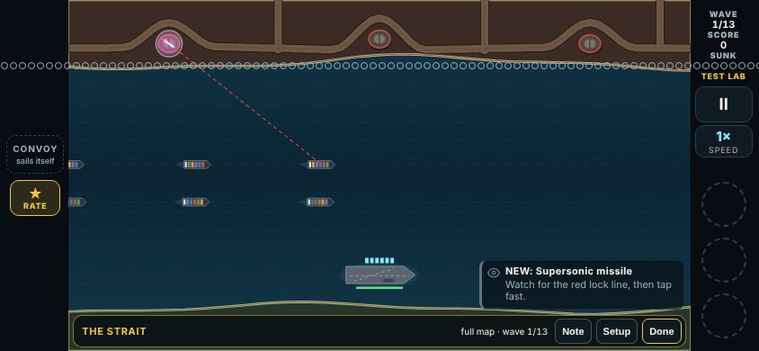
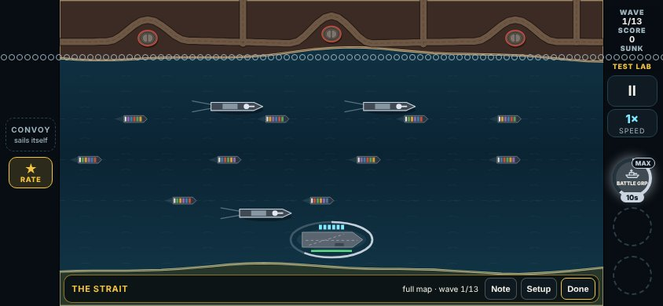
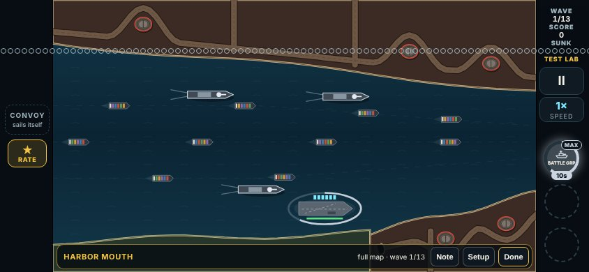
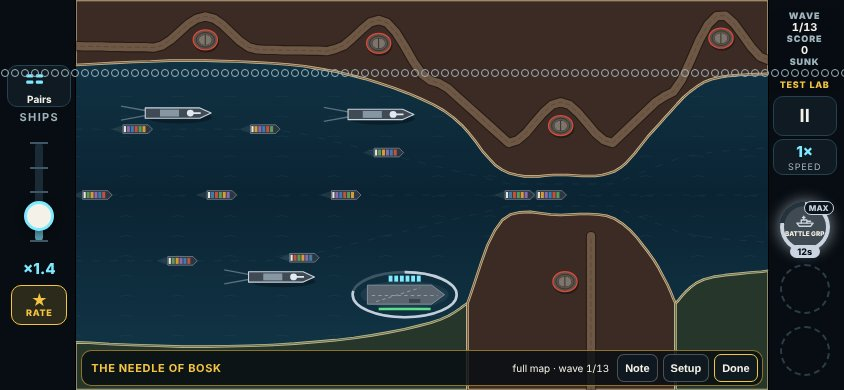

# V3 round 13: frigates give way, munitions on their launchers, the Nuke

**Date:** 2026-11-17. Test Lab round 13 is `{ n: 13, date: '2026-11-17', since: '2026-11-17T00:00' }`. Play log v25.

Three changes, one per section:

1. [Frigates never run over convoy ships](#1-frigates-never-run-over-convoy-ships) (every map). You approved this from the proposal in [the Saltgate doc](v3-saltgate-locks.md#do-escorts-run-over-convoy-ships).
2. [Munitions can't be hit until they are released](#2-munitions-cant-be-hit-until-they-are-released). Your note, The Strait, wave 6.
3. [The Nuke destroys everything on the map](#3-the-nuke-destroys-everything-on-the-map). Your note, The Strait, wave 8.

## 1. Frigates never run over convoy ships

**Before** (measured last round): on 19 maps, all but Saltgate, a frigate's hull lay on a cargo hull 5–26% of the time it was on screen. The closest centres were 0–4 px apart. There were two causes:

- **Where it held station.** A frigate held station at the lane's edge, `min(0.85 × hw, hw − 20)` off the centre line. Spread's outer files sail at 0.8 × hw, and so do Harbor Mouth's opened-out Pairs. On the narrow lanes, Pairs and Box were hit too.
- **How it sailed in and out.** A frigate sailed in and out at 260 px/s through a convoy doing 40. Where the lane narrowed, it moved in toward the centre line, across the files.

### Stations and tracks: clear water outside the widest file

`escortTrack` in `sim/game.ts` works out the line a frigate holds and sails down each side of each lane. It is worked out once per map:

- **The widest file.** At each point along the lane, it finds the widest file that any formation can sail there (`fileReach`). That is slotLat's own rule: one file down the middle of a narrows, Harbor Mouth's Pairs opened out. It holds that width for the ~100 px a hull takes to ease across into a narrower slot.
- **Every hull's place.** Every place a hull of any formation can be, on every lane, becomes one box. Each box is as wide as the files, plus a cargo ship's half-beam. The supertanker's lane gets a box for its own size.
- **The track.** At each point, the track is the nearest line to the files where the frigate's whole hull, as drawn (−74..78 along, ±12 across), meets three tests:
  - it keeps **12 px of clear water** (`ESCORT_WATER`) from every box: about 34 px centre to centre beside a single file;
  - it is on water (the map's own `onLand` test, with 4 px to spare);
  - it is clear of the carrier.
  It searches out from the files, up to 150 px further. It never searches past a shore or the carrier to the water behind them: a frigate couldn't get there.
- **Where there is no such line,** the track still passes the files clear with 6 px of water if it can (`ok`); a station needs the full 12 (`berth`). Failing even that, the track runs as far out as the water goes. That is the stretch where a frigate gives way.

**Stations** are picked as before: the same wanted spots along the lane, edges, carrier clearance and spacing. What changed:

- A station is only a point on that track with full clear water.
- A station the frigate can sail straight in to wins: the track is clear all the way from the lane's entry. A station past a tight stretch is taken only when nothing else will do.
- A frigate may take another lane's water when its own lane has no room.

Because every formation's widest file is counted, a formation change never puts a file under a frigate.

**The four stations with no room** (level 3, measured last round) moved to open water:

| Map | Before | After |
|---|---|---|
| The Kesh Hook | (824, 781), lat 75: on the south files | (624, 833), lat 113, in open water further west. The far frigate still holds the Hook's exit, at (1071, 331) |
| The Island | (744, 236), lat 46 on the north lane: on its files | (408, 280), lat 90, further west where the north lane has room |
| The Needle of Bosk | (856, 419), lat 31: in the mouth of the narrows | (772, 281), lat 169, in the open basin before the narrows |
| The Sharra Delta | (938, 140), lat 38 in the north river | (514, 302), lat 98, on the big river before the fork. The Delta's branches are rivers one formation wide, with banks at 72 px from the centre and no water beside the convoy, so the other two frigates moved too: (660, 606), south of the middle channel, and (313, 317) |

On every other lane map the stations moved straight out from the files. On The Strait they moved from lat 128 to lat 157, which is 120 + 10 + 12 + 12 + 3: Spread's outer file at 120, a ship's half-beam, 12 px of water, a frigate's half-beam, and the 3 px search step.

Every station is at most about 210 px off its lane's centre line, and a frigate reaches 560 px.

### Giving way

`sailLane` in `sim/game.ts` moves the frigate along its track toward its station, or off the lane. Each step, it takes the first of these moves that keeps its hull clear of every cargo hull (4 px of water: `ESCORT_GIVE`) and on water:

1. on at full speed, steering for its track;
2. on at full speed, stepping out sideways into open water;
3. the same two at half speed, then at about the convoy's own speed;
4. holding where it is, stepping out if it can;
5. easing back a little.

Each check uses where every hull is now **and** where it will be a quarter of a second later. So a frigate never moves onto a hull. When nothing has room, the frigate holds behind or beside the hull until there is.

**It never jumps.** Every move is a step at its own speed, and it steps sideways at most 0.45 × 260 px/s, about a 24° steer. It steers for its track early enough for what is ahead (`trackAhead`):

- it moves out ahead of an obstacle on the inside, such as the carrier on Harbor Mouth and Behemoth;
- it moves in ahead of narrowing water;
- it never steers for anything past its goal.

**A tight stretch** is a narrows, the inside of the Kesh Hook, or the carrier close by: anywhere the track doesn't pass the files clear. A frigate goes into one only when `runClear` says it can sail the whole stretch at speed without coming near a hull. `runClear` sails it ahead of time, against where each hull will be. Until then the frigate waits on clear water short of the stretch. A frigate never stops inside a tight stretch, so no hull runs into it from behind. (Ships don't brake for frigates; that is unchanged.)

**Leaving:**

- **On down the lane,** as before, if its track is clear all the way.
- **Backing out:** where a narrows lies ahead (the Needle, the Delta's branches) and the way it came is clear, it backs out that way at half speed, stern first, like Saltgate's berthed frigates. It never turns round: that was your round 8 note.
- **A new drop** calls back a frigate that is backing out, so the two never meet head on.

**Battle Group (level 3) line astern:**

- A frigate never comes within 190 px of the frigate ahead on its own side of its lane.
- New frigates start 260 px behind the last one already on that side.
- On each side of each lane, the frigate furthest along takes the furthest station. No frigate has to pass another, including one called back or still on station.

**Saltgate** keeps its berths: `sailBerthed` is unchanged, and it still shows 0%.

### Before and after: every map

`npx vite-node tools/v3/saltgate/escort-overlap.ts -- before=<old.json>`: levels 1–3 × flows 1 and 3 × Column, Pairs, Spread and Box, 90 s each, frigates called in again whenever the last set has gone. The tool now counts the supertanker at its own size, ±70 × ±16. It can save its numbers (`json=`) and print an older build's beside them (`before=`).

| Map | Before: overlap share | Before: events | Before: closest (px) | After: overlap share | After: events | After: runs hit | After: closest (px) |
|---|---|---|---|---|---|---|---|
| The Strait | 11.4% | 350 | 2 | 0.0% | 0 | 0/24 | 37 |
| The Kesh Hook | 12.8% | 481 | 1 | 0.0% | 0 | 0/24 | 37 |
| Lee of Marrow | 12.0% | 358 | 0 | 0.0% | 0 | 0/24 | 37 |
| The Gauntlet | 5.3% | 118 | 2 | 0.0% | 0 | 0/24 | 37 |
| Harbor Mouth | 23.5% | 644 | 0 | 0.0% | 0 | 0/24 | 32 |
| The Island | 10.0% | 223 | 0 | 0.0% | 0 | 0/24 | 37 |
| The Behemoth Run | 12.5% | 383 | 0 | 0.0% | 0 | 0/24 | 37 |
| The Needle of Bosk | 18.6% | 1018 | 1 | 0.0% | 0 | 0/24 | 37 |
| The Archipelago | 12.0% | 363 | 0 | 0.0% | 0 | 0/24 | 37 |
| Saltgate Canal | 0.0% | 0 | 50 | 0.0% | 0 | 0/24 | 50 |
| Battery Point | 11.3% | 240 | 4 | 0.0% | 0 | 0/24 | 37 |
| Sowers' Reach | 11.4% | 350 | 1 | 0.0% | 0 | 0/24 | 37 |
| The Rig Field | 11.9% | 350 | 0 | 0.0% | 0 | 0/24 | 37 |
| The Black Strait | 11.7% | 332 | 1 | 0.0% | 0 | 0/24 | 37 |
| Dreadnought Pass | 12.0% | 360 | 0 | 0.0% | 0 | 0/24 | 37 |
| Smugglers' Coves | 11.4% | 308 | 1 | 0.0% | 0 | 0/24 | 37 |
| The Sharra Delta | 25.6% | 850 | 1 | 0.0% | 0 | 0/24 | 37 |
| Dunmar Crossing | 5.9% | 196 | 2 | 0.0% | 0 | 0/24 | 34 |
| Tidewater Flats | 8.0% | 176 | 3 | 0.0% | 0 | 0/24 | 34 |
| Citadel of Vey | 13.4% | 445 | 0 | 0.0% | 0 | 0/24 | 36 |

**Closest** is centre to centre. Beside a ship, 34 px is 12 px of water between the hulls.

### Frigate effectiveness, before and after

`npx vite-node tools/v3/round13/frigate-effect.ts`. Each map is played from wave 1 with its real waves:

- ships and carrier can't sink; no taps; drafts take the first card;
- the Frigate Escort is picked up 4 s into each wave and again every 20 s (it lasts 15 s);
- levels 1 and 3, in Pairs and in Spread, 2 seeds, 150 s each.

**Kills** are frigate shots that reached their target and killed it. **Coverage** is the share of each frigate's 15 s spent in reach to fire: on screen and not leaving. It can top 100% when a frigate from an earlier drop is called back.

| Map | Before: kills / threats | After: kills / threats | Before: coverage | After: coverage |
|---|---|---|---|---|
| The Strait | 84.3% | 84.1% | 96.8% | 96.8% |
| The Kesh Hook | 83.2% | 83.0% | 99.3% | 103.2% |
| Lee of Marrow | 92.2% | 92.4% | 98.4% | 101.4% |
| The Gauntlet | 84.9% | 83.2% | 97.8% | 97.9% |
| Harbor Mouth | 79.7% | 79.2% | 97.8% | 98.0% |
| The Island | 88.6% | 88.5% | 89.7% | 91.0% |
| The Behemoth Run | 87.5% | 87.7% | 89.9% | 90.7% |
| The Needle of Bosk | 87.6% | 86.5% | 89.6% | 93.4% |
| The Archipelago | 91.7% | 92.6% | 88.1% | 91.7% |
| Saltgate Canal | 82.9% | 82.9% | 94.2% | 94.2% |
| Battery Point | 84.8% | 83.7% | 94.1% | 94.1% |
| Sowers' Reach | 89.9% | 90.4% | 94.6% | 94.6% |
| The Rig Field | 84.6% | 84.7% | 94.0% | 97.4% |
| The Black Strait | 85.6% | 85.2% | 95.4% | 95.4% |
| Dreadnought Pass | 81.6% | 82.9% | 93.5% | 96.9% |
| Smugglers' Coves | 82.7% | 82.3% | 89.0% | 88.9% |
| **The Sharra Delta** | **75.5%** | **67.4%** | 88.8% | 92.7% |
| Dunmar Crossing | 83.5% | 85.4% | 88.8% | 91.5% |
| Tidewater Flats | 86.3% | 86.3% | 89.3% | 89.3% |
| Citadel of Vey | 76.0% | 75.9% | 89.0% | 93.0% |
| **All maps** | **84.5%** | **84.0%** | **92.9%** | **94.6%** |

- **About the same everywhere but the Delta.** Across all maps, kills went from 84.5% to 84.0% of the threats spawned.
- **The Sharra Delta dropped 8 points.** Its three branches are rivers one formation wide, so no frigate can sit beside the convoy in them. Before, all three frigates held station in the branches, in the convoy's files: that is why the Delta had the most overlap of any map (25.6%). Now they hold the open water before the fork and south of the middle channel. That leaves the far ends of the north and south branches out of reach.
- **Should the Delta get its own berths, like Saltgate?** That would be a map change, so it is your call: for example, a pool of open water cut beside the north branch.

### Tests

- **`tests/v3/frigateOverlap.test.ts`**, all 20 maps, about 17 s. On every map, four 60 s runs (level 1 Spread at flow 3, level 2 Box at flow 1, level 3 Pairs at flow 3, level 3 Spread at flow 1). It fails on:
  - any overlap between a frigate hull and a cargo hull (the supertanker at its own size);
  - a frigate's centre or either end on land;
  - a set of frigates that never comes on screen.
  On the old code it fails on 19 maps.
- **`tests/v3/routes.test.ts`**, the round 9 route audit, still passes: never over land, never on the carrier, never on each other, and off the screen at the end. On the way, this audit caught two tracks running too close to the carrier, at the Kesh Hook and Behemoth. Both were fixed by measuring the carrier as drawn and never searching for water behind it.
- **`tests/v3/saltgateLocks.test.ts`** is unchanged and passes.

## 2. Munitions can't be hit until they are released

> "You should not be allowed to attack any enemy munitions until it's actually released from its launcher. Right now I feel like it just hit things like this. [Hit the super]sonic missile before it's even off the launcher." (The Strait, wave 6)

**The rule:** `released(th)` in `sim/game.ts`. A munition still on its launcher is part of the launcher, not a threat in the air. Until it is released it is not a target for anything:

- **Your taps:** a tap, its aim assist, and the hold weapons (the Grapnel's hook, the Lance's aim).
- **Your weapons:** seekers, Tesla arcs, the Railgun beam, Scatter and Shrapnel rays, Boomerang blades, the Cutter, the Cadence broadside.
- **Helpers:** Point Defense on each hull and on the carrier, the frigates, the drone screen, gunships, bomber sorties, shore batteries, Shield Reflect.
- **Area effects:** every blast, Flak and burn fields, the Thermobaric burst, a Gravity Well's pull and slow, Orbital splash, the Air Strike's guns.

The bots skip it too: `worthShooting` leaves it out.

**Backstop:** `damageThreat` does nothing to an unreleased munition, except from the Nuke.

**A tap where the only thing under the finger is a missile on its rail** resolves as if the missile weren't there, the way taps already pick targets:

- If a shootable thing is in reach, such as the launcher (a helicopter, a truck the game lets you shoot), the tap goes to it.
- Otherwise it is an ordinary tap on open water: the plain gun fires nothing and spends no round, and a weapon that bursts on water still bursts there.

**A launcher destroyed** with a missile still arming on it takes the missile with it (`scrubRacked`). Its kill was the launcher's. This covers a launch truck or sub knocked out by a Carpet Strike or the Nuke, a rig whose base is down, and the Dreadnought.

**Every munition, audited.** Only one exists as a threat before it is released.

| Munition | Before it is released | A target then, before this round? | Change |
|---|---|---|---|
| **Supersonic missile** (silos; launch trucks and subs that carry one) | On its rail for `SUPERSONIC.arming` (1.1 s), lock line showing, a threat on the board | **Yes**: taps, every helper, every blast | **No longer a target** until it leaves the rail. A destroyed launcher takes it with it. The Nuke takes it |
| Rocket Truck's rockets | Not on the board: each rocket is made as it is fired (`fireRocket`) | No (and once fired: a red shot, which nothing can stop) | None |
| Old launch trucks' and subs' rounds | Counted in the launcher (`rounds`), not on the board | No | None (a supersonic among them: as above) |
| Attack Helicopter's missiles | Made as they leave the rail (`heliRocket`) | No | None |
| Siege battery's and Spotter's shells | A circle on the water until fired, then a red shell | No (red: nothing can stop them) | None |
| Torpedoes | Made as the sub fires (`launchTorpedo`) | No | None |
| Bomber's guided missiles | A count aboard (`bombs`) | No | None |
| Dive Bomber's bomb | Made as it lets go, a red shot | No | None |
| Cluster bomblets, Mothership mini-drones | Made as they split off or launch | No | None |
| Hydra darts | Made as the Hydra dies, flung clear of it | No | None |
| Ballistic, guided, heavy, Incendiary Missile, sprinters, the Dreadnought's broadside | Leave the silo or ship the moment they are made | No arming phase | None |

**Screenshot:** a supersonic arming at The Strait's west silo, its lock line on a ship. A tap right on it fired nothing (`tools/v3/round13/shots.mjs` checks this).

**Tests:** `tests/v3/round13.test.ts`:

- a tap on it alone fires nothing and spends no round;
- a tap on it beside a helicopter shoots the helicopter;
- a Thermobaric burst and any damage leave it whole;
- a Gravity Well neither drags nor slows it;
- the bots skip it;
- the frigates hold fire until it is away, then shoot it;
- the Nuke takes a launch truck and the missile on its rail.

`tests/v3/labRound5.test.ts` now drags a supersonic that is already off its rail.

## 3. The Nuke destroys everything on the map

> "The nuke should blow up everything on the map, even the launcher trucks, even after it left." (The Strait, wave 8)

**Before**, the Nuke hit only what was on the screen, with 40 px to spare:

- a rocket truck driving off after its salvo, or still driving in, survived once it was off the screen;
- a popup launch truck reversing back up its road after firing (its "left" state) was skipped outright.

**Now** `nuke()` in `sim/game.ts` and `nukeFoes()` in `sim/foes.ts` reach the whole map:

- **Rocket trucks** wherever they are on their road: driving in, firing, or driving off after firing, on the screen or off it.
- **Old launch trucks and subs (raiders)** in every state. That includes a popup reversing out after firing, a runner between stops, a sub warning, surfacing or diving. Each is knocked out as a Carpet Strike knocks one out ("TRUCK DESTROYED" / "SUB DESTROYED").
- **Aircraft and helicopters** still coming in from off the screen.
- **A Spotter away between its turns**, off the board: brought back and destroyed.
- **A siege gun down in its hatch** (as before). A hatch whose gun hasn't risen yet blows.
- **A sub at periscope depth** (as before); dive bomber circles, shells and rockets in the air (as before).
- **A munition still on its launcher** (the supersonic on its rail).
- **Boats, drones, missiles, mines, the Lure Beacon, the Repair Tender, guards:** every threat, on or off the screen.

Each one dies as today's Nuke kills do: its explosion and kill sound, a "big kill" punch for the tough ones, the kill counted (`g.kills`, telemetry by `nuke`), and no drops.

**Kept as it was:**

- **Rigs, generators, the Citadel and the Dreadnought** still take 3 hits (`PICKUPS.nukeStructure`). They are destroyable elsewhere in the game, so your note could be read as "include them". But in the weapons review of 2026-11-06 you picked "3 hits, not a kill" for exactly these. Your new note is about the trucks, so I kept your earlier choice. If you want them gone too, it is a one-line change (they would die like everything else, the Citadel after its generators). Tell me.
- **Plain launch sites** (silos, coves, mine chutes) can't be destroyed anywhere in the game, so the Nuke leaves them too. A rig, a generator or the Citadel's core is their only destroyable kind.

**Tests:** `tests/v3/round13.test.ts`. One Nuke destroys all of these:

- a rocket truck driving off, off the screen;
- one driving in, off the screen;
- a helicopter coming in from off the screen;
- a Spotter away;
- a popup truck reversing out;
- a missile on its rail.

Each kill is counted, and nothing comes back. A rig still takes 3 hits. `tests/v3/nuke.test.ts` and `tests/v3/weapons.test.ts` (round 1's Nuke) still pass.

## Screenshots

`tools/v3/round13/shots.mjs`, 844 × 390, touch, each from the map's lab card with the enemy held off:

- **The Strait,** a Battle Group on station beside a Spread convoy. 15 px of water to the nearest hull beside them.

  

- **Harbor Mouth,** the same. 18 px of water.

  

- **The Needle of Bosk** at flow 3. The lower frigate has slowed beside the outer file to give way, 15 px clear of it (the shot is taken the moment a frigate short of its station slows below 150 px/s within 120 px of a hull).

  

- **A supersonic arming on its rail:** see section 2.

## Replays, the baseline and the Test Lab

- **Play log v25** (`LOG_VERSION`; `LOG_REPLAYS` is `[25]`). A v24 log with frigates, a supersonic or a Nuke plays differently now:
  - frigates sail and hold station elsewhere;
  - a tap or a helper that used to hit a supersonic on its rail now doesn't, and the bots' kills and the drops that follow from them shift.

  The map-lab baseline differed on 9 of its 12 runs. Their waves and scores moved because the bots no longer shoot supersonics on the rail, and frigates sit elsewhere. It was rewritten with `--write`, and every run replays exactly with telemetry on and off. The version pins in the tests and e2e scripts moved to 25.
- **Test Lab round 13** (`src/v3/data/lab.ts`; `tools/v3/test-lab/lab.mjs` ROUND_DOCS points here):
  - **`w-frigate`:** never runs over your ships (stations and the way in and out keep clear water; it steps aside or holds back).
  - **Every map card except Saltgate:** "Frigates never run over your ships…".
  - **The Kesh Hook, the Island, the Needle and the Delta:** a line on where their frigates hold station now.
  - **Every map card, Saltgate included:** a missile still arming on its launcher can't be hit; the Nuke destroys every enemy on the map.

  The Nuke has no card of its own and the supersonic has none either, so those lines are on the map cards. The v2 and v3 encounter cards pick up their map card's lines.
  - **Tests pinning card versions moved.** The Frigate Escort and every map card are now at version 13 (lab, round 11, 11b and 12 tests).
  - **The telemetry gate's frigate kit.** Seed 40 stopped dropping a frigate in its 60 s, because the bots' kills shifted. That kit now plays seed 44.
