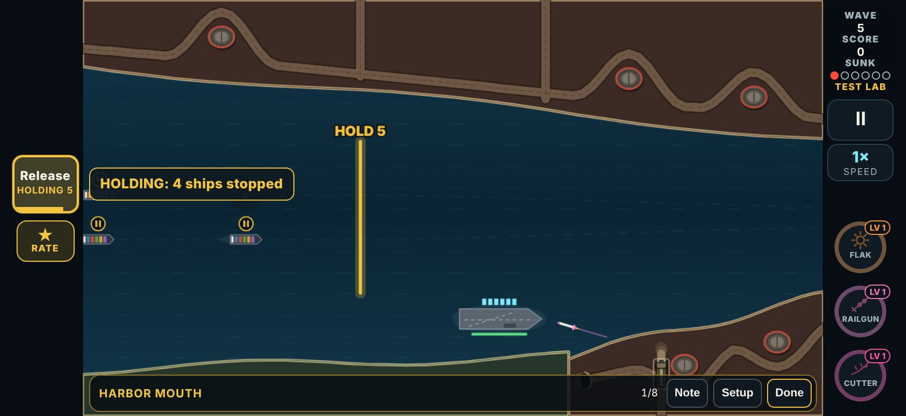
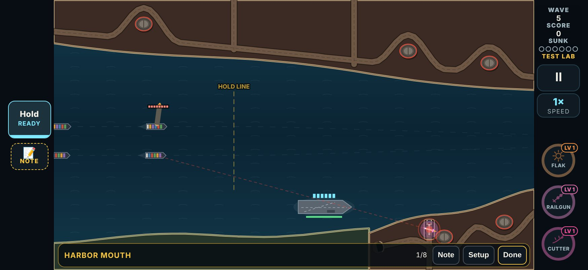
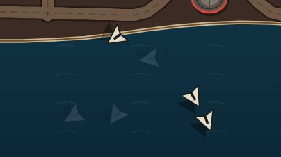
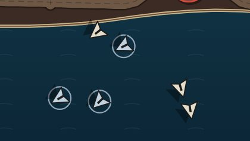
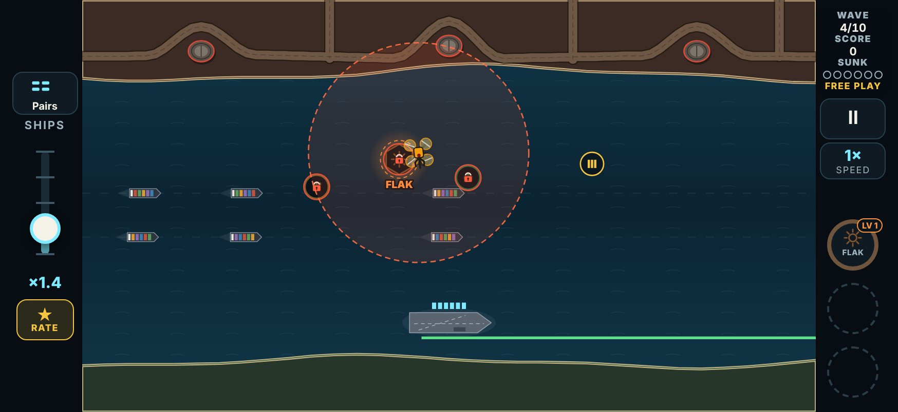

# V3 round 9: the Hold fix, decoys that flash, a wider scavenger lock

**Date:** 2026-11-12. From your phone playtest of 2026-11-12 (iPhone at 874 x 402, build 2026-11-12T14:36). The runs and notes are in `tools/v3/test-lab/playtest-2026-11-12.json`.

Test Lab round 9 is `{ n: 9, date: '2026-11-12', name: 'Hold fix; decoys flash; wider scavenger lock', since: '2026-11-13T00:00' }`. These cards have a round 9 line, so the hub asks for them again:
- **Decoy Drones** and **Scavenger Drone**. Their pairs inherit the line: Decoys + Sprint Drones, Decoys + Cluster Missiles and Scavenger + Drone Swarm.
- **Decoy Storm**, **The Breakout** and **Supply Raid**.
- **Harbor Mouth**, for its Commands policy.

The Strait and The Gauntlet are unchanged: Rush and Disperse were not touched, so those two cards keep version 1.

The play log is now **version 21**, because v20 logs with decoys, scavengers, the Decoy Storm or a Hold no longer replay to the same game. The Map & Convoy Lab's convoy rules are **rev 2**. The twelve stored baseline runs were rewritten (`npm run v3:map-lab -- baseline --write`), because this round changes the campaign on purpose: decoys, scavengers and the Decoy Storm are in it.

## Your words

> Harbor Mouth, Commands policy (written in a pause on wave 5): "The good command did not work at all"

> Decoy Storm (verdict Keep): "Yeah still. Rees to be more distinct I say just go full extreme and make it very obvious say make it flash the whole time like it used too or kinda far in and out I think that is the right move"

> Supply Raid (written in a pause; verdict Keep): "Radius for the drom s could be about twice as large and make sure it applies to the drones normally outside of the special event here"

Every other run with a verdict was Keep, with no note: Hydra Bloom, The Breakout, Run the Canal, Fire Mission, The Strait and The Gauntlet. The other runs were quit before a verdict.

## 1. Hold on Harbor Mouth: why it "did not work at all"

### What happened (observed: your log, replayed)

`v3-20261112214027-31825`: Harbor Mouth, policy D, from wave 5. One command, `[646, 'k', 'hold']`, about 10.8 s into the wave.

- **Your touch registered.** The press is in the log, so the button got it on your iPhone. The sim **accepted** it (`ok`, no refusal).
- **It changed nothing you could see.** Rev 1's Hold did not touch the ships on the water. It only held back the groups that came due *while it was on*, and it held them off the map, where nothing is drawn.
- **Nothing came due for 5.2 s.** At Harbor Mouth's flow, pairs sail every 7.5 s, and the next pair was 5.2 s away when you pressed. The Hold lasts 6 s, so it caught that one pair for its last 0.8 s, and the pair sailed 0.7 s late.
- **Your four ships sailed on** at full speed, about 160 px in the next 4.5 s. The only sign of the Hold was the button, which read RELEASE 5, 4, 3...
- **The second limit could never trigger.** Rev 1 also ended a Hold when two groups were waiting. At this flow, two groups never come due inside 6 s.

**Root cause, in plain words:** Hold was not broken in the code. It did what it was written to do, and what it was written to do was invisible: it kept back ships that had not appeared yet, and at Harbor Mouth's pace there were usually none or one to keep back, for under a second.

### What changed (rules rev 2)

**Hold now stops ships that are on the water.**
- Every ship short of the **hold line** eases to a stop within 0.4 s (`CONVOY.hold.ease`) and waits where it is. None gets closer than the line.
- On Harbor Mouth the line crosses the lane at x 600, in the wide water short of the narrows (`MAP_CONVOY.harbor.stage`).
- Ships already past the line sail on.
- New ships that come due meanwhile wait at the entry. None is dropped, and none is put on top of another.
- Released by your tap, or by itself after 6 s, everything sails on at once. The 12 s cooldown then starts.
- A Hold needs a ship short of the line. Pressed with none, it is **refused, and the screen says why**.

**What you see:**
- **The line is always on the water**, as a faint dashed gold line labelled "HOLD LINE". While a Hold is on it turns solid and bright, pulses, and reads **HOLD 5, 4, 3...**
- **Each held ship carries a gold pause mark.**
- **The button beats gold** and reads **Release / HOLDING n**.
- **Words beside the button** say what the press did, for 2 s: "HOLDING: 4 ships stopped", or "RELEASED: the held ships sail on".
- **A refused press** of any command still shakes its button, and now also gets a line in red beside it for 2.6 s. The lines are "HOLD: Ready again in 9 s", "HOLD: No ship short of the hold line", "RUSH: Not while dispersed" and "DISPERSE: Not while rushing".

Rush and Disperse were not retuned.

**Your run under rev 2 (the same press, replayed):**
- All four ships stopped within 0.4 s, at lane distances 433, 438, 109 and 111, and stayed there.
- The next pair came in at 16.5 s and waited at the entry.
- At 6 s the Hold ended by itself and six ships sailed on.

### Found on the way

- **Telemetry put a Hold's end in the wrong stretch.** When a wave or event run ended while a Hold was on, the release was logged after the event had closed. That opened an empty "wave" stretch in the telemetry. The Hold is now ended before the event closes. This affected lab runs only.
- **Map Analytics' Trace ran past the hit.** An attacker that survives its own hit, such as a strafer, was also shown being shot after the impact. The browser check caught it once this round's changes moved the bots' runs. Trace now ends at the impact.
- **A pair's arrival timing read the decoy as "not urgent".** Decoys + Cluster Missiles times its missiles to arrive with the swarm, and it used the bots' ETA, which counts a decoy that has been told apart as 30 s away. Now that decoys are told apart from launch, the missiles would have come late, and the pair test caught it. The pair now uses the decoy's real flight time.

## 2. Decoy Drones: they fade in and out, everywhere

- **Every decoy now beats**, from its launch until it fizzles: 1.6 times a second, from full down to 15% opacity and back (`DECOY_PULSE` in `src/v3/ui/foes.ts`). A pale ring in its tint shows at the top of each beat.
- **The tint stays**: the round 8 steel blue, `#c2d3e3` (`DECOY_TINT`).
- **A real drone never fades.**
- **This holds in every context**: normal waves, Free Play, the Decoy card, its two pairs, Decoy Storm and The Breakout. They all draw a decoy with the same code.
- **The beat is under 3 a second**, the usual photosensitivity limit.
- **The bots' read rule:** a decoy is told apart from launch, anywhere on the board (`FOE.decoy.readAt` 420 → 2000 px, `readAfter` 1.5 → 0 s). The bots, the Cadence broadside and the helper drones leave it alone from launch.
- **Words:** the blurb is now "The decoys are pale blue and fade in and out the whole way in: let them go". The first-meeting tip and the card question say the same.

Full-screen frames: `img/round9/decoys-phone-dim.jpg` and `img/round9/decoys-phone-bright.jpg`.

### Decoy Storm was retuned so it did not become trivial

With the decoys readable, the Decoy Storm card went from Broken 20% to never Broken for the sharp bot, and from 23% to 0% for the average bot. Its own numbers were tuned back:
- **twelve swarms** (ten), which means 24 real drones, not 20, among 48 decoys;
- **the second half 2 s sooner** (9 → 7 s);
- **no ammo drops**, kept.

| Tried (lab card, sharp bot, 40 seeds) | Clean / Held / Broken % |
|---|---|
| Round 8 (before) | 45 / 35 / 20 |
| Round 9 pulse, round 8's numbers | 100 / 0 / 0 |
| 4 fakes in 6 → 3 (30 real drones) | 43 / 10 / 48 |
| 4 fakes → 2 (40 real) | 20 / 8 / 73 |
| 12 swarms | 50 / 38 / 13 |
| 14 swarms | 25 / 20 / 55 |
| **12 swarms, second half at 7 s (kept)** | **43 / 35 / 23** (80 seeds: 41 / 33 / 26) |

## 3. Scavenger: the lock is twice as wide, everywhere

- **`FOE.scavenger.deny`: 120 → 240 px.** Every scavenger uses this one number: its card, Scavenger + Drone Swarm, Supply Raid, and any wave that brings one.
- **The ring scales with it.** It is drawn from `deny`, as are the padlocks on locked pickups.
- The hover circle (48 px), the lurk circle and the leaving rules are unchanged.

Close-up: `img/round9/scavenger-close.jpg`.

## The numbers, before and after

Every row is measured before (the branch as it was, 5b8b46f, plus this round's Hold change, which plays no part in these cards) and after, on the same seeds.

### The Test Lab cards

`SEEDS=80 SKILLS=sharp,average,casual npx vite-node tools/v3/test-lab/measure.mts -- <cards>`. Each run is three Full waves of the card.

The tool now also counts:
- **gun shots** and **shots at a decoy**;
- **ships sunk by anything** ("all sunk"). The cards' own "harm" counts only the card's new enemies, not a pair's old threats such as the cluster missile.

| Card | Bot | Shots at decoys | Decoys killed (of ~1,330) | Card harm / sunk | All sunk |
|---|---|---|---|---|---|
| Decoy Drones | sharp | 969 of 7,340 → **0** of 6,458 | 1,274 → 615 | 0 / 0 → 0 / 0 | 25 → 16 |
| Decoy Drones | average | 754 of 6,581 → **3** of 5,876 | 1,188 → 587 | 0 / 0 → 0 / 0 | 36 → 25 |
| Decoy Drones | casual | 360 of 5,300 → **0** of 5,309 | 920 → 606 | 0 / 0 → 0 / 0 | 203 → 189 |
| Decoys + Sprint Drones | sharp | 556 → 0 | | 30 / 2 → 9 / 1 | 53 → 42 |
| Decoys + Sprint Drones | average | 418 → 0 | | 33 / 2 → 25 / 1 | 64 → 50 |
| Decoys + Sprint Drones | casual | 242 → 0 | | 115 / 17 → 126 / 19 | 141 → 155 |
| Decoys + Cluster Missiles | sharp | 791 → 0 | | | 170 → 111 |
| Decoys + Cluster Missiles | average | 648 → 0 | | | 254 → 186 |
| Decoys + Cluster Missiles | casual | 396 → 0 | | | 499 → 516 |

The decoys still killed after the change are caught in a real drone's blast: flak's cloud, Tesla's chain.

| Card | Bot | Pickups taken | Scavengers killed (of ~468) | All sunk |
|---|---|---|---|---|
| Scavenger Drone | sharp | 4,367 → 4,393 | 452 → 451 | 20 → 21 |
| Scavenger Drone | average | 4,168 → 4,132 | 454 → 453 | 38 → 37 |
| Scavenger Drone | casual | 3,590 → 3,559 | 447 → 447 | 183 → 172 |
| Scavenger + Drone Swarm | sharp | 3,247 → 3,271 | 438 → 437 | 35 → 23 |
| Scavenger + Drone Swarm | average | 3,140 → 3,147 | 442 → 445 | 42 → 35 |
| Scavenger + Drone Swarm | casual | 2,791 → 2,784 | 434 → 438 | 251 → 236 |

### The events

`npx vite-node tools/v3/special-events/measure.mts 40 --only=…`: on the event's own table (wave 11, ten drafts handed over, flow 2), and with `--lab`, as the card plays it. Results are Clean / Held / Broken %.

The tool now counts shots at decoys in any event, not just the Decoy Storm. Its share is of the bot's gun shots during the event, so it is not the same figure as round 8's. Supply Raid now reports pickups taken.

| Event | Bot | Own: before | Own: after | Lab card: before | Lab card: after |
|---|---|---|---|---|---|
| Decoy Storm | sharp | 98 / 3 / 0 · 58% at decoys | 98 / 3 / 0 · 13% | 45 / 35 / 20 · 50% | 43 / 35 / 23 · 0% |
| Decoy Storm | average | 95 / 5 / 0 · 52% | 98 / 3 / 0 · 13% | 58 / 20 / 23 · 42% | 43 / 43 / 15 · 0% |
| The Breakout | sharp | 98 / 3 / 0 · 25% | 100 / 0 / 0 · 2% | 95 / 5 / 0 · 33% | 100 / 0 / 0 · 0% |
| The Breakout | average | 98 / 3 / 0 · 25% | 100 / 0 / 0 · 2% | 88 / 10 / 3 · 32% | 100 / 0 / 0 · 0% |
| Supply Raid | sharp | 100 / 0 / 0 · 21.3 pickups | 100 / 0 / 0 · 21.2 | 100 / 0 / 0 · 22.3 | 100 / 0 / 0 · 22.2 |
| Supply Raid | average | 98 / 3 / 0 · 20.8 | 100 / 0 / 0 · 20.8 | 100 / 0 / 0 · 21.4 | 100 / 0 / 0 · 21.2 |
| Supply Raid | casual | 90 / 5 / 5 · 19.6 | 90 / 8 / 3 · 19.2 | 100 / 0 / 0 · 19.6 | 100 / 0 / 0 · 18.6 |

**Reading it:**
- **Decoys:** the bots stop wasting shots on decoys almost entirely. Their sunk counts fall a little on the Decoy card and its pairs; the casual bot's barely move, because it was losing ships to everything else.
- **Decoy Storm** is back where round 8 had it, on both measures.
- **The Breakout** gets easier: the lab card goes from Broken 0–3% to never. It was already close to that, so its numbers were left alone (below).
- **The wider scavenger ring barely shows with the bots.** They shoot a scavenger as soon as it locks a pickup (about 97% are killed), so a wider ring mostly means they shoot it sooner. Supply Raid lost about one pickup a run for the casual bot, and about none for the others. A person who doesn't drop everything to shoot it will feel it more than the bots do.

## Judgement calls

- **Hold stops ships where they are, not "at the line".** Every ship short of the line stops within 0.4 s, so the effect is on screen the moment you press. The other reading was to let ships sail up to the line and stop there. Under that, a ship far back keeps sailing for many seconds and nothing visibly changes, which was exactly your complaint. The line is where Hold stops applying: ships past it are committed to the narrows.
- **A Hold with nothing short of the line is refused**, with the reason on screen, rather than accepted and doing nothing.
- **Hold's 6 s and 12 s cooldown were kept.** Holding now costs more, because stopped ships deliver later and sit still under fire. The bots' convoy experiment for Hold has not been rerun under rev 2. Its old Harbor Mouth rows are rev 1 and do not hold any more.
- **Only the Harbor Mouth map card has a round 9 line.** The brief named "the three reference map cards if Hold changes", but only Harbor Mouth has Hold. The Strait and The Gauntlet play exactly as before, so asking you to retest them would waste a test.
- **The helpers ignore decoys too.** The bots, the Cadence broadside and the drone wings rank a decoy that has been told apart last. With the pulse, that is from launch. A careful player reads it at once, so the helpers do too.
- **The Breakout was not retuned.** It got easier (lab card: never Broken), but it was 95% Clean for the sharp bot before. It is a finale whose decoys are one beat of four. Your next run on it will say whether it needs more.
- **The log version went to 21.** That is the repo's rule when old logs no longer replay to the same game. The Map Analytics viewer reads only current-version logs, so v20 runs drop out of it.
- **The beat is 1.6 times a second, down to 15%.** That is clear on a phone and under the photosensitivity limit. A hard on/off strobe was the other choice; a fade reads as "this one is different" without looking like damage.

## Checks

- `npx tsc --noEmit`: clean.
- `npx vitest run --exclude '.claude/**'`: 53 files, 1,478 tests, all passing. Hold's reproduction (your log, replayed): `tests/v3/convoy.test.ts`, "the player's press". It fails under rev 1, where the ships sail on about 160 px.
- `npx vite build` and `npm run build:store`: both build.
- Browser checks on an isolated build at port 4311: `e2e/v3.mjs`, `e2e/v3-audio.mjs`, `e2e/v3-convoy.mjs`, `e2e/v3-encounters.mjs` and `e2e/v3-map-analytics.mjs`. `e2e/v3-convoy.mjs` now taps Hold on Harbor Mouth at 874 x 402 and 667 x 375 and checks that:
  - the button is a thumb's size and nothing covers it;
  - the touch holds;
  - the ships short of the line stop and stay stopped;
  - the button and the words beside it say so;
  - the Hold ends by itself and the ships sail on;
  - a press while it cools down is refused, with the reason on screen.
- Screenshots: `tools/v3/round9/shots.mjs` writes to `docs/design/img/round9/`.
