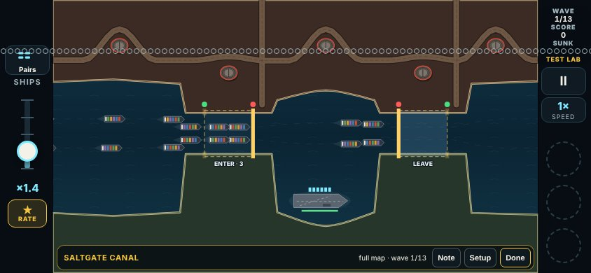
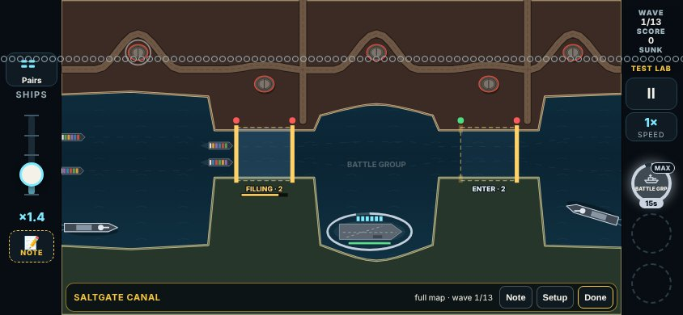
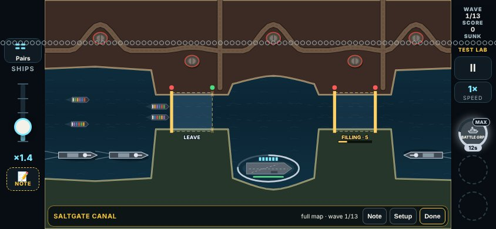

# V3: Saltgate Canal's locks and frigates

**Date:** 2026-11-16. Play log v24. Test Lab: two round 12 change lines on the Saltgate Canal map card.

**Your note** on a Saltgate Canal campaign run: "The gates for the canal did not work. I think the escorts broke it."

## What broke

The locks deadlocked. The escorts were not the cause.

- A lock has three phases. In **ENTER**, the entry gate is open. In **FILLING**, both gates are shut while the chamber fills. In **LEAVE**, the exit gate is open. ENTER lasts at least 8 s (`LOCK.inTime`), and the entry gate shuts only when no hull is in its gateway.
- Ships sailed into the chamber whenever the entry was open, whether or not there was room. The chamber holds two ships in each file (formation lane). The third ship in a file stopped across the entry gate, behind the two waiting at the exit.
- That ship could not move on, because the chamber was full. The gate could not shut, because a hull was in its gateway. So the chamber never filled and the exit never opened. Lock 0 stayed in ENTER for the rest of the run and every ship froze.
- This happened at flows above the default (4 s between ships or less), and in **Column at every flow**, even the slowest. Column is one fast file, so ships arrive faster than one file's two places per cycle. Your run delivered 12 ships by wave 3 and none in the last 10 waves.
- **Why it looked like the escorts:** frigates had "priority passage". A gate was drawn open while a frigate was near it, and the cargo ships still waited behind it.

## The fix

**A lock admits only what its chamber holds** (`stopAt` / `chamberRoom` in `sim/game.ts`).

- A ship short of the entry counts the ships already in the chamber in its own file. Ships in a file queue back from the exit gate, 66 px apart (`SHIP.minGap`).
- If the next place in that queue would be inside the entry gateway, the ship waits at its normal spot short of the gate (`LOCK.stand`, 44 px), even while the gate is open.
- So the gateway clears once the chamber is full, and the gate shuts on time.
- In each file the chamber takes two ships: Column 2, Pairs 4, Spread 6, Box 6.
- Ships still wait in each chamber while it fills: the map's "sitting ducks under the silos" is unchanged.

**The backstop** (`LOCK.grace`, 6 s): 14 s into ENTER, the entry gate shuts even if a hull is still in its gateway.

- That hull is already past the waiting spot, so the game counts it as in the chamber. It waits at the exit with the others and leaves with them.
- Ships only sail forward, so it can't be sent back. That is why this is the safe choice: the alternative is a gate held open for good.
- **The exit gate needs no backstop.** It waits only for hulls sailing out. The only thing that can hold them is the next lock's queue, and that lock has its own backstop.
- In every measured run (4 formations × 5 flows × 3 seeds × 300 s, and the tests below) the backstop never fired. ENTER never lasted 10 s: the 8 s, plus at most the time a ship takes to sail clear of the gateway.

A hull waiting exactly at the entry spot no longer counts as in the gateway (`inside(-LOCK.stand + 1, …)`). The exit side always treated it that way.

## Frigates on Saltgate: they come in from the sides

**Priority passage is gone.** `frigateAtGate` is removed, from the sim and from the gate drawing. A gate is drawn open only when it is open. No frigate is ever held by a gate, because none comes near one.

**Berths beside the canal** (`MapDef.berths`, Saltgate only):

| Berth | Where | Comes in from | Levels |
|---|---|---|---|
| 1 | x 330, y 610: west of lock 0 | the west edge | 1, 2, 3 |
| 2 | x 1490, y 610: east of lock 1 | the east edge | 1, 2, 3 |
| 3 | x 130, y 610: west of lock 0 | the west edge | 3 (Battle Group) |

- **Where:** each berth is on the friendly (south) side of a stretch open to the map's edge, in the water between the convoy's lane (it ends at y 590) and the bank (y 700).
- **Coming in:** a frigate sails in bow first along that water, 40 px further out (y 650), and steers gently across onto its berth over the last 160 px. The east frigate sails west, against the convoy, and faces it from its berth.
- **Leaving:** a frigate backs out the way it came, at half speed, steering back out. It never turns round. A full turn would need more water than this strip has, so the hull would cross the lane or the bank.
- **A new drop** calls back any frigate still backing out: it sails up to its berth again. Only missing frigates sail in. This keeps two frigates from meeting head on in the strip.
- **No station between the locks.** The middle basin is closed in by the locks, so no frigate can reach it without passing a gate.
- **Coverage:** each frigate reaches 560 px, so the two berths cover both chambers and almost all of the basin.

**Timing:** the west frigates are on their berths 1.7 s (x 330) and 2.0 s (x 130) after the drop, the east one after 0.9 s. They stay while the weapon lasts (15 s), and take 3–5 s to back out of sight.

On every other map, frigates sail exactly as before. The lane code was moved into its own function (`sailLane`) without change. The overlap numbers below are identical before and after for those 19 maps.

**Screenshots** (844 × 390, `tools/v3/saltgate/shots.mjs`):

- 
  Lock 0 in ENTER with its chamber full (two files of two). The next pair waits short of the open gate (flow 3, Pairs). Before the fix that pair sailed into the gateway and the lock jammed.
- 
  Battle Group called in. Two frigates come in from the west edge along the strip beside the lane; the east one steers onto its berth.
- 
  All three on their berths, clear of the lane and the locks, while the convoy passes through the locks.

## Numbers

**All 20 maps, stall probe:** flow 0–4, 2 seeds, 300 s, no input, ships unsinkable. Each cell is the longest stretch with ships on the water and nothing delivered, then ships delivered per seed.

- **Before:** Saltgate stalled at flows 2–4.

  | | f0 | f1 | f2 | f3 | f4 |
  |---|---|---|---|---|---|
  | Saltgate | 70 s / 24 | 70 s / 35 | **228 s / 4** | **300 s / 0** | **300 s / 0** |

- **After:** no stall on Saltgate.

  | | f0 | f1 | f2 | f3 | f4 |
  |---|---|---|---|---|---|
  | Saltgate | 70 s / 24 | 70 s / 35 | 70 s / 38 | 70 s / 38 | 70 s / 38 |

- **The other 19 maps:** identical before and after, 36–45 s in every cell.
- **Saltgate's 70 s is not a stall.** It is the first convoy's trip through both locks. After the first delivery, the longest gap is 18–20 s at every flow.

**Saltgate by formation** (3 seeds, 300 s, ships delivered per seed):

| Formation | Before f0 | Before f1 | Before f2 | Before f3 | Before f4 | After f0 | After f1 | After f2 | After f3 | After f4 |
|---|---|---|---|---|---|---|---|---|---|---|
| Column | **0** | **0** | **0** | **0** | **0** | 20.7 | 20.7 | 20.7 | 20.7 | 20.7 |
| Pairs | 26 | 38 | **4** | **0** | **0** | 26 | 38 | 41.3 | 41.3 | 41.3 |
| Spread | 25.7 | 37 | 50.7 | **5** | **6** | 25.7 | 37 | 50.7 | 61 | 62 |
| Box | 26 | 38 | 52 | **12** | **0** | 26 | 38 | 52 | 62 | 62 |

- **Flat at the top:** above about flow 2, the locks set the pace: two places per file per cycle. A higher flow adds score per ship (the flow multiplier) and more ships waiting under the silos, but no more deliveries.
- **For you to judge:** at the top flows, the score multiplier is free once the locks set the pace. The extra risk is the ships waiting under the silos. Tell me if that makes the top flows too strong a pick here.

## The flow test

`tests/v3/convoyFlow.test.ts` runs every map in `MAPS` at every flow step, from wave 1 with no input.

- **Setup:** ships and carrier can't sink, drafts take the first card, and each run is 150 s of sim.
- **It fails when:**
  - a gap of more than 60 s, with ships on the water and nothing delivered, comes after the first delivery;
  - or the first delivery takes longer than 120 s (the start of the run is excluded; Saltgate's first trip is about 70 s).
- **It also checks** that a faster flow never delivers fewer ships.
- **Runtime:** about 18 s (about 1 s per map, about 2 s for Saltgate).
- **On the old code** it fails on Saltgate only:

  ```
  flow 2: first delivery 70 s, longest stall 78 s, 4 delivered
  flow 3: first delivery never, longest stall 150 s, 0 delivered
  flow 4: first delivery never, longest stall 150 s, 0 delivered
  ```

- **On the new code** it passes for all 20 maps.

`tests/v3/saltgateLocks.test.ts` covers the locks and frigates. Every test in it fails on the old code.

- **Locks:** every formation at every flow. Every entry gate shuts on time, with no hull in its gateway, and the backstop is never needed.
- **Full chamber:** the next hull waits short of an open gate, and the chamber holds 4 in Pairs.
- **Backstop:** a hull stuck in the gateway does not hold the gate open past 14 s, and it leaves with the others.
- **Frigates:**
  - at levels 1–3, frigates come in from off screen and stay outside the lane and clear of every lock's walls;
  - a new drop calls back frigates that are backing out;
  - no frigate overlaps a convoy hull, at any level, in any formation, at flow 3.

## Do escorts run over convoy ships?

**Yes, on every map but Saltgate (now).**

**How it was measured** (`npx vite-node tools/v3/saltgate/escort-overlap.ts`):

- **Hulls:** the boxes the renderer draws. A frigate is -74..78 along and ±12 across; a cargo ship is -34..34 along and ±10 across. An overlap is any intersection, tested on the hulls' own axes.
- **Runs:** each map at levels 1–3 × flow 1 and 3 × Column, Pairs, Spread and Box. Each run is 90 s, with no enemy fire. Frigates are called in 3 s into the wave and again each time the last set has gone, so arriving, on station and leaving are all covered.
- **The 24 runs** are 3 levels × 2 flows × 4 formations.

**Table columns:**

- **Overlap share:** of all frigate-seconds on screen, the share with a frigate overlapping a cargo hull.
- **Events:** separate frigate-and-ship overlaps.
- **Closest:** the smallest distance between a frigate's centre and a ship's centre.

| Map | Frigate-s on screen | Overlap s | Overlap share | Events | Runs hit | Closest (px) | Events: arriving / station / leaving |
|---|---|---|---|---|---|---|---|
| The Strait | 4233 | 483 | 11.4% | 350 | 24/24 | 2 | 128 / 41 / 181 |
| The Kesh Hook | 4106 | 527 | 12.8% | 481 | 24/24 | 1 | 305 / 56 / 120 |
| Lee of Marrow | 4233 | 506 | 12.0% | 358 | 24/24 | 0 | 128 / 41 / 189 |
| The Gauntlet | 4216 | 223 | 5.3% | 118 | 6/24 | 2 | 66 / 14 / 38 |
| Harbor Mouth | 4219 | 991 | 23.5% | 644 | 24/24 | 0 | 240 / 126 / 278 |
| The Island | 4216 | 420 | 10.0% | 223 | 6/24 | 0 | 115 / 44 / 64 |
| The Behemoth Run | 4220 | 526 | 12.5% | 383 | 24/24 | 0 | 122 / 44 / 217 |
| The Needle of Bosk | 4245 | 791 | 18.6% | 1018 | 24/24 | 1 | 73 / 94 / 851 |
| The Archipelago | 4216 | 508 | 12.0% | 363 | 24/24 | 0 | 131 / 40 / 192 |
| **Saltgate, before** | 4175 | 751 | 18.0% | 540 | 18/24 | 2 | 381 / 70 / 89 |
| **Saltgate, after** | 4157 | **0** | **0%** | **0** | **0/24** | **50** | – |
| Battery Point | 4187 | 472 | 11.3% | 240 | 6/24 | 4 | 125 / 42 / 73 |
| Sowers' Reach | 4233 | 485 | 11.4% | 350 | 24/24 | 1 | 128 / 41 / 181 |
| The Rig Field | 4219 | 503 | 11.9% | 350 | 24/24 | 0 | 131 / 41 / 178 |
| The Black Strait | 4216 | 494 | 11.7% | 332 | 24/24 | 1 | 131 / 40 / 161 |
| Dreadnought Pass | 4233 | 507 | 12.0% | 360 | 24/24 | 0 | 128 / 41 / 191 |
| Smugglers' Coves | 4202 | 477 | 11.4% | 308 | 24/24 | 1 | 155 / 44 / 109 |
| The Sharra Delta | 4203 | 1077 | 25.6% | 850 | 24/24 | 1 | 387 / 110 / 353 |
| Dunmar Crossing | 4233 | 248 | 5.9% | 196 | 24/24 | 2 | 65 / 14 / 117 |
| Tidewater Flats | 4216 | 338 | 8.0% | 176 | 6/24 | 3 | 96 / 25 / 55 |
| Citadel of Vey | 4195 | 562 | 13.4% | 445 | 24/24 | 0 | 172 / 51 / 222 |

The 19 other maps give the same numbers before and after this change.

**Where the overlap comes from:**

1. **On station, in Spread:** a lane frigate holds station at the lane's edge, `min(0.85 × hw, hw − 20)` off the centre line. Spread's outer files sail at 0.8 × hw. On a 150-px lane that is 127 px against 120 px, so the hulls sit on top of each other. On Harbor Mouth, where Pairs opens out, and on the narrow lanes (the Delta, the Needle), Pairs and Box are hit too. Most overlap seconds are on station.
2. **Sailing in and out:** a frigate sails at 260 px/s through a convoy doing 40. Where the lane narrows, it moves in toward the centre line, through the files. On the Needle this is most of it: 851 of 1018 events are frigates leaving through the narrows.

**Fixed on Saltgate** by the berths. The table shows 0 overlaps, closest 50 px. A test keeps it at 0.

**Not fixed on the other 19 maps: a proposal.** A real fix changes how every lane frigate moves, on every map:

- stations in different places;
- a new rule for passing the convoy;
- checks against land for water outside the lane.

That would also change the reference maps' replays. You have tuned how frigates look over rounds 5, 6 and 8, so this is your call, not something I should slip in with a Saltgate fix.

The proposal:

1. **Stations clear of the files.** A frigate's station sits at least 30 px outside the outermost file of the current formation (frigate and ship half-beams, plus 8 px). Where the lane edge is too close, the station moves into the open water outside the lane.
   - I measured the open water at all 60 level-3 stations. There is room at 56.
   - The four without room are one station each on the Kesh Hook (824, 781), the Island (744, 236), the Needle of Bosk (856, 419) and the Sharra Delta (938, 140). Those move along the lane, or use the far edge.
2. **Give way when sailing.** A frigate whose next step would overlap a convoy hull steps out sideways if there is water. If there isn't, it holds behind the hull until there is room. Where the lane narrows (the Needle, the Delta), a leaving frigate goes out the way it came, or waits for the convoy's gap.
3. **A test across every map,** like the Saltgate one: 0 overlaps at every level, formation and flow. This also means rewriting the baseline, because the reference maps' frigates move.

## Checks and replays

- **Play log:** now v24, and only v24 logs replay (`LOG_REPLAYS`). A v23 Saltgate log that ran above flow 1, in Column, or with frigates plays differently now.
- **The map-lab baseline:** The Strait, The Gauntlet and Harbor Mouth replay exactly, with every full-state check the same. Only the content hash changed: `LOCK` gained `gateway` and `grace`. The baseline was rewritten (`--write`), which changes only each fixture's version and the hashes in the manifest.
- **Test Lab:** two round 12 lines on the Saltgate Canal card: the locks no longer jam, and frigates never pass a gate.
