# V3 special events: the build

The special event attacks are in the game. This is what was built from the design round (`docs/design/v3-special-events.md`, the review page of 2026-11-08), what each event does, how it is graded, what the bots made of it, and what is left.

## Your notes, and what they decided

All seven pieces of the system were approved. Your notes on them:

| Piece | Your note | What it means in the build |
|---|---|---|
| The event beat | "don't give them a note how to counter it they should just have to figure that out" | The event's card says its name and any rule in force (No ammo drops, Night, …). Nothing in the game says how to beat an event. The design doc's "How you beat it" lines stay in the design doc only. |
| Map scripts | "it should showcase a new enemy attack if it has not been showcased yet. And the special event should not replace the round, so basically there is 11 waves now instead of 10" | Every map with an event has an **11th wave that is its event**, after its ten normal waves, which are exactly as they were. Clearing wave 11 wins the map. |
| Built on the debut enemy | "you will need to mix it around tho … one or more weapons might need a second special too on a different map" | Each event is built on its map's debut enemy, as designed. The map → event table is data (`EVENT_MAPS` in `src/v3/data/events.ts`), so it can be remixed and a second event added later. |
| Rules | "this is good to make the events more novel" | Built as designed: no ammo drops, night, helpers pulled to the beacons, pickups raining down (and Hydras splitting into three). |
| Reward, Test Lab, play log | Approved as written. | See below. The reward changed in one way (the event ends the map, so a weapon drop would be no use: it is score only). |

The eight questions weren't answered, so the build takes the recommended answer except where your notes say otherwise:
- **Length:** 20 to 30 seconds. The events measured run 12 to 28 s each (the table below).
- **Ships:** lost as normal.
- **Free Play and endless:** no events in this build (later).
- **Clearing the screen:** not needed. The event is its own wave, so it starts like any wave: its card, then a 3 s breather (a wave's usual lead-in).
- **When:** wave 11, from your note (not wave 8).
- **The finales:** not in this build (below).
- **How to build:** all seventeen events at once, as asked.

## How an event plays

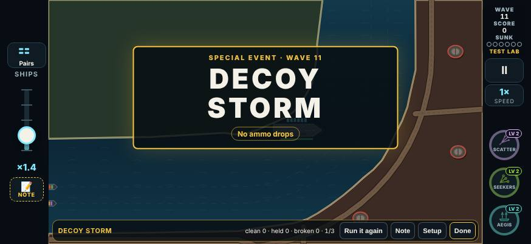

- **The briefing** names the event under the map's description: "Special event: Decoy Storm, wave 11". Only its name.
- **The wave counter** shows 11 on a map with an event (WAVE 3/11); 10 on the three that have none.
- **Waves 1 to 10** are planned exactly as before.
- **Wave 11 is the event.** In place of the raid planner it runs the event's script (`src/v3/sim/events.ts`):
  - Its card comes up in the middle of the field. This is its own centred card, not a corner call-out. It says "Special event · wave 11", the event's name, and a chip for each rule in force.
  - A 3 s breather. Then the script launches.
  - The convoy keeps sailing as in any wave. In a Test Lab test that starts with no ships on the water yet, the attack waits 9 s more for the first ships to sail in.
- **It ends** as any wave does, once everything it sent is dealt with. Fireballs still burning and beacons still up hold it open. Anything still on the board 48 s after the breather flies off, so an event can never hold a wave open for good.
- **The outcome banner** comes up as it ends: the event's name, then **Clean**, **Held** or **Broken**, and the bonus. It sits above the MAP CLEARED stamp.
- **The result screen** lists the event and how it went.
- **Rules** are on only while the event runs: they end with it.

### The grade

| Grade | When | Bonus |
|---|---|---|
| **Clean** | No ship lost, and the carrier not hit. | +3,000 score |
| **Held** | One ship lost, or the carrier hit (or both), and the convoy still sailing. | +1,500 score |
| **Broken** | Two or more ships lost, or the map lost during the event. | Nothing |

The bonus comes on top of the wave's own 2,200 (200 × wave 11). A carrier hit was counted because the design says the grade "counts ships lost and carrier hits". It can't break an event on its own: a carrier hit alone is Held. A supertanker counts as three ships, as it always has, so losing one is Broken.

**The reward.** There is no weapon drop for Clean. The event is the map's last wave, so the weapon would come too late to use.

## The seventeen events

Each is built on its map's debut enemy, on that map. The numbers live in `EV` in `src/v3/data/events.ts`. Where the design's "Weak" line said an enemy was too much in numbers, its hits or salvos are cut for the event; that is marked *tuned*. Most events also send a few ordinary drone swarms "for company", so a single set piece isn't the whole wave.

The rules on the cards are in bold. Each picture is the event in progress, in its Test Lab card at 874×402.

### Chapter 1: Home Waters

**Afterburner Rush** (The Strait, Sprint Drones)

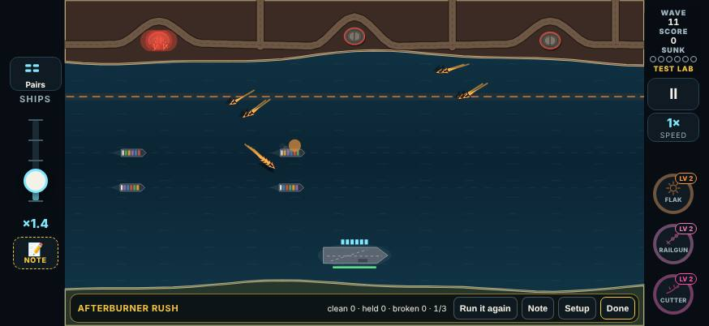

- Six sprint swarms, one every 1.5 s, cruising at half speed.
- A dashed orange line is drawn across the water, three quarters of the way from the bases to the lane.
- The moment the first sprinter crosses it, every cruising sprinter flares and sprints at once. The rest cruise on until the next one crosses.
- *Tuned* from eight swarms one every 1.7 s: in the campaign the ordinary bot lost the Strait 5 times in 11 with eight, because the rack ran dry.

**Decoy Storm** (The Kesh Hook, Decoy Drones). **No ammo drops.**

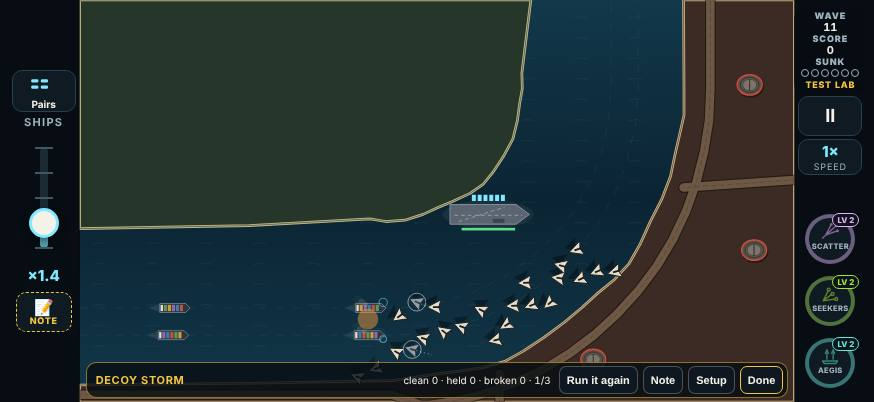

- Ten swarms of six, five at the start and five 9 s later, from every base.
- Four in six of each swarm are decoys (60 drones, 40 of them fake). They strobe late, as always.
- No ammo pickups drop while it runs.
- The log counts the shots that went at decoys: the bots spent 42 to 49% of their shots on them.

**Hydra Bloom** (Lee of Marrow, Hydra Missile). **Hydras split into three, not two.**

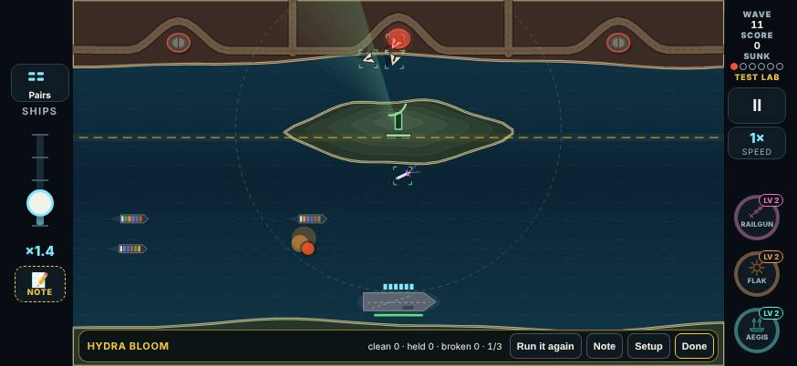

- Two fans of three Hydras (one from each base at once), 8 s apart, a little slower than usual. Two drone swarms come in between.
- A dashed gold line across the water, halfway from the bases to the lane. A Hydra killed before the line dies whole; past it, it splits into three darts.
- The design had a ring. A straight line reads the same on every map and was simpler to build (a judgement call).

**Rocket Convoy** (The Gauntlet, Rocket Truck)

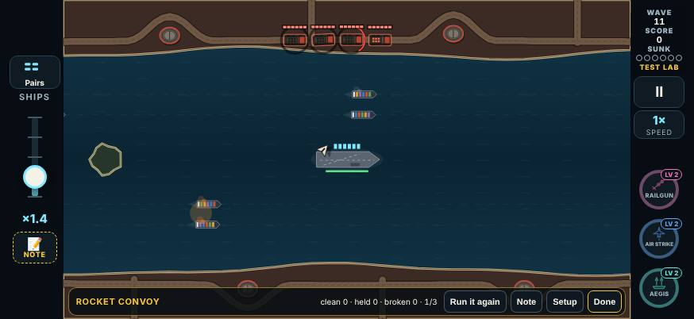

- Four trucks drive the north shore road in a column, nose to tail, at twice a truck's speed.
- Each stops 80 px behind the one ahead and raises its launcher 2.6 s after it, so the salvos ripple down the column.
- A truck killed makes the ones behind it stall for 2 s (shown as STALLED).
- Each fires 3 salvos (a normal truck fires 5). Each takes 8 hits for the run (4 normally), because the bots killed a column of 4-hit trucks before it ever stopped. Three drone swarms come for company.

### Chapter 2: The Narrows

**Gunship Wall** (The Island, Attack Helicopter)

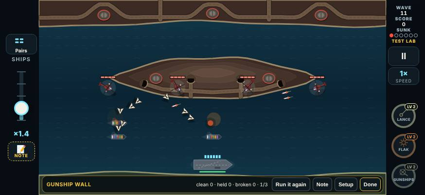

- Four helicopters fly in from the sides to a line off the far side of the lane, spread across the screen, and hold there.
- 6.5 s after they arrive, the wall opens fire left to right, one every 0.75 s, so the missile pairs walk across the convoy.
- Four volleys each. *Tuned* to 4 hits each (6 normally), per the design's "Weak" line.
- Three drone swarms come for company.

**Wolf Pack** (The Behemoth Run, Torpedo Sub)

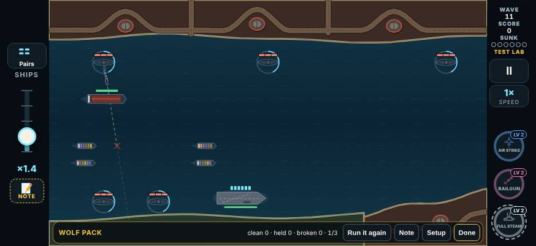

- Five periscopes at once on open water, then three more 11 s later.
- Each pack's subs fire 0.9 s after one another, so their dashed torpedo lines cross the lane in turn.
- *Tuned* from two packs of five: a torpedo sinks a ship outright.

**Shield Wall** (The Needle of Bosk, Armored Drone)

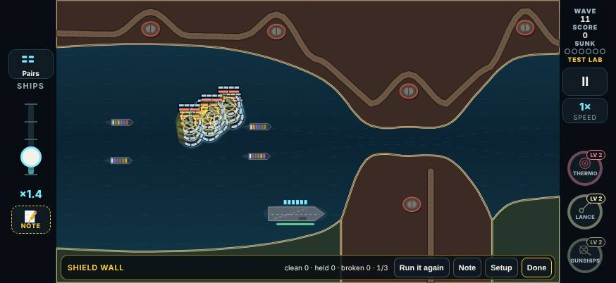

- Twelve armored drones in one block, four wide and three deep.
- They come from the base furthest from the carrier, all at one ship, and keep their places until close.
- They never bank on their own. At a signal (a flash round every drone and the flare sound), the whole block banks together. The signal comes twice: 30% and 62% of the way in.

**Supply Raid** (The Archipelago, Scavenger Drone). **Pickups rain down.**

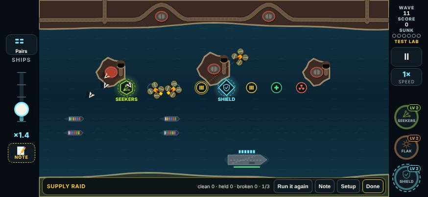

- A cargo plane drops eight pickups across the water on chutes: your weapons, ammo, repairs and a Nuke. A second run 12 s later drops six more.
- Three scavengers come after each run. A pickup one grabs is gone.
- Five drone swarms of six keep the pressure on.

### Chapter 3: Dark Water

**Blackout** (Battery Point, Stealth Strafer). **Night. A star shell is on the way.**

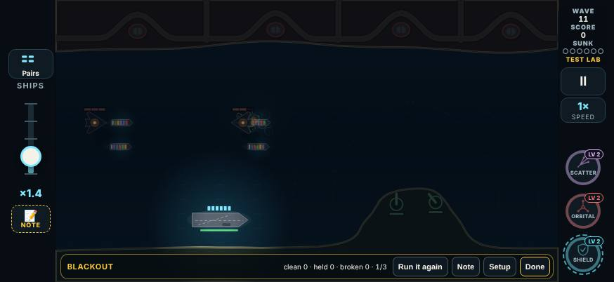

- Night falls for the event: the Black Strait's darkness, without its lighthouse. The carrier's lamp, launch flashes and kill flashes light the water, and threats in the dark show a faint engine glow.
- Eight stealth strafers make passes from alternate sides, one every 2.4 s.
- A star shell pickup drops by the carrier 6 s in, and star shells join the drops while the night lasts.

**Carpet Run** (Sowers' Reach, Stealth Bomber)

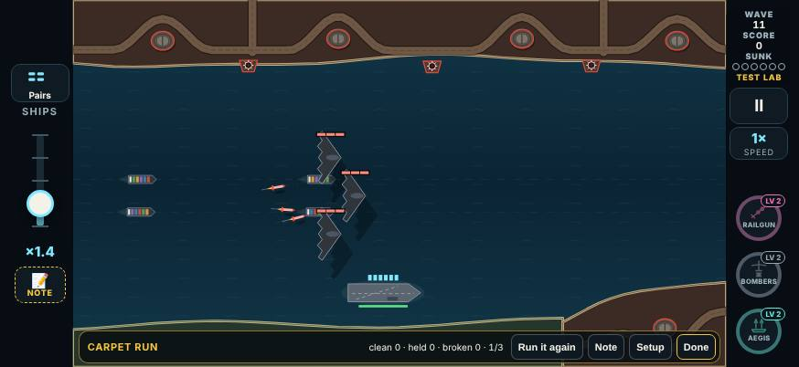

- Three stealth bombers abreast across the whole lane, the middle one leading, the wings 60 px back.
- A second vee comes from the other side 11 s later.
- *Tuned* to 3 hits each (6 normally), per the design's "Weak" line.
- Their missiles are the stealth bomber's usual three each. The design's "bomb lines that show late" weren't built: these are guided missiles, the bomber's own weapon.

**Dive Circus** (The Rig Field, Dive Bomber)

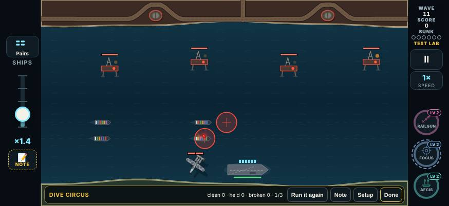

- Eight dive bombers, one every 2.3 s, each with its circle first, as always.
- The beat is the rhythm. There is no drum sound: no sound was added in this build.

**Bombardment** (The Black Strait, Siege Battery)

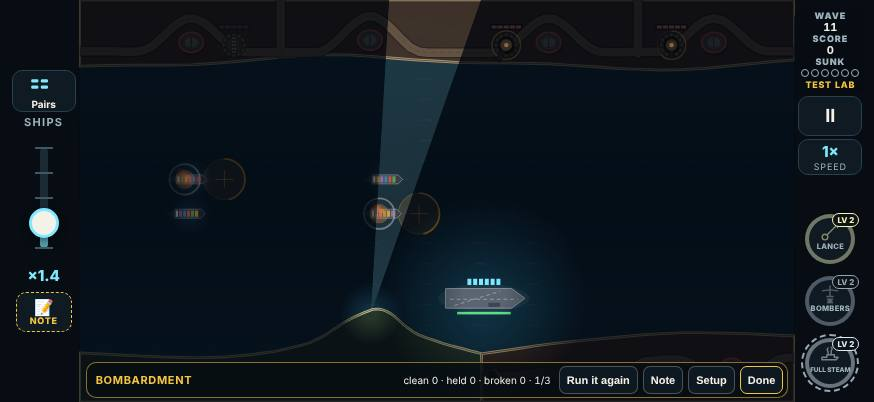

- Three siege hatches beside three bases on the far shore, spread along it.
- Their first rises are 2.2 s apart, so the guns take turns. Each one killed is gone for good.
- *Tuned* (the design: "must be shorter"): two salvos a gun (three normally), so the event lasts about 12 to 15 s.

**Fire Mission** (Dreadnought Pass, Spotter Plane)

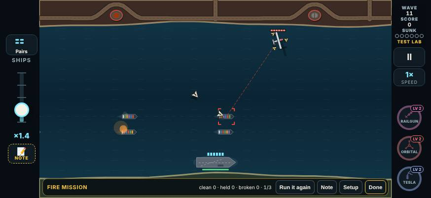

- One Spotter circles beside the lane with three escort drones orbiting it. Like a heavy's guards, the escorts take the shots aimed at it.
- It paints a ship, calls a strike (three missiles from the bases), then paints a different ship. Five strikes in all.
- Shot down, it calls off every strike still to come; what has launched keeps coming.
- It takes 6 hits for the event (4 normally). Three drone swarms come for company.
- The Dreadnought doesn't sail on the event wave.

### Chapter 4: Open War

**Repair Yard** (Smugglers' Coves, Repair Tender)

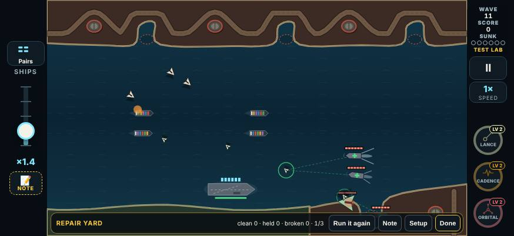

- A slow drone mothership with 16 hits (5 normally) sets out for the carrier.
- Three tenders sail in to stations beside its course. Each mends the most damaged enemy near it: 2 hits every 2.4 s (normally every 3.5 s).
- Two drone swarms come for company.

**Escort Run** (The Sharra Delta, Bodyguard Ring)

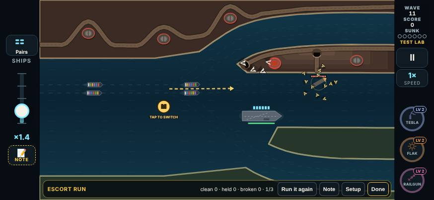

- One heavy missile with 10 hits, at the carrier, inside three rings of guards: 3, 4 and 5 guards, the rings turning different ways.
- A shot at the heavy meets a guard first. It starts at 45% of its speed, and each ring stripped adds 25%.
- Two drone swarms come for company.

**Siren Field** (Dunmar Crossing, Lure Beacon). **Helpers chase the beacons.**

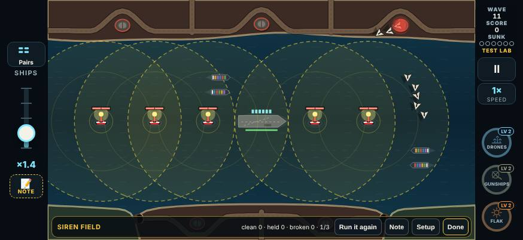

- Five lure beacons rise at once on open water. While the event runs, every helper (frigates, gunships, drone screen, batteries, Point Defense) goes for the nearest beacon, however far away.
- Six drone swarms come in, one every 2.5 s.
- Only your taps sink a beacon, as always.

**Firestorm** (Tidewater Flats, Incendiary Missile)

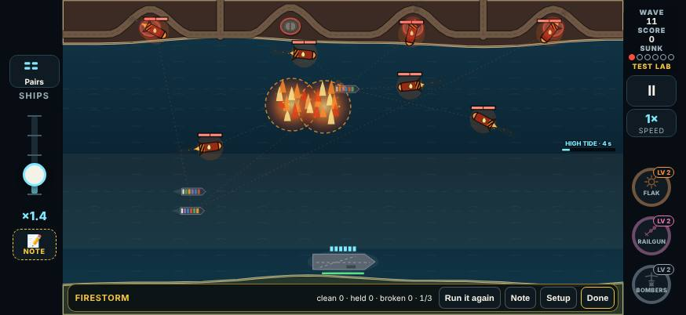

- Six firebombs at once from every side: each launch base, and both side edges of the screen. Three more come 9 s later.
- They fly at 85% of their speed.
- Their fireballs burn 13 s (7 normally), so where they burst stays closed for most of the event.

## The three finales: not in this build

Harbor Mouth, Saltgate Canal and Citadel of Vey repeat an earlier map's debut enemy. The design gave them chapter finales, and those aren't built. These three maps stay at **10 waves**: no event, no wave 11. The briefing shows no event line for them, and their wave counter reads x/10.

## The Test Lab

- **An Events section**, first in the hub, open by default. It holds one card per event (17), in the table's order. Next up plays them first, as round 5's new cards. Cards changed since their last test still come before them.
- **Each card starts straight into its event** on its own map, at wave 11. Its kit comes from that map's chapter, at level 2, because a player meets the event with ten waves of drafts behind them. For example:
  - Decoy Storm: Scattergun, Seeker Pod, Aegis.
  - Siren Field: Drone Screen, Gunship Pair, Flak (helpers, so the rule has something to pull).
  - The full list is `EVENT_KITS` in `src/v3/data/lab.ts`.
- **Run it again** replaces Bring one.
  - It is the same recorded command (`'b'`), so a test that used it replays exactly.
  - What is on the board goes, and the event starts over: card, breather, script.
  - The run it cut short is logged as `rerun`.
- **Length:** Quick is one run of the event, Full is three, with a draft between.
- **The bar** counts clean · held · broken.
- **The verdict sheet** counts the same, and the hull hits the event cost you.
- **Each card's question** (the bar's look line, the TESTING card) asks one thing and never gives the answer. For example, "Ten swarms and no ammo drops: did you run dry, and was that on you?"
- **Round 5** is in `LAB_ROUNDS`: `{ n: 5, date: '2026-11-09', name: 'Special events', since: '2026-11-09T18:00' }`. Each event card has its one round-5 line in `LAB_CHANGES`. The other build's weapon changes for round 5 will merge in beside them.
- **The review page** picks the cards up with no change to its code. `tools/v3/test-lab/page.mjs` builds its Results tab from `LAB_SECTIONS` and `LAB_CARDS`, so the page has an Events section with 17 cards. Their results come through `labDocs.ts` and `results.mts` like any other card's, and their evidence line reads "Clean 1 · Held 0 · Broken 0".

## The play log

- **Version 18.** A run that won at wave 10 on a map that now has an event plays on to wave 11, so older logs need their own build to replay. A replay of a log with an event is exact: the tests replay a recorded event run, and a lab test with Run it again, and get the same game.
- **A new `events` list**, one entry per event met:
  - the wave;
  - when it started and ended (sim steps) and its seconds;
  - what it sent, by kind;
  - its outcome (Clean, Held, Broken, or `rerun`);
  - the ships it cost, and whether the carrier was hit;
  - the shots fired in it;
  - on the Decoy Storm, the shots that went at decoys;
  - the bonus.
- **The review timeline** has an event band: a striped gold stretch over the event's wave.

## What the bots made of it

Two measures: each event on its own, and whole campaign maps. The tool is `npx tsx tools/v3/special-events/measure.mts [seeds] [--md] [--campaign] [--only=…] [--flow=N]`.

### Each event on its own

- 20 seeds per event and bot.
- Each starts at wave 11 with ten waves of drafts handed over, as `?wave=11` does.
- The event is held back 45 s, so the convoy fills the lane as it does ten waves in.
- Flow 2, as the balance sweep plays (the default for a player is 1, fewer ships).
- The **sharp** bot reacts in 0.35 s and taps every 0.18 s. The **average** ("ordinary") bot reacts in 0.6 s, taps every 0.3 s and misses 8% of its taps.

| Event | Map | Bot | Clean | Held | Broken | Ships lost (avg) | Seconds (avg) |
|---|---|---|---|---|---|---|---|
| Afterburner Rush | The Strait | sharp | 95% | 5% | 0% | 0.05 | 12 |
| Afterburner Rush | The Strait | average | 95% | 0% | 5% | 0.10 | 13 |
| Decoy Storm | The Kesh Hook | sharp | 90% | 10% | 0% | 0.10 | 18 |
| Decoy Storm | The Kesh Hook | average | 90% | 0% | 10% | 0.20 | 18 |
| Hydra Bloom | Lee of Marrow | sharp | 100% | 0% | 0% | 0.00 | 17 |
| Hydra Bloom | Lee of Marrow | average | 85% | 10% | 5% | 0.20 | 17 |
| Rocket Convoy | The Gauntlet | sharp | 100% | 0% | 0% | 0.00 | 24 |
| Rocket Convoy | The Gauntlet | average | 100% | 0% | 0% | 0.00 | 24 |
| Gunship Wall | The Island | sharp | 90% | 5% | 5% | 0.20 | 19 |
| Gunship Wall | The Island | average | 90% | 5% | 5% | 0.15 | 19 |
| Wolf Pack | The Behemoth Run | sharp | 85% | 15% | 0% | 0.15 | 20 |
| Wolf Pack | The Behemoth Run | average | 60% | 35% | 5% | 0.50 | 20 |
| Shield Wall | The Needle of Bosk | sharp | 90% | 0% | 10% | 0.20 | 13 |
| Shield Wall | The Needle of Bosk | average | 95% | 0% | 5% | 0.10 | 13 |
| Supply Raid | The Archipelago | sharp | 100% | 0% | 0% | 0.00 | 23 |
| Supply Raid | The Archipelago | average | 100% | 0% | 0% | 0.00 | 24 |
| Blackout | Battery Point | sharp | 100% | 0% | 0% | 0.00 | 21 |
| Blackout | Battery Point | average | 55% | 45% | 0% | 0.45 | 21 |
| Carpet Run | Sowers' Reach | sharp | 100% | 0% | 0% | 0.00 | 17 |
| Carpet Run | Sowers' Reach | average | 85% | 15% | 0% | 0.15 | 17 |
| Dive Circus | The Rig Field | sharp | 100% | 0% | 0% | 0.00 | 22 |
| Dive Circus | The Rig Field | average | 90% | 10% | 0% | 0.10 | 23 |
| Bombardment | The Black Strait | sharp | 90% | 10% | 0% | 0.10 | 12 |
| Bombardment | The Black Strait | average | 70% | 5% | 25% | 0.65 | 15 |
| Fire Mission | Dreadnought Pass | sharp | 100% | 0% | 0% | 0.00 | 24 |
| Fire Mission | Dreadnought Pass | average | 100% | 0% | 0% | 0.00 | 24 |
| Repair Yard | Smugglers' Coves | sharp | 75% | 25% | 0% | 0.10 | 20 |
| Repair Yard | Smugglers' Coves | average | 70% | 30% | 0% | 0.05 | 20 |
| Escort Run | The Sharra Delta | sharp | 85% | 15% | 0% | 0.00 | 17 |
| Escort Run | The Sharra Delta | average | 75% | 25% | 0% | 0.00 | 18 |
| Siren Field | Dunmar Crossing | sharp | 95% | 5% | 0% | 0.05 | 21 |
| Siren Field | Dunmar Crossing | average | 85% | 5% | 10% | 0.35 | 22 |
| Firestorm | Tidewater Flats | sharp | 65% | 30% | 5% | 0.50 | 27 |
| Firestorm | Tidewater Flats | average | 35% | 45% | 20% | 0.95 | 28 |

- **Every event:** the sharp bot holds it (Clean or Held) at least 90% of the time.
- **Nothing is a guaranteed Broken.** The most Broken for any bot is 25%: the average bot on the Bombardment, at night.
- **Easy for both bots (100% Clean):** Rocket Convoy, Supply Raid and Fire Mission. They are measured, but marked for your playtest.
  - The bots are best at exactly what these ask: they shoot a column of trucks while it drives, catch every ballistic, and pick off a spotter.
  - Supply Raid is meant as a change of pace.
- **Short:** the Shield Wall (13 s) and the Bombardment (12 to 15 s). The Bombardment's shortness was asked for.

### Whole campaign maps

- 12 seeds a map, from wave 1, the balance sweep's settings (`runBot`, flow 2).
- **"Through 10"** is how often the bot got through wave 10, which is what winning the map meant before.
- **"Won"** is how often it then won the map with its event. A run that got through wave 10 but not "won" lost the map in its event.
- C/H/B count the event's grades.

| Map | Sharp: through 10 → won | Sharp: event C/H/B | Average: through 10 → won | Average: event C/H/B |
|---|---|---|---|---|
| The Strait | 100% → 100% | 11/1/0 | 92% → 92% | 9/1/1 |
| The Kesh Hook | 100% → 92% | 6/3/3 | 92% → 92% | 8/1/2 |
| Lee of Marrow | 83% → 83% | 9/1/0 | 92% → 83% | 8/1/2 |
| The Gauntlet | 50% → 42% | 5/0/1 | 42% → 42% | 5/0/0 |
| Harbor Mouth | 58% → 58% | (no event) | 42% → 42% | (no event) |
| The Island | 83% → 83% | 9/1/0 | 42% → 33% | 3/1/1 |
| The Behemoth Run | 83% → 83% | 6/3/1 | 42% → 17% | 2/0/3 |
| The Needle of Bosk | 17% → 17% | 1/1/0 | 8% → 8% | 1/0/0 |
| The Archipelago | 25% → 25% | 3/0/0 | 33% → 33% | 4/0/0 |
| Saltgate Canal | 8% → 8% | (no event) | 0% → 0% | (no event) |
| Battery Point | 17% → 17% | 2/0/0 | 0% → 0% | 0/0/0 |
| Sowers' Reach | 17% → 17% | 2/0/0 | 8% → 8% | 1/0/0 |
| The Rig Field | 8% → 8% | 1/0/0 | 8% → 8% | 1/0/0 |
| The Black Strait | 8% → 8% | 1/0/0 | 17% → 17% | 1/1/0 |
| Dreadnought Pass | 17% → 17% | 2/0/0 | 8% → 8% | 1/0/0 |
| Smugglers' Coves | 17% → 17% | 2/0/0 | 8% → 8% | 1/0/0 |
| The Sharra Delta | 33% → 33% | 0/4/0 | 0% → 0% | 0/0/0 |
| Dunmar Crossing | 25% → 25% | 2/0/1 | 0% → 0% | 0/0/0 |
| Tidewater Flats | 0% → 0% | 0/0/0 | 8% → 8% | 1/0/0 |
| Citadel of Vey | 25% → 25% | (no event) | 0% → 0% | (no event) |

- **The first chapter barely moves.**
  - The Strait: sharp 100% → 100%, average 92% → 92%.
  - The Kesh Hook (sharp), Lee of Marrow (average) and The Gauntlet (sharp) each lose one run in twelve to the event; so does The Island in the second chapter (average).
- **The Behemoth Run's average bot drops 42% → 17%.** The three average-bot runs it lost there came into the event with four or five of their six ships already lost. A torpedo sinks a ship, so one torpedo through ended the map. The sharp bot is unchanged (83% → 83%). This is the one real drop. It comes from wave 10 already being on the edge for the average bot on that map, not from the event alone.
- **Later chapters:** these bots, with no Armory, rarely get through ten waves (0 to 33%). Each event there was met only one to four times, so those rows say little. The events' own table above is the measure for them.
- **The test thresholds still hold:** all 1,212 unit tests in 41 files pass, `tests/v3/maps20.test.ts` among them, with none loosened. The chapter 1 test "a strong bot clears the first chapter" now includes the events, and still passes.

## What is left

- **The chapter finales** for Harbor Mouth, Saltgate Canal and Citadel of Vey (The Breakout, Run the Canal, Siege of Vey). Until then those maps stay at ten waves.
- **The six original-threat events** (Silo Salvo, Swarm Tide, Sea Skimmers, Cluster Rain, Strafer Squadron, Bomber Stream).
- **Events in Free Play and endless.** The recommended answer was an Events setting in Free Play, and an event every five waves in endless.
- **A second event for some enemies**, and remixing the map table (your "mix it around"). The table is data, so this is a change to `EVENT_MAPS`, plus a script for each new event.
- **Not built from the event write-ups:**
  - the Carpet Run's late bomb lines (the bombers fire their usual missiles);
  - the Dive Circus's drumbeat sound;
  - the Shield Wall's horn (it uses the flare sound).
- **Your playtest:** the Test Lab's Events section is ready. Rocket Convoy, Supply Raid and Fire Mission may be too easy for a person too.

## Files

- `src/v3/data/events.ts`: the table, the rules' words, the map → event table, the grade, the numbers.
- `src/v3/sim/events.ts`: starting, running, grading and logging an event; each event's script.
- `src/v3/sim/foes.ts`: the few places a foe behaves differently in an event:
  - a truck's stop, wait and stall;
  - a helicopter's hold and turn;
  - a sub's firing time;
  - the armored block;
  - a spotter's repeat strikes;
  - guard rings;
  - a tender's mend rate;
  - the Hydra's darts;
  - the fire's linger;
  - the global lure.
- `src/v3/sim/game.ts`: the event wave in `startWave`, its end in `step`, the drop rules, the decoy shot count, "Run it again".
- `src/v3/ui/app.ts`, `src/v3/ui/events.ts`, `src/v3/ui/features.ts`, `src/v3/ui/style.css`:
  - the card and the outcome banner;
  - the briefing line;
  - the wave counter;
  - the result line;
  - the line on the water;
  - the Shield Wall's flash;
  - the Blackout's night.
- `src/v3/data/lab.ts`, `src/v3/sim/lab.ts`, `src/v3/ui/lab.ts`: the event cards, round 5, Run it again.
- `src/v3/sim/playlog.ts`, `src/v3/ui/notes.ts`: the log's `events`, version 18, the timeline band.
- `tests/v3/events.test.ts`: the tests.
- `tools/v3/special-events/measure.mts`: the bots' measure.
- `tools/v3/special-events/build-shots.mjs`: the pictures.
