# V3 special event attacks: the plan

Design round of 2026-11-08: each map keeps its normal waves and gets one scripted special event, built on the enemy that debuts there.

This file is generated by `node tools/v3/special-events/plan.mjs` from `tools/v3/special-events/events.mjs`. Edit that, not this.

- **Review page:** https://claude.ai/artifact/Q7w8heyAgvHDPDyeR1bBbg. It is built by `node tools/v3/special-events/page.mjs <out.html>`, with the pictures from `node tools/v3/special-events/shots.mjs` (needs `npx vite preview --port 4185` on a fresh build; writes `docs/design/img/special-events/<eventId>.jpg`).
- **Its store** (each document also has `at`, an ISO time):

| Collection | Fields | Holds |
|---|---|---|
| `pieces/{pieceId}` | `verdict` (approve, change or cut), `note` | A mark on a piece of the system. |
| `reviews/{eventId}` | `verdict` (go, maybe or drop), `note` | A mark on an event. |
| `answers/{questionId}` | `choice` (option index, 0 = recommended), `note` | An answer (`se-` ids). |
| `answers/se-else` | `note` | The "Anything else?" box. |

## The ask

> So basically how the drones are launched. This is a bigger idea and can be applied to any attack. Maybe we can call it a special event attack. So right now there are just normal attacks that happen again and again like group of drones or a silo of missiles or in this case a group of drones with some decoys. Keep those as it is but for each weapon type we can have a special event where everything on the screen clears / a new phase of the attack begins where we have like 10 groups of these drones with the decoys attack and it forces the player to pick only the real drones cuz if they hit all the decoys they will not have enough ammo for the real ones. So this can be like a map specific event and should be done with an enemy attack that has shown up for the first time. So this is kinda scripting rounds and the maps with normal attacks and then a special event attack as well.

## What the game does today

- Every wave is planned the same way: its units split into raids of one family (swarm, barrage, volley, strike), one every ~5 s, from random bases. Nothing is scripted per map.
- A new enemy debuts on its map at wave 2 and then mixes in like any other unit. It never gets a moment of its own.
- Nothing in a run changes the rules for a stretch: ammo drops, the light, the helpers all work the same from wave 1 to 10.
- Each map of a chapter leads with a different new enemy (its debut), so every map already has "its" enemy to build an event on.

## The system (7 pieces)

### 1. The event beat (`beat`)

- **What you'd see:** A wave pauses its normal raids. A big card: "SPECIAL EVENT: DECOY STORM" with one line on the rule ("Most of them are fake. Your ammo won't cover them all."). New launches stop and the screen empties (anything left flies off). A 3 s breather while the radar shows what is coming, then the event phase (about 20–30 s; see the length question). It ends with an outcome banner: Clean (no ship lost), Held, or Broken, and the wave carries on.
- **Why:** You asked for "everything on the screen clears / a new phase of the attack begins". A clear start and a clear end make it read as an event, not a hard wave.
- **How:** A new wave phase (`event`) between raids, with its own launch script in place of the raid planner for its length. The card and banner reuse the briefing and wave-banner styles.

### 2. Map scripts: normal waves plus one event (`scripts`)

- **What you'd see:** Each map keeps its ten normal waves as they are, and gets one scripted special event on a set wave. The map's briefing names it ("Special event: Decoy Storm, wave 8").
- **Why:** "Scripting rounds and the maps with normal attacks and then a special event attack as well."
- **How:** A small script per map in the map data (`event: { id, wave }`). Nothing else in the planner changes, so the waves you have played stay the same.

### 3. Each map's event is built on its debut enemy (`debut`)

- **What you'd see:** The map where Decoy Drones first appear gets the Decoy Storm; the one where the Rocket Truck first appears gets the Rocket Convoy; and so on. Its normal waves teach you the enemy, and the event tests what you learned.
- **Why:** "It should be done with an enemy attack that has shown up for the first time."
- **How:** The game already gives each map a debut (the first map of a chapter leads with the chapter's first new enemy, the second with the second…). Three maps repeat a debut (Harbor Mouth, Saltgate Canal, Citadel of Vey): they get a chapter finale instead (below).

### 4. Events can change a rule for their length (`rules`)

- **What you'd see:** An event may switch a rule while it runs, always named on its card: no ammo drops (Decoy Storm), night (Blackout), helpers pulled away (Siren Field), pickups raining down (Supply Raid). The rule ends with the event.
- **Why:** Your Decoy Storm only works if ammo is the limit: spraying the decoys has to leave you short for the real drones.
- **How:** A small set of event rules the sim checks (drops off, darkness, lure everything…), each already close to something in the game: the night maps, the Lure Beacon, the drop table.

### 5. A reward for holding it (`reward`)

- **What you'd see:** Clean: a guaranteed weapon drop and a score bonus. Held: the score bonus. Broken: nothing extra (the ships you lost are the cost). The result screen lists the event and how you did.
- **Why:** An event should feel worth winning, not just a hard patch to survive.
- **How:** The outcome counts ships lost and carrier hits during the phase; the drop uses the existing pickup system.

### 6. Test every event in the Test Lab (`lab`)

- **What you'd see:** A new Events section in the Test Lab: one card per event, starting straight into it (wave 7, the right kit), with the usual verdict sheet afterwards. The page gets them too.
- **Why:** So each one is tried before it goes into the campaign, the same way the enemies were.
- **How:** A new card kind in the Lab's list; the test runs the event on its map with Bring one replaced by Run it again.

### 7. Events in the play log (`log`)

- **What you'd see:** Each event is recorded: when it started, what it sent, the outcome, your shots (and on the Decoy Storm, how many went into decoys). You can rate it like a volley.
- **Why:** So we can tell from your runs whether an event is fair, and tune it from evidence.
- **How:** A new `events` list in the log, next to volleys; the result screen's timeline gets an event band.

## The events (26)

| Event | Chapter | Map | Debut enemy | Size |
|---|---|---|---|---|
| Afterburner Rush | 1 | The Strait | Sprint Drones | S |
| Decoy Storm (the player's idea) | 1 | The Kesh Hook | Decoy Drones | S |
| Hydra Bloom | 1 | Lee of Marrow | Hydra Missile | S |
| Rocket Convoy | 1 | The Gauntlet | Rocket Truck | M |
| Chapter finale: The Breakout | 1 | Harbor Mouth | the chapter's new enemies | M |
| Gunship Wall | 2 | The Island | Attack Helicopter | M |
| Wolf Pack | 2 | The Behemoth Run | Torpedo Sub | M |
| Shield Wall | 2 | The Needle of Bosk | Armored Drone | M |
| Supply Raid | 2 | The Archipelago | Scavenger Drone | S |
| Chapter finale: Run the Canal | 2 | Saltgate Canal | the chapter's new enemies | M |
| Blackout | 3 | Battery Point | Stealth Strafer | M |
| Carpet Run | 3 | Sowers' Reach | Stealth Bomber | S |
| Dive Circus | 3 | The Rig Field | Dive Bomber | S |
| Bombardment | 3 | The Black Strait | Siege Battery | S |
| Fire Mission | 3 | Dreadnought Pass | Spotter Plane | M |
| Repair Yard | 4 | Smugglers' Coves | Repair Tender | S |
| Escort Run | 4 | The Sharra Delta | Bodyguard Ring | S |
| Siren Field | 4 | Dunmar Crossing | Lure Beacon | S |
| Firestorm | 4 | Tidewater Flats | Incendiary Missile | S |
| Chapter finale: Siege of Vey | 4 | Citadel of Vey | the chapter's new enemies | L |
| Silo Salvo | – | Free Play, endless | – | S |
| Swarm Tide | – | Free Play, endless | – | S |
| Sea Skimmers | – | Free Play, endless | – | S |
| Cluster Rain | – | Free Play, endless | – | S |
| Strafer Squadron | – | Free Play, endless | – | S |
| Bomber Stream | – | Free Play, endless | – | S |

### Chapter 1: Home Waters (5)

#### Afterburner Rush (`rush`)

*The Strait (`strait`) · debut enemy: Sprint Drones (`sprinter`) · small build.*

Eight sprint swarms launch in a row and all flare at the same line on the water.

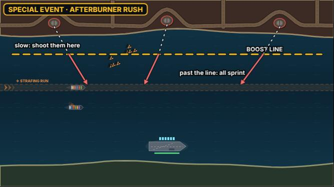

- **How it plays:** A dashed boost line is drawn across the lane. Every swarm cruises in slowly, and the moment the first one crosses the line, they all sprint. Kill them while they are slow, before the line.
- **How you beat it:** Shoot early and far out; area weapons on the bunched-up swarms before the line.
- **Strong:** Teaches the sprinter's tell (the flare) as a rhythm you can see coming.
- **Weak:** If the player is short of ammo when the line is crossed, it can feel like a wall.

#### Decoy Storm (`decoy-storm`): the player's idea

*The Kesh Hook (`kesh`) · debut enemy: Decoy Drones (`decoy`) · small build.*

Ten swarms at once, most of them decoys. Your ammo won't cover them all.

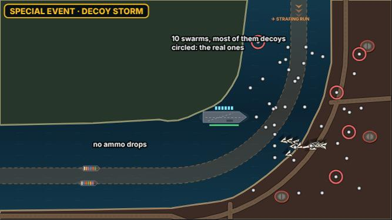

- **Rule while it runs:** No ammo drops.
- **How it plays:** Ten swarms launch in two waves from every base. About two in three drones are decoys, and they strobe only very late. No ammo drops for the event, so a rack spent on decoys leaves the real drones through.
- **How you beat it:** Hold fire, watch for the late strobe, shoot only what stays solid. Area weapons waste less.
- **Strong:** Your idea exactly: reading the swarm beats spraying it.
- **Weak:** Needs the decoy tell to stay readable in a crowd of 60 drones on a phone.

#### Hydra Bloom (`hydra-bloom`)

*Lee of Marrow (`marrow`) · debut enemy: Hydra Missile (`hydra`) · small build.*

Six Hydras in a fan. Kill them past the halfway mark and each splits into three.

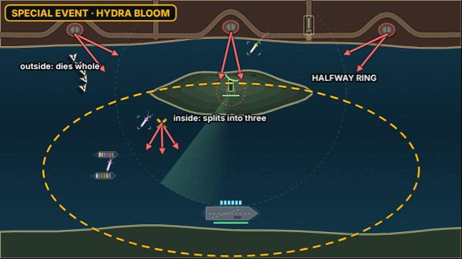

- **Rule while it runs:** Hydras split into three, not two.
- **How it plays:** A halfway ring is drawn on the water. A Hydra killed outside it dies whole; inside it splits into three darts at three ships.
- **How you beat it:** Reach out early (Railgun, Lance), or save area fire for the darts.
- **Strong:** Turns "kill it early" into a visible goal.
- **Weak:** Close to a normal Hydra wave if the player already kills them early.

#### Rocket Convoy (`rocket-convoy`)

*The Gauntlet (`gauntlet`) · debut enemy: Rocket Truck (`rocketTruck`) · medium build.*

Four trucks drive the shore road nose to tail, raising launchers one after another.

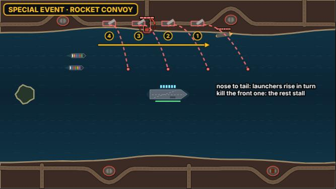

- **How it plays:** The trucks come in a column; each raises its launcher a few seconds after the one ahead, so the red salvos come in a ripple down the lane. Kill the front one and the others stall behind its wreck for a moment.
- **How you beat it:** Work the column front to back; the stall buys time.
- **Strong:** A clear target order, and the red rockets make the stakes plain.
- **Weak:** Only works on maps with a long shore road (The Gauntlet has one).

#### Chapter finale: The Breakout (`finale-1`)

*Harbor Mouth (`harbor`) · the chapter's new enemies · medium build.*

The chapter's four new enemies in one event: sprint swarms with decoys among them, a Hydra fan and a truck.

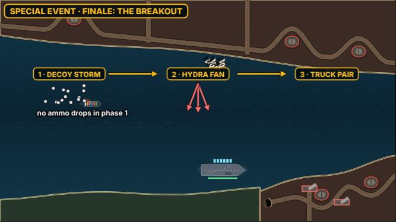

- **Rule while it runs:** No ammo drops in the first phase.
- **How it plays:** Three short phases back to back: a Decoy Storm in miniature, then Hydras, then a truck pair on the road. Harbor Mouth repeats a debut, so it gets the finale.
- **How you beat it:** Everything the chapter taught.
- **Strong:** A real end to the chapter.
- **Weak:** The longest event; needs care not to drag.

### Chapter 2: The Narrows (5)

#### Gunship Wall (`gunship-wall`)

*The Island (`island`) · debut enemy: Attack Helicopter (`attackHeli`) · medium build.*

Four helicopters hover in a line across the lane and fire in turn.

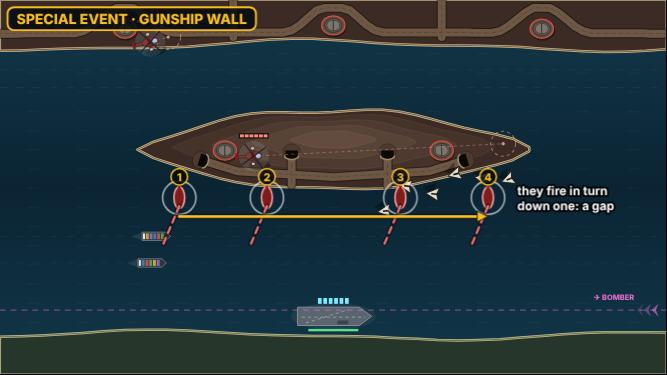

- **How it plays:** They take station side by side and fire one after another, left to right, so the missiles walk across the convoy. Each one shot down opens a gap in the wall.
- **How you beat it:** Pick one end and roll the wall up; shoot the missiles that would hit.
- **Strong:** A set piece you can read at a glance.
- **Weak:** Four helis at six hits each is a lot of ammo; may need fewer hits for the event.

#### Wolf Pack (`wolf-pack`)

*The Behemoth Run (`behemoth`) · debut enemy: Torpedo Sub (`torpedoSub`) · medium build.*

Five periscopes at once; their torpedo lines cross the lane in a lattice.

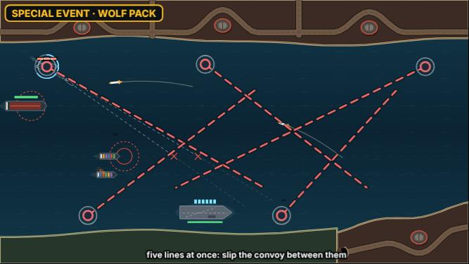

- **How it plays:** All five warn together, then fire on a stagger. Their dashed lines show where each torpedo will run, so some ships can slip between them.
- **How you beat it:** Kill the subs whose lines cover the most ships; change pace to thread the gaps.
- **Strong:** Uses pace and formation, which most events don't.
- **Weak:** Many dashed lines at once can be hard to read.

#### Shield Wall (`shield-wall`)

*The Needle of Bosk (`needle`) · debut enemy: Armored Drone (`armored`) · medium build.*

A phalanx of armored drones, shields to the front, that all bank together.

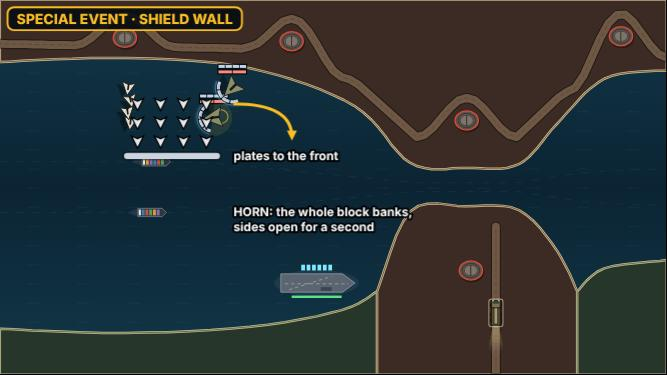

- **How it plays:** Twelve armored drones fly in one block, plates facing the carrier. At a signal (a horn and a flash) the whole block banks, showing their sides for about a second.
- **How you beat it:** Wait for the bank, then fire everything; blasts that go round the plates work any time.
- **Strong:** One big readable window, a satisfying payoff.
- **Weak:** Waiting can feel passive.

#### Supply Raid (`supply-raid`)

*The Archipelago (`archipelago`) · debut enemy: Scavenger Drone (`scavenger`) · small build.*

Pickups rain down everywhere, and a pack of scavengers comes for them.

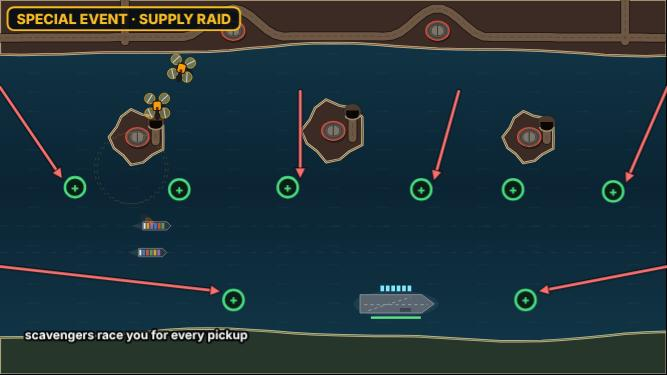

- **Rule while it runs:** Pickups rain down.
- **How it plays:** A cargo run drops eight pickups across the water (weapons, ammo, a Nuke). Six scavengers arrive to steal them. Each one grabbed is gone.
- **How you beat it:** Race them: grab what matters most, shoot the thieves going for it.
- **Strong:** A rewarding event: win it and you come out stronger.
- **Weak:** More a scramble than a threat; good as a change of pace.

#### Chapter finale: Run the Canal (`finale-2`)

*Saltgate Canal (`saltgate`) · the chapter's new enemies · medium build.*

Through the canal under the chapter's four new enemies at once.

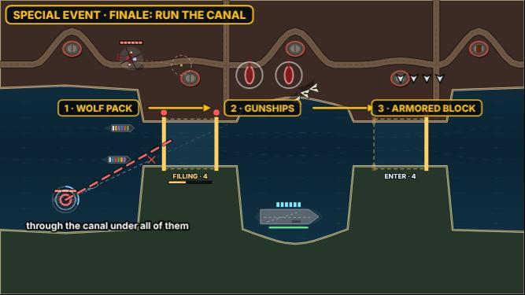

- **How it plays:** Phases: a Wolf Pack in miniature as the convoy enters, a Gunship pair on the banks, then armored drones banking in. Saltgate repeats a debut, so it gets the finale.
- **How you beat it:** Everything the chapter taught.
- **Strong:** The canal makes it feel like a gauntlet.
- **Weak:** Saltgate is already the hard map of the chapter.

### Chapter 3: Dark Water (5)

#### Blackout (`blackout`)

*Battery Point (`battery`) · debut enemy: Stealth Strafer (`stealthJet`) · medium build.*

The lights go out; strafers come in with only their run-in flash.

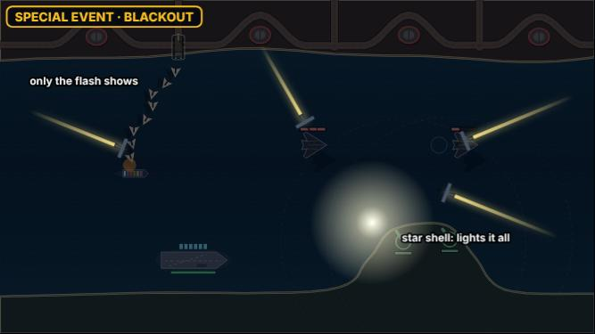

- **Rule while it runs:** Night. A star shell drop is on the way.
- **How it plays:** The screen darkens to night for the event. Stealth strafers make passes from all sides, seen only by their flash and their shadow on the water. A star shell drop lights everything for a few seconds.
- **How you beat it:** Shoot at the flashes; save the star shell for a group.
- **Strong:** A mood change, and it reuses the night maps' look.
- **Weak:** Darkness on a phone outdoors can be too dark.

#### Carpet Run (`carpet-run`)

*Sowers' Reach (`sowers`) · debut enemy: Stealth Bomber (`stealthBomber`) · small build.*

Three stealth bombers in a V across the whole lane; their bomb lines show late.

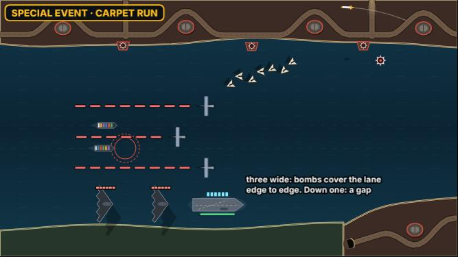

- **How it plays:** They come in together, wide apart, so their bombs cover the lane edge to edge. The bomb lines appear only on the last part of the run.
- **How you beat it:** Bring one down early to open a gap; steer the convoy into it.
- **Strong:** Simple and big.
- **Weak:** Six hits each, three at once: tune the hits for the event.

#### Dive Circus (`dive-circus`)

*The Rig Field (`rigs`) · debut enemy: Dive Bomber (`diveBomber`) · small build.*

Eight dive bombers, one after another, on a drumbeat.

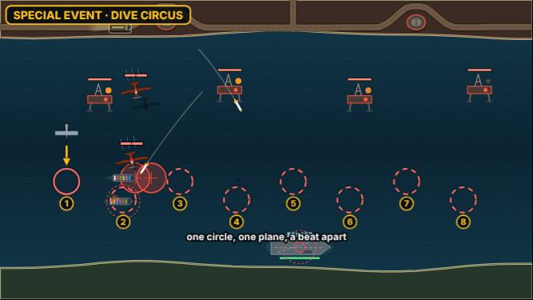

- **How it plays:** Circles appear down the lane one per beat; a plane dives on each in turn. It becomes a rhythm: circle, plane, shoot, next.
- **How you beat it:** Keep the rhythm; a miss means a bomb, not a sinking.
- **Strong:** A rhythm game moment, very readable.
- **Weak:** The new dive drawing has to be good (it is fresh).

#### Bombardment (`bombardment`)

*The Black Strait (`lantern`) · debut enemy: Siege Battery (`siege`) · small build.*

Three hatches on the shore pop up in turn; shells rain on the lane.

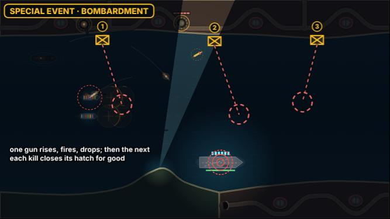

- **How it plays:** A whack-a-mole: one gun rises, marks its circles, drops back; the next rises somewhere else. Each kill closes that hatch for good.
- **How you beat it:** Watch the hatches; be ready where the next one rises.
- **Strong:** Uses the new hatch exactly as built.
- **Weak:** Siege was the deadliest enemy in the playtest; the event must be shorter.

#### Fire Mission (`fire-mission`)

*Dreadnought Pass (`dreadnought`) · debut enemy: Spotter Plane (`spotter`) · medium build.*

A spotter paints your ships one after another and calls a strike on each.

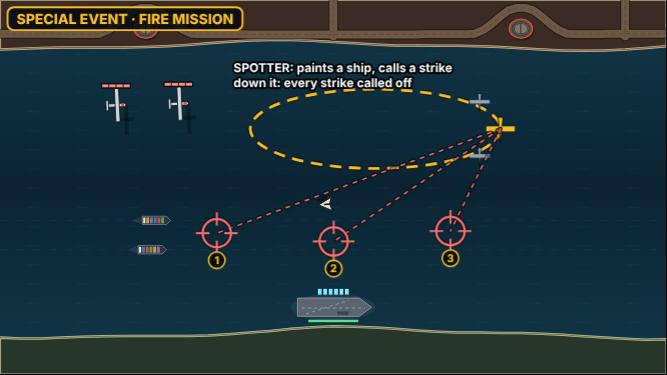

- **How it plays:** It circles with two escort fighters. Every few seconds it paints a new ship and a strike comes for it. Down the spotter and every strike still to come is called off.
- **How you beat it:** Get through the escort to the spotter; it is the whole event.
- **Strong:** One clear target with a big payoff.
- **Weak:** Dreadnought Pass is a boss map; the event must not fight the boss for attention.

### Chapter 4: Open War (5)

#### Repair Yard (`repair-yard`)

*Smugglers' Coves (`coves`) · debut enemy: Repair Tender (`tender`) · small build.*

A mothership with three tenders mending it as it comes.

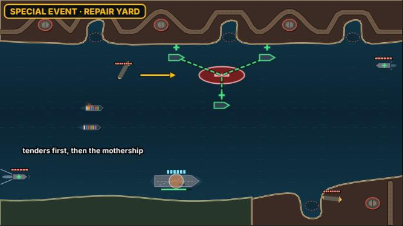

- **How it plays:** A mothership crosses slowly with three tenders sailing alongside, each pulsing repairs into it. Hit the mothership alone and it heals faster than you hurt it.
- **How you beat it:** Tenders first, then the mothership.
- **Strong:** The tender's point made plain.
- **Weak:** Plays like a puzzle with one answer.

#### Escort Run (`escort-run`)

*The Sharra Delta (`delta`) · debut enemy: Bodyguard Ring (`bodyguard`) · small build.*

One huge missile in three rings of guards, coming slowly.

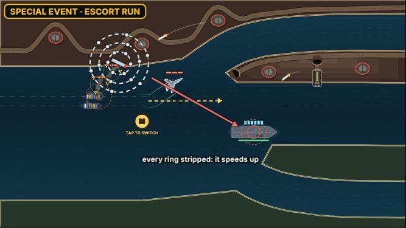

- **How it plays:** A heavy missile carries three rings of guard drones. Every ring stripped speeds it up. It must die before it reaches the carrier.
- **How you beat it:** Strip rings with area fire, then a big hit on the missile.
- **Strong:** A boss-like target in a normal map.
- **Weak:** Speeding up as you win can feel unfair; worth testing.

#### Siren Field (`siren-field`)

*Dunmar Crossing (`crossing`) · debut enemy: Lure Beacon (`lure`) · small build.*

Five lure beacons surface at once. Every helper you have is pulled away.

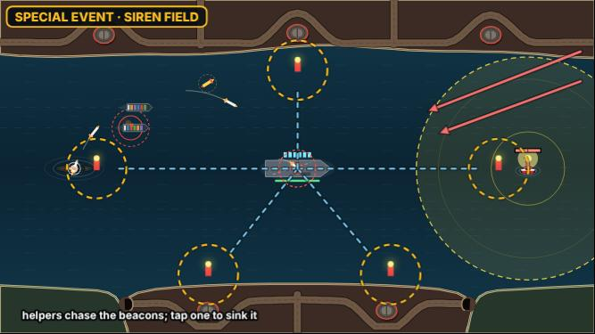

- **Rule while it runs:** Helpers chase the beacons.
- **How it plays:** All your helpers turn on the beacons, and a big swarm comes while you are on your own. Sink a beacon (by tapping) and the helpers near it come back.
- **How you beat it:** Sink the beacons nearest the swarm's path first.
- **Strong:** Makes a support enemy the star.
- **Weak:** Without helpers in the kit, it's only a swarm.

#### Firestorm (`firestorm`)

*Tidewater Flats (`tide`) · debut enemy: Incendiary Missile (`cloud`) · small build.*

Six firebombs from every side; their fireballs close the lane.

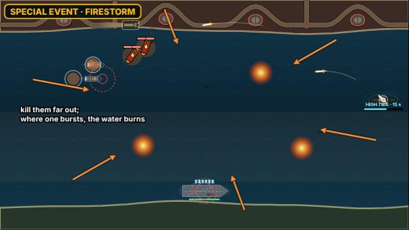

- **How it plays:** They come in a ring, all slow. Wherever one bursts, fire burns on the water for the event. Shot down far out, the lane stays open; let them in and the convoy sails through fire.
- **How you beat it:** Kill them far out; steer the convoy around the fires.
- **Strong:** Visible consequences that last.
- **Weak:** Lingering fire plus more waves can snowball.

#### Chapter finale: Siege of Vey (`finale-4`)

*Citadel of Vey (`citadel`) · the chapter's new enemies · large build.*

The last map: the chapter's four new enemies around the Citadel.

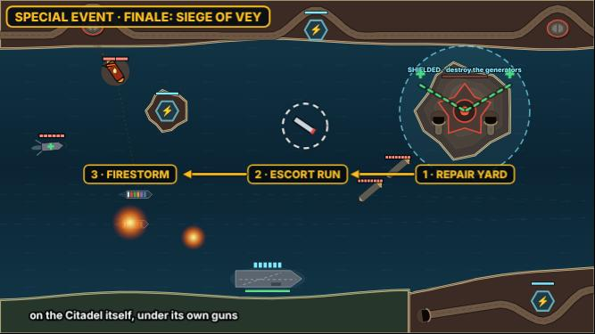

- **How it plays:** A Repair Yard on the Citadel itself (tenders mending it), then an Escort Run, then a Firestorm. Citadel of Vey repeats a debut, so it gets the finale.
- **How you beat it:** Everything the game taught.
- **Strong:** A real ending for the campaign.
- **Weak:** Stacked on the Citadel boss, it may be too much.

### The original threats (6)

#### Silo Salvo (`silo-salvo`)

*Free Play, endless, later maps · the original threats · small build.*

Every silo fires at once, then again, then again.

- **How it plays:** Three full barrages, five seconds apart, from every live base. Classic missile defence.
- **How you beat it:** Spread fire; formation for barrages.
- **Strong:** The game's first threat as a set piece.
- **Weak:** Close to a hard normal wave.

#### Swarm Tide (`swarm-tide`)

*Free Play, endless, later maps · the original threats · small build.*

A mothership pair releasing drones nonstop for twenty seconds.

- **How it plays:** Two motherships hold off the coast and pour out mini drones until they are killed.
- **How you beat it:** Kill the motherships through the screen of drones.
- **Strong:** Big numbers on screen.
- **Weak:** Performance on older phones.

#### Sea Skimmers (`sea-skimmers`)

*Free Play, endless, later maps · the original threats · small build.*

Guided missiles and supersonics come in low, in pairs, from both flanks at once.

- **How it plays:** Two lines of guided missiles cross from left and right, with a supersonic hidden in each line. The supersonics only show their speed in the last third.
- **How you beat it:** Watch for the fast ones; railguns and leads on the supersonics.
- **Strong:** Uses the original missiles in a new shape.
- **Weak:** Needs flank launch points on maps that only fire from one shore.

#### Cluster Rain (`cluster-rain`)

*Free Play, endless, later maps · the original threats · small build.*

Heavy missiles and cluster bombs together: kill the clusters before they open.

- **How it plays:** Four heavies and four cluster missiles in one barrage. A cluster opens into bomblets halfway, a heavy takes many hits, so you have to choose which to spend ammo on.
- **How you beat it:** Clusters first, while they are whole; spread fire for the bomblets.
- **Strong:** A real ammo choice with the original threats.
- **Weak:** Bomblets on a phone can be hard to see.

#### Strafer Squadron (`strafer-squadron`)

*Free Play, endless, later maps · the original threats · small build.*

Six strafers in two flights of three, each flight on the same pass.

- **How it plays:** The flights come from opposite ends, guns open on the same ships. Down the lead plane and the flight breaks off.
- **How you beat it:** Hit the lead of each flight.
- **Strong:** Simple, readable, and a clear lead target.
- **Weak:** Close to the Gunship Wall in feel.

#### Bomber Stream (`bomber-stream`)

*Free Play, endless, later maps · the original threats · small build.*

Bombers in a long line, one every two seconds, down the lane.

- **How it plays:** A stream of bombers flies the length of the lane; each drops a stick. A steady drill.
- **How you beat it:** Keep up; never let two in a row through.
- **Strong:** Simple to build.
- **Weak:** Monotonous if long.

## Questions (8)

The recommended option is first in each.

- **`se-when`:** When in a map should its special event come?
  1. Wave 8 of 10: the map's climax, with two normal waves after to finish (recommended)
  2. Wave 10: the event is the map's ending
  3. Wave 5 or 6: the middle of the map
  4. Wave 3: right after the debut enemy first shows
- **`se-clear`:** How should the screen clear before an event starts?
  1. New launches stop; what's in the air plays out, and anything left after 8 s flies off (recommended)
  2. Everything on screen is blown away at once (like a free Nuke)
  3. No clear: the event starts on top of what's there
- **`se-length`:** How long should an event last?
  1. 20 to 30 seconds (recommended)
  2. About 45 seconds
  3. Until everything it sent is dealt with
- **`se-reward`:** What should holding an event give you?
  1. Clean: a guaranteed weapon drop and a score bonus; Held: the score bonus (recommended)
  2. A chance at an Armory card at the end of the map
  3. Score only
- **`se-fail`:** What happens to ships during an event?
  1. Same as normal: ships can be lost (recommended)
  2. Ships take half damage during events
  3. No losses: the event only grades you
- **`se-finale`:** Harbor Mouth, Saltgate Canal and Citadel of Vey repeat an earlier map's debut enemy. What should they get?
  1. A chapter finale that mixes the chapter's new enemies (recommended)
  2. One of the original-threat events (Silo Salvo, Swarm Tide…)
  3. No event on those maps
- **`se-replay`:** In Free Play and endless, how should events work?
  1. Free Play gets an Events setting (off, the map's own, or any); endless brings one every five waves (recommended)
  2. Only in the campaign
  3. Every map, every time, any event at random
- **`se-build`:** How should we build them?
  1. A pilot first: the system plus four events (Decoy Storm, Rocket Convoy, Dive Circus, Firestorm), tested in the Test Lab, then the rest (recommended)
  2. All the events marked Go further in one build
  3. Chapter by chapter, in order
- **`se-else`:** Anything else? (a free note)
