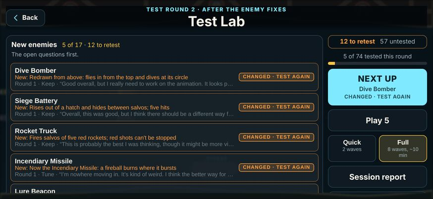
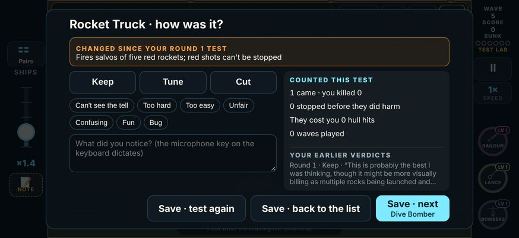

# V3 Test Lab

A playtest hub for testing new things fast. The player asked for it on 2026-11-08, after the enemy build. They wanted:
- a screen that says what's being tested and what's left;
- normal-feeling waves with the thing under test mixed in;
- quick changes of wave and weapons;
- notes that are recorded;
- everything lining up with the review pages.

It is built from the player's marks: `tools/v3/test-lab/marks-2026-11-08.json`.

- **Review page:** https://claude.ai/artifact/SzK5Boc4CrB9wrtMbd7249. It is built by `node tools/v3/test-lab/page.mjs <out.html>`, from `tools/v3/test-lab/lab.mjs` and the game's own card list (`src/v3/data/lab.ts`, through `cards.mts`).
- **The page's layout (from 2026-11-14).** The player asked for the page to "only have the new questions and new updates to the game on it". So it opens on one **This round** view, with only what is new, in this order:
  1. **The current round's header:** the latest round in `LAB_ROUNDS`, e.g. "Test round 10 · Map cards are the full production map", with its date. If the round has a design doc, the header adds a one-line summary and a link to it.
  2. **What's new in the game:**
     - the current round's `LAB_CHANGES` lines, by card; cards with the same line share one entry;
     - a fold, closed, with the earlier rounds' lines on cards not tested since that change.
  3. **To test:** the cards never tested, and the cards whose latest verdict is older than their current version. Each has its newest change in a line, its last verdict, and its "Test in game" link. They are grouped by section, with this round's changed cards first.
  4. **Open questions:** the questions in `OPEN_QUESTIONS` with no saved answer, or "No open questions". A question answered on the page stays until the page is reloaded.
  5. **A tally**, in the sticky bar: "50 cards to test · 0 open questions".

  Everything else is in one **Archive** at the bottom, closed by default. It holds:
  - **Done:** the cards whose latest verdict is on their current version, with their verdict, note, setup and evidence, and the earlier rounds folded underneath;
  - **Answered questions:** the saved choice and note, read only;
  - **The original design round:** the ask, the pieces and the first checklist, read only, with their marks;
  - **Cut cards.**

  The page has no tabs. The only inputs are on the open questions.
- **Results arrive after the page is published,** so the page's script works out To test, Done and the untested earlier changes from the store, each time a result comes in. The logic is `tools/v3/test-lab/split.mjs`: the page inlines its functions, and `tests/v3/labPage.test.ts` tests it. A card is done when its result's `rev` (1 if the result has none) is at least the card's `cardRev`.
- **A new round needs no page edit.** Add the round to `LAB_ROUNDS` and its lines to `LAB_CHANGES`, then rebuild and republish the page. The page then shows that round's changes and retests. Two optional additions:
  - **A design doc:** add a line to `ROUND_DOCS` in `lab.mjs`, as `{ doc, summary }`. Without one, the page uses the doc in `docs/design/` that says "Test Lab round N is", with that doc's title as the summary.
  - **Questions for the player:** add them to `OPEN_QUESTIONS` in `lab.mjs`, as `{ id, round, text, options, why }`, with the recommended option first. Use a new `id` every time: the build stops if an id is used twice.
- **The page's store.** The ids and shapes are unchanged from the design round, and nothing saved is rewritten:
  - `results/{cardId}`: `verdict`, `tags`, `note`, `evidence`, `ended`, `log`, `at`, and (from test round 2) `round`, `rev`, `changes` and `history`. Claude writes these from the logs, and the page only reads them. A document without `round` is round 1 A map card's document can also carry `variant`, `score`, `auto` and `runs` (from round 11, see Scorecard). All are optional.
  - `answers/{questionId}`: `choice` (option index) and `note`. The open questions write these. The design round's `tl-*` answers are shown read only.
  - `reviews/{pieceId}` and `cards/{cardId}`: the design round's marks, shown read only.

## What the player marked

- **Approved:** the lab bar, the setup sheet, the mix, the verdict sheet, the evidence, the recording, the page bridge, the session report and the combos.
- **Changed:**
  - **The Test Lab screen:** "make sure that we have this set up so that we can play test out new weapons to new maps things like that. It should [be a] kind of play test hub". So cards come in four kinds (enemy, weapon, combo, map), and new things join as more cards.
  - **Next up:** a test "doesn't feel like a specific wave like from a certain map", is designed to try its card "in various scenarios", lasts "5 to 10 minutes", has "normal upgrades … once you finish a wave", and starts "at a pretty good pace". So lab waves are their own:
    - they start at wave 5;
    - they rotate four scenarios (mixed, swarms, missiles, air raid);
    - they have drafts between waves.
- **Answers:**
  - feedback is given in the game and copied to the page;
  - a test runs until Done;
  - the card's enemy makes up about a third of the new-enemy mix;
  - everything is on the list, all 29 weapons too;
  - tests start at wave 5;
  - the Lab is on the menu in test builds, hidden in the App Store build.
- **Their note** asked for "a long one or a shorter one … make that like an option". So there is a Quick (2 waves) / Full (8 waves, about 10 minutes with drafts) switch, and Done ends a test early either way.

## How it works

- **The hub** (main menu → Test Lab) holds 74 cards:
  - 17 new enemies, the open questions first;
  - 29 weapons, the 5 reworked ones first;
  - 8 combos;
  - 20 maps.

  The first playtest (2026-11-08) cut four enemies: Loitering Drones, Crossing Wing, Flak Picket and Supply Barge (see [v3-enemy-build.md](v3-enemy-build.md)). Their cards are gone. Three combos used them and were remade: Siege Battery + Rocket Truck (was Supply Barge + Rocket Truck), Bodyguard Ring + Seeker Pod (was Flak Picket + Seeker Pod), and Hydra + Sprint Drones, Tesla (was Hydra + Crossing Wing). Old results and logs for the cut cards stay on the device and in the store as records; the hub and the session report skip them.

  Each card shows its status and what to look for. Its buttons are Next up, Play 5 (five back to back), Quick/Full, Session report and Feedback page. Progress is kept on the device (`straitwatch.v3.lab`), as a history of verdicts per card (see Rounds and versions).
- **A test** is a Free Play run with a card (`src/v3/sim/lab.ts`):
  - it plays on the lab's water (The Strait); a map card uses its own map, its own waves and its chapter's enemies;
  - it starts at wave 5 with three weapons that suit the card;
  - the card's enemy is moved up to open every wave (about 4.5 s in), and makes up about a third of that wave's other new enemies;
  - a combo's enemies come in as a **set**, launched together and timed to be on the board at once, and a combo with a weapon drops it by the carrier just before each set (round 4, [v3-lab-round4.md](v3-lab-round4.md) has each combo's pairing rule);
  - it doesn't end at wave 10.
- **The bar in play:** the card's name, a live count, and four buttons:
  - **Bring one:** brings the card's enemy in now (a combo: its whole set, and its weapon). It is a recorded command (`'b'`), so a test that used it still replays exactly.
  - **Note:** the usual note form.
  - **Setup:** wave, weapons, mix and length; the test restarts with them.
  - **Done**
- **The verdict sheet:** Keep, Tune or Cut; tags; a note; and the evidence. The evidence covers:
  - how many came and how many were killed;
  - how many were stopped before they did harm (`foeHarmed`: before a truck fired, a dive bomber dropped, a sub loosed its torpedo…);
  - the hull hits and sinkings they cost;
  - the seconds from showing up to the first shot;
  - for a weapon card, kills with it in hand and pickups taken.
- **Its buttons:** Save · next (the next card, or the Play 5 queue), Save · test again, or Save · back to the list.
- **Recording:** the play log is version 17. It carries `lab`, which replays, and `labResult`, the verdict, each with the card's version and the test round (see Rounds and versions). It uploads like every run.
- **The session report:** today's verdicts and notes. A note's moment can be rewatched from the last six tests' logs kept on the device (`straitwatch.v3.lab.logs`). "Send logs now" sends anything still waiting to upload.
- **Links:** `v3.html?lab=<cardId>` opens a test directly. Both review pages link each card that way: this one, and the enemy page's Build tab.

## Rounds and versions

The player asked for it on 2026-11-08: "We need to have versions for the play test that we do. I went in on the test lab and did one for the rocket truck and what not and my old notes were there. We need to have a version control there so we know which notes are for what." After the first round, PRs #132/#133 changed most of the enemies, but the hub still showed the round 1 verdicts as if they were current.

- **A test round** is one pass of playtesting on one build. The rounds are listed in `LAB_ROUNDS` (`src/v3/data/lab.ts`); the latest is the current one (`LAB_ROUND`):
  1. 2026-11-08, First look at the new enemies.
  2. 2026-11-08, After the enemy fixes.
  3. 2026-11-08, Round 2 notes: the Dive Bomber, the Incendiary Missile and the Decoy Drones changed again ([v3-enemy-lab-round2.md](v3-enemy-lab-round2.md)).
  4. 2026-11-09, Combos meet; Dual Wield and Cadence: every combo's enemies now come in together, Dual Wield's cases, War Drum blows up platforms ([v3-lab-round4.md](v3-lab-round4.md)).
- **A card's version** (`cardRev`) is the latest round it changed in, from `LAB_CHANGES`: one short plain line per change, by round. A card that never changed is version 1. A combo also takes its enemies' and its weapon's changes (and their versions), so changing the Rocket Truck makes Siege Battery + Rocket Truck a new version too. `cardChanges(id, sinceRound)` lists what changed after a round.
- **On the device** (`straitwatch.v3.lab`), each card keeps a list of verdicts, oldest first. Each one holds the verdict, tags, note and evidence, plus `at`, `rev` (the card's version when tested), `round` (the round it was tested in) and `build`. A new verdict is added to the list and doesn't replace the old ones. Progress saved before rounds (one result per card) loads as one round 1, version 1 verdict.
- **Tested** means tested at the card's current version. That's the rule for the progress count, the section counts, Next up and Play 5.
- **The hub:**
  - The header shows the round ("Test round 2 · After the enemy fixes"), and the side shows "12 to retest · 57 untested".
  - A card tested only on an older version shows **Changed · test again** in amber. It also shows one line of what's new since that test, and the old verdict and note dimmed ("Round 1 · Keep · “…”").
  - Next up and Play 5 take the changed cards first (they're the most useful to try again), then the untested ones, each in the checklist's order.
- **The verdict sheet** fills in only a verdict given on the current version. When the card changed since your last test, it shows what changed under the title, and your earlier verdicts below the evidence, read only.
- **The session report** tags each card with the round it was tested in.
- **Logs** carry `rev` and `round` in both `lab` (the setup) and `labResult`. These fields are optional and the sim never reads them, so the log version stays 17. A log without them is round 1 and still replays.
- **The page bridge** groups logs by card and round. Each card's document is its latest round's verdict, with that round's `changes`, and `history` holds the latest verdict of each earlier round. The page shows a "Round N" chip on each result, the change lines for that round, and the earlier rounds folded underneath. If a card's latest result is from an older version than the game's, the page lists it under To test (until 2026-11-14 it said "changed since: retest" on the card). The enemy page's `builds/<enemy>` documents also carry `round`.

**Starting a new round** (when a build changes something under test):
1. Add the round to `LAB_ROUNDS`: its number, date and a short name.
2. For each card the build changed, add `{ round, what }` to `LAB_CHANGES[cardId]` in one plain line. A combo picks up its enemies' and weapon's lines by itself. Give a combo its own line only if the combo itself changed, for example a new pairing.
3. Rebuild the review page (`node tools/v3/test-lab/page.mjs <out.html>`) and republish it to the same URL, so it knows the new versions. It then opens on the new round, with its changes and the cards to retest. Add the round's design doc to `ROUND_DOCS` and any questions to `OPEN_QUESTIONS` in `lab.mjs`, if it has them.

## Scorecard

The player asked for it on 2026-11-14: "let's improve the rating and feedback system at the end of the game. It should have categories to rank that we should have some feedback on to determine if this production map is good." Next: "make a few different versions of the same maps with different encounters and see which ones do the best". So every full map run asks the same short questions, and the answers can be compared across runs and across versions of one map.

**On the verdict sheet.** After a map card's full run (won, lost, or Done), the sheet opens with a **Scorecard** box above Keep / Tune / Cut, the tags and the note. Other cards, and a map card's Quick slice, have no scorecard; their sheet is unchanged.
- One row per category, and one tap on a chip answers it. A second tap clears it. Nothing needs typing.
- Every row is optional. **Skip** folds the box away, and nothing from it is saved; **Show it** brings it back.
- Save still asks for Keep, Tune or Cut. If the verdict row is out of sight under the scorecard, the sheet scrolls back to it.
- Held sideways, a row's name sits beside its chips. Upright, the name sits above them. Every chip is a 40 px target.
- A score is never filled in from an earlier run: each run's score is its own.

### Revision 2 (2026-11-17): rate relative to the other maps

The player approved this on the map-rebuild hub on 2026-11-17: "Proposed scorecard: (1) before you rate, it shows your last scores for this map and the latest scores of the other maps, so you rate relative to them; (2) the waves of your run in a strip, with the moments the game marked, so you tap the best and weakest wave from what happened, not memory; (3) one comparison: 'compared with <the map you rated last>, this one was worse / about the same / better'; (4) fewer sliders: Fun, Difficulty and Play again stay, plus a note; Readability and Pacing go (always 5 and 'right')."

Revision 1's answers had stopped telling the maps apart. Pacing was always "Right" and Readability always 5, and each run was rated from memory with nothing to compare it with. Revision 2 (`SCORECARD_REV = 2`) changes the sheet in four ways:
- **Your last scores.** A compact box at the top of the scorecard. It shows this map card's most recent score ("Last time", from either revision), then the latest score of each other map card, newest first, four lines in all. Each line is short, for example "Harbor Mouth · Fun 5 · Right · Again yes · 2 days ago". On a landscape phone the lines sit two to a row, so the box takes two lines. With nothing scored yet, the box is not shown. It reads the Test Lab progress on the device (`straitwatch.v3.lab`).
- **The wave strip.** Best wave and Weakest wave stay two rows, and both show the same strip. Each wave's chip shows its label (1 to 10, B1 to B3), the ships lost in that wave in red ("−2"), and a mark for each kind of moment the game marked in it: ★ new threat, ‼ ships lost in a burst, ◆ carrier hit, ∅ out of ammo. A sunk ship shows as the "−n". A key under the rows explains only the marks shown. A chip in the Best row answers Best, and one in the Weakest row answers Weakest. The ships lost come from the run's wave records (`g.history`, whose `lost` is the running tally, so a wave's own losses are the difference from the wave before). The moments come from the run's recorder (`Watch.moments`). Without that data the rows are plain chips, as in revision 1. Held sideways, the row's name sits on one line above the strip, so all 13 waves fit on one line.
- **One comparison.** A row named after the other map card scored most recently (by the entry's `at`), for example "Compared with The Gauntlet: this one was… Worse · About the same · Better". It is saved as `vs` (`worse` −1, `same` 0, `better` +1), with that card's id in `vsCard`. It is shown only when another map card has been scored. A version card of the same map counts as another card.
- **Fewer rows.** Fun, Difficulty, Boss rounds (only on a run that reached wave 11: a design rule checks the boss score) and Play again stay. Pacing and Readability go. Variety and Map feel go with them, as part of "fewer sliders". The note stays under the verdict, as before.

| Row | Asks | Answers |
|---|---|---|
| Fun | How much fun was this run? | 1 to 5 |
| Difficulty | How hard was it? | Too easy · Bit easy · Right · Bit hard · Too hard |
| Boss rounds | How were waves 11 to 13? (only on a run that reached wave 11) | 1 to 5 |
| Compared with *the map rated last* | this one was… (only when another map card has a score) | Worse · About the same · Better |
| Play again? | Would you play this map again? | Yes · Maybe · No |
| Best wave | The wave you liked most | the strip: a chip per wave played, 1 to 10, then B1 to B3 |
| Weakest wave | The wave you liked least | the same strip |

Retired in revision 2. These rows are still defined, so a revision 1 score reads and averages as before:

| Row | Asked (revision 1) | Answers |
|---|---|---|
| Pacing | How fast did the run move? | Too slow · Right · Too fast |
| Variety | The waves felt different from each other | 1 to 5 |
| Readability | I could tell what was coming and what hit me | 1 to 5 |
| Map feel | The layout mattered to how I played | 1 to 5 |

**In data.** The rows are `SCORECARD` in `src/v3/data/scorecard.ts`. Each has an `id`, a `label`, a `help` line and a `scale`. The scale is `stars`, `choice` (ordered `{ id, label, value }` options) or `wave`. A choice's `value` is what the page averages. Right is 0 on Difficulty (−2 to +2) and on Pacing (−1 to +1), and About the same is 0 on the comparison (−1 to +1).
- A row that is no longer asked keeps its definition and gets `retired: <the revision that retired it>`.
- `scoreRows(played, { vsCard })` gives the rows to ask. It leaves out retired rows, leaves out the boss row before wave 11, and includes the comparison only when there is a `vsCard`.
- `cleanScorecard` keeps a valid answer on any row its score's revision asked. A revision 1 score keeps its Pacing, and a revision 2 score drops it. It keeps `vsCard` only beside a valid `vs`.
- Changing a row's meaning, or adding or dropping a row, means bumping `SCORECARD_REV`, so answers to two different questions are never averaged together.

**In the log (version 22).** The run's `labResult` carries the score. A revision 1 example: `"score": { "rev": 1, "fun": 4, "difficulty": "bit-hard", "best": 12, "again": "yes" }`. A revision 2 example: `"score": { "rev": 2, "fun": 4, "vs": "better", "vsCard": "map-gauntlet", "again": "yes", "best": 12 }`. A row left alone is absent, and a skipped or blank scorecard leaves no `score` at all. A wave is its number (11 to 13 are B1 to B3). The score is never part of replay, so revision 2 did not change the log version.
- **The encounter version.** A map card's `lab` and `labResult` also carry `variant`: which encounter version of the map was played. It is `'v1'` for now (`MAP_VARIANT_DEFAULT`). A log without it is v1. The setup's `variant` (`LabRunSetup`) is the plumbing for next round's A/B/C versions.
- **Old logs.** Version 22 only adds fields outside replay, so a v21 log replays here exactly as before. `LOG_REPLAYS` (`[21, 22]`) lists the versions this build replays, and Map Analytics and the map lab tools accept either.

**The bridge.** `labResultDocs` (`src/v3/sim/labDocs.ts`) adds these to a map card's `results/{cardId}` document:
- `variant`, `score` and `auto` for the latest run (when it was a full run);
- the same on each `history` entry;
- `runs`: every full run of the card, newest first (up to 60), each `{ at, log, round, rev, variant, end, verdict, score?, auto? }`.

**Three numbers per run (`auto`).** They come from the log's summary, so no new telemetry is needed:
- `deliveredPct`: the ships delivered, as a share of those delivered or sunk;
- `lost`: the ships lost. The restore before the ending doesn't reset the tally;
- `firstLoss`: the wave the first ship was lost on, or `null` when none were lost.

`results.mts` prints them, with the variant and the score, beside each map card's verdict.

**The review page.** A map card, under To test or Done, gets a scorecard block:
- **Latest full run:** how it ended (Map cleared, Lost, or Stopped with Done), the three numbers, and the answers as a row of chips ("Fun 4", "Difficulty Bit hard", "Best wave B2").
- **Average:** once a card has two or more scored runs, one chip per category, with the number of runs that answered it:
  - a 1-5 row shows its mean ("3.7");
  - Difficulty, the comparison and (revision 1) Pacing show the nearest answer and the signed mean ("Bit hard (+0.7)");
  - the wave rows show the wave picked most ("7", or "7 (2 of 3)" when the runs differ);
  - Play again shows its counts ("Yes 2 · No 1").

  Each chip ends with "×n", the runs that answered it. A line above the chips gives the runs, the runs won, the mean delivered % and the mean ships lost.
- **By encounter version:** when a card has runs on more than one `variant`, each version gets its own box with its own line and averages, so the versions can be compared side by side.
- **Comparable runs only:**
  - only runs on the newest card version are averaged, and older ones are counted in a line under the block;
  - only scores on the current `SCORECARD_REV` count. A score is never averaged with another revision's, and rows that revision retired are not averaged. Runs scored on an older scorecard get a line of their own ("2 runs scored on an older scorecard (other questions) not averaged with these"). Their latest scores still show as chips, retired rows included.

The logic is `tools/v3/test-lab/scores.mjs`. The page inlines it, as it does `split.mjs`, and `tests/v3/labScores.test.ts` tests it. To try the block, the page reads fake results from its browser store when it is opened outside claude.ai (`localStorage['straitwatch-test-lab-1'] = { results: { 'map-strait': {...} } }`).

**Checks:**
- `tests/v3/scorecard.test.ts`: the rows, cleaning and saving a score, the variant on the plan, log version 22 with v21 still replaying, and the bridge's numbers, runs and history.
- `tests/v3/labScores.test.ts`: the page's chips, averages and grouping.
- `e2e/v3-map-cards.mjs`: a scorecard filled on The Strait's sheet lands in the log; Skip saves none.

## Copying results to the pages (Claude, each session)

1. Read the newest logs from the playlog store (`/api/playlog?all=1` on a deployment URL, through the Vercel tools) and save them to a file.
2. Run `npx tsx tools/v3/test-lab/results.mts <logs.json> <out-dir>`. It writes one document per card, with the latest round's latest verdict and the earlier rounds as history (the grouping is `src/v3/sim/labDocs.ts`):
   - `results/<card>.json` for this page;
   - `builds/<enemy>.json` for the enemy page.
3. Write them with `ArtifactData` `batch` (`file_path` per entry): to `results/` here, and `builds/` on https://claude.ai/artifact/Sm8d5jmPVxTwihiTiKdtGX.

## Telemetry (the Map & Convoy Lab)

From 2026-11-12 a Test Lab run also records the Map & Convoy Lab's telemetry as it is played ([v3-map-lab-slice0-1.md](v3-map-lab-slice0-1.md)): where each attack was launched, every hit with what dealt it, pickups, taps and ship positions. It stays on the device and is not part of the log (the log is unchanged, and any log replays to it: `npm run v3:map-lab -- telemetry <log.json>`). `?tel=0` turns it off. (This file still describes the lab as of round 4; the hub is at round 8 with 98 cards.)

Also from 2026-11-12 ([v3-map-lab-slices2-5.md](v3-map-lab-slices2-5.md)): the front page has a **Map Analytics** button (heatmaps of the runs kept on the device), and a test's Setup sheet has a **Convoy** row (today's controls, automatic, formations only, or the map's commands) and, on The Strait, The Gauntlet and Harbor Mouth, a **Waves** row (the shared waves or the map's authored encounters). Both are written into the test's log.

## Checks

- `tests/v3/lab.test.ts`:
  - the card list covers everything once, in its order;
  - every wave opens with the card's enemy, and it makes up a third or more of the new-enemy mix;
  - a test runs past wave 10 and stops at its length;
  - an early kill counts;
  - "Bring one" replays exactly;
  - a map card plays its own map;
  - each combo's enemies are on the board together for 4.5 s or more, in the first wave and after Bring one; a weapon combo drops its weapon first (round 4);
  - rounds and versions: old progress becomes round 1 history; a card changed since its only verdict isn't tested, and Next up offers it first; a new verdict is added and becomes current; combos take their enemies' versions; the bridge groups logs by card and round; a log from before rounds still replays.
- `e2e/v3.mjs` (Test Lab block):
  - the hub lists 74 cards with Next up;
  - a test starts at wave 5 with its bar;
  - Bring one is recorded;
  - the verdict is kept on the device and goes into the log, at version 17;
  - `?lab=w-cadence` opens that test holding Cadence;
  - a round 1 verdict saved before rounds shows the Rocket Truck as "Changed · test again", with its note dimmed, and Next up offers it.
- Screenshots of every screen at 667×375 and 874×402.
