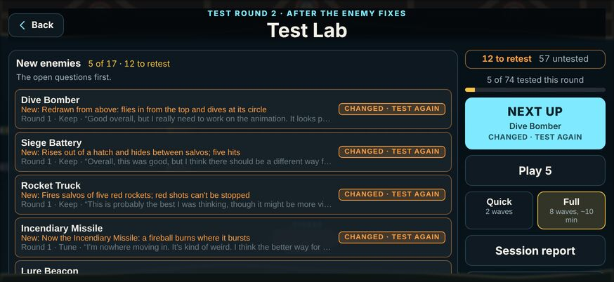
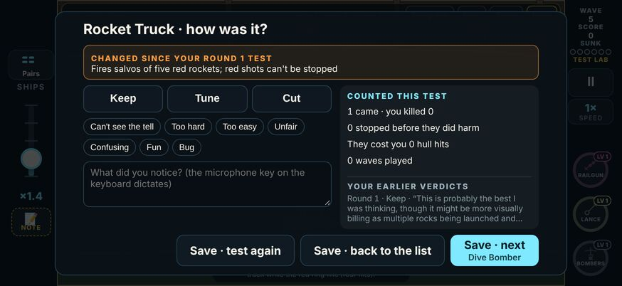

# V3 Test Lab

A playtest hub for testing new things fast. The player asked for it on 2026-11-08, after the enemy build. They wanted:
- a screen that says what's being tested and what's left;
- normal-feeling waves with the thing under test mixed in;
- quick changes of wave and weapons;
- notes that are recorded;
- everything lining up with the review pages.

It is built from the player's marks: `tools/v3/test-lab/marks-2026-11-08.json`.

- **Review page:** https://claude.ai/artifact/SzK5Boc4CrB9wrtMbd7249. It is built by `node tools/v3/test-lab/page.mjs <out.html>`, from `tools/v3/test-lab/lab.mjs` and the game's own card list (`src/v3/data/lab.ts`, through `cards.mts`).
- **The page's layout (from 2026-11-14).** The player asked for the page to "only have the new questions and new updates to the game on it". So it opens on one **This round** view, with only what is new, in this order:
  1. **The current round's header:** the latest round in `LAB_ROUNDS`, e.g. "Test round 10 · Map cards are the full production map", with its date. If the round has a design doc, the header adds a one-line summary and a link to it.
  2. **What's new in the game:**
     - the current round's `LAB_CHANGES` lines, by card; cards with the same line share one entry;
     - a fold, closed, with the earlier rounds' lines on cards not tested since that change.
  3. **To test:** the cards never tested, and the cards whose latest verdict is older than their current version. Each has its newest change in a line, its last verdict, and its "Test in game" link. They are grouped by section, with this round's changed cards first.
  4. **Open questions:** the questions in `OPEN_QUESTIONS` with no saved answer, or "No open questions". A question answered on the page stays until the page is reloaded.
  5. **A tally**, in the sticky bar: "50 cards to test · 0 open questions".

  Everything else is in one **Archive** at the bottom, closed by default. It holds:
  - **Done:** the cards whose latest verdict is on their current version, with their verdict, note, setup and evidence, and the earlier rounds folded underneath;
  - **Answered questions:** the saved choice and note, read only;
  - **The original design round:** the ask, the pieces and the first checklist, read only, with their marks;
  - **Cut cards.**

  The page has no tabs. The only inputs are on the open questions.
- **Results arrive after the page is published,** so the page's script works out To test, Done and the untested earlier changes from the store, each time a result comes in. The logic is `tools/v3/test-lab/split.mjs`: the page inlines its functions, and `tests/v3/labPage.test.ts` tests it. A card is done when its result's `rev` (1 if the result has none) is at least the card's `cardRev`.
- **A new round needs no page edit.** Add the round to `LAB_ROUNDS` and its lines to `LAB_CHANGES`, then rebuild and republish the page. The page then shows that round's changes and retests. Two optional additions:
  - **A design doc:** add a line to `ROUND_DOCS` in `lab.mjs`, as `{ doc, summary }`. Without one, the page uses the doc in `docs/design/` that says "Test Lab round N is", with that doc's title as the summary.
  - **Questions for the player:** add them to `OPEN_QUESTIONS` in `lab.mjs`, as `{ id, round, text, options, why }`, with the recommended option first. Use a new `id` every time: the build stops if an id is used twice.
- **The page's store.** The ids and shapes are unchanged from the design round, and nothing saved is rewritten:
  - `results/{cardId}`: `verdict`, `tags`, `note`, `evidence`, `ended`, `log`, `at`, and (from test round 2) `round`, `rev`, `changes` and `history`. Claude writes these from the logs, and the page only reads them. A document without `round` is round 1.
  - `answers/{questionId}`: `choice` (option index) and `note`. The open questions write these. The design round's `tl-*` answers are shown read only.
  - `reviews/{pieceId}` and `cards/{cardId}`: the design round's marks, shown read only.

## What the player marked

- **Approved:** the lab bar, the setup sheet, the mix, the verdict sheet, the evidence, the recording, the page bridge, the session report and the combos.
- **Changed:**
  - **The Test Lab screen:** "make sure that we have this set up so that we can play test out new weapons to new maps things like that. It should [be a] kind of play test hub". So cards come in four kinds (enemy, weapon, combo, map), and new things join as more cards.
  - **Next up:** a test "doesn't feel like a specific wave like from a certain map", is designed to try its card "in various scenarios", lasts "5 to 10 minutes", has "normal upgrades … once you finish a wave", and starts "at a pretty good pace". So lab waves are their own:
    - they start at wave 5;
    - they rotate four scenarios (mixed, swarms, missiles, air raid);
    - they have drafts between waves.
- **Answers:**
  - feedback is given in the game and copied to the page;
  - a test runs until Done;
  - the card's enemy makes up about a third of the new-enemy mix;
  - everything is on the list, all 29 weapons too;
  - tests start at wave 5;
  - the Lab is on the menu in test builds, hidden in the App Store build.
- **Their note** asked for "a long one or a shorter one … make that like an option". So there is a Quick (2 waves) / Full (8 waves, about 10 minutes with drafts) switch, and Done ends a test early either way.

## How it works

- **The hub** (main menu → Test Lab) holds 74 cards:
  - 17 new enemies, the open questions first;
  - 29 weapons, the 5 reworked ones first;
  - 8 combos;
  - 20 maps.

  The first playtest (2026-11-08) cut four enemies: Loitering Drones, Crossing Wing, Flak Picket and Supply Barge (see [v3-enemy-build.md](v3-enemy-build.md)). Their cards are gone. Three combos used them and were remade: Siege Battery + Rocket Truck (was Supply Barge + Rocket Truck), Bodyguard Ring + Seeker Pod (was Flak Picket + Seeker Pod), and Hydra + Sprint Drones, Tesla (was Hydra + Crossing Wing). Old results and logs for the cut cards stay on the device and in the store as records; the hub and the session report skip them.

  Each card shows its status and what to look for. Its buttons are Next up, Play 5 (five back to back), Quick/Full, Session report and Feedback page. Progress is kept on the device (`straitwatch.v3.lab`), as a history of verdicts per card (see Rounds and versions).
- **A test** is a Free Play run with a card (`src/v3/sim/lab.ts`):
  - it plays on the lab's water (The Strait); a map card uses its own map, its own waves and its chapter's enemies;
  - it starts at wave 5 with three weapons that suit the card;
  - the card's enemy is moved up to open every wave (about 4.5 s in), and makes up about a third of that wave's other new enemies;
  - a combo's enemies come in as a **set**, launched together and timed to be on the board at once, and a combo with a weapon drops it by the carrier just before each set (round 4, [v3-lab-round4.md](v3-lab-round4.md) has each combo's pairing rule);
  - it doesn't end at wave 10.
- **The bar in play:** the card's name, a live count, and four buttons:
  - **Bring one:** brings the card's enemy in now (a combo: its whole set, and its weapon). It is a recorded command (`'b'`), so a test that used it still replays exactly.
  - **Note:** the usual note form.
  - **Setup:** wave, weapons, mix and length; the test restarts with them.
  - **Done**
- **The verdict sheet:** Keep, Tune or Cut; tags; a note; and the evidence. The evidence covers:
  - how many came and how many were killed;
  - how many were stopped before they did harm (`foeHarmed`: before a truck fired, a dive bomber dropped, a sub loosed its torpedo…);
  - the hull hits and sinkings they cost;
  - the seconds from showing up to the first shot;
  - for a weapon card, kills with it in hand and pickups taken.
- **Its buttons:** Save · next (the next card, or the Play 5 queue), Save · test again, or Save · back to the list.
- **Recording:** the play log is version 17. It carries `lab`, which replays, and `labResult`, the verdict, each with the card's version and the test round (see Rounds and versions). It uploads like every run.
- **The session report:** today's verdicts and notes. A note's moment can be rewatched from the last six tests' logs kept on the device (`straitwatch.v3.lab.logs`). "Send logs now" sends anything still waiting to upload.
- **Links:** `v3.html?lab=<cardId>` opens a test directly. Both review pages link each card that way: this one, and the enemy page's Build tab.

## Rounds and versions

The player asked for it on 2026-11-08: "We need to have versions for the play test that we do. I went in on the test lab and did one for the rocket truck and what not and my old notes were there. We need to have a version control there so we know which notes are for what." After the first round, PRs #132/#133 changed most of the enemies, but the hub still showed the round 1 verdicts as if they were current.

- **A test round** is one pass of playtesting on one build. The rounds are listed in `LAB_ROUNDS` (`src/v3/data/lab.ts`); the latest is the current one (`LAB_ROUND`):
  1. 2026-11-08, First look at the new enemies.
  2. 2026-11-08, After the enemy fixes.
  3. 2026-11-08, Round 2 notes: the Dive Bomber, the Incendiary Missile and the Decoy Drones changed again ([v3-enemy-lab-round2.md](v3-enemy-lab-round2.md)).
  4. 2026-11-09, Combos meet; Dual Wield and Cadence: every combo's enemies now come in together, Dual Wield's cases, War Drum blows up platforms ([v3-lab-round4.md](v3-lab-round4.md)).
- **A card's version** (`cardRev`) is the latest round it changed in, from `LAB_CHANGES`: one short plain line per change, by round. A card that never changed is version 1. A combo also takes its enemies' and its weapon's changes (and their versions), so changing the Rocket Truck makes Siege Battery + Rocket Truck a new version too. `cardChanges(id, sinceRound)` lists what changed after a round.
- **On the device** (`straitwatch.v3.lab`), each card keeps a list of verdicts, oldest first. Each one holds the verdict, tags, note and evidence, plus `at`, `rev` (the card's version when tested), `round` (the round it was tested in) and `build`. A new verdict is added to the list and doesn't replace the old ones. Progress saved before rounds (one result per card) loads as one round 1, version 1 verdict.
- **Tested** means tested at the card's current version. That's the rule for the progress count, the section counts, Next up and Play 5.
- **The hub:**
  - The header shows the round ("Test round 2 · After the enemy fixes"), and the side shows "12 to retest · 57 untested".
  - A card tested only on an older version shows **Changed · test again** in amber. It also shows one line of what's new since that test, and the old verdict and note dimmed ("Round 1 · Keep · “…”").
  - Next up and Play 5 take the changed cards first (they're the most useful to try again), then the untested ones, each in the checklist's order.
- **The verdict sheet** fills in only a verdict given on the current version. When the card changed since your last test, it shows what changed under the title, and your earlier verdicts below the evidence, read only.
- **The session report** tags each card with the round it was tested in.
- **Logs** carry `rev` and `round` in both `lab` (the setup) and `labResult`. These fields are optional and the sim never reads them, so the log version stays 17. A log without them is round 1 and still replays.
- **The page bridge** groups logs by card and round. Each card's document is its latest round's verdict, with that round's `changes`, and `history` holds the latest verdict of each earlier round. The page shows a "Round N" chip on each result, the change lines for that round, and the earlier rounds folded underneath. If a card's latest result is from an older version than the game's, the page lists it under To test (until 2026-11-14 it said "changed since: retest" on the card). The enemy page's `builds/<enemy>` documents also carry `round`.

**Starting a new round** (when a build changes something under test):
1. Add the round to `LAB_ROUNDS`: its number, date and a short name.
2. For each card the build changed, add `{ round, what }` to `LAB_CHANGES[cardId]` in one plain line. A combo picks up its enemies' and weapon's lines by itself. Give a combo its own line only if the combo itself changed, for example a new pairing.
3. Rebuild the review page (`node tools/v3/test-lab/page.mjs <out.html>`) and republish it to the same URL, so it knows the new versions. It then opens on the new round, with its changes and the cards to retest. Add the round's design doc to `ROUND_DOCS` and any questions to `OPEN_QUESTIONS` in `lab.mjs`, if it has them.

## Copying results to the pages (Claude, each session)

1. Read the newest logs from the playlog store (`/api/playlog?all=1` on a deployment URL, through the Vercel tools) and save them to a file.
2. Run `npx tsx tools/v3/test-lab/results.mts <logs.json> <out-dir>`. It writes one document per card, with the latest round's latest verdict and the earlier rounds as history (the grouping is `src/v3/sim/labDocs.ts`):
   - `results/<card>.json` for this page;
   - `builds/<enemy>.json` for the enemy page.
3. Write them with `ArtifactData` `batch` (`file_path` per entry): to `results/` here, and `builds/` on https://claude.ai/artifact/Sm8d5jmPVxTwihiTiKdtGX.

## Telemetry (the Map & Convoy Lab)

From 2026-11-12 a Test Lab run also records the Map & Convoy Lab's telemetry as it is played ([v3-map-lab-slice0-1.md](v3-map-lab-slice0-1.md)): where each attack was launched, every hit with what dealt it, pickups, taps and ship positions. It stays on the device and is not part of the log (the log is unchanged, and any log replays to it: `npm run v3:map-lab -- telemetry <log.json>`). `?tel=0` turns it off. (This file still describes the lab as of round 4; the hub is at round 8 with 98 cards.)

Also from 2026-11-12 ([v3-map-lab-slices2-5.md](v3-map-lab-slices2-5.md)): the front page has a **Map Analytics** button (heatmaps of the runs kept on the device), and a test's Setup sheet has a **Convoy** row (today's controls, automatic, formations only, or the map's commands) and, on The Strait, The Gauntlet and Harbor Mouth, a **Waves** row (the shared waves or the map's authored encounters). Both are written into the test's log.

## Checks

- `tests/v3/lab.test.ts`:
  - the card list covers everything once, in its order;
  - every wave opens with the card's enemy, and it makes up a third or more of the new-enemy mix;
  - a test runs past wave 10 and stops at its length;
  - an early kill counts;
  - "Bring one" replays exactly;
  - a map card plays its own map;
  - each combo's enemies are on the board together for 4.5 s or more, in the first wave and after Bring one; a weapon combo drops its weapon first (round 4);
  - rounds and versions: old progress becomes round 1 history; a card changed since its only verdict isn't tested, and Next up offers it first; a new verdict is added and becomes current; combos take their enemies' versions; the bridge groups logs by card and round; a log from before rounds still replays.
- `e2e/v3.mjs` (Test Lab block):
  - the hub lists 74 cards with Next up;
  - a test starts at wave 5 with its bar;
  - Bring one is recorded;
  - the verdict is kept on the device and goes into the log, at version 17;
  - `?lab=w-cadence` opens that test holding Cadence;
  - a round 1 verdict saved before rounds shows the Rocket Truck as "Changed · test again", with its note dimmed, and Next up offers it.
- Screenshots of every screen at 667×375 and 874×402.
