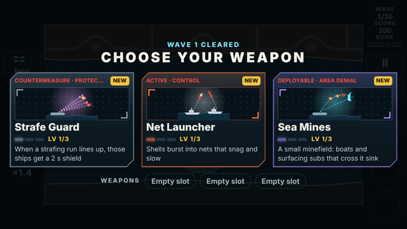
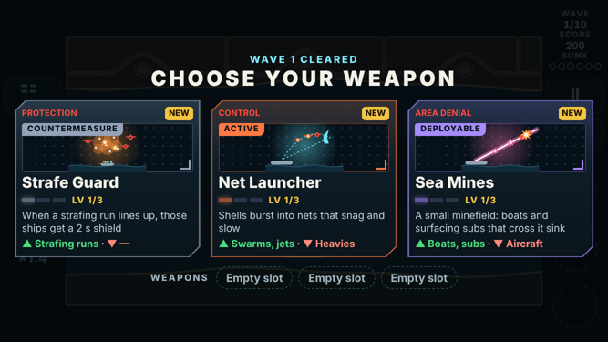
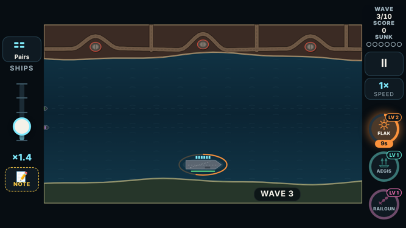

# V3 weapon categories (brainstorm, not built)

Nothing in this document is built. It is for locking ideas before any build.

> **Superseded in part by round 2:** `v3-weapon-ideas-2.md`. The player kept three categories (Active, Passive, Boost) and asked for new ideas with a real feature each.

## The ask

The player, after the first weapon brainstorm:

> "I say keep for every weapon as is. I think we need to take a step back and
> categorize each weapon type first as passive or active."

**Active weapons** (Tesla, Flak…) take over the main gun for a set time.
- **The concern:** "if [we] make limits to the active weapons we are preventing the player from defending themselves when they have a weapon pickup that cannot address a threat."
- **The reframe:** actives should be "good at specific things like swarms or good against fast things or high health things and poor against others but still be able to attack them."

**Passive weapons** (Escort, Aegis) leave the normal gun in your hands, "so it is okay for passive weapons to not attack things like planes."

**More categories.** The player suggested two:
- "something that is just a speed up all weapons";
- "something that is like another normal power up but you can unlock it and then upgrade it", with the special rule that it "doesn't override your current weapon drop".

Then "think of three more categories like that".

**Sub-categories** for what weapons are good at. The player's example: "the shot gun blast and the Thermo and the flak gun all kinda do the same thing which is area denial."

**Six weapons per category.** "Active is already at 6 but still come up with six that would address other sub categories."

This document replaces `v3-weapon-roles-brainstorm.md`: the player kept every weapon as it is.

## What success looks like (the player's view)

1. Every weapon in the game is classed active or passive by **how it really works** (read from the code), not by guesswork.
2. **Actives can always fight back:** good against some threats, poor against others, never helpless. This is shown with measurements, not asserted.
3. **Passives may have blind spots,** stated plainly.
4. **The categories:**
   - the player's two ideas, plus three more;
   - each with its own rule: how you get it, how it fires, how long it lasts, and whether it replaces the loaded weapon;
   - each fits the game's one-tap control, so no buttons to manage. The round 2 lesson: "too much managing with the activations hitting the buttons".
5. **Sub-categories (roles)** are defined, and every weapon has one. Flak, Thermobaric and Scattergun share "area denial", as the player said.
6. **Six weapons per category** (six *new* actives), spread across roles.
   - No idea that was cut before, or that duplicates an Armory card or a power-up, unless it is flagged.
   - Each tied to a real problem from the logs where possible.
7. **It reads on a phone:** a category must be clear on a draft card at 667×375, and the run's HUD must have room for it.
8. **Easy to lock:** a short list of decisions at the end.

## Evidence: how today's twelve weapons work

From the code (`fireWeapon` in `sim/game.ts`):
- **Active (10):** Flak, Thermobaric, Scattergun, Shrapnel, Railgun, Boomerang, Tesla, Seeker Pod, Gravity Well and Air Strike. Loaded, they change what a tap fires.
- **Passive (2):** Aegis and Frigates. Loaded, the tap stays the plain gun while they fight on their own.
- **One weapon at a time.** Picking up any weapon, active or passive, replaces the one loaded (`g.weapon`). That is the "override" the player means.

There are 10 actives, not 6.

**Measured effectiveness.**
- **Setup:** the game's own launches from the map's bases, 3 seeds per weapon and threat. One weapon stays loaded the whole time (picked up for real, then kept topped up), with unlimited ammo. An auto-tapper fires every 0.3 s at the threat nearest the carrier.
- **Each cell:** taps per kill. Lower is better; the plain gun is the baseline.
- **Kill share:** every weapon killed 100% of every type except cluster missiles (67–100%; a cluster splits, which isn't a miss).

| Level 1 | drone | guided | supersonic | ballistic | heavy | mothership | strafer | bomber |
|---|---|---|---|---|---|---|---|---|
| plain gun | 2.9 | 4.1 | 4.0 | 4.1 | 10.2 | 9.0 | 5.0 | 6.0 |
| Air Strike | 1.0 | 1.3 | 1.4 | 1.0 | 3.5 | 3.0 | 2.0 | 2.0 |
| Railgun | 1.0 | 2.0 | 1.0 | 1.0 | 8.0 | 5.0 | 3.3 | 3.2 |
| Boomerang | 1.8 | 2.6 | 2.6 | 2.7 | 4.5 | 5.0 | 3.0 | 3.7 |
| Scattergun | 1.8 | 3.3 | 3.2 | 3.6 | 7.3 | 17.0 | 4.8 | 6.3 |
| Flak | 1.6 | 4.0 | 4.0 | 3.5 | 5.0 | 6.0 | 4.0 | 4.8 |
| Thermobaric | 1.7 | 4.0 | 4.0 | 4.1 | 5.5 | 7.0 | 4.5 | 5.3 |
| Shrapnel | 1.8 | 4.0 | 4.0 | 4.1 | 4.0 | 5.0 | 4.0 | 4.2 |
| Seeker Pod | 1.9 | 3.8 | 3.6 | 3.0 | 9.0 | 7.0 | 4.0 | 4.7 |
| Gravity Well | 1.7 | 3.5 | 4.0 | 3.8 | 6.5 | 9.0 | 5.0 | 6.0 |
| Tesla | 1.8 | 4.1 | 4.0 | 4.1 | 10.2 | 9.0 | 5.0 | 6.0 |
| Frigates (passive) | 1.4 | 4.0 | 3.0 | 2.9 | 6.3 | 7.0 | 4.5 | 5.3 |
| Aegis (passive) | 2.8 | 4.1 | 4.0 | 4.1 | 10.0 | 9.0 | 4.5 | 5.5 |

At level 3 (max), the picture is the same but stronger:
- Railgun is 1–2 taps against everything.
- Scattergun is 1.0 against all but heavies and aircraft.
- Air Strike is 0.5–2.0.
- Aegis cuts strafers from 5.0 to 3.0, so it does shoot jets.

**What this means.**
- **Fighting back is already true.** No active is helpless against any threat; every one killed every type.
- **The problem is the opposite: weak specialization.**
  - Air Strike and Railgun (level 3) are the best answer to nearly everything.
  - Railgun at level 1 needs 8 taps per heavy, though its card says it answers "Heavies".
  - Tesla is the plain gun except against swarms.
  - Four of the ten actives share one role, area denial: Flak, Thermobaric, Scattergun and Shrapnel. That's the sameness the player noticed.
- Under the player's reframe, the generalists need a **weak side**, not a blind spot. See decision 1.

## Sub-categories (roles) and threat profiles

**Roles** say *how* a weapon works:

| Role | What it means |
|---|---|
| AREA DENIAL | Covers an area: a blast, a cloud or a cone |
| PRECISION | One target or one line, hard |
| CHAIN | Jumps from target to target |
| HOMING | Finds its own targets |
| CONTROL | Moves, slows or holds threats |
| STRIKE | A big hit along a path or on a spot |
| ESCORT | Allied units that fight on their own |
| PROTECTION | Shields and repairs |
| TEMPO | More shots, faster reloads, longer timers |
| INTEL | Reveals or marks threats so other shots do more |
| EVASION | Moves the convoy out of harm |

**Threat profiles** say *what* a weapon is good against:

| Profile | Threats |
|---|---|
| Swarm | drone, mini-drone, bomblet, mothership |
| Fast | supersonic, ballistic, guided |
| Heavy | heavy cruise missile, mothership, dreadnought, rigs |
| Air | strafer, bomber |
| Surface | fast boat, mine, sub, missile truck |

Every weapon below has one role, and a rating for each profile:
- **S:** strong;
- **o:** ok;
- **w:** weak (an active's floor: weak, never none);
- **–:** none (allowed only outside the active category).

## The categories

| Category | How you get it | How it works | How long | Replaces the loaded weapon? |
|---|---|---|---|---|
| **Active** | weapon pickup | every tap fires it | 15 s | yes (one weapon at a time) |
| **Passive** | weapon pickup | fights on its own; your tap stays the plain gun | 15 s | yes |
| **Boost** (player) | its own pickup | amplifies the gun, the loaded weapon and the escorts | 10 s | **no**; a second boost replaces the first |
| **Power-up** (player) | drafted; that kind drops more often and is stronger at each level | instant or short | as the power-up | **no** |
| **Deployable** (new) | pickup; arms one placement | your next tap on open water places it (a tap on a threat still fires the gun) | 20 s | **no** |
| **Convoy Order** (new) | pickup; held as an order | your next tap on one of your ships gives the order to it and its group. While an order is held, a tap on a ship gives it even with a threat close by (today the gun prefers the threat) | 2–6 s | **no** |
| **Countermeasure** (new) | pickup; stored as charges (up to 3) | each charge fires itself when its trigger happens; no tap at all | until used | **no** |

### Why these three new categories

Each new category adds a different kind of decision, with no new button:
- **Deployables:** *where* (spatial planning).
- **Convoy Orders:** your *ships* rather than the gun. Today a tap on a ship does nothing, so the tap is free to claim.
- **Countermeasures:** *before* the danger (a reflex you bank).

### Considered and rejected

| Idea | Why not |
|---|---|
| Ultimate / charge meter | needs a button to fire it: the round 2 lesson |
| Run-long convoy upgrades | that's the Armory's Hull bay |
| Logistics (ammo, drops, magnets) | overlaps the Armory's Supply bay and the Boost category |
| Call-ins (one-shot off-screen strikes) | the same as a drafted Power-up |
| Intel as a category | too thin on its own; kept as a role |
| Combos / finishers | too abstract to read in a 15 s window |
| Traps | the same as Deployables |

## The weapons, six per category

### Active: the ten that exist, tagged

| Weapon | Role | Swarm | Fast | Heavy | Air | Surface |
|---|---|---|---|---|---|---|
| Flak Cannon | AREA DENIAL | S | w | o | S | w |
| Thermobaric Shell | AREA DENIAL | S | w | S | o | w |
| Scattergun | AREA DENIAL | S | S | w | o | w |
| Shrapnel Shell | AREA DENIAL | S | o | S | o | w |
| Railgun | PRECISION | o | S | S | o | o |
| Boomerang | PRECISION | o | S | o | S | o |
| Tesla Arc | CHAIN | S | w | w | w | w |
| Seeker Pod | HOMING | S | o | o | o | w |
| Gravity Well | CONTROL | S | o | o | w | o |
| Air Strike | STRIKE | S | S | S | S | S |

### Active: six new, for the roles and threats the ten leave thin

| Weapon | Role | Swarm | Fast | Heavy | Air | Surface | What a tap does | Why |
|---|---|---|---|---|---|---|---|---|
| Net Launcher | CONTROL | S | o | w | S | w | shells burst into nets that snag and slow | strafers sank 4 ships in a second (Island 11-03) |
| Designator Rounds | INTEL | w | w | S | o | o | a hit marks the target: everything does double to it | heavies took 8–10 taps with most weapons |
| Gatling Burst | TEMPO | o | S | w | o | w | each tap fires a 3-round burst at the nearest threats | fast missiles need a quick hand |
| Harpoon Gun | PRECISION | w | w | S | o | S | a heavy harpoon: one hit kills a boat, truck or sub | nothing is built for surface threats |
| Mortar Barrage | STRIKE | S | w | S | w | S | three shells land where you tapped, a beat later | rewards leading a slow pack or a parked truck |
| Sidewinder Rounds | HOMING | w | o | o | S | w | every shot locks on to the nearest aircraft first | strafers decide runs |

### Passive: two exist, four new (blind spots allowed)

| Weapon | Role | Swarm | Fast | Heavy | Air | Surface | What it does |
|---|---|---|---|---|---|---|---|
| Aegis Launchers | PROTECTION | o | S | o | – | – | each ship fires at missiles and drones about to hit it (the player: no more jets) |
| Frigate Escort | ESCORT | S | o | o | o | S | frigates sail in and fire on their own |
| Combat Air Patrol | ESCORT | – | – | – | S | – | two fighters fly cover and hunt enemy aircraft |
| Barrage Balloons | AREA DENIAL | S | – | – | S | – | balloons along the lanes snag drones and low jets |
| Hunter Drones | HOMING | S | o | – | w | – | two drones circle the convoy and ram the first threats that come close |
| Gunboat Screen | ESCORT | o | – | – | – | S | fast gunboats hunt boats, mines and surfacing subs |

### Boost (the player's): amplifies everything you have, never replaces it

| Weapon | Role | What it does for 10 s | Why |
|---|---|---|---|
| Speed Loader | TEMPO | rounds reload twice as fast | the rack ran dry in wave 10 on two runs |
| Hot Rounds | PRECISION | every shot from everything hits for one more | heavies and bosses; lifts escorts and Aegis too |
| Velocity Shells | PRECISION | every shot flies twice as fast | supersonic and ballistic missiles outrun slow shots |
| Big Bore | AREA DENIAL | every blast, cloud, beam and net is 40% bigger | forgives a rough tap |
| Double Tap | CHAIN | every tap also fires at the next-nearest threat | big raids; pairs with any active |
| Battle Stations | ESCORT | frigates, Aegis, buoys and turrets fire twice as fast | for builds that lean on escorts |

The game already has **Overdrive** (free shots for 5 s) as a random drop. It
sits in the Power-up category below.

### Power-up (the player's): drafted, levels up, instant, never replaces

Five of these are today's random power-ups made draftable. Drafting one makes
it drop more often and get stronger with each level.

| Weapon | Role | Level 1 → Level 3 |
|---|---|---|
| Shield | PROTECTION | 5 s → 8 s, and it reflects a hit |
| Time Warp | CONTROL | threats at 40% for 4 s → 25% for 6 s |
| Repair Crew | PROTECTION | +2 hull → the whole convoy and the carrier |
| Full Steam | EVASION | 1.6× for 5 s → 2× for 8 s |
| Overdrive | TEMPO | free shots 5 s → 10 s |
| Recon Flare (new) | INTEL | lights the sea and shows where the next two raids come from (Star Shell, useful on every map) |

Ammo stays a common random drop.

### Deployable (new): placed by a tap, stays 20 s

| Weapon | Role | What it does |
|---|---|---|
| Sea Mines | AREA DENIAL | a small minefield: boats and surfacing subs that cross it sink |
| Boom Barrier | CONTROL | a floating boom: boats and drifting mines stop at it |
| Flak Buoy | HOMING | fires flak at drones passing near it |
| SAM Buoy | HOMING | fires missiles at aircraft passing near it (park it under a strafing line) |
| Radar Buoy | INTEL | threats near it are tracked: your shots at them fly faster (Lee of Marrow's radar, where you want it) |
| Artillery Beacon | STRIKE | shells land round it every 2 s |

### Convoy Order (new): a tap on your own ship

| Weapon | Role | What the group does |
|---|---|---|
| Evasive Turn | EVASION | swerves hard for 2 s: strafing lines and impacts miss (strafers sank 4 ships at once) |
| Flank Speed | EVASION | sprints ahead for 4 s |
| All Stop | CONTROL | holds still for 3 s, so a ballistic missile aimed ahead of it misses |
| Fire Support | STRIKE | the ship calls a free air strike down its own row |
| Deck Guns | ESCORT | the ship's crew fires at drones near it for 6 s |
| Draw Fire | PROTECTION | missiles go for this ship for 4 s, and it shrugs off half (spares the tanker) |

### Countermeasure (new): stored charges that fire themselves

| Weapon | Role | Trigger → effect |
|---|---|---|
| Chaff | EVASION | a guided missile about to hit a ship loses its lock |
| Last-Ditch Gun | HOMING | a missile a moment from impact is shot down |
| Strafe Guard | PROTECTION | a strafing run lines up: those ships get a 2 s shield |
| Hull Patch | PROTECTION | a ship about to sink is patched to 2 hull |
| Counter-Battery | STRIKE | a base that fires is shelled and goes quiet for 8 s |
| Reserve Belt | TEMPO | the rack runs dry: it refills at once (Marrow wave 10: 29 taps on an empty rack) |

**Echoes, flagged:**
- **Chaff** echoes Decoy Flares (cut in round 3 as a 15 s gun mode). As an automatic one-off charge it works differently.
- **Last-Ditch Gun** echoes the Armory's Point Defense, which fires every 3 s. This one fires only at the last moment, once per charge.

## Checks run on the brainstorm

The whole brainstorm is kept as data and checked by script
(`tools/v3/weapon-ideas/`):
- `arsenal.mjs` holds the data;
- `check.mjs` checks the brainstorm itself;
- `doccheck.mjs` checks that this document matches the data.

**Per category:**
- six weapons each (six *new* actives);
- at least four different roles each;
- no active with a "–";
- every new active strong at something and weak at something;
- names of 17 characters or fewer and lines of 86 or fewer, the draft card's limits.

**Across the arsenal:**
- every threat profile has two or more strong answers, among the actives and outside them:

  | Profile | Strong actives | Strong outside the actives |
  |---|---|---|
  | Swarm | 10 | 13 |
  | Fast | 5 | 7 |
  | Heavy | 7 | 2 |
  | Air | 5 | 8 |
  | Surface | 3 | 6 |

- a name echo against ideas cut before, Armory cards and power-ups;
- the same role with the same ratings across categories, flagged as a likely duplicate.

**What the checks caught (fixed in the second draft):**
- Radar Picket (Passive) and Radar Buoy (Deployable) were the same idea. Radar Picket became Hunter Drones.
- Four repair ideas in four categories. Repair Barge became SAM Buoy, and Patch Up became Fire Support.
- Name clashes with Armory cards, renamed:
  - Rapid Reload → Speed Loader (vs Quick Reload);
  - Wide Bore → Big Bore (vs Wide Warhead).
- Long Fuse duplicated the Armory's Long Loads (weapon pickups last longer) and became Battle Stations.
- Strafe Shield would have read as the Shield power-up, so it became Strafe Guard.

**Still flagged on purpose:** the three existing actives with no weak side (Air Strike, Railgun, Boomerang). See decision 1.

## On a phone: draft cards and the HUD

The check used the real draft screen in the browser. The game's own three
cards were relabelled with proposed weapons, measured and screenshotted at
667×375 and 874×402.

| Style | Result |
|---|---|
| **A:** category and role on the top line ("COUNTERMEASURE · PROTECTION") | **cut off at 667** ("COUNTERMEASURE · PROTEC…") |
| **B:** category as a coloured ribbon on the art, role on the top line, and a ▲ strong / ▼ weak line under the text | fits at both sizes, with nothing cut or overflowing |

Style B is recommended. Two fixes for it:
- **One-sided weapons:** a weapon with no weak side should drop the "▼ —".
- **Colour:** the role sits on the top line in the game's warning red, which reads like a warning. It should take the category colour.

**HUD space during a wave**, measured at 667×375 with three weapons held:

| Rail | Free height |
|---|---|
| Right (weapon chips) | 22 px |
| Left (under the NOTE button) | 60 px |

That fits **one** small group of status icons on the left rail, not five
categories each with its own timer or charges. See decision 3.

**The draft pool.** Today's rule deals 3 cards, half from what you hold. Measured with that rule while holding two weapons, the chance a given new weapon is offered in one draft:

| Pool size | Chance per draft |
|---|---|
| 12 (today) | 11.2%, about 1 in 9 |
| 22 | 5.3% |
| 48 (all seven categories) | 2.7%, about 1 in 37 |

So with every category in one pool, a run would rarely see what it wants.

## Decisions to lock

1. **The three generalist actives.** Air Strike, Railgun and Boomerang are strong against nearly everything (measured above). Under the player's reframe, should each get a **weak side** (weaker, never helpless)?
   - **Air Strike:** weak against fast missiles. The jet passes the row in a moment and missiles move on.
   - **Railgun:** weak against swarms. A thin beam.
   - **Boomerang:** weak against heavies.

   The alternative is to leave all three as they are.
2. **Aegis:** missiles and drones only, no jets (the player's ask; passives may have blind spots). Yes or no?
3. **How a run holds the new categories.** Recommended: **(a)**, because it fits both the HUD and the draft pool. Options:
   - **(a)** three weapon slots (active or passive, as today) **plus one support slot** for a single Boost, Power-up, Deployable, Order or Countermeasure;
   - **(b)** a separate support draft every third wave;
   - **(c)** each map offers two of the five support categories.
4. **Which new categories to keep:** Deployable, Convoy Order, Countermeasure, or swap one for a rejected idea.
5. **Names:** "Countermeasure" (14 characters) fits the ribbon, but "Reflex" would be shorter. "Convoy Order" or just "Order"?
6. **Per category, keep, change or cut each of the six.** All seven categories have six.

Once locked, the build is a separate round per category (data, sim, card
art, tests that each weapon's strong and weak sides are real, and a bot
comparison).

## Cycles

| # | Focus | Found | Changed | Verified |
|---|---|---|---|---|
| 1 | Baseline: what today's weapons really are | 10 actives, not 6. Two passives. One loaded weapon at a time. Overdrive already exists. The first harness never spawned Frigates (identical to the plain gun). | Harness reloaded weapons the way a player does (a real pickup tapped) | Code read (`fireWeapon`, `tap`); effectiveness matrix at levels 1 and 3, 3 seeds each |
| 2 | Categories and their rules | 10 candidate categories. A meter needs a button; convoy upgrades and logistics duplicate Armory bays; call-ins duplicate Power-ups. | Picked Deployable, Convoy Order and Countermeasure: each a different decision with no button | Code check: a tap on a ship does nothing today, so Convoy Orders can claim it |
| 3 | Roles and threat coverage | Four of ten actives share area denial. Three actives (Air Strike, Railgun, Boomerang) have no weak side. | New actives aimed at the thin roles (CONTROL, INTEL, TEMPO, PRECISION-surface, STRIKE, HOMING-air); the generalists become a decision | `check.mjs`: role × category map, strong answers per profile |
| 4 | Duplicates and echoes | Radar idea twice; four repairs; three Armory name clashes; Long Fuse = Long Loads; Strafe Shield vs Shield; Chaff and Last-Ditch echoes | 6 swaps or renames; echoes recorded in the data | `check.mjs` re-run: only the three deliberate generalist flags remain |
| 5 | On a phone | Style A cut off at 667; the HUD has room for one extra status group; a 48-weapon pool drops a wanted weapon to 2.7% a draft | Style B recommended; "one support slot" proposed (decision 3) | Real draft screen relabelled and measured at 667×375 and 874×402 (both styles, two card sets); rail space measured in a wave; pool odds simulated with the game's draft rule |
| 6 | Against the success criteria | Criterion 4: the Convoy Order rule didn't say what a tap does when a threat is near the ship (the gun prefers threats). A doc check first reported 7 mismatches; all were the check matching the wrong table, none were in the doc. | Rule added (a held order wins the tap on a ship); doc check fixed | `doccheck.mjs`: every weapon, role and rating in the doc matches the data; final `check.mjs` run |

## Limitations

- **Bot measurements.** The effectiveness numbers come from an auto-tapper firing every 0.3 s, one threat type at a time, not from a player in a mixed wave. They show what each weapon can do, not how it feels.
- **Opinion, not data.** The ratings for new ideas (S/o/w) are design intent. They become real only when built and measured the same way.
- **Partial mock-up.** The draft mock-ups relabel real cards; their art is today's weapon art, not new art.
