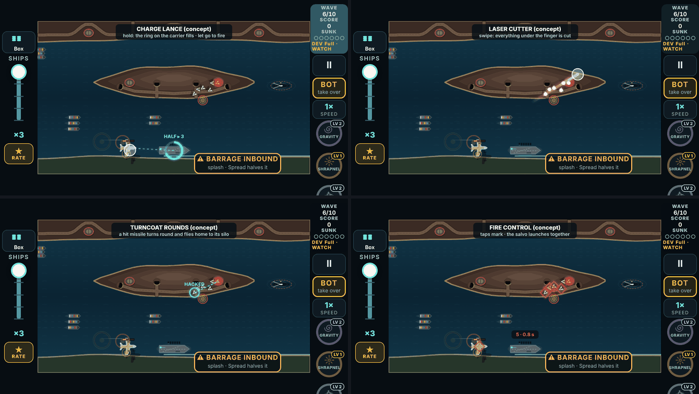
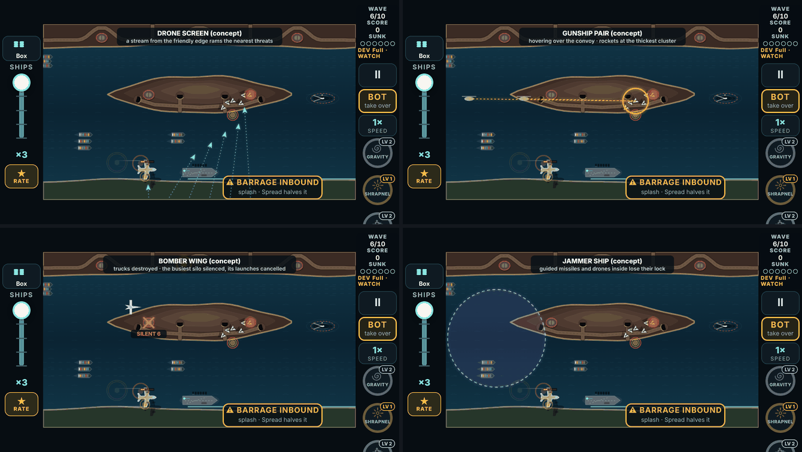
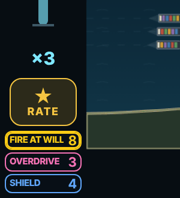

# V3 weapon ideas, round 2 (brainstorm, not built)

Nothing in this document is built. It exists to lock ideas before any build.

This file is generated by `node tools/v3/weapon-ideas/gen2.mjs`, from the idea data (`arsenal2.mjs`) and the prototype results (`proto-results.json`). Edit those, not this.

## The ask

The player, on round 1 (`v3-weapon-categories.md`):

> "I think all the technical aspect that you made with the categories was great but idk about the new weapons. Nothing stood out as different."

**Categories:** Active, Passive and Boost. "The other like deploy and counter are really just passive."

**The player's own ideas, as the bar for "different":**
- **Passive:**
  - a drone swarm streaming in from the bottom of the map to kamikaze into attacks;
  - Apache helicopters doing area damage;
  - a bomber that blows up ground vehicles and temporarily disables silos and tunnels.
- **Boost:**
  - Fire at Will: hold to fire faster, with a bigger magazine;
  - Up Power: more power-up drops for a set time.
- **Active:** an energy weapon. Tap for a normal hit, or hold for a harder one.

> "See how I came up with different features instead of kinda rehashing? … have a total of 10 new weapon ideas for each category. Again you can do more than ten and thin it out. Make tests if you need to to test things out as well."

## What success looks like (the player's view)

1. **Every idea is a feature, not a number.** It brings at least one of:
   - a new thing your finger does;
   - a new thing the weapon acts on;
   - a new rule.

   Checked on three axes (below), not just claimed.
2. **Ten per category** (Active, Passive, Boost), thinned from a longer list, with each cut explained.
3. **The player's six ideas are all in.** Reworked only where tests said so.
4. **Actives keep round 1's rule:** good against some threats, poor against others, and every tap still hits.
5. **Measured where a bot can measure it,** in real games on all 20 maps. Where it can't (feel, rhythm, steering), the doc says so instead of guessing.
6. **It reads on a phone.** Concept frames are drawn over a real wave at 667×375, the smallest screen.
7. **Easy to lock:** a short decision list at the end.

## How "different" was checked

Each idea is tagged on three axes, and `check2.mjs` tests them:

| Axis | What it is | Today's twelve weapons |
|---|---|---|
| **Verb** | what your finger does | one verb: tap (passives: nothing) |
| **Target** | what the weapon acts on | one target: threats |
| **Shape** | how the effect plays out in time | instant, or a lasting area |

**Across the 30 kept ideas:**
- **Actives** use 8 verbs: tap, hold and release, swipe, hold and steer, catch and drag, mark then fire, two taps, timing.
- **Passives** act on 8 targets:
  - threats;
  - launchers;
  - the sea;
  - your own ships;
  - the loss rule;
  - the enemy's aim;
  - the weather;
  - your ammo.
- **Boosts** act on 6 targets: ammo, drops, the loaded weapon, threats, launchers, time.

**The check's rules:**
- No two kept ideas in a category share all three axes.
- Every idea differs from today's weapons on at least one axis.

**The closest calls,** one axis away from today: Laser Cutter, Turncoat Rounds, Limpet Charges, Cadence Gun, Chain Shot, Drone Screen, Gunship Pair, Orbital Strike, Hot Streak and Wingman. Each one's "What's new" line says what carries it.

## What the game's own data says

**How it was measured:** the bot played all 20 maps, 2 seeds each, at three skill levels. The figures below are for the average bot unless marked. Script: `tools/v3/weapon-ideas/field.mts` (the bottom-edge check: `bottom.mts`).

- **Where launches come from:**
  - silos 62%;
  - subs 19%;
  - trucks 15%;
  - aircraft 4%.

  No weapon today can touch a launcher, except Carpet Strike against trucks and subs right under it. **A third of launches come from trucks and subs.**
- **What sinks ships:**
  - drones 32%;
  - ballistic 19%;
  - cluster 15%;
  - strafers 10%;
  - heavy 6%;
  - bombers 6%;
  - motherships 6%;
  - guided 4%;
  - supersonic 2%.

  **About half of all sinkings come from threats that fly to a point** (ballistic, cluster, heavy, strafing runs). A ship can dodge those; homing ones it can't.
- **How long a threat is on screen:**

  | Threat | Seconds |
  |---|---|
  | ballistic | 1.3 |
  | supersonic | 1.4 |
  | guided | 1.7 |
  | drone | 2.3 |
  | heavy | 4.5 |
  | mothership | 6.1 |

  **A charge or wait longer than about 0.6 s only pays against heavy things.**
- **How crowded it gets:**
  - On average 1.6 threats are on screen.
  - 6 or more only 7–12% of wave time.
  - In those busy moments the best 320 px swipe catches 4.4 threats, against 2.1 for the best tap blast.

  **Effects that need crowds are weak overall, but strong in the moments that decide runs.**
- **Ammo:**
  - A tap-happy player (the spammer bot) has an empty rack 18% of wave time.
  - The average bot: 6%.
- **The bottom edge of the map is not always yours:**
  - Kesh and Gauntlet: 100% enemy shore.
  - Crossing: 55%.
  - Lantern: 45%.

  This matters for the Drone Screen.

## How the prototypes were run

**Method:**
- **The games:** each idea was added as an effect inside real games, using the game's own sim with the existing bot.
- **Runs:** all 20 maps × 8 seeds = 160 runs per idea, for two players:
  - **accurate:** the bot's "average" skill, 0.6 s reaction, 8% misses;
  - **tap-happy:** the "spammer" bot, which taps without waiting, 20% misses.
- **Timing:** every idea was on for the same two 15 s windows each wave (8–23 s and 40–55 s), about as long as a picked-up weapon stays loaded. So they compare like for like.
- **Actives** replaced the gun in those windows, and the bot used them in the obvious way:
  - swipe through the most urgent threat;
  - hold on anything with 3+ hit points;
  - hack the most urgent missile.
- **Baseline** (no idea): the accurate player won **38%** of runs, the tap-happy one **9%**.

**How far to trust it:**
- **Size, not balance.** The numbers on the cards below are a starting point.
- **Noise.** Differences under about 8 points are within the noise (160 runs).
- **The bot doesn't change its play** for an idea. Shore Bombardment and Long Shot, which only pay if you shoot earlier, were run both ways.
- **Actives are flattered.** The prototype actives hit instantly, with no flight time.
- **13 of the 30 kept ideas weren't prototyped.** Some need a person (steering, rhythm, feel), some need sim work first; each card says why.

**Reproducing:** `tools/v3/weapon-ideas/proto.mts` needs `proto.patch` applied to `src/v3/sim/game.ts`. The patch exports `damageThreat` and adds a dodge hook. It is not in the game.

| Idea | Category | Status | Accurate player: runs won | Tap-happy: runs won | Ships lost a run (accurate) |
|---|---|---|---|---|---|
| *No idea (baseline)* | | | 38% | 9% | 4.5 |
| Gunship Pair | passive | kept | 84% (+46) | 41% (+32) | 2.3 |
| Drone Screen, one drone every 0.7 s | passive | variant | 83% (+45) | 44% (+35) | 2.5 |
| Fire at Will | boost | kept | 74% (+36) | 19% (+10) | 3.2 |
| Laser Cutter | active | kept | 74% (+36) | 43% (+34) | 2.7 |
| Orbital Strike | passive | kept | 71% (+33) | 23% (+14) | 3.3 |
| Drone Screen | passive | kept | 69% (+31) | 25% (+16) | 3.1 |
| Supply Run | boost | kept | 68% (+30) | 18% (+9) | 3.2 |
| Scavenger Rounds | boost | kept | 66% (+28) | 16% (+7) | 3.2 |
| Shore Bombardment, player shooting early | boost | kept | 61% (+23) | 14% (+5) | 3.4 |
| Bomber Wing | passive | kept | 59% (+21) | 20% (+11) | 3.5 |
| Turncoat Rounds | active | kept | 59% (+21) | 30% (+21) | 3.5 |
| Hot Streak | boost | kept | 59% (+21) | 11% (+2) | 3.6 |
| Wingman | boost | kept | 58% (+20) | 19% (+10) | 3.5 |
| Charge Lance | active | kept | 57% (+19) | 31% (+22) | 3.6 |
| Long Shot, player shooting early | boost | **cut** | 56% (+18) | 20% (+11) | 3.6 |
| Overclock | boost | kept | 54% (+16) | 21% (+12) | 3.6 |
| Evasive Helm | passive | kept | 52% (+14) | 18% (+9) | 3.6 |
| Shore Bombardment, player not adapting | boost | variant | 49% (+11) | 9% (+0) | 4.0 |
| Adrenaline | boost | **cut** | 48% (+10) | 9% (+0) | 4.1 |
| Hunter-Killer Sub | passive | kept | 48% (+10) | 15% (+6) | 3.9 |
| Salvage Tug | passive | kept | 48% (+10) | 14% (+5) | 3.9 |
| Long Shot, player not adapting | boost | variant | 45% (+7) | 14% (+5) | 4.0 |
| Volatile Rounds | boost | **cut** | 44% (+6) | 9% (+0) | 4.1 |
| Ricochet Rounds | boost | **cut** | 41% (+3) | 17% (+8) | 4.4 |
| Bomber Wing, launches delayed instead of cancelled | passive | variant | 36% (−2) | 6% (−3) | 4.6 |
| Overwatch | boost | **cut** | 33% (−5) | 9% (+0) | 4.6 |

**What the table taught:**
1. **The rack is the limit.**
   - The biggest gains add hits from outside the rack (Gunship Pair, Drone Screen, Orbital Strike), or give an accurate player more of it (Fire at Will, Scavenger Rounds).
   - Overwatch (the gun fires itself, from the same rack) gained nothing.
2. **"Silenced" must mean cancelled.** A silo's launches delayed by the bomber just pile up later.
3. **Crowd effects are small.**
   - Kill explosions (Volatile) and rage-when-crowded (Adrenaline) do little.
   - The swipe is the exception: it is aimed at exactly the crowded moments.
4. **Skill boosts split players, as intended.** Hot Streak and Scavenger reward the accurate player and barely help the tap-happy one.
5. **The tap-happy player gains most from the new verbs and from free help.**
   - Laser Cutter, Gunship Pair, Charge Lance and Turncoat Rounds (+21 to +34), then Drone Screen.
   - More ammo (Fire at Will) helps them far less than it helps the accurate player: they spend it on misses.

## Active (10)

> **Rule:** Takes over the main gun for 15 s; picking up another weapon (active or passive) replaces it. Good against some threats, poor against others, but every tap still hits.

### 1. Charge Lance → Sunspear (your idea)

*Tap for a quick bolt; hold to charge, let go to fire.*

- **How:** A tap fires a 1-hit bolt. Holding fills a ring on the carrier: let go at half (0.6 s) for a 3-hit bolt, full (1.2 s) for a 6-hit lance that pierces everything in line. One round a shot, whatever the charge.
- **▲ Strong:** Heavies, motherships, bombers, rigs and the Citadel. **▼ Weak:** Swarms and fast missiles (no time to charge).
- **Levels:** 1: Half 3, full 6. 2: Charges a third faster. MAX: Sunspear: a full lance leaves a burning line for 2 s.
- **What's new:** Hold-and-release: the first weapon where how long you press matters. One round buys up to six hits, so it is the ammo answer to armour.
- **Prototype:** accurate player 57% (+19), tap-happy 31% (+22). Note: the bot held on anything with 3+ hit points and tapped the rest; shots hit instantly.

### 2. Laser Cutter → Searing Edge

*Swipe across the sky: everything under your finger is cut.*

- **How:** Drag a finger across threats: everything within 30 px of the path (up to 320 px long) takes a hit, instantly. One round a swipe. A plain tap fires a normal shot.
- **▲ Strong:** Swarms, lines and supersonic missiles (instant). **▼ Weak:** Heavies and motherships (one hit a swipe).
- **Levels:** 1: 320 px, 1 hit. 2: 420 px. MAX: Searing Edge: the cut stays lit for 1 s and burns what flies into it.
- **What's new:** A new verb, the swipe. In a busy moment the best swipe cuts 4.4 threats, against 2.1 for the best tap blast (field data).
- **Prototype:** accurate player 74% (+36), tap-happy 43% (+34). Note: the bot swiped through the most urgent threat at its usual tap rate.

### 3. Turncoat Rounds → Mutiny

*Hack it: a hit drone or missile turns round and flies home.*

- **How:** A hit on a drone or a light missile (2 hp or less) takes it over: it turns and flies back the way it came, hitting what is in its path for 2 and its own silo, truck or sub at the end (silenced for 5 s). Heavies, aircraft and structures are too big to hack: they take a normal hit.
- **▲ Strong:** Drones, guided and ballistic volleys, and the launchers behind them. **▼ Weak:** Heavies, aircraft, structures (normal hits only).
- **Levels:** 1: Hacks 2 hp or less. 2: A hacked missile flies home twice as fast. MAX: Mutiny: a hacked missile that reaches its silo silences it for the rest of the wave.
- **What's new:** Turns the enemy's own shot into yours, and the only active that reaches the launchers. On average 1.2 other threats are in the corridor behind a missile (field data).
- **Prototype:** accurate player 59% (+21), tap-happy 30% (+21). Note: only the hits along the way home were modelled, not the silo going quiet at the end.

### 4. Wire-Guided Missile → Twin Wire

*Fly the missile yourself: it follows your finger until you let go.*

- **How:** Press and hold: a missile launches and follows your finger while it stays down (fast, 700 px/s). Let go and it bursts: 3 hits, 90 px. One missile in the air at a time; a quick tap is a normal shot.
- **▲ Strong:** Heavies, bombers, rigs and anything far away or behind land. **▼ Weak:** Many threats at once (one missile at a time).
- **Levels:** 1: 3 hits, 90 px. 2: 4 hits, 110 px. MAX: Twin Wire: a second missile follows a second finger.
- **What's new:** Piloting: the first shot you steer after it leaves the gun. It can curve round an island to a rig or a bomber on its line.
- **Prototype:** not run: needs a person steering; the bot can't say how it feels.

### 5. Grapnel → Wrecking Ball

*Harpoon a threat, then swing it into the others.*

- **How:** Tap a threat: a cable from the carrier hooks it. While your finger is down it swings where you drag; anything it smacks takes 2 hits. Let go and it is flung, bursting where it lands. A heavy missile is the best ball. Tap with nothing to hook: a normal shot.
- **▲ Strong:** Packs, and heavies (use the heavy as the ball). **▼ Weak:** Lone fast missiles (a second and a half a swing).
- **Levels:** 1: Swings for 2. 2: The cable reaches twice as far. MAX: Wrecking Ball: the flung threat explodes for 3 in a 120 px blast.
- **What's new:** Physics: the threat itself becomes the weapon, and you aim it with a drag.
- **Prototype:** not run: needs a person dragging; the physics is the question, not the numbers.

### 6. Fire Control → Full Broadside

*Mark your targets, then the whole salvo launches at once.*

- **How:** Taps mark targets (a red diamond each, up to 6) without firing. 0.8 s after your last mark the gun launches a round at each, at double speed, and every round that kills also bursts (40 px). A mark on a threat less than a second from impact fires at once, as a normal shot, so nothing gets through on the wait. The rounds come from the rack as normal.
- **▲ Strong:** Volleys and pairs of aircraft (all hit at the same moment). **▼ Weak:** A lone fast missile (it only gets a normal shot).
- **Levels:** 1: Up to 6 marks. 2: Up to 8 marks, 0.5 s wait. MAX: Full Broadside: marked threats take 2 hits each.
- **What's new:** Plan, then fire: a tap that queues instead of shooting. It rewards reading the raid.
- **Prototype:** not run: its value is in reading a raid, which the bot doesn't do.

### 7. Limpet Charges → Daisy Chain

*Stick a bomb on it and let it fly into its friends.*

- **How:** A shot is a normal hit, and it leaves a charge stuck to the threat that goes off 1.2 s later: 2 hits to it and everything within 90 px. It rides along with the threat, so a mothership carries it into its own drones and a bomber over the missiles it drops.
- **▲ Strong:** Motherships, bombers, formations and swarms that fly together. **▼ Weak:** Fast missiles (they hit before the fuse: just the normal hit).
- **Levels:** 1: 1.2 s fuse, 90 px. 2: 0.9 s fuse, 110 px. MAX: Daisy Chain: anything the blast kills carries a fresh charge.
- **What's new:** The enemy carries your bomb. Where it goes off depends on where the threat flies, not where you tapped.
- **Prototype:** not run: needs threats to carry a charge in the sim.

### 8. Tidal Cannon → Tsunami

*Shoot the sea: a wave rolls out and swamps what is on it.*

- **How:** A shot on open water raises a wave that rolls 300 px outward: fast boats, mines and surfaced subs it reaches are swamped, and low drones are knocked into the sea. Missiles fly over it (a shot at one is a normal hit). A wave that reaches your ships pushes them forward.
- **▲ Strong:** Fast boats, mines, surfaced subs, drones. **▼ Weak:** Missiles and aircraft (normal hits only).
- **Levels:** 1: 300 px wave. 2: 420 px, and it pushes threats back as it goes. MAX: Tsunami: the wave rolls the full width of the lane.
- **What's new:** Acts on the sea, not on a threat; the same wave helps your convoy.
- **Prototype:** not run: surface threats are rare on most maps; worth a map-by-map test once built.

### 9. Cadence Gun → War Drum

*Fire on the beat for a triple-strength shot.*

- **How:** A ring pulses on the carrier every 0.6 s, with a drum on the sound. A shot fired on the pulse (within 0.12 s) hits for 3 and pierces; off the beat it is a normal shot.
- **▲ Strong:** Heavies and lines, for a player who keeps the beat. **▼ Weak:** Swarms (the beat is too slow for many targets).
- **Levels:** 1: 3 on the beat. 2: A wider beat window (0.18 s). MAX: War Drum: four beats in a row and the fifth fires a free broadside.
- **What's new:** Rhythm: the first weapon that rewards when you tap, not only where.
- **Prototype:** not run: rhythm is a feel question for a person.

### 10. Chain Shot → Bolas Storm

*Tap two threats: a chain links them and drags them together.*

- **How:** Tap one threat, then another within 300 px: a chained pair of shots flies between them and wraps them, and they are dragged into each other for 2 hits each and anything caught on the chain. A lone tap is a normal shot.
- **▲ Strong:** Pairs: aircraft, guided volleys, a heavy with an escort. **▼ Weak:** Lone threats (it needs two).
- **Levels:** 1: 2 hits each. 2: 400 px reach, 3 hits. MAX: Bolas Storm: a third tap adds a third link.
- **What's new:** A two-tap combo. Chain shot is real naval history: two cannonballs chained to cut a ship's rigging.
- **Prototype:** not run: needs a person picking pairs.

## Passive (10)

> **Rule:** Your plain gun stays in your hands; it works on its own for 15 s. Blind spots are fine. Like an active, it is replaced by the next weapon you pick up.

### 1. Drone Screen → Hornet Nest (your idea)

*A steady stream of your own drones flies in from your side of the map and rams the threats.*

- **How:** A friendly drone launches from your edge of the map every 1.2 s (the bottom on most maps; the carrier's deck on Kesh and Gauntlet, where the bottom is enemy shore) and rams the threat closest to hitting a hull (one hit). Each goes for a different threat. 420 px/s, so supersonic and ballistic missiles outrun them.
- **▲ Strong:** Drones, guided missiles, motherships' mini-drones. **▼ Weak:** Supersonic and ballistic missiles (too fast); heavies (one hit a drone).
- **Levels:** 1: One every 1.2 s. 2: One every 0.9 s. MAX: Hornet Nest: each ram bursts, hitting everything within 50 px.
- **What's new:** A continuous stream from the map edge, not ships on station: it fills the sky between you and the raid.
- **Prototype:** accurate player 69% (+31), tap-happy 25% (+16).
- **Tuning:** One drone every 0.7 s won 83% of runs, among the strongest tested; one every 1.2 s won 69%, in line with the other strong ideas.

### 2. Gunship Pair → Hellfire Wing (your idea)

*Two attack helicopters hover over the convoy and rocket the thickest cluster.*

- **How:** Two helicopters follow the convoy, one either end. Each fires a rocket pod every 1.4 s at the densest spot within 380 px: a 65 px blast, one hit. They stay with the ships, so threats far from the convoy are not theirs.
- **▲ Strong:** Swarms and packs closing on the convoy. **▼ Weak:** Anything far from the ships; supersonic missiles (no time to aim).
- **Levels:** 1: Every 1.4 s. 2: Every 1.0 s. MAX: Hellfire Wing: a third helicopter, and each pod hits for 2.
- **What's new:** Area damage that moves with the convoy, unlike frigates, which hold station and fire single shots.
- **Prototype:** accurate player 84% (+46), tap-happy 41% (+32). Note: the two helicopters fired alternately from either end of the convoy.

### 3. Bomber Wing → Carpet Raid (your idea)

*Bombers hit the enemy shore: trucks are destroyed, silos and tunnels go quiet.*

- **How:** A bomber crosses every 6 s. It destroys a missile truck on screen; if there is none, it bombs the silo or tunnel with the most launches coming and silences it for 6 s. Launches due in that time are cancelled, not delayed. Land only: subs are the Hunter-Killer's.
- **▲ Strong:** Trucks, tunnels and silos: the launches before they happen. **▼ Weak:** Everything already in the air; subs.
- **Levels:** 1: Every 6 s. 2: Every 4.5 s. MAX: Carpet Raid: each pass silences two silos.
- **What's new:** Stops threats before they exist. Silos fire 62% of launches and trucks 15%; today nothing touches a silo, and only Carpet Strike (Air Strike at MAX) can hit a truck.
- **Prototype:** accurate player 59% (+21), tap-happy 20% (+11).
- **Tuning:** Cancelling the launches won 59% of runs (38% without); delaying the same launches won 36%: they just pile up later. Silenced must mean cancelled.

### 4. Hunter-Killer Sub → Wolfpack

*Your own submarine stalks the enemy's at sea.*

- **How:** A friendly sub shadows the convoy underwater (its periscope is the only sign). Every 3 s it torpedoes an enemy sub that is surfacing, before its salvo, or a fast boat or mine; against the Dreadnought it hits for 1 every 4 s. Nothing in the air.
- **▲ Strong:** Enemy subs, fast boats, mines, the Dreadnought. **▼ Weak:** Everything in the air.
- **Levels:** 1: Every 3 s. 2: Every 2 s. MAX: Wolfpack: a second sub, and a torpedo hit on the Dreadnought does 3.
- **What's new:** Fights under the sea, a layer no weapon touches today. On Strait and Harbor a third of launches come from subs.
- **Prototype:** accurate player 48% (+10), tap-happy 15% (+6).

### 5. Evasive Helm → Ghost Fleet

*Your ships dodge: a hull about to be hit swerves out of the way.*

- **How:** When a ballistic, cluster, heavy or strafing run is about to hit a hull, that ship swerves clear (once every 4 s a ship). It shoots nothing. Homing threats (guided, drones) follow it, and narrow lanes leave no room to swerve.
- **▲ Strong:** Ballistic, cluster and heavy missiles, strafing runs. **▼ Weak:** Guided missiles and drones (they home); narrow lanes (Needle, Saltgate).
- **Levels:** 1: Once every 4 s a ship. 2: Every 3 s. MAX: Ghost Fleet: a dodging ship also drops a decoy the miss chases.
- **What's new:** Defends by moving your ships, not by shooting. Ballistic, cluster, heavy and strafer hits are about half of all sinkings (field data).
- **Prototype:** accurate player 52% (+14), tap-happy 18% (+9).

### 6. Salvage Tug → Rescue Fleet

*A tug catches a sinking ship and tows it home: it doesn't count as lost.*

- **How:** A tug sails with the convoy. The next two ships that sink while it is out are caught before they go down and towed off: they don't count against the six-ship limit (and still deliver half their cargo). It does no fighting.
- **▲ Strong:** Bad moments: a strafing run or a lucky salvo. **▼ Weak:** Everything; it never fires.
- **Levels:** 1: Saves 2. 2: Saves 2 and returns them repaired next wave. MAX: Rescue Fleet: saves 3.
- **What's new:** Changes the loss rule itself. Playtest logs ended runs at full carrier health on the six-ship limit; this is aimed straight at that.
- **Prototype:** accurate player 48% (+10), tap-happy 14% (+5). Note: it saved 2 ships a run in total, not 2 per pickup, so this understates it.

### 7. Orbital Strike → Sky Spear

*A satellite picks the biggest thing on screen and spears it from space.*

- **How:** Every 2.5 s a beam comes down on the toughest threat on screen (most hit points) for 3 hits. It always picks the biggest, so a swarm gets nothing.
- **▲ Strong:** Heavies, motherships, bombers, rigs, generators, the Dreadnought. **▼ Weak:** Swarms and anything small (always picks the biggest).
- **Levels:** 1: 3 hits every 2.5 s. 2: Every 1.8 s. MAX: Sky Spear: the beam stays 1 s and sweeps to the next biggest.
- **What's new:** A targeting rule no weapon has: biggest first. It frees your gun for the small stuff.
- **Prototype:** accurate player 71% (+33), tap-happy 23% (+14).

### 8. Jammer Ship → Blackout

*An electronic-warfare ship scrambles locks around the convoy.*

- **How:** A jammer sails with the convoy inside a visible 250 px bubble. Guided missiles and drones that enter lose their lock and wander for 2 s; a supersonic's lock-on line takes 1 s longer. Ballistic shots (no lock), heavies and aircraft (crewed) are unaffected, and the jammer kills nothing.
- **▲ Strong:** Guided missiles, drones, supersonic lock-ons. **▼ Weak:** Ballistic, heavies, aircraft; it never kills.
- **Levels:** 1: 250 px bubble. 2: 330 px. MAX: Blackout: a jammed missile that wanders out turns back at its own side.
- **What's new:** Acts on the enemy's aim, not its health: the threats are still there, just lost. Not Decoy Flares (one-shot flares that were cut): this is a lasting zone.
- **Prototype:** not run: needs the sim's homing to accept a lost lock.
- **Close to:** Decoy Flares (cut, round 3). Kept because the difference is the point.

### 9. Storm Front → Hurricane

*Call in the weather: a squall rolls across, lightning hits what flies through it.*

- **How:** A storm cell (about 300 px wide) drifts across the map with the wind. Lightning strikes a drone or aircraft inside it every 0.8 s, and missiles crossing it are blown off course (half of them miss). You can't steer it.
- **▲ Strong:** Drones and aircraft inside the cell; missiles crossing it. **▼ Weak:** Everything outside the cell; it goes where the wind blows.
- **Levels:** 1: 300 px cell. 2: A bigger, slower cell. MAX: Hurricane: two cells.
- **What's new:** Weather as a weapon: big and unaimed, so where it drifts changes where you shoot.
- **Prototype:** not run: needs a wind model.

### 10. Ammunition Ship → Arsenal Ship

*A supply ship joins the convoy: your rack reloads twice as fast, but the enemy goes for it.*

- **How:** An ammunition ship sails in the middle of the convoy. While it floats, the rack reloads twice as fast. Missiles prefer it as a target (a decoy, by its nature), and if it is sunk the bonus ends (it doesn't count as a lost ship).
- **▲ Strong:** Running dry: it is the reload; it also draws fire off the cargo ships. **▼ Weak:** Nothing by itself; you must protect it.
- **Levels:** 1: Reload ×2, 4 hits to sink. 2: Reload ×2.5, 6 hits. MAX: Arsenal Ship: it also fires a round of your loaded weapon every 2 s.
- **What's new:** Risk and reward on the water: a ship worth protecting that pays you back in ammo.
- **Prototype:** not run: needs the enemy to prefer a ship.

## Boost (10)

> **Rule:** Drafted and dropped like a weapon, but picking it up never replaces the loaded weapon: it changes how everything you fire works for a while. Levels make it last longer (8, 11, then 15 s). A second boost replaces the first.

### 1. Fire at Will (your idea)

*Hold to fire full-auto, with a bigger magazine.*

- **How:** While it lasts, holding fires every 0.15 s instead of every 0.6 s, the rack holds 6 more rounds and reloads twice as fast. Whatever is loaded fires that fast.
- **▲ Strong:** Big raids, running dry. **▼ Weak:** Wasted on spraying: it is ammo that wins, not taps.
- **What's new:** The player's idea: today's hold-to-fire becomes a real full-auto. Not Overdrive (5 s of free rounds): this is rate and capacity while it lasts.
- **Prototype:** accurate player 74% (+36), tap-happy 19% (+10). Note: the bit a bot can use: 6 more rounds and twice the reload; the bot never holds, so full-auto itself was not tested.
- **Close to:** Overdrive power-up (5 s of free rounds). Kept because the difference is the point.

### 2. Supply Run (your idea)

*For a while every kill is three times as likely to drop something, and drops fly to you.*

- **How:** Power-up and weapon drop chances ×3, and every drop floats straight to the carrier (no tap to collect).
- **▲ Strong:** Turning a raid into a stockpile. **▼ Weak:** Quiet moments (no kills, no drops).
- **What's new:** The player's "Up Power": a boost that feeds the drop economy rather than the gun. Pickups that fly to you mean no taps away from the fight.
- **Prototype:** accurate player 68% (+30), tap-happy 18% (+9). Note: drop chances ×3; the bot collects drops anyway, so flying to the carrier was not tested.

### 3. Scavenger Rounds

*Every kill gives its round back.*

- **How:** While it lasts, a shot that kills refunds its round to the rack. Misses still cost.
- **▲ Strong:** Careful aim: a sharp player never runs dry. **▼ Weak:** Spraying (misses aren't refunded).
- **What's new:** Accuracy turns into ammo. It should help an accurate player far more than a tap-happy one, and it does (below).
- **Prototype:** accurate player 66% (+28), tap-happy 16% (+7).

### 4. Overclock

*The loaded weapon jumps a level, and its timer stops.*

- **How:** While it lasts, the loaded weapon plays one level higher (a level 3 one gets its MAX behaviour if it doesn't have it) and its 15 s timer stops. With nothing loaded, it waits for the next weapon you pick up.
- **▲ Strong:** A good weapon at the right moment. **▼ Weak:** Nothing loaded (it waits).
- **What's new:** Acts on the weapon you hold: a free taste of an evolution before you draft it.
- **Prototype:** accurate player 54% (+16), tap-happy 21% (+12).

### 5. Dual Wield

*The next weapon you pick up joins the loaded one instead of replacing it.*

- **How:** While it lasts, the next weapon pickup doesn't replace the loaded one: both stay loaded together for the rest of their time, and every tap fires both (Flak and Tesla: a cloud that arcs). Passives join too.
- **▲ Strong:** Combos: two weapons at once. **▼ Weak:** No second weapon pickup before it runs out.
- **What's new:** Breaks the one-weapon rule for a moment: the combo maker. The rule "a boost never overrides" becomes "and here, nothing overrides".
- **Prototype:** not run: needs two loaded weapons at once in the sim.

### 6. Hot Streak

*Hit, hit, hit: a streak of hits makes every shot hit harder.*

- **How:** While it lasts, hits in a row build heat on the rail: after 5, shots do double; after 10, triple and they pierce. A tap that hits nothing resets the streak.
- **▲ Strong:** A sharp player in a big raid. **▼ Weak:** Tapping everywhere (a miss resets it).
- **What's new:** Risk on every tap: chase the streak or play safe. Like Scavenger, it pays the accurate player (below).
- **Prototype:** accurate player 59% (+21), tap-happy 11% (+2). Note: the extra damage only; piercing at 10 was not modelled.

### 7. Wild Card

*Every plain shot is a random weapon at its MAX.*

- **How:** While it lasts and no weapon is loaded, each tap fires a random weapon's level 3 (MAX) shot: a Daisy Cutter, then a Mass Driver, then Twin Blades. If a weapon is loaded, it waits until that runs out.
- **▲ Strong:** Anything, by luck; and a preview of every evolution. **▼ Weak:** You don't choose: a Railgun beam at a swarm.
- **What's new:** Randomness and discovery: it shows a player what every MAX does.
- **Prototype:** not run: a random level 3 shot; balance follows the weapons' own.

### 8. Wingman

*A friendly jet copies every shot you take, from the other side of the map.*

- **How:** While it lasts, every shot you fire (whatever is loaded) is fired again by a jet from the screen edge nearest the target, 0.3 s later.
- **▲ Strong:** Far threats (the copy starts nearer) and anything that takes two hits. **▼ Weak:** Nothing extra on its own; it doubles what you do.
- **What's new:** A second gun position: shots that come from the other side of the map.
- **Prototype:** accurate player 58% (+20), tap-happy 19% (+10). Note: a second hit on the same target 0.35 s later; the jet's different starting point was not modelled.

### 9. Shore Bombardment

*Hit a threat as it launches and the hit carries on to whatever fired it.*

- **How:** While it lasts, any shot (whatever is loaded) that hits a threat within 350 px of where it was launched also hits its launcher: a truck there is destroyed, a silo there goes quiet for 4 s (its launches cancelled).
- **▲ Strong:** Trucks and busy silos, if you shoot early. **▼ Weak:** Late shots near your ships (nothing to carry on to).
- **What's new:** Gives every weapon a second target, the shore. It pays most if you change where you shoot: a player who shoots early won 61% of runs (38% without it), one who kept shooting late 49%.
- **Prototype:** accurate player 61% (+23), tap-happy 14% (+5). Note: measured with a player who shoots early; see the results table for one who doesn't.

### 10. Focus

*Time slows while your finger is on the screen.*

- **How:** A bank of slow motion, as long as the boost lasts (the whole game at half speed), spent only while a finger is down. Lift it to save the rest.
- **▲ Strong:** The moment everything arrives at once. **▼ Weak:** Long raids (the bank runs out).
- **What's new:** You choose when time slows. Not Time Warp (4 s, threats only, starts the moment you collect it).
- **Prototype:** not run: slow motion helps a person, not a bot that never hesitates.
- **Close to:** Time Warp power-up (4 s, threats only). Kept because the difference is the point.

## Cut, and why

| Idea | Category | Why it was cut |
|---|---|---|
| Command Fuse | active | A shell you burst with a second tap is Flak or Thermobaric with extra steps. |
| Ricochet Gun | active | Bouncing to the next threat is Tesla Arc. |
| Decoy Launcher | active | Decoy Flares were cut in round 3. |
| Concussion Cannon | active | Pushing threats away is the Gravity Well run backwards. |
| Rotary Cannon | active | Hold to spray is the same verb as the player's Fire at Will boost; the boost gets it. |
| Mirror Shield | active | Bouncing a missile home is folded into Turncoat Rounds, which does it from a shot. |
| Stasis Field | active | A slow field is Cryo Rounds ("the freeze really doesn't matter"). |
| Portal Gun | active | Two portals and the paths between them would not read on a phone at 667×375. |
| Goalkeeper Destroyer | passive | A ship that soaks hits is the Shield power-up plus Aegis. |
| AWACS | passive | Launch warnings and faster shots at tracked threats are the radar tower (Lee of Marrow). |
| Minelayer | passive | Round 1's Sea Mines; Hunter-Killer covers surface threats. |
| Commando Raid | passive | Folded into Bomber Wing: two ideas for silenced silos is one too many. |
| Repair Ship | passive | Patching hulls is the Armory's Damage Control. |
| CIWS Turret | passive | The Armory's Point Defense. |
| Volatile Rounds | boost | Every kill explodes. Small effect (+6 accurate, +0 tap-happy): fewer than 6 threats are on screen about 90% of the time, so a blast rarely reaches a second threat. |
| Adrenaline | boost | Stronger the more threats on screen. +10 accurate, +0 tap-happy, for the same reason, and one more "your shots do more" boost. |
| Ricochet Rounds | boost | A miss bounces to the nearest threat. +3 accurate, +8 tap-happy: forgiving misses is a job for an aim-assist setting, not a feature. |
| Overwatch | boost | The gun fires itself. −5 accurate, +0 tap-happy: it spends the same rack, and the rack, not tapping, is the limit. |
| Lock-On | boost | Aim assist: useful, but no new decision. Better as an accessibility setting. |
| Overtime | boost | Kills add time to the loaded weapon: a weaker Overclock. |
| Bounty | boost | Folded into Supply Run. |
| Long Shot | boost | Triple damage far from the carrier. It works (56% when the player shoots early), but it is a third "your shots do more if…" boost beside Hot Streak and Wingman. Shore Bombardment asks for the same early shot, with a visible effect, and measured higher (61%). |
| Explosive Tips | boost | Bigger blasts: a number, not a feature (round 1's Big Bore). |

## Phone checks

**The frames:**
- **Setup:** a real wave on Island (wave 6, the bot playing) at 667×375, frozen at a busy moment. Each concept is drawn over the live positions: the threats, ships, silos and trucks of that frame.
- **The images:**
  - `img/weapon-ideas-2/actives-667x375.png`: Charge Lance, Laser Cutter, Turncoat Rounds, Fire Control.
  - `img/weapon-ideas-2/passives-667x375.png`: Drone Screen, Gunship Pair, Bomber Wing, Jammer Ship.
  - `img/weapon-ideas-2/boost-timer-667x375.png`: the left rail with a boost running.

**Findings:**
- **Drone Screen's origin.** On Kesh and Gauntlet the bottom edge is enemy shore.
  - **Proposal:** drones launch from your side of the map. That is the bottom edge on most maps, and the carrier's deck where the bottom is the enemy's.
- **Boost timer.** A running boost fits with the power-up timers at the foot of the left rail. Three chips (a boost plus two power-ups) leave 3 px under the Rate button; a fourth would cover it.
  - **Proposal:** show the boost and the two newest power-ups.

  
- **Hold verbs change what holding does.** Today a hold repeats the shot (every 0.6 s). With Charge Lance, Wire-Guided Missile or Grapnel loaded, a hold charges, steers or drags instead.
  - **Proposal:** the weapon chip says so, e.g. "HOLD: charge".
  - Fire at Will (a boost) makes holding a real full-auto, so it pairs with the tap-and-swipe actives, not the hold ones.
- **Charge Lance stays readable.** The charge ring sits on the carrier, not under the finger, which is on the target.
- **Laser Cutter's reach is a short flick on a phone.** A 320 px swipe is about 105 px on the 667 screen. In the frame it cut 6 threats in a line.
- **Jammer Ship's bubble** (250 px) covers about 14% of the map. A faint fill and a dashed edge read clearly without hiding the threats inside.
- **Helicopters need a strong silhouette.** The placeholder helicopters (16 px across on screen, against about 22 px for a cargo ship) were hard to pick out over the sea. They need a rotor disc and at least a ship's size.
- **Bomber Wing's "SILENT 6" tag** reads on the silo. It must keep clear of the shore road and the wave banner.

## The cycles

1. **Wide generation.**
   - 18 actives, 16 passives and 19 boosts were written, tagged on the three axes and screened against round 1's ideas, older cuts, the Armory and the power-ups.
   - **Found:** several "new" ideas were old ones in disguise: a decoy launcher (Decoy Flares), a slow field (Cryo), a minigun (the player's Fire at Will), a repair ship (Damage Control). Cut, with reasons.
2. **Field data.** Measured where launches come from, what sinks ships, how long threats live, how crowded it gets, and how often the rack runs dry.
   - **Found:**
     - a third of launches are untouchable today;
     - half of sinkings are dodgeable;
     - charges over 0.6 s only pay against heavies;
     - crowds are rare.
3. **Prototypes, first pass** (80 runs per idea).
   - **Found two harness bugs, fixed before trusting anything:**
     - the kill-explosion test saw no kills: dead threats leave the list inside the step;
     - the swipe test stopped collecting pickups: unfair to it.
   - **Found that delaying a silo's launches does nothing; cancelling them works.** This became Bomber Wing's rule.
4. **The check script** (`check2.mjs`) found 6 problems:
   - Fire Control and Limpet Charges could leave you helpless against a fast missile.
     - **Fixed:** an urgent mark fires at once; a limpet shot is a normal hit plus the charge.
   - Hunter-Killer and Bomber Wing overlapped.
     - **Fixed:** one owns the sea, the other the land.
   - Three boosts were all "your shots do more if…".
     - **Fixed:** Long Shot was swapped for Shore Bombardment, and both were measured with a player who adapts and one who doesn't.
5. **Phone frames.** The 8 concepts were drawn over a live wave at 667×375, and the rail measured with a boost running.
   - **Found:** the enemy bottom edge, the boost-timer budget, the hold-verb conflict and the unit-art size (all above).
   - **The frame tool itself had a bug:** Bomber Wing's first frame drew over the label. Fixed and redrawn.
6. **Confirmation.** Every prototype was re-run at 160 runs per idea, and the doc was generated from the data so the numbers can't drift.
   - **Found:**
     - Adrenaline rose from +7 to +10 for the accurate player, now level with two kept ideas (Salvage Tug, Hunter-Killer Sub). Its cut reason was rewritten from "weak" to what is true: small, crowd-bound and one more "shots do more" boost.
     - Drone Screen was re-measured at the proposed rate (one every 1.2 s) instead of only the 0.7 s first tried.

## Decisions to lock

1. **For each of the 30:** keep, change or cut. Or just pick favourites per category; the rest wait.
2. **Three ideas reach the launchers:** Turncoat Rounds (active), Bomber Wing (passive) and Shore Bombardment (boost). Keep all three, or pick one or two?
3. **Holding means something new** while Charge Lance, Wire-Guided Missile or Grapnel is loaded. OK?
4. **Drone Screen's origin:**
   - (a) your side of the map, falling back to the carrier deck (recommended);
   - (b) always the carrier deck.
5. **Boosts:** drafted and dropped like weapons, never replacing the loaded one, and levels lengthen them (8, 11, then 15 s). OK?
6. **Holding them in a run:**
   - (a) 3 weapon slots (active or passive) plus 1 boost slot (recommended; round 1's support slot, now the boost slot);
   - (b) boosts share the 3 slots.
7. **Next step for the feel questions.** Playable prototypes of the hold-and-gesture actives on a preview build the player can open on the phone:
   - Charge Lance;
   - Laser Cutter;
   - Wire-Guided Missile;
   - Grapnel.

   A bot can't say whether they feel good.
