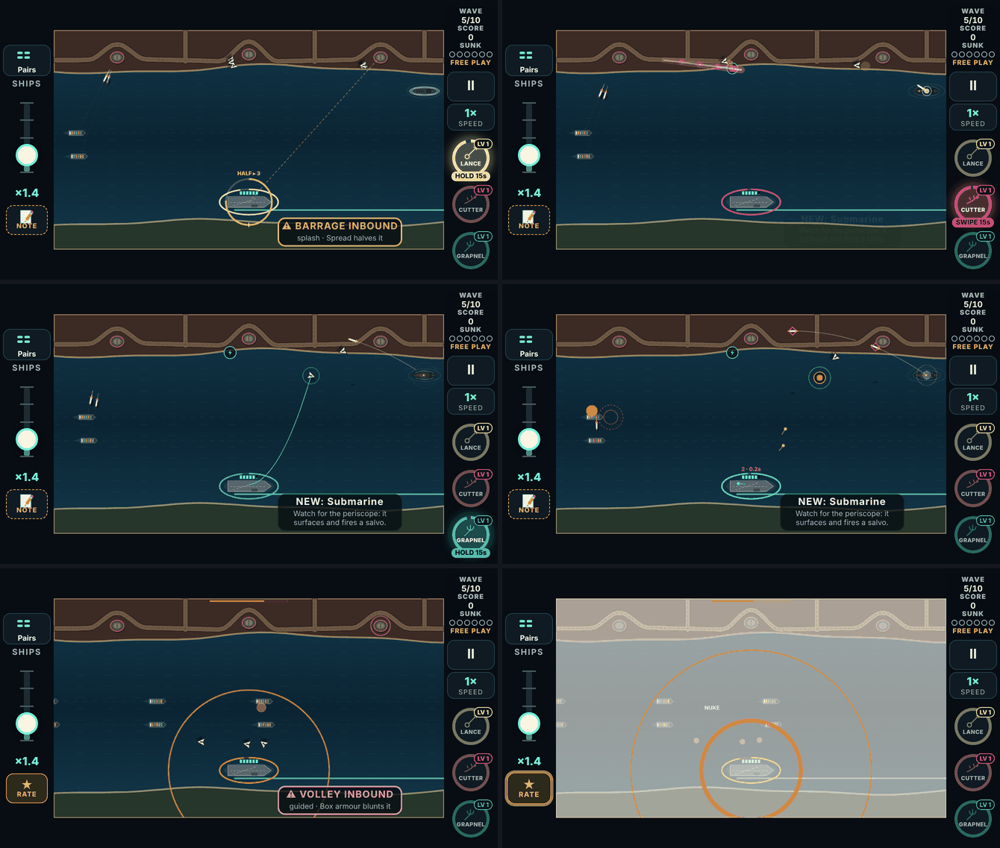
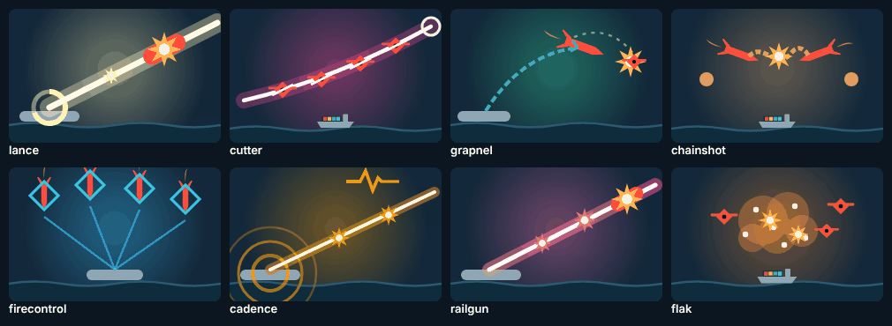

# V3 weapons, build 1: systems and the six actives (phases 0–1)

The first playable link of the weapons plan ([v3-weapons-plan.md](v3-weapons-plan.md)).

The player answered round 3 ("start building!"): Phase 0 (systems) and Phase 1 (the six actives) are the first link. Everything here is a **prototype**:
- it is playable in Free Play;
- the campaign's draft doesn't deal it until the player locks it in.

## How to try it

1. Open the branch's preview link on the phone.
2. **Free Play** → set Weapon 1–3 to any of the six, marked "· prototype".
3. Pick the level (LV 1, LV 2, MAX). Frequent drops makes them come often.
4. **Start**, tap a weapon pickup to load it, then:

| Weapon | What your finger does | The chip says |
|---|---|---|
| **Charge Lance** | Hold on a target: a ring on the carrier fills. Half (0.35 s) is a 3-hit bolt; full (0.7 s) is a 6-hit lance through everything in line. A quick tap is a plain shot. | HOLD |
| **Laser Cutter** | Swipe across threats: everything under the finger is cut, one round a swipe. A tap is a plain shot. | SWIPE |
| **Grapnel** | Hold on a threat to hook it, drag to swing it into others (2 hits each), and let go to fling it. It bursts where it lands. Pressing on nothing is a tap. | HOLD |
| **Chain Shot** | Tap one threat (a normal shot), then a second in reach: a chain drags them together for 2 hits each. | — |
| **Fire Control** | Taps mark targets (red diamonds); moments later the salvo fires at all of them at once, a round for every two. | — |
| **Cadence Gun** | Tap on the beat for a 3-hit shot that pierces. Off the beat, a plain shot. | — |

**Other changes:**
- **The Nuke** is now a drop in every run, campaign included, from wave 3. Tap it and everything in the air and on the water is destroyed; rigs, generators, the Citadel and the Dreadnought take 3 hits. It is rare: weight 3, against 40 for ammo.
- **Notes:** the note button in a run saves straight into the play log, so comments come back with the run.

## What was built

### Phase 0: systems

- **The roster** (`src/v3/data/roster.ts`): one line per weapon, with its category (active / passive / boost), the chapter it unlocks in, live or prototype, and its gesture.
  - The draft reads it: `draftPool(chapter)` deals only live weapons unlocked by that map's chapter.
  - Free Play reads it too: every weapon, with prototypes marked.
  - Today's twelve are live from chapter 1, so the campaign's draft is unchanged.
  - The six prototypes have proposed unlock chapters (Cutter 1; Lance and Chain Shot 2; Fire Control and Grapnel 3; Cadence 4) for when they go live.
- **Gesture input:**
  - With Charge Lance, Laser Cutter or Grapnel loaded, a finger down is a *press*, not a tap. The UI sends `press`, `pressMove` (every 6 px) and `release`.
  - A press that never becomes a gesture is a tap, so pickups and plain shots still work.
  - A press still down when play stops (pause, a note, the run ends) is let go where the finger last was.
  - A second finger still taps while the first charges.
- **The play log** records presses (`d`), moves (`v`) and lifts (`r`), so a gesture run replays exactly. `LOG_VERSION` is now 14, because the Nuke changes the drop rolls.
- **The Nuke:** see above. Drops don't come from its kills, so a screen-clear isn't a loot shower.
- **Sounds:** 15 new cues. They borrow existing files for now (see Limits).

### Phase 1: the six actives

- **Each one has:**
  - its sim (`src/v3/sim/game.ts`, "The weapons plan, phase 1");
  - its card text, icon and card art;
  - its effects on the battlefield;
  - the test bot playing it;
  - unit tests (`tests/v3/weapons.test.ts`).
- **The player's notes are built in:**
  - **Cadence Gun:** a ring closes in from the edges onto the carrier and lands on the beat; the whole border of the sea glows on the beat; a steady single beat; a progress bar along the top edge.

## Strength, measured

**How it was measured:**
- The bot ("average") played every map from wave 1, 5 seeds each (100 runs per row).
- It held one weapon at a fixed level and took Resupply at every draft, so runs differ only by the weapon.
- Script: `tools/v3/weapon-ideas/phase1-sweep.mts`.
- This measures relative strength with a bot, not how a weapon feels.

| Weapon | Level 1: runs won | MAX: runs won |
|---|---|---|
| *Nothing held* | 8% | 8% |
| **Laser Cutter** | **31%** | **71%** |
| Flak (today's) | 33% | 55% |
| **Grapnel** | **29%** | **52%** |
| Scattergun (today's) | 17% | 58% |
| Air Strike (today's) | 8% | 61% |
| Railgun (today's) | 15% | 45% |
| **Charge Lance** | **16%** | **36%** |
| **Cadence Gun** | **16%** | **36%** |
| **Fire Control** | **13%** | **25%** |
| **Chain Shot** | **21%** | **23%** |

**Reading it:**
- Every new weapon beats holding nothing, and they all sit within today's range at level 1.
- Laser Cutter at MAX (Searing Edge) is the strongest weapon in the game, and may need a trim after the playtest.
- Chain Shot barely grows from level 1 to MAX: it is the weakest MAX. A candidate buff is for the crash itself to burst in an area.
- Fire Control's value is reading a raid, which the bot doesn't do. Both are for the player to judge on the phone.

### Tuning made during the build (each from a measurement)

| What | The plan said | Built | Why |
|---|---|---|---|
| Charge Lance timing | half 0.6 s, full 1.2 s | half 0.35 s, full 0.7 s | A charge only for heavies hardly mattered (heavies are rare on screen): 13% at MAX. A short hold now triples any shot, and at MAX it won 36%. |
| Charge Lance level 2 | charges faster | charges faster, and the half bolt pierces | So the levels grow. |
| Chain Shot cost | a round per chain | the chain is free (the first tap's shot costs a round) | At a round a chain it fell below the plain gun. |
| Chain Shot MAX | a third link | a third link, and links hit for 4 | So MAX grows; it is still the weakest MAX (above). |
| Fire Control | salvo 0.8 s after the last mark | 0.4 s after the last; never more than 1 s after the first; at once when the marks are full; a round for every two marks | Marking a steady stream kept pushing the salvo back. Then a round a mark made it the plain gun with a delay. |

**One harness flaw was found and fixed before trusting any number.** Early runs let a weapon-less bot take Resupply every wave while weapon runs took level-ups instead. That made "nothing" look stronger than most weapons; the fixed harness gives every run Resupply.

## Verified

- **Unit tests:** `npm test` passes all 1,015.
  - **The roster:** the campaign's draft never deals a prototype, on 20 maps × 20 seeds; a prototype held in Free Play can still be levelled.
  - **The Nuke:** none before wave 3; one on the water at a time; it clears the sky; structures take 3 hits.
  - **Each weapon's rule,** with hand-placed threats: tap = plain shot, half/full charge, a swipe cuts once per threat, hook / smack / fling / burst, chain, marks and salvo cost, the beat window, War Drum.
  - **Replay:** a Free Play run with Lance, Cutter and Grapnel replays to the same game.
- **The browser suite:** `node e2e/v3.mjs` passes all 148 checks. The new ones play each weapon through real pointer events at 667×375:
  - a hold charges and pierces, and a second finger still taps while the first charges;
  - a swipe cuts three drones for one round;
  - a hold swings a heavy into a missile and bursts;
  - two taps chain;
  - three marks fire for two rounds;
  - the Nuke clears the sky;
  - the log records presses, moves and lifts.
- **Audio:** `node e2e/v3-audio.mjs` passes all 16 checks.
- **Builds:** `tsc` is clean; the web build and the App Store build both succeed.
- **Looked at, at 667×375:** each effect mid-use (the picture above), and the six cards.

## Limits

- **Placeholder sounds:** the 15 new cues reuse other cues' files, re-pitched. Each gets its own sound later, through `tools/v3/audio`.
- **Watch mode:** the watch-mode bot (the "BOT" player) doesn't use the gestures. With a gesture weapon loaded it fires plain shots. The test bot (sweeps and tests) does use them.
- **The bot measures size, not feel.** Hold timing, swipe length and the beat are exactly what the phone playtest is for.
- **Not in this build:**
  - **Passives and boosts** (phases 2 and 3).
  - **Default drops:** the four power-ups that become boosts (Overdrive, Time Warp, Shield, Full Steam) stay as drops in the campaign until Phase 3, so the campaign doesn't lose them with nothing in their place. For now the only change to the drops is the Nuke.
