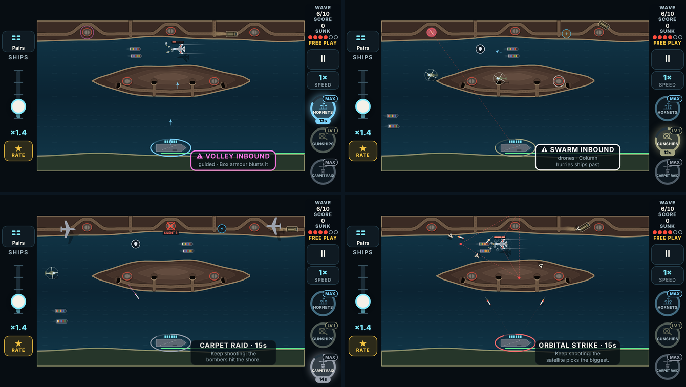
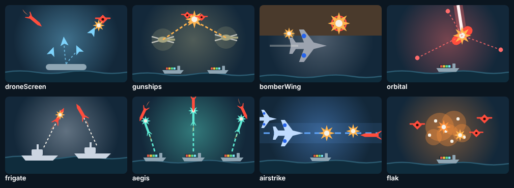

# V3 weapons, build 2: the four passives (phase 2)

The second playable link of the weapons plan ([v3-weapons-plan.md](v3-weapons-plan.md)), after [build 1](v3-weapons-build-1.md).

A **passive** loads like any weapon (tap its pickup; it lasts 15 s), but your gun stays plain: the passive works on its own beside it. All four are **prototypes**:
- they are playable in Free Play;
- the campaign's draft doesn't deal them until the player locks them in.

## How to try it

1. Open the branch's preview link on the phone.
2. **Free Play** → set Weapon 1–3 to any of the four, marked "· prototype". There are now ten prototypes: six actives and four passives.
3. Pick the level (LV 1, LV 2, MAX). Frequent drops makes them come often.
4. **Start**, tap a passive's pickup, and keep shooting:

| Passive | What it does on its own | Level 2 | MAX |
|---|---|---|---|
| **Drone Screen** | Your own drones lift off the carrier deck one after another (every 1.2 s) and ram the threat closest to hitting a hull. | A drone every 0.9 s. | **Hornet Nest:** every 0.7 s, and each ram bursts, hitting everything around it. |
| **Gunship Pair** | Two helicopters fly in from the edges, hover over the convoy, and rocket the thickest cluster near it (a blast, 1 hit each). When the weapon is swapped out, they fly off. | They fire half again as often. | **Hellfire Wing:** a third helicopter, and each pod hits for 2. |
| **Bomber Wing** | Every 6 s a bomber crosses the shore and bombs the best land target: a truck on screen is destroyed, else the silo with the most launches due goes quiet for 6 s (a red X and "SILENT n"; its launches are **cancelled**, not delayed), else a tunnel about to send out a truck is collapsed. | A pass every 4.5 s. | **Carpet Raid:** a pass every 3.5 s, two targets each, a surfaced sub can be one of them; silos stay silent for 8 s. |
| **Orbital Strike** | Three red laser dots slide in from the edges and close in on the toughest thing on screen over 0.8 s, following it, then a beam from orbit hits it for 3 (and what is around it for 1). Every 2.5 s. | Every 1.8 s. | **Sky Spear:** every 1.2 s, and the beam lingers onto the next toughest. |

## What was built

- **Each passive has:**
  - its sim (`src/v3/sim/game.ts`, "The weapons plan, phase 2": `updatePassives`, `callGunships`, `callSorties`, `bombTarget`);
  - its card text, icon and card art;
  - its look on the battlefield (`drawPassives` in `render.ts`): drone chevrons with trails, helicopters with a rotor disc and shadow, bombers with shadows, the silenced silo's X and countdown, the laser dots' shrinking triangle and the beam;
  - its sounds (7 new cues, borrowed files for now);
  - unit tests (`tests/v3/weapons.test.ts`).
- **The player's notes are built in:**
  - **Drone Screen** launches from the carrier deck on every map.
  - **Orbital Strike** telegraphs with the laser dots triangulating on the target, then the big beam.
- **Silos can be silenced:** a new rule in the sim. A silo's launch due while it is quiet is dropped. Other threats aren't touched.
- **The bot** plays passives by loading them and shooting as usual; there is nothing to aim.

## Strength, measured

Measured the same way as build 1:
- the "average" bot played every map from wave 1, 5 seeds each (100 runs per row);
- it held one weapon at a fixed level and took Resupply at every draft;
- script: `tools/v3/weapon-ideas/phase1-sweep.mts`.

| Weapon | Level 1: runs won | MAX: runs won |
|---|---|---|
| *Nothing held* | 8% | 8% |
| **Gunship Pair** | **38%** | **64%** |
| Frigates (today's passive-like ally) | 52% | 55% |
| Aegis (today's) | 26% | 58% |
| **Drone Screen** | **25%** | **45%** |
| **Orbital Strike** | **22%** | **45%** |
| **Bomber Wing** | **23%** | **32%** |

**Reading it:**
- All four beat holding nothing by a wide margin, and they sit inside today's range.
- **Gunship Pair** is the strongest new passive at both levels, close to the top of the whole game (Laser Cutter's 71% at MAX).
- **Bomber Wing** is a land specialist. It flies 24–53 passes a run and cancels about 40–100 launches, but a big share of launches come from subs (about 70–80 a run on these maps), which it mostly can't reach. Carpet Raid's sub strike didn't move the number. It should feel strongest on shore-heavy maps; that's for the playtest to judge.

### Tuning made during the build (each from a measurement)

| What | The plan said | Built | Why |
|---|---|---|---|
| Drone Screen MAX | every 0.9 s (level 2's rate), and each ram bursts | every 0.7 s, and each ram bursts | So MAX grows: at level 2's rate the burst added little. |
| Orbital Strike damage | 3 hits to the target | 3 hits, and 1 to what is around it (60 px) | One target every 2.5 s rarely mattered. The splash hits a pack's leader and the pack. |
| Orbital Strike target | the biggest threat | the toughest threat, but not a structure while anything else is up | It spent strikes on rigs and generators. |
| Orbital Strike MAX | the beam stays 1 s and sweeps to the next biggest | a strike every 1.2 s, and the beam lingers 0.5 s onto the next toughest | The sweep alone barely grew it over level 2. |
| Bomber Wing MAX | each pass silences two silos | every 3.5 s, two targets each (trucks, silos or tunnels), a surfaced sub too; silos quiet for 8 s | Tried to lift it; it holds at 32% (see above). |
| Bomber Wing targets | silos | trucks first, then the busiest silo, then a tunnel about to send a truck | A truck on screen is the closest launcher. |

## Verified

- **Unit tests:** `npm test` passes all 1,028.
  - **Drone Screen:** launches on the cadence from the deck, rams the threat closest to impact; Hornet Nest's ram bursts.
  - **Gunship Pair:** two arrive, rocket a pack within reach while ignoring a far threat, and fly off when another weapon loads.
  - **Bomber Wing:** a silenced silo's launches are cancelled (not delayed); a truck on screen is destroyed; Carpet Raid bombs a surfaced sub, level 1 doesn't.
  - **Orbital Strike:** locks the toughest, the beam lands after 0.8 s for 3 plus splash, Sky Spear lingers onto the next.
- **The browser suite:** `node e2e/v3.mjs`. The new checks load each passive by tapping its pickup at 667×375 and watch it work: drones ram, gunships clear a pack, a bomber pass silences a busy silo, the dots lock the heavy and the beam hits it.
- **Builds:** `tsc` is clean; the web build succeeds.
- **Looked at, at 667×375:** each passive mid-use (the picture above), and the four cards.

## Limits

- **Placeholder sounds:** the 7 new cues reuse other cues' files, re-pitched.
- **Watch mode:** the watch-mode bot loads passives like any weapon, so it plays them correctly (there is nothing to aim).
- **Not in this build:** boosts, and moving Overdrive, Time Warp, Shield and Full Steam to boosts (phase 3); the phase 4 experiments (Storm Front, Ammunition Ship).
