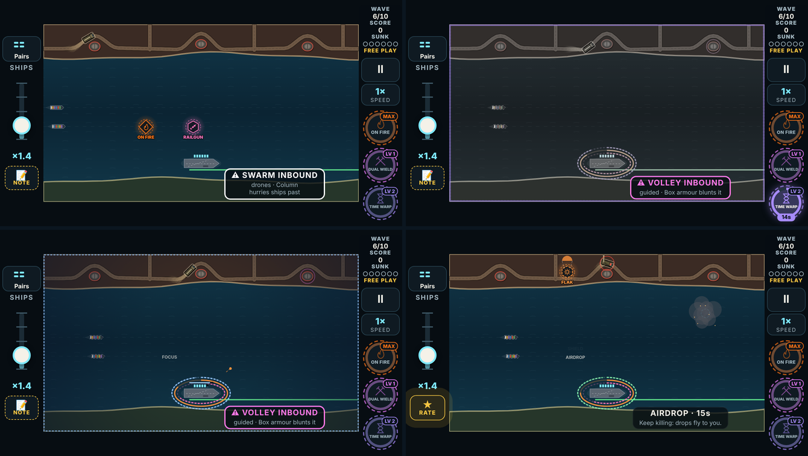
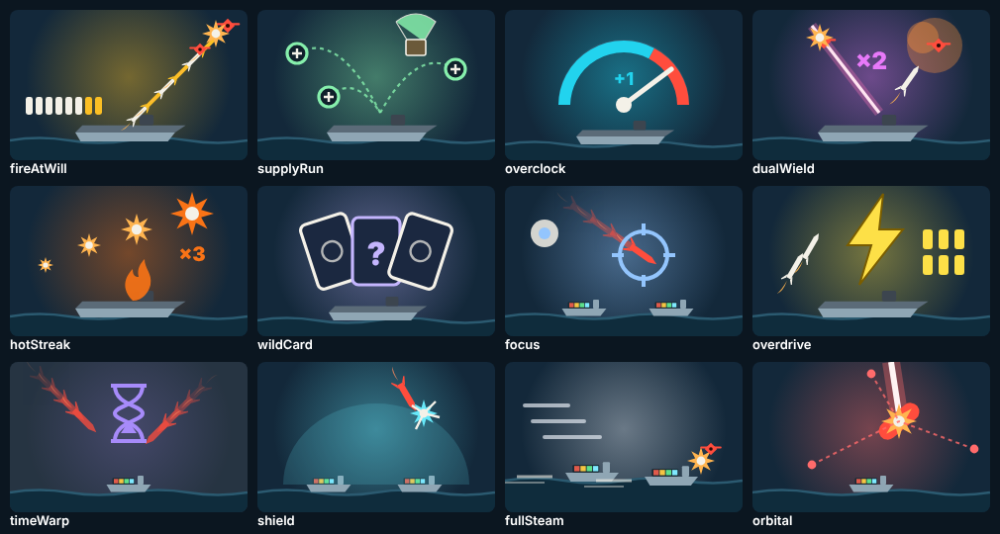

# V3 weapons, build 3: the boosts (phase 3)

The third playable link of the weapons plan ([v3-weapons-plan.md](v3-weapons-plan.md)), after [build 1](v3-weapons-build-1.md) (systems and the six actives) and [build 2](v3-weapons-build-2.md) (the four passives).

A **boost** drops like a weapon and takes a slot like one, but picking it up **never replaces the loaded weapon**: it changes how everything you fire works while it lasts (15 s at every level). A second boost replaces the first. This build has eleven:
- the seven picked in round 2;
- the four power-ups that the player moved to boosts (Overdrive, Time Warp, Shield and Full Steam), with the levels from round 3.

All eleven are **prototypes**:
- they are playable in Free Play;
- the campaign's draft doesn't deal them until the player locks them in.

## How to try it

1. Open the branch's preview link on the phone.
2. **Free Play** → set a weapon slot to any boost, marked "· prototype (boost)". Mix it with a weapon to see what it does to it.
3. Pick the level (LV 1, LV 2, MAX). Frequent drops makes them come often.
4. **Start**. A boost's pickup is a **diamond** (a weapon's is a hexagon); its slot chip has a dashed ring, and a dashed ring round the carrier counts it down.

| Boost | Level 1 | Level 2 | MAX |
|---|---|---|---|
| **Fire at Will** | Hold to fire full-auto (a shot every 0.2 s), whatever is loaded; the rack holds 4 more. | Every 0.15 s, 6 more, and it reloads twice as fast. | **Lead Rain:** every 4th shot bursts into flak. |
| **Supply Run** | Kills drop twice as much, and drops fly to the carrier and load themselves. | Three times as much. | **Airdrop:** every 6 s a crate parachutes in with one of your weapons. |
| **Overclock** | The loaded weapon plays a level higher and its clock stops (nothing loaded: the next one you pick up). Already at MAX: its clock stops and it drops more often. | Every weapon picked up while it lasts is overclocked too. | **Overload:** the loaded weapon jumps straight to MAX. |
| **Dual Wield** | The next weapon picked up joins the loaded one: every tap fires both, for one round. A passive joins too. | Both clocks run at half speed. | **Arsenal Drop:** weapons drop twice as often while it lasts (round 3's change). |
| **Hot Streak** | Hits in a row heat the gun: at 5, double damage and a wider burst; at 10, triple. A tap on nothing resets it. Pips and ×2 / ×3 over the carrier show the heat. | Double at 4, triple at 8 (round 3's change). | **On Fire:** at 10 shots pierce to the next threat, and a miss no longer resets it. |
| **Wild Card** | With nothing loaded, each tap fires a random active weapon's level 1 shot; its name flashes at the tap. | A random active **or passive**, at level 2 (round 3's change). A passive's tap is its one shot: three drones off the deck, a rocket pod, a beam from orbit, or a bomber pass. | **Jackpot:** a random active's MAX shot. |
| **Focus** | Up to 6 s of half-speed time, spent only while a finger is down (a bar over the carrier shows the bank). Lift to save the rest. | 9 s, at a third of the speed. | **Deadeye:** shots fired in slow motion hit for double. |
| **Overdrive** (was a power-up) | Rounds cost nothing. | And the rack keeps refilling, so it is full when the boost ends. | **Hyper Overdrive:** every shot fires twice. |
| **Time Warp** (was a power-up) | Threats move at 40%. The whole field drains of colour, threats leave trails, and the sound drops in pitch. | 25%. | **Freeze Frame:** the first 2 s near-stopped (10%), then 25% (round 3's change). |
| **Shield** (was a power-up) | Ships and the carrier take no damage from missiles, drones and boats (a strafing run still hits). | It blocks a strafing run too, and visibly cracks and shatters doing it (round 3's note); the boost ends there. | **Reflect:** a blocked missile bounces back the way it came and bursts. |
| **Full Steam** (was a power-up) | The convoy steams at 1.6×. | 2×. | **Ramming Speed:** ships at full steam run down drones and boats. |

## What changed in the game

- **Boosts in the sim** (`src/v3/sim/game.ts`, "The weapons plan, phase 3: boosts"): the boost slot beside the loaded weapon, its clock, and each boost's rule.
- **Two hands:** Dual Wield adds a second loaded weapon (`weapon2`). Every check that asked "is this weapon loaded?" now asks either hand, so two passives can run at once, each on its own clock.
- **Free Play drops follow the plan:** in Free Play, Overdrive, Time Warp, Shield and Full Steam no longer drop as power-ups; the default drops are ammo, repair and the Nuke (Star Shell stays on The Black Strait). **The campaign is unchanged:** it keeps the four power-ups until their boosts go live (one line each in `data/roster.ts`).
- **Focus by touch:** with Focus running, the first finger down is sent to the sim as a press (as the gesture weapons do), so slow motion is in the play log and a run replays exactly.
- **The bot** paces its taps on real time, so under Focus it gets more taps into slowed seconds, as a person does. It holds a finger down for Focus when three threats are about to land.
- **The UI:** a boost's pickup is a diamond, its chip a dashed ring, and its countdown a dashed ring round the carrier. Time Warp drains the field's colour (all levels) and the sound drops in pitch (as it already did for the power-up).
- **Sounds:** 9 new cues, borrowed files for now.

## Strength, measured

**How it was measured:**
- The "average" bot played every map from wave 1, 5 seeds each (100 runs per row).
- Each run held the row's weapons (a boost on its own, with the plain gun, unless a weapon is named) at a fixed level, and took Resupply at every draft.
- Every row runs under Free Play's drops, so the four old power-ups don't drop in any of them.
- Script: `tools/v3/weapon-ideas/phase1-sweep.mts` (now takes `a+b` rows, `none` and `campaign`).

**A boost on its own** (the plain gun, the boost dropping):

| Held | Level 1: runs won | MAX: runs won |
|---|---|---|
| *Nothing* (Free Play drops) | 5% | 5% |
| *Nothing* (the campaign's drops: the four power-ups still drop) | 8% | 8% |
| Flak, for reference | 29% | 41% |
| **Overdrive** | **31%** | **52%** |
| **Fire at Will** | **21%** | **47%** |
| **Wild Card** | **20%** | **47%** |
| **Time Warp** | **15%** | **29%** |
| **Shield** | **21%** | **22%** |
| **Supply Run** | **13%** | **19%** |
| **Full Steam** | **7%** | **12%** |
| **Hot Streak** | **9%** | **10%** |
| **Focus** | **8%** | **6%** |

**A boost with weapons** (the slot a boost takes could hold a weapon instead):

| Held | Level 1 | MAX |
|---|---|---|
| Flak + Railgun | 14% | 41% |
| Flak + **Overclock** | **32%** | **47%** |
| Flak at level 1 + **Overload** (Overclock MAX) | **35%** | — |
| Flak at level 1 + Railgun at MAX | 33% | — |
| Flak + Railgun + Scattergun | 21% | 42% |
| Flak + Railgun + **Dual Wield** | **22%** | **44%** |

**Reading it:**
- **Losing the four power-ups costs the plain game something:** holding nothing wins 5% under the plan's drops, against 8% with the campaign's. Overdrive was the main relief when the rack ran dry (the plan's pacing note); as a boost it is now the strongest one.
- **The strongest boosts** are the ones that put more shots in the air: Overdrive, Fire at Will (the bot doesn't hold, so this is the bigger rack and faster reload; full-auto is untested by it) and Wild Card.
- **The weakest on their own** are Full Steam and Supply Run. Supply Run's Airdrop needs a weapon held, so it shows nothing alone. Full Steam gets ships out sooner rather than killing anything.
- **The combo boosts are worth a weapon's slot now:** Overclock beside Flak beats a Railgun there at both levels, and Dual Wield matches a third weapon. Before two fixes (below) neither did.
- **Hot Streak and Focus** barely move the bot. Hot Streak rewards a run of clean hits and Focus rewards a person's hands in slow motion, which a bot doesn't have; the playtest decides both. If Hot Streak feels flat, a candidate is for the heat to speed up reloading too.
- **The bot measures size, not feel.** Focus and Fire at Will's full-auto are about a person's hands; the playtest is what judges them.

### Tuning made during the build (each from a measurement)

| What | The plan said | Built | Why |
|---|---|---|---|
| Hot Streak's heat | double or triple damage | double or triple damage, **and** a burst 1.8× / 2.6× as wide | Most threats die to one hit, so double damage did nothing: 6% and 9% of runs won, holding nothing 5%. |
| Hot Streak's hits | hits in a row (the gun's shells) | the gun's shells, and any loaded weapon's own shot aimed at a threat | With the Railgun loaded the streak never built: its beam isn't a shell. |
| Overclock on a MAX weapon | it drops more often (round 3) | its clock still stops, and it drops more often | Reading "instead" as instead of the level only: with the drops alone, Flak at MAX was loaded 23% of the time against 43% without Overclock in the slot. |
| Airdrop's crate | lands | parachutes in over open water mid-screen, then flies to the carrier | Crates at the top edge landed on the enemy shore. |
| Dual Wield's second weapon | the next weapon picked up joins | the next weapon picked up joins, **and while a hand is free the next kill drops one** (a weapon, not a boost) | At the normal drop rate a second weapon almost never came inside the boost's 15 s: two hands were loaded 0% of the time, and it won 11% / 31% against a third weapon's 21% / 42%. Now 14% of the time, 22% / 44%. |
| Overclock with nothing loaded | waits for the next weapon | waits, and the next kill drops one | The same problem as Dual Wield: Flak + Overclock won 19% at both levels; now 32% / 47%. |
| The hands after Dual Wield | (round 2) "both stay loaded together for the rest of their time" | a pickup takes the first hand, or refreshes the hand already holding it; the second keeps its time | The first build dropped the second hand on the next pickup. |
| A boost dropping again | | the boost already running isn't dealt again while you hold something else | Dual Wield dropped four times in a row in one traced run. |
| Focus and the bot | | the bot paces its taps on real time and holds a finger for a rush | Otherwise slow motion could never help it. |

**A harness change, found before trusting any number:** the sweep's "nothing held" row didn't use Free Play's rules, so it still had the four power-ups while every other row didn't. Both are now measured (`none` and `campaign`).

## Verified

- **Unit tests:** `npm test` passes all 1,074. `tests/v3/boosts.test.ts` (35 tests) plays each boost through real taps and presses:
  - the rules: a boost never replaces the weapon, a second replaces the first, it ends on time and with the wave, and Free Play's drops never include the four old power-ups while the campaign's still do;
  - each boost at each level it changes (for example: Lead Rain's 4th shot bursts into flak; Dual Wield's tap fires a beam and pellets for one round; Focus slows time only while pressed and replays exactly from the play log; Shield at level 2 takes a real strafing run and shatters, at level 1 doesn't; Reflect's bounce kills what is behind the missile).
- **The browser suite:** `node e2e/v3.mjs` passes all 156 checks; `node e2e/v3-audio.mjs` all 16. The new ones, by real touch at 667×375: Fire at Will with the Railgun loaded (rack +4, the weapon kept), holding fires full-auto, Focus slows time under a finger and stops when it lifts, and Dual Wield's one tap fires both weapons for one round.
- **Builds:** `tsc` is clean; the web build and the App Store build both succeed.
- **Found by the browser suite and fixed:** with a plain weapon loaded, lifting a Focus finger never reached the sim (the play log only sent a lift for a gesture press), so time stayed slow.
- **Looked at, at 667×375:** each boost in play (the picture above) and the eleven cards.

## Limits

- **Placeholder sounds:** the 9 new cues reuse other cues' files, re-pitched.
- **What the multipliers reach:** Hot Streak's heat and Deadeye's double damage are on the gun's shells (plain, or tagged with a weapon like Flak or Tesla). A weapon's own effect (a beam, pellets, a jet) builds the streak but isn't multiplied.
- **Hyper Overdrive** fires twice: plain shells, and the one-shot weapons (Railgun, Air Strike, Scattergun, Boomerang, Seekers and the shells). Weapons with their own rhythm (Chain Shot, Fire Control, Cadence, the gestures) fire once.
- **Dual Wield and gestures:** a hold, swipe or drag works for the first weapon; the second fires on taps.
- **Wild Card** draws from the ten weapons a single tap can fire: not the gesture weapons, Chain Shot or Fire Control (they need a hold, a swipe or two taps), nor Frigates or Aegis (they need the full 15 s).
- **Not in this build:** the phase 4 experiments (Tidal Cannon, Storm Front, Ammunition Ship). The campaign keeps its four power-ups until the boosts are locked in.
