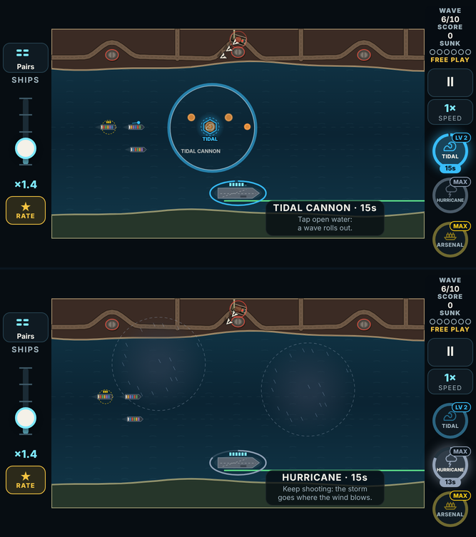
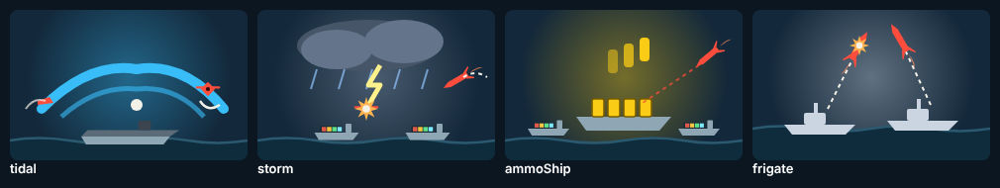

# V3 weapons, build 4: the experiments (phase 4)

The fourth playable link of the weapons plan ([v3-weapons-plan.md](v3-weapons-plan.md)), after builds [1](v3-weapons-build-1.md) (systems and the six actives), [2](v3-weapons-build-2.md) (the four passives) and [3](v3-weapons-build-3.md) (the eleven boosts).

Phase 4 is the player's three **maybes**, built so they can be tried and **kept only if they play well**:
- **Tidal Cannon:** "I think mechanically it will not work well with the game."
- **Storm Front:** "might not work well with the game."
- **Ammunition Ship:** "play around with this."

All three are **prototypes**: playable in Free Play, never in the campaign's draft.

## How to try it

1. Open the branch's preview link on the phone.
2. **Free Play** → set a weapon slot to any of the three, marked "· prototype" (the two passives say so).
3. Pick the level (LV 1, LV 2, MAX). Frequent drops makes them come often.
4. **Start**, tap its pickup:

| | Level 1 | Level 2 | MAX |
|---|---|---|---|
| **Tidal Cannon** (active) | Tap a boat, a mine or open water: a wave rolls out 300 px and swamps fast boats, mines, surfaced subs, and drones diving low on a hull. Missiles and aircraft fly over it; a tap on one is a plain shot. Ships it reaches surge forward a little. | 420 px, and it shoves what it doesn't swamp back the way it came. | **Tsunami:** the wave rolls across the whole sea. |
| **Storm Front** (passive) | A storm cell 300 px across rolls in from upwind, over the water between the enemy shore and the convoy, and drifts across with the wind. Lightning strikes a drone or aircraft in it every 0.8 s, and every other missile that crosses it is blown into the sea. You can't steer it. | A bigger (400 px), slower cell. | **Hurricane:** two cells. |
| **Ammunition Ship** (passive) | An ammunition ship sails in with the convoy: while it floats, the rack reloads twice as fast. Every other missile aimed at a ship goes for it instead. Sunk, its bonus ends, and it isn't a lost ship. A pickup while it floats repairs it. | Reloads 2.5× as fast; takes 6 hits. | **Arsenal Ship:** it also fires a free round at the nearest threat every 2 s. |

## What was built

- **The sim** (`src/v3/sim/game.ts`, "The weapons plan, phase 4"):
  - the waves;
  - the storm cells and the wind (picked at random when the storm is loaded);
  - the ammunition ship as a real hull in the convoy: the enemy aims at it, but it is never scored or counted lost.
- **The bot** taps beside boats, mines and low drones with Tidal Cannon loaded.
- **Card art, icons, the battlefield look:**
  - the wave's ring;
  - the cells, dark with slanting rain;
  - lightning bolts;
  - a dashed yellow ring and rounds on the ammunition ship.
- **Sounds:** 4 new cues, borrowed files for now.
- **Tests:**
  - `tests/v3/experiments.test.ts`: 13 tests covering each rule at each level it changes;
  - three new browser checks by touch.

## Strength, measured

The same harness as build 3:
- the "average" bot played every map from wave 1, 5 seeds each (100 runs per row);
- each run held one weapon at a fixed level, under Free Play's drops, and took Resupply at every draft.

| Held | Level 1: runs won | MAX: runs won |
|---|---|---|
| *Nothing* | 5% | 5% |
| Frigates, for reference (the other "a ship joins you" passive) | 39% | 52% |
| **Ammunition Ship** | **27%** | **42%** |
| **Tidal Cannon** | **8%** | **17%** |
| **Storm Front** | **10%** | **22%** |

**Reading it:**
- **The Ammunition Ship works as built.** It is a strong passive, a little under Frigates. It is the one experiment the numbers say to keep.
- **Tidal Cannon and Storm Front are weak, much as the player expected.** Both beat holding nothing, and both grow at MAX (Tsunami's whole-sea wave; Hurricane's second cell), but they sit at the bottom with Hot Streak and Full Steam.
  - **Tidal Cannon:** what it is good against (boats, mines, surfacing subs) is rare on most maps. Against drones it only takes the ones already diving, which a plain shot also kills.
  - **Storm Front:** being unaimed is the design ("you can't steer it"); much of the time the fight isn't where the cell is.
- **The recommendation,** for the player to decide after playing them: keep the Ammunition Ship, and drop Storm Front and Tidal Cannon or rework them. For Tidal Cannon, a version that is only a surface weapon could live on the maps with boats and mines.

### Changes made during the build

| What | The idea said | Built | Why |
|---|---|---|---|
| Tidal Cannon's tap | a shot on open water raises the wave; a tap on a threat is a normal hit | a tap on open water **or on what the wave takes** (a boat, a mine, a low drone) raises it there; a tap on a missile, an aircraft or a high drone is a plain shot | On a phone a tap reaches ~135 px of the sea, so there was almost never open water beside a boat: in the phone check every wave tap became a plain shot. |
| "Low" drones | low drones are knocked into the sea | drones within 170 px of a hull (diving in) | The game has no drone altitude; this is the dive. |
| Storm Front's cells | drift across with the wind | roll in from the upwind side of the screen, halfway between the enemy shore and the convoy; one leaving the far edge comes round again | At first they spawned upwind of the convoy, off the edge or over the shore. |
| Which missiles the storm takes | half of them | every other one by id | No random roll, so a storm never changes the raid that follows it. The same goes for the Ammunition Ship's "every other missile". |
| The Ammunition Ship's stay | sails in the middle of the convoy | sails in at the entry and stays until port or sunk (not just 15 s) | A ship can't turn round mid-lane; its reload counts only while it floats. |

## Verified

- **Unit tests:** `npm test` passes all 1,090.
- **The browser suite:** `node e2e/v3.mjs`, E2E_N checks. The new ones, by touch at 667×375:
  - a tap on a boat rolls a wave that swamps it while the missile beside it flies over;
  - a storm rolls in and lightning takes a drone;
  - the ammunition ship sails in.
- **Builds:** `tsc` is clean; the web build succeeds.
- **Looked at, at 667×375:** the wave, the cells, the ammunition ship (the picture above), and the cards.

## Limits

- **Placeholder sounds:** the 4 new cues reuse other files.
- **Maps:** fast boats, mines and surfacing subs aren't on every map. Tidal Cannon is worth judging on the maps that have them (the bot played all of them).
- **The storm's wind** is random per pickup. A cell can drift away from where the fight is; that is the design ("you can't steer it").
- **Next, per the plan:** a balance sweep across everything built, the draft pool question, then the picks (and these, if kept) enter the campaign.
