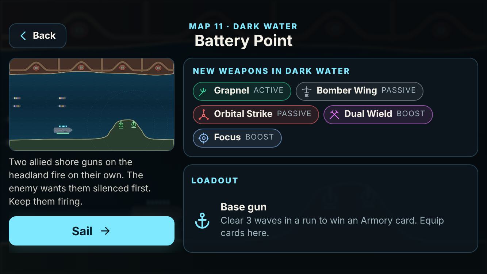
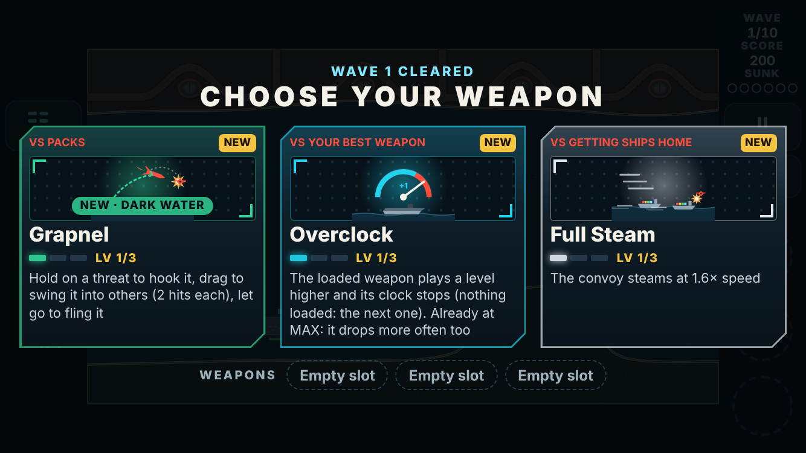
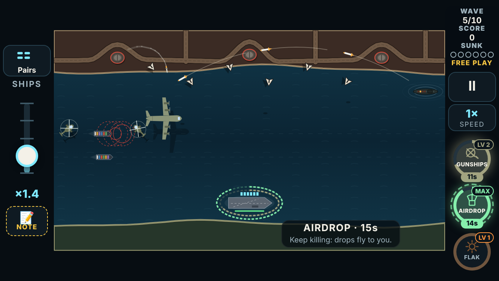

# V3 weapons: the lock-in build

The weapons plan ([v3-weapons-plan.md](v3-weapons-plan.md)) built 24 prototypes in four builds ([1](v3-weapons-build-1.md), [2](v3-weapons-build-2.md), [3](v3-weapons-build-3.md), [4](v3-weapons-build-4.md)). The player played them in Free Play, then marked the lock-in round on the review page (https://claude.ai/artifact/WdDGCXvCnQUzRL655GCmBQ). The marks are kept in `tools/v3/weapon-ideas/lockin-marks-2026-11-07.json`.

Then: "Answers are back in. Go ahead and start the next phase by phasing in the weapons with each new world."

This build does that.

## Each chapter brings new weapons

The 17 kept weapons are **live**: the campaign's draft deals each one from the chapter the player marked (`src/v3/data/roster.ts`, one line a weapon).

| Chapter | Joins the draft |
|---|---|
| 1, Home Waters | Laser Cutter, Drone Screen, Supply Run, Overdrive, Time Warp (beside today's twelve) |
| 2, The Narrows | Charge Lance, Gunship Pair, Overclock, Shield, Full Steam |
| 3, Dark Water | Grapnel, Bomber Wing, Orbital Strike, Focus, Dual Wield |
| 4, Open War | Cadence Gun, Wild Card |

Dual Wield's chapter was left unmarked, so it takes the chapter the card proposed (3).

So that a new chapter **reads** as new kit:
- **The briefing** of a map in chapters 2–4 lists the weapons that chapter adds: "New weapons in Dark Water", one chip each, with its kind.
- **Their draft cards** carry a "NEW · Dark Water" tag in that chapter.
- **The draft deals them first:** until you hold one of the chapter's new weapons, the first card of a draft that isn't one of yours is one of them. After that the draft deals as before.

**Default drops** (the player's answer): ammo, repair and the Nuke. Now that their boosts are live, Overdrive, Time Warp, Shield and Full Steam no longer drop as power-ups in the campaign; they come only as boosts you draft.

## Cut from the game (7)

These are removed entirely: data, simulation, bot, card art, icons, sound cues, tests and browser checks.
- **Chain Shot and Fire Control:** the playtest note said "definitely in"; the player confirmed it meant out.
- **Fire at Will** and **Hot Streak**.
- **Tidal Cannon**, **Storm Front** and the **Ammunition Ship**.

## Reworked from the notes

| Weapon | The player | Built |
|---|---|---|
| **Dual Wield** | "it should have the weapons last as long as the boost is active"; then, on the page: both weapons end exactly when the boost ends | Both hands run on the boost's clock and both end with it. Level 2 ("both clocks at half speed") meant nothing any more, so it now makes the boost last 20 s. Test Lab round 4 settled every other case (another Dual Wield resets both hands; another boost no longer empties them): the rule table is in [v3-lab-round4.md](v3-lab-round4.md). |
| **Cadence Gun** | "a little slower … tap tap tap in the same intervals": a beat every 0.9 s; and buff the hands-on weapons "to the middle of the table now" | A beat every 0.9 s. Beat shots cost no round (0.6 s "burned the rack"), hit for 4 and wider (40 px), and War Drum comes after 3 beats with an 8-target broadside. War Drum (Test Lab round 4): on the beat it also blows up platforms and vehicles ([v3-lab-round4.md](v3-lab-round4.md)). |
| **Focus** | "one finger down and then tap with the other one"; and the same buff | The holding finger only slows time and fires nothing; every other finger taps or presses as usual. A quick touch of the first finger (under 0.22 s) is still a tap, so one finger can still pick a pickup up. The holding finger is its own play-log command (`h`), so replays slow at the same moments. Buffed: the rack reloads on the real clock in slow motion; a 10 s / 15 s bank at 35% / 25% speed; Deadeye hits for triple. |
| **Gunship Pair** | "make their projectiles look like hellfire missiles … with a streak"; "if it needs to move certain direction, it should rotate and then lean into it like a helicopter" | Each shot is a Hellfire. It leaves the rail along the helicopter's nose, curves onto the target with a smoke streak behind it, and bursts there. The helicopters fly with velocity: they turn toward where they're going, can only accelerate as fast as they're facing that way, lean into the acceleration and bank into turns, ease into the hover, and turn to face the threat they're about to shoot. |
| **Supply Run** | "I would've expected like a big cargo plane to come in and drop it in a row" | A four-engine cargo plane crosses the middle of the screen and drops a row of crates under parachutes: 3 at level 1, 4 from level 2, ammo and repair in turn. They drift down for 0.9 s, then fly to the carrier. Airdrop's weapon crate also comes by plane, every 6 s. |

## Their own sounds

The player answered that the weapons get their own sounds **before** they go live. All 28 cues that borrowed other files now have their own, synthesized in `tools/v3/audio/synth.py`:
- every weapon's sounds;
- the Nuke;
- War Drum's salvo;
- the boosts' on and off.

There are two new cues:
- **`heli.hit`:** a Hellfire bursting;
- **`supply.plane`:** the cargo plane's pass.

`cadence.beat` moved to the UI bus, so busy waves and alerts never bury the tick the player plays to.

The new files took the set past the phone budget (4 MB). To fit, the four music beds were re-encoded at 72 kbps stereo instead of 96. The set is now 4.10 MB, with 98 KB to spare.

## Strength, measured

Same harness as the earlier builds:
- the "average" bot, every map from wave 1, 100 runs a row;
- the weapon held at MAX, Resupply at every draft, the plan's drops.

| At MAX | Before | After |
|---|---|---|
| Cadence Gun (0.6 s beat) | 28% | |
| Cadence Gun, 0.9 s beat alone | 20% | |
| **Cadence Gun, as built** | | **41%** (Flak: 41%, mid-table) |
| **Focus** | 6% | **30%** |
| Gunship Pair | 54% | 51% (in the noise) |
| Supply Run | 19% | 24% (the plane's crates) |
| Dual Wield, beside Flak and Railgun | 44% | 35% (the weapons now end with it; the player's call) |

**Focus** stays below the middle in this measure. The bot can't hold one finger and tap with another as a person does: it only holds when two threats are due within 3 s. The variants tried got to 30% at most.

## The campaign, before and after

`npm run v3:sweep -- 6` on the trunk before this build and on this build. Every map, 6 seeds a skill, from wave 1 with an empty Armory, the bot drafting as usual. Maps cleared, by chapter:

| Bot | Chapter 1 | Chapter 2 | Chapter 3 | Chapter 4 |
|---|---|---|---|---|
| sharp | 90% → 93% | 47% → 37% | 17% → 10% | 10% → 17% |
| average | 80% → 93% | 30% → 33% | 20% → 20% | 0% → 7% |
| casual | 20% → 30% | 3% → 0% | 0% → 0% | 0% → 0% |

At 6 seeds a map these move by ±20 points on a single map, so read them as: Chapter 1 is easier, and the rest is about where it was. In the sweep's whole-game estimate (every map cleared in order, Armory cards carried), the average bot takes 26 runs, against 20 before. That is the pacing pass's to look at, next as the player chose.

## Verified

- **Unit tests:** `npx vitest run tests/v3` passes all 229. New ones cover:
  - the chapters' pools;
  - a map dealing only what its chapter has unlocked;
  - the default drops;
  - Dual Wield ending both hands;
  - the cargo plane's row of parachuted crates;
  - Focus's holding finger (no shot, the real-clock reload);
  - War Drum after 3 beats.
- **The browser suite:** `node e2e/v3.mjs` passes all 157 checks. New ones, by touch at 667×375:
  - Free Play lists all 29 weapons, none a prototype;
  - Gunship Pair fires Hellfires;
  - Focus with two fingers (the held one fires nothing, the other's tap fires);
  - Dual Wield ending both weapons;
  - the cargo plane and its parachutes;
  - the play log recording the Focus finger;
  - the Dark Water briefing listing its five weapons;
  - its first draft dealing one, tagged.
- **Builds:** `tsc` is clean, and the web build succeeds.
- **Audio:** `tests/v3/audio.test.ts` passes (every cue fires, the budget holds). `qa.py` passes every file.

## Limits and next

- **Play logs:** the format is now version 15. Older logs (with the cut weapons, and Focus as a press) no longer replay.
- **Heard by no one yet:** the new sounds and the 72 kbps music.
- **Next:**
  - **the AC-130**, the player's new idea from this round's notes, as a Free Play prototype: "a gun ship that fires from above with a circling gunship. Long hold send a large radius explosive round and taps is smaller rounds";
  - **the pacing pass**, starting with running dry and the longer whole-game estimate.
